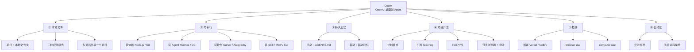

<iframe src="https://player.bilibili.com/player.html?aid=116572056191242&bvid=BV1Nd596vEyU&cid=38366874485&page=1&autoplay=0" scrolling="no" border="0" frameborder="no" framespacing="0" allow="fullscreen; picture-in-picture" allowfullscreen="true" style="height:100%;width:100%; aspect-ratio: 16 / 9;"> </iframe>

> [!abstract] 一句话总结
> **[[Codex]] = OpenAI 出的桌面端 AI Agent，把「一个文件夹」变成它能自由读写的项目。**
> 和 [[Claude Code]] 同源：都是从**编程 Agent** 逐步转向**通用 Agent**。区别在于 [[Codex]] 桌面端产品设计更友好、更贴白领，[[Claude Code]] 自由度更高、更偏专业开发者。
>
> 全片用 **10 个实战场景**串起六层能力：**① 本地文件** → **② 命令行** → **③ 持久记忆** → **④ 项目开发** → **⑤ 插件** → **⑥ 自动化**，中间夹着 [[Skills]] 与 [[MCP]]。
>
> 收尾心法（全片最值钱的两句）：**很多事情已经可以交给 Agent 了；我们已经从「问 AI」走向「管 AI」。**

## 📺 视频信息

| 项 | 值 |
| --- | --- |
| 标题 | 全网最全！40分钟全面掌握Codex～【附完整文档】 |
| UP 主 | 秋芝2046 |
| 发布 | 2026-05-16 |
| 时长 | 约 40 分钟 |
| 来源 | [Bilibili BV1Nd596vEyU](https://www.bilibili.com/video/BV1Nd596vEyU/) |
| 姊妹篇 | [[Aigc/60分钟全面掌握Claude Code\|60 分钟全面掌握 Claude Code]] |

**章节 → 本文位置对照表**（保证知识点不丢失）：

| 原片章节    | 时间点     | 本文位置               |
| ------- | ------- | ------------------ |
| codex全解 | `00:00` | [[#一、认识 Codex]]    |
| 安装上手    | `02:35` | [[#二、装上它]]         |
| 文件操作    | `03:51` | [[#三、用起来：本地文件操作]]  |
| 上下文检查   | `08:54` | [[#四、看住额度：上下文与设置]] |
| 命令行工具   | `11:13` | [[#五、命令行工具]]       |
| 持久记忆    | `16:42` | [[#六、持久记忆]]        |
| 项目开发    | `21:02` | [[#七、项目开发实战]]      |
| 插件使用    | `26:51` | [[#八、插件]]          |
| Skills  | `31:53` | [[#九、Skills]]      |
| （片尾补充）  | `35:54` | [[#十、MCP]]         |
| 自动化任务   | `36:44` | [[#十一、自动化定时任务]]    |
| （片尾总结）  | `39:21` | [[#十二、回顾与心法]]      |

# 一、认识 Codex

## 1.1 它是什么

[[Codex]] 是 OpenAI 出的**桌面端 Agent**。和 [[Claude Code]] 一样，本质都是**从编程 Agent 逐步转向通用 Agent** 的产物——只不过一家是 [[Anthropic]]、一家是 [[OpenAI]]。

## 1.2 Codex vs Claude Code

> [!important] 一句话结论
> **入门的朋友用 [[Codex]] 就很强了；有条件的朋友两个都来是最完美的。**
> 两者逻辑其实一样，**学一个另一个也就会用了**。

| 维度    | [[Codex]]（OpenAI）                                          | [[Claude Code]]（Anthropic）                                               |
| ----- | ---------------------------------------------------------- | ------------------------------------------------------------------------ |
| 模型    | 桌面端**只支持** OpenAI 的 GPT 模型                                 | 默认 Claude 模型，但**可自行替换成任意其他模型**                                           |
| 易用程度  | 桌面端产品设计**更友好**，更适合零基础白领                                    | 自由度更高                                                                    |
| 功能齐全度 | 近期迭代快：浏览器操控、[[computer use]]、内置 image2 生图；刚发布手机端与 [[Hook]] | 原本最齐全（[[Skills]]、[[MCP]]、斜杠命令、[[Hook]]、远程操控**都是人家先发明的**），但近期更新稍慢，更偏专业开发者 |
| 价格与额度 | 会员额度**非常大方**，20 刀就很够用，**而且不封号**                            | 多数人用不了官方账号，基本得自行调用 API，**花多少用多少**，丰俭由人                                   |
| 适合场景  | 执行与解决问题很强；日常办公场景                                           | 搭配 Claude 模型做**写作与规划**很强（Opus 4.6 的写作规划能力真的很强）                           |
| 编程    | 两个都用                                                       | 两个都用                                                                     |

> [!tip] 选型速记
> - **写作 / 规划** → [[Claude Code]] + Claude 模型
> - **执行 / 解决问题 / 日常办公** → [[Codex]]
> - **编程** → 两个一起上

# 二、装上它

## 2.1 安装与初体验

- **唯一需要准备的**：一个 ChatGPT 账号（免费的也行，只是额度少一点）
- 去官网**双击安装** → 登录账号 → 初始设置随便选（如「日常工作」），**后续都可以改**
- 进来后的界面，跟 ChatGPT 很像：
  - **左侧** —— 管理对话和任务的列表
  - **中间** —— 聊天
  - **右侧** —— 大概是结果之类

## 2.2 陌生 AI 工具的通用上手心法

> [!tip] 独门秘方：先聊，先按
> 打开一个陌生界面，先别管别的——
> 1. **先找到能对话的框，先聊**
> 2. **先找到看得懂的按钮，先按**
>
> 按着按着，你就会了。
>
> 这套心法适用于**所有 AI 工具**，不只 Codex。

# 三、用起来：本地文件操作

这是这一代桌面 Agent 跟**对话式 AI 最显著的区别和能力**。

> [!note] 过去 vs 现在
> 过去用 ChatGPT 想让 AI 看到本地内容，只有两种方式：**复制粘贴**进对话，或者按**它允许的格式和数量**上传文件。
> [[Codex]] 不一样：**它可以自主读取和操作本地文件，而且不限数量。**

## 3.1 「项目」= 本地文件夹

选择「项目」→ 选中本地某个文件夹 → **这个文件夹就成了你的项目**，里面所有文件 Codex 都能自由读取和操作（当然需要你给权限）。

| 概念 | 对应关系 |
| --- | --- |
| 项目 | 本地的一个文件夹 |
| 项目内文件 | Codex 随时可以获取的**上下文** |
| 可执行操作 | 读内容、写文件、删文件、移动文件 |

在同一个项目里**可以开多个不同的对话**，它们的**上下文是独立的**，但**同样都能随时访问这个项目的文件**。

手动新建任务时，Codex 会**自动在本地创建一个文件夹**；对话过程中 Agent 产出的任何文件（PDF、Markdown、PPT）也都**直接存在你本地的电脑上**。

## 3.2 三种权限模式

| 模式 | 行为 | 建议 |
| --- | --- | --- |
| **默认权限** | 当前文件夹内可自由读写；但**联网、下载东西、碰文件夹之外的文件**都不行，必须做时会向你**提出提权请求**，你点同意才能继续 | — |
| **自动审查** | 由 **AI 自动判断**这个操作危不危险：危险的来问你，不危险的（比如下载知名官方软件）**直接开干**。比默认模式更宽松、更智能 | ✅ **新手选这个**，相信 AI 就完了 |
| **完全访问** | 在电脑上**几乎什么都能干**：修改删除任何文件、在任何位置执行命令 | ⚠️ 谨慎 |

> [!danger] 完全访问权限
> 这意味着 Codex 理论上可以把你的文件删掉、把别的工具删掉。UP 主原话是「开玩笑啊，他一般情况下是不会这样抽风的」——但**新手请老实选自动审查**。

## 3.3 实战：批量重命名视频素材

**需求**：本地存了 80 多条剪辑素材，命名全乱，希望**按实际画面内容重新命名**。

> [!example] Codex 的执行过程（值得学的是它的思路）
> 1. **先数清楚**到底有多少个视频
> 2. 选择**抽帧**的方式抽取关键画面来判断内容
> 3. 知道**不要一张一张图去看**，而是**拼成缩略图**，一组一组地看
> 4. 全程**没有提权**——因为它都在这个文件夹内操作
> 5. 命名遵循统一格式：**序号 - 任务场景行动**
>
> 结果核对：`钢琴家音乐演奏厅` ✓ `雪山近身格斗` ✓ `旗袍女人夜巷卖热饮` ✓

**另一个对话里的进阶案例**：让 Codex 把所有关于**风景**的视频剪成一整条。它自己想办法用了工具、问你要了权限，最后用 **FFmpeg** 拼在了一起。

> [!tip] 这就是 Agent 和聊天框的分水岭
> 它不只是「告诉你怎么做」，而是**自己找工具、自己要权限、自己把活干完**。

# 四、看住额度：上下文与设置

## 4.1 上下文窗口

对话界面里的**小圈**代表当前对话和里面的操作一共使用了 GPT-5.5 的多少**上下文窗口**；**鼠标悬上去**会有更详细的信息。

- 当上下文**快满时，Codex 会自动帮你压缩**
- 但**不必等它快满**——一个任务告一段落后，就可以自己用**斜杠压缩命令**手动压缩
- 好处：让模型**更聚焦在新任务上**，也**省一点上下文额度**

## 4.2 查看剩余额度（两种方式）

| 方式 | 路径 | 能看到 |
| --- | --- | --- |
| ① 设置 | 设置 → **剩余额度** | 5 小时内还剩多少、本周内还剩多少，甚至**什么时候到期刷新**的提示 |
| ② 斜杠命令 | 对话框输入 `/` → 找到**状态** | 打开后持续显示**上下文余量**、**五小时限额**、**一周限额** |

> [!note] 产品设计
> UP 主评价：这个产品的额度展示设计**比 Claude 友好很多**。20 刀的额度**非常大方**，可以满足大多数白领的高频使用。

## 4.3 模型选择

点开模型选择后，有三项可调：

| 项 | 选项 | 说明 |
| --- | --- | --- |
| **速度** | 快速 | 相当于**加急通道**，会**消耗更多额度** |
| **模型** | —— | 大家都选 **5.5**，因为它确实更好用 |
| **智能程度** | 中度 / 高 | 一般**中度就够**了（原片演示选了「高」） |

## 4.4 语音输入

那个**小麦克风**就是语音输入功能，**比手打字快很多**。

> [!warning] 但它转录速度不行
> 远不如**单独下载一个语音输入法**。UP 主明确推荐：**用专门的语音输入法**，别指望它内置的这个。

# 五、命令行工具

## 5.1 什么是命令行工具

回到权限那节：**默认权限下 Codex 可以读写文件，却不能执行命令、不能联网**。那「命令」是什么？

前面案例里已经用过了——**抽帧、拼接视频用的 FFmpeg 就是命令行工具**。还有大家熟悉的：

- 在终端里 **`git clone`** 一个 GitHub 仓库
- 在命令行输入命令来**下载「龙虾」和各种依赖**

> [!important] Codex 的第二大能力
> **在你授权的情况下，使用你的终端来替你做这些事。**

## 5.2 四类可以用 Codex 装的东西

| 类别 | 例子 | 说明 |
| --- | --- | --- |
| **① 常用依赖** | Node.js、Git | 以前得找手把手教程照着命令抄，现在直接说「帮我安装 Node.js」。因为很常见，**自动审核模式下基本不问你要提权** |
| **② 有门槛的新 Agent** | Hermes（「龙虾爱马仕」）、甚至竞品 [[Claude Code]] | **不需要给官网和仓库链接**，只说「最近有个叫 Hermes 的 Agent 很火，帮我装一个」，它会**自己去搜索**、判断是哪一个、按官方文档装好并**验证** |
| **③ 软件应用** | [[Cursor]]、[[Antigravity]] | 本来要去网页手动下载的，它也能帮你**下载和卸载** |
| **④ [[Skills]] / [[MCP]] / [[CLI]]** | find-skills、飞书 CLI | 这些通常不像 Git 那么著名，**最好给出具体仓库或明确的官网地址** |

> [!tip] 「怒省 599」
> 那些复杂的、要收你 599 的部署服务，现在**可以直接让 Codex 帮你做**。使用中遇到任何问题，还能**截图去问它**，让它直接帮你修。

### 建议顺手装一个 Agent IDE

> [!warning] Codex 的一个短板
> 它**没有办法打开文件内容直接手动编辑**——侧边栏虽然能看到文件结构和内容，但**都不能编辑**。

所以建议让 Codex 帮你下载一个 Agent IDE：

1. 让它下载你喜欢的 IDE
2. 执行一次 **`git init`** 做初始化
3. 之后**右上角就会出现入口**，随时可以把项目在编辑器中打开、手动编辑

### 并行任务处理

Codex 的另一大好处：**并行任务处理**。完全可以在它装东西的时候**再开一个对话**让它去下载别的。

- 任务状态标识：**转圈** = 正在执行中；**蓝点** = 已完成；还可能冒出**需要申请权限**的标识

> [!example] 典型案例：飞书 CLI
> 飞书 CLI 非常典型，因为现在有一些积极 AI 化的软件，**把几乎所有在软件里能做的操作都做成了命令**，方便 Agent 操作。
> 装好之后，Codex 就能帮你做飞书里的各种操作了：**写文档、发消息、建日历、做表格**——UP 主「几乎每天都在用」。

# 六、持久记忆

> [!note] 与 Claude Code 的对称关系
> [[Claude Code]] 有**手动持久记忆 `CLAUDE.md`** + 自动记忆系统；两者都是把希望 Agent 长期记住的东西（**规则、偏好**等）**以本地文件方式存在电脑上**，用时再**以上下文方式注入**。
> **[[Codex]] 完全对称：手动记忆叫 `AGENTS.md`，外加一套自动记忆机制。**

## 6.1 手动：AGENTS.md

### 全局 AGENTS.md

**路径**：设置 → **个性化** → **自定义指令**

这实际上就是**一个全局生效的 `AGENTS.md`**——在**任意项目**跟 Codex 对话时，它都**第一时间作为上下文发给大模型**。

可以手写，但**更推荐直接在对话里跟它说**。

> [!example] 实战案例：让 Codex 给飞书文档留修订痕迹
> **指令**：「我希望你以后对飞书文档里的任何修改，都使用一个专属的文字颜色和删除线的方式来修改，不要直接修改。然后这个帮我记到全局的 AGENTS.md 里。」
>
> 结果：打开「个性化」确实多出了一套规则；之后让它按侧面评论改文档，**它果然用了紫色的字和删除线**来修改。

**全局 AGENTS.md 适合记**：适用于所有任务的大原则——工作习惯、**要用中文**、工作偏好、修改文档要留修订痕迹等等。

### 项目级 AGENTS.md

- **只在当前项目内生效**
- 两种写法：选择某个项目的对话 → 打开编辑器 → 手动创建 `AGENTS.md`；或者**让 Codex 帮你写**
- UP 主建议：**等项目文件里有一些内容之后，再让 Codex 根据它对项目的了解自己写**

## 6.2 第二层：自动记忆

**开启方式**：在「个性化」下面**需要手动打开**这个功能。

| 项 | 说明 |
| --- | --- |
| **机制** | 结束对话/任务后、对话**闲置一段时间**，Codex 把那段对话**总结成记忆**记在一个地方 |
| **原则 1** | **太短的对话不记** |
| **原则 2** | 总结**一样会消耗额度**；额度太低时**也不记** |
| **原则 3** | OpenAI **官方不建议手动修改**这个文件，顶多删一删没必要的信息 |

**自动记忆文件的大致结构**（一个任务一条记录）：

1. 记忆的**来源**是哪段对话
2. **工作目录**是什么
3. 以后触发**什么关键词**时会召回这段记忆
4. 用户在这件事上的**偏好**
5. 一些**可复用的知识**、**踩坑记录**

> [!tip] 明确规则别写进自动记忆
> 对于**明确的规则和要求**，还是**通过组织 `AGENTS.md` 来实现**——因为自动记忆的格式确实不太方便修改。

# 七、项目开发实战

Codex 的第四大能力是**直接用 image2 生成图片**。但生图只是小功能，这一节用**一个完整的个人主页开发项目**串起小白开发中的各种用法。

## 7.1 计划模式

新建项目「个人主页」→ 点加号 → **打开计划模式**。

> [!important] 什么时候用计划模式
> 它会**先帮你列出一个详细的计划，你确认之后它才开始行动**。
> 适合两种情况：**① 任务有一定复杂性；② 你自己也还没想清楚**，想跟 AI 讨论出一个计划。

**实战流程**：

1. 只说「我想做一个个人主页」——它看到项目里没内容，会**用选择框的方式**询问细节
2. 选项里没有满意的 → 选**最后一个**自己填详细要求（如「叙事感 + 高级感 / 针对合作伙伴 / 不要个人照 / 中英双语」）
3. 它给出详尽计划并问是否实施
4. **补充调整方案**：比如计划里没体现生图，就加一句「网页上要多用一些图片，使用 image2 来生成一些高级感的图片」
5. 它又问「走哪一种高级感」——**点开小叹号还能看到这个风格到底意味着什么**（产品细节，UP 主很喜欢）

## 7.2 引导（Steering）：中途纠偏

> [!tip] 全片最实用的小功能之一
> 在执行一个很长的任务的过程中，如果觉得**它有点跑偏了**，可以**随时补充纠偏**。
> 例如补充：「图片的人味要更强一点，而且不要这么冷的色调，我是一个 AI 博主」。

**关键行为**：它**不会立刻打断任务**——消息会**排队**。右边的**引导按钮**写着「**不打断模型运行，会在下次调用工具后发送过去**」，点一下才真正发出去。

**两个好处**：

- 让 Codex **不用在错误的道路上继续狂飙**，把额度花光
- 也**不会让它重新再跑一轮任务**

## 7.3 Fork 分叉

每个 AI 回复下面都有一个按钮叫 **fork（分叉）**，意思是**可以随时从这里开始开一个新对话**。

> [!note] 什么时候用
> 非常适合那种**前面聊得还好好的、上下文也非常有价值，但再往下聊就聊岔了**的时候。

## 7.4 宠物

**路径**：设置 → **外观** → 下面有一对小宠物可选，甚至能点击**创建**，让 Codex 根据对你的了解**生成一个定制化宠物**。

点击**唤醒宠物**后，桌面上会常驻一个小桌宠，**脑袋上会冒出来 Codex 正在做什么的提示**。（UP 主补刀：别的好像也没什么用 😄）

## 7.5 内置预览浏览器 + 批注

Codex 有**内置的预览浏览器**，直接打开右边的侧边栏就能看网页效果。

> [!tip] 批注按钮
> 点右上方的**批注按钮**，就可以在页面上**选中具体元素写修改意见**，包括**重新生成图片**。
> 例如：「这个 logo 放大一点」「这张图加上一个人物」「把这个删掉」。
> 然后**批注会自动进入对话框**，点发送即可按意见修改。

## 7.6 回头补项目级 AGENTS.md

项目有了雏形之后，**正是让 Codex 生成项目级 `AGENTS.md` 的好时候**——因为已经有一定的内容供它了解。

生成的内容包括：**项目背景、各种信息、各种规则、各种文件路径**。

> [!important] 它的价值
> 以后无论**新开对话**，还是**聊天记录已经被清空**，Codex 都能通过这个项目级 `AGENTS.md` **立马了解项目的基本情况**。

# 八、插件

## 8.1 插件是什么

**插件**主要作用是让 Agent 跟**外部平台、外部工具、外部服务**连接。

> [!note] 本质
> 插件实际上就是 **[[Skills]] + [[MCP]] + [[CLI]] 这一类东西的一个完整集合包**。
> 比如：操作邮箱、操作日历、操作 GitHub。

内置插件默认已经开了好几个，例如：

- **浏览器操作**
- **Mac 专有的屏幕操作**
- **GitHub**、**表格**、**PPT**

> [!warning] 插件页面没有中文翻译
> 所以 UP 主在课件里**把这些插件的具体中文意思、分别能干什么都列了出来**，大家课后按需装上，点加号就好。

## 8.2 实战：把个人主页部署上线

翻到 **coding 板块**，两个部署插件可选：

| 插件 | 适合谁 |
| --- | --- |
| **Vercel** | **有域名**的朋友 |
| **Netlify** | **没有域名**的朋友——国内访问这个更好 |

> [!tip] 别忘了
> 如果 **GitHub 还没勾选**，记得一起选上。

**部署流程**：装好插件 → 回到对话说「我想用 Netlify 把这个网站部署上去」→ 它**发现没登录授权，主动弹出登录链接** → 建议**用 GitHub 账号登录**（最方便）→ 登录完它自己知道 → 继续部署完成 → **给出的链接就是最终的网站**。

想换成自己买的域名？**问 Codex 教你操作就完了。**

## 8.3 三个操控类插件

| 插件 | 能力 | 说明 |
| --- | --- | --- |
| **browser use** | 直接帮你**操控浏览器**：点击、翻页、截图、填写表单 | 通常用于**自动化测试前端**；也有无聊用法，比如让它打开 MBTI 做测试（演示结果：GPT-5 是 INTJ 😄） |
| **chrome 浏览器插件** | 控制**你自己已登录的浏览器**，**不会新开浏览器** | 需要先在 Chrome 里装一个插件。好处：**可以在后台执行多个页面的操作**，不占用你的整个浏览器，你该干嘛干嘛 |
| **computer use** | 不止浏览器，**连电脑上的 App 都能操作** | 目前**暂时只有 Mac** 有这个功能 |

> [!example] computer use 演示
> 「帮我放一首 99 年最火的歌，然后用我的微信给 QQ 发条微信说：请收下我一个点赞收藏关注。」
> - 音乐软件：**成功**（它自己搜索、播放）
> - 微信：**失败**——估计微信已经开始严防这类 Agent 操作，直接把进程退出去了
> - 还让它操作了**剪映**，给最新项目加上了音乐

> [!warning] UP 主的个人评价
> 这两个功能很强大，但**操作效率目前还是有点低的**，UP 主自己**不太喜欢用**。
> 真正每天都会用的，是下一个能力——**Skills**。

# 九、Skills

## 9.1 Skill 是什么

> [!important] 定义
> **Skill = 人为沉淀的、可复用的「方法 + 流程 + 工具」的组合**，相当于**给 Agent 做某些具体任务的行动指南**。

## 9.2 找 Skill / 装 Skill

前面已经让 Codex 装过一个叫 **find-skills** 的原 skill。所以后续想装或找社区上的 skill，**都可以直接用自然语言让 Codex 下载**。

- 案例：让它下载 **Anthropic 的前端设计 skill** + 一个**去 AI 味**的 skill
- 如果 find-skills 找不到，**直接把链接发给 Codex** 让它装就好

> [!tip] 但最好用的还是自己建的
> **最好用的 skill 还是自己创建的、符合自己工作的专属 skill。**

## 9.3 创建 Skill：两种方式

| 方式 | 做法 | 评价 |
| --- | --- | --- |
| **① 直接讨论** | 直接告诉 Codex 你想要一个什么样的 skill，通过跟它讨论打磨出来 | 快，但容易脱离实际 |
| **② 先跑通再沉淀** | **先一步步引导 Codex 真正做出一个你满意的结果，再把整套流程固化成 skill** | ✅ **更推荐** |

## 9.4 实战：做一个「GitHub 热门项目推荐图文」Skill

> [!example] 完整的跑通过程
> 1. 用刚装好的 **GitHub 插件**问：最新最火的 GitHub 热门项目有哪些
> 2. 让它**清晰解释**这些项目分别是干嘛的
> 3. 让它挑**星星数量最多**的，写一篇《本周 GitHub 热门项目推荐》
> 4. 觉得**太人机了** → 要求**更口语化**，且只要 **5 个精选**
> 5. 用刚才装的**去 AI 味 skill**（斜杠调出来）
> 6. 还要求加**固定的开头和结尾**
> 7. 要求用 **image2 生成配图**
> 8. 要求输出成**飞书文档格式**、图文并茂
> 9. 配图不够丰富 → **又经过几轮调整**才满意
> 10. 最后加一步：**把飞书文档发送到指定的群里**

**满意之后**：直接让它**把这一整套标准和动作做成一个 skill**。

**调用方式**：

- **手动**：输入斜杠 → 往下找 → 就能看到这个 skill
- **自动**：直接说触发词（如「生成一篇热门项目推荐图文」），Codex 会自动调用

> [!important] Skill 的真正价值
> **把经过验证、调好一次的一整套流程和方法固定下来，下次做这件事，Codex 就能按这个方式稳定输出。**

> [!tip] 更进一步的玩法
> 如果想更加一步到位，还可以**结合前面的浏览器操控能力**，让它直接打开发布页面帮你发布出去。

# 十、MCP

> [!note] 现状
> MCP 现在**已经用得不太多了**，所以只做简单示范。

- **位置**：设置 → **MCP 服务器**
- **问题**：小白看这个界面**肯定不太知道怎么填**
- **最佳实践**：跟前面一样——**把你想装的那个 skill 的链接拷贝给 Codex，让它自己装**

> [!example] 实例：NotebookLM MCP
> 把链接发给它 → 它会**引导你完成授权登录** → 登录完就搞定了。
> 之后 Codex 也就可以直接获取你 **NotebookLM** 上面的那些**外挂知识库**了。

# 十一、自动化定时任务

> [!important] 为什么把它放最后
> 定时任务本身**并不稀奇**（每天早上提醒吃药、提醒喝水，普通软件也能做）。放在最后一个说，是因为它可以**结合前面学到的各种能力**——把**一整套组合起来的任务**让 Agent **定点执行**，加上**智能化和定制化**，方显美妙。

> [!example] 玩法示例
> - 把「热门项目推荐图文」skill 设成**每三天或每周**定时产出 → 就是一个**自动化的自媒体运营机器**
> - 当**邮箱插件、GitHub、飞书**都连上 Codex 后，让它**每天下午六点**汇总日历上完成的会议、GitHub 上的提交记录和邮箱回复记录 → **生成一份全面的工作日报**

## 11.1 两种创建方式

| 方式 | 做法 |
| --- | --- |
| **① 自动化面板** | 选到自动化面板 → 有官方参考示例（**大多跟开发相关**）→ 新建自动化 → 用提示词写清楚**要做什么** → 选**触发时间**（可自定义）→ 选**执行的模型和思考强度** → 创建 |
| **② 直接对话** | ✅ 更简单——直接在对话里跟 Codex 说 |

**方式 ② 案例**：「帮我创建一个自动化任务，每周一早上九点，自动化执行热门项目推荐的这个 skill，产出一篇图文发到群里。」→ 打开自动化面板，**任务已经设好了**，随时可以改时间。

## 11.2 手机远程操控 Codex

> [!tip] 设置方法（超简单）
> 1. 手机上的 ChatGPT 和电脑上的 Codex **都更新到最新版**
> 2. 打开手机 ChatGPT → 点击侧边栏的 **Codex**
> 3. 它提示你**允许这台手机控制你的电脑** → 搞定
> 4. 有多台电脑可以**分别连上**

**意义**：不管在大街上、地铁上还是朋友聚会，都可以**随时随地下发一个任务**，让 Codex 在你的电脑上把活干完——**它更像一个可以跟你远程协作的同事了**。

> [!warning] 限制
> 目前**免费版也可以用**，但**主要能连的是 Mac 系统**的 Codex。

# 十二、回顾与心法

## 12.1 能力回顾

| # | 能力 |
| --- | --- |
| 1 | 操作**本地文件** |
| 2 | 使用电脑上的**终端命令行工具** |
| 3 | 两种构建**持久记忆**的方式（`AGENTS.md` + 自动记忆） |
| 4 | **生成图片**（image2） |
| 5 | 通过**计划模式**做完整的**项目开发** |
| 6 | 丰富的**插件**，可操控浏览器和电脑 |
| 7 | 把知识和流程沉淀成可复用的 **[[Skills]]** |
| 8 | 使用 **[[MCP]]** 连接外部 |
| 9 | 设置**自动化定时任务** |

## 12.2 两个要点：从「问 AI」到「管 AI」

> [!important] 比起功能本身，更该记住的两件事
> **第一：我们真的有很多事情，是已经可以交给 Agent 去做了。**
>
> **第二：我们已经从「问 AI」的阶段，走向了「管理 AI」的阶段。**

| 阶段 | 你的角色 | 你的动作 |
| --- | --- | --- |
| **问 AI**（过去用 ChatGPT） | 提问者 | 有问题 → 问一下 → 得到答案 → 走了 |
| **管 AI**（现在用 Codex 这类 Agent） | **领导** | 帮它准备所需的**上下文和工作环境** → **指明任务目标** → **检查计划** → **监督过程** → **验收结果**；还要把**好方法和流程沉淀成可复用的技能**，把**反复要做的事设成自动化执行的规矩** |

> [!quote] 收尾
> 「好啦，恭喜大家今天都升职了。」

## 🧠 自测（费曼式复述）

不看笔记，试着回答：

1. Codex 和 Claude Code 在**模型支持**上的根本区别是什么？各自最适合什么场景？
2. 「**项目**」在 Codex 里对应什么？三种**权限模式**分别的边界在哪里，新手该选哪个？
3. 从「快满了才压缩」到「任务一结束就压缩」，**好处**是什么？
4. **全局 `AGENTS.md`** 和**项目级 `AGENTS.md`** 分别适合写什么？
5. **计划模式**和**引导（Steering）**解决的是同一类问题吗？如果不是，各解决什么？
6. **Skill** 和**插件**是什么关系？为什么说「先跑通流程再沉淀」比「直接描述」更好？
7. 「问 AI」和「管 AI」，**动作序列**上差在哪几步？

## 📝 转写勘误（ASR 识别误差）

| 原文（字幕） | 正确 | 说明 |
| --- | --- | --- |
| cloud code / cloud pod | Claude Code / Claude | 产品名 |
| ANTHOPIC | Anthropic | 公司名 |
| 拆GPT / XGP / HGP / XGPT / chat gbt / chi g b t | ChatGPT | 产品名 |
| GBT5.5 / GBT5 | GPT-5.5 / GPT-5 | 模型名 |
| office4.6 | Opus 4.6 | 模型名 |
| agent ent / ENT / agent的 | Agent | 反复出现 |
| AH品产品 | AI 产品 | 读音含混，**疑** |
| 奶妈级 | 保姆级 | 口误 |
| ffm pig / ff fm pad | FFmpeg | 工具名 |
| get it / get it nit | Git / `git init` | 命令 |
| note gs / node js | Node.js | 依赖名 |
| 龙虾爱马仕 / HERMES | Hermes（AI Agent） | 产品名 |
| final skill / fan skill / find skill / 翻skill | find-skills | 找 skill 的 skill，**疑** |
| FACECLI / 飞数CIRI / 非输CLI / 非硕的CLI / STYI | 飞书 CLI | 工具名 |
| agency md / agents点MD / agent的MD / AGENDMD / agents dmd | `AGENTS.md` | 文件名 |
| cloud点MD | `CLAUDE.md` | 文件名 |
| image 二 | image2 | 生图模型名 |
| VOCL | Vercel | 部署平台 |
| NATALIFY / NETLIFY | Netlify | 部署平台 |
| get up / GITHUB | GitHub | 平台名 |
| MB ti | MBTI | 测试名 |
| notebook lm | NotebookLM | 产品名 |
| CODX / PODEX | Codex | 产品名 |
| 去AIV | 去 AI 味 | 口语说法 |
| cursor antiarity | Cursor / Antigravity | 两个 IDE 名 |
| 他的绘画这里 | 他的对话这里 | 上下文界面描述 |
| 见日历 | 建日历 | 飞书操作 |
| 一个点赞收藏关注是最奇葩的 | （疑为「最实在的」） | ⚠️ **未确认，待核** |

## 🔗 相关笔记

- [[Aigc/60分钟全面掌握Claude Code|60 分钟全面掌握 Claude Code]] —— 姊妹篇，[[Claude Code]] 系统教程
- [[设计课1/day01_am_开班课_互联网行业认知与职场法则]] —— AI 时代的职场法则
- [[Scratch/Bilibili/2026-09-19-这是一期关于金融入门的全面导学（权威框架）]] —— 金融入门导学

## 🏷️ 标签

#Codex #AI #Agent #知识框架/AI工具 #AI编程 #效率工具 #Skills #MCP #自动化

## 📼 原始字幕（1059 行，点击展开）

> [!quote]- 完整字幕（含时间戳，未做任何删改）
> ### codex全解 `00:00`
>
> `00:00` 没有啊
> `00:00` 朋友们
> `00:01` 这是一期codex奶妈级的零基础系统教程
> `00:05` 这期视频我会从安装开始
> `00:08` 手把手的把codex的基础能力到高级功能的组合
> `00:12` 以及最新的手机端操作
> `00:15` 用十个实战场景来带大家彻底拉通以后
> `00:19` 这一类的AH品产品出一个算一个
> `00:22` 你都会触类旁通
> `00:23` 游刃有余
> `00:24` 我也把这一期的文字课件整理成了文档
> `00:27` 大家评论区见了
> `00:28` 那这期的含金量可谓是BIUBIUBIU
> `00:31` Biu biu biu
> `00:33` 一个点赞收藏关注是最奇葩的
> `00:35` 好了不多说
> `00:36` 学费都交了吧
> `00:38` 我们上课
> `00:40` 那在开始之前
> `00:42` 我先说一下codex和cloud code的区别
> `00:45` 从本质上来说
> `00:47` 他俩都是由编程agent的逐步转向了通用agent的
> `00:51` 分别是ANTHOPIC和OpenAI
> `00:53` 这两家出的cloud code呢默认使用cloud模型
> `00:56` 但是我们可以自行替换成任意其他的模型
> `00:59` 那codex桌面端只支持OpenAI的GPT模型
> `01:03` 那在易用程度上
> `01:05` codex桌面端的产品设计是会更友好的
> `01:08` 更适合零基础的白领工作者
> `01:10` 而cloud code有更高的自由度
> `01:12` 在功能上
> `01:14` cloud code原本是最齐全的
> `01:16` 什么skill mc p斜杠命令
> `01:18` hook远程操控
> `01:19` 这都是人家先发明的
> `01:21` 但是呢最近的cc更新稍微不如codex那么快了
> `01:25` 会更加偏向专业开发者一点
> `01:27` 而codex发了非常强的浏览器操控和computer use
> `01:32` 还内置了最近的image2生图模型
> `01:34` 而且昨天还刚刚发布了手机端和hook
> `01:38` 可以直接用你的手机chat gbt
> `01:41` 来控制电脑上的codex干活
> `01:43` 那价格和额度方面呢
> `01:45` codex的会员额度非常大方
> `01:47` 20刀的会员就很够用
> `01:49` 而且还不封号
> `01:50` 而cloud pod呢大多数人可能都没法用
> `01:53` 他的官方账号
> `01:54` 基本上都得自行调用API的费用
> `01:57` 属于是花多少用多少
> `01:59` 丰俭由人
> `02:00` 那在使用场景上
> `02:01` 我个人喜欢用cloud code搭配cloud模型来写作
> `02:05` 因为office4.6的写作和规划能力真的很强
> `02:08` 那codex的执行和解决问题的能力也很强
> `02:12` 日常的办公场景我会选择用codex
> `02:15` 那在编程的时候嘛
> `02:16` 我就两个都用上了
> `02:18` 所以结论是入门的朋友用codex就很强了
> `02:22` 有条件的朋友呢
> `02:23` 两个都来是最完美的
> `02:25` 不过两者的逻辑其实都是一样的
> `02:27` 我们学一个另一个也就会用了
> `02:29` 那cloud pod我也做了一期系统教程
> `02:32` 想拥有左膀右臂的朋友可以去看看
>
> ### 安装上手 `02:35`
>
> `02:35` OK正式开始使用codex
> `02:37` 我们唯一需要准备的就是一个拆GPT账号
> `02:40` 免费的也行
> `02:41` 只是会额度稍微少一点
> `02:43` 那有了账号之后
> `02:45` 我们就直接去它的官网双击安装
> `02:48` 然后安装好之后登录我们的XGP账号
> `02:52` 然后这些设置我们可以先随便选一点啊
> `02:56` 选个日常工作
> `02:57` 反正后续呢我们都是可以改的
> `02:59` 那搞定了
> `03:00` 那进来之后呢
> `03:01` 大家会看到这个对话窗口
> `03:03` 好像跟ChatGPT是很类似的
> `03:06` 那我们打开两边的侧边栏也蛮眼熟的
> `03:09` 左边呢可以管理对话和任务的列表
> `03:12` 那中间就是聊天
> `03:14` 右边大概是结果之类的吧
> `03:16` 大家应该都能猜个7788
> `03:18` 所以我们先不深究它的页面
> `03:21` 我们直接开用
> `03:22` 这其实也是我探索所有的AI工具的独门秘方
> `03:26` 我打开一个陌生界面呢
> `03:28` 我先不管别的
> `03:29` 我先找到我能对话的框
> `03:31` 我先聊
> `03:32` 先找到我能看得懂的按钮
> `03:34` 先按按着按着你就会了
> `03:36` 你看看独门秘籍都教给大家了
> `03:39` 以后你们就是为师的弟子了
> `03:43` OK众弟子不必拘礼
> `03:46` 我们还是以学业为重啊
> `03:48` 那我们第一个要了解的codex能力呢
> `03:50` 就是本地文件操作
>
> ### 文件操作 `03:51`
>
> `03:52` 也是这一类桌面端的agent ent
> `03:54` ENT跟对话AI最显著的区别和能力
> `03:58` 因为过去我们用chi g b t
> `03:59` 如果说我们要让他看到我们本地的内容
> `04:02` 我们只有两种方式
> `04:04` 一个呢就是复制粘贴到这个对话里
> `04:07` 另一种就是以它允许的格式和数量
> `04:10` 把文件给上传上去
> `04:12` 但是codex不一样
> `04:13` 它可以自主的读取和操作我们的本地文件
> `04:18` 而且不限数量
> `04:19` 比如说我作为一个剪辑
> `04:21` 我的本地里面存了80多条视频素材
> `04:25` 这都是我剪辑要用的
> `04:26` 但是呢这个命名全都是乱的
> `04:29` 完全看不懂
> `04:30` 所以我想以这些视频的内容来命名
> `04:34` 到时候我们看见文件名的时候
> `04:36` 我们就知道这个素材是什么了
> `04:37` 那这事儿chat gbt肯定是做不了的
> `04:40` 但是codex可以我们来看这两个地方
> `04:43` 它都显示了一个概念
> `04:45` 叫做项目
> `04:46` 我们选择一下诶
> `04:48` 一选择项目
> `04:49` 它就让我们选择本地的文件夹了
> `04:52` 那我们只要选中这个文件夹
> `04:54` 那这个文件就是我们的项目了
> `04:57` 里面所有的文件codex都可以自由的读取和操作
> `05:01` 当然这需要我们给他权限
> `05:04` 大家看这里的权限选择啊
> `05:06` 目前呢我们是一个默认的权限
> `05:08` 我们再点开它有三种权限模式
> `05:12` 那默认权限的意思呢
> `05:13` 就是在我们当前的文件夹内
> `05:16` 它可以自由的去读写这些文件
> `05:19` 但是如果他想要联网呀
> `05:21` 或者是帮我们下载一点东西呀
> `05:23` 或者是碰这个文件夹之外的其他文件
> `05:27` 那他是不行的
> `05:28` 如果他必须要做
> `05:29` 就会要向我们提出提高权限的请求
> `05:32` 我们点同意才能继续
> `05:34` 那自动审查呢
> `05:36` 顾名思义就是有个AI自动帮我们审查
> `05:39` 由AI来判断这个操作危不危险
> `05:41` 如果危险呢
> `05:42` 就来问我们不危险的
> `05:44` 比如说他去下一个知名的这种官方软件什么的
> `05:47` 他就直接开干了
> `05:48` 自动审查比默认模式要更宽松和智能
> `05:52` 建议大家选这个就完了
> `05:54` 那最后呢是完全访问权限
> `05:56` 这意味着codex可以在你的电脑上
> `05:59` 几乎什么都能干
> `06:00` 它可以修改删除任何文件
> `06:02` 它可以在任何位置执行命令
> `06:04` 例如说他可能会去把你的cloud code给删了
> `06:08` 开玩笑啊
> `06:08` 他一般情况下是不会这样抽风的
> `06:11` AI呢也没有记住情绪妈
> `06:14` 那大家尤其是新手朋友就选择自动审查模式
> `06:18` 相信AI就完了
> `06:19` 毕竟咱又能省的比AI好多少呢
> `06:22` 啊对吧
> `06:23` OK那我们选中了刚刚的这个视频的文件夹
> `06:26` 继续来提出我们无理的要求
> `06:28` 让他帮我们把这个文件夹里的所有视频素材
> `06:32` 都按他们的实际画面来重新命名
> `06:36` 诶他就开始做了
> `06:37` 而且大家看他非常的聪明
> `06:40` 他先看了看我们到底有多少个视频
> `06:43` 然后他选择用抽帧的方式抽取关键画面
> `06:48` 来判断内容是什么
> `06:49` 而且他还知道他不要一张一张图去看
> `06:52` 它给拼成了缩略图的形式
> `06:54` 一组一组的去看
> `06:56` OK很快这个文件夹里面的文件名就全改变了
> `07:00` 过程中呢codex也是没有向我们提权的
> `07:04` 因为它都是在这个文件夹内去操作的
> `07:07` 那我们也可以检查一下
> `07:08` 它都对应好了没有
> `07:10` OK钢琴家音乐演奏厅没错
> `07:14` 雪山近身格斗没错
> `07:17` 旗袍女人夜相卖热饮哇
> `07:20` 而且她的这个命名还遵循着一个序号
> `07:24` 任务场景行动的一个清晰的命名格式
> `07:28` AI做事的这个细心程度啊
> `07:31` 人类你不服不行
> `07:32` 那另外呢
> `07:33` 我们其实也可以在同一个项目里面
> `07:35` 去开多个不同的对话
> `07:37` 它们的上下文都是不一样的
> `07:39` 但是同样都可以随时的访问我们这个文件
> `07:43` 这个项目
> `07:44` 比如说我们在另外一条对话
> `07:46` 我们又给它一个不同的任务
> `07:48` 让它想办法把所有关于风景的视频
> `07:52` 都剪成一整条
> `07:54` 诶
> `07:55` 没想到吧
> `07:55` 他真的能剪
> `07:57` 他自己想办法用了一些工具
> `07:59` 问我们要了一些权限
> `08:00` 用这个f f m pig给它拼在了一起
> `08:04` 效果的确是关于风景的都剪成了一条
> `08:08` OK那如果我们要创建一个新的任务
> `08:11` 我们其实也可以手动的在这边创建
> `08:14` 它也会自动的在我们本地创建一个文件夹
> `08:18` 然后呢我们跟codex对话的整个过程
> `08:21` agent产生出来的任何文件啊
> `08:23` PDF啊
> `08:24` 什么markdown PPT
> `08:26` 它都会直接存在我们本地的电脑上
> `08:29` OK到这里大家应该get了codex呢
> `08:32` 可以随时的访问我们的本地文件
> `08:34` 去读取内容
> `08:36` 写文件
> `08:36` 删文件
> `08:37` 移动文件
> `08:38` 文件夹里的内容
> `08:39` 也就成了我们的codex随时可以获取的上下文
> `08:43` 那这里的项目也就对应着
> `08:46` 我们在本地的一个文件夹诶
> `08:49` 那刚刚这么个任务会花我们多少上下文呢
>
> ### 上下文检查 `08:54`
>
> `08:54` 我们只要看这里就能看到了
> `08:56` 那这个小圈代表的是我们现在的这个对话
> `09:00` 和里面的操作
> `09:01` 一共使用了GBT5.5的多少上下文窗口
> `09:06` 如果我们把鼠标悬上去呢
> `09:08` 他还会有更详细的一个信息
> `09:09` 当上下文快满的时候
> `09:11` codex会自动的帮我们压缩上下文
> `09:14` 不过其实当我们一个任务告一段落之后
> `09:18` 不用等它快满了
> `09:19` 让它自动压缩
> `09:20` 我们也可以自己通过斜杠压缩这个命令
> `09:25` 来手动的去压缩上下文
> `09:27` 这样呢可以让模型更聚焦在我们的新任务上
> `09:30` 也省一点上下文的额度
> `09:32` 那当然大家除了这个对话的上下文余量
> `09:36` 其实我们还想知道我作为一个免费用户
> `09:39` 或者是我作为一个pro用户plus会员
> `09:41` 我还有多少总共的额度可以用
> `09:44` 对吧
> `09:45` 这个呢有两个方式查看
> `09:48` 一个呢是左边的设置
> `09:49` 这里我们点开剩余额度
> `09:52` 就能看到你五小时内还剩下多少
> `09:54` 那本周内又还剩下多少
> `09:56` 甚至呢也有什么时候到期会刷新的一个提示
> `10:00` 这个产品的设计还是比cloud友好很多的
> `10:03` 那另一种方式呢
> `10:04` 就是我们可以直接在对话框里输入斜杠
> `10:07` 然后找到这个状态
> `10:09` 那打开这个状态之后
> `10:11` 他的绘画
> `10:12` 这里就会持续地显示我们的上下文余量
> `10:15` 这个五小时和一周的限额
> `10:17` 但再次说实话
> `10:18` 这个codex的额度还是非常大方的
> `10:21` 20刀的额度
> `10:22` 我认为是可以满足大多数白领工作的
> `10:25` 高频使用的
> `10:26` OK那顺便呢我们也介绍一下这里的模型选择
> `10:29` 那点开之后我们可以选择速度
> `10:32` 快速呢就相当于加急通道
> `10:35` 会消耗我们更多的额度
> `10:36` 那这里呢可以选择其他模型
> `10:39` 但是大家都选5.5
> `10:41` 因为它确实更好用
> `10:42` 然后呢这里可以选择智能程度
> `10:45` 其实呢一般中度智能就够了
> `10:48` 所以我们选高
> `10:50` OK那这个小麦克风呢肯定就是语音输入功能了
> `10:54` 比手打字还是要快很多的
> `10:56` 但是呢它的转录速度远不如大家去下载一个语
> `11:00` 音输入法
> `11:01` 还是非常推荐大家用语音输入的好
> `11:04` 那现在我们通过一个本地文件处理的案例
> `11:07` 也了解了codex上常用的一些功能
> `11:10` 那codex的第二大能力就是命令行工具使用
>
> ### 命令行工具 `11:13`
>
> `11:14` 其实刚才我们说到权限的时候
> `11:16` 就有提到
> `11:17` 在默认权限下它可以读写文件
> `11:19` 但是却不能执行一些命令
> `11:22` 一些联网的操作
> `11:23` 那这些命令是什么意思呢
> `11:25` 刚刚的案例其实也已经用到过了
> `11:27` 比如说他把视频抽帧出来
> `11:30` 还把几个视频拼接到一起
> `11:32` 他用到的ff fm pad就是命令行工具
> `11:35` 还有一些我们熟悉的命令
> `11:36` 比如说我们在终端里面来克隆一个GITHUB仓库
> `11:40` 或者是大家近期比较熟悉的
> `11:42` 我们在命令行里面输入一些命令
> `11:44` 来下载龙虾和各种依赖
> `11:46` 那codex的第二大能力就是在我们授权的情况下
> `11:50` 可以使用我们的终端来替我们做这些事
> `11:54` 那我们就来让codex帮我们来安装一些
> `11:57` 平时对于小白来说非常复杂的东西吧
> `12:00` 第一类常用依赖
> `12:02` 比如说什么note gs啊
> `12:04` get it什么的
> `12:05` 也是大家以后使用各种agent
> `12:07` 或者是做其他项目必备的一些工具
> `12:09` 那之前大家要装这些依赖
> `12:11` 都得去看一个手把手教程
> `12:13` 然后照着命令抄挨个装
> `12:15` 那现在我们就直接跟codex说
> `12:18` 帮我安装个node js给他发过去
> `12:22` 也是因为这些东西呢
> `12:23` 其实都是比较常见的东西了
> `12:25` 所以在我们的自动审核的权限模式下
> `12:28` 你看他基本上都不问我们要提权
> `12:31` 就熟门熟路地帮我们装好了
> `12:33` 那第二类就是那些爆火的
> `12:36` 但是有上手门槛的一些新的agent的
> `12:38` 比如说龙虾爱马仕
> `12:40` 甚至还有这个codex的竞品cloud code
> `12:43` 我们都可以让codex帮我们装完了呢
> `12:46` 他还能教我们该怎么用
> `12:48` 那我们装一个HERMES吧
> `12:50` 我其实都不需要给他官网和仓库链接
> `12:52` 我就说最近有一个叫HERMES的agent的很火
> `12:56` 你帮我安装一个吧
> `12:58` 诶他就会自己去搜索
> `13:00` 然后帮我们判断到底是哪一个
> `13:03` 然后呢
> `13:04` 他根据官方的文档帮我们陆续的装好了
> `13:07` 还帮我们验证过
> `13:08` 已经装好了
> `13:09` 你瞧瞧
> `13:10` 那我们照着他说的来启动一下试试
> `13:13` 诶真的帮我们装好了
> `13:15` 那往后的配置我们就不在这里继续了
> `13:18` 但是大家应该get了
> `13:19` 有了codex以后
> `13:21` 那些复杂的要收你599的部署
> `13:24` 你都可以直接让codex帮你做了
> `13:26` 怒省599
> `13:28` 而且我们在使用的过程中遇到任何问题
> `13:31` 还可以截图去问codex
> `13:33` 什么瞎死啦
> `13:34` 马挂了
> `13:34` 升级出现的问题都可以让codex直接帮你修
> `13:38` 是不是很方便
> `13:40` 那第三类有点没那么必要
> `13:42` 但它其实也可以
> `13:43` 就是像cursor antiarity这种软件应用
> `13:47` 平时都是我们去手动在网页上下载的
> `13:50` 它也可以帮你下载和卸载
> `13:52` 那大家用codex
> `13:53` 我其实也建议大家去下载一个agent的IDE啊
> `13:57` 因为现在codex有个缺点是
> `13:59` 它没有办法打开我们的文件内容
> `14:02` 直接去手动编辑
> `14:03` 虽然这个侧边栏呢
> `14:05` 是可以看到一些文件结构和内容的
> `14:07` 但是我们都没法编辑
> `14:09` 所以大家可以让codex下载一个自己喜欢的
> `14:12` 比如说我们就这样下载
> `14:14` 那下好之后呢
> `14:15` 我们再执行一个get it nit
> `14:18` 一个初始化
> `14:20` 那右上角就会出现这个东西
> `14:22` 随时可以把我们的项目在编辑器中打开
> `14:26` 我们来手动编辑
> `14:27` 那第四类就比较重要了
> `14:29` 就是agent的本身会常用到的那些skills啊
> `14:33` MCP啊和CLI
> `14:34` 那skill和MCP本身codex也是支持的
> `14:38` 我们后面会详细讲到
> `14:39` 我先挑两个
> `14:40` 大家安装一下
> `14:41` 方便我们后面综合起来来做案例
> `14:43` 那这些skill和CLI呢
> `14:45` 通常来讲不像那些get it那种大项目那么著名
> `14:49` 所以我们最好是找到它的具体仓库
> `14:51` 或者是明确的官网地址
> `14:53` 比如说我们下载一个专门找skill的这个final skill
> `14:57` 而我方式就是直接把链接拷贝给codex
> `15:00` 然后跟他说帮我装一下这个skill
> `15:04` 那在他装的期间
> `15:05` 我们也说一下PODEX的另一大好处
> `15:07` 并行任务处理
> `15:09` 我们完全可以在他做这个事情的时候
> `15:12` 再开一个对话
> `15:13` 让他去下载一个别的
> `15:15` 那我们下载一个飞书CLI吧
> `15:17` 飞书CLI其实非常的典型
> `15:19` 因为现在呢有一些积极AI化的软件
> `15:22` 把几乎所有他在软件里能做的操作
> `15:26` 都做成了命令
> `15:28` 让agent能够方便的去操作
> `15:30` 我们把这个链接发过去
> `15:31` 让它开始下载
> `15:32` 那这边呢其实会显示每一个正在处理当中
> `15:36` 任务的情况
> `15:37` 这个在转呢就说明它正在执行中
> `15:40` 那这个蓝色的点呢就说明已经完成了
> `15:43` 有时候还可能会出现一个
> `15:45` 需要申请权限的一个标识
> `15:48` OK那这里fan skill呢它是已经装好了
> `15:51` 我们再看FACECLI
> `15:53` 这边
> `15:53` 它会引导我们去做一些授权
> `15:56` 我们就跟着他的引导去完成就好了
> `16:00` OK那装好飞数CIRI
> `16:02` 那codex就能帮我们去做非书里的各种操作了
> `16:06` 比如说写文档
> `16:07` 发消息
> `16:08` 见日历
> `16:08` 做表格什么的了
> `16:09` 我几乎每天都在用好大功告成
> `16:12` 我们就这么一个小章节
> `16:14` 我们就用自然语言的方式
> `16:16` 让codex帮我们装上hermes node
> `16:19` 非输CLI1大堆东西
> `16:21` 这就是codex作为agent的第二大常用能力
> `16:25` 命令行使用
> `16:26` 那这个能力和这个章节的演示
> `16:29` 也是希望大家能够get到一点
> `16:31` 就是我们现在在电脑上想去做的很多
> `16:34` 很多事情都可以让codex这样的桌面agent去做了
> `16:39` 那codex的第三大能力是持久记忆
>
> ### 持久记忆 `16:42`
>
> `16:42` 看过我那篇cloud code的朋友应该都知道
> `16:44` cc呢有一个手动的持久记忆
> `16:47` cloud点MD
> `16:48` 还有一个自动的记忆系统
> `16:50` 都是把我们希望agent的能够长期记住的
> `16:53` 比如规则偏好和我们的信息之类的东西
> `16:57` 以本地文件的方式存在我们的电脑上
> `17:00` 然后事实的时候把这些记忆
> `17:03` 以上下文的方式注入到agent里去
> `17:06` 那codex也是类似的
> `17:08` 它也有这两套持久的记忆系统
> `17:10` 在codex里面呢
> `17:12` 手动的持久记忆文件叫做agents点MD
> `17:16` 而且它也有一个自动的记忆机制
> `17:18` 来我们打开设置找到个性化
> `17:21` 那在这里的这个自定义指令
> `17:25` 实际上就是一个全局生效的agency md
> `17:28` 它会在我们任意的项目跟codex对话的时候
> `17:32` 他都第一时间作为上下文发给大模型
> `17:35` 那么可以手动的自己在这里写
> `17:37` 不过我更喜欢呢直接在对话中去跟codex说
> `17:41` 比如说我说一个
> `17:42` 我希望你以后对飞书文档里的任何修改
> `17:47` 都使用一个专属的
> `17:48` 你的文字颜色和用删除线的方式来修改
> `17:52` 不要直接的修改
> `17:53` 然后这个帮我寄到全局的agency md里
> `17:56` OK那他这里呢告诉我们已经写好了
> `17:59` 我们再打开个性化这一块
> `18:02` 就的确是多出来了这么一套规则
> `18:05` 那实际在使用当中
> `18:07` 它就会去遵循我们这个规则了
> `18:09` 比如说我这里已经有一篇飞书文档了
> `18:12` 我在侧面呢也评论了几个我想修改的地方
> `18:15` 我直接可以把这个链接发给codex
> `18:17` 我让他根据我侧面的评论帮我修改一下
> `18:21` 那因为我们刚才确实已经装好了
> `18:24` 这个非硕的CLI也都给他配置好了权限
> `18:26` 所以codex是直接可以操作我们的文档的
> `18:30` OK看看它完成之后的效果
> `18:32` 果然他用了紫色的字和删除线的方式
> `18:36` 来帮我们做的文档修改
> `18:38` 那这个呢是全局的agency md
> `18:40` 适合记一些适用于所有任务的一些大原则
> `18:44` 比如说我们的工作习惯
> `18:46` 我们要说中文
> `18:47` 我们的工作偏好
> `18:48` 修改文档要留下这种修订痕迹等等等等
> `18:51` 那另一种呢就是项目级的agent的MD
> `18:54` 这个长期记忆呢只在这个项目当中生效
> `18:58` 我们可以选择一个项目的对话
> `19:00` 然后打开编辑器
> `19:01` 自己在这里手动的创建一个agent的MD的文件
> `19:06` 然后我们去写一些
> `19:07` 针对我们这个项目的一些规则
> `19:09` 当然也可以让codex来帮我们写
> `19:12` 我个人的建议呢
> `19:14` 是在这个项目文件里面有了一些内容之后
> `19:17` 让codex根据他对我们项目的了解
> `19:20` 来自己帮我们写
> `19:21` 那自动记忆怎么回事呢
> `19:23` 其实我们刚才在这个个性化这个下面
> `19:26` 我们也看到了
> `19:27` 我们需要手动打开这个自动记忆功能
> `19:31` 它的机制是我们打开这个功能之后
> `19:33` codex会在我们结束对话或者是结束任务
> `19:37` 这个对话闲置一段时间之后
> `19:39` 他帮我们把那段对话总结成记忆
> `19:42` 然后记在一个地方
> `19:44` 但是它有几个原则
> `19:45` 第一太短的对话他就不记了
> `19:47` 那第二这个对话的总结
> `19:50` 它一样会消耗我们的额度
> `19:51` 所以当我们的额度太低的时候
> `19:53` 他也就不计了
> `19:55` 并且这个自动记忆文件呢
> `19:57` OpenAI官方是不建议我们去手动修改的
> `20:00` 顶多我们可能删一删
> `20:02` 有些没必要的信息
> `20:03` 那这个文件大概是长这样的
> `20:05` 是一个任务
> `20:06` 一个任务在记录的主要呢会写上
> `20:09` 这个记忆的来源是哪段对话呀
> `20:12` 以及他的工作目录是什么
> `20:14` 那以及以后触发了什么关键词的时候
> `20:18` 他会去召回这段记忆
> `20:19` 那再往下呢是用户在这件事情上的偏好
> `20:22` 大概是什么样的
> `20:23` 那第五段呢是一些可复用的一些知识
> `20:26` 一些踩坑的记录
> `20:27` 那这些内容都是codex自己记录的
> `20:30` 并且以后也是会它自动的召回去使用的
> `20:34` 我们就先不修改它
> `20:35` 他这个格式确实也不太方便修改
> `20:37` 更多的时候我们对于明确的规则和要求
> `20:41` 我们还是通过组织agency md来实现
> `20:43` 那大家学完这些视频之后呢
> `20:45` 我也想给大家再做一期
> `20:47` 通过组织不同层级的这种AGEN的MD
> `20:50` 给自己做一个非常懂你的
> `20:52` 可以做不同类型事情的超级助手的视频
> `20:56` 感兴趣的朋友可以扣个一
> `20:58` Ok
> `20:58` 那第四大能力就是codex
> `21:00` 可以直接用到image2来生成图片
>
> ### 项目开发 `21:02`
>
> `21:03` 不过呢生图功能其实是一个小功能
> `21:06` 所以这一章节呢我们不只会用它的图片生成
> `21:10` 我们会带大家做一个完整的
> `21:12` 个人主页的开发项目
> `21:14` 并且在了解一些
> `21:15` codex在小白开发中的一些用法和功能
> `21:18` 那我们再来开一个项目
> `21:20` 叫做个人主页
> `21:21` 然后我们点开这个加号
> `21:24` 我们把计划模式打开
> `21:26` 因为我们要做一个网站嘛
> `21:28` 任务会复杂一点
> `21:29` 所以打开这个计划模式呢
> `21:31` 它会先帮我们列出一个详细的计划
> `21:34` 我们确认之后他才开始行动
> `21:36` 计划模式呢比较适合我们的任务有一定复杂性
> `21:39` 或者我们自己也还没想清楚
> `21:42` 可以跟AI讨论出一个计划
> `21:44` 那假设我们现在就是第二种情况
> `21:46` 我们其实没想清楚
> `21:48` 我们直接跟他说
> `21:48` 我想做一个个人主页
> `21:51` 那你看他看到我们的项目中是没有内容的
> `21:54` 所以他以这种选择框的方式来询问我们的细节
> `21:58` 这些选项呢大家可以按照自己的要求去选择
> `22:01` 那我就选这个个人品牌吧
> `22:04` 然后如果说这些选项中没有我们满意的呢
> `22:08` 我们也可以选到最后一个来填写
> `22:10` 我们详细的要求
> `22:12` 比如说我要它叙事感也要高级感
> `22:15` 然后我选针对合作伙伴
> `22:17` 不要个人照中英双语啊
> `22:20` 巴拉巴拉巴拉
> `22:21` 这里真的是问了我们相当多的问题啊
> `22:23` 那最后呢他给到我们出了一个详尽的计划
> `22:26` 问我们是否实施此计划
> `22:28` 那其实基本的计划我们看着没有什么问题
> `22:32` 但我们也可以补充一些调整方案
> `22:34` 比如说我们刚才就要说到了
> `22:36` 要用它的image2的生成能力
> `22:38` 我们这里没有体现
> `22:40` 我们加一句
> `22:41` 网页上要多用一些图片
> `22:43` 使用image2来生成一些高级感的图片
> `22:47` 然后我们一起提交诶
> `22:50` 那他又问我们要走哪一种高级感呢
> `22:52` 我们如果点开这个小叹号的话
> `22:54` 还能看到他说的这个风格到底意味着什么意思
> `22:58` 这个产品的小细节真的是我很喜欢
> `23:01` 那我们就选它推荐的吧
> `23:03` 然后他出了一版新的计划
> `23:05` 我瞧着没什么问题去吧
> `23:07` OK他就开始初始化这个项目
> `23:10` 来逐步帮我们生成了
> `23:12` 那这个过程呢肯定会需要一定的时间
> `23:14` 在这个期间我再给大家补充一点点知识点哟
> `23:18` 他的第一张图出来了
> `23:19` 不错
> `23:20` 挺有艺术感的
> `23:21` 果然是最强的image2
> `23:23` 那我要补充的这个知识点呢叫做引导
> `23:26` 如果说大家在codex
> `23:28` 执行一个很长的任务的过程当中
> `23:30` 你觉得他有点跑偏了
> `23:32` 我们是可以随时给它补充纠偏的
> `23:35` 比如说我们补充一下图片的人味要更强一点
> `23:39` 而且不要这么冷的色调
> `23:40` 我是一个AI博主
> `23:42` 然后我们发送出去诶
> `23:44` 大家会看到他没有立刻打断我们的任务
> `23:47` 没有发出去
> `23:48` 实际上他在这里排队呢
> `23:50` 那我们看到右边的这个引导按钮
> `23:53` 它写着我们不打断模型运行
> `23:57` 会在下次调用工具后发送过去
> `23:59` 这个是非常好的一个功能啊
> `24:01` 我们点一下A它就可以发出去了
> `24:04` 这个功能呢可以让codex不用在错误的道路上
> `24:07` 一路狂飙
> `24:08` 把我们额度都花光
> `24:10` 也不会让他重新再跑一轮任务
> `24:12` 那另外一个小功能点
> `24:14` 我们找到一个已经结束的任务
> `24:16` 我们看一下这个AI的回复
> `24:19` 每个AI回复的下面都有一个这个按钮
> `24:22` 叫做分叉fork
> `24:24` 这个的意思是
> `24:25` 我们可以随时从这里开始去开一个新对话
> `24:29` 非常适合那种前面聊的还好好的
> `24:32` 上下文也非常有价值
> `24:34` 但是我们再往下聊就聊的有点岔劈了的时候哦
> `24:38` 还有个小功能
> `24:39` 宠物
> `24:40` 我们点开设置外观
> `24:42` 然后这下面就有一小对小宠物可以选
> `24:46` 甚至呢我们还可以点击创建
> `24:48` 让codex根据对我们的了解
> `24:50` 来生成一个定制化宠物
> `24:52` 那我们先点击唤醒宠物诶
> `24:55` 就会在桌面上有常驻这么一个小桌宠
> `24:58` 脑袋上会冒出来codex正在做什么的一个提示
> `25:02` 别的呢好像也没什么用
> `25:04` OK终于在他跑了77419分钟之后
> `25:07` 网页完成了
> `25:08` 我们来看看效果
> `25:09` 因为codex呢有一个内置的预览浏览器
> `25:13` 我们可以直接打开右边的侧边栏啊
> `25:16` 我们还给它放大一点嗯
> `25:18` 这个网页的效果确实是不错啊
> `25:20` 不过呢现在的agent呢其实都有这么一首了
> `25:24` 那他这个预览浏览器呢还有一个好处
> `25:26` 我们点击右上方这里的一个批注按钮
> `25:29` 我们就可以在这个页面上选中这里的具体元素
> `25:33` 去写修改意见
> `25:35` 包括重新生成图片
> `25:37` 比如说我们要这个logo放大一点
> `25:40` 然后批注这里这张图加上一个人物
> `25:44` 好把这个删掉
> `25:47` 那然后对话框里呢就会加上我们这几条批注
> `25:51` 然后我们点击发送
> `25:52` 它就会针对我们的意见进行修改了
> `25:55` 是不是挺方便的
> `25:57` 那我们现在项目有了雏形之后
> `25:59` 我们再call back一下刚才说的agents dmd
> `26:03` 其实现在呢就是一个让codex帮我们生成
> `26:07` 项目级AGENDMD的好时候了
> `26:09` 因为我们也有了一定的内容
> `26:11` 我们就让它自己生成一下
> `26:13` 我们打开编辑器看看不错
> `26:16` 项目的背景
> `26:17` 各种信息
> `26:18` 各种规则
> `26:19` 各种文件路径都已经写好了
> `26:21` 那以后呢
> `26:23` 无论我们在新开对话
> `26:24` 还是我们的聊天记录都已经被清空了
> `26:27` codex都可以通过这个项目级的agency md
> `26:31` 立马的了解我们的项目基本情况
> `26:33` OK那我们先保持这样
> `26:35` 先不做精修了
> `26:36` 我们直接准备部署上线
> `26:38` 当然大家自己做的时候完全可以去打磨的更好
> `26:41` 那网页上的这些信息也换成更真实的信息就好
> `26:45` 那我们现在要部署呢
> `26:46` 就得要说到codex的第五大能力插件
> `26:50` 在现在的codex当中
>
> ### 插件使用 `26:51`
>
> `26:52` 插件大多数是让我们的agent跟外部平台
> `26:56` 外部工具
> `26:57` 外部服务连接的一个作用
> `27:00` 它实际上就是我们所说的skill m cp
> `27:03` STYI这一类东西的一个完整集合包
> `27:06` 比如说操作邮箱
> `27:08` 操作日历
> `27:09` 操作GITHUB啥的
> `27:10` 那我们来点开左边的这个插件栏
> `27:12` 我们看这里呢
> `27:13` 已经默认帮我们打开了好几个内置插件了
> `27:17` 比如说浏览器操作
> `27:18` 还有Mac专有的屏幕操作
> `27:20` 还有GITHUB表格PPT等等
> `27:23` 那它的插件页面没有中文翻译
> `27:26` 所以我给大家把这些插件的具体中文意思
> `27:29` 分别能干什么也都列出来了
> `27:31` 大家课后可以按需装上
> `27:33` 点这个加号就好了
> `27:34` 那我们先翻到这个coding板块
> `27:37` 因为我们想要部署上限嘛
> `27:39` 通过插件会非常方便
> `27:40` 其实呢这个VOCL和NATALIFY都可以
> `27:44` VOCL呢更适合有域名的朋友
> `27:46` 否则国内访问的时候可能会有点问题
> `27:49` 那如果大家没有域名呢
> `27:51` 国内访问这个NETLIFY会更好一点
> `27:54` 我们点一个加号给它装上
> `27:56` 那如果大家get up没有选上的
> `27:58` 也记得要选上
> `27:59` 然后我们再回到对话当中
> `28:01` 告诉他们
> `28:02` 我们想用这个NETLIFY
> `28:05` 把这个网站给我们部署上去
> `28:08` 我们大家也不用管他咋部署的啊
> `28:10` 反正他需要干什么的
> `28:11` 他都会告诉我们
> `28:12` OK他发现我们没有登录授权
> `28:15` 然后主动弹出了这个登录的链接
> `28:18` 那这里呢建议大家用GITHUB账号登录是最方便的
> `28:22` 那登录完之后
> `28:23` 他自己就知道我们已经登录好了
> `28:25` 然后继续的帮我们部署
> `28:27` 这就搞定了
> `28:28` 这个链接呢就是我们最后的网站了
> `28:31` 只要把这个发出去
> `28:32` 别人就能访问你的个人主页了
> `28:34` 那如果大家想把这个域名
> `28:36` 换成你自己买的域名的话
> `28:38` 你懂的
> `28:39` 问codex教你操作就完了
> `28:42` AI是不是个好东西
> `28:43` 你说就这么两下子就干了
> `28:45` 原来普通人花钱都不一定能干成什
> `28:47` Ok
> `28:48` 先压抑住我的这个老登感叹
> `28:50` 我们回到刚才我们已经装好的插件
> `28:52` 那其实这里呢还有两个非常重要的内置插件
> `28:57` 就是browser use和computer use
> `28:59` 还有这个chrome浏览器
> `29:01` 那这些有什么用呢
> `29:03` browser use顾名思义呢
> `29:05` 就是codex可以直接帮你操控浏览器
> `29:08` 比如说他自己点击翻页截图
> `29:11` 填写表单等等
> `29:12` 通常呢适用于自动化测试前端
> `29:15` 当然也有比较无聊的用途
> `29:18` 比如我们可以让codex打开这个MB ti
> `29:21` 做个测试试试
> `29:23` 嘿嘿
> `29:24` 这样大家能够比较直观的看到它的一个效果吧
> `29:27` 那这个鼠标呢是它自己在移动
> `29:29` 然后他是自己看了上面的答案
> `29:31` 再自己填写
> `29:32` 然后填完这一页
> `29:33` 它也会自动的翻页
> `29:35` 那随着他的一通操作结果出来了
> `29:38` 原来GBT5是INTJ啊
> `29:41` 我说怎么跟我这么聊得来呢
> `29:43` OK那这个chrome的插件呢也是控制浏览器
> `29:46` 但是它控制的是我们自己已登录的
> `29:49` 自己的浏览器
> `29:50` 它不会再新开浏览器
> `29:51` 那我们如果把它给勾选上之后
> `29:54` 它会引导我们去chrome里面装一个插件
> `29:57` 那装好之后呢
> `29:58` 它就可以操作我们自己的浏览器了
> `30:00` 而且它有个好处
> `30:02` 它是可以直接在后台执行多个页面的
> `30:06` 浏览器操作的
> `30:07` 就是并不会占用我们的整个浏览器
> `30:09` 我们不用真等着看他这些操作
> `30:11` 我们该用浏览器干别的
> `30:13` 我们可以接着干
> `30:14` OK那computer use就更厉害了
> `30:16` 它不止能够操控浏览器
> `30:19` 连你电脑上的这些app它都可以操作
> `30:22` 只不过呢暂时只有Mac有这个功能
> `30:24` 比如说我们新开一个对话
> `30:26` 我们在加号这里来看最下面的这个插件选项
> `30:30` 我们手动的把电脑插件选上
> `30:33` 我们再来几个没什么用的奇技淫巧吧
> `30:36` 帮我放一首99年最火的歌
> `30:39` 然后用我的微信给QQ发条微信
> `30:42` 说
> `30:43` 请收下我一个点赞收藏关注
> `30:46` 懂了吧
> `30:48` OK他陷入了思考
> `30:50` 然后他看到我们的应用都正在运行中
> `30:53` 并且向我们使用了这个音乐软件
> `30:56` 我们点同意
> `30:57` 看这个就是CODX自己干的啊
> `31:00` 他帮我们搜索歌曲
> `31:03` OK音乐响起了
> `31:06` 但是他还有活
> `31:08` 他还在问我们要微信的权限
> `31:10` 我们也给他允许一下
> `31:12` OK看他这个小鼠标
> `31:13` 他正在犹豫着准备搜索
> `31:16` 点击好朋友们失败了
> `31:19` 因为我上次都成功了
> `31:21` 但是我估计现在微信已经开始
> `31:23` 严防这种agent的操作了
> `31:25` 直接给我退出去了
> `31:26` 但是呢他的确成功操作了这个音乐软件
> `31:30` 其实我还让他操作了剪映
> `31:32` 并且给我们的最新的项目加上了音乐
> `31:35` 那总之呢意思大家都懂了吧
> `31:37` 就是它可以操作浏览器
> `31:39` 并且可以操作我们的电脑
> `31:41` 当然实际上我觉得他的操作效率
> `31:44` 目前来说还是稍微有点低的
> `31:46` 我不太喜欢用这两个强大的功能
> `31:49` 不过后面我要说的这个skill
> `31:51` 就是我每天都会用的东西了
>
> ### Skills `31:53`
>
> `31:54` 那skills我的确也已经跟大家说过很多次了
> `31:57` 好学的朋友一定要去补补课
> `31:59` 那skill
> `32:00` 本质上呢是我们人为沉淀的一些可复用的方法
> `32:05` 流程和工具的组合
> `32:06` 相当于给agent做某些具体任务的一些行动
> `32:10` 指南
> `32:11` 那因为之前我们已经让这个codex帮我们装过
> `32:14` 一个叫做find skill的一个原skill了
> `32:17` 所以后续如果大家想要去装
> `32:20` 或者是找一些社区上的skill
> `32:22` 都可以直接用codex拿语言直接让他下载
> `32:26` 比如说我们下载一个必备的ANTHROPIC
> `32:29` 那个前端设计的skill
> `32:31` 还有一个去AIV的
> `32:33` 那我们这两个都发给他
> `32:34` 等会儿都会刚好有用诶
> `32:37` 很快他就帮我们装好了
> `32:38` 那以后大家想要下载skill呢
> `32:41` 如果说遇到这个翻skill
> `32:43` 他找不到的东西
> `32:44` 也可以直接把链接发给codex
> `32:46` 让他帮你下载就好了
> `32:47` 不过我在cc那期也说过
> `32:50` 最好用的skill还是自己创建的
> `32:53` 符合自己工作的专属skill
> `32:55` 那创建skill呢也有两种方式
> `32:57` 第一呢就是直接告诉codex
> `33:00` 你想要创建一个什么样的skill
> `33:01` 通过跟他讨论打磨得出来一个skill
> `33:05` 那另一种呢就是我们接下来要演示的
> `33:08` 先跑通流程
> `33:10` 然后让它形成skill
> `33:12` 这也是一种更推荐的做法
> `33:14` 那比如说我们想做一个自动化写这类文章
> `33:18` 并且帮他配图的skill
> `33:19` 这种大家应该都看过吧
> `33:21` 那我们就得先通过一步步的引导codex
> `33:25` 让他真正实现一个我们满意的文章
> `33:28` 来我们新开一个对话
> `33:30` 那正好呢我们刚才不是装过这个GITHUB插件吗
> `33:34` 我们可以直接先问他最新的GITHUB流行项目
> `33:37` 热门项目都有哪些
> `33:39` OK他的确帮我们找到了一些
> `33:41` 那我们再让他清晰的解释一下
> `33:44` 这些项目都分别是干嘛的
> `33:47` 那我们再让他挑其中星星数量最多的
> `33:51` 来帮我们写一篇本周GITHUB热门项目推荐
> `33:55` 这样的一篇文章
> `33:56` 好
> `33:57` 那他写好了这一篇之后
> `33:59` 我觉得稍微有点太人机了
> `34:00` 我希望可以更口语化一点
> `34:02` 并且我只想要五个精选的
> `34:05` 那我们就告诉他
> `34:06` 然后还要覆盖到这几个层面
> `34:09` 那我们这里就可以用到刚刚我们下载的那个
> `34:12` 去AI味的那个skill了
> `34:13` 我们斜杠给它调出来好
> `34:16` 那看到他的结果稍微优化了一点
> `34:19` 但是我们还希望加一个我们固定的开头
> `34:22` 我们的结尾
> `34:24` 并且还要让他用上image
> `34:25` 二来帮我们生成一些配图
> `34:27` 最后呢我还希望它不要是这个格式
> `34:30` 它要是一篇非书文档的格式
> `34:32` 然后图文并茂的
> `34:34` OK结果来了
> `34:36` 他确实是有了
> `34:38` 但是呢我觉得这个配图不够丰富
> `34:41` 于是我又经过几轮调整才觉得差不多满意
> `34:44` 并且我还给他最后加了一步
> `34:46` 要让他把这个飞书文档发送到指定的群里
> `34:50` 让大家都来看看
> `34:52` 那最终呢它的效果是这样的
> `34:54` 果然发出去了
> `34:55` 其实啊如果想更加一步到位的朋友
> `34:58` 也可以结合刚才我们说的这个浏览器操控
> `35:01` 让他直接打开那个发布页面
> `35:04` 直接就帮你发布出去
> `35:05` 那总之我们对他这一套结果满意了之后
> `35:08` 我们就可以直接让他把这一整套的标准和动作
> `35:12` 做成一个skill搞定了
> `35:15` 那我们再输入斜杠
> `35:17` 再往下找
> `35:18` 我们就发现就有了这个skill
> `35:21` 我们可以直接这样手动的调用这个skill
> `35:24` 也可以直接说生成一篇热门项目推荐图文
> `35:28` 这一类的触发词也会让codex自动调用
> `35:32` 不过因为现在GITHUB上面实时的热门项目
> `35:35` 肯定是没有更新的
> `35:36` 所以我们再调用一次呢
> `35:37` 他大概率会写出差不多的文章
> `35:40` 所以我们就不试了
> `35:41` 但是大家都理解了吧
> `35:42` skills呢可以把我们经过验证
> `35:45` 调好一次的一整套流程和方法给它固定下来
> `35:49` 下次做这件事情呢
> `35:51` codex就可以按照这个方式稳定的输出
> `35:54` OK那下一个能力则是MCP
> `35:57` 其实MCP现在已经用的不太多了
> `35:59` 所以我只简单的示范一下
> `36:01` 那codex的MCP藏在设置里面的MCP服务器
> `36:06` 只不过小白看这个
> `36:08` 肯定是有点不太知道怎么填的
> `36:10` 所以跟我们之前说的一样
> `36:12` 我们最好的方式还是把你想装的那个
> `36:15` skill的链接拷贝给codex
> `36:17` 让他自己装就完了
> `36:18` 比如说我们来装一个notebook lm的一个MCP
> `36:22` 发给他
> `36:23` 它就会引导我们来做授权登录
> `36:25` 登录完就搞定了
> `36:27` 那我们再试一个
> `36:29` 我存了非常多访谈视频的一个笔记本
> `36:32` 我们来问一下他
> `36:33` 诶
> `36:34` 那这样呢
> `36:35` codex也就可以直接获取我们notebook lm
> `36:39` 上面的这些外挂知识库了
> `36:41` OK最后一个codex能力是自动化定时任务
>
> ### 自动化任务 `36:44`
>
> `36:45` 其实定时任务本身并不稀奇
> `36:48` 比如什么每天早上提醒我吃药
> `36:50` 提醒我喝水这一类的事情
> `36:52` 普通的软件也能做
> `36:54` 但是我们把它放到最后一个说呢
> `36:56` 就是因为它可以结合我们之前学到的各种能力
> `37:00` 把一整套组合起来的任务
> `37:02` 让agent定点执行自动化
> `37:05` 加上智能化和定制化
> `37:07` 方显美妙
> `37:09` 比如说刚才我们做的这个热门项目
> `37:11` 图文的这个skill
> `37:12` 我们就可以把它设成每三天或者是每周
> `37:16` 让他定时定点的产出一篇GITHUB
> `37:19` 热门项目推荐发出来
> `37:21` 那不就是一个自动化的自媒体运营机器了吗
> `37:24` 那我们要创建自动化任务呢
> `37:26` 其实也分两种方式
> `37:27` 第一种就是选到这边的自动化面板
> `37:30` 那它这里呢有一些官方的参考示例了
> `37:33` 不过大多数是跟开发相关
> `37:35` 那我们选择新建一个自动化
> `37:37` 其实你看要填写的东西也非常简单
> `37:40` 其实就是用提示词写好这些自动化是要做什么
> `37:44` 然后我们可以在这里选好什么时候出发
> `37:46` 我们也是可以自定义一个触发时间的
> `37:50` 然后这边就可以选择执行的模型和思考强度
> `37:54` 最后点击创建即可
> `37:56` 不过呢我也还是倾向于让大家用第二种
> `37:59` 更简单的方式
> `38:00` 就是直接在对话里跟codex说
> `38:02` 那我们直接跟他说
> `38:04` 帮我创建一个自动化任务
> `38:06` 每周一早上九点
> `38:08` 自动化执行热门项目推荐的这个skill
> `38:11` 产出一篇图文发到群里
> `38:13` OK那我们再看自动化
> `38:15` 这里他就已经帮我们设好了这个任务
> `38:18` 我们随时也可以去改变它的时间
> `38:21` 再比如当你的这个邮箱插件
> `38:24` GITHUB飞书都已经连上了codex
> `38:27` 那么你也可以让它每天下午六点
> `38:29` 帮我汇总日历上完成的会议
> `38:31` GITHUB上面的提交记录和我的邮箱回复记录
> `38:35` 生成一份全面的工作日报
> `38:38` 最后手机操控codex设置方法非常简单
> `38:42` 手机上的XGPT和电脑上的codex
> `38:45` 都把它更新到最新版之后
> `38:47` 打开手机上的HGP
> `38:49` 然后点击侧边栏的那个codex
> `38:52` 它就会提示你允许这台手机控制你的电脑
> `38:56` 直接就搞定了
> `38:58` 如果你有多台电脑的话
> `38:59` 也可以给它分别连上
> `39:01` 这就等于你不管在大街上
> `39:03` 地铁上还是朋友聚会
> `39:05` 都可以随时随地的用手机下发一个任务
> `39:08` 让codex在你的电脑上干完一个活
> `39:11` 他就更像一个可以跟你远程协作的同事了
> `39:15` 这个功能呢目前免费版也可以用
> `39:17` 但是主要能连的是Mac系统的codex好
> `39:21` 那到这里
> `39:22` codex的所有核心能力我们就全部过完了
> `39:25` 来我们回顾一下codex呢
> `39:28` 可以操作我们的本地文件
> `39:30` 可以使用我们电脑上的终端命令行工具
> `39:33` 它还有两种构建持久记忆的方式
> `39:36` 它还可以生成图片
> `39:38` 而且它可以通过计划模式来做一个
> `39:41` 完整的项目开发
> `39:42` 那它有丰富的插件
> `39:44` 可以操控浏览器和电脑
> `39:46` 还可以把知识和流程沉淀成可复用的skill技能
> `39:51` 它可以使用MCP连接外部
> `39:54` 它还可以设置自动化的定时任务
> `39:56` 不过其实比起这些功能本身
> `39:59` 我也希望大家记住两件事
> `40:01` 第一就是我们真的有很多事情
> `40:04` 是已经可以交给agent去做了
> `40:06` 那第二呢就是我们已经从问AI的阶段
> `40:10` 走向了管理AI的阶段
> `40:12` 因为过去我们使用chat gbt就是有问题了
> `40:14` 我们问一下
> `40:15` 然后得到答案
> `40:16` 我们就走了
> `40:17` 那现在使用codex这类的agent呢
> `40:19` 每个人都得像领导一样
> `40:21` 帮他准备他所需要的上下文和工作环境
> `40:24` 给他指明一些任务目标
> `40:27` 然后来检查他的计划
> `40:29` 监督他的过程
> `40:30` 验收他的结果
> `40:31` 那同时领导还要负责
> `40:33` 把好的方法和流程沉淀成可复用的技能
> `40:37` 把反复要做的事情设成自动化执行的规矩
> `40:42` 好啦恭喜大家今天都升职了
> `40:45` 记得点赞收藏关注我们
> `40:47` 下次见啦
