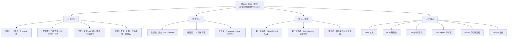
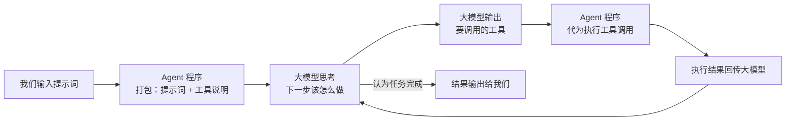

<iframe src="https://player.bilibili.com/player.html?aid=116522328524431&bvid=BV1NvRyBzEhq&cid=38111807531&page=1&autoplay=0" scrolling="no" border="0" frameborder="no" framespacing="0" allow="fullscreen; picture-in-picture" allowfullscreen="true" style="height:100%;width:100%; aspect-ratio: 16 / 9;"> </iframe>

> [!abstract] 一句话总结
> **[[Claude Code]]（CC）= 装在你电脑终端里的 AI Agent，不是聊天框。**
> 它的运行内核是 [[LLM Loop|大模型循环]]：程序把「你的提示词 + 本程序具备的工具说明」一起发给大模型 → 大模型思考后决定调用哪个工具 → Agent 程序代为执行 → 把结果回传给大模型 → 大模型再决定下一步，如此循环，直到它认为任务完成，才把结果输出给我们。
>
> 全片是一条四段式主线：**① 用上它**（装好 → 配模型 → 会交互）→ **② 管住它**（回滚 / Git / 上下文）→ **③ 让它懂你**（CLAUDE.md / 自动记忆）→ **④ 扩展它**（Skills / MCP / CLI / Sub-agent / Hook / Plugin）。

## 🗺️ 知识框架

## 📺 视频信息

- **UP 主**：秋芝2046 ｜ **发布**：2026-05-05 ｜ **时长**：约 56 分钟
- **配套资料**：评论区文字教程（常用命令中文速查表、常用 Skill 与 MCP 打包）

| 章节 | 时间点 | 本文位置 |
| --- | --- | --- |
| CC全面教程（开场） | `00:00` | 导语 |
| 认识CC | `01:40` | [[#一、认识 CC]] |
| 初步上手 | `05:25` | [[#二、装上它]] |
| 安装CC | `06:55` | [[#二、装上它]] |
| 配置模型 | `08:03` | [[#二、装上它]] |
| 版本管理 | `21:53` | [[#四、管住它]] |
| 上下文管理 | `25:43` | [[#四、管住它]] |
| 个性化设置 | `29:36` | [[#五、让它懂你：三层记忆]] |
| 高级扩展 | `40:35` | [[#六、扩展它]] |
| 巩固一遍 | `53:49` | [[#七、巩固：四阶段回顾]] |

---

# 一、认识 CC
## 1.1 它是什么

- [[Anthropic]] 于 **2025 年 2 月**推出，**原本为编程而生**，运行在**终端**里的一个 Agent 程序，网友简称 **CC**。
- 但今天它的能力**远不止编程** —— 凡是知识工作都可能被它接管。
- 与"一问一答"的对话式 AI 相比，它的关键差异是**自主性**：它会自行做计划，并且**真的采取行动**去达成任务目标。

## 1.2 运行内核：LLM Loop（大模型循环）

> [!important] 关键推论
> CC 只是"**以大模型为大脑的一整套程序**"。所以我们**不必非得用 Anthropic 的模型**，也可以替换成其他大模型 —— 这也正是国产模型能跑 CC 的原因。

## 1.3 为什么 CC 比别的 Agent 强？

| #   | 原因                 | 说明                                                     |
| --- | ------------------ | ------------------------------------------------------ |
| 1   | **跑在你本地**          | 在有限权限下直接访问与读写你电脑里的本地文件、使用你的终端执行命令、往你电脑下载东西             |
| 2   | **Harness 工程做得更好** | [[Harness]] = Agent 程序里除了大模型之外，**所有让 Agent 最终表现更好的设计** |

> [!tip] 什么是 Harness？
> 简单理解：Agent = 大模型 + Harness。
> 但**即便用完全一样的大模型**，换了 Harness 也会带来非常大的效果差异 —— 所以 CC 是"Harness 的集大成者"。
> 我们用同样的模型，换 CC 还是换 Codex，其实换的就是 Harness。

## 1.4 它能做什么
- **开发应用、做编程** —— 名字就说明了它是为编程而生；**没有编程基础**的人也能用它写出真的可用的应用。
- **泛化到任意知识工作** —— Anthropic 内部员工很早就在用 CC 处理**法律、财务、市场**各类任务。
- 具体如：写文案、查资料、整理资料、分析数据、做表格、做报告，以及更多你定制的专属任务。
- UP 主自述：内容创作中用得最多的工具就是 CC，甚至运营、剪辑也常用它做文稿分析与素材设计匹配。

---

# 二、装上它

## 2.1 四种使用形态

| 形态 | 备注 |
| --- | --- |
| Claude 官方桌面应用 | — |
| 网页版 | — |
| IDE 插件 | — |
| **终端** | ✅ **更原生、新功能更多更全**，本教程采用 |

## 2.2 为什么"终端 + 一个 IDE"搭配用

教程用**终端**方式运行 CC，但额外搭配一个 Agent IDE（[[Cursor]] / [[Antigravity]] / [[Trae]] 都可以，**不必买会员，薅免费额度就够**）。搭配 IDE 的主要原因是布局方便：

| 区域 | 用途 |
| --- | --- |
| 左 | 看到全部项目文件 |
| 中 | 手动编辑文件 |
| 下 | 开多个终端与 CC 交互 |
| 右 | 偶尔用 IDE 自带的 Agent 帮手 |

> 整体布局可自行调整。UP 主以 Cursor 为例：官网下载 → 打开 IDE → 新建文件夹 `first cc` → 打开，这就是第一个项目。

## 2.3 安装（两种方式）

| 方式 | 操作 | 特点 |
| --- | --- | --- |
| ① 一行命令 | 从 Claude Code 官网拷贝命令 → IDE 里打开终端 → 粘贴回车 → 自动下载完成 | Mac / Windows 通用 |
| ② 让 Agent 帮你装 | 直接跟 IDE 的 Agent 说"帮我安装 Claude Code" | **更 AI 原生**，以后用得更多的方式 |

- **验证**：输入 `claude --version`，看到版本号即安装成功。
- 方式 ② 的好处：**即便出现依赖问题或网络问题，它也会自己想办法解决**。

## 2.4 配置模型

CC 本身是 Agent 程序，**给它配什么"大脑"是我们自己可以选的**。

| 路线 | 做法 | 说明 |
| --- | --- | --- |
| 官方订阅 | 输入 `/login` 登录 | **性能拉满 + 价格划算**，但目前实名制，能用上的人不多 |
| **国产模型 / 其他渠道 API** | 下载 **[[CC Switch]]** 做多模型切换与管理 | 更多人的选择 |

**API 配置步骤**：下载安装 CC Switch → 填写 **API Key + Base URL** → 随意起个名 → 保存。

> [!warning] 顺序很重要
> 操作 CC Switch **必须在打开 Claude Code 之前**完成，否则 CC 会默认引导你去登录。

配好后：回到 IDE → 启动 CC（调出 IDE 终端）→ 输入 `claude` 回车。首次启动会依次询问：

1. **主题色** —— 上下键选一个顺眼的即可；
2. **安全提示** → 是否使用推荐设置 → `yes` 回车；
3. **当前文件夹是否可信** → 可信，回车。

到这 CC 就装好了，可以正常对话并开启第一个项目。

---

# 三、用起来

## 3.1 第一个项目：从一句话到番茄钟

输入"我们做一个桌面的番茄钟软件吧"，观察 CC 的三个行为：

1. **发现指令模糊 → 主动提问**：它没有直接开始做，而是问我们要用什么技术栈。
   → CC 会在自己认为**上下文不清楚**时主动向我们提问。
2. **自动进入计划模式**：给出一个相对详尽的计划（功能、项目结构、实现方式），**等我们确认后才开始做**。
3. **开工后**：创建代码文件，底部状态栏随选择切换到自动编辑模式。

## 3.2 四种权限模式

通过 <kbd>Shift</kbd>+<kbd>Tab</kbd> **循环切换**前三种：

| 模式 | 行为 | 风险 |
| --- | --- | --- |
| **默认模式** | 自己判断哪些操作要问、哪些可直接做，何时该切到其他模式 | 较智能，**新手建议从这里起手** |
| **计划模式**（Plan Mode） | 不直接动手，先出详尽计划，确认后才执行 | 最低 |
| **自动编辑模式** | **改文件不再征求同意**，但**跑命令仍要征求同意** | 中 |
| **免确认模式** | 一路绿灯，完全不需要问你（启动 CC 时额外加一个参数） | 最高 |

> [!danger] 关于"最危险的权限"
> UP 主个人选择使用免确认模式，理由是：Anthropic 自己发现 **93% 的情况下用户都是直接同意的**，并不会细看 CC 到底改了哪些文件；且 CC 确实很少"抽风"做高风险的事。
> 但**新手仍建议从默认模式起手**。命令很长不必记 —— 每次进 CC 按**上方向键**就能调出之前输入过的命令。

## 3.3 计划模式给出的四个选项

| 选项 | 含义 |
| --- | --- |
| 1 | **同意方案 + 切换到自动编辑模式** —— 后续改文件不再问我们 |
| 2 | **同意方案 + 保持当前默认模式** —— 后续改文件仍可能问我们 |
| 3 | **不同意方案** —— 继续讨论、修改方案 |
| 4 | 按 <kbd>Shift</kbd>+<kbd>Tab</kbd> 给出**反馈意见**，让它带着反馈去改方案并执行 |

> [!note] 自动编辑模式也有管不到的地方
> 选了选项 1 之后，CC 仍可能弹窗询问 —— 因为它这次**不是在编辑文件，而是在执行终端命令**（例如安装项目依赖 `npm install`）。**命令执行不归自动编辑模式管**。
> 此时三个选项：① 只同意这一次 ② 同意，且**本项目**以后执行 npm 安装不再询问 ③ 不同意，再商量。

## 3.4 在终端里运行命令的两种方式

CC 的终端里，**直接输入任何文字都是在跟 CC 对话**，不是在运行命令。想跑命令要换方式：

| 方式 | 操作 | 备注 |
| --- | --- | --- |
| ① 新开一个终端 | 用另一个终端运行命令 | UP 主开发项目时更常用 |
| ② Bash 模式 | 命令前加 `!`（会提示进入 **bash mode**） | 不再是与 CC 对话 |

> [!tip] 命令阻塞对话怎么办
> 用 `!` 运行项目后，它会**阻塞我们与 CC 的对话**。此时 CC 会提示按 <kbd>Ctrl</kbd>+<kbd>B</kbd> 让程序**在后台运行** —— 按下后列表里会多出一个 shell，选中回车即可查看运行中的进程，<kbd>Esc</kbd> 退出回到对话。

## 3.5 投喂上下文的三种方式

除了最基础的**打字对话**，CC 还支持：

### ① @ 具体文件

- 场景 A：`@某文件` → 让它解释该文件的代码逻辑，并用详细中文注释。
- 场景 B：把**长提示词写进一个本地文档**，再 `@` 这个文件让它遵循文件里的要求执行（也可以直接把文件**拖进对话框**，它能识别路径）。

> [!important] 为什么 @ 文件有用
> CC **不会每时每刻把旁边所有项目文件都加载进上下文**（项目大了也加载不进去）。它通常靠 **grep**（本地文件查找）找到需要的那部分文件再编辑。
> 所以当你明确知道是哪个文件时，直接 @ 它 —— **帮 CC 省事，也帮自己省 token**。

> [!tip] 反直觉的小知识
> 给 CC 的**指令越短，花的 token 可能越多** —— 因为指令与上下文不足时，它要花更多 token 去**探索本地文件**。
> 反之，**描述越具体，执行效果越准确越靠谱**。

> [!note] 命令行打字的小坑
> - 长提示词在命令行里编辑很麻烦：**不能像普通编辑器那样用鼠标挪动光标**。
> - **换行不是** <kbd>Shift</kbd>+<kbd>Enter</kbd>（那是直接发送）；Mac 用 <kbd>Option</kbd>+<kbd>Enter</kbd>，Windows 用 <kbd>Ctrl</kbd>+<kbd>Enter</kbd>。

### ② 直接给图片

- 把图片**拖拽**进对话框，或用 <kbd>Ctrl</kbd>+<kbd>V</kbd> 粘贴。
- ⚠️ **Mac 上也是 Ctrl+V，不是 Command+V**。
- 用途示例：给一张配色参考图，让 CC 给番茄钟加一个同款主题 —— 利用多模态能力还原效果。**一图胜千言。**

### ③ 斜杠命令

输入 `/` 就会列出所有可用命令；`/help` 可查看全部命令及其含义。

| 命令 | 作用 |
| --- | --- |
| `/model` | 切换高 / 中 / 低档模型（需先在 CC Switch 里配好每档对应的模型） |
| `/btw` | **By the way** —— 问一个与当前项目无关的问题，**回答与项目上下文隔离**，按 <kbd>Esc</kbd> 退出后自动从上下文中消失 |
| `/simplify` | 内置 Skill：派生**三个子 agent**，分别从**代码质量 / 运行效率 / 是否可复用**三个角度做代码审核，并自动完成优化修改 |

---

# 四、管住它

> 关卡一通过后，你很自然地会撞上两个问题：**它把你的文件改坏了怎么办**？**用久了为什么变笨了**？

## 4.1 软回滚：CC 自带的后悔药

| 操作                                    | 说明          |
| ------------------------------------- | ----------- |
| 连按**两下 <kbd>Esc</kbd>**，或输入 `/rewind` | 进入回滚 / 撤回界面 |

弹窗会让你选择回滚范围：仅回滚对话 / 回滚对话**并**回滚刚才编辑过的文件 / 只回滚编辑的文件 / 算了不回滚。
→ **通常选"回滚对话 + 刚编辑过的文件"**。

> [!warning] 它的局限
> 只能撤销 **CC 自己编辑的文件**。如果 CC 执行了终端命令（装了包、下载了东西），**这些撤不回来**。

## 4.2 硬兜底：Git

> 真正靠谱的后悔药是 **[[Git]]**。

把 Git 理解为**游戏的存档系统**：打到满意的环节就存一个档；后面怪不好打、打死了，还能回到存档点。Git 就是给项目文件做这个**版本管理**的。

| 要点 | 说明 |
| --- | --- |
| 安装 | Mac 自带 Git；也可以让 CC 帮你装 |
| **建 GitHub 账号** | 除了本地存档点，还能存到**远程仓库** → 换电脑能快捷拉取、也方便共享协作 |
| 有 CC 之后 | 下载、安装、登录、提交存档、回滚到哪个版本，**都可以用自然语言让 CC 完成** |

> [!tip] 养成版本管理习惯
> AI 无论写代码还是做其他事，都有**不确定性**。建议**每做完一步就让 CC 帮你存档一步**。有了 Git 兜底，我们才更放心让 CC 去尝试各种方案。

## 4.3 上下文管理

**症状**：项目做久了、用 CC 时间长了，回答**变慢**、结果质量**下降**。
**根因**：**上下文窗口有限**。从开启对话起，聊的每一句话、读的每一个文件、执行的每一个操作结果，都累积占用上下文空间。

> [!danger] 上下文衰减
> 我们常见的大模型动辄 100 万、200 万上下文窗口，但实际上**有效比例只有 60~80%**，而且**随着上下文增多，大模型能力会随之下降** —— 就像脑子里一口气塞太多东西，容易把握不住重点。

| 命令         | 作用                                   |
| ---------- | ------------------------------------ |
| `/compact` | **主动压缩上下文**：把之前的对话精简，保留关键信息，释放大部分上下文 |
| `/clear`   | **彻底清空**，相当于重开一个对话                   |

- 不手动输入时，CC 也会在**上下文即将满时自动压缩**（体感上可以一直聊下去），但效果仍会下降。
- 所以建议：**在结束某些任务时主动压缩** —— 既省 token，也让大模型更专注于当前新任务。
- （UP 主自述 `/clear` 用得不多，想新开对话时通常直接**点加号新建终端**。）

## 4.4 观察与恢复上下文

**观察占比**：

| 方式 | 说明 |
| --- | --- |
| `/context` | 详细展示上下文占比 —— 有哪些 MCP、哪些 Skill，分别占用多少 token |
| 常驻显示 | 让 CC 帮你打开常驻百分比显示（**需重启终端才生效**，连按两次 <kbd>Ctrl</kbd>+<kbd>C</kbd> 退出后重新输入 `claude`） |

**恢复历史对话**：

| 方式 | 说明 |
| --- | --- |
| `/resume` | 进入后**选择**恢复到哪一次对话 |
| `claude -c` | 启动时直接加 `-c`（continue）—— **继续上次的对话** |

> [!tip] 经验阈值
> 底部百分比即上下文余量。UP 主个人习惯：**高到 60% 以上就大概率需要 `/compact` 压缩一下**。

---

# 五、让它懂你：三层记忆

CC 更新后有了两类**为了个性化**的记忆机制，再加上我们可以**自行构建**的文档，共三类。三者的共同目标一致：**让 CC 记住你是谁、你在做什么、你有什么要求**，不需要我们反复提醒。

## 5.1 第一优先级：CLAUDE.md

**[[CLAUDE.md]]** 是一个写文字的 Markdown 文件，**在我们跟 CC 说任何东西之前，第一时间被读入上下文**。它分三层：

| 层级       | 位置                                                                                                                                                                                                       | 内容                                   | 范围                        |
| -------- | -------------------------------------------------------------------------------------------------------------------------------------------------------------------------------------------------------- | ------------------------------------ | ------------------------- |
| **全局级**  | 全局配置文件夹下                                                                                                 | 无论做什么项目都希望 CC 遵循的原则，如"永远用中文回答"、记住我是谁 | **只对自己生效**，所有项目通用         |
| **项目级**  | 项目根目录下   | 项目的技术架构、文件结构、开发规范与风格                 | **可团队共享**，可提交到 Git，共用一套规则 |
| **文件夹级** | 各子文件夹中                                                                                                                                                                                                   | 该文件夹内的规则（子文件夹的子文件也可以再设）              | 对该文件夹内生效，也可提交到 Git        |

> 三层**叠加生效，不会冲突**。第三层预计用得不多。

**创建方式**：

| 对象        | 做法                                                                                            |
| --------- | --------------------------------------------------------------------------------------------- |
| 项目级       | 输入 `/init` —— CC 会初始化整个项目、创建 `.claude` 文件夹与 `CLAUDE.md`，并**阅读整个项目**把信息写进去（常用命令、架构概览、通信状态、主题等） |
| 全局级 · 方法一 | 直接跟 CC 说"记得永远说中文，并且写进全局 CLAUDE.md 里"，它会自己写（会先问能否编辑该文件）                                        |
| 全局级 · 方法二 | 输入 `/memory` —— 出现两个记忆选项（全局 CLAUDE.md / 项目 CLAUDE.md），回车即可打开编辑                                |

> [!tip] Anthropic 官方建议
> **不要**在空项目时就手动建 CLAUDE.md，而是**等项目有了一定雏形，再用 `/init` 初始化**会更好。
> 有了项目级 CLAUDE.md 之后，哪怕新开一个对话，CC 也会**第一时间知道整个项目在干嘛**，否则它还要重新详细扫一遍文件才能了解架构。

> [!warning] 修改全局 CLAUDE.md 后需重启
> 改完全局 CLAUDE.md，需要**退出 CC 再重新进入**才会生效。

> [!important] 写得越少越好
> CLAUDE.md **不应该塞太多内容**。理想状态是只放那些**最顶层、基本不会变化的原则**（尤其全局 CLAUDE.md），并在使用过程中**逐渐往里添加 CC 犯过的、经常容易犯的错误**。
> 例：近期很火的 Karpathy 的一个 Skill，里面就是针对大模型写代码时常犯的原则性错误写的通用规则 —— **只有几百行字，却已有 5 万多 Star**。
> 项目级 CLAUDE.md 同样是**变化的**：项目新增功能、有了新要求、CC 又踩了坑，就要同步更新它。**积累的错误经验越多，它就越少犯错。**

## 5.2 第二优先级：Auto Memory（自动记忆）

有些我们**没有显式写进 CLAUDE.md** 的习惯、错误、经验，会被一个**与主对话无关的后台 agent** 默默自动记录下来。**需要手动打开**：输入 `/memory`，第一个选项就是开关（`off` → 打开）；打开后会多出"**打开自动记忆文件夹**"选项。

**都会主动记下什么**：

| # | 类型 | 例子 |
| --- | --- | --- |
| 1 | **关于用户** | 关于我们这个人 |
| 2 | **我们给过的反馈** | "不要这样""就要那样" |
| 3 | **项目相关** | 进度、决策、技术选型 |
| 4 | **外部资源索引** | 某个文档在哪里 |

**工作机制（关键）**：

- 记录时会显示标识（如"写了两个 memories"），按 <kbd>Ctrl</kbd>+<kbd>O</kbd> 可打开具体操作细节。
- 存储位置：`.claude/` 下的**项目地址**对应的 `memory` 文件夹 → 说明**自动记忆只作用于当前项目**，换个项目需要重新积累。
- **不是每次都全部加载**：每次打开项目，CC 只先读 `MEMORY.md` 这一个文件，它相当于**每条具体记忆的索引**；真正遇到相关场景时，才按索引去读对应的细节文件（如 `feedback_light` 主题的 MD）。
  → 所以**一开始它不会占用太多上下文**。
- **可纠正**：如果觉得它记得不对，直接说"忘掉刚刚说的不喜欢浅色主题"，它就会自动删除。

## 5.3 第三层：自建文档 + 引用规则

既然前两种记忆**无非是把信息写进文件、让 CC 在适当时候读取**，那我们完全可以自己写文档并规定 CC 何时去读。

**示例**：给番茄钟项目建两个文件

| 文件 | 内容 |
| --- | --- |
| 品牌视觉规范 | 视觉要求、配色体系 |
| 语言规范 | 文字风格要求（如"休息"要叫"放松"） |

然后在 CLAUDE.md 里写明：**"当你要对前端视觉进行修改时，去参考这个文件；当你要写产品上文字时，去参考这个文件。"**

## 5.4 三层记忆对比

| 层级 | 名称 | 谁写的 | 何时进上下文 | 范围 |
| --- | --- | --- | --- | --- |
| 1 | **CLAUDE.md** | 我们主动立的规矩 | **每次对话第一时间全量注入** | 全局 / 项目 / 文件夹，叠加生效 |
| 2 | **Auto Memory** | 后台 agent 自动记录 | **按需注入**（先读索引 `MEMORY.md`） | 仅当前项目 |
| 3 | **自建文档** | 我们手写 | 由 CLAUDE.md 规定"何时去读" | 自定义 |

> [!quote] 一句大实话
> 不管是 OpenAI 还是 Claude Code，还是其他各种 Agent 所谓的"持久记忆"，本质上**都是在适当的时候向它注入一些经过压缩或提炼的上下文**。
> 所以粗暴理解，那句经典的话没错：**"这不都是提示词吗？"**

---

# 六、扩展它

## 6.1 Skills（技能）

**一句话**：给 AI 的**各式各样的子领域专业说明书和操作手册**，是 agent 当前非常重要的拓展工具。

**四类技能**：

| 类型 | 例子 |
| --- | --- |
| **知识型** | 如何做页面设计的规范手册 |
| **流程型** | 如何按照你们公司的流程和标准做记账报销的手册 |
| **工具型** | 如何调用 nano banana 生成图片 |
| **混合型** | 如何做公众号排版**并自动发布** |

> [!important] Skill 的上下文策略
> 这些手册**不适合全写进 CLAUDE.md** —— 因为我们**不可能随时都在用**，但又**不止一次会用到**。
> Skill 的处理方式是：每次运行 agent 时，**只发给大模型几行元信息**（Skill 的名称 + 什么时候该调用它的描述），让大模型自己知道"我有这本说明书"，**由大模型自己决定何时去看**。

**安装方式**：

1. 本质就是**一个文件夹**（最简单的由一个 `SKILL.md` 构成：上面是元信息，下面是具体原则），**按固定位置放进去**即可。
2. 分**全局 Skill** 与**项目级 Skill**，存放位置分别对应不同目录 —— 手动在 `.claude` 里建一个 `skills` 文件夹放进去即可。
3. 更智能的方法：用**"找 skill 的 skill"来找 skill**，其中很火的叫 **find-skills** —— 把它的链接发给 CC 让它装上，之后想要什么类型的 Skill 直接跟 CC 说，它会去找、推荐，并可让它直接装好（会询问装全局还是项目下）。

**调用方式**（三种）：

| 方式 | 说明 |
| --- | --- |
| 模型自行调用 | 听到"优化 UI"就自己判断该加载哪个 Skill |
| **`/` + Skill 名称** | 像命令一样手动直接调用 |
| 提示词里点名 | 明确要求"用这个 Skill 来做某某事" |

> [!warning] 什么情况下 Skill 会"该用而不用"
> 当 Skill 存得多了、**上下文被塞得比较满**，或者**技能的触发词写得不够准确**时，大模型就可能在该用的时候不去用它。

**创建自己的 Skill**：最原始的方式是跟着标准写；更多时候用**"创建 skill 的 skill"** —— 其中著名的是 Anthropic 自己出的 **skill-creator**（可让 find-skills 帮忙下载）。过程其实就是跟 CC 对话，说你想创建一个什么样的 Skill。

## 6.2 MCP

**[[MCP]]** 诞生很早，本质是**解决 AI 与外部工具、外部服务连接的"转接头"**。

- 例：让 Claude Code 看到你存在 **Notion** 上的资料；或让它读取你在 **Figma** 中的设计稿，按设计稿直接生成代码。

> [!warning] MCP 的现实问题
> 目前 **MCP 占用的 token 数量还比较大**，很难同时拥有非常多的 MCP 服务。
> 所以现在很多外部工具：**轻量的转向做成 Skills，重量的转向近几个月很火的 CLI**。
> UP 主本人也只保留了少量几个 MCP。

## 6.3 CLI（Command Line Interface）
**[[CLI]]** 全称 **Command Line Interface（命令行工具）**，其实很早就存在，原本是方便程序员和程序做操作的。

| 场景 | 普通用户 | 程序员 |
| --- | --- | --- |
| 下载东西 | 去网站翻页、点击下载 | 一行命令搞定 |
| 压缩视频 | 专门找一个压缩应用 | 一行命令搞定 |

> [!important] 为什么 CLI 现在突然火了
> 这些命令**过去普通用户不会用**，但**现在 AI 很会用**。
> 比起让现在的 agent 去**模拟人类操作浏览器**（截图、点击、翻页），让它们**输出这些命令简直是又精准又高效**。
> 于是很多厂商把自己原本提供给人类"点击操作"的功能和接口，**也做成了 CLI 工具**，目的就是让 agent 能更方便地调用和操作。

**例子**：

- **飞书 CLI**：把创建文档、写文档、写多维表格、发邮件、建日历都变成一条条 CLI 命令 → 可以直接让 CC 帮我们操作飞书（如"创建文档并把链接发到某个邮箱"）。
- **OpenCLI**：把很多常用网页、社交媒体的接口做成了 CLI 工具。安装方式同样是**把地址粘贴给 CC** 让它装好。装上后可以让它"查一查社交媒体上深圳必吃的餐厅"—— 查出来的就真的是社交媒体上的内容，**图片也能帮忙下载下来**。

## 6.4 Sub-agents（子代理 / 分身）

CC 有了分身和下属 —— sub agent 子 agent 的功能。

**典型场景**：番茄钟要正式上线，想让 CC 去**调研其他番茄钟都是怎么做的**、数据如何、有什么优缺点，最终反馈开发建议。

> [!note] 为什么不让主 Agent 直接做？
> | 问题 | 说明 |
> | --- | --- |
> | ① 阻塞主任务 | 主 agent 得**停止写代码**，一个项目一个项目地**串行**做调研，耗时久 |
> | ② 污染主上下文 | 主 agent 的上下文会充斥**大量调研细节**，但它其实**只需要调研结论** |
>
> **子 agent 的优势**：有**单独的上下文空间**，且**可以多个并行**同时干活，最终把结果汇总给主 agent。

**两种创建方式**：

| 方式 | 说明 |
| --- | --- |
| **自动派生** | 任务相对复杂、判断可并行时（如调研类任务），CC 会**自己意识到并自动派生出几个子 agent**，中间不需要我们做任何操作 |
| **手动创建** | 输入 `/agents` 进入创建流程，它会引导我们一步一步创建，用自然语言说即可 |

> 主 agent 会在它觉得合适时**自行决定**把活派给哪个子 agent；我们也可以**直接指定**某个子 agent 去干什么，或直接让它自己派生几个分身分头去干。

## 6.5 Hooks（自动触发器）

**[[Hook]]** 就是一个**自动触发器** —— 我们设定好"**当 CC 怎么怎么样的时候，就自动执行一个什么什么**"。本质是给 CC 设定的**条件反射**。

| 例子 | 触发条件 → 动作 |
| --- | --- |
| ① 提示音 | CC 每次**完成任务后** → 发出提示音"叮"提醒我们 |
| ② 格式检查 | CC 每次**提交代码之前** → 自动触发代码格式检查 |

配置方式：不必深究背后原理，**直接跟 CC 说**即可（例："我想要 CC 每次完成任务后都自动发出提示音，最好还发一条退出消息"），它会给出方案，跟它讨论、配合完成。

## 6.6 Plugins（插件）

**插件 = 把前面说的 Skills、Sub-agents、Hooks、MCP 打包在一起。**
有的插件也没有打包这么多东西 —— 里面就是一个 Skill，或者就是一个 MCP。

**使用**：在 CC 里输入 `/plugin` 进入插件管理页面 → 有"发现新插件"与"管理已安装的插件" → 在发现里看到喜欢的，**选一下安装范围**，确认即可安装。

## 6.7 扩展功能全景

| 扩展 | 一句话 | 关键点 |
| --- | --- | --- |
| **Skills** | 给 AI 的子领域说明书 | 上下文里常驻的只有几行元信息，**由模型自己决定何时加载** |
| **MCP** | 连接外部工具 / 服务的"转接头" | 能力强但**吃 token**，不宜多装；轻量需求正被 Skills 取代 |
| **CLI** | 厂商把"点击操作"变成命令行 | 比模拟人类点浏览器**更精准高效**；如飞书 CLI、OpenCLI |
| **Sub-agents** | 分身 / 下属，独立上下文、可并行 | 适合调研类任务，**避免细节污染主 agent 上下文** |
| **Hooks** | 条件反射式自动触发器 | 完成任务后响一声 / 提交前跑格式检查 |
| **Plugins** | 把上面这些打包 | `/plugin` → 发现 → 选安装范围 → 确认 |

---

# 七、巩固：四阶段回顾

| 阶段 | 你学会了什么 |
| --- | --- |
| **① 上手安装** | 安装 CC；用 **CC Switch** 配置模型；用 **<kbd>Shift</kbd>+<kbd>Tab</kbd>** 切换权限模式；掌握与 CC 交互的基本方法，了解斜杠命令，轻松做出第一个番茄钟 |
| **② 掌控 CC** | 双击 <kbd>Esc</kbd> 的简单回退；**Git** 这个后悔药；主动管理和监控上下文 |
| **③ 让它按你的意思行动** | 通过 **CLAUDE.md** 和**自动记忆**，让 CC 记住你的要求、记住它犯过的错 |
| **④ 高级扩展，让它越来越强** | 装上特定领域的技能 **Skills**；通过 **MCP / CLI** 连接外部工具；用 **Sub-agent** 派出分身并行干活；了解 **Hook** 和**插件** |

> [!quote] 结尾的两句话
> 1. **从 CC 泄露的源码看，它还有更多能力等待发布**，未来甚至会变得更主动、在哪里都可能用到它，能力边界还在不断扩大。但不必慌 —— 熟悉以上知识点，反复组合着用在你自己的工作中，**今年都很够用**。
> 2. **最重要的是你在习惯跟 AI 的协作方式**：从"一问一答"到"**构建系统、组织 AI，让它自己去干**"。只要习惯了这个，以后再出什么新东西，你也能上手得很快。

---

## 🧠 自测（费曼式复述）

- [ ] 不看定义，用一句话说清 [[LLM Loop|大模型循环]] 的每一步，以及 CC 在这个循环里扮演什么角色
- [ ] "CC 更强"的两个原因是什么？[[Harness]] 指的是什么？
- [ ] 为什么配 API 必须在**打开 CC 之前**操作 CC Switch？
- [ ] 四种权限模式分别是什么？<kbd>Shift</kbd>+<kbd>Tab</kbd> 能切换其中几种？自动编辑模式为什么还会弹窗问你？
- [ ] 为什么"给 CC 的指令越短，token 反而可能越多"？
- [ ] 为什么 `@` 一个具体文件，是在帮 CC 省事、也帮自己省 token？
- [ ] CC 自带的回滚有什么局限？真正靠谱的后悔药是什么？
- [ ] `/compact` 和 `/clear` 的区别是什么？上下文到多少该压缩？
- [ ] CLAUDE.md 的三层分别放在哪、谁能共享？为什么它"写得越少越好"？
- [ ] Auto Memory 存在哪？为什么它一开始不占用太多上下文？
- [ ] Skill 只把几行元信息常驻上下文，好处是什么？什么情况下它会"该用而不用"？
- [ ] MCP 和 CLI 各自解决什么问题？为什么很多工具正在从 MCP 转向 CLI？
- [ ] 什么任务适合派给 Sub-agent？不派会发生哪两个问题？
- [ ] Hook 的本质是什么？举两个例子。

## 📝 转写勘误（ASR 识别误差）

> 本字幕为机器识别，专有名词错误较多。下表只列**高频且影响理解**的部分；正文中已按正确写法统一。

| 字幕原文 | 应为 | 说明 |
| --- | --- | --- |
| cloud code / cloud / 杠 | **Claude Code / Claude / 斜杠（`/`）** | "杠 model""杠 compact"指 `/model`、`/compact` |
| A证 / A生 / 主A证 | **Agent** | "sabent""subb agent" 应为 **sub agent** |
| L lam loop / l m loop | **LLM Loop** | 大模型循环 |
| 哈人 | **Harness** | 原音译，指大模型之外让 agent 表现更好的设计 |
| grab | **grep** | 本地文件查找方式 |
| play mode | **Plan Mode** | 计划模式 |
| shader type / shift tab | **Shift+Tab** | 切换权限模式的快捷键 |
| Accept at some | **Accept Edits** | 自动编辑模式 |
| GUCLEAR | **`/clear`** | 彻底清空上下文 |
| 杠 resolve | **`/resume`** | 恢复历史对话（`-c` 即 continue） |
| memory点MD / cloud点MD | **MEMORY.md / CLAUDE.md** | — |
| 点 cloud 文件（夹） | **`.claude`** | 配置目录 |
| get it | **Git** | 全文多处 |
| 菲格玛 / notebook | **Figma / Notion** | 外部工具举例 |
| ZALI / CIA / open sli | **CLI / OpenCLI** | — |
| Poke | **Hook** | 结尾回顾处 |
| 卡帕西 | **Karpathy** | 指那个几百行、5 万+ Star 的 Skill |
| 烧的脱粉 | **Token** | — |
| 番茄中 | **番茄钟** | 全文多处 |
| 主绘画 | **主对话** | "跟主对话无关的后台 agent" |
| 第4就是终端领了 / IE / id | **终端里 / IDE** | — |
| TRA / ANTIGRAVITY | **Trae / Antigravity** | IDE 举例 |
| final skill / find skill | **find-skills**（疑） | 找 Skill 的 Skill，识别不稳定 |
| QZ色系 | — | ⚠️ 读音不清，疑为某配色体系名，**未确认，待核** |

## 🔗 相关笔记

- [[Claude Code]] · [[LLM Loop]] · [[Harness]] · [[Agent]]
- [[CC Switch]] · [[Git]] · [[上下文窗口]] · [[CLAUDE.md]] · [[Auto Memory]]
- [[Skills]] · [[MCP]] · [[CLI]] · [[Sub-agent]] · [[Hook]] · [[Plugin]]
- [[计划模式]] · [[Cursor]] · [[Figma]] · [[Notion]] · [[飞书]]

## 🏷️ 标签

#ClaudeCode #AI #Agent #知识框架/AI工具 #AI编程 #效率工具 #Harness #Skills #MCP

