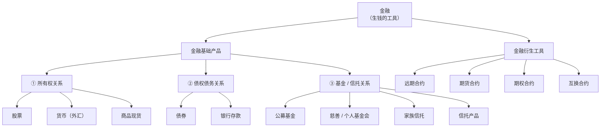

<iframe src="https://player.bilibili.com/player.html?aid=116714092238711&bvid=BV1cnEg6LEZF&cid=38958270243&page=1&autoplay=0" scrolling="no" border="0" frameborder="no" framespacing="0" allow="fullscreen; picture-in-picture" allowfullscreen="true" style="height:100%;width:100%; aspect-ratio: 16 / 9;"> </iframe>

> [!abstract] 一句话总结
> **金融 = 一堆「生钱的工具」的集合。** 学金融就是逐个拆解这些工具 —— 先分[[金融基础产品|基础产品]]（买啥就是啥）与金融衍生工具（基于基础产品的合约），再按**关系**（所有权 / 债权 / 信托）与**特征**（联动性 / 未来合约 / 杠杆 / 零和）给它们归位。
>
> 为什么很多人"学了零零散散的知识却不成体系"？因为在学之前没有**建立关系、形成框架**。这篇导学的价值就是那张框架。

## 🗺️ 知识框架

---

## 一、前置辨析：经济 / 财经 / 金融

| 概念 | 归属 | 研究什么 | 关联对象 |
| --- | --- | --- | --- |
| **经济学** | 社会学科 | 范围极广：哲学、历史、人文、美学……"句句不提钱，但句句都跟钱相关" | 与**政治**挂钩 |
| **财经** | 媒体 / 内容领域 | 财政 + 经济：社会新闻、国际形势、国家政策 | — |
| **金融** | 应用工具 | 一个个「生钱的工具」 | 与**法律**关联 |

**关键判断**：谈论经济之上必有权力。

- 规则与制度存在的目的，**不是**为某些集团/个人谋私利，而恰恰是**防止资源过度集中**；没有规则，普通人的生存空间更有限，资源只会落到霸权、精英、财阀手里。
- LSE（伦敦政治经济学院）的观点：学经济不能脱离政治 —— 经济学家讲的话未必正确，换一个执政者就可能被推翻。

## 二、金融的本质：两条「生钱」路径

1. **用钱生钱** —— 资金量本身起来了，再把钱放进生钱工具制造更多现金流（富人的被动收入逻辑）。
2. **空手套白狼** —— 没钱怎么办？靠**信用**无中生有。

> 所以金融再复杂，无非就是一个个生钱的工具。想了解金融，就是去研究这些工具。

## 三、分支一：金融基础产品

> **定义**：你买啥就是啥 —— 价格波动来源于它**自己本身**。

### 3.1 所有权关系

#### [[股票]] —— 你买的是公司的一部分

- 买股票 = 成为公司所有者（"公司即是我，我即是公司"）
- 因此**不能退货、不能返还** —— 退给谁？你自己就是老板
- 想退出 → 只能找**新的接盘人** → 这就是交易所（[[二级市场]]）上的买卖
- **常见误区**：不懂公司就冲进去 → 一入场即套牢 → 天天计较股价何时涨。这已经完全脱离了所有权思维
- **正确思维**：把公司当成自己的孩子 —— 愿意爱它、真正懂它，才花钱买它

#### 货币 —— 特指[[外汇]]市场

- [[汇率]]怎么形成？和所有价格一个逻辑：**买卖双方叫价成交即定价**
  - 拿人民币想换美元的人 → 是买盘（报 6.0 / 6.2 / 6.8……逐级加价）
  - 拿美元想换人民币的人 → 是卖盘（报 7.0 / 6.9……逐级降价）
  - 买卖盘逐渐逼近，直到有人成交 → **实时汇率达成** → 所以汇率波动如此之快
- **国家必须调控**：汇率背后关乎一国经济金融安全
  - 若完全自由兑换 → 人民币汇率先冲天再落地 → 外资不敢进、国内企业走不出去
  - 因此有购汇额度限制：**每人每年 5 万美元**（无特殊情况）

#### 商品现货 —— 特指**具有金融属性**的大宗商品

> 不是你在市场上买个西瓜就叫参与金融市场。

| 类别 | 举例 |
| --- | --- |
| 能源 | 原油、天然气、煤炭 |
| 金属 | 金、银、铜、铁、铝 |
| 农产品 | 小麦、玉米、大豆 |
| 软商品 | 白糖、咖啡 等 |

- 延伸：炒房、炒艺术品 —— 同理，买入即拥有，仍是**商品现货 + 所有权关系**

### 3.2 债权债务关系

#### [[债券]] —— 借钱主体「正规化」的凭证

朋友之间借钱，一张借条就够；但主体变成国家、地方政府、公司企业，就需要一个正规的东西 —— 这就是债券。

| 发行主体 | 名称 | 信用等级 |
| --- | --- | --- |
| 国家 | [[国债]] | 最高 |
| 地方政府 | 地方债 | 次之 |
| 公司 / 企业 | 公司债 / 企业债 | 较低 |

**定价逻辑**：若国债收益 ≥ 公司债收益，则没人会买公司债（信用比你好、收益还比你高）。所以公司债必须提供**风险补偿** —— 用明显更高的收益吸引投资人。

#### [[银行存款]] —— 一种不那么绝对的债权债务关系

- 存款人把钱放在银行 = 借给了银行，虽然没有"借条"，但银行**实际使用了这笔资金**（吸收存款 → 放贷给别人），并主要靠此盈利
- 因此形式上仍满足**债权债务关系**

### 3.3 基金 —— 本质是**信托关系**

#### 定义公式

> **有钱进来 → 大家把钱放进一个池子 → 这笔钱用于某种特殊目的被支出去** = 基金

只要名字里带"基金"，都满足这个形式。

#### 类型一 · 投资收益类

- [[公募基金]]（美国称 **共同基金**）、[[私募基金]]、[[对冲基金]]
- 散户凑钱进池子 → 交给[[基金经理]]打理 → 投资股票、债券、甚至其他基金 → 收益返还投资人
- 此时的"特殊目的" = **投资收益**

#### 类型二 · 慈善基金会 / 个人基金会

- 资金来源：社会捐助，或某人以自己名义设立
- 目的：做慈善 / 把某个受益人加进基金会，通过基金会给他发报酬
- **关键好处**：规避高税率。例如遗产直接转赠费用很高；把人加进基金会即可

#### 信托的三方结构

| 角色 | 含义 | 在投资类基金中 |
| --- | --- | --- |
| **委托人** | 给钱、委托他人办事的人 | 我自己 |
| **受托人** | 受委托管理的人 | 基金经理 / 信托公司 |
| **受益人** | 最终得到好处的人 | **也是我自己** |

> 买公募 / 私募 / 对冲基金时，**委托人与受益人是同一个人** —— 因为我要的就是投资回报。

#### [[家族信托]]

- 场景：富商把遗产交给信托公司打理，约定子孙后代定时定点领取生活费（**受益人 = 子女**）
- **核心功能**：设立成功后，信托资产与**个人财富剥离**
  - 个人公司破产 → 不会直接动摇信托基金里的资产
  - 例外：违法、偷奸耍滑的设立 → 仍会被**"击穿"**

#### 信托产品 vs 私募基金

| 维度 | 私募基金 | 信托产品 |
| --- | --- | --- |
| 运作方式 | 凑钱投资（如 2 亿的项目由 100 人各出 200 万）—— 降低门槛、分散风险 | 同左，高度相似 |
| 监管方 | 证监会 | 不同的监管主体 |
| 独特功能 | — | **个人财产剥离**（破产不挂钩） |

> 结论：信托之所以能被单独拎出来，就因为它有**个人财产剥离**的功能；否则它就是一种基金。

## 四、分支二：金融衍生工具

> 教科书的讲法：衍生品价格基于某个基础产品，随其价格变动而变动 —— 一个是自变量，一个是因变量。
> 但只看这个定义会晕。例如："基金成分里有股票债券，股票会影响基金价值，那基金也是衍生品吗？"

### 4.1 四大特征（鉴别器）

分不清一个产品是不是衍生品，就看它是否**同时具备**以下四条：

| # | 特征 | 含义 |
| --- | --- | --- |
| 1 | **联动性** | 价格随基础产品变动 |
| 2 | **未来结算的合约** | 两个要素：① **未来**结算（当下即时交易不算）② 本身是一份**合约**，且能被包装成**可交易的产品**转手；签订时**不要求持有底层资产** |
| 3 | **[[杠杆]]性** | 用很少的资金撬动较大的名义金额（期货常见 10~20 倍；远期甚至可能无需启动资金）→ 变相**放大基础产品的风险** |
| 4 | **[[零和游戏]]** | 有人赚钱必有人亏钱，你亏的恰好被对手赚走，没有例外 |

### 4.2 四个工具

#### ① [[远期合约]] —— 所有衍生工具的鼻祖

- **一句话**：两个人今天**私底下**商量，把未来某个商品的价格锁定
  - 例：农民有货、面包厂想收货 → 双方锁死小麦价格 → 到期无论涨跌都按约定价成交
- **对谁友好**：**大机构** —— 因为"私底下"，量大时可省掉正规平台较高的手续费
- **死穴**：私下交易**太容易违约** —— 没有保证金、没有第三方约束，到期价格波动一大就有人跑路

#### ② [[期货合约]] —— 远期合约「搬到交易所」

- **为什么搬进交易所**：私下交易缺乏约束 → 交易所出面盯盘，每人先交[[保证金]]
- **机制**：做 1 万的单子交 2000 保证金；每天盯市，若剩余保证金覆盖不了次日交易且补不上 → **被踢出局**，交易结束
- **参与者多为投机**：手里压根没有货（也不需要）
  - 到期前做**反向操作**即可[[平仓]] —— 不用买原油，也不用交割
- **商品期货**（可实物交割） vs **金融期货**（如[[股指期货]]）
  - 股指期货的标的物是**虚拟的点数**，反映成分股整体走势；到期只看指数涨跌，**纯现金结算**，不交付成分股或基金份额 → 本质是双方**对赌价格**
- **兼顾[[套期保值]]**：如航空公司买原油期货锁油价

#### ③ [[期权合约]] —— 多了一个「权」字

> 期货和期权极易混淆：两者都是针对未来某时间点/时间段的合约交易，都在预测未来价格走势。**区别在于期权买方买的是一份权利。**

| 对比项 | 期货 | 期权 |
| --- | --- | --- |
| 买方 | **必须**提货 | **有权利**（可行权，也可不行权） |
| 卖方 | **必须**交货 | **只有义务** |
| 对价 | 保证金 | **权利金**（买方提前支付） |

**运作示例**（原油）：

1. 约定未来交割日，买方可以以 **80 元/桶**（[[行权价]]）向卖方提货
2. 买方今日支付**权利金**（如 2~3 元/桶）—— 卖方在什么都没给出之前就先收到钱，所以到期**只有义务**
3. 到期油价涨到 90 → 市场价 > 行权价 → **肯定行权** → 80 买进、90 卖出，赚差价
4. 想买的桶数越多 → 今日支付的权利金越多（不会无限套利）

> 这里只讲了最简单的形态，实际期权交易非常复杂（该博主另有"八种期权交易策略"专门内容）。

**期货与期权，谁是谁的标的物？**

| 命题 | 是否成立 | 原因 |
| --- | --- | --- |
| 期权期货（期权作期货的标的） | ❌ | 期权本质是一份**抽象的权利**，无法成为期货的标的物 |
| **期货期权**（如股指期货的期权） | ✅ | 期货本身是一份合约、一个可交易的金融产品，可以嵌到期权合约里 |

#### ④ [[互换合约]] —— 交换未来的现金流 / 资产

- **定义**：双方约定在未来某时间点，交换各自的现金流或资产
- 可交换标的：利率、货币、[[信用违约互换]]（CDS）等

**[[利率互换]]怎么运作**：

1. 双方各有自己的债务，各自有还款方式 —— 一方是**固定利率**（如每年 4.5%），另一方是**浮动利率**（随市场实时变化）
2. 两方都觉得自己的方式不够好，想优化 → 自然成为交易对手
3. 交换的是**还款方式**（固定方用浮动利率帮对方还，浮动方用固定利率帮对方还），**不是交换债务本身**
4. **本质是对赌利率差** → 到期必有一方赚、一方亏 → 亏方直接转钱给赚方
5. **本金必须一致**，否则还款方式不对称
6. **动机**：浮动方想要固定成本；固定方预计未来利率下滑、想省成本 —— 但利率究竟涨跌不确定，最终环节是波动的
7. **用途**：投机 / 避险皆可（没有真实债务也能签，纯赌利率差）；市场上更多是**银行或大机构**用于锁成本、节约成本、改善债务结构

## 五、关键辨析（高频易混）

### 5.1 为什么基金不是衍生品？

| 四大特征 | 基金是否符合 |
| --- | --- |
| 联动性 | ✅ 有（成分股/债会影响基金价值） |
| 未来结算的合约 | ❌ 实时交割；且你买的是**份额**，不是真实交割基金合同 |
| 杠杆性 | ❌ 买基金不需要加杠杆 |
| 零和游戏 | ❌ |

→ 四条不齐，**基金不属于衍生品**。

### 5.2 股票是零和游戏吗？

**不是。**

- 买股票的本质是**买一家公司**：公司挣钱了未来可以分红；即便破产，若有可瓜分的净资产，仍会回馈股东
- 公司本身就是**一头现金牛**，可以平等地给每一个股东分红
- 说"股票是零和"的人，只看到了股票**可炒作**的那一层（交易所里你买我卖，还要被券商收手续费），**没有看清股票的本质**

### 5.3 保险 vs [[信用违约互换]]（CDS）

| 维度 | 保险 | CDS |
| --- | --- | --- |
| 形式 | 合约 | 合约 |
| 价格波动 | **不天天波动** | 与信用事件挂钩 |
| 杠杆 / 投机性 | 无 | 有 |
| 前提 | 投保时必须**真实拥有**该资产（车险要有车、房险要有房） | **不需要**拥有标的资产 |
| 本质 | 交保费 → 得额度 → 触发约定事项一次性赔付 | 买卖双方**对赌第三方信用主体是否违约**：违约则卖方向买方赔付，不违约则买方只亏合约费用 |

## 🧠 自测（费曼式复述）

- [ ] 用一句话说清「经济 / 财经 / 金融」三者的差别与各自的关联对象
- [ ] 为什么股票不能"退货"？想退出只能走哪条路？
- [ ] 国债和公司债，谁的收益更高？为什么？
- [ ] 基金的三种角色里，买基金时哪两个角色是同一个人？
- [ ] 家族信托和信托产品，共同的核心功能是什么？
- [ ] 不看定义，仅凭四大特征，如何判断一个产品是不是衍生品？
- [ ] 远期和期货的唯一实质差别是什么？
- [ ] 期权买方和卖方的权利义务为何不对等？靠什么补偿卖方？
- [ ] 利率互换交换的是债务本身还是还款方式？本金为什么要一致？
- [ ] 为什么"股票是零和游戏"这个说法是错的？

## 📝 转写勘误（ASR 识别误差）

| 字幕原文 | 应为 | 说明 |
| --- | --- | --- |
| 洋鸡债券 | **扬基债券**（Yankee Bond） | 讲到"不同国家的国债都有自己别致的称呼"时举例 |
| 衍生品随着**技术**产品变动 | 基础产品 | 全文多处"技术产品"应为"基础产品" |
| "这是**买它**" | 买盘 | 讲汇率叫价时，买卖双方应分别为"买盘 / 卖盘" |
| "如果你不能覆盖**企业**" | 覆盖 | 保证金盯市语境下的口误/误识别 |

## 🔗 相关笔记

- [[股票]] · [[债券]] · [[基金]] · [[信托]] · [[银行存款]]
- [[远期合约]] · [[期货合约]] · [[期权合约]] · [[互换合约]]
- [[杠杆]] · [[零和游戏]] · [[套期保值]] · [[保证金]]
- [[二级市场]] · [[汇率]] · [[大宗商品]]

## 🏷️ 标签
#金融 #投资理财 #知识框架/金融入门 #衍生品 #基础产品

