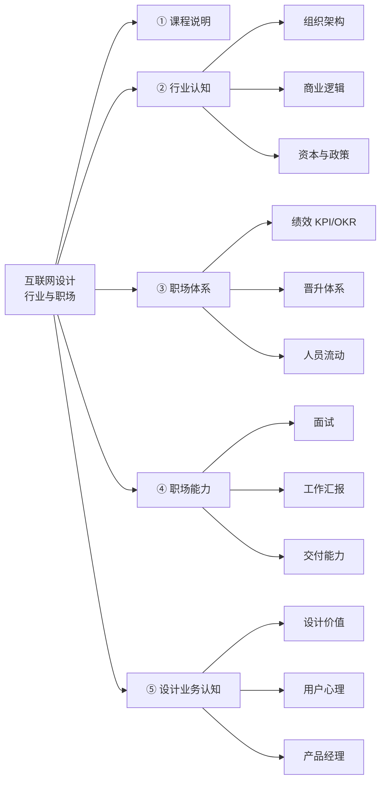

******> [!info] 课程信息
> **讲师**：[[果冻Joe]] ｜ **机构**：像素范儿 ｜ **日期**：2026-09-14 ｜ **类型**：开班课
> **主线**：班级规则 → 行业认知 → 职场体系 → 职场能力 → 设计业务认知
> **性质**：这不是设计技法课，而是一节**行业与职场的"地图课"** —— 先知道自己在什么局里，才知道力气往哪使。

> [!abstract] 一句话总结
> 互联网设计师的竞争力不在"审美"和"技法"，而在三件事：**读懂业务链路、把设计交付给不同角色、用数据结果说话**。
> 而这一切的前提，是理解大厂**靠什么赚钱、凭什么考核、按什么规则流动**。

# 1. 🗺️ 全局框架

---

# 一、课程说明（班级规则）

## 1. 课程质量保障

- ✔ 现有课程体系无明显问题，核心目标是保障学员**跟上课程节奏**，提供 #超预期 教学服务
- ❌ 不对脱离课程节奏、因**个人安排**无法跟进学习的学员做结果承诺

> [!tip] 往届学员状态参考
> 曾有女学员学习期间压力极大，两三个月不洗头不化妆、日常戴帽子，每次写完作业后累到哭泣，哭完仍继续完成学习任务，其男友曾在上个月到机构反馈该情况。

## 2. 线下班价值

- 可获得与老师**面对面授课**的学习机会
- 当前班级共 6 名学员，**同学资源**具备长期价值 —— 班级学员中必然会有 1-2 人最终入职大厂

## 3. 教学特色：行业前沿信息「反哺机制」

- 针对筛选出的优质**苗子**，毕业后续留用 **1 个月**
- 由 3 名老师一对一**带教**，确保其能进入腾讯、阿里等头部**大厂**
- 入职大厂的学员会持续**反哺内部最新行业信息**：

> [!example] 教研会与大厂内网反哺
> 1. **2020 年之前**，每天下午学员下课后，所有老师会召开**教研会**，连麦入职大厂的学员，通过大厂内网**屏幕共享**获取支付宝等团队最新的产品动态、设计方向，通过截屏、录屏、拍照留存资料，补充到教学内容的缺漏部分。
> 2. 积累的内部资料覆盖度极高，甚至掌握**部分大厂内部团队都不清晰的内部文档与标准** —— 例如曾给入职美团的学员提供其团队内部的工作汇报相关资料。

---

# 二、行业认知：互联网是怎么运转的

## 1. 大厂组织架构

**工作室分组模式（阿里）**：整体并非统一管理的单一主体，而是划分成多个类似半外包形式的**独立工作室**

- 夸克浏览器组、淘宝天猫组、支付宝蚂蚁组 等

**工作室独立运营**：各工作室**自主制定 [[KPI]]**、绩效、考核标准与工作任务，相当于独立运营的小公司。

## 2. 组织运转：指标分配、汇报与任务分级

### 2.1. 季度指标的分配

- **集团层**面会给各**业务集团**下达季度指标，再由各**工作室负责人拆解**分配给设计、运营、市场等不同**小组**

> [!summary] 指标分配链路
> `集团` → `业务组` → `工作室` → `小组`（设计 / 运营 / 市场…）

### 2.2. 月度项目汇报机制

| 维度 | 内容 |
| --- | --- |
| **汇报人** | 主管、普通设计师 |
| **汇报内容** | 通过 PPT 汇报当月**工作成果**（如夸克浏览器的改版升级、AI 功能落地、交互与视觉设计调整） |
| **汇报目的** | 结果直接关联小组 KPI 与绩效，是向其他组、集团高层**证明小组价值**的核心机会 |
| **汇报结果** | 直接影响：**团队负责人**的晋升 间接影响：**普通设计师**的绩效评定与资源倾斜 |

> [!important] 为什么要争 S 级项目
> 拿到高层 **S 级别的项目**（如支付宝集福卡、摇一摇功能）会给团队带来显著加分 —— 汇报是"分蛋糕"的场合，项目等级决定了蛋糕的大小。

### 2.3. 任务分级机制

大厂内部项目按重要度分为 **S / A / B / C** 等等级，会根据员工的薪资水平、能力匹配度分配对应等级的任务，**不会在入职初期（季度 / 年度内）给员工分配超出能力范围的任务**：

1. **S 级任务**：全公司最高优先级、全民级的项目。例如 2026 年天猫双十一主视觉设计，会匹配对应能力的人员负责动效、美术把控等模块，项目知名度极高
2. 实习生通常负责 **B 级、C 级**及更低等级的任务

> [!success] 任务争取
> 若员工能在项目汇报等场景主动**向负责人、总监证明自身价值**，有机会获得更高等级的任务分配。

## 3. 商业逻辑：中外互联网的核心差异

| | 国外科技公司 | 中国互联网公司 |
| --- | --- | --- |
| **核心** | 以**实体科技业务**为核心，不存在"互联网行业" | **依托 APP 生存** |
| **举例** | 马斯克旗下特斯拉、SpaceX 火箭、星舰、星链 | 淘宝、抖音、拼多多 |
| **APP 的角色** | 仅作为用户承载的工具，不单纯依靠互联网产品变现 | APP 本身就是变现主体 |
| **经营目标** | — | 做**高营收数据**、拉高公司**市值** |

**中国互联网的支撑链条**：营收增长、市值提升的核心支撑是 APP 的用户规模与用户活跃度（日活、月活）—— 通过活动、内容等方式抢占用户停留时长（如电商平台造节促销、抖音短视频内容），保障活跃度后再转化付费用户。
> [!summary] 商业逻辑主链
> **市值增长 ← 高营收数据 ← 付费用户转化 ← 用户规模 / 用户活跃度（日活月活）← 抢占用户停留时长 ← 各种活动内容（促销 / 短视频）**

### 3.1. 案例：新能源汽车的互联网逻辑
**小鹏、蔚来等**
> [!summary] 亏损换规模模型
> 低价补贴（**极高亏损**）→ 扩大用户规模 → 增加财报数据 → 吸引投资 → 提高市值 → 创始人套现 / 市场规模再扩大

**小米造车（降维打击）**
- **用户来源**：**存量用户** → 直接消化汽车产品，还能挖掘其他品牌的用户
- **造车方案**：
  1. 舍弃了油车核心的**发动机壁垒**，底盘、减震等部件可**直接采购**成熟企业的方案
     - 小米在欧洲建立研发中心，吸纳宝马、奔驰、大众、法拉利等企业的资深人才负责机械部分
  2. 自身**聚焦**擅长的**用户体验与车机交互**（将汽车类比为"大手机"）
     - 例如新推出的二十万级 SUV 可实现房车功能，支持露营时喝茶、吃火锅，车顶可升起作为帐篷，主打**场景化体验**优势

## 4. 大厂业务拓展方式与成本结构
### 4.1. 核心业务逻辑：广告变现
- **阿里妈妈**是阿里旗下 To B 广告投放平台，依托淘宝、天猫、支付宝等头部 APP 的数亿优质用户基数，为广告主提供广告分发服务，获取广告分成
- 相比小范围投放，面向亿级用户的广告哪怕仅**千分之一**的转化率，也能获得极高收益
- 设立初衷：和百度的搜索广告业务竞争，盘活自身的用户资源获取广告收益

### 4.2. 新业务落地的两种模式

| 模式       | 逻辑                                    | 案例                                                                   |
| -------- | ------------------------------------- | -------------------------------------------------------------------- |
| **溢价收购** | 直接用钱买时间、买市场份额                         | 收购饿了么时，饿了么当时市值为 35 亿人民币，阿里以 **95 亿美金**溢价收购，完成本地生活业务布局                |
| **内部孵化** | 压缩成本，给内部团队极少的启动资源，承诺业务做成后团队可拿大部分分红与股权 | 阿里妈妈孵化时仅给 **3-4 名**团队成员、**数百万**启动资金，承诺做成后阿里仅占 **5%-10%** 的股份，剩余收益归团队 |

### 4.3. 互联网公司成本特点
> [!warning] 最大成本不是人，是服务器
> - 科技公司最大的成本支出为**服务器成本**，而非人员成本
> - 服务器需承载海量用户的数据存储、保证访问速度，运行产生大量热量 → 需建在**山顶、海底、水库附近**等低温区域降温（如苹果的"云上贵州"服务器建在贵州山区）
> - 腾讯微信这类亿级用户产品的服务器年成本可达**十几亿至几十亿**
> - 内部孵化项目会最大限度压缩成本：如阿里妈妈孵化时被允许使用**阿里云淘汰的旧服务器**、阿里园区的**闲置办公场地**

## 5. 资本运作逻辑
### 5.1. 影视行业
**非法资金洗白渠道**：影视行业曾是非法资金洗白的重要渠道，典型操作如**阴阳合同** —— 非法资金持有人与剧组约定，明面出资 1 亿投资项目，实际剧组仅获得 5000 万，剩余资金通过**虚报演员片酬**（如演员实际片酬 1000 万，合同写 4000 万）、给无关人员（如亲属）**虚挂制片人职位**发放报酬的方式转回持有人手中，把非法收入转化为可合法使用的资金，过程中损失部分资金作为操作成本。范冰冰阴阳合同事件就是这类操作的典型案例。

**流水线网剧的盈利逻辑**：爱奇艺、腾讯视频等平台的网络大电影、流水线网剧普遍**不打磨剧情** —— 因为流量演员的粉丝是核心受众，打磨剧情带来的受众增量远低于打磨成本，投入产出比极低。

> [!danger] 真正的盈利方式：配合资本在股市收割
> 1. 剧集上线前 **1 个月**就开始营销"磕 CP"，放出片场花絮、剧透片段炒热度
> 2. 剧集播出到 **1/3 热度顶峰**时，平台背后资本的股票、市值会被炒高，资本方在**高点抛售套现**
> 3. 剧集播出中期，投资方会**主动给剧集买黑料**、制造负面新闻，等市值回落时，接盘的都是普通散户

> 资本需要持续上线新的流水线剧集、不断制造新热点，才能反复通过市值波动获利 —— 这和互联网行业持续做新活动、造新购物节拉动流水、美化财报数据、拉动股价增长的逻辑**完全一致**。国内很多行业背后的资本方高度重合，因此运作逻辑相似。

### 5.2. 战略性收购
互联网行业很多收购属于"**战略性收购**"：大厂面对产品、市场表现优秀但资本实力弱的竞争对手，会选择直接收购；收购后**不会**给被收购项目倾斜资源、投入运营精力，让其自生自灭 —— 目的是**消灭竞争对手**，保障自身核心业务的市场份额。

- 饿了么被收购后，资源被倾斜给美团外卖核心业务，饿了么逐渐==边缘化==
- 2018 年阿里以 30 多亿收购主打海外购的**网易考拉**，收购后没有给考拉资源倾斜，其市场份额逐渐被天猫国际抢占，最终淡出公众视野

> 这类战略性收购会导致被收购公司逐渐消亡、引发员工裁员，是近年互联网行业动荡的核心原因之一。

### 5.3. 大厂 背后的AI 业务布局
- 阿里推出**千问 AI**，核心目标是给电商业务赋能：试图打造一站式电商管家 —— 用户在千问内搜索商品时，AI 直接推荐高性价比、活动力度大的商品，**无需跳转其他 APP** 即可完成购买
- 此前千问曾推出持续 2 个月（从年前到元宵节后）的**免费奶茶券**活动，用户每周可领一杯价值三四十元的奶茶，以此引导用户使用 AI 的消费推荐功能

## 6. 国家政策导向与企业资本关联
### 6.1. 中美竞争背景下的赛道扶持
中国目前在 **AI、电车**赛道重点发力，试图在这两个新赛道实现对美国的赶超。**只要美国布局的前沿领域，中国都会出台政策跟进扶持**，避免落后。

### 6.2. AI 行业扶持现状
- 只要==成立 AI 公司==, 就可获得当地政府**十几亿到上百亿**不等的注资（需签订业务目标相关协议，但资金支持力度极高）
	- 2023 年国内涌现大量大模型产品，仅阿里等大厂就有多个不同的大模型团队并行研发
- **Deepseek** 从大厂竞争中突围，成为获得官方重点支持的企业；多数没有自研大模型能力的公司都会接入 Deepseek 的接口，向其支付费用或商务分成
- **豆包**（字节）依托抖音的海量内容数据快速发展（用户在抖音搜索的教程、资讯、游戏攻略、育儿内容等都是 AI 模型的训练素材），其 C 端视频生成等模型能力也在快速扩充
- AI 设计领域头部产品 **Lovart** 可生成带图层的设计作品；这类产品初期大多接入 ChatGPT 的接口，后续再逐步研发自研技术

### 6.3. 电车行业扶持现状
- 发展初期政府补贴极高：只要企业实现电车量产，**每卖出一辆车，政府会承担大部分生产成本**，企业可获得纯利
- 各地政府会给落地本地的电车企业注资，如江西政府注资本土的哪吒汽车，小米汽车落地北京获得北京政府支持
- 行业发展至今已有**近百家品牌被淘汰**，仅少数头部品牌存活
- 如北汽这类有国资背景的车企，不会出现资金链断裂问题 —— 当企业资金紧张时，当地政府会组织本地优质企业召开融资会，**强制要求企业出资注资**

### 6.4. 政策引导的行业发展先例
2013 年年初李克强总理在中关村视察时提出"**移动互联网才是中国的未来**"，当年就诞生了十几万家移动互联网 APP 公司，原本投入房地产的资本大量转向互联网行业 —— 2017-2018 年房地产行业彻底走弱前，资本早已完成向互联网行业的转型。

## 7. 头部企业的国资持股与行业性质
### 7.1. 国资持股情况

| 企业       | 国资关联                                                               |
| -------- | ------------------------------------------------------------------ |
| **抖音**   | 大股东为张一鸣相关财团；中国广播电视台占 **1%** 股份，拥有**一票否决权**，不参与日常利益分配，但可对方向性错误行使否决权 |
| **快手**   | 股东包含北京广播电视台                                                        |
| **蚂蚁集团** | 七大股东为杭州地区旅游导向的国家机构，股权被国资稀释，掌握中国资金命脉                                |
| **滴滴**   | 背后有国家多个部委持股（提及为七大或八大部委，未明确具体数量）                                    |

### 7.2. 行业监管与性质判断
- 国内互联网企业很大程度受国家政策导向；对企业的罚款多为**象征性**，存在政府需要资金周转时开出**百亿元级罚单**的情况
- 本质上多数互联网企业与国家机构、机关存在股权关联 —— 并非直接由国家机构领导，而是通过**国资持股实现方向管控**，可理解为**类国企属性**

## 8. 政策与市场风口
### 8.1. 政策导向催生行业风口
- 市场行为高度受政策影响，**行业风口即政策导向下的机会**，可通过两会等重要会议的总结内容判断行业发展方向
- 2023 年 AI 课程爆发：美国 AI 产业发展热度高，国内两会明确将 AI 列为国家未来重点发展方向后，大量大模型公司、从业者涌入 AI 课程赛道
- 案例：启曼学院某老师在 2023 年 3-4 月 AI 刚兴起时，整合 YouTube 海外教程内容开课，运营五六个各 500 人的学员群，**单月收入达 200 万**

### 8.2. 案例：学习强国项目的运营逻辑
- 由**阿里离职高管**创办的全新科技公司承接开发，团队、体系、周转资源全部来自阿里
- 项目需求**直接由中宣部下发**，设计稿需由负责人乘坐地铁送至中宣部对接（例如曾提出"答题后添加铃铛"的修改需求，团队需按要求快速调整）
- **中宣部为项目实际甲方**

### 8.3. 案例：政策变动下的企业转型（K12）
- K12 教育行业受政策管控后，学而思、小猿辅导等企业**早已提前收到相关信息**并布局转型，将课程内容搭载到**学习机**中售卖
- 学习机售价 4000-7000 元不等，价位等同于华为、小米平板或 iPad Pro，内置全阶段课程与学习资料
- 对外以"**寓教于乐的学习硬件**"为宣传点，==规避教辅培训的名义限制==；师资未直接与企业绑定，规避监管风险

---

# 三、职场体系：绩效、晋升与人员流动

## 1. 绩效体系：KPI vs OKR

| | [[KPI]] | [[OKR]]（Objectives and Key Results） |
| --- | --- | --- |
| **制定方** | 由公司**强制**给员工制定**固定目标** | 由员工**自主制定**个人周期（月 / 季度）绩效目标 |
| **运作** | 员工围绕目标完成工作，根据完成度核算奖金 | 周期结束后回看目标完成度核算绩效 |
| **举例** | 月销售 200 辆汽车 | — |
| **地位** | — | 当前国内外大厂普遍采用的绩效模式，源自**硅谷** |

> [!note] TIPS：管理理念来源
> 国内企业的管理体系多学习自**西方与日本**。中国企业家普遍受**稻盛和夫**的管理类书籍影响，市面上多数成功学管理内容也沿用稻盛和夫的相关理论。

## 2. 评级与淘汰
### 2.1. 裁员的两类情形
1. **整条业务线**：新业务线投入后，未达**盈利预期**、竞争不过竞品，直接裁撤
2. **绩效不达标**的员工：为**降本增效**

### 2.2. 绩效评级体系
大厂绩效通常分为 A+、A、A-、B+、B、B-、C+、C、C 等等级：

| 等级 | 含义 |
| --- | --- |
| **A+** | 可获得**全额绩效**，难度极高 |
| **A / A-** | **优秀**水平 |
| **B+** | **良好**水平（**普遍**） |
| **B- / C- / C** | B- 较差；C- 极少出现；C 为实习生相关情况，较少被提及 |

### 2.3. 会被判定为「不合格」的情形
- 连续数月工作产出质量差、负责的功能上线后数据表现不佳
- 负责的活动（如双十一活动页）点击率、转化购买率低 → 代表业务表现差，直接影响绩效结果
- 长期维持 B+ 评级，代表**业务能力增长不足**
- 入职 3-4 年持续为公司创造的价值偏低
- 入职持续绩效差，**入职数月就会被辞退**

### 2.4. 常见淘汰方式
- **正规大公司**：裁员会**按规定**支付赔偿
- **部分公司**：采用**短期合同**模式 —— 先签 6 个月合同，转正后再签 6 个月，若期间绩效**不达标则不续签**，**无需支付赔偿**

> [!tip] tips
> - 若员工**长期停留**在同一职级、无成长，会成为**优先优化对象**
> - **同职级**人员招聘难度低，甚至可招聘到薪资要求更低的求职者 —— 混日子、无法创造对应价值的员工会被淘汰

## 3. 晋升体系
### 3.1. 职级与薪资

| 职级 | 薪资 | 要求 |
| --- | --- | --- |
| **高级专家岗**（天花板） | 年薪一般 **50w+**，特殊可达 **70w** | 5-10 年工作经验 |
| **高级设计师** | **20K+** / 月 | — |
| **中级设计师** | **15K-20K** / 月 | — |

> [!example] 专家岗案例
> 拼多多从自如挖入的**动效专家**，负责拼多多砍一刀等动效的逻辑策划，**无需亲自完成所有执行工作** —— 高薪买的是判断力与策划能力，而不是产能。

### 3.2. 晋升流程与要求
- **正规一线公司**：职级爬升机制设置**合理**
- **入职时长要求**：不同公司不同，如美团入职满 **1 年**即可申请晋升
- **名额分配**：**按组分配**
  - **负责人**：由**组负责人**确定参与晋升的人员
  - **参与者**：需准备对应**汇报材料**，内容为入职周期内的工作成果，核心要**呈现为公司创造的价值与业务结果**，无固定页数要求，清晰说明工作全貌即可
- **高等级晋升**（如专家岗）：
  - 需**高层**（含对应业务 CEO 级别的管理者）**现场或远程**听取汇报，按**细化的打分标准**评分
  - 由于晋升名额固定，同批次晋升人员会按**评分排序**竞争，达标者才可晋升

> [!warning] 晋升机制的弊端
> 机制会给团队成员带来**竞争压力**，是团队内部出现**勾心斗角**、**帮派势力**的核心原因之一，且**公司规模越大这类情况越普遍**。

## 4. 团队内部生态
### 4.1. 人员流动与空降领导
- **流动原因**：员工获得更好的发展机会跳槽；负责的业务线长期无实际增长（如淘宝签到模块这类无法带来实际业务增长的项目组），项目主管会被优化替换
- **空降规则**：新替换的主管多为空降形式，**99.999% 的空降领导不会沿用原有团队成员** —— 类比木匠不会使用他人的工具，原有工具可能存在野路子、使用不顺手的问题，会替换为自己的原有团队成员

### 4.2. 空降领导调整团队的常见方式
> [!danger] 不直接辞退，而是「架空」
> 通常不会直接辞退原有员工，而是通过**架空核心人员**的方式逼迫员工主动离职：
> - 剥夺原有小负责人的**管理权限**，只分配基础执行类工作
> - **拆分原有员工手中的核心绩效任务**，将大部分任务分配给自带的团队成员，仅给原有员工保留少量低价值任务，削弱其核心竞争力
>
> **案例**：某任职小负责人（管理 1-2 名员工）的从业者，在部门大总监被替换、空降新领导后被架空，原本负责的模块被分配给新入职员工，仅被安排做基础作图工作，因此产生离职意向。

### 4.3. 高管对赌规则
- 公司挖角高管时会设置**对赌协议**：以支付宝挖角微信运营增长模块负责人为例 —— 给出 **200 万基础薪资**，同时约定期权、绩效奖金等额外收益的获取条件：若**半年内**达成日活、下载量、业务增长等约定指标，才可获得对应期权与奖金；若未达标仅能拿到基础工资（部分岗位基础工资较低）
- 企业创始人的薪酬也采用类似逻辑：如刘强东公开宣称在京东仅拿 **1 元年薪**，实际收益来自公司**分红**与早期持有的**期权** —— 这类资产不属于工资范畴，婚姻财产分割时无法被分割

---

# 四、职场核心能力：面试、汇报与交付
> [!important] 决定职场长远发展的三个核心环节
> **面试 · 工作汇报 · 交接协作**

## 1. 面试考察重点
- 面试中**仅约 10%** 的问题涉及设计技法，绝大多数问题围绕**业务层面**展开：选择某版==设计方案的原因==、个人在项目中的==具体贡献==、说服团队采用方案的==方法==、与开发等协作方的==沟通协调过程==、项目所属==业务类型与目标==、作品投放==渠道==等
- 若缺乏对行业、业务的认知，**即便作品集质量极高也难以通过面试**
- 企业要求人才为"**八角形人才**"（高于六边形的全面能力要求），即"**面试造飞机，工作拧螺丝**"的招聘逻辑
- **压力测试**：面试官质疑作品集图片相似，目的是考察应试者是否心虚、是否真正理解作品对应的业务逻辑。当前获取设计图门槛极低（无 AI 时代可从花瓣网找参考，AI 时代可生成全网唯一的图片），**图片本身并非核心考察点**，通过业务交流即可判断真实能力
- 即便通过面试，仍有 **3-6 个月试用期**，入职后通过需求会议、碰稿等协作环节即可快速判断真实能力

## 2. 工作汇报
**固定汇报**：大厂等一线互联网公司包含

| 类型   | 内容                     |
| ---- | ---------------------- |
| 日报   | 部分要求 PPT、部分要求长图，总结当日工作 |
| 周报   | 总结一周工作                 |
| 月报   | 团队内全员同步当月工作            |
| 季报   | 多为跨组同步季度工作             |
| 年底汇报 | 年度工作总结                 |
| 晋升报告 | 不定期                    |

**灵活汇报**：项目（如中秋活动）平稳上线后，需整理为 PDF 等格式在组内做**经验分享**。
> [!tip] 汇报要求
> **逻辑清晰为核心**。PPT 无需设计精美，甚至可以是白底加标题、线条标注的简洁形式，做到**仅看页面就能理解内容**即可；不要求具备演讲能力，表述清晰、逻辑通顺即可。

## 3. 入职适应建议
- 公司的规范、知识点是**通用内容**，不同公司有不同的流程和偏好 —— 入职后可直接询问团队==交接流程、工作习惯==，**大方确认需求不属于"露馅"**，工作是在规范体系下灵活开展的
- 开展任何工作都需要明确**上游、下游对接的团队与人员**，在此基础上灵活处理具体沟通、方案碰撞等环节

## 4. 求职面试的核心考察逻辑
### 4.1. 适配性优先于硬技能
- 招聘方核心评估两个维度：
	- 一是对**业务全环节的熟悉程度**
	- 二是与公司团队、工作形式的**匹配度** —— 适配性的判断逻辑和择偶类似，**并非能力越强越好**
- 若候选人能力过强、流程搭建过于完善，但招聘方团队规模小、人员配置不足以支撑对应的体系，同时无法匹配候选人的薪资预期，**反而不会录用**，避免后续工作推进复杂、适配困难
- 当前 AI 工具普及的环境下，面试官不会重点考察纯技能；**硬实力达标后，适配性是核心决策因素**，总有部分岗位会和求职者形成适配

### 4.2. 面试官实际考察方式
- 面试核心**不会**询问作品的制作方法、来源渠道，也**不会**优先查看作品集；通常通过 **1 小时左右**的沟通即可判断候选人是否具备==真实的行业实操能力==，若存疑可通过测试题验证
	- 核心判断仅需**两个问题**即可覆盖 80% 以上的评估：
	  1. 工作环节中的**协作、交接流程**是如何开展的
	  2. 负责的项目（如设计的活动）**上线后是如何收尾**的
- 通过回答即可快速识别候选人是否具备真实的行业实操经验（即"**行活儿**"能力）—— 即使是表达能力极强的人，也很难在无实操经验的情况下对答如流，这类人占比仅为百万分之几

### 4.3. 作品集的实际价值
- 作品集属于求职**必备的交付材料**，但准备作品集的核心价值**不是应付面试**，而是在 3 个月的制作过程中，完整梳理全==业务模块==、==业务流程==，把==工作思路==理顺，明确==每个工作环节的价值和内容==
  - 作用类似从小学到高中的语文学习 —— **不一定直接用到知识点，但会锻炼逻辑表达、内容输出能力**
- 新展现形式：可以用 **CodeX** 这类 AI 工具快速生成个人作品集网站，仅需掌握少量代码相关词汇即可操作，不需要完全懂代码开发

## 5. 全链路业务逻辑理解
> [!important] 求职者必须掌握完整的业务链路
> 以互联网活动运营为例，核心链路包含三个环节：

### 5.1. ① 引流入口
引导用户进入活动的**外部触达渠道**。典型案例：天猫双十一的开屏海报、抖音平台的视频广告、公交站的线下海报 —— 核心作用是**吸引用户注意力**，引导用户进入活动页面。

### 5.2. ② 落地页
用户点击引流内容后进入的**活动主页面**。比如双十一带有活动大标题、商品展示的主会场页面。

### 5.3. ③ 留存与转化设计
落地页无法留住所有用户，因此需要设计**多重分流、留存环节**：
- 通过各类**互动游戏**（集福卡、喂宠物等）将用户分流到子业务板块，确保**总有一个环节能留住用户**，大型活动通常会设置多个互动入口
- 运营端通过**预售**等手段提前锁定用户：比如 9 月底 / 10 月初开启双十一预付款通道，用户支付定金后可享受双十一半价优惠
  - 本质是**提前锁定用户决策**，类似理发店充值会员的逻辑 —— 资金提前到账后用户就处于被动位置，后续会被引导支付尾款，很多用户会在环节引导下做出冲动消费决策

---

# 五、设计业务认知
## 1. 业务设计的价值影响
- 大厂核心活动（如双十一）会**选拔全公司最优秀的设计师**负责主视觉设计，其余设计师负责辅助工作
- 核心大促的单月流水可达数千亿（如天猫双十一单月流水最高达 **6000 多亿**，京东大促流水也达五六千亿）
- 设计细节（如图标、按钮大小）会直接影响**数百万、数千万用户**的点击与参与意愿 —— 哪怕仅**万分之几**的转化率波动，都会造成**数亿级别**的营收差异
- 因此所有活动、运营动作均**以数据结果为核心判断标准**

## 2. 行业活动投放数据参考
- 大厂常规小型活动，投放覆盖数百万参与者时，**0.01%** 左右的参与率属于正常水平；部分极小活动 **0.001%** 的参与率即可算达标
- 活动核心逻辑为通过**大规模曝光撬动用户点击**，只要有部分用户进入活动链路，即可产生消费转化 —— 也侧面体现互联网行业**流量竞争压力极大** 

## 3. 互联网设计师的行业覆盖范围
当前"互联网设计师"并非仅服务于阿里、拼多多等纯互联网公司，**国内绝大多数行业均与互联网强关联**：
- 快消品牌如**三只松鼠**，虽有线下门店，但核心获客来自电商、直播带货等线上渠道，属于互联网范畴
- **线下餐饮**门店需通过抖音等平台运营账号获客；瑞幸酱香茅台等品牌营销活动也需通过互联网传播
- **电车行业**核心体验差异来自**车机系统**（包括交互页面、辅助驾驶反应速度、转向响应、智能门把手触发等），相关设计工作属于互联网设计范畴 —— 本质是**物联网场景下的网络连接与交互承载**
- 即使是**传统品牌设计师**，也需要通过抖音、小红书等互联网平台承接私活、传播作品

> 国内几乎所有设计岗位均与互联网相关，**不再严格区分视觉、交互等细分方向**。

## 4. 设计师核心能力
### 4.1. 审美不属于核心专业能力
- 审美是**全人类共通**的基础能力，非设计师专属 —— 即使是不懂设计的普通人群（如家中长辈）也能对设计美观度给出主观判断
- 审美属于**后天形成的认知**，受所处时代、环境的主流内容影响，**没有绝对的优劣标准**：

> [!example] 审美的时代性
> - 日本军国主义时期，贵族女性将牙齿涂黑视为审美标准
> - 清朝官服、龙袍在当时是身份象征，当下观看会有类似僵尸服的观感
> - iOS5、iOS6 时期的拟物化图标在当时是主流设计，如今用户已普遍接受扁平化风格，未来 20 年现有数码产品设计也可能被后辈认为过时

- 普通人群虽能判断美丑，但**不具备调整配色、优化交互逻辑、落地设计方案的执行能力** —— 这类**技法能力**才是专业能力的组成部分

 
### 4.2. 交付能力是核心专业能力
> [!important] 什么是「交付」
> 交付指**完成设计内容后对接给相关方的全流程**。多数新人对交付的认知仅停留在提交单张图片或云文件，**不符合职场要求**。

职场中设计师往往是团队内**唯一懂设计的角色**，需对接运营、市场、老板、用户调研等**非专业人群**，也需对接 junior 设计师、上级领导等不同角色 —— 需**根据对接方调整交付形式**：
1. **对接非专业业务方**：不能仅提交单张设计图，需结合实际**投放场景展示效果**。例如双十一海报需附上天猫对应页面的截图，直观展示设计在实际上线场景中的适配情况
2. **对接协作的设计师**：不能仅提交单张作品，需附上**完整的规范文档**，明确模型材质、设计标准、后续需产出的内容模块等要求，方便其他设计师承接后续**数百至数千张**配套页面的制作（参考天猫双十一全链路页面的协作模式）
3. **对接领导 / 管理层**：不能仅提交杂乱的原文件，需根据需求准备 **PPT / PDF / Keynote** 格式的汇报材料，方便领导向上级或投资方展示；避免因文件杂乱浪费对方时间，留下"工作习惯差"的印象
   - 可借助 **Kimi** 等 AI 工具一键生成 PPT 提升效率，其中苹果系统的 **Keynote** 演示效果优于常规 PPT

### 4.3. 业务方向判断能力
- 接到设计任务时需结合**活动阶段、核心目标**确定设计方向，而非仅参考泛化的"大众审美"
- 以天猫双十一为例，**固定设计方向元素**包括：红色系热闹氛围、红包雨、平台 IP 吉祥物（天猫喂猫、京东喂狗）、互动小游戏（盖楼、跑步攒积分等）
  - 这类设计的核心目的**不是传播，而是通过吸引注意力提升用户活跃度**，最终实现消费转化
- 互联网平台频繁做活动的底层逻辑：当前流量竞争激烈，各平台（包括短视频平台入局电商）均在争夺**有限的国内用户**，通过小游戏、优惠券、折扣等形式引导用户停留、消费 —— 哪怕红包雨实际仅能给到用户几毛金额，也能起到引导用户点击参与的作用

## 5. 产品设计匹配用户定位的案例

| 品牌 | 目标用户 | 设计匹配 |
| --- | --- | --- |
| **理想汽车** | 中国中产家庭（多为 5 口及以上的多成员家庭） | 大尺寸 SUV/MPV，主打大后排空间、大储物空间，座椅可放倒当床，满足孩子活动、老人舒适乘坐的家庭出行需求 |
| **小米汽车** | 2012-2013 年小米品牌成长阶段积累的**米粉**群体，以男性为主，当前有一定积蓄、不一定成家，追求酷炫、刺激、科技感 | 首款车型为**低趴轿跑**，主打百米 1-2 秒级的强加速性能；后续推出的 SUV、露营款也围绕目标用户需求设计 |
| **华为高端产品**（折叠屏手机、享界 / 尊界等合作汽车） | 高端阶级用户，核心属性是**社交货币** | 折叠屏手机初期溢价可达 2-3 万，价格接近顶配苹果笔记本，核心价值不是产品功能，而是身份、地位的体现；高端车型主打**私密性功能**（后排与驾驶室的隔音隔断、可升降私密幕布、自动关门等），匹配商务、高端人士的出行隐私需求 —— 网络负面评价不影响其目标客群的购买选择 |

## 6. 高端奢侈品的营销与溢价逻辑
### 6.1. 阶级属性与广告受众
- 体现阶级属性的高端产品**天然带有阶层对立属性**：公众看到法拉利轰油门、3 万元折叠屏、巴黎世家售价三四万的普通塑料袋造型产品时，第一反应是反感、吐槽使用者"装"，但潜意识里会**承认使用者的消费能力、认可其财富阶层身份**
- 劳斯莱斯、LV、Gucci、巴黎世家等奢侈品牌的广告，**核心目标受众并非有购买能力的高净值人群** —— 这类人群购买劳斯莱斯、大 G、湾流私人飞机、科尼赛格等顶级产品时，不会通过广告了解信息，不会对比配置、询问贷款政策，而是**直接定制购买**
- 奢侈品广告的核心作用是**给非目标受众**反复强化"该产品价格高昂、普通人买不起"的认知，让非受众形成产品的高端价值共识，最终**衬托购买者的身份地位** —— 如果年轻一代对劳斯莱斯等高端品牌没有认知，购买者的身份彰显需求就无法满足

### 6.2. 拓展: 艺术品类的溢价本质
- 艺术作品的核心溢价来源是**独有的个性化差异**：梵高、达芬奇、毕加索等艺术家的作品具备不可复制的个人风格 —— 若作品能被普通大众轻易看懂，就会失去差异化价值，无法卖出高价
- 艺术、茶叶等**无明确统一成本定价标准**的品类，常被用于利益输送、洗钱：部分公职人员通过亲属开设茶叶店，暗示求办事的人高价买茶，将贿赂款包装成茶叶交易款；艺术品拍卖也存在以"个人喜好"为名，将非法资金包装成合法交易款的操作

## 7. 消费下行环境下的营销与用户心理
### 7.1. 消费决策逻辑
1. **压缩决策成本与时间**：消费下行阶段用户花钱决策犹豫，平台通过快速降低用户决策成本、压缩决策时间刺激消费 —— 例如进入活动页面就**直接展示用户已获得小额收益**（如三毛钱红包），不给用户犹豫空间
2. **大数据精准推送**：各 APP 基于用户浏览偏好推送对应商品（男性用户收到衣服、玩具、游戏类推送；女性用户收到化妆品类推送），多因素叠加下引导用户**非计划性消费**
3. **热闹氛围营造**：通过制造复杂热闹的活动氛围，利用人性的**从众心理**吸引用户参与 —— 和过年期间民众下意识去逛商场的逻辑一致（民众默认商场有活动、其他人都在参与）。该心理**并非中国人特有，是普遍人性**

### 7.2. 传统节日营销逻辑
1. **核心依托道德约束**：中国用户消费行为受**道德因素**影响强，节日营销可绑定团圆、孝亲等道德属性刺激消费
   - 中秋节营销可主打团圆氛围，唤醒用户对父母、家人的关怀，刺激用户为家人购买月饼等节令商品
   - 春节营销可绑定走亲访友、给晚辈准备礼物的传统，用户会考虑礼物数量、均等性，自然产生消费
2. **视觉设计贴合节日属性**：传统节日视觉需传递团圆等核心氛围，节令元素多为**圆形**（对应团圆寓意）—— 如中秋的月饼、咸鸭蛋（蛋黄），清明节的鸡蛋；粽子虽为三角形但也不会设计为方形，避免违背节日认知
3. **与大促营销的差异**：漫天飞红包的形式适合**无明确消费理由的时间节点**（如双十一大促）用来刺激冲动消费，**不适合**中秋这类传统节日

## 8. 互联网造节与大促的发展逻辑
### 8.1. 双十一发展脉络
- **起源**：2013 年（移动互联网正式起步、手机厂商百家争鸣的阶段）阿里巴巴首次将光棍节命名为双十一抢购节，**早期活动真实福利力度大**
  - 初期盖楼活动可获得数百元红包
  - 第一年集五福活动，参与者最低获得 200 元，最高可获得 600 元
- **造势方式**：在中秋到年底的**消费空档期**打造狂欢节点，通过举办高规格晚会（邀请顶级明星，规格接近春晚）营造氛围，吸引用户尤其是单身用户通过凑热闹、消费获得情绪慰藉
- **规模**：阿里双十一销售额可达 **6400 多亿到 6500 多亿**，投入约 **1000 亿**，单月营收规模可达千亿美元级别 —— 是依托**人性和社会特征**实现的商业结果
- **现状**：抖音、京东等平台也入局争夺大促市场份额

### 8.2. 节气、特殊节点营销的目的
> [!note] 并非所有节点营销都以直接卖货为目标
> | 节点类型 | 核心目标 | 视觉策略 |
> | --- | --- | --- |
> | 双十一大促类 | **直接提升销量** | 偏向通用 3D 渲染素材（礼盒、金币、红包样式同质化），直接推送商品优惠信息，引导即时转化 |
> | 白露等二十四节气、九三阅兵类特殊节点 | **品牌宣传** | 即使页面没有购买按钮、转化入口，也会放置品牌 logo、吉祥物，通过有独特风格的**插画类设计**体现品牌差异化，强化用户品牌认知 —— 典型案例如墨迹天气的节气小插画设计 |
> | 瑞幸酱香拿铁类联名 | **获取流量** | 即使直接销量不高，数百万的关注度也能提升品牌关注度和品牌效应 |

## 9. 设计专业能力要求
1. 摒弃主观"好看"的判断标准，优先明确三个核心问题：**活动需要什么形式、活动面向什么人群、活动的核心目的是什么**，快速匹配对应设计方向
2. 建立**行业活动认知的审美**，可通过参考找思路，但需具备**独立判断能力**，不能依赖他人指导
3. 设计需**贴合用户定位** —— 所有领域的产品、设计本质都是匹配目标用户需求，核心是**用户体验思维**

## 10. 产品经理岗位认知
### 10.1. 核心价值：设计利用人性的规则
产品经理是公司团队中价值极高的岗位，核心工作是设计能**击中用户人性弱点**（贪婪、损失厌恶、沉没成本心理等）的**游戏规则**，引导用户完成留存、转化行为。

### 10.2. 两类产品经理

| 类型            | 职责                                                 |
| ------------- | -------------------------------------------------- |
| **传统互联网产品经理** | 负责设计完整的产品规则、交互跳转逻辑，核心是激发用户的行为动力 —— 比如拼多多"砍一刀"的规则设计 |
| **AI 产品经理**   | 负责给大模型规划逻辑 —— 比如即梦的出图逻辑、快速出图的交互流程                  |

### 10.3. 行业标杆案例
- **拼多多"砍一刀"** 是现阶段全球范围内最成功的产品规则设计：能让 **70%-90%** 的用户进入规则流程，环节衔接紧密，只要用户进入第二步就会被引导走到最后；至今没有第二个同量级效果的裂变规则，后续的发红包、朋友圈集赞获福利等玩法都是模仿该逻辑
- 拼多多海外版 **Temu**（北美市场产品）把砍一刀模式复制到美国，当地用户从未接触过这类玩法，传播效果极好
- 拼多多的产品经理属于行业内**薪资极高、能力受认可**的群体
- 过往行业公认的顶级产品经理是百度的**俞军**、微信创始人**张小龙**，行业内有"**南俞军、北张小龙**"的说法 

### 10.4. 设计与产品的专业背景差异

|                        | 国内               | 海外                                                   |
| ---------------------- | ---------------- | ---------------------------------------------------- |
| **设计 / 交互 / UI 岗对应专业** | 视觉传达、平面设计、多媒体设计等 | ① **计算机专业** —— 90% 的海外设计师具备**前端开发能力**，可独立搭建个人网站      |
| **产品经理对应专业**           | —                | ② **用户心理学** —— 海外 90% 的产品经理是用户心理学出身，所有交互理论都基于用户心理学模型 |

> 核心逻辑：利用用户的**贪婪、损失厌恶、沉没成本**等心理，激发用户的点击、参与欲望。

## 11. 典型人性设计案例解析
### 11.1. ① 拼多多砍一刀的心理逻辑
规则会先让身边 10 个人里的 2-3 个成功拿到奖励，给用户营造"**我也有可能中奖**"的预期 —— 即使用户清楚规则的套路，也会被**侥幸心理**驱动参与。

> 作者本人曾带着研究拼多多逻辑的目的参与砍一刀，最后也因**差一点**拿到 200 元奖励产生遗憾情绪，出现"想研究传销结果自己陷入传销"的状态。

这类设计和**赌场游戏逻辑**类似，通过概率和机制让用户应接不暇，即使用户最后点击退出，也会在过程中产生心动感。

### 11.2. ② 页面退出环节的心理设计
用户点击关闭按钮时，页面会弹出"**确定要走吗**"类的提示，告知用户退出就会损失对应福利，利用用户的**损失厌恶、沉没成本**心理挽留用户；同时会给用户"点一下也没损失，大不了退出"的**低门槛心理暗示**，降低用户的参与顾虑。

### 11.3. ③ 世界杯足彩的心理陷阱
> 作者从 1998 年开始看球，世界杯期间第一次购买足彩，第 2 到第 4 次购彩累计盈利 **600 元**（单场盈利 200 元）。当时已经意识到**沉没成本**的风险想要收手，但又产生"再买也不亏，中了就是白赚"的心理，后续购彩再未中奖，且多次差一点命中。

本质是世界杯的氛围、彩票的规则设计会**放大人性弱点** —— 人的理性往往会被基因里的底层心理驱动，很多产品就是利用这类**人类底层的心理代码**设计规则。

## 12. AI 在互联网工作中的应用逻辑
- **品质对比**：当前行业资深从业者的产出质量仍优于 AI 生成内容，但 AI 的**效率优势显著**
- **效率差异**：以阿里巴巴某项目组为例，单月需完成 4 个业务目标，纯人工仅能完成 **2 个**，借助 AI 可完成 **5-6 个**
- **职场评价导向**：职场中设计能力、作品质量**不直接决定**薪资、绩效与待遇，核心评价标准为**业务完成度**
  - 即使作品质量高, ==但产出慢、未完成业务，不会获得高评价==
  - 即使作品非本人创作、借助外力完成，==只要达成业务目标即会被认可==
- **真实职场案例**：存在员工因擅长协助总监处理任务分配、年会统筹等**业务相关事务**获得总监认可，其名下设计工作可由总监分配给其他同事协助完成 —— 能力评价**不局限于设计技法本身**

## 13. 不同市场的设计合规与业务要求
### 13.1. 海外市场设计规范
> [!danger] 面向北美、南美等海外市场的设计需符合当地社会规则
> 例如快手国际部电商海报曾因**仅出现男性形象**，在推广阶段被打回。

- 当地人权组织要求设计中**人物性别必须对等**：出现 2 个人物需为 1 男 1 女，4 个人物需为 2 男 2 女
- 人物**不能有明确的性别指向或身份标签**（例如不能明确刻画家庭主妇形象），最好呈现**无性别特征**的风格 —— 否则会引发民间组织抗议，导致活动停办、产品下架
- 海外市场**社会影响力由民间声音主导**：例如美国弗洛伊德事件直接影响总统选举结果，民间抗议可直接决定平台、产品的生死

### 13.2. 国内市场设计逻辑
国内社会影响力最终由**政府、机构**进行导向，相关措施规则根据**社会反响程度**制定。

---

# 六、📅 后续安排
- [ ] 通过作业提交情况, 检验学员的**交付能力**。
- [ ] 在为期 3 个月的学习周期内，除设计作图技能外，掌握**职场交付、业务判断**等综合职业能力。
- [ ] 建立对**全行业各类活动的认知体系**，面对不同节点（节日、节气、大促、特殊事件）的设计需求时，能快速定位正确的设计方向。
- [ ] 摒弃设计中主观"好看"的判断逻辑，做设计前先明确**活动形式、目标人群、核心目的**三个核心要素。
- [ ] 观察、思考不同行业产品（如汽车、数码产品）的设计逻辑，理解**产品定位、用户需求和设计选择**的关联，提升用户体验思维和专业能力。
- [ ] 做品牌相关的节气、节点宣传设计时，必须植入**品牌 logo、吉祥物**等品牌识别元素，体现品牌差异化风格，避免无效设计。
- [ ] 日常关注**政策资讯与行业发展方向**，提升对业务的理解能力。
- [ ] 训练**工作汇报**的逻辑表达能力，掌握不同类型汇报的呈现方法。

---

- 下一页: [[UXDesignCourse/W1D0_pm_行业认知与职场法则]]