> [!info] 课程信息
> **讲师**：[[果冻Joe]] ｜ **机构**：像素范儿 ｜ **日期**：2026-09-14 ｜ **场次**：Day00 下午
> **主线**：行业现状 → 认知与核心竞争力 → 能力模型 → 面试沟通 → 中外对比 → 品牌 IP → 大厂活动视觉 → 小红书案例 → 页面拆解方法论 → 商业逻辑
> **性质**：[[UXDesignCourse/W1D0_am_互联网行业认知与职场法则]] 的**下半场**——上午讲"局是什么"，下午讲"**你在这个局里靠什么活、怎么看懂别人的活**"。

> [!abstract] 一句话总结
> **基础能力决定下限，认知决定上限。**
> 行业门槛其实不高（AI 之后更低），真正的分水岭是：**认知深度、核心竞争力、和看懂别人活动背后商业逻辑的能力**。
> 全片最大的方法论产出是一句话——**画面本身不重要，重要的是机制、逻辑、模块。**

```mermaid
graph TD
    D0["Day00 PM<br/>行业认知与能力模型"] --> M1["① 行业现状"]
    D0 --> M2["② 认知与核心竞争力"]
    D0 --> M3["③ 设计师能力模型"]
    D0 --> M4["④ 面试 · 沟通 · 作品集"]
    D0 --> M5["⑤ 中外对比"]
    D0 --> M6["⑥ 品牌符号与 IP"]
    D0 --> M7["⑦ 大厂活动视觉"]
    D0 --> M8["⑧ 小红书 40 亿案例"]
    D0 --> M9["⑨ 页面拆解方法论"]
    D0 --> M10["⑩ 活动视觉商业逻辑"]
    D0 --> M11["⑪ 设计方法论原则"]
    D0 --> M12["⑫ 课程信息与任务"]
    D0 --> M13["⑬ 后续安排"]

    M12 --> M12a["每日热点关注任务"]
    M13 --> M13a["作品集 · 面试"]
    M13 --> M13b["活动拆解练习"]
    M13 --> M13c["任务与纪律"]

    M1 --> M1a["薪资溢价"]
    M1 --> M1b["门槛：外网信息"]
    M1 --> M1c["AI 冲击"]
    M2 --> M2a["认知决定上限"]
    M2 --> M2b["长板理论"]
    M3 --> M3a["基础能力"]
    M3 --> M3b["工作能力"]
    M8 --> M8a["转化漏斗"]
    M8 --> M8b["抖音 vs 小红书"]
    M9 --> M9a["引流 → 落地 → 转化"]
    M9 --> M9b["包体 · 动效 · 热区"]
    M10 --> M10a["选品与摆放"]
    M10 --> M10b["多层审核 · 技术壁垒"]
```

---

# 一、行业现状：薪资、门槛与 AI 冲击

## 1.1 薪资现状

### 初创团队资金规模
- 行业初创团队**起始资金通常达数千万甚至数亿级别**
- 当前 AI 热潮下，**新公司成立当月即可获得数亿投资**
- **典型模式**：大厂某组负责人摸透规则后**独立创业**，拉拢业务熟练人才，向投资机构**出具 PPT 规划并签署对赌协议**获取资金

### 薪资水平

| 层级 | 薪资 |
| --- | --- |
| **零基础入行最低** | **12,000–15,000** 元/月 |
| **悟性强的零基础** | 可达 **18,000–20,000** 元/月 |

> [!important] 薪资溢价从哪来
> 行业整体薪资**存在明显溢价**，并非完全对应个人实际价值。
> - **对比传统广告公司**：同类能力者仅能拿到**几千到一万元**——因为传统广告公司营收有限，用人成本被压缩
> - **互联网大厂**单月活动（如双十一）营收可达**数千亿**，因此**愿意抬高用人成本**以确保人员能力达标

## 1.2 行业能力门槛分析
### 整体门槛不高
- 行业所需设计师**能力水平至今并不算高**
- **AI 普及后，了解互联网活动机制即可胜任大部分工作**
- 主要需要掌握的是**行业小套路和内幕信息**

### 唯一较高门槛：外网信息来源
- 行业**新概念、新技术、新信息几乎全部来自外网**
- 以 Adobe 软件学习为例，**深入教程需通过外网获取**
- **外网教程特点**：讲解**底层逻辑**，一个工具能完成的效果会**拆解为多个步骤**，帮助学习者**举一反三**
- **国内早期（百度时代）教程特点**：**只教操作步骤，不教原理**，导致同质化严重、学习者吃不透

### 学习方法的转变

|            | 做法                          | 结果          |
| ---------- | --------------------------- | ----------- |
| ❌ **早期学习** | 跟着教程**记具体数值**               | 做完仍不理解      |
| ✅ **正确方法** | 记住**效果本质**及实现该效果的**几种快速方法** | 数值可**灵活调整** |

> [!tip] 这条学习理念同样适用于 AI 工具
> 不要记提示词的"咒语"，要记**效果的实现路径**。

## 1.3 AI 对行业的冲击：两个标志性事件（2023 年初）

> [!example] 事件一：ChatGPT 发布（约 2023 年 1 月，中国春节期间）
> - **真正意义上的人工智能对话工具**
> - 可满足**文档处理、查重、论文整理、Excel 表格**等需求
> - **当前应用示例**：用豆包拍摄游戏画面即可获取道具获取方式

> [!example] 事件二：Discord 平台上的 Midjourney（MJ）
> - [[Discord]] 是国外**语音实时沟通平台**，**语言逻辑成熟，适合 AI 字符命令**
> - 有团队在 Discord 上搭载了设计工具 [[Midjourney]]
> - **直接解决了设计师两大痛点**：**没有审美**、**不知道好看的效果如何实现**

## 1.4 AI 带来的变化
- **出图门槛大幅降低**：小学生也能用 AI 生成插画
- **个人案例**：12 岁外甥用 iPad **一帧一帧制作火柴人砍人动画**
- **行业震动类比**：如同第一次工业革命中**蒸汽机出现时纺织工人的恐慌**——但最终**纺织工人学会了使用机器继续工作**
- **结论**：**新事物出现后需了解其本质，不必恐慌失业**

## 1.5 企业降本增效与裁员案例
> [!warning] 紫金矿业降本增效
> 集团将目标下发给各**项目组高管**，要求完成年度业绩/目标；完不成时**从其他方面找补**，**降本增效成为手段**。

> [!danger] 字节跳动大力教育：一夜归零
> - K12 文件下发前，大力教育是 K12 领域**最强公司之一**
> - **半年内**教育部门从普通部门扩充至 **5000 多人**
> - **国家文件下发当晚，一夜之间 5000 多人全部裁撤**，大力教育直接消失

---

# 二、认知与核心竞争力

## 2.1 认知决定上限

- **基础能力决定下限，认知决定上限和可能性**
- **认知提升方法**：**多看、多了解、多吸收，不仅限于作图本身**

## 2.2 认知差异示例：面试场景

| | 理解 |
| --- | --- |
| **低认知** | 作品集做好、作品数量够多即可 |
| **高认知** | **站在面试官角度思考** |

**高认知的具体展开**：
- 面试官核心关切：**此人能否帮我完成绩效目标**
- 面试官问"**还有没有其他作品**"的真实含义有两种：**可能是尬聊想尽快结束**，也可能是**真的想确认实力**——需要判断
- **类比**：相亲时问"家里几口人"，需判断对方真实意图

## 2.3 核心竞争力的定义
- **前提**：**沟通协作能力**、**了解整个运行机制**
- **本质**：利用协作、效率提升、沟通等能力，**直接达成业务目标**
- **大白话定义**：**具备别人目前不具备的某个关键能力**

## 2.4 核心竞争力的具体表现
- **AI 应用能力**：不仅会用 AI 出图，还能用 AI 完成**具体业务场景**（世界杯海报、天猫双十一、中秋节活动等）
- **AI 工作流优化**：**缩短从需求到上线中间环节**，提升团队效率
- **沟通能力**：讲话**有逻辑、有带动性**（非闲聊）
- **PPT 制作能力**：工作中极为重要的环节
  - **案例**：小米发布会 PPT 由**设计团队分工完成**，总监不亲自做
  - **个人经历**：2018 年小米 MIUI 12 发布会前，通过小米同学**提前拿到未完成的 PPT，比雷军更早看到**

## 2.5 情商与协调能力
- 让团队**沟通顺畅、获得认可、推动他人按你的要求执行**
- 有些人**能力不强但沟通协调让人舒服**，愿意与之合作
- 这**有一定天赋成分**，但同样属于核心能力

## 2.6 长板理论
> [!important] 核心主张
> **不需要把所有的短板都补长，而是保证短板不是很短，但长板足够长。**

- **举例**：AI 工作流能力强的人，做的东西可以很一般，但能展示**全链路产出、规模化东西或标准规范**
- **总能找到一个别人不太在乎的点，把长板补长**
- **闲鱼案例**：唯一一个**既能聊天扯皮又能买货**的 APP，在国外号称"**中国的黑市**"
- **结论**：**核心竞争力直接决定在行业未来上升的高度和在团队的核心地位。工作能力甚至高于基础能力，两者缺一不可。**

---

# 三、设计师的能力模型
## 3.1 设计是理科
- 互联网设计（**非专业插画师方向**）**本质是理科**
- **用户心理学涉及物理数学模型**
- 国外心理学研究使用**坐标表格图、波士顿矩阵、X 轴 Y 轴**分析用户数据
- **数学好的人逻辑性强，对设计学习有直接帮助**

## 3.2 设计师的两大核心能力

|                    | 能力       | 内容                                                       |
| ------------------ | -------- | -------------------------------------------------------- |
| **1. 核心基础能力**      | **专业能力** | 会作图、掌握设计技能                                               |
|                    | **业务能力** | 了解业务，知道**商业化如何落地**                                       |
| **2. 工作能力**（与职业挂钩） | —        | 区别于纯技术能力；需满足**多元化、复杂的工作场景**；**协调好所有人员之间的关系**，保证团队"大船往前走" |

## 3.3 自由职业 vs 上班工作

| | 主动权 | 甲方 | 要求 |
| --- | --- | --- | --- |
| **自由职业** | 在设计师手中 | 看中的是设计师**特有的个人风格/能力** | 工作方式相对自由 |
| **上班工作** | 设计师处于**乙方位置** | **甲方是自己的团队** | 所有能力要求**必须符合当前甲方的业务目标**，不能"**你有啥给啥**" |

## 3.4 工作能力的具体构成

- **目标需求拆解**：将**模糊需求拆解为可执行的步骤**，明确最终要达到的结果
- **业务理解与落地**：了解业务方向，考虑方向**如何满足最终目标**
- **协作与协调能力**：多人沟通必然带来扯皮，**底层逻辑是任务没分清楚**；**提效核心是缩短工作流程**（人员上、步骤上、沟通上缩短）
- **任务交接**：**以什么形式交接任务**，如何与人讨论、探讨、扯皮

## 3.5 设计师职业的独特性
> [!important] 设计师是**唯一需要「作品集 + 面试」的技术工种**
> - **对比**：理发师需要简单沟通但不会聊太长时间；木匠、抹墙工人**不需要面试**
> - **底层逻辑**：设计师**不是纯技术工种**，需要满足**多元化、复杂的工作场景**

## 3.6 能力提升的时间要求

| 周期 | 重点 |
| --- | --- |
| **一个月内** | 工作能力与绩效表现；合理规划时间、提高效率；良好沟通能力（**快速、简短地传达意图**）；作图时清晰体现需求与最终呈现结果；**交付物需规范、专业**，便于他人使用；**文件命名与整理需标准化**，避免混乱 |
| **三个月内** | 掌握**多种方法技法，不限于特定工具**（AI、PS 均可，**以最快达成目标为准**）；协作能力——交付文件需让接收者感到**专业、规范、舒适**；避免交付混乱文件 |

---

# 四、面试、沟通与作品集
## 4.1 面试中的关键问题
> [!danger] 错误示范
> 说"**我来公司是为了学习**"、说"**我看公司特别大，是个好机会**"——**本质是来蹭吃蹭喝，基本已被 pass**。

> [!tip] 正确思路
> 要体现出"**你未来的样子**"，在作品集里体现**你能踏实做事**，核心还是要看**工作能力**。

## 4.2 沟通能力的核心痛点

| | 表现 |
| --- | --- |
| ❌ **反面案例** | 学员回答"**我这个就卖零食的**"——**完全毫无沟通价值**，用一个问题搪塞，**堵住对方的嘴** |
| ✅ **正确示范** | 品牌定位、目标人群、传播渠道、出圈手段、竞品分析等，**层层递进** |

> [!important] 沟通的本质：学会听人话
> 通过对方的提问**摸索出他到底想得到什么答案**；**人与人之间的沟通尽量说更少的话。**

**总监的日常**：审核设计、与业务方扯皮、与其他部门勾心斗角、面试、讨好领导——**没有时间教人说话**。

## 4.3 中国教育环境与沟通能力的脱节
- 幼儿园**建立规矩不说话** → 小学**动脑子** → 高中**服从纪律** → 大学**突然不管**——**教育体系脱节**
- 导致"**看人说话、下菜碟**"的能力普遍缺失
- **原因分析**：中国人口太多，不能让所有人满足高标准；**精力不够，资源不够**
- **应对**：在**三个月内需要迅速建立沟通能力**，刻意培养

## 4.4 作品集常见误区

> [!warning] 两个高频雷区
> **1. 样机使用问题**
> 很多面试官明确表示**作品集中只要有样机的一律不看**——原因是**要看业务能力和实际做的东西，不是看包装**。
>
> **2. 封面过度设计问题**
> 封面做得高大上、国外风格，**面试官不太看**，一看就知道怎么回事，往后看很套路。
> **AI 时代，浮夸封面一个关键词就能生成，没有含金量。**

## 4.5 核心原则：加分项只能是加分项

> [!important] 如果把加分项当成重点拼命体现，外人看来就是基础不行
> **类比**：见女生一个劲儿穿名牌，女生只会觉得**浮躁**。

- **真正总监做 PPT 甚至可能有轻微不对齐**，但展示的是**季度完成了哪些事、改版了什么业务**
- **老板关心的是业务成果，不是对齐与否**
- **正确做法**：**把业务做好，把该做的做好**

---

# 五、中外对比：AI 应用、社会形态与就业市场

## 5.1 中国 AI 普及现状
- **中国 AI 普及率、使用率、使用频率全球最高**
- **战略背景**：中国**笃定发展 AI，寻求弯道超车**，目标未来超越美国
- **普及案例**：**老年人**可用豆包解决生活/行业刚需，**儿童从小使用 AI**
- **长期影响**：下一代从小使用 AI 十几年，**底层逻辑认知和普及率将远超国外**

## 5.2 国外 AI 应用特点

- **AI 定位**：特定行业达到特定工作要求的**软件/工具**
- **功能针对性极强**，年费高（**几十到几百美金/月**），**普通人使用率低**
- **原因分析**：人口少，公司和行业竞争小；**人工成本高**，传统领域收益足够；**缺乏刚需驱动**

## 5.3 中外社会形态差异

| | 国外 | 中国 |
| --- | --- | --- |
| **特点** | 性格"**轴**"，讲究自由，社会形态和行业压力小，**单线条思维，不卷**，对新鲜事物刚需不高，传统领域成就成熟 | **人口多、基数大、机会多**，同类型竞争激烈，核心要求是**提效** |

**「先做就是老大」案例**：淘宝先做电商 → 老大；抖音先专注短视频 → 老大；微信先做熟人社交 → 老大；QQ 先做陌生人社交 → 老大。

**获客成本高**：17-18 年**地推送礼物、扫码、新用户券**；拼多多至今给新用户**无门槛券**。

**中国互联网/物联网**：讲究**互联网/物联网绑定生活方方面面**——智能马桶、手机控制窗帘、电车远程控制。国外传统领域成熟，**想不到这些应用**，看到只会"amazing"。

## 5.4 中外 AI 发展路径对比

| | 路径 | 优势 |
| --- | --- | --- |
| **中国** | **先普及 → 再慢慢发展更好**；先培养用户 → 做大 → 最后变现 | 能让产品**越来越好** |
| **国外** | 一上来就要求**变现商业化**，来一个人就薅一个人付钱 | 一上来就能**赚钱** |

## 5.5 上海就业市场分析

### 上海适合李云燕背景的原因

- **国际化大都市**，历史底蕴深厚，**国外投资集中**，中国投资也倾向上海
- **经济开放，对接资源多**，尤其国外资源
- **行业特征**：**外包公司多，国外工作室多，外企多**，节奏相对较慢，压力较小
- **设计呈现风格与其他城市、整个中国不同**

### 上海设计风格要求

> [!example] 望氏（国外工作室）案例
> 某同学在望氏工作，要求**保持传统风格**，设计趋势要有**设计感、逼格和调性**，**不追求单纯的转化数据**，突出**个人价值**。
> **与国内主流做法形成对比**：国内普遍追求**效率和数据转化**。

---

# 六、品牌符号与 IP 策略

## 6.1 品牌符号化的本质

> [!important] 核心逻辑：视觉锤 + 语言钉 + 符号化
> 目的是**让用户快速识别和记住品牌**。

- **国外品牌不倾向于做吉祥物类产品**：同类型产品太多，通过**标志性颜色或简单符号**即可快速被识别
- **中国厂商面临同质化竞争严重**，拉不开差距，因此需要**快速曝光**来让用户记住品牌——**吉祥物和创始人 IP 成为主要手段**

## 6.2 创始人 IP 的刻意营造

| 人物 | 刻意营造的方式 |
| --- | --- |
| **雷军** | B 站**鬼畜视频最初由雷军自己的营销运营团队上传**，刻意营造 IP 身份；新车发布会刻意使用"**20 万以内最好的 SUV 之一**"并**停顿后补充"之一"**，营造谦虚形象 |
| **余承东** | 发布会上刻意营造"**结巴**""**阿巴阿巴**"的形象，甚至"**卧槽**"等表达**都是设计好的** |
| **马云** | **高调张扬**的风格是刻意为之 |
| **许家印** | 在人民代表大会上**露皮带**，被网友称为"**许皮带**"，背后有团队策划 |
| **黄仁勋** | 来中国后在**武汉吃街边摊**，是刻意安排的**亲民形象**展示 |

## 6.3 吉祥物使用效果对比

> [!failure] 效果不佳：得物 APP
> 有吉祥物但**极少出现在活动中**，市场团队**没有决定好让吉祥物发挥什么作用**，**使用场景不明确**。

> [!success] 效果良好：五个正面案例
> - **淘宝/天猫双十一**：双十一本身成为**品牌关键词**，每年推出一个核心概念，形成"**品牌认知 + 变现 + 商业化闭环**"
> - **蜜雪冰城雪王**：通过"**你爱我我爱你**"歌曲**破圈**，雪王符号**贯穿所有店铺和周边产品**
> - **瑞幸咖啡的鹿**：鹿在中国象征**吉祥祥瑞**——比羊更高端，比猫更不家常，比老虎等猛兽更亲民
> - **京东狗**：与东哥"**憨憨的**"人设吻合，体现"**服务到家、物流快**"的平台调性
> - **拼多多**：APP 设计**看起来可以做得更好但刻意不做**——因为如果给吉祥物、在设计上造势，**反而会抹杀用户对"便宜实惠"的现有品牌认知**

## 6.4 抖音的独特策略：无限吉祥物

- 抖音**不做固定吉祥物**，而是通过**算法隔一段时间推一个新网红**出来——"**现在谁火，谁就是抖音的吉祥物**"
- 抖音可以**无限更换吉祥物**：网红出问题就**封杀**，同时**一定会有另一个网红被抬起来**
- 除了网红，抖音还有**多重矩阵**为品牌助力：**歌曲、鬼畜配音、舞蹈、音效特效**

## 6.5 快手的失败教训
> [!failure] 想走网红路线，但网红"不三不四"
> - 快手也想走网红路线，但**辛巴、二驴**等网红"**不三不四**"，太负面
> - **负面网红只能自己封杀干净，结果发现没人了**，导致平台品牌一直起不来
> - **核心问题**：**没有一个很好的帮快手助力的符号**

## 6.6 国外品牌与国内品牌的差异
- **国外品牌比较传统，认老字号**，名字和 logo 一旦确定就**长期伴随品牌，成为强符号**
- 国外品牌**符号稳定**，后续网红或其他事件**不会影响核心符号**
- **原因分析**：当时自媒体和网红看的人没那么多，**竞争不卷**；业务比较传统，**安于现状**；**换 logo 成本太大**
- **传统车企做新能源的困境**：国外车企如果想做电车或新能源，**很难给新产品造势**，唯一可行的方法是采用**中外合资模式**

## 6.7 品牌的多维识别体系
> [!important] 品牌需要「视觉锤」+「语言钉」
> **视觉锤** = 标志性的视觉元素作为品牌符号
> **语言钉** = 声音标识

- **辨识度测试**：**挡住 logo 后，用户无法分辨活动页面属于哪个平台**；加入 IP 形象后辨识度立刻提升——例如**美团的袋鼠**，一眼就能识别
- **语言钉案例**：京东的"**京东京东**"声音标识、QQ 的"**滴滴**"提示音、抖音的**网红歌曲和背景音乐**
- **核心原则**：**品牌识别必须全方位覆盖，不能只依赖单一元素**，**一个失效时其他元素可以顶上**

> [!tip] 设计工作的核心原则
> 无论是**海报、包装盒还是品牌形象**，都要找到**标志性的视觉元素、符号或特征化表达**。
> 对设计而言，**特征化体现在边角、形状、符号、线条图形上**。
> 设计师的工作更多体现在实实在在的视觉产出上，但**决定宣传效果的因素很多**——宣传能否出圈具有**很强的不确定性**，无法完全预判哪个元素会触发爆点。

---

# 七、大厂活动视觉与 AI 应用

## 7.1 AI 生成海报的现状与门槛
- **无需设计基础或审美理解**，只需明确**活动类型和海报风格**
- 使用"**即梦**"等 AI 工具，通过**关键词堆叠**即可生成类似构图的海报
- **大厂活动海报并非想象中需要极高的专业设计能力**

## 7.2 大厂 S 级活动案例
- **小红书巴黎奥运会活动**：**S 级项目**，视觉呈现**并非想象中那么精致**
- **微博巴黎奥运会活动**：**AI 直出海报**，作为奥运会期间**最重要活动的视觉**
- **快手过年活动**：**AI 渲染模型出图**，画面细节看似精细，但**风格已显老旧**

## 7.3 AI 视觉风格的演变
- **2024 年的 AI 插画风格已显过时**
- 早期 AI 模型受限于能力，**只能输出类似风格的插画**，当时令人惊艳
- 当前 AI 已支持**毛毡效果、3D、粘土、插画**等多种风格

## 7.4 快手「有年味儿」活动复盘
- 活动复盘 **PPT 直接逐页外发**，展示大厂 PPT 制作方式
- 画面风格在**四五年前需用 C4D 捏图渲染**，门槛较高；**现在 AI 可轻松实现**

> [!important] 什么是「业务能力」
> **能准确传达活动意图，让用户看完画面即感知到活动内容。**

- 用户**虽未进入活动页面**，但能从画面感知到：**内部有游戏环节、可能有小奖励机制、参与感强**
- **乒乓球"梦之队"主题表现到位**，传达出**王者风范和夺金项目的冲击力**
- **对设计师的启示**：大厂设计师**业务能力普遍很强，但设计能力未必突出**——可以**不会 C4D、不会 3D、不会渲染，但必须能达成活动要求**

## 7.5 小红书的「抽象」视觉风格
- 官方活动复盘内容视觉**极其抽象**，甚至"**抽象到令人发指**"
- 属于"**丑风**"，但符合**小红书社区调性**
- **核心逻辑**：**有流量、有话题、有噱头，能引发讨论即可**

---

# 八、小红书深度案例：40 亿世界杯
> [!abstract] 一句话结论
> 小红书**肯花 40 亿买版权，却不肯在设计和用户体验上用心**——**引流和变现两端都有投入，但中间「承载」环节严重缺失**。

## 8.1 40 亿版权投入的背景与结果
- 小红书花费 **40 亿人民币**从**央视**购买**世界杯网络独播版权**，核心目的是**吸引更多男性用户进入平台**
- **实际效果未达预期**：男性用户进入后**与平台原有调性产生冲突**，未能形成良性融合

> [!danger] 足球评论员事件
> 某足球评论员在直播中形容守门员扑球"**跟黄继光堵枪眼儿一样**"，引发**大量用户举报**。
> **举报理由**：涉嫌**侮辱烈士**。该评论员原与小红书签订**一个月直播嘉宾合约**，事件后**至今未再出现在足球解说中**。
> **反映的问题**：小红书引入体育内容后，**平台用户文化与体育内容之间的兼容性问题**。

### 关键数据速查

| 项          | 值                                       |
| ---------- | --------------------------------------- |
| 小红书世界杯版权投入 | **40 多亿**                               |
| 小红书世界杯画质   | **4K、60 帧**                             |
| 抖音世界杯时间    | **2022 年卡塔尔世界杯**                        |
| 小红书世界杯时间   | **2026 年美加墨世界杯**                        |
| 疫情背景       | 2022 年卡塔尔世界杯期间正值**全民免疫阶段**，大量用户**居家观看** |
| 小红书优势      | **全平台最清晰、免费、源最好**                       |
| 咪咕劣势 / 优势  | 劣势：**有广告、无 4K**；优势：**有好的转播评论员**         |

## 8.2  商业转化漏斗：中间「承载」环节缺失
> [!warning] 漏斗断裂
> 小红书在**引流和变现两端均有投入**，但中间"**承载**"环节严重缺失。

- **对比抖音 2022 年卡塔尔世界杯**：抖音在世界杯期间**紧急推进本地化业务**，成功将流量转化为**同城配送、鲜花蛋糕等本地生活服务**
- 小红书**商城模块至今不成熟**，**商城与内容分发、带货之间缺乏联动**

### 小红书电商推流问题
- **用户实际体验**：在小红书卖过商品，发现**平台推流极不精准**
- **付费推流效果差**，与抖音的**精准算法分发**差距明显
- 小红书推流**仅为概念性推送**，**无法根据用户搜索行为和兴趣进行精准匹配**

## 8.3 抖音的流量变现路径对比

| 平台      | 变现路径                                              | 问题                |
| ------- | ------------------------------------------------- | ----------------- |
| **抖音**  | 刷几个视频**必推送一个直播间**；**高端品牌广告配合明星代言**；直接推送**静态商品页面** | —                 |
| **小红书** | 仅有"**市集**"功能                                      | **视频带货与市集之间衔接不畅** |

- **投入产出**：**40 亿投入带来的千万级用户在一个月后大量流失**，未能转化为长期用户

## 8.4 平台调性、历史问题与师姐案例
### 平台调性与定位
- 用户**年龄偏小，女性占比高**，内容偏向**八卦、话题讨论**
- **2021 年整改**：**中宣部或相关文化部门介入**，要求下架整改，整改后**大力推广学习打卡、vlog 等正能量内容**
- **流量增长方式涉及挑逗男女对立、鼓励嚼舌根等**，违反社会主义核心价值观，**多次被国家相关部门处理**
- **平台地位**：**帖子类产品头部**，但与抖音相比**仅算二线或准一线**

### 国际对比与局限
- **若在海外市场，此类产品将"降维打击" Instagram**
- 国内受**社会主义核心价值观**约束，**不能有骂人、三俗内容**
- **个人使用体验**：在地铁站、公共场合**不敢打开小红书**，因推送内容常含擦边信息

### 师姐案例：海林的成功路径
> [!example] 踩中平台整改红利的典型
> - 最初想做自媒体但**摸不着头绪**，恰逢小红书**被要求整改、推正能量内容**，她做**学习打卡 vlog 且日更**
> - **官方直接推流**，迅速崛起为**学习类头部网红**，粉丝规模最高达 **40 万**
> - **变现方式**：开课教学、接品牌广告（一个月可接**五六条**）、建立**付费圈子**（数千人，年费约**两三千元**）
> - **收入水平**：2021 年约**年入两三百万**，加上圈子收入，**年入可达数百万**
> - **现状**：已在**北京买房**，工作节奏自由

## 8.5 海外用户涌入事件复盘
> [!example] TikTok 关停危机带来的一波流量
> - **背景**：TikTok 在美国面临**特朗普政府的关停压力**，大量美国用户开始寻找替代平台
> - **操作**：小红书**提前布局**，在美国 App Store 进行 **SEO 优化**，**买断"TikTok"关键词搜索排名**
> - **结果**：用户搜索 TikTok 时，**小红书排在第一位**，大量美国用户**误以为小红书是字节跳动的新平台**

> [!danger] 承载能力不足，错过留存窗口
> - **没有翻译功能**，**长按翻译功能在一周后才上线**，错过**最佳留存窗口**
> - **一周后 TikTok 恢复使用，大量用户回流**，小红书未能将这批海外流量转化为长期用户

## 8.6 小红书与微博的相似性
- 两者在**热点话题传播上高度绑定**，**微博热搜内容在小红书可同步搜到最新爆料**
- **抖音对擦边热点内容管控严格，会迅速封禁**；**微博和小红书则依靠此类内容获取流量**
- 小红书的活动机制、玩法**与微博相似**，**视觉风格均以简洁为主**

## 8.7 抖音 vs 小红书世界杯落地页对比
> [!success] 抖音卡塔尔世界杯落地页（范本）
> - 主视觉**有彩带等元素**，看起来酷炫，能引导用户了解页面内容
> - **设计契合卡塔尔世界杯官方品牌 VI 手册**：卡塔尔的视觉符号是**吉祥物袍子上的丝带**，**拧出大力神杯符号**
> - **细节处处体现丝带元素**：红包设计、小卡片、图标、卡片叠加的丝带效果
> - 从主会场渲染到小细节，**方方面面做足准备**，体现诚意，拉拢用户

> [!failure] 小红书世界杯落地页（对照）
> - **没有主视觉引导**
> - 看完后**无法判断是哪一年、哪个国家举办**的世界杯
> - 主要宣传的是**小红书自身**，而非世界杯品牌
> - **未体现对世界杯官方品牌调性的尊重和延续**

### 美加墨世界杯品牌 VI 手册（2026）
- **设计风格**：**极简、拼贴、颜色叠层**
- **2026 年整体设计行业和用户认知趋向极简化**，**越少越简单**
- "**26**"数字本身**可以当大卡片承载元素或信息**
- 颜色用于**区分国家、做符号、做装饰**
- 手册**规范了颜色范围、字体、字号、信息模块的颜色分割方式**
- **类比**：**卖的是别人家的货（世界杯 IP），包装袋上不能有瑕疵**，直营方应保持**干净规范**，但**小红书没有考虑这一点**

> [!tip] 看大厂东西的正确方式
> **不是看酷炫的东西就想模仿，而是看细节、看底层逻辑，学大厂真正怎么商业化。**
> 看活动推广要思考：**当前活动的底层逻辑是什么？诉求是什么？应该怎么弄？**

### 小红书设计层面的具体问题
> [!failure] 视觉素材随意拼凑
> **小红书 2026 美加墨世界杯**表现欠佳：视觉素材**随意拼凑，缺乏设计感**，**连"美加墨 2026 世界杯"都懒得标注清楚**，卡片**疑似开发直接调用 iOS 控件**。

| 问题 | 说明 |
| --- | --- |
| **卡片设计** | 开发直接敲代码**调用 iOS 自带控件**，设计师**唯一能发挥的只有字体和背景** |
| **信息呈现** | 世界杯规则、分享、奖品等入口**分散**，用户**需滑动才能看到其他内容** |
| **4K 标识** | 放置"**4K 超清支持投屏电脑**"的提示**显得缺乏经验**，因为**投屏是视频 APP 标配功能** |
| **整体态度** | **怕麻烦、不想好好弄，只想一个月薅一波男性用户** |

### 小红书策略层面的分析
- **策略定位问题**：**肯花 40 亿买版权，却不肯在设计和用户体验上用心**
- **用户感受**：**资深球迷打开小红书看第一场就想关掉**，觉得"**太没有诚意**"
- **唯一优势**：**4K 画质全平台最清晰、免费、源最好**，收看体验最佳
- **对比咪咕**：咪咕**有广告且无 4K**，但**有好的转播评论员**，用户仍会**部分选择咪咕**

## 8.8 世界杯专题的内容结构问题
### 核心问题：重点不明确
- 小红书的世界杯专题整体呈现"**什么都想要**"的状态，**重点不突出，模块混乱**
- 官方内容**缺乏转播经验**，**不懂世界杯球迷真正需要什么**
- **男性向与女性向关注方向存在差异**，但小红书试图拉拢男性用户时**没有抓住男性球迷的兴趣点**

### 明嘴聊球模块分析
- **背景**：明嘴聊球是**临时拉来的解说资源**，用于当月世界杯期间的**内容填充**
- **功能定位**：让用户看完比赛后，针对**有争议的画面、热点事件**进入直播间听分析
- **用户需求**：球迷通常需要**赛后战术分析**，例如"**日本为什么能赢德国**"这类话题

### 球员账号运营问题
- 世界杯球员在小红书发布的内容**均由中国的运营公司或 MCN 机构代理**
- 用户**已普遍知晓这些账号并非球员本人运营**，**互动性极差**
- 这类账号**对用户留存没有实际价值，应降低层级**，不应作为重点模块展示
- **缺少"拍同款"等 UGC 互动机制**，没有利用当天热点**引导用户产出内容**

### 模块设计缺陷
- 模块设置**没有抓到用户痛点**，"**更多视频**"模块设计不理想
- 与抖音相比，小红书的世界杯体验**明显不足**，但**用户因版权限制只能在小红书观看**

## 8.9 留存手段与商业合作
### 主队金球兑奖 / 看球必问模块
- 用户可通过**竞猜赢取好礼**，奖品由**伊利**赞助
- 该模块**目的性明确**，服务于**当月用户留存目标**

### 伊利赞助分析
- 伊利**买断了转播版权中的品牌宣传权益**，但**投入力度有限**
- 伊利品牌露出**未达到"春晚冠名"级别**，更像是"**沈腾小品冠名**"级别——**只覆盖了有奖竞猜模块**
- 页面配色**疑似从伊利品牌色中提取**，但整体**呈现不够突出，品牌价值体现不充分**

### 与抖音的对比

| | 抖音 | 小红书 |
| --- | --- | --- |
| **商业延伸** | 电商和本地化业务在世界杯期间**成功起步**，推出"**点外卖送到同城**"模块，主打**啤酒、炸鸡、小龙虾**等宵夜配送 | **没有看到后续的商业诉求延伸** |
| **转化路径** | 短 | **球迷市集入口太深，需要二次跳转，转化路径过长** |
| **商品卡片** | — | 作为电商平台，**没有在世界杯专题中直接推送足球装备、球衣、签名周边**等商品卡片 |

## 8.10 设计评价方法论
> [!important] 避免主观评价
> - **不应直接说"做得不好"**，而应说"**做到位了**"或"**没做到位**"
> - **对比分析法**：先找出一个**标准范本**（如抖音世界杯），再分析目标产品**在哪些方面应向标准靠拢**
> - **客观表述**：可以说"**产品层级没有抖音高**""**抖音在世界杯上做得更出色**"，而非简单否定
> - **资格问题**：**小红书是大厂、砸了 40 亿，单方面批评缺乏说服力，必须通过对比来支撑观点**

### 用户留存逻辑分析（自媒体类比）
- **工具型账号的困境**：纯教程类账号**涨粉快但留存差**，用户将其**当工具**，**有替代品即被抛弃**
- **IP 型账号的价值**：带有**个人色彩、情绪价值、个人魅力**的账号才能留住用户
- **小红书世界杯的类比**：用户只因"**当下只有他有 4K 免费**"而使用，**一旦优势消失，用户立即流失**
- **核心结论**：除非小红书能保证**世界杯播 365 天且持续提供独家价值**，否则**用户必然流失**

### 关键结论
- 小红书世界杯专题**从看球体验角度不算成功**，但平台**有钱、有资源，版权垄断使其仍有用户**
- **抖音世界杯在结果上明显更成功**，电商和本地化业务均实现突破
- **分析竞品的核心目的不是评判好坏，而是提炼可借鉴的活动形式与注意事项**
- 抖音在细节层面的用心（如**字体设计、与卡塔尔官方品牌的知识产权合作**）体现了大厂考量维度的深度

## 8.11 附：活动海报设计分析
### 真实活动海报的核心要素
- **必须包含平台身份标识**：**logo、吉祥物、品牌颜色、字体、活动专属 logo**
- **关键诉求信息需放在视觉最显著位置**
- **设计原则**：**先亮身份，再亮诚意**

### 反面案例特征
- 某练习海报将"**20%**"关键信息**放在角落位置**，**百分号处理不专业**
- 画面虽**干净美观**，但**缺乏品牌 IP 和活动主办方信息**
- 此类作品如同"**小孩穿 LV Gucci**"，**视觉成熟度与商业理解力不匹配**

### 优秀设计案例
- **支付宝年度报告**：**关键消费信息始终放在视觉第一位**
- **抖音汽水音乐节海报**：使用**普通 3D 素材**，但**信息层级清晰，诉求明确**
- **设计核心能力**：**对需求理解深刻，表达准确，让用户一秒内理解传达内容**

---

# 九、活动页面拆解方法论
> [!important] 全片最值钱的方法论
> **画面本身不重要（AI 随便生成都行），重要的是机制、逻辑、模块。**

## 9.1 系统性拆解 APP 的方法
- **搜索品类关键词，下载所有知名 APP**；在 App Store **点击开发者名称**，查看该公司的**所有孵化产品**
- **活动页面的截图拆解法**：看到活动入口**立即截图**，**继续跳转直至无法再点**，截图记录每个环节
- **分析维度**：**引流逻辑、转化逻辑、页面类型**
- **产出认知**：一个活动**涉及哪些页面**、活动的**完整流程**、**如果自己负责该活动需要设计哪些页面**
- **认知积累的复利效应**：看多了之后，设计认知会**潜移默化地扎根**，做设计时会**自然而然运用这些模式**

> [!tip] 行业认知的获取方式
> 通过**侧敲旁击、道听途说**收集碎片化信息，结合自己对产品的观察分析，**寻找机会向相关团队验证假设**。
> **有时外部观察者比团队内部设计师对活动的分析更透彻**——原因在于**外部视角更关注机制、逻辑和模块，而非视觉细节**。

## 9.2 引流入口与转化机制
- **引流入口**：**海报页面 → 点击跳转 → 落地页**
- **落地页转化逻辑**：**特定位置发放优惠券、设置用户参与环节、开始推送商家商品**
- **多入口保障**：**即使主入口未成功引流，主页还有弹窗/浮层等多个备用入口**

## 9.3 弹窗的进化与「耍赖式」引流
- **传统弹窗**：简单方块弹出
- **现代浮层**：更复杂的交互层，**不再是单一方块**
- **核心目的不变**：**引流**

> [!danger] 「跳过」按钮的陷阱
> - **跳过按钮视觉上显示很大，但实际可点击区域（热区）远小于视觉区域**
> - 用户小心翼翼点击"跳过"二字时，**稍不留神就会触发跳转**
> - **设计逻辑**：按钮切图时，**设计稿中的热区范围远大于"跳过"文字本身**
> - **策略本质**：**总有一个引流入口能把用户引过去**——"**来都来了，看看吧**"

## 9.4 资源优化与包体控制策略
- **视频与动效的混合使用**：**头部主视觉初始转动为动效，后续内容使用视频素材**
- **优势**：减少**开发逻辑和上线逻辑的复杂度**，避免**加载压力**，将**素材和安装包体积压缩到最低**
- **包体大小对下载转化的影响**：**包越大，用户搜索到并下载的可能性越低；包越小，下载越方便，转化率越高**
- **游戏行业惯例**：初始包 **400 多 MB**，进入后需**额外下载 3-4 GB** 资源
- **策略逻辑**：**先让用户完成下载（"来都来了"），再逐步加载更多内容**

## 9.5 红包引导与按钮动效
- **未领取状态**：红包显示在**页面右上角**，作为**主要引导元素**
- **领取后状态**：**跳转至白色页面，红包元素消失**
- **按钮的动效引导**："**咚咚**"跳动效果——**第一层目的是人性引导，第二层目的是针对强迫症用户**；**闪烁效果进一步强化注意力吸引**
- **设计价值**：**从设计稿上看按钮很简单，但动效赋予了它转化能力**

## 9.6 卡片式设计的动态感与材质
- 打开的卡片采用**侧向朝向用户**的构图，**配合动态效果**
- **模拟"拿着卡片看"的真实感觉**，而非板正的静态展示
- **设计要点**：让用户感受到**卡片正在被手持、正在被查看**的状态
- **材质选择**：使用**半透明亚克力塑料质感**，模拟**薄膜撕开**的感觉；**避免使用传统纸盒或礼盒的厚重感**——用"**似有非有的薄膜撕开感**"营造**轻盈、高级**的视觉体验

> [!example] 场景化体验设计案例：青藏铁路绿皮车
> 乘务员在**列车启动时**告知乘客"**现在可以开始拍照了**"。
> **设计启示**：**给用户一个明确的"此刻可以体验/记录"的信号，引导用户行为。**

## 9.7 动效实现的技术判断与分层
- **判断动效是否为视频的依据**：**帧率、像素与质量**
- **大厂动效库体系**：阿里系有**内部动效库平台**（如"**梦马**"），**仅内网可访问**，开发人员**直接拖拽所需动效到元素上，代码自动嵌入**
- **分层制作策略**：**前景层与背景层分开制作、分开适配**，先完成**背景层**，再制作**前景层**，最后**叠加合成**

## 9.8 价格信息排版与视觉细节
- 页面展示**三个价格**，其中**划线价用于制造对比**
- 实际优惠为 **24 元**，但页面**进一步给出 18 元优惠**，形成"**来都来了**"的消费心理
- **核心信息通过简洁文字替代冗长解释，体现设计师价值**
- **设计师需在入职第一个月内体现此类信息排版能力**
- **视觉细节要求**：**白框拉取需练习至笔直、方正**；**细节处理到位即代表真正理解活动设计逻辑**
- 活动页面需**引导用户进入后无法轻易退出**；页面**堆砌大量信息**的目的在于营造"**活动复杂、优惠丰富**"的感知

## 9.9 活动分级体系

| | 特征 |
| --- | --- |
| **活动级别判断标准** | **点击步骤越多，活动级别越低**（B 级、C 级、D 级）；**位于页面前端、点击步骤少或直接展示在主页的活动级别较高** |
| **高级别活动** | **页面交互逻辑多、玩法丰富、可能包含游戏化元素** |
| **低级别活动** | **玩法直白、视觉比重少、复杂度低** |
| **一级页面** | **主页/首页概念** |
| **二级页面** | **从一级页面点击进入的独立活动页面**；独立二级页面**通常可视为单独的小活动** |

## 9.10 抖音与支付宝的活动生态

> [!note] 抖音活动页面特征
> - **可点击区域均指向推广内容**
> - 商城活动包含**动态元素**：**限时疯抢、倒计时（每次进入均重新计时）**
> - **打卡夺宝**类活动引导用户进入**游戏化流程**
> - 卡片设计**风格素净、设计感低但信息链路清晰**
> - **直播间活动宣传页采用半屏弹出形式**：上半屏保持**直播画面**，下半屏展示**活动内容**
> - **直播卡片实时播放**，解决静态主视觉干扰用户的问题
> - 抖音**以直播间本身作为主视觉**，一目了然

> [!note] 支付宝活动生态
> - 支付宝相当于**大型 App Store**，**每个入口即一个小 APP**
> - **技术承载能力强**：多 APP 运行流畅、无 bug
> - **活动类型丰富**：外卖一键领取、天天秒杀、借呗、花呗金等
> - **各子模块无法统一设计规范**，因**用户人群不同**：**花呗面向年轻人，借呗面向生意人**，设计风格需差异化

---

# 十、活动画面的商业逻辑

## 10.1 画面元素服务于用户决策
> [!important] 核心观点
> 活动画面的核心目的是**让用户直接看到价值**，而**非展示设计师个人喜好**。
> 构图中**物品的摆放位置经过精心考量**，每个元素都有其**商业目的**。
> 设计师的业务能力体现在**能否理性地用构图将商品摆放到合适位置，确定视觉焦点**。

## 10.2 选品逻辑：豆油为什么放在中间

- **目标用户画像**：购买此类生活必需品的人群**以中老年为主**，他们更看重**价格、刚需和实用性**
- **豆油的价值属性**：一桶油价格在**几十到小一百元**，属于**高感知价值**商品；**每天使用**，属于快消品；相比化妆品等"可用可不用"的商品，**油是绝对刚需**
- **对比逻辑**：化妆品**可能过敏、可能用不上**，但**油寄回家给母亲一定能用上**，用户感知到的优惠更实在

## 10.3 抽纸而非卷纸的选择逻辑

- **卷纸过于廉价**，超市随处可买，**无法体现"神券"的价值感**
- **抽纸属于大标品**，**能体现生活品质，相对大牌**
- 抽纸**虽非绝对刚需**，但作为**多元化展示**的一部分，传递"**我能给你更多**"的信号

## 10.4 生活必需品作为补贴品类的策略

- **选品特征**：**客单价适中**（过高则不刚需）；**快消品属性强，复购率高**；**刚需覆盖用户面广**
- **对比高客单价商品**：**苹果耳机五折券对不需要的人毫无意义**，但**豆油券对所有人都实用**
- **诚意表达**：**撒券买豆油比给耳机五折券更能让用户感受到"真真实实把优惠给到你了"**

## 10.5 年货选品的差异化逻辑

- 年货商品通常**不是日常刚需**，而是**平时不常买、客单价较高、较精品**的商品
- **年货消费心理**：讲究**面子**，讲究**形式感**——**过年必须好好犒劳自己和家人**

## 10.6 活动礼盒摆放：硬通货五粮液

- 五粮液被定义为"**硬通货**"：**可保值、可作为货币流通、可送人**
- **3000 元预算送大老板**，折叠屏拿不出手，但 **2000 多元的五粮液精品老板绝对喜欢**
- **五粮液被放在礼盒中间位置，是有意为之的考量**

## 10.7 为什么不用茅台

> [!warning] 政策红线
> - 前两年**国家明令禁止当官聚会喝茅台**
> - **放茅台不符合主流价值观，上面不允许**
> - **五粮液与茅台对标，档次接近，但避开了政策红线**
> - **茅台价格变化**：2020 年疫情时普通茅台 **2900 多元**，现在 56 度普通茅台**跌到 1600 元左右**

## 10.8 礼盒产品覆盖的用户维度

- 礼盒共涉及**六个产品**，覆盖**所有维度的人群**：**老板送礼人群、精致御姐款女生、普通小女生、学生党、办公人群**
- **最便宜的手机和吹风机"飘在空中"，硬通货放中间**
- **不能放黄金**：黄金**不能绝对流通、有门槛、不是刚需**

## 10.9 面试中被追问的深层含义

> [!tip] 面试官问"为什么放这个吹风机"，只有两种可能
> **对方绝对感兴趣**，或**对方正在做同样的业务或模块**。
> 面试官**一天面很多人、时间紧，不会闲得没事好奇**。
> **被问后需要回来琢磨：到底是绝对有问题还是绝对没问题。**

## 10.10 活动页面背后的多层审核流程

- 一张活动图**至少经过三层人员之手**才能上线：**运营层、设计层、开发层**
- **双十一级别活动可能改版十几稿甚至 N 稿**，耗时**一周到数月**，最终上线版本**一定是最优解**
- **与个人练习的本质区别**：练习可以"**没啥毛病就过了**"，商业活动**必须经过反复推敲和多方扯皮**

## 10.11 动效实现的技术手段与风险

- **动态效果实现方式**：**直接导出视频、PNG 序列帧、SVG、Lottie**
- **开发环节的约束**：如果**动效实现过于复杂，所有环节需配合返工修改**
- **上线前的风险考量**：
  - **敏感元素审查**：**特定时间节点不能出现不当元素或颜色**
  - **技术实现风险**：**开发层面能否流畅呈现视觉效果**
  - **代码稳定性原则**：如果发现**小 bug 但不影响运行，一定不要动它**——**改一个地方可能引发更大的 bug**

## 10.12 大厂技术能力的核心壁垒

> [!important] 双十一真正厉害的地方
> **不在于红包满天飞，而在于打开后特效极多但完全不卡、秒开。**
> - 技术团队能将**影响卡顿的动效压缩到用户无感知的程度**
> - 双十一页面中**每个子页面几乎相当于独立小 APP**，但整体在一个 APP 内流畅运行，**只有大厂能做到**

## 10.13 甲方偏好对产品视觉的影响

| 人物 | 偏好 |
| --- | --- |
| **马云** | 偏好 **3D 风格**，**不喜欢国风** |
| **张一鸣**（字节跳动/抖音） | **技术出身，以技术为导向**，**不过度关注视觉图标** |
| **黄峥**（拼多多） | **游戏背景出身**，策略是**快速迭代、快速上市**，视觉上走"**2 元店**"概念 |

> [!tip] 结论
> **不能单纯以视觉复杂度评判一个活动的好坏，简单画面的背后是大量理性考量和准备。**

## 10.14 交互逻辑先于视觉设计

- 设计师接到双十一类活动时，**先接到的是交互原型**，而非直接做视觉
- **流程**：**先与交互设计师捋清交互逻辑，确认后再开始视觉设计**
- 此过程**可能耗时数天到一周**，反复扯皮，**浮夸的动效设想在此阶段就被剪掉**

## 10.15 设计行业的理性本质

> [!important] 商业设计 ≠ 艺术创作
> **所有商业化产品都是理性的。**
> 用户**不会仅因好看就购买使用一个商品**（盲盒除外），**商品必须解决某方面需求**。

> [!example] 乔布斯案例
> **iPhone 4 量产前夕**，乔布斯发现**耳机插孔缺少"啪"的反馈声**，将**所有度假中的团队召回重新改接口**。

> [!example] 戴森吹风机：解决用户痛点的典型案例
> - **价格**：约 **2000 元**，初看觉得"谁买它有病"
> - **核心痛点解决**：**不起静电、保持恒定温度、堵住前后不受影响、同等三档风力下出风更强**
> - **用户反馈**：用过之后"**由奢入俭难**"，**200 多元的吹风机再也用不回去**
> - **市场地位**：**国产仿品多只仿外貌，内部功能不具备**，戴森仍能立足，原因在于**真正解决了用户痛点**
> - 戴森**对中国市场的调研非常到位**，在解决市场反馈和活动方向上**判断精准**

**总结性判断**：看到这些活动海报，**真正厉害的不是做海报的设计师个人，而是做活动的整个团队**。每一张上线画面的背后，是**策略、用户洞察、多层审核、技术实现和风险规避的综合结果**。

---

# 十一、活动设计的方法论原则

## 11.1 不设专业壁垒
> [!example] 快手「羽毛球集结令」
> 视觉元素**仅用球拍和羽毛球**，**没有放专业羽毛球鞋**，背景**没有使用专业场馆木地板或草坪**，而是选择**户外场景**。
> **目的**：**让普通用户（包括小学生）都觉得自己可以参与，降低心理门槛。**

## 11.2 品牌元素与活动诉求的匹配
- **汽水音乐**推广音乐节时，logo 和视觉元素采用**热气球、奢华气球等音乐节氛围元素**，**与活动诉求高度相关**
- **大厂的视觉设计均有明确原因，不是随意选择"好看的东西"**

> [!example] 520 活动案例
> - **传统情人节**侧重"**鹊桥相会**"等**文化叙事**
> - **现代 520 活动**通过"**我爱你**"概念**降低参与门槛**，**单身用户也可以参与**，氛围**可可爱爱，不强调情侣身份**

> [!example] 宠物话题活动案例：「晒晒我的毛孩子」
> 视觉细节体现"**主人不在家时宠物拆家**"的场景：**冰箱门被打开，物品即将掉落，地面有抓痕，物品散落**。
> 通过这些细节传达"**偷偷霍霍家**"的叙事，而非简单摆放宠物和整齐布景。
> **新手或缺乏经验的人不会注意到这些细节敏感度。**

## 11.3 行业同质化现象
- 各平台**活动页面、视觉设计基本趋同**，**用户无法仅凭画面区分是淘宝、京东、抖音还是快手**
- **同质化带来的好处**：**用户理解成本极低**，点进去立刻知道是什么内容、什么玩法
- **行业内的"抄"并非抄视觉本身，而是抄用户理解形式**

> [!example] 具体案例：十八神券节
> 用户看到"**十八**"会自然联想到**发 18 元券**，点进去即可了解详情。
> **当前没有用户纠结淘宝给 10 块还是美团给 18 块，用户只关心实际到手利益。**

## 11.4 抄袭争议的实际影响
- **抄袭与否没有明确界定标准**，与其耗费时间在抄袭纠纷上，**不如把精力放在业务增长上**
- **除非存在战略层面的举报动机**，例如**通过法律手段拖住竞争对手**

> [!example] 京东诉天猫「二选一」案例
> **2018 年**京东起诉天猫强迫商家二选一，最终**天猫（淘宝）被罚款 180 亿元**。
> **以比例计算**：天猫体量约 **6000 多亿**，**180 亿罚款相当于月薪 6000 元的人被罚 100 多块钱**——**会心疼，但咬咬牙就过去了**。

## 11.5 福卡活动的全行业普及

- 过年期间**几乎所有 App 都有集福卡活动**：支付宝、抖音、闲鱼等
- **支付宝的福卡活动至今仍被用户首先认可，先发优势明显**
- **抖音 2021 年疫情期间**也推出福卡活动，用户**集了一个多月，最终只分到 2 块钱**
- **抖音本应在第一年真金白银投入**，哪怕给 20 块也行，**但只给 2 块导致福卡活动未能真正做起来**
- **用户只认真金白银和实在的折扣，不会分辨谁抄谁**

---

# 十二、课程信息与任务

## 12.1 参会人员背景

1. **许振兴**: 软工出身, 职业教培-英语+数学, 转行 UXUI,  目标全链路
2. **李果**：国企土木工程转行，原年收入15万，目标转行收入不低于原有水平，短板是审美和设计基础。
3. **杨增玉**：教培数学老师转行，零基础，逻辑思维强，需要系统学习设计全链路。
4. **林昀彥**：8年澳门品牌设计从业者，当地AI应用少、产业单一，来内地学习UXUI+AI实现转型。
5. **赵海生**：5年UI经验，进修目的是掌握AI设计工作流，补齐AI项目经历，意向求职金融、Web3、AI原生产品。
6. **任毅**：包含5年工作经验99年学员、数媒专业刚毕业的任毅（三只松鼠实习，基础薄弱）。

**班级整体情况**：本期学员**素质较好，有工作经验的学员较多**；上一期 **4 人全是大学生**，对 AI 等概念完全陌生；上上期也以大学生为主，仅一两人有工作经验。

## 12.2 自媒体与 AI 能力

### 自媒体课程安排

- 本月课程包含**自媒体内容**，**具体比重待定**
- **上期学员基础薄弱，未加入自媒体内容**；本期**视学员情况决定是否纳入**

### 成功案例参考

> [!example] 往期男学员经历
> 在校期间做**自媒体及 AI 自媒体**，接到私活 → **入职快手**后离职 → 加入初创公司做 **AI 漫剧** → 接 AI 广告，将公司账号做到 **1 万多粉丝** → 在**豆包**平台讲授**十节课**，每节课报酬 **1000-2000 元** → 开设 **AI 短剧课程**，收入**数万元** → 最终**辞职自主创业**。

### AI 对设计师的挑战
- **AI 降低工作成本**，**老板可自行用 AI 生成参考画面**
- 老板生成的 AI 画面**质量可能较差或抽象**，**设计师需纠正并给出更优方案**
- **小公司及私活场景**中，甲方**常以简单 AI 生成结果作为方向参考**
- 设计师需具备**综合素质**，**理解甲方真实需求并给出专业意见**

## 12.3 课程强度与预期
> [!warning] 外号「魔鬼训练营」
> - 往期学员反馈：**比高考更累**
> - **时间安排紧凑，学习压力大**
> - 需**提前做好心理准备，避免抱怨与偷懒**

**竞争环境**：AI 兴起后**工作成本大幅降低**；设计师需**各方面能力突出**；**一人可完成以往需多人协作的工作**；"**一人公司**"模式成为可能。

## 12.4 课程任务布置
> [!todo] 任务一：分析三个 APP 品牌的吉祥物 / IP 形象
> - 从**至少三个 APP 品牌**中选取案例（如闲鱼、支付宝、抖音等）
> - 分析这些品牌吉祥物**在哪些活动、流程中有所体现**
> - **页面数量不限，可以多张**
> - 需要**截图并进行分析阐述**，形式可以是文档或其他整理方式
> - **交付标准**：**规矩工整、不乱**，**不需要花里胡哨的视觉设计**
> - 可以参考**公众号或大厂渠道中已有的分析文章、PPT** 等

> [!todo] 任务二：确定一个品牌作为后续项目方向
> - **自行选定一个品牌**，后续将围绕该品牌展开设计工作
> - **品牌选择要求**：**必须与自己相关或自己充分了解**
> - **核心要求**：对该品牌**方方面面有充分掌握**，方向明确，不至于后续无从下手

**项目背景说明**：
- 后续将为选定品牌制作**类似形象符号（IP 形象）**
- 将完善品牌的 **logo、字体**等视觉要素
- 需要制作**活动、海报、页面**等内容，使用 **AI 工作流或 AI 工具**完成
- **IP 形象作为主视觉呈现**，需传达品牌的核心信息
- **除 logo 外，IP 形象是绑定品牌要素的关键视觉符号**

> [!failure] 反面案例：奥利奥对标失误
> 此前有同学做饼干品牌，声称**对标奥利奥**。
> 该同学**误认为奥利奥主要用户人群是小女生**。
> **实际上奥利奥主要面向家庭和小孩**——广告策略是"**扭一扭舔一舔**"、**牛奶搭配**、**妈妈给孩子牛奶**等场景。
> **教训**：**做品牌前必须充分理解品牌符号、推广方式和宣传要求，不能稀里糊涂。**

## 12.5 每日热点关注任务
### 任务要求
- **每天关注**行业及各行业热点事件
- **分析事件原由与底层逻辑**
- 培养"**网感**"和对热点信息的**敏感度**

### 热点应用示例
- **特朗普制裁 TikTok 导致老外涌入小红书**：分析**事件起因与平台机会**
- **世界杯主题活动**：了解**梅西、C 罗**等球星状态，在设计中体现"**怀念 / 不舍**"情感
- **张雪机车热点**：**快速抓取热点并转化为营销活动**
- **设计师需实时了解热点**，**避免临时查询浪费时间**

## 12.6 课堂纪律与硬性要求
> [!danger] 硬性要求一：不能迟到
> **每天 9:30 上课，迟到绝对不允许。**
> 迟到反映**个人管理能力**，是**基本职业素质问题**。

> [!danger] 硬性要求二：必须完成交付
> - 要求完成的东西**必须尽可能完成**
> - **完成度优先于完美度**：**十个页面都做到七成，优于只把一个页面做到百分之百**
> - **先完成，再尽可能完成好**；完成不好时**大面上不能差**
> - **不能只抠一个细节而忽略整体交付**

**其他课堂要求**：课上可以**自由说话、讨论、交流**，但**不允许瞎聊捣乱**；上课需**认真听讲，不要走神**；老师讲课**碎片化知识点多，会随时跳转补充知识点**。

## 12.7 趣事：AI 笔记与「果冻金句」

- 此前有女同学用 **iPad 配合 AI 笔记**记录课堂语音
- AI 会**自动整理并优化老师的话**，生成"**果冻金句**"
- 该同学**每天将整理的金句发到群里**，甚至发给老师本人

> [!quote] 示例金句
> "你做东西在工作里边儿一定要**听领导的**，领导说我们要服务于什么什么团队，**你就做得再好也没有用**。"

---

## 🔗 相关笔记

- [[UXDesignCourse/W1D0_am_互联网行业认知与职场法则]] —— 上午场：行业认知、职场体系、职场能力
- [[设计课/W1D0_am_凝练自测]] —— 上午场的问答式自测版
- [[UXDesignCourse/W1D2_am_大厂设计岗位简历筛选与IP品牌设计反馈]] —— 品牌符号与 IP 的底层逻辑
- [[UXDesignCourse/W1D2_pm_字节跳动HR体系复盘与设计师能力模型及AI工作流]] —— 广告营销与品牌运营全流程
- [[UXDesignCourse/W1D3_pm_AI辅助形象设计应用、自媒体运营方法论与变现策略复盘]] —— 组织人才战略与 [[AI工作流]]
- [[UXDesignCourse/稻盛和夫]] —— 管理理念来源

## 🏷️ 标签
#行业认知 #职场法则 #设计业务 #活动设计 #小红书案例 #知识框架/设计职场 #像素范儿

---

- 下一页:  [[UXDesignCourse/W1D1_pm_品牌营销与设计行业全景指南]]