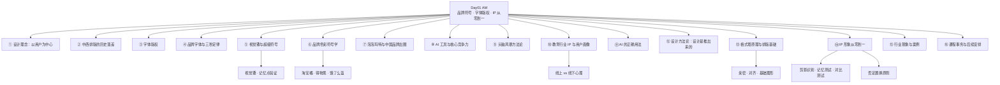

> [!info] 课程信息
> **讲师**：[[果冻Joe]] ｜ **机构**：像素范儿 ｜ **日期**：2026-09-15 ｜ **场次**：Day01 上午
> **主线**：设计理念 → 中西排版史 → **字体版权** → 品牌符号与视觉锤 → 品牌色彩 → 泡泡玛特案例 → AI 竞争力 → **头脑风暴方法论** → 教育行业 IP → 设计方法论 → **格式塔原理** → **IP 形象从零到一** → 行业现象
> **定位**：上午讲**原理与方法**，下午（[[UXDesignCourse/W1D1_pm_品牌营销与设计行业全景指南]]）讲**落地与执行**。

> [!abstract] 一句话总结
> **设计是「推」出来的，不是「做」出来的。**
> 从关键词 → 具体特征 → 设计形式 → 草稿 → 成品，**每一步都能反推回上一步**，才叫有理有据。
> 全片最实用的一条判据：**把形象做成剪影，离远一看还能认出来——认不出来，就是没有记忆点。**

---

# 一、设计理念：以用户为中心

## 1.1 用户中心原则

> [!important] 三条铁律
> 1. **有设计感但被否定的方案，往往是设计师的异想天开，脱离了用户实际使用场景**
> 2. **把所有用户当成"婴儿"或"傻子"**——**让用户在完全不了解产品的情况下也能立即上手**
> 3. **好的设计遵循用户已有的使用习惯，而非臆造新的交互方式**

## 1.2 设计的进阶路径
> [!tip] 先把字做好 → 再往上走
> **先把字做好 → 上升为排版（把多个字合理归纳）→ 让用户明白设计意图 → 再施加独特的设计变化**，才能越做越好。
> **顺序不能颠倒**：**连"让人看懂"都没做到，就谈"独特变化"，等于在沙子上盖楼。**

---

# 二、中西文字设计与排版的历史落差

> [!important] 本模块在解释一件事
> **为什么中国的排版与字体设计，比西方晚了将近半个世纪？**
> 答案不是"审美不行"，而是**扫盲、教育与商业化的时间差**。

## 2.1 中国文字普及起步较晚
- **文革于 1976 年结束**，**恢复高考在 1977–1978 年前后**，**改革开放于 1978 年提出**（十一届三中全会）
- **父母那一代（及姐妹一代）普遍缺乏文化教育**，**对文字的认知和使用起步本来就晚**，**更谈不上推广与排版**

> [!warning] 勘误：改革开放的年份
> 原文作"**改革开放于 1982 年提出**"，**有误**。
> 改革开放的起点是 **1978 年 12 月召开的十一届三中全会**；1982 年是**家庭联产承包责任制全面推开与现行宪法颁布**的年份。
> （详见文末「转写勘误」。）

## 2.2 西方设计的起点
- **西方设计从二战后开始发展**：**战争结束后各国转向经济振兴，商业化市场催生了平面设计需求**
- **1965 年，瑞士的一个平面广告展（或平面展）上，诞生了世界上第一款极具影响力的字体**

> [!warning] 勘误：Helvetica 的诞生时间与地点
> 原文的"**1965 年瑞士平面展**"**不准确**。实际是：
> **1957 年**由**瑞士哈斯铸字厂（Haas'sche Schriftgiesserei）**推出，原名 **Neue Haas Grotesk**，设计师 **Max Miedinger** 与 **Eduard Hoffmann**；**1960 年**为便于国际销售改名 **Helvetica**（取自拉丁文 *Helvetia*，即"瑞士"）。
> **课堂原意正确**（"瑞士 + 20 世纪 50 年代"），**只是年份记岔了**。

## 2.3 Helvetica 的地位与影响
- **地位对比**：**Helvetica 在全球的地位，高于宋体、楷体在中国的地位**
- **全球范围内，大量知名品牌（约 99%）的字体均以 Helvetica 为原型进行修改使用**；**衬线体品牌除外**
- **日韩品牌（如索尼、三星等）同样推崇以字符和文字为主导的设计理念**，因为**其市场面向西方，沿用西方设计体系**

> [!note] 两处需要修正的表述
> **① "三星"不是日本品牌**（原文把三星与索尼并列在"日本品牌"下）。三星是**韩国**品牌，此处应表述为"**日韩品牌**"，与本段"面向西方市场"的论点并不冲突。
> **② "约 99%"是课堂的夸张说法**，应理解为"**Helvetica 及其衍生字体是现代无衬线品牌字体的主流源头**"。
> 典型使用者：**纽约地铁导视系统、NASA、美国航空、苹果早期系统字体（Helvetica Neue）** 等。

## 2.4 中国品牌与设计发展的特殊性

- **中国早期以自产自销为主，对外销售从改革开放后才逐步起步**
- **真正大规模工厂化生产、南方供货，是在 2001 年加入 WTO 之后**
- **中国对外供货与生产仅二十余年，但已接近发达国家水平，发展速度极快**
- **西方在 1960 年代已开始用成熟字体做平面设计并推广品牌**，而**中国同期受历史条件限制**

> [!note] 补足：1960 年代的中国处在什么阶段
> 原文作"**中国同期处于大跃进时期**"，**时间线不吻合**——**大跃进是 1958–1960 年**。
> 更准确的表述是：**1960 年代前期中国处于经济困难与调整期，中后期进入政治运动，商业设计的需求与市场基本不存在。**
> **这一整段的落点是对的**：**设计是商业化的产物，没有市场就没有设计需求。**

---

# 三、字体版权：最容易被忽视的法律风险

> [!danger] 这一节请务必看完
> **字体是设计师最常踩、赔偿最直接的法律坑。**
> **侵权即可能被起诉**，且**存在"钓鱼执法"现象**——字库公司主动排查侵权使用并提起诉讼。

## 3.1 版权模式：租用而非买断

- 以**方正字体**为例（如"**方正兰亭黑**"），**几乎没有一次性买断，均为租用模式**
- **版权使用方式细分为十几种，不同使用场景对应不同价格**

> [!important] 核心认知：买的是「场景授权」，不是「字体文件」
> **同一款字体，用在海报上、用在 APP 默认字体上、用在包装上——是三份不同的钱。**
> **下载到电脑 ≠ 获得授权**；**获得授权 ≠ 全场景可用。**

## 3.2 各类场景的版权价格

| 使用场景 | 价格 / 说明 |
| --- | --- |
| **多媒体移动端广告、海报使用** | 约 **2,000–5,000 元**，**且仅限海报使用** |
| **长条海报（banner）与竖条海报** | **为不同版权，混用即侵权** |
| **移动 APP 默认字体（UI 默认字体）** | **单独版权** |
| **推广 IP 形象上使用** | **单独版权** |
| **包装上使用** | **单独版权** |
| **PPT 中使用** | **单独版权** |
| **自媒体账号中使用** | **单独版权** |
| **单一版权价格区间** | 最高**接近一万元**，最低**两千多元** |
| **全场景买断一款字体** | 约**两万到三四万元** |

## 3.3 维权现状与「钓鱼执法」

- **字体版权售卖严格，侵权即可能被起诉**
- **存在"钓鱼执法"现象**：**字库公司主动排查侵权使用并提起诉讼**

> [!tip] 给设计师的自保动作（补充）
> 1. **优先用开源可商用字体**（**思源黑体 / 思源宋体、阿里巴巴普惠体、HarmonyOS Sans、OPPO Sans** 等）
> 2. **客户提供的字体，让客户书面确认授权范围**——**责任要落在合同里**
> 3. **企业项目建立「字体台账」**：**记录每款字体的来源、授权场景、到期时间**
> 4. **拿不准就替换**——**换字体的成本，永远低于被起诉的成本**

---

# 四、品牌字体、三秒定律与形象符号

## 4.1 品牌字体的四重作用
- **推广形式**：**品牌字体用于各类推广物料的信息处理**
- **互联网 APP 默认字体**：**产品名称往往只有两三个字**，但**实际使用中需要数百个字词**，因此**需要延展自有品牌字体库**
- **规范化**：**品牌字体归拢设计中的构图要素与元素**
- **中间人角色**：**通过虚拟形象在用户与品牌活动之间充当中间人**，**帮助用户一眼识别品牌**

> [!tip] 补足：为什么只有两三个字的产品，也要做整套字库
> 因为**品牌字体一旦确定，就会扩散到所有需要打字的场景**——**开屏、Banner、活动页标题、弹窗、周边**。
> **不做字库的后果**：**每个物料各用一款字，品牌看着像十家公司。**
> **做字库的本质是"把视觉规范锁死在一套字形上"。**

## 4.2 三秒定律

> [!important] 用户不会花时间在你的海报上找字、找 logo
> - **用户看一个活动页或海报的时间通常不超过 5–10 秒，实际标准为 3 秒**
> - **检验标准**：**海报完成后，3 秒内让用户知道有优惠、有信息，即为过关**；**否则需继续优化**

> [!note] 澄清时间口径（原文两种说法并存）
> **5–10 秒是"停留时间"**——用户在信息流里滑过你的物料时，实际扫视的极限。
> **3 秒是"决策窗口"**——**能不能在这 3 秒内传递核心利益点**。
> **两者不矛盾**：**5–10 秒是机会上限，3 秒是及格线。设计要按 3 秒来要求自己。**

## 4.3 品牌形象符号的核心特征

- **一眼识别**：**京东（狗）、天猫（猫）、美团外卖（袋鼠）**等，** 形象符号让用户瞬间识别品牌**
- **符号的核心特征**：**简洁**
- **简洁的目的**：**满足记忆需求、制造差异化** 
- **符号不应频繁变化，不应添加过多装饰**（如**复杂衣服、装扮**），**否则会偏离符号的本质功能**
- **周边玩偶、卖货只是形象符号非常边缘化的用途之一**

## 4.4 案例：美团外卖袋鼠的形象演变
- **2020 年之前**，美团外卖的袋鼠形象与现在不同（**改版时间大约在 2019–2020 年之前**）
- **旧版形象较为复杂，新版更加简洁**
- **通过结果反推**：**新版简化是为了更好地满足符号的记忆与差异化功能** 
- **京东的狗头形象同样采用半椭圆结构、大弧度的简洁设计** 

---

# 五、视觉锤、超级符号与记忆点验证
## 5.1 视觉锤与超级符号的关系

| 概念 | 来源 | 核心目标 |
| --- | --- | --- |
| **视觉锤** | **广告行业早期概念** | **强调品牌形象需具备强烈的视觉记忆点** |
| **超级符号** | **互联网语境下对视觉锤的升级表述** | **与视觉锤一致——让品牌具备差异化识别能力** |

> [!important] 一句话区分
> **视觉锤和超级符号不是两个理论，是一件事的两次表述**：
> **都是为了让用户在 3 秒内认出你，并且记住你。**

## 5.2 记忆点的验证标准
> [!important] 唯一的验证动作：默画
> **用户看到形象后，即使无法精准还原，也能快速默画出大致轮廓**；
> **若不知从何下手，则说明缺乏记忆点。**

**三个检验维度：**

| 维度 | 做法 |
| --- | --- |
| **① 剪影识别** | **做成剪影后，离远一看，简单明了，能看出是什么** |
| **② 记忆测试** | **离远看后回过头去，脑子里过一下，看能否记住刚才看到的** |
| **③ 对比测试** | **放在同等级的其他符号中，看是否能脱颖而出、起到同等作用** |

> [!tip] 这是全片最可执行的一条标准
> **做完形象，导出黑白剪影，缩小到 100px，退后两米看一眼。**
> **认不出来 → 回去改轮廓，不要改细节。**

## 5.3 案例：美团骑手形象改版
> [!example] 在既有认知上升级，而不是凭空创造
> - **改版前**：**虽有特殊代图设计，但用户无法形成有效记忆，缺乏视觉锤特质**
> - **改版后**：**骑手形象延续了用户已有的基础认知（骑手佩戴头盔）**，**更换后迅速打通认知链路**
> - **关键启示**：**形象改版不能脱离用户既有认知基础，需在原有认知上做升级而非凭空创造**

## 5.4 抽象形象的设计逻辑
- **大厂倾向于将品牌形象做得抽象**，**并非单纯追求"丑"，而是满足广告营销场景的实际需求**
- **"化成灰都认识"原则**：**优秀设计的剪影即使黑白化处理后仍具备极高辨识度**，这是**设计思路、推导、改版各环节到位的体现**
- **反面案例**：**给形象附加过多装饰元素**（**花、百褶裙、JK 裙**等），**这些附加条件无法有效传递品牌核心感受**

## 5.5 品牌 LOGO 复杂化的真实成因

> [!important] 传统 LOGO 复杂，不是因为审美差，是因为注册不上
> - 许多中国**景区、学校、小品牌**的门店 LOGO **看起来非常复杂**，**核心原因并非追求差异化，而是商标注册困难**
> - **老板的真实反馈**："**我们也想简单，但注册商标注册不了，就得复杂一点，因为都注册过了。**"
> - **文字标流行的原因**：**中国文字字形本身具有独特性**，**根据字形稍改几个笔画即可注册**，因此**很多学校、博物馆使用文字标**
> - **如果 LOGO 与他人撞车，后续出文创产品（如冰箱贴）都会受限，无法有效商业化**

> [!tip] 这条解释了「中国设计为什么土」的一大半
> **商标注册是"先到先得"**——**越简单的图形越早被注册完**。
> 所以**真正简单的中国品牌 LOGO，几乎都出现在互联网行业**（因为进入晚，需要靠视觉差异化竞争，且不受线下门店招牌的历史包袱限制）。
> **设计需理解品牌背后的商业逻辑，而非简单模仿符号形式。**

## 5.6 设计前的核心思考
> [!important] 不要把重点先放在形象本体上
> **应先考虑「形象上要加哪些符号」。**
> - 如果**已有 LOGO**：**如何将 LOGO 中的特征赋予形象？**
> - 如果**没有 LOGO 或符号**：**如何通过渠道推导找到合适的符号往上加？**
> - **参考案例中的符号特征**：**大方大尖角、大椭圆大弧度**

---

# 六、品牌色彩符号学与符号绑定
> [!important] 颜色不是审美选择，是心理暗示 + 历史惯性
> 下面每一个案例都回答同一个问题：**这个颜色在用户脑子里唤起了什么？**

## 6.1 淘宝橘色
- **偏橘红色调**，**呼应中国人节日文化中"喧嚣、热闹、隆重"的集体心理**
- **适用于大促、促销等需要激发消费热情的场景**

## 6.2 得物黑色
- **前身名为"毒"**，**因涉及不良含义被迫更名**
- **黑色契合潮牌定位**：**酷炫、潮流、年轻化**

## 6.3 抖音黑色
- **早期以卡点舞等鬼畜内容起家**，**定位潮流、年轻、潮酷**
- **黑色成为其核心视觉符号**

## 6.4 绿色系（招聘平台、小象超市、医药类）
- **传递冷静、新鲜、安全感、健康等心理暗示**
- **适用于需要建立信任感的行业**

## 6.5 饿了么蓝色
> [!example] 一个"没有理由的理由"最后变成了符号
> - **初创团队为大学生创业**，**当时认知中"互联网 = 蓝色"**，**未深入考虑餐饮属性**
> - **后被淘宝收购后仍保留蓝色**，**蓝色已固化为其特有符号**
> - **启示**：**先行动，即使初始缺乏充分理由，长期坚持也能形成符号**；
>   **但市场成熟后，新品牌不能简单模仿先行者的逻辑。**

## 6.6 品牌符号的绑定效应

- **董宇辉案例**：**个人 IP 与平台深度绑定**，**即使未来转投其他平台，用户仍会将其与抖音关联**
- **符号一旦形成，具有极强的路径依赖和认知惯性**

> [!tip] 这条对个人的意义
> **"前阿里设计师""前字节设计师"这类标签，本质上也是一种符号绑定**——**它会在你离开平台后继续为你工作**（正面是背书，负面是"你就是那个平台的"）。
> **绑定越深，迁移成本越高。** 这也是为什么大厂人会刻意强调"我做过什么"，而不是"我在哪待过"。

---

# 七、案例研究：泡泡玛特与中国品牌出圈路径
## 7.1 泡泡玛特的品牌策略
- **仅使用英文名**，**中文名在日常使用中不常见**
- **采用类似国外极简黑体英文字体**，**整体调性对标国际品牌**

## 7.2 商业模式本质
> [!danger] 表面做 IP，实质是溢价炒作
> - **表面做 IP，实质类似数字货币 / 区块链的溢价炒作模式**
> - **通过 IP 快速爆发带动市值上涨，潮退后市值下跌，在股市波动中获利**
> - **拉布布（Labubu）案例**：**初期由好莱坞明星和国外网红在 TikTok 上开箱带火，中国明星后续跟风**；**火爆时溢价数千至数万元**，**潮退后二级市场无人问津**

## 7.3 低调运营的原因

- **创始人（王宁，非王兴）极为低调**，**曾直接要求员工删除涉及公司内部的自媒体内容**
- **因商业模式涉及资本炒作，需避免危机公关风险**

## 7.4 设计为何迎合国外市场
- **拉布布形象对标史迪仔等国外丑萌 IP**，**呲牙带毛的抽象风格符合迪士尼及国外 IP 调性**
- **中国本土 IP（如孙悟空）通常不带毛、不呲牙**，**拉布布的设计明显面向海外市场**

## 7.5 香港上市的战略意义
- **港币与美元绑定，在香港上市等同于接入美元资本体系**
- **香港在九十年代一度是亚洲最重要的金融中心之一，GDP 体量在全球城市中位居前列**
- **收复香港的战略价值之一在于获取外汇储备优势**

> [!warning] 勘误：香港 GDP 的占比
> 原文作"**香港在九十年代 GDP 曾相当于全中国 GDP 总和**"，**严重夸大**。
> 实际量级：**1990 年前后，香港 GDP 约相当于中国大陆的 1/4 左右**；**到 1997 年回归时已降至约 1/5 以下**。
> **"相当于全中国"不成立**，但**"当时香港的经济体量相对其人口规模极为惊人"这一判断是准确的**。

## 7.6 中国品牌出圈的两条路径
> [!important] 路径一：官方背书（唯一的大规模出圈方式）
> - **唯一大规模出圈方式**：**获得官方背书**（**CCTV、新华社、中宣部**等），如**哪吒、黑悟空**案例
> - **官方推动通常基于正能量、爱国等价值观导向**
> - **张雪案例**：**因爱国言论（台湾相关）获得国家层面推广**

> [!success] 路径二：海外先行，再回流国内
> **借助国外渠道**（**Instagram、TikTok 海外版、国外明星带货**）**先在国外走红，再回流国内**。

> [!note] 附：传统行业 Logo 复杂化的原因
> **中国线下传统行业 Logo 普遍复杂**，与**互联网品牌的极简符号化**形成对比。
> **根因见 5.5（商标注册困难）**——**设计需理解品牌背后的商业逻辑，而非简单模仿符号形式。**

---

# 八、AI 工具与核心竞争力

## 8.1 AI 在设计领域的现状

- **AI 出图是零成本**：**输入关键词即可生成**，且**绝对原创、独一无二，不存在撞车可能**
- **AI 只是工具和实现手段**，真正的核心在于**做之前如何为 AI 提供应用领域内的使用场景设计**——**这需要花脑子**

> [!important] AI 时代的分工线
> **能被"输入关键词"解决的部分，AI 全包了。**
> **剩下的价值只有一件事：在动 AI 之前，想清楚这个设计要用在哪、解决什么问题。**
> **这一段想不清楚，AI 生成得再快也是废图。**

## 8.2 ChatGPT 的跨时代改版
- **约六个月前 ChatGPT 经历了一次跨时代改版**，**对设计和找工作都是跨时代的**
- **实际案例**：给出**一句话要求**（如"**试着把京东 VIP 模块 UI 改版，尺寸改成十六比九**"），**AI 即可直接输出完整作品集，所有内容均由 AI 生成**

## 8.3 如何保持核心竞争力
> [!tip] 作品集可以 AI 生成，但「为什么这么做」必须是你说的
> 1. **即使作品集由 AI 生成，关键在于如何有理有据地向面试官阐述**，展示**自己进入团队后的价值**
> 2. **对 AI 生成内容进行审视，找出未说到位的地方，继续用关键词优化**——**这本身就是核心竞争力**
> 3. **需要对交付物、模块有绝对深入的理解**，并在面试中**发挥自身优势，将 AI 产出转化为自身能力的外在呈现**

> [!note] 关于「用 AI 算不算作弊」
> **原文判断**：目前直接用 AI 生成作品集仍有些"耍赖"，**但预计一年后将成为普遍做法，不算作弊**。
> **理由**：**作弊的定义是"用了本不该用的东西"，而大家都在用的工具就不算作弊。**
> （**这是一个时效性很强的判断，请以实际就业市场为准。**）

---

# 九、头脑风暴方法论与设计工作实践
> [!abstract] 本模块是全片方法论的核心
> **头脑风暴 = 脑图 = 写作文前的列大纲。**
> 它在设计领域的落地形态是：**贴便签纸、输出关键词、把关键词具象化为情绪版**。

## 9.1 什么是头脑风暴
- **头脑风暴即脑图**，类似**写作文前列大纲**；在**设计领域表现为贴便签纸、输出关键词**
- 关键词需**具象化为情绪版**，体现具体情绪表达——**例如教育的关键词：努力、奋斗**
- 进一步将**抽象概念具象化为视觉可感的元素**，如**奋斗联想到什么颜色**

> [!important] 唯一的关键原则：越细越好
> **每个大关键词往下发展出五个具体关键词，再继续细分，直到发展不动为止。**
> **每条具体线索，都是一个设计思路。**

## 9.2 网络黑话与代名词现象

### 「卡了卡了」的跨文化传播案例
- **源自英雄联盟国际赛事期间**，**中国观众在评论区来不及打中文，直接敲拼音"kale"发送**
- **国外玩家按英文发音读作"color"**，查询后发现是中文"**卡了**"，**意为网络延迟**
- **此后外国玩家也开始使用"卡了卡了"这一表达**

### 代名词的抽象化演变
- **"吃鸡"案例**：**原指枪战游戏中最终获胜的奖励**，**现已泛化为所有枪战类游戏的统称**
- **很多家长将孩子玩的三角洲等各类枪战游戏统称为"吃鸡"**
- **代名词往往超出字面含义，成为一种文化代号，只有特定年轻群体能理解**

> [!tip] 为什么设计师必须懂黑话
> **黑话是目标人群的身份标记**——**你连他们在说什么都听不懂，就不可能做出他们喜欢的形象。**
> **这也是设计师做用户研究最便宜、最有效的一条入口。**

## 9.3 设计工作中的关键词发散
- **针对一个设计环节，可能持续数天甚至一周，发散出几百上千个关键词**
- **通常由多人协作完成**：**每人各自发散一批关键词，再统一开会汇总碰撞**
- **钉钉、阿里等大厂的做法**：**组织几十名设计师，花费数月时间专门进行关键词发散**

> [!important] 头脑风暴的目的只有两条
> 1. **为设计提供有理有据的依据**，避免**随意发挥、缺乏头绪**
> 2. **有理有据的设计方案，在面对面试官、老板、总监时，更容易获得充足的时间和人员配合**

## 9.4 平行需求：设计师的工作现状

### 什么是平行需求

- **团队设计师同时接收来自不同运营和市场推广组的需求**
- **以淘宝 / 天猫为例**：**推广组、百亿补贴、天猫超市等不同业务线同时向设计组提交需求**
- **同一时间点需要完成多个任务，永远处于多任务并行状态**

### 优先级排期策略

| 策略 | 具体做法 |
| --- | --- |
| **活动等级优先** | **S 级活动（如天猫大型活动）优先处理** |
| **时间分配** | **给不同需求方分配不同的每日工作时长**（如 **4–5 小时给一方，1–2 小时给另一方**） |
| **长期需求** | **没有明确截止日期的大需求**（如设计一个形象），**利用碎片时间推进**，例如**每天 5 点到 6 点集中碰头** |

- **做完一个任务后不会闲着，新需求会不断涌入**

### 行业现状

- **设计师工作状态是"充实"而非"很累"**
- **如果公司市场活儿少，可能面临裁员风险**；**但也有公司靠资金充裕维持运营**

## 9.5 头脑风暴的具体应用方法
### 技术感的具象化表达
- **装饰元素**：**佩戴特定物品、领口板正**等细节可体现技术感
- **刻板印象调动**：

| 身份 | 联想特征 |
| --- | --- |
| **科学家** | **戴眼镜** |
| **生物学家 / 工程师** | **技术宅形象、特定眼镜、白袍** |

- **这些脑海中的固有印象本身就是一种情绪版表达**

### 科学家与梦想的关联

- **小时候谈梦想时，"科学家"是高频答案**
- **科学家已成为小孩对"梦想"这一关键词的具象化表达**

## 9.6 AI 工具与头脑风暴的关系

> [!important] 把 AI 当成一位「素材库有数亿张图的高级设计师」
> **优秀设计师的素材库可达数千、数万甚至数亿张图**——**AI 就是这样一个存在。**

### 抽象指令的局限性

> [!example] 马云类比
> **问马云"怎么赚钱"太抽象，他只能回答"开阿里巴巴就赚钱了"。**
> 同理，**给 AI 过于抽象的指令**（如"**生成个教育的**""**来个可爱点的**"），**AI 只能按自己的理解乱发挥**。
> - **实例**：**要求设计视频角色但未指定具体形象时，AI 会随机使用猫头鹰（智慧象征）、羊（西方文化中与邪恶 / 心机关联）等元素。**

### 具体化指令的价值
- **给出具体描述**（如"**头发卷卷的**"）**后，AI 输出会稍有设计感**
- **指令越具体，AI 的输出范围越聚焦**
- **从"一堆范围"逐步收窄到"某一个具体方向"，这就是头脑风暴的核心作用**

## 9.7 头脑风暴的跨行业应用

> [!success] 头脑风暴适用于所有行业，不限于设计领域
> **它能保证做事过程详细、有章可循。**

### 案例一：说唱歌手写词

- **爱奇艺《少年说唱企划》**中，**选手将梦境具象化为关键词：沙漠、仙人掌、干枯、骆驼**
- **根据关键词构建完整故事框架**，**确定情绪基调**（**励志 / 欢快 / emo / 朋克**）
- **选定 Beat 后，将关键词作为押韵韵脚，填充前后歌词**

### 案例二：创业 / 商业规划

- **以创办电车品牌为例，头脑风暴可梳理**：
  - **人员配置**
  - **工厂生产线匹配**
  - **销售渠道**（线上 / 线下）
  - **营销策略**（炒作 / 网红营销）
  - **技术来源**（挖人 / 培养）
- **前期规划阶段本质上就是脑图概念的运用**

## 9.8 技术感的设计表达方向

- **装饰**：**身上佩戴特定物品**
- **颜色**：**身上带有光效、蓝色、绿色等科技感色彩**
- **新信息体现**：**通过色彩和装饰传递技术属性**

> [!note] 个人局限性
> **每个人能联想到的方向不同，存在个人认知局限。**
> **需要通过团队协作和持续发散来突破。**

---

# 十、教育行业 IP 设计方法与用户画像
> [!abstract] 本模块是一整套「从行业 → 人群 → 视觉符号」的实例推演
> 教育行业只是载体，**方法可以平移到任何行业**。

## 10.1 教育行业的三种形态

| 形态 | 定义 | 关键特征 |
| --- | --- | --- |
| **义务教育** | **传统线下培训** | — |
| **知识付费** | **在生活和工作之余的补充性学习，即查即用**（如 **99 元十节录播钢琴课、理财课、认知课、"三天学会 AI"**） | **前提是学习者有自己的时间**，**不系统利用额外时间做补充** |
| **线上学习** | **包含知识付费，但系统性无法保证，完全靠自觉** | **老师无法一对一面对面，难以在自律性上带动学生** |
| **线下学习** | — | **需要老师主动管理和催促**，**否则会被认为培训机构不行** |

## 10.2 线上课与线下课的用户心理差异

> [!important] 这一组反差是教育 IP 设计的分水岭
> **线上学生不能催，一催就可能退课或不学**；**线下老师不管不催，会被认为不负责。**

- **线上课学生心理**：**不能催，一催就可能退课或不学**，**部分学生钱不要了也不让催，甚至躲着老师**
- **线下课学生心理**：**老师不管不催会被认为不负责**
- **线上课老师的标准动作**：**只需把两小时课讲清楚**，**配套标准交作业流程和售后课外辅导**（**交作业、点评**）；**学生可以选择不来听，但服务必须存在**

> [!example] 真实案例：99 元的线上插画课
> **一位系统课同学花 99 元报线上插画课，只交了一天作业就不交了。**
> **老师主动询问，学生说"以后甭管我了，我就是来听一听"，反而觉得紧张。**

> [!quote] 线上课的本质：买书的安慰效应
> - **线上课类似买书的安慰效应**：**焦虑时购买，买了就有安慰感。**
> - **类比**：**真想彻底改变的人不会只报线上课**，**就像真想结婚的人不会一直当网友，会立刻买火车票去见对方**。
> - **报线上课等于给自己留后路**——**学成了赚了，学不成钱给了就算了。**

### 不同教育形式对应的关键词

| 形式 | 关键词 |
| --- | --- |
| **线上教育** | **自由、随性、提高** |
| **线下教育** | **系统、努力奋斗、再教育** |

## 10.3 教育细分领域

- **认知增长、财富管理、传统系统课、工作技能**（如 **Excel、Word、设计**）
- **不同细分领域对应不同人群，认知水平和接触信息不同**
- **设计教学的人群更前沿，接触新鲜事物更多**
- **实际案例**：**有同学提到做"AI 漫剧"**，指**最新的真人 AI 网电影、短剧、广告**，**属于行业黑话**，说明**人群和定位不同，课程内容和教学方式也不同**

## 10.4 目标用户特征分析

> [!warning] 一个容易被忽视的基本盘
> **中国电脑普及率可能不到十分之一**，但**手机普及率约 99.999%**（**疫情期间全面摸底，没有的也用上了**）。

- **设计学员的技术水平**：**软件基本都不是老师安装的**；**曾有学员连电脑打字都不会**（**一只手打字，从未用过电脑，之前在美容院推销面膜**），**老师直接退课**——**这是十年教学生涯中唯一主动退课的案例**
- **技术能力的意义**：**意味着能获取大部分人看不到的信息、访问大部分人去不了的网站，快速接触新鲜事物**
- **"拉布布"（Labubu）案例**：**年轻人很快知道**，但**父母辈甚至 80 后律师姐姐、做外贸的妻子都觉得"太丑了"，统一反应是"扯"**

> [!tip] 一句题外话，但对做设计很重要
> **设计学员群体在整个中国人中综合素质较优质**——**不要自我贬低。**
> （**课堂原话如此，属于鼓励性表述，非统计数据。**）

## 10.5 用户喜好与特征

- **穿衣风格较潮流，爱打扮**
- **喜欢黑怕（Hip-Hop）、街舞、唱跳、idol**
- **爱看网剧**（如**爱奇艺**），属于"**电子榨菜**"

## 10.6 从用户特征到视觉符号的推导

> [!example] 关键词 → 视觉元素（可直接套用的换算表）
> **科技**：联想到**棱角分明、电路板、刚硬的字体、黑色背景配蓝光、白色字在黑色上、亮光出现效果**（**参考汽车、手机发布会 PPT 风格**）。
> **游戏**：联想到**抽象元素**，可继续向上发展，如"**卷卷**"等形态。

---

# 十一、AI 在设计流程中的正确用法

## 11.1 AI 是工具，不是替代品
- **AI 是设计过程中的一种形式补充**，**不是唯一的表现手法**
- **很多人焦虑是因为把 AI 理解成了唯一手段，这是误解**

## 11.2 AI 的两种主要用途
> [!tip] AI 在流程里最该干的两件事
> **① 找参考**：**替代传统渠道**（**花瓣、百度、Pinterest**），**直接关键词生成，不满意刷新重出。**
> **② 出草稿 / 初稿**：**生成大致方向后人工细化调整**。
> - 例如**身体太胖可以改，或找其他胖的素材替换再优化**
> - **AI 可以用在设计流程的某一个环节中，作为加分加成的工具**

## 11.3 AI 的适用与局限

> [!warning] 简单图形用软件做，可能比 AI 更快
> - **一个基础图形在软件中约六步即可完成**
> - **用 AI 生成则需要反复调整关键词，且一次成功率低**
> - **AI 的数据库庞大，反而可能导致简单任务耗时更长**
> - **结论**：**AI 应放在设计流程中能真正提效的环节，而非硬性使用**

> [!important] 给新手的建议
> - **新手容易陷入"应不应该用 AI"的纠结，硬用反而不会提效**
> - **不要为了迎合招聘要求而强行用 AI 出作品**
> - **如果只是应付作品集，直接使用即梦等工具搜索现成素材即可**，**无需费劲生成**
> - **强行用 AI 生成的作品大概率（约 60%）效果不佳**，且**审美和活动要素难以保证**

## 11.4 抽象指令的局限性（补充）

见 **9.6**：**给 AI 的指令越具体，输出越聚焦**；**抽象指令只会让 AI 按自己的理解乱发挥。**

---

# 十二、设计方法论：设计是「推」出来的

> [!important] 全片的核心论点
> **设计是「推」出来的，不是「做」出来的。**
> **"推"= 每一步都有来源、都能反推回上一步。**

## 12.1 从抽象概念到具体形式的转化路径

> [!danger] 最常见的错误：用大概念解释大概念
> **"概念往下就是无限的概念，永远不具体。"**

- **概念必须逐步具体化，避免用另一个大概念去解释大概念**：

| 大概念 | 具体化之后 |
| --- | --- |
| **新鲜事物** | **具体到穿着 → 古装** |
| **抽象** | **具体到斗鸡眼、大长脸、眼睛、嘴等五官特征** |
| **棱角** | **具体到一个棱还是两个棱** |
| **切角** | **具体到斜切、对切还是中间切** |

- **模棱两可的大概念关键词不需要再用概念去表达**
- **具体化之后，设计形式自然浮现**：**可以做出不同版本**（**可爱版、逗比版**等）

### 设计推导的完整链路

> [!abstract] 记住这条链路
> **关键词 → 具体特征 → 设计形式 → 草稿 → 成品**

- **示例**：**冷饮的"棱角"概念 → 切角方式 → 基础图形表现 → 草图推演**
- **只要逻辑自洽、有理有据、从 0 到 1、从 0 到 N 能推通，任何方向（圆、冷、棱角）都能成立**

## 12.2 品牌案例分析

> [!example] 天猫双十一：方形可以，圆形也可以
> **方图设计实际是一个盘子，作为容器使用，也作为海报元素使用。**
> **盘子做成圆形也可以成立，只是最初选择了方形。**
> **关键在于逻辑自洽，能让用户"知其然知其所以然"。**

> [!example] 支付宝与花呗：违背常识，但精准定位
> - **传统认知中理财应该稳重，但支付宝定位年轻炫酷**
> - **大量使用粉、蓝、黄的渐变，圆角设计**
> - **花呗吉祥物极其抽象**：**一个胖乎乎的、难以辨认是人还是其他生物的造型**
> - **违背了大众对理财品牌的基础认知，但精准定位了目标用户群体**
> - **审美是个人理解，形象的核心作用是做代表**（**类比：猴子可以代表菲律宾，这是外交部的说法**）

## 12.3 如何判断设计是否成功

> [!important] 唯一的判据：看步骤多不多
> **即使做了一百步结果很丑，设计本身也算成功。**
> **丑可能是技法不行、审美差点意思，但推导过程有逻辑、能说得通就 OK。**
> **审美接受度因人而异，形象的核心是代表性而非美观。**

## 12.4 常见误区：直接上手做

> [!danger] 在软件里吭哧吭哧弄两小时，最后发现啥也没有
> **很多人在软件里吭哧吭哧弄两小时，每一块都磕磕绊绊，最后发现啥也没有。**

**三大危害：**

1. **严重打击自信心**（**类比：上来就给不熟的女生买 LV，被拒绝后半年不想谈恋爱**）
2. **吃掉所有时间效率**
3. **消耗精力效率，磨掉耐心**

### 正确的推导节奏

- **遵循从无到有、从零到一的规律**
- **类比**：**婴儿不可能一出生就说话，需要慢慢成长到二十多岁**
- **男生到三十来岁才真正成熟**，**成熟往往需要一个突然的事件触发**
- **女孩通常很早成熟**，**在家里就开始当"姐姐"和"妈妈"的角色**
- **不能一口吃个胖子，要慢慢来**

## 12.5 基础图形的推导练习

- **以圆角矩形 / 胶囊形为基础，持续推演各种形式变化**
- **一直做到做不出来的图形形式为止**
- **推导过程比较"无脑"，可以不断尝试**：**这样、那样、再这样**
- **当基础图形（如正方形）实在无法再推时，在此基础上做细微优化**（如**加热变形**等）

> [!tip] 先把基础"砖"弄好，才能往上盖楼
> **即使交一个简单的圆角矩形，只要能说清楚推导逻辑**（如"**胶囊兔**"的概念），**就有理有据。**
> **当然不能真的糊弄，但核心是有基础的东西就可以继续往下发展。**

## 12.6 有源设计原则

> [!important] 设计必须有源头
> - **设计必须有源头，让大家能"知其然知其所以然"**
> - **自己的逻辑能自洽、有理有据即可成立**
> - **设计没有绝对的唯一答案，关键在于推导过程是否完整**

## 12.7 设计感的价值与比重

- **纯设计在整个项目中的比重约为 30%，最多不超过 50%**
- **设计的目的**：
  1. **让作品好看**
  2. **增加设计感**
  3. **让作品不像生活中常见的东西**
- **设计师的核心价值在于赋予作品"不常见"的新鲜感**

## 12.8 对称图形的制作优势

- **对称图形在软件中只需制作一半即可完成整体**
- **除手绘外，任何软件制作对称图形都非常高效**

---

# 十三、格式塔原理与排版基础

> [!abstract] 为什么单开一节讲格式塔
> **格式塔是所有设计实践的地基**——**它不是"一个知识点"，是判断排版对错的底层规则。**

## 13.1 核心设计对象（课堂实例）

- **当前正在优化一个图形形态**，**该形态呈现出聊天框的视觉效果**
- **设计目标是展现品牌与学员之间的互动感**，**体现"一对一"的教授关系**
- **图形具有类似"小眼睛"的特征**

## 13.2 格式塔原理在设计中的基础地位

- **格式塔原理是设计领域最基础的理论之一**
- **该理论贯穿所有设计实践，是保证设计质量的前提条件**
- **讲师在 2018 年教授字体设计时突然"悟到"格式塔的真正含义**，**强调需要反复理解才能融会贯通**

> [!warning] 勘误：格式塔的起源时间
> 原文作"**格式塔原理是上世纪六七十年代西方心理学理论**"，**时间偏晚**。
> 实际起点是 **20 世纪 10 年代**：**1912 年，德国心理学家 Max Wertheimer 发表《关于运动知觉的实验研究》**，**标志格式塔心理学（Gestalt psychology）诞生**，**核心阵地是柏林学派**（**Wertheimer、Köhler、Koffka**）。
> **六七十年代是它被引入设计教育、广泛应用的时期，不是它的诞生时间。**

## 13.3 格式塔原理的核心原则

### 亲密性原则

- **属于同一模块的文字应彼此靠近排列**，**自然形成视觉上的整体感**
- **无需额外添加边框即可让观者识别模块归属**
- **通过文字大小区分层级**：**大标题用大字号，次要文本逐步缩小**

### 对齐原则

- **排版必须遵循对齐和对列的基本规律**
- **对齐不限于绝对对齐，可以是居中对称式对齐**
- **居中排版需预留两侧边距**：

| 领域 | 术语 |
| --- | --- |
| **印刷领域** | **出血** |
| **UI 领域** | **水槽线** |

> [!warning] 术语澄清：出血 ≠ 水槽线
> **原文把两者并列成"同一件事的两个叫法"，其实职责不同：**
> - **出血（bleed）**：**指印刷品在成品尺寸之外多留的、待裁切的部分**——**目的是防止裁切偏移露出白边**。
> - **水槽线 / 安全线（gutter、safe margin）**：**指版心两侧必须留出的空白区域**——**目的是保证内容不被裁掉、不被装订遮住**。
> 课堂想说的其实是「**居中排版必须预留两侧安全边距**」，**出血和水槽线都是为这个目的服务的两个不同机制。**

- **错位排版同样需要遵循某种对齐逻辑，而非随意摆放**
- **设计规律必须让不懂设计的人一眼能看出规律**

> [!warning] 排版建议的例外
> **原文建议"一般文字排版建议左对齐"**——**这条对长文本成立；但对短文案、标题、海报主视觉，居中和错位都可以，前提是有明确的对齐逻辑。**

### 基础图形原则

> [!important] 用户第一眼看到复杂图形时，大脑会自动将其简化为基础图形
> **所有复杂设计最终都由标准基础图形（方、圆、椭圆、矩形）构建。**
> **违反基础图形原则会增加用户的接受成本，导致用户"不爱看"。**

**实例拆解：**

| 品牌形象 | 基础图形构成 |
| --- | --- |
| **美团外卖** | **椭圆 + 圆形 + 圆角矩形 + 耳朵** |
| **苏宁狮子** | **由方块组合构成，鼻子是两个圆** |
| **国美老虎** | **同样由基础图形组成** |
| **拉布布（Labubu）** | **似猫非猫、似狗非狗、似熊非熊**，**因"不常见"而受欢迎** |

## 13.4 居中对齐与自适应

- **一般文字排版建议左对齐**，符合用户阅读习惯
- **居中对齐通常不好用，但苹果公司采用居中对齐是例外**
- **苹果使用居中对齐的原因**：
  - **适配多端多屏幕的自适应需求**
  - **文字量少（仅两三行），居中符合视觉焦点**
  - **网页阅读习惯是从上到下，而非从左到右**
- **苹果前端代码中居中逻辑是写死的**，**无论屏幕如何自适应都保持居中**

## 13.5 设计推导过程与方法论

> [!important] 每一步都能反推回上一步
> **正确做法**：**每一步都能反推回上一步，形成可互相反馈的闭环。**
> **错误示范**：**步骤跳跃如"1 → 3.75 → 2.68 → 10.381"，缺乏逻辑连贯性。**

- **设计推导必须一步一步连贯推进，不能出现环节脱节**
- **讲师在当天九点半备课时，并未预见到最终具体效果**，**但思路方向是清晰的**

## 13.6 设计优化方案与学员互动

- **当前已获得多个设计优化方案**，**相当于数学公式中"求 x 的值"已经有了答案**
- **不同方案如同不同的竖式计算方式，最终得出相同结果**
- **每个方案都有明确的影子对应关系，可追溯来源**
- **后续可继续添加细节**：**头发波浪、耳朵等元素**

> [!quote] 课堂互动
> **有学员表示想学习如何精准控制曲线**（"**让杆儿听我话**"）。
> **讲师回应**：**这类软件操作技能可通过线上短视频课程学习，费用为 25000 元，一周可掌握。**
> **但讲师强调**：**过度纠结于细节弧度（如"小揪揪"）对整体设计影响有限，不应在此浪费过多时间。**

---

# 十四、IP 形象从零到一的生成与优化

> [!abstract] 本模块是「从 0 到 1」的完整操作流程
> **核心流程**：**建立基础符号 → 挑选并细化 → 验证 → 升级。**

## 14.1 核心流程：从基础符号到完整 IP

### 第一步：建立基础符号

- **通过"掐头去尾"的方式，从一个基础元素衍生出多种形式**
- **一个基础符号可以生成不同的变体**，**这些变体构成后续优化的起点**
- **有了基础符号后，可以将其用于优化，逐步升级为更完整的形态**

### 第二步：从基础符号中挑选并细化

- **从生成的结果中挑选可用的方向**
- **进一步细化的维度**：**神态、结构、设计**
- **基础符号可以直接使用，也可以继续优化迭代**

## 14.2 设计原则与理念

### 核心风格定位

- **遵循"逗趣、新鲜事物"的原则**
- **设计需满足以下要求**：
  - **能代表行业属性**
  - **好玩、有趣**
  - **符合培训的定位**（**非传统严厉风格**）
  - **带来认知提升、新技能技法、新行业视野**
- **目标人群的审美偏好是重要参考标准**
- **参考案例**：**拉布布（Labubu）——好玩的神态和感觉**

### 设计认知：否定置换原则
> [!important] 不要自我否定，不要轻易删除已有的成果
> **核心观点**：**如果没有更好的替代方案，就不要否定当前方案。**

- **警惕身边习惯性否定他人的人**——**这类人往往出于人性底层的不愿看到他人行动**
- **真正的善意否定应包含"否定之否定"**：**提出一个更好的替代条件来置换原有前提**
- **实践原则**：
  - **有了条件（即使不完美），先做起来**
  - **设计遵循底层逻辑，是"推"出来的——在推进过程中会越做越好**
  - **不怕做不好，只怕没有**
  - **否定之后，"有"又变回"没有"，从零开始**
  - **如果没有更好的或对等的方案，就别否定**

### 行动哲学：先做再调整
> [!tip] 如果给不出充分的反对理由，就去做
> - **做任何事，如果给不出充分的反对理由，就去做**
> - **不要用"可是"来拖延**——**做两天真做不下去再放弃，也比永远不做强**
> - **举例**：**交 25000 学费学设计，即使学不好，至少能挂横幅维权、发抖音，没准自媒体还做起来了**
> - **核心态度**：**先做、先去弄，别老删**

## 14.3 符号特征的验证标准

> [!important] 三个检验维度（与 5.2 一致，此处是操作版）
> 1. **剪影识别**：**做成剪影后，离远一看，简单明了，能看出是什么**
> 2. **记忆测试**：**离远看后回过头去，脑子里过一下，看能否记住刚才看到的**
> 3. **对比测试**：**放在同等级的其他符号中，看是否能脱颖而出、起到同等作用**

### 符号的保值性

- **基础符号概念确定后，后续升级只优化设计形态，不改变基础概念**
- **案例：天猫**——**基础形和符号概念长期保值，即使未来升级也保持核心识别**
- **案例：博士猴**——**猴子本身不能改，但可以变成"潮流博士"，保留萌感和博士特征，调整比例**（如**头身比例从头部偏大调整为匀称或身体偏大**）

## 14.4 形态变化的探索方法

> [!example] 从零到一的四个阶段
> - **第一阶段**：**不改变形态，只调整圆角等细节，来回尝试**
> - **第二阶段**：**稍微改变形态**
> - **第三阶段**：**稍微改变性能 / 属性**
> - **第四阶段**：**通过稍微改变形态来对齐成特定形状（如正方形）**
> **形态探索可以持续进行，不存在"找不出来"的情况。**

### 设计方法论的本质

- **不是纯理论，而是沿用一套方法体系进行有理有据的设计**
- **完成基础符号阶段后，IP 设计最关键的部分已完成约 10%–30%**

> [!note] 澄清完成度的两个口径
> 原文出现两个比例，**指的其实是两件事**：
> - **10%–30%**：**只完成"基础符号"这一步时**，**属于全流程的早期**
> - **60%–80%**：**做好头部 / 上半身之后**（见 **14.6**），**因为头部可直接当 Logo 用，是全流程性价比最高的一段**
> **两者不矛盾：一个说的是"起点"，一个说的是"关键节点"。**

## 14.5 具体操作技巧

### 形态规范化的方法

- **不对称的形态看起来胖但不规范时，用钢笔工具将尖角改为带弧度的圆角**
- **利用圆形作为参考，放入基础形状中进行对比**
- **方形可以微调角度和位置，探索不同变体**
- **通过细微调整让形态逐步趋向规范和理想状态**

## 14.6 设计思路与 IP 形象推导（课堂实操）

### 核心设计原则：以简单为主

- **形状选择**：**什么形状都可以，但越简单越好**；**基础形状即可**，**优化时避免出现"太怪的小揪揪"**
- **形象比喻**：**可以是孩子头上戴的帽子、发箍之类的元素，配合小脸蛋呈现**
- **可爱度的把控**：**过于可爱可能象征意义不佳，需要优化为极简风格**
- **非对称设计**：**故意做成非对称的，当前设计趋势流行这种风格**；**不要做得太对称，可以一边这样一边那样，甚至故意偏一点，呈现某种角度**（**低头、侧仰视、俯视**等）
- **设计感的来源**：**真正做设计逃不开那几样——这边改改、那边弄弄**；**开始乱搞反而会陷入纠结，保持克制才能推进**

### 为什么从头部 / 上半身开始

> [!important] 头部即 Logo
> **形象符号从头部或上半身开始，因为头部往往可以直接拿出来当 Logo 使用**，**放到活动里就是容器或符号。**

- **完成度占比**：**做好头部，形象符号基本完成 60% 到 80%**
- **身体部分的功能**：

| 身体特征 | 传递的感觉 |
| --- | --- |
| **宽大的四肢** | **代表憨厚，是一种感觉、一种性格** |
| **更肥大的手和腿** | **看起来很憨** |
| **更细小、细长的** | **看起来挺逗** |
| **更修长、更常规的比例** | **看起来比较稳** |

- **分工**：**身体负责情感化支撑和情感化表达，头部负责品牌化表达**

## 14.7 盲盒 IP 与品牌 IP 的本质区别

| 维度 | **盲盒模式**（如泡泡玛特 Molly） | **品牌 IP 模式** |
| --- | --- | --- |
| **目的** | **一个 IP 能出十五个盲盒，目的是让用户多花钱** | **从零到一，面对完全陌生的品牌，需要让别人理解这个品牌，必须有理有据** |
| **设计手法** | **基本本体很简单（如一个发型），身上堆花样、换姿势**；**有大隐藏、小隐藏，比例更小，意味着花费更多** | **不能盲目模仿盲盒的复杂堆砌**（如**加百褶裙、吐舌头**等） |
| **本质** | **复杂设计是为了商业变现，不是为了品牌识别** | **必须每个条件都能证明可用** |

> [!important] 马云体量可以吐舌头没人反对，但从零到一的品牌不行
> **用户用不用淘宝不取决于马云吐不吐舌头，取决于五折还是八折。**
> **可记忆的特征**：**拉布布能记住毛和呲牙，史迪仔能记住吐舌头**——**但这些是已经具备品牌识别度的案例，前提是品牌已有体量。**

## 14.8 设计的三项核心要求

> [!important] 简单为主 + 设计感 + 可延展
> 1. **简单为主**：**设计感觉简单，边缘轮廓简单，但要有设计感**（如**轮廓的设计弧度、某块鼓起**等）
> 2. **品牌特征的设计感**：**轮廓的弧度、局部鼓起等细节构成设计感**
> 3. **考虑延展场景**：**后续要延展海报、不同动作**；**如果设计复杂（如百褶裙），延展时所有褶皱都要按角度调整，工作量巨大，且用户不会因此多花钱**（**不会因为折得多就从八折变五折**）

## 14.9 应用场景考量

- **运营侧（活动）**：**图形放在海报里当装饰元素，前面放月饼等主体，后面放 IP 头**，**整体不复杂、可接受**
- **产品侧（UI）**：
  - **标签设计**：如**外卖平台的"十年好店""美团推荐"等标签，需要独特的设计样式**
  - **小揪揪跟气泡似的形状很适合做标签按钮**，**类似 QQ 以前的气泡**
- **设计过程中的思维**：**一边设计一边在脑中过这些应用因素**，**确保每个条件都能证明设计是可用的，没有抽象概念**

## 14.10 设计推导的合理性

- **时间与成熟度**：**一两个小时推导出来的东西，不像大厂做 IP 需要一两年**，**但有理有据，每个条件都能证明可用**
- **品牌依附**：**IP 不是孤立存在的，有产品（APP 或店面产品）依附**；**比如雪王让人联想到蜜雪冰城的便宜和亲和，互相映衬**
- **当前状态**：**虽然还没特别完善、没推敲那么长时间，但能用、站得住脚**

---

# 十五、行业现象与案例

> [!abstract] 本模块是「新鲜感」这一商业逻辑的完整解剖
> 核心命题：**用户为"没见过"付费，不为"好看"付费。**

## 15.1 盲盒 IP 的「不可解释性」

- **盲盒的抽象性**：**很多盲盒你不知道为啥撅嘴、嘟嘟嘴、嘴巴往下，设计师也没想让你知道**；**你只知道它特殊，全世界只有这么一个**
- **拉布布案例**：**设计师不出文章解释为什么要设计成这样，能不能火也无法预测**；**特殊性、抽象性造就了它能火——因为大家确实没见过**

## 15.2 电影《牛来》：新鲜感驱动消费

> [!example] 一部"不好看但没见过"的电影
> **最近很火的电影（牛来），不好看但没见过**，**20–30 块钱买个乐子，比喝咖啡吃面包都便宜**（**现在吃个面包三四十，还不止买一个**）。

**成本与收益：**

| 项目 | 情况 |
| --- | --- |
| **投资成本** | **10 万还是 20 万** |
| **票房** | **接近 5 千万，纯赚 5 千万** |
| **制作团队** | **两个人：一个做工程的男的，一个四五十岁的妇女** |
| **片尾曲** | **那个妇女找她六十多岁的妈唱的** |
| **宣发成本** | **零**——**电影院挂立事牌没钱买，那个女的现场弄一块白布手绘，画得比牛来还抽象** |
| **创作成本** | **零**——**用的软件是 SketchUp（非常古老的软件）抠出来的 3D，连 C4D 都没用** |

> [!note] 对《牛来二》的预测与风险
> - **2027 年上映牛来二，如果不搞得再特殊一点就没人去了**
> - **建议策略**：**突然搞一个像熊出没那种大电影，稍微好点，用户会因反差感买单**（**第一步那么随意，第二步怎么认真了**）
> - **不能再出第三**：**第三没法再抽象，再突破下限广电总局该管了**
> - **《人民日报》发文说"要尊重电影行业人的认真"**，**变相在骂他**，**但因为是平民百姓创作、喜闻乐见，没有明着骂**
> - **如果出三再那样，直接封杀**——**上边看不顺眼直接就封**

## 15.3 王楚钦事件与用户审美

> [!note] 事件概述
> **国乒运动员王楚钦在央视直播中被记录到对队医说脏话**（"**你妈这个嘴唇**"之类），**因为队医找创可贴找慢了**。

- **后续发展**：
  - **好多人喷他，后来澄清说不是骂人，是"快点拿纱布拿纱布"**
  - **第二天国乒老队医辞职 / 被裁**
  - **饭圈也去喷那个队医**
- **为什么他还能被喜欢**：
  - **违反社会主义道德核心，但正在为国争光，国家不好处理他**
  - **小女生喜欢他的个性，坏坏痞痞的，女粉贼多，饭圈最多**
  - **国乒抵制饭圈，但他自己饭圈最多**

> [!important] 设计启示
> **要满足当下用户的审美以及他们喜闻乐见的东西。**
> （**这是课堂举例，用于说明"用户审美优先于道德评判"这一设计立场，不代表对事件的评价。**）

### 🎨 品牌符号自检

- [ ] 梳理现有品牌形象，评估是否具备"视觉锤"特质（用户能否快速默画轮廓）
- [ ] 检查品牌色彩选择是否有明确的心理依据或行业惯例支撑
- [ ] 分析品牌形象是否存在过度附加装饰、削弱核心记忆点的问题
- [ ] 研究目标市场（国内 / 国外）对 IP 形象的审美偏好差异
- [ ] 若涉及 IP 运营，明确商业模式是长期品牌建设还是短期溢价炒作
- [ ] 关注品牌符号与平台 / 个人的绑定效应，评估跨平台迁移的认知成本
- [ ] 如需品牌出圈，评估是否具备获得官方背书的可能性，或需借助海外渠道先行推广
- [ ] 在设计 IP 形象前，先确定要添加的符号类型及推导渠道

### 🧠 头脑风暴与关键词
- [ ] 针对教育行业 IP，进行头脑风暴，输出关键词并具象化为情绪版
- [ ] 明确目标教育形式（线上 / 线下），确定对应关键词方向（自由随性提高 vs. 系统努力奋斗再教育）
- [ ] 从用户特征（科技、游戏等）出发，继续发散具体的形状图形名词，完善视觉符号推导
- [ ] 针对当前设计需求，进行关键词发散练习，尝试从技术、装饰、颜色等维度联想具体元素
- [ ] 将发散出的关键词整理成脑图，为设计提供有理有据的依据
- [ ] 在向 AI 工具下达设计指令时，提供尽可能具体的关键词描述（如形象特征、色彩、装饰等），避免抽象指令
- [ ] 参考说唱歌手写词的方法，尝试将抽象概念（如梦境、情绪）转化为具体关键词列表
- [ ] 在团队中组织关键词发散会议，汇总多人发散结果进行碰撞

### 🤖 AI 工具使用
- [ ] 关注 ChatGPT 改版后的作品集生成能力，练习用关键词优化 AI 产出，提升面试中的阐述能力
- [ ] 利用 AI 工具辅助找参考和出草稿，再进行人工细化
- [ ] 使用 AI 工具时，先判断其是否处于设计流程中能真正提效的环节，避免硬用
- [ ] 如需快速完成作品集 AI 相关内容，可直接使用即梦等工具搜索现成素材

### 🗂️ 工作与排期
- [ ] 梳理手头平行需求的优先级，按活动等级和时间分配制定排期计划
- [ ] 利用碎片时间推进长期需求，固定每日碰头时间（如 5–6 点）集中讨论

### 📐 推导与设计实操
- [ ] 将抽象概念逐步具体化，明确设计方向（如"新鲜事物"具体到穿着 / 古装等）
- [ ] 确定核心设计元素的具体形式（棱角数量、切角方式等）
- [ ] 从基础图形（如圆角矩形 / 胶囊形）开始进行推导练习，持续推演到无法再推为止
- [ ] 在基础图形推导完成后，进行细微优化调整
- [ ] 练习软件操作，把软件练熟练，打通从概念到成品的完整链路
- [ ] 在推导过程中记录每一步的逻辑依据，确保设计有源可溯
- [ ] 继续探索形态变化，通过稍微改变形态来对齐成正方形（可进行到晚上下课）
- [ ] 在基础符号确定后，进行神态、结构、设计三个维度的细化
- [ ] 用钢笔工具将不规则尖角改为带弧度的圆角，使形态规范化
- [ ] 将符号做成剪影进行三项验证（剪影识别、记忆测试、对比测试）
- [ ] 在保持基础符号概念不变的前提下，探索设计升级和改版的可能性
- [ ] 在设计实践中避免在细节弧度上过度耗时，将时间投入在推导环节（建议约两小时）
- [ ] 后续可对当前图形方案继续添加细节变化（头发波浪、耳朵等元素）
- [ ] 按照上午的思路先做出自己的 IP 形象初稿

### 📚 课外补充与后续课程
- [ ] 学员可自行在抖音搜索格式塔原理相关科普内容，作为课外知识补充
- [ ] 第三周字体设计课程前，回顾本次格式塔原理的讲解内容，做好知识衔接准备
- [ ] 如需学习软件曲线控制技巧，可考虑报名讲师推荐的线上短视频课程（费用 25000 元）
- [ ] 中午回顾上午讲的思路和流程（从零到一开始的推导过程）
- [ ] 下午学习如何进入服务器获取作业和资料
- [ ] 录屏文件将上传到群里，注意查收
- [ ] 后续将讲解 IP 形象出来后要做什么东西、放在什么场景里
- [ ] 关注 2027 年《牛来二》上映后的市场反应（作为新鲜感案例的后续观察）

# 🧠 自测

> [!question]- Q1. 设计的进阶路径是什么？为什么顺序不能颠倒？
> **路径**：**先把字做好 → 上升为排版（把多个字合理归纳）→ 让用户明白设计意图 → 再施加独特的设计变化**。
> **不能颠倒的原因**：**连"让人看懂"都没做到，就谈"独特变化"，等于在沙子上盖楼。**

> [!question]- Q2. 为什么中国的排版与字体设计比西方晚了将近半个世纪？
> **不是"审美不行"，而是扫盲、教育与商业化的时间差**——**文革 1976 年结束、恢复高考 1977–1978 年、改革开放 1978 年提出**，**父母那一代普遍缺乏文化教育**；**中国真正大规模工厂化生产、南方供货，是在 2001 年加入 WTO 之后**。

> [!question]- Q3. 改革开放是哪一年提出的？原文说错了什么？
> **1978 年 12 月召开的十一届三中全会**。原文作"**1982 年**"，**有误**。1982 年是**家庭联产承包责任制全面推开与现行宪法颁布**的年份。

> [!question]- Q4. Helvetica 是什么时候、由谁、在哪里诞生的？
> **1957 年**由**瑞士哈斯铸字厂（Haas'sche Schriftgiesserei）**推出，**原名 Neue Haas Grotesk**，**设计师 Max Miedinger 与 Eduard Hoffmann**；**1960 年**为便于国际销售改名 **Helvetica**（取自拉丁文 *Helvetia*，即"瑞士"）。
> 原文说"**1965 年瑞士平面展**"，**不准确**。

> [!question]- Q5. Helvetica 的地位有多高？"约 99%"这个说法该怎么理解？
> **Helvetica 在全球的地位，高于宋体、楷体在中国的地位。**
> "**约 99% 品牌以 Helvetica 为原型**"是**课堂的夸张说法**，应理解为"**Helvetica 及其衍生字体是现代无衬线品牌字体的主流源头**"。**典型使用者**：**纽约地铁导视系统、NASA、美国航空、苹果早期系统字体（Helvetica Neue）**。

> [!question]- Q6. 原文把三星归为日本品牌，对吗？
> **不对**。**三星是韩国品牌**，此处应表述为"**日韩品牌**"。原文用这个例子想说明的是"**其市场面向西方，沿用西方设计体系**"——**这个论点本身成立**。

> [!question]- Q7. 字体版权的核心认知是什么？
> **买的是"场景授权"，不是"字体文件"。**
> **同一款字体，用在海报上、用在 APP 默认字体上、用在包装上——是三份不同的钱。**
> **下载到电脑 ≠ 获得授权**；**获得授权 ≠ 全场景可用。**

> [!question]- Q8. 字体版权有哪些场景和对应价格？
> | 场景 | 价格 |
> | --- | --- |
> | **多媒体移动端广告、海报** | **约 2,000–5,000 元，且仅限海报使用** |
> | **长条海报（banner）与竖条海报** | **为不同版权，混用即侵权** |
> | **移动 APP 默认字体（UI）** | **单独版权** |
> | **推广 IP 形象上使用** | **单独版权** |
> | **包装 / PPT / 自媒体账号** | **各自单独版权** |
> | **单一版权价格区间** | **最高接近一万元，最低两千多元** |
> | **全场景买断一款字体** | **约两万到三四万元** |

> [!question]- Q9. 什么是字体版权的「钓鱼执法」？设计师该怎么自保？
> **字库公司主动排查侵权使用并提起诉讼**。
> **自保四动作**：**① 优先用开源可商用字体**（思源黑体 / 思源宋体、阿里巴巴普惠体、HarmonyOS Sans、OPPO Sans 等）；**② 客户提供的字体，让客户书面确认授权范围**；**③ 企业项目建立「字体台账」**（记录来源、授权场景、到期时间）；**④ 拿不准就替换**——**换字体的成本，永远低于被起诉的成本**。

> [!question]- Q10. 品牌字体有哪四重作用？
> **① 推广形式**（用于各类推广物料的信息处理）；**② 互联网 APP 默认字体**（产品名称往往两三个字，但实际需要数百个字词，因此需要延展自有品牌字体库）；**③ 规范化**（归拢设计中的构图要素与元素）；**④ 中间人角色**（通过虚拟形象在用户与品牌活动之间充当中间人，帮助用户一眼识别品牌）。

> [!question]- Q11. 三秒定律的检验标准是什么？5–10 秒和 3 秒如何区分？
> **检验标准**：**海报完成后，3 秒内让用户知道有优惠、有信息，即为过关**；**否则需继续优化**。
> **5–10 秒是"停留时间"**（用户在信息流里滑过物料时实际扫视的极限）；**3 秒是"决策窗口"**（能不能在这 3 秒内传递核心利益点）。**5–10 秒是机会上限，3 秒是及格线。**

> [!question]- Q12. 品牌形象符号的核心特征是什么？为什么不能加太多装饰？
> **核心特征是"简洁"**，**目的是满足记忆需求、制造差异化**。
> **符号不应频繁变化，不应添加过多装饰**（如复杂衣服、装扮），**否则会偏离符号的本质功能**。
> **周边玩偶、卖货只是形象符号非常边缘化的用途之一。**

> [!question]- Q13. 视觉锤和超级符号是两回事吗？
> **不是，是一件事的两次表述**：**视觉锤来自广告行业早期概念，强调品牌形象需具备强烈的视觉记忆点**；**超级符号是互联网语境下对视觉锤的升级表述**，**目标一致——让品牌具备差异化识别能力**。

> [!question]- Q14. 验证记忆点的唯一动作是什么？三个检验维度是哪些？
> **唯一动作：默画**——**用户看到形象后，即使无法精准还原，也能快速默画出大致轮廓**；**若不知从何下手，则说明缺乏记忆点。**
> **三个检验维度**：**① 剪影识别**（做成剪影后离远一看，能看出是什么）；**② 记忆测试**（回过头去脑子里过一下，看能否记住）；**③ 对比测试**（放在同等级符号中，看能否脱颖而出）。

> [!question]- Q15. 美团骑手形象改版给了什么启示？
> **形象改版不能脱离用户既有认知基础，需在原有认知上做升级而非凭空创造。**
> **改版前**：**虽有特殊代图设计，但用户无法形成有效记忆，缺乏视觉锤特质**；**改版后**：**骑手形象延续了用户已有的基础认知（骑手佩戴头盔），更换后迅速打通认知链路**。

> [!question]- Q16. 为什么大厂把品牌形象做得抽象？"化成灰都认识"指什么？
> **大厂倾向于将品牌形象做得抽象，并非单纯追求"丑"，而是满足广告营销场景的实际需求。**
> "**化成灰都认识**"指：**优秀设计的剪影即使黑白化处理后仍具备极高辨识度**，**这是设计思路、推导、改版各环节到位的体现**。

> [!question]- Q17. 中国景区、学校的 LOGO 为什么那么复杂？
> **核心原因并非追求差异化，而是商标注册困难。**
> **老板的真实反馈**："**我们也想简单，但注册商标注册不了，就得复杂一点，因为都注册过了。**"
> **文字标流行的原因**：**中国文字字形本身具有独特性，根据字形稍改几个笔画即可注册**。
> **如果 LOGO 与他人撞车，后续出文创产品（如冰箱贴）都会受限，无法有效商业化。**

> [!question]- Q18. 设计之前，第一优先要考虑的是什么？
> **不应把重点先放在形象本体上，而应先考虑「形象上要加哪些符号」。**
> **如果已有 LOGO**：**如何将 LOGO 中的特征赋予形象？**
> **如果没有 LOGO 或符号**：**如何通过渠道推导找到合适的符号往上加？**
> **参考符号特征**：**大方大尖角、大椭圆大弧度**。

> [!question]- Q19. 淘宝橘色、得物黑色、抖音黑色分别对应什么心理？
> **淘宝橘色**：**偏橘红色调，呼应中国人节日文化中"喧嚣、热闹、隆重"的集体心理**，**适用于大促、促销**。
> **得物黑色**：**前身名为"毒"，因涉及不良含义被迫更名**；**黑色契合潮牌定位——酷炫、潮流、年轻化**。
> **抖音黑色**：**早期以卡点舞等鬼畜内容起家，定位潮流、年轻、潮酷**。

> [!question]- Q20. 绿色系和饿了么蓝分别传递什么？
> **绿色系（招聘平台、小象超市、医药类）**：**传递冷静、新鲜、安全感、健康等心理暗示**，**适用于需要建立信任感的行业**。
> **饿了么蓝色**：**初创团队为大学生创业，当时认知中"互联网 = 蓝色"，未深入考虑餐饮属性**；**后被淘宝收购后仍保留蓝色，蓝色已固化为其特有符号**。

> [!question]- Q21. 饿了么蓝色案例的启示是什么？
> **先行动，即使初始缺乏充分理由，长期坚持也能形成符号**；**但市场成熟后，新品牌不能简单模仿先行者的逻辑。**

> [!question]- Q22. 什么是品牌符号的绑定效应？对个人有什么意义？
> **符号一旦形成，具有极强的路径依赖和认知惯性。**
> **董宇辉案例**：**个人 IP 与平台深度绑定，即使未来转投其他平台，用户仍会将其与抖音关联。**
> **对个人**：**"前阿里设计师""前字节设计师"这类标签，本质上也是一种符号绑定**——**绑定越深，迁移成本越高**。**这也是为什么大厂人会刻意强调"我做过什么"，而不是"我在哪待过"。**

> [!question]- Q23. 泡泡玛特的商业模式本质是什么？
> **表面做 IP，实质类似数字货币 / 区块链的溢价炒作模式**——**通过 IP 快速爆发带动市值上涨，潮退后市值下跌，在股市波动中获利。**
> **拉布布（Labubu）案例**：**初期由好莱坞明星和国外网红在 TikTok 上开箱带火，中国明星后续跟风**；**火爆时溢价数千至数万元，潮退后二级市场无人问津。**

> [!question]- Q24. 泡泡玛特为什么刻意低调？创始人是谁？
> **创始人王宁（非王兴）极为低调**，**曾直接要求员工删除涉及公司内部的自媒体内容**。
> **原因**：**因商业模式涉及资本炒作，需避免危机公关风险。**

> [!question]- Q25. 拉布布的设计为什么明显面向海外？
> **拉布布形象对标史迪仔等国外丑萌 IP，呲牙带毛的抽象风格符合迪士尼及国外 IP 调性。**
> **中国本土 IP（如孙悟空）通常不带毛、不呲牙。**

> [!question]- Q26. 在香港上市的战略意义是什么？原文哪里说错了？
> **港币与美元绑定，在香港上市等同于接入美元资本体系**；**香港在九十年代一度是亚洲最重要的金融中心之一**。
> **原文作"香港九十年代 GDP 曾相当于全中国 GDP 总和"，严重夸大。**
> **实际量级**：**1990 年前后香港 GDP 约相当于中国大陆的 1/4 左右；到 1997 年回归时已降至约 1/5 以下。**

> [!question]- Q27. 中国品牌出圈的两条路径是什么？
> **路径一（唯一的大规模出圈方式）：获得官方背书**（**CCTV、新华社、中宣部**等），如**哪吒、黑悟空**案例；**官方推动通常基于正能量、爱国等价值观导向**；**张雪案例**：**因爱国言论（台湾相关）获得国家层面推广**。
> **路径二（替代路径）：借助国外渠道**（**Instagram、TikTok 海外版、国外明星带货**）**先在国外走红，再回流国内**。

> [!question]- Q28. AI 出图的最大优势和真正的核心难点分别是什么？
> **最大优势**：**AI 出图是零成本，输入关键词即可生成，且绝对原创、独一无二，不存在撞车可能。**
> **核心难点**：**AI 只是工具和实现手段，真正的核心在于做之前如何为 AI 提供应用领域内的使用场景设计**——**这需要花脑子。**

> [!question]- Q29. AI 时代设计师的核心竞争力是什么？
> **关键在于如何有理有据地向面试官阐述**，展示**自己进入团队后的价值**。
> **对 AI 生成内容进行审视，找出未说到位的地方，继续用关键词优化。**
> **需要对交付物、模块有绝对深入的理解**，并在面试中**发挥自身优势，将 AI 产出转化为自身能力的外在呈现**。

> [!question]- Q30. "用 AI 算不算作弊"？原文怎么判断？
> **目前直接用 AI 生成作品集仍有些"耍赖"，但预计一年后将成为普遍做法，不算作弊。**
> **理由**：**作弊的定义是"用了本不该用的东西"，而大家都在用的工具就不算作弊。**
> （**时效性很强的判断，请以实际就业市场为准。**）

> [!question]- Q31. 头脑风暴在设计领域的具体形态是什么？关键原则是什么？
> **头脑风暴即脑图，类似写作文前列大纲；在设计领域表现为贴便签纸、输出关键词。**
> **关键词需具象化为情绪版**（如教育的关键词：努力、奋斗），**并进一步具象化为视觉可感的元素**（如奋斗联想到什么颜色）。
> **关键原则：越细越好**——**每个大关键词往下发展出五个具体关键词，再继续细分，直到发展不动为止；每条具体线索都是一个设计思路。**

> [!question]- Q32. 「卡了卡了」是怎么传到国外的？
> **源自英雄联盟国际赛事期间**，**中国观众在评论区来不及打中文，直接敲拼音"kale"发送**；**国外玩家按英文发音读作"color"，查询后发现是中文"卡了"，意为网络延迟**；**此后外国玩家也开始使用**。

> [!question]- Q33. 「吃鸡」这个代名词说明了什么？
> **原指枪战游戏中最终获胜的奖励，现已泛化为所有枪战类游戏的统称**；**很多家长将孩子玩的三角洲等各类枪战游戏统称为"吃鸡"**。
> **代名词往往超出字面含义，成为一种文化代号，只有特定年轻群体能理解。**

> [!question]- Q34. 大厂是怎么做关键词发散的？
> **针对一个设计环节，可能持续数天甚至一周，发散出几百上千个关键词。**
> **通常由多人协作完成**：**每人各自发散一批关键词，再统一开会汇总碰撞。**
> **钉钉、阿里等大厂的做法**：**组织几十名设计师，花费数月时间专门进行关键词发散。**

> [!question]- Q35. 头脑风暴的两个目的是什么？
> **① 为设计提供有理有据的依据**，避免**随意发挥、缺乏头绪**；**② 有理有据的设计方案在面对面试官、老板、总监时，更容易获得充足的时间和人员配合。**

> [!question]- Q36. 什么是平行需求？设计师如何排期？
> **平行需求**：**团队设计师同时接收来自不同运营和市场推广组的需求**（如淘宝 / 天猫的推广组、百亿补贴、天猫超市**同时向设计组提交需求**），**永远处于多任务并行状态。**
> **排期策略**：**① 活动等级优先**（S 级活动优先）；**② 时间分配**（给不同需求方分配不同的每日工作时长，如 4–5 小时给一方，1–2 小时给另一方）；**③ 长期需求利用碎片时间推进**（如每天 5 点到 6 点集中碰头）。

> [!question]- Q37. 设计师的真实工作状态是"很累"吗？
> **设计师工作状态是"充实"而非"很累"。**
> **如果公司市场活儿少，可能面临裁员风险**；**但也有公司靠资金充裕维持运营。**

> [!question]- Q38. 如何用刻板印象表达"技术感"？
> **装饰元素**：**佩戴特定物品、领口板正**等细节可体现技术感。
> **刻板印象调动**：**科学家 → 戴眼镜**；**生物学家 / 工程师 → 技术宅形象、特定眼镜、白袍**。
> **这些脑海中的固有印象本身就是一种情绪版表达。**

> [!question]- Q39. 为什么说 AI 是一位的「高级设计师」？抽象指令为什么不行？
> **应将 AI 视为高级设计师，拥有海量素材库**（**优秀设计师的素材库可达数千、数万甚至数亿张图**）。
> **抽象指令的局限**：**问马云"怎么赚钱"太抽象，他只能回答"开阿里巴巴就赚钱了"**；**同理，给 AI 过于抽象的指令，AI 只能按自己的理解乱发挥**——**例如要求设计视频角色但未指定具体形象时，AI 会随机使用猫头鹰（智慧象征）、羊（西方文化中与邪恶 / 心机关联）等元素。**

> [!question]- Q40. 具体化指令的价值体现在哪？
> **给出具体描述（如"头发卷卷的"）后，AI 输出会稍有设计感。**
> **指令越具体，AI 的输出范围越聚焦。**
> **从"一堆范围"逐步收窄到"某一个具体方向"，这就是头脑风暴的核心作用。**

> [!question]- Q41. 说唱歌手写词案例说明了头脑风暴的什么用法？
> **爱奇艺《少年说唱企划》中，选手将梦境具象化为关键词：沙漠、仙人掌、干枯、骆驼。**
> **根据关键词构建完整故事框架，确定情绪基调（励志 / 欢快 / emo / 朋克）。**
> **选定 Beat 后，将关键词作为押韵韵脚，填充前后歌词。**

> [!question]- Q42. 创业 / 商业规划如何用头脑风暴？
> **以创办电车品牌为例，可梳理**：**人员配置、工厂生产线匹配、销售渠道（线上 / 线下）、营销策略（炒作 / 网红营销）、技术来源（挖人 / 培养）**。
> **前期规划阶段本质上就是脑图概念的运用。**

> [!question]- Q43. 技术感的设计表达方向有哪些？
> **装饰**：**身上佩戴特定物品**；**颜色**：**身上带有光效、蓝色、绿色等科技感色彩**；**新信息体现**：**通过色彩和装饰传递技术属性**。
> **个人局限性**：**每个人能联想到的方向不同，存在个人认知局限，需要通过团队协作和持续发散来突破。**

> [!question]- Q44. 教育行业有哪几种形态？
> **义务教育**：**传统线下培训**。
> **知识付费**：**在生活和工作之余的补充性学习，即查即用**（如 99 元十节录播钢琴课、理财课、认知课、"三天学会 AI"）。
> **线上学习**：**包含知识付费，但系统性无法保证，完全靠自觉**。
> **线下学习**：**需要老师主动管理和催促，否则会被认为培训机构不行。**

> [!question]- Q45. 线上课和线下课的用户心理有什么根本差异？
> **线上课学生心理**：**不能催，一催就可能退课或不学**，**部分学生钱不要了也不让催，甚至躲着老师**。
> **线下课学生心理**：**老师不管不催会被认为不负责**。
> **线上课老师的标准动作**：**只需把两小时课讲清楚，配套标准交作业流程和售后课外辅导（交作业、点评）**；**学生可以选择不来听，但服务必须存在。**

> [!question]- Q46. 99 元插画课案例说明了什么？
> **一位系统课同学花 99 元报线上插画课，只交了一天作业就不交了。老师主动询问，学生说"以后甭管我了，我就是来听一听"，反而觉得紧张。**
> **说明**：**线上课类似买书的安慰效应——焦虑时购买，买了就有安慰感。**

> [!question]- Q47. 「报线上课等于给自己留后路」这个类比是怎么说的？
> **真想彻底改变的人不会只报线上课，就像真想结婚的人不会一直当网友，会立刻买火车票去见对方。**
> **报线上课等于给自己留后路——学成了赚了，学不成钱给了就算了。**

> [!question]- Q48. 线上线下教育分别对应什么关键词？
> **线上教育**：**自由、随性、提高**。
> **线下教育**：**系统、努力奋斗、再教育**。

> [!question]- Q49. 教育细分领域有哪些？为什么说人群不同？
> **细分领域**：**认知增长、财富管理、传统系统课、工作技能（如 Excel、Word、设计）**。
> **不同细分领域对应不同人群，认知水平和接触信息不同**；**设计教学的人群更前沿，接触新鲜事物更多**。
> **实际案例**：**有同学提到做"AI 漫剧"，指最新的真人 AI 网电影、短剧、广告，属于行业黑话**——**说明人群和定位不同，课程内容和教学方式也不同。**

> [!question]- Q50. 设计学员的技术水平有哪些极端案例？说明了什么？
> **软件基本都不是老师安装的**；**曾有学员连电脑打字都不会（一只手打字，从未用过电脑，之前在美容院推销面膜），老师直接退课**——**这是十年教学生涯中唯一主动退课的案例。**
> **说明**：**中国电脑普及率可能不到十分之一，但手机普及率约 99.999%**（疫情期间全面摸底）。

> [!question]- Q51. 技术能力对设计师意味着什么？
> **技术能力意味着能获取大部分人看不到的信息、访问大部分人去不了的网站，快速接触新鲜事物。**
> **"拉布布"（Labubu）案例**：**年轻人很快知道，但父母辈甚至 80 后律师姐姐、做外贸的妻子都觉得"太丑了"，统一反应是"扯"。**

> [!question]- Q52. 设计学员群体的画像是什么样的？
> **穿衣风格较潮流，爱打扮**；**喜欢黑怕（Hip-Hop）、街舞、唱跳、idol**；**爱看网剧（如爱奇艺），属于"电子榨菜"。**
> **课堂补充**：**设计学员群体在整个中国人中综合素质较优质**——**不要自我贬低**。（**属鼓励性表述，非统计数据。**）

> [!question]- Q53. 如何从"科技""游戏"推导视觉符号？
> **科技**：**棱角分明、电路板、刚硬的字体、黑色背景配蓝光、白色字在黑色上、亮光出现效果**（参考汽车、手机发布会 PPT 风格）。
> **游戏**：**抽象元素**，可继续向上发展，如"卷卷"等形态。

> [!question]- Q54. 如何理解「设计是推出来的，不是做出来的」？
> **概念必须逐步具体化，避免用另一个大概念去解释大概念**——**"概念往下就是无限的概念，永远不具体"**。
> **设计推导的完整链路**：**关键词 → 具体特征 → 设计形式 → 草稿 → 成品**。
> **只要逻辑自洽、有理有据、从 0 到 1、从 0 到 N 能推通，任何方向（圆、冷、棱角）都能成立。**

> [!question]- Q55. 抽象概念具体化有哪些例子？
> **"新鲜事物" → 具体到穿着 → 古装**；**"抽象" → 具体到斗鸡眼、大长脸、眼睛、嘴等五官特征**；**"棱角" → 具体到一个棱还是两个棱**；**"切角" → 具体到斜切、对切还是中间切**。
> **具体化之后，设计形式自然浮现**：**可以做出不同版本（可爱版、逗比版等）。**

> [!question]- Q56. AI 在设计流程中的定位是什么？有哪两种主要用途？
> **AI 是设计过程中的一种形式补充，不是唯一的表现手法**；**很多人焦虑是因为把 AI 理解成了唯一手段，这是误解。**
> **用途 ① 找参考**：**替代传统渠道（花瓣、百度、Pinterest），直接关键词生成，不满意刷新重出**。
> **用途 ② 出草稿 / 初稿**：**生成大致方向后人工细化调整**（如身体太胖可以改，或找其他胖的素材替换再优化）。

> [!question]- Q57. 天猫双十一的「方形盘子」案例说明了什么？
> **方图设计实际是一个盘子，作为容器使用，也作为海报元素使用。盘子做成圆形也可以成立，只是最初选择了方形。**
> **关键在于逻辑自洽，能让用户"知其然知其所以然"。**

> [!question]- Q58. 支付宝 / 花呗为什么违背理财品牌的常规认知？
> **传统认知中理财应该稳重，但支付宝定位年轻炫酷**：**大量使用粉、蓝、黄的渐变，圆角设计**；**花呗吉祥物极其抽象——一个胖乎乎的、难以辨认是人还是其他生物的造型**。
> **违背了大众对理财品牌的基础认知，但精准定位了目标用户群体。**
> **审美是个人理解，形象的核心作用是做代表**（**类比：猴子可以代表菲律宾，这是外交部的说法**）。

> [!question]- Q59. 如何判断设计是否成功？
> **看步骤多不多。**
> **即使做了一百步结果很丑，设计本身也算成功**——**丑可能是技法不行、审美差点意思，但推导过程有逻辑、能说得通就 OK。**
> **审美接受度因人而异，形象的核心是代表性而非美观。**

> [!question]- Q60. 直接上手做有哪三大危害？
> **很多人在软件里吭哧吭哧弄两小时，每一块都磕磕绊绊，最后发现啥也没有。**
> **三大危害**：**① 严重打击自信心**（类比：**上来就给不熟的女生买 LV，被拒绝后半年不想谈恋爱**）；**② 吃掉所有时间效率**；**③ 消耗精力效率，磨掉耐心。**

> [!question]- Q61. 正确的推导节奏应该是什么样？
> **遵循从无到有、从零到一的规律。**
> **类比**：**婴儿不可能一出生就说话，需要慢慢成长到二十多岁**；**男生到三十来岁才真正成熟，成熟往往需要一个突然的事件触发**；**女孩通常很早成熟，在家里就开始当"姐姐"和"妈妈"的角色**。
> **不能一口吃个胖子，要慢慢来。**

> [!question]- Q62. 基础图形推导练习怎么做？
> **以圆角矩形 / 胶囊形为基础，持续推演各种形式变化，一直做到做不出来的图形形式为止。**
> **推导过程比较"无脑"，可以不断尝试**：**这样、那样、再这样。**
> **当基础图形（如正方形）实在无法再推时，在此基础上做细微优化**（如加热变形等）。

> [!question]- Q63. 为什么说"基础砖"最重要？
> **先把基础"砖"弄好，才能往上盖楼。**
> **即使交一个简单的圆角矩形，只要能说清楚推导逻辑（如"胶囊兔"的概念），就有理有据。**
> **当然不能真的糊弄，但核心是有基础的东西就可以继续往下发展。**

> [!question]- Q64. 什么是有源设计原则？
> **设计必须有源头，让大家能"知其然知其所以然"。**
> **自己的逻辑能自洽、有理有据即可成立。**
> **设计没有绝对的唯一答案，关键在于推导过程是否完整。**

> [!question]- Q65. 纯设计在项目中占多大比重？设计的目的是什么？
> **纯设计在整个项目中的比重约为 30%，最多不超过 50%。**
> **设计的目的**：**① 让作品好看；② 增加设计感；③ 让作品不像生活中常见的东西。**
> **设计师的核心价值在于赋予作品"不常见"的新鲜感。**

> [!question]- Q66. 格式塔原理在设计中的地位如何？
> **格式塔原理是设计领域最基础的理论之一**，**贯穿所有设计实践，是保证设计质量的前提条件。**
> **讲师在 2018 年教授字体设计时突然"悟到"格式塔的真正含义，强调需要反复理解才能融会贯通。**
> （**原文作"上世纪六七十年代"，实为 1912 年由德国心理学家 Max Wertheimer 创立。**）

> [!question]- Q67. 格式塔的亲密性原则是什么？
> **属于同一模块的文字应彼此靠近排列，自然形成视觉上的整体感。**
> **无需额外添加边框即可让观者识别模块归属。**
> **通过文字大小区分层级**：**大标题用大字号，次要文本逐步缩小。**

> [!question]- Q68. 对齐原则有哪些要求？出血和水槽线是一回事吗？
> **排版必须遵循对齐和对列的基本规律**；**对齐不限于绝对对齐，可以是居中对称式对齐**；**错位排版同样需要遵循某种对齐逻辑**。
> **设计规律必须让不懂设计的人一眼能看出规律。**
> **出血 ≠ 水槽线**：**出血是印刷品在成品尺寸之外多留的、待裁切的部分**；**水槽线 / 安全线是版心两侧必须留出的空白区域**。**课堂想说的是"居中排版必须预留两侧安全边距"。**

> [!question]- Q69. 基础图形原则说的是什么？有哪些实例？
> **所有复杂设计最终都由标准基础图形（方、圆、椭圆、矩形）构建。**
> **用户第一眼看到复杂图形时，大脑会自动将其简化为基础图形。**
> **违反基础图形原则会增加用户的接受成本，导致用户"不爱看"。**
> **实例**：**美团外卖（椭圆 + 圆形 + 圆角矩形 + 耳朵）；苏宁狮子（方块组合，鼻子是两个圆）；国美老虎（同样由基础图形组成）；拉布布（似猫非猫、似狗非狗、似熊非熊，因"不常见"而受欢迎）。**

> [!question]- Q70. 苹果为什么用居中对齐？
> **一般文字排版建议左对齐，符合用户阅读习惯；居中对齐通常不好用，但苹果是例外。**
> **原因**：**适配多端多屏幕的自适应需求；文字量少（仅两三行），居中符合视觉焦点；网页阅读习惯是从上到下，而非从左到右。**
> **苹果前端代码中居中逻辑是写死的**，**无论屏幕如何自适应都保持居中。**

> [!question]- Q71. 设计推导为什么必须"一步一步"？
> **设计推导必须一步一步连贯推进，不能出现环节脱节。**
> **错误示范**：**步骤跳跃如"1 → 3.75 → 2.68 → 10.381"，缺乏逻辑连贯性。**
> **正确做法**：**每一步都能反推回上一步，形成可互相反馈的闭环。**

> [!question]- Q72. 课堂上的设计优化方案是怎么理解的？
> **当前已获得多个设计优化方案，相当于数学公式中"求 x 的值"已经有了答案。**
> **不同方案如同不同的竖式计算方式，最终得出相同结果。**
> **每个方案都有明确的影子对应关系，可追溯来源。**

> [!question]- Q73. 从基础符号到完整 IP 的流程是什么？
> **第一步：建立基础符号**——**通过"掐头去尾"的方式，从一个基础元素衍生出多种形式**，**这些变体构成后续优化的起点**。
> **第二步：从基础符号中挑选并细化**——**从生成的结果中挑选可用的方向**，**进一步细化的维度包括：神态、结构、设计**。

> [!question]- Q74. 什么是「否定置换原则」？
> **核心观点**：**不要自我否定，不要轻易删除已有的成果。**
> **如果没有更好的替代方案，就不要否定当前方案。**
> **警惕身边习惯性否定他人的人**——**这类人往往出于人性底层的不愿看到他人行动。**
> **真正的善意否定应包含"否定之否定"：提出一个更好的替代条件来置换原有前提。**
> **实践原则**：**有了条件（即使不完美），先做起来；不怕做不好，只怕没有；否定之后，"有"又变回"没有"，从零开始。**

> [!question]- Q75. 「先做再调整」的行动哲学是什么？
> **做任何事，如果给不出充分的反对理由，就去做。**
> **不要用"可是"来拖延——做两天真做不下去再放弃，也比永远不做强。**
> **举例**：**交 25000 学费学设计，即使学不好，至少能挂横幅维权、发抖音，没准自媒体还做起来了。**
> **核心态度**：**先做、先去弄，别老删。**

> [!question]- Q76. 符号的保值性体现在哪两个案例上？
> **基础符号概念确定后，后续升级只优化设计形态，不改变基础概念。**
> **案例：天猫**——**基础形和符号概念长期保值，即使未来升级也保持核心识别。**
> **案例：博士猴**——**猴子本身不能改，但可以变成"潮流博士"，保留萌感和博士特征，调整比例（如头身比例从头部偏大调整为匀称或身体偏大）。**

> [!question]- Q77. 形态变化探索的四个阶段是什么？
> **第一阶段**：**不改变形态，只调整圆角等细节，来回尝试**。
> **第二阶段**：**稍微改变形态**。
> **第三阶段**：**稍微改变性能 / 属性**。
> **第四阶段**：**通过稍微改变形态来对齐成特定形状（如正方形）**。
> **形态探索可以持续进行，不存在"找不出来"的情况。**

> [!question]- Q78. 怎么用钢笔工具让形态规范化？
> **不对称的形态看起来胖但不规范时，用钢笔工具将尖角改为带弧度的圆角。**
> **利用圆形作为参考，放入基础形状中进行对比。**
> **方形可以微调角度和位置，探索不同变体。**
> **通过细微调整让形态逐步趋向规范和理想状态。**

> [!question]- Q79. 为什么 IP 形象要从头部 / 上半身开始做？
> **头部即 Logo**：**形象符号从头部或上半身开始，因为头部往往可以直接拿出来当 Logo 使用，放到活动里就是容器或符号。**
> **完成度占比**：**做好头部，形象符号基本完成 60% 到 80%。**
> **分工**：**身体负责情感化支撑和情感化表达，头部负责品牌化表达。**

> [!question]- Q80. 身体的不同比例分别传递什么感觉？
> **宽大的四肢**：**代表憨厚，是一种感觉、一种性格**。
> **更肥大的手和腿**：**看起来很憨**。
> **更细小、细长的**：**看起来挺逗**。
> **更修长、更常规的比例**：**看起来比较稳**。

> [!question]- Q81. 盲盒 IP 和品牌 IP 的本质区别是什么？
> **盲盒模式（如泡泡玛特 Molly）**：**一个 IP 能出十五个盲盒，目的是让用户多花钱**；**有大隐藏、小隐藏，比例更小，意味着花费更多**；**基本本体很简单（如一个发型），身上堆花样、换姿势**；**复杂设计是为了商业变现，不是为了品牌识别**。
> **品牌 IP 模式**：**从零到一，面对完全陌生的品牌，需要让别人理解这个品牌，必须有理有据**；**不能盲目模仿盲盒的复杂堆砌（如加百褶裙、吐舌头等）**。
> **马云体量可以吐舌头没人反对，但从零到一的品牌不行——用户用不用淘宝不取决于马云吐不吐舌头，取决于五折还是八折。**

> [!question]- Q82. 设计的三项核心要求是什么？
> **① 简单为主**：**设计感觉简单，边缘轮廓简单，但要有设计感（如轮廓的设计弧度、某块鼓起等）**。
> **② 品牌特征的设计感**：**轮廓的弧度、局部鼓起等细节构成设计感**。
> **③ 考虑延展场景**：**后续要延展海报、不同动作**；**如果设计复杂（如百褶裙），延展时所有褶皱都要按角度调整，工作量巨大，且用户不会因此多花钱（不会因为折得多就从八折变五折）。**

> [!question]- Q83. IP 形象的应用场景有哪些考量？
> **运营侧（活动）**：**图形放在海报里当装饰元素，前面放月饼等主体，后面放 IP 头，整体不复杂、可接受**。
> **产品侧（UI）**：**标签设计需要独特的设计样式（如外卖平台的"十年好店""美团推荐"）**；**小揪揪跟气泡似的形状很适合做标签按钮，类似 QQ 以前的气泡**。
> **设计过程中的思维**：**一边设计一边在脑中过这些应用因素，确保每个条件都能证明设计是可用的，没有抽象概念。**

> [!question]- Q84. 设计推导的合理性体现在哪些方面？
> **时间与成熟度**：**一两个小时推导出来的东西，不像大厂做 IP 需要一两年，但有理有据，每个条件都能证明可用。**
> **品牌依附**：**IP 不是孤立存在的，有产品（APP 或店面产品）依附**——**比如雪王让人联想到蜜雪冰城的便宜和亲和，互相映衬。**
> **当前状态**：**虽然还没特别完善、没推敲那么长时间，但能用、站得住脚。**

> [!question]- Q85. 盲盒 IP 的「不可解释性」是什么？
> **很多盲盒你不知道为啥撅嘴、嘟嘟嘴、嘴巴往下，设计师也没想让你知道**——**你只知道它特殊，全世界只有这么一个。**
> **拉布布案例**：**设计师不出文章解释为什么要设计成这样，能不能火也无法预测**；**特殊性、抽象性造就了它能火——因为大家确实没见过。**

> [!question]- Q86. 《牛来》的成本与收益有多夸张？
> **投资成本 10 万还是 20 万，票房接近 5 千万，纯赚 5 千万。**
> **制作团队**：**两个人——一个做工程的男的，一个四五十岁的妇女**；**片尾曲是那个妇女找她六十多岁的妈唱的。**
> **零宣发**：**电影院挂立事牌没钱买，那个女的现场弄一块白布手绘。**
> **零创作成本**：**用的软件是 SketchUp（非常古老的软件）抠出来的 3D，连 C4D 都没用。**

> [!question]- Q87. 对《牛来二》的预测和风险是什么？
> **2027 年上映牛来二，如果不搞得再特殊一点就没人去了。**
> **建议策略**：**突然搞一个像熊出没那种大电影，稍微好点，用户会因反差感买单。**
> **不能再出第三**：**第三没法再抽象，再突破下限广电总局该管了**；**如果出三再那样，直接封杀。**
> **《人民日报》发文说"要尊重电影行业人的认真"，变相在骂他**，**但因为是平民百姓创作、喜闻乐见，没有明着骂。**

> [!question]- Q88. 王楚钦事件的设计启示是什么？
> **要满足当下用户的审美以及他们喜闻乐见的东西。**
> （**课堂举例，用于说明"用户审美优先于道德评判"这一设计立场。**）

> [!question]- Q89. 从零到一的心态问题怎么破？
> **开始往往没有头绪，因为没接触过，但一旦开始了往后就顺了。**
> **好和不知道怎么做是两码事，不要混淆。**
> **行动指引**：**先把它弄出来，按照思路先出，接下来再说往下怎么加其他要素、怎么设计最后成型；东西出来之后再讲要做什么、放在什么里。**

> [!question]- Q90. 服务器里有什么资料？为什么会有防外传警告？
> **服务器内容**：**下午会告诉大家怎么进服务器**；**里面有一些作业和资料**；**资料很厉害，很多是内部设计师没见过的，可能是三四年前的，但包含很厉害的文档**；**可以拷走，但写了"谁是外滩烂屁股下个死咒"**（防外传的咒语式警告）。
> **背景**：**之前有同学偷课件（电脑密码被知道后偷走），后来有同学上班做到很高职位，面试时发现面试者用了当时上课的作业，直接拒了。**

> [!question]- Q91. iXDC 大会资料包含什么？
> **北京的一个互联网大会，大厂总监在上面分享干货（美团点评等）。**
> **资料带密码，但密码直接写在上面。**
> **涉及百度、金山、马蜂窝、叮咚买菜等。**
> **很多是团队要做东西，师兄师姐负责做，品牌书从前没有过，做完直接给一份。**

---

# 📝 转写勘误

| 原文表述 | 修正 / 说明 | 置信度 |
| --- | --- | --- |
| **改革开放于 1982 年提出** | **1978 年 12 月十一届三中全会** | 高 |
| **1965 年瑞士平面展诞生第一款字体** | **1957 年瑞士哈斯铸字厂推出 Neue Haas Grotesk，1960 年改名 Helvetica** | 高 |
| **"三星"归入日本品牌** | **三星是韩国品牌**，应表述为"日韩品牌" | 高 |
| **"约 99% 品牌以 Helvetica 为原型"** | **课堂夸张说法**，应理解为"现代无衬线品牌字体的主流源头" | 中 |
| **中国同期处于大跃进时期** | **大跃进为 1958–1960 年**；1960 年代前期为经济困难与调整期 | 高 |
| **"还有沃提卡"** | **Helvetica** 的听写音 | 高 |
| **格式塔原理是上世纪六七十年代理论** | **1912 年由 Max Wertheimer 在德国创立格式塔心理学** | 高 |
| **印刷称"出血"，UI 称"水槽线"** | **两者是不同机制**：出血 = 裁切余量；水槽线 / 安全线 = 版心两侧留白 | 高 |
| **香港九十年代 GDP 相当于全中国总和** | **严重夸大**；**1990 年前后约相当于中国大陆的 1/4** | 高 |
| **王兴为泡泡玛特创始人** | **王宁** | 高 |
| **"给题卡""给卡"** | **上下文不完整**，疑似与答题或游戏相关 | 低（保留原文） |
| **"外滩烂屁股下个死咒"** | **原话照录**，为防外传的咒语式警告 | 高 |
| **"拉布布"** | **Labubu**，泡泡玛特旗下 IP | 高 |
| **"黑怕"** | **Hip-Hop** 的音译 | 高 |
| **"电子榨菜"** | 网络用语，**指下饭用的视频内容** | 高 |

---

# 🔗 相关笔记

- [[UXDesignCourse/W1D1_pm_品牌营销与设计行业全景指南]] —— **同一天下午的内容：落地与执行**
- [[day00_pm]] —— **行业认知与职场法则**
- [[互联网行业认知与职场法则 · Day00 AM]] —— **Day00 上午的能力模型与活动拆解**
- [[UXDesignCourse/W1D2_am_大厂设计岗位简历筛选与IP品牌设计反馈]] —— **品牌与 IP 符号的底层逻辑**
- [[UXDesignCourse/W1D2_pm_字节跳动HR体系复盘与设计师能力模型及AI工作流]] —— **广告营销与快消品牌运营**
- [[UXDesignCourse/W1D3_pm_AI辅助形象设计应用、自媒体运营方法论与变现策略复盘]] —— **组织人才战略与 AI 工作流**
- [[果冻Joe]] —— **本课讲师**

---
