> [!info] 课程信息
> **讲师**：[[果冻Joe]] ｜ **机构**：像素范儿 ｜ **日期**：2026-09-15 ｜ **场次**：Day01 下午
> **主线**：广告行业史 → 快消渠道与增长 → 直播带货 → 头部零售机制 → 大厂福利 → 品牌设计方法论 → **IP 形象设计全流程** → 落地与作品集 → 大厂设计生态 → 课程要求
> **定位**：上午讲"行业是什么"，下午讲"**品牌怎么长出来、IP 怎么设计出来、作品集怎么落地**"。

> [!abstract] 一句话总结
> **品牌不是调性和宣传，而是一套运行机制——对外保障消费者，对内保障员工。**
> 设计的终局不是"好看"，而是**能落地、能复用、能被市场验证**：一张丑图可能赚 5000 万，一部 3 亿投资的电影可能上映十天就撤档。
> 全片对本课最实用的一条：**面试官看作品集时，先算的是生产成本，不是设计美感。**

```mermaid
graph TD
    D1["Day01 PM<br/>广告营销 · 品牌运营 · IP 设计"] --> A["① 本土广告大师的崛起与祛魅"]
    D1 --> B["② 快消品牌的渠道与增长逻辑"]
    D1 --> C["③ 直播带货与头部主播生态"]
    D1 --> D["④ 头部零售品牌的运营机制"]
    D1 --> E["⑤ 大厂福利与实习待遇"]
    D1 --> F["⑥ 品牌设计方法论与 AI 工具"]
    D1 --> G["⑦ IP 形象设计全流程"]
    D1 --> H["⑧ 设计实操方法与工具要点"]
    D1 --> I["⑨ 品牌 IP 设计规范"]
    D1 --> J["⑩ 作品集、面试与落地性"]
    D1 --> K["⑪ 职场规范与交付素养"]
    D1 --> K2["⑫ 大厂设计团队生态与变现"]
    D1 --> L["⑬ 品牌从 0 到 1 的推导方法"]
    D1 --> M["⑭ 运营活动、行业案例与组件化"]
    D1 --> N["⑮ 课程说明与学习要求"]

    A --> A1["黄金十年 → 翻车 → 祛魅"]
    B --> B1["地推抢渠道 → 融资 → 上综艺"]
    D --> D1a["山姆 · 胖东来 · 海底捞"]
    G --> G1["本体 → 延展 → 换肤"]
    G --> G2["四指惯例 · 手部简化"]
    J --> J1["过程 > 成品"]
    J --> J2["落地成本意识"]
    K --> K1a["源文件整理"]
    K --> K1b["交付规范"]
    L --> L1["聚焦概念 → 具象 → 落地 → 优化"]

    class A1,B1,D1a,G1,G2,J1,J2,K1a,K1b,L1 internal-link;
```

---

# 一、中国本土广告大师的崛起与祛魅

> [!important] 本模块主线
> 一批"**营销地才**"借时代先机崛起 → 用**个人品牌**替代机构品牌 → 提炼**三大理论** → 以**强硬姿态**收取高溢价 → 在互联网与算法时代**被祛魅**。
> 结局：**"点子时代"成就了他们，也埋下了虚假宣传的后遗症。**

## 1.1 时代起点：甲方乙方

- **1997 年**，冯小刚执导的《甲方乙方》上映，是**中国第一部严格意义上的贺岁片**
- 当时**全国多数观众并不理解"甲方乙方"这两个词的含义**，但**真正服务过各类客户的乙方从业者深有感触**
- 这一时期，一批本土广告人开始崭露头角：**华杉、华楠、叶茂中、邓德隆**
- 与来自**纽约麦迪逊大道**、走**高大上路线**的**奥美、盛世长城**等外资广告公司不同，这批人被视为"**营销地才**"——**你可以看不上他们，却很难看不到他们**

> [!note] 补充：什么叫"营销地才"
> "**地才**"是相对"**天才**"造的词——**不是天上掉下来的灵感，而是从土里长出来的实战能力**。
> 外资广告公司走的是**品牌形象、审美格调、4A 方法论**；本土这批人走的是**洗脑口号、渠道砸钱、把货卖出去**。
> **同一时期的两条路：一条向上做"品牌资产"，一条向下做"销售转化"。** 后者在当时的中国市场更管用。

## 1.2 起步与关键人脉

### 入行先机与早期经历

- 上世纪 **90 年代**，**奥美、扬·罗必凯**等外资广告公司在国内开设办公室时，华杉、华楠、叶茂中等初代广告狂人**尚处于不同的人生阶段**：
  - 有的在**地方电视台担任摄像**
  - 有的在**珠海从事不挣钱的煤炭生意**
- 他们的**共同特点是极度勤奋**，例如**每天早上 5:30 起床工作至凌晨**
- **创业初期最大的短板是缺乏直接接触客户的机会**

> [!warning] 行业痛点：「乙中乙、杯中杯」
> 乙方从业者常面临"**乙中乙、杯中杯**"的困境——**服务的是代理而非真正的甲方**。
> **中间商传错话，是策划人痛苦的根源。**

### 华与华的关键突破：于小生的人脉

- **华杉**拿下的代理是号称**中国广告界"财神爷"**的**于小生**（人名疑为音译，见文末勘误）
- 于小生操盘过**哈药、盖中盖、严迪**等名噪一时的案例，**巅峰时期几乎垄断了全中国的药品广告营销**
- **华杉与于小生曾是同一家药企的老同事**。华杉曾为帮助于小生创业，**介绍了价值一个多亿的单子，未收一分钱**
- 于小生后来成为**华与华的第一大代理**，两人合作的**第一个项目即取得空前成功**——**挽救了当年销量下滑的牙膏厂**
- 在财神爷的关照下，华与华又陆续完成了**三精蓝瓶钙、小葵花儿童药**等项目，**战绩不亚于于小生当年**
- 华与华由此**从名不见经传的小广告公司，跃升至机场高速广告牌上的知名品牌**

> [!tip] 可迁移的职场逻辑
> 华杉的关键动作**不是"找客户"，而是"先给价值"**——**免费介绍一个多亿的单子**，换来的是此后十几年的核心代理资源。
> **人脉的本质是"你先欠我一次"的信用账户**，而不是加微信、递名片。

## 1.3 个人品牌化：卖传奇，不卖公司

- 本土广告狂人的**核心特色**：**他们卖的不是公司的牌子，而是个人的传奇**
- 这些人**不仅懂得如何营销商品，更懂得如何营销自己、抬高身价**
- **即便后期有了团队，对外打的仍是个人标签，而非机构品牌**
- **对标人物**：**现代广告业之父大卫·奥格威**
  - **人们记住的不是奥美做过哪些案例，而是《一个广告人的自白》这本书**
- **叶茂中和华与华兄弟常被定位为"low"**，但**他们想走的实际上是大卫·奥格威路线**——**写书 5 本起步，上不封顶**
- 考虑到**现代人不爱看书**，他们还**浓缩出一套套四字真言**来**强化个人记忆点**

## 1.4 三大核心营销理论

| 理论 | 提出者 | 核心奥义 | 代表案例 |
| --- | --- | --- | --- |
| **冲突理论** | [[叶茂中]] | **制造冲突**——要么给消费者一个**惊叹号**，要么给一个**问号** | "洗了一辈子头发，你洗过头皮吗？""我们恨化学" |
| **超级符号** | [[华杉]]（华与华） | 打造一个**能让人立刻联想到品牌的东西** | 海底捞的"**嗨**"、蜜雪冰城的"**雪王**" |
| **定位理论** | [[邓德隆]] | 师承**定位之父杰克·特劳特**，认为"**定位**"二字更能服务到根上 | 王老吉"**预防上火**"、香飘飘"**杯装奶茶**"、瓜子二手车"**没有中间商赚差价**" |

### 4.1 叶茂中的「冲突理论」

- **核心奥义**：**制造冲突**——要么给消费者一个**惊叹号**，要么给一个**问号**
- **典型案例**：
  - **惊叹号示例**："**这是给你的惊叹号！**"
  - **问号示例**："**洗了一辈子头发，你洗过头皮吗？**"
  - **打包问号示例**："**你知道吗？你真的确定你知道吗？**"（买一送三，四个问号）
- **理论支撑**：借用**左右脑分工理论**，提出**制造冲突也得分左右脑**
  - **理性左脑**："**营养还是真的好！**"
  - **感性右脑**："**我们恨化学**"——这条广告后来演化成**甲方法兰琳卡与中国化学协会的真实冲突**，也是叶茂中职业生涯中**为数不多得罪甲方的例子**

> [!tip] 补足：左右脑到底怎么用
> 原文只给了两个例子，把底层逻辑说透就一句话：
> - **左脑 = 理性诉求**：讲**成分、功能、数据、对比**，解决"**为什么该买**"
> - **右脑 = 感性诉求**：讲**情绪、身份、态度、立场**，解决"**为什么想买**"
> **"冲突"的作用是打断用户的心理惯性**——在信息洪流里，**不冲突就没有注意力**。
> 惊叹号让人**停下来**，问号让人**想下去**。

### 4.2 华与华的「超级符号」

- **华杉**将自己的成功归功于"**超级符号**"
- 该概念**较为复杂**，华杉**写了四万五千字**来解释什么是超级符号
- **简单理解**：**一个能让人立刻联想到品牌的东西**
  - **海底捞的"嗨"**
  - **蜜雪冰城的"雪王"**

> [!important] 补足：超级符号的底层原理（原文未讲透）
> 只说"能让人联想到品牌"，等于没说清它**为什么有效**。真正的机制是：
> **超级符号 = 借用人类文化中"已经存在、已被广泛记住"的符号（文化母体），直接嫁接到品牌上。**
> - 品牌自己发明一个符号 → 要从 0 开始教育用户，**成本极高**
> - 品牌借用现成符号（雪王、福字、红灯笼、生肖、谚语、顺口溜）→ **零成本调动用户已有的记忆和情感**
> **关键在于"寄生"**：不是造一个新记忆，而是**在旧记忆上贴一张新标签**。
> 这也解释了为什么超级符号**常常土、俗、不高级**——**土俗恰恰意味着"全民已有认知"**，这正是它生效的前提。

### 4.3 邓德隆的「定位理论」

- **邓德隆**号称**师承定位之父杰克·特劳特**，认为"**定位**"二字**更能服务到根上**
- **代表案例**：
  - **王老吉**主打"**预防上火**"
  - **香飘飘**专注"**杯装奶茶**"
  - **瓜子二手车**"**没有中间商赚差价**"

> [!tip] 补足：定位的落点在心智，不在产品
> **定位不是改变产品，而是改变消费者头脑里的那一个词。**
> 王老吉并没有变得"更降火"，它只是**把"怕上火"这个已有焦虑，绑到了自己名字上**。
> **判断一个定位好不好，看一件事：用户能不能用一句话，把你和竞品区分开。**

## 1.5 强硬姿态与黄金十年

### 对甲方的强硬态度

- **华与华不再对外招投标，拒绝参与比稿**——**要求比稿的甲方，华与华不要**
- **叶茂中的"三不原则"**：**不讲价、不比稿、不主动找客户**。**有钱你就来，来了就别多话**
- 这种**强硬对待甲方的行为**，在**以礼相待的广告行业中极为罕见**

### 黄金十年的市场背景

- **新世纪前十年**是**改制后民营企业大幅增加的第一个十年**，**大量企业家和生意人初次下海**，**捧着钱寻找品牌机会**，广告业迎来**空前繁荣**
- **僧多粥少，好乙方成为稀缺品，要价自然水涨船高**：

| 公司 / 人物 | 报价 |
| --- | --- |
| **华与华** | **起步价 600 万** |
| **叶茂中** | **一口价 500 万** |
| **邓德隆** | **2000 万 / 年，三年起签**；付不起**可以用公司股权抵扣** |

- **2000 年至 2010 年是中国广告的黄金十年**
- **TVC 时代就是点子时代**——**想出一个洗脑点子，在电视上砸钱循环播放，差不多就能触达全国人民**
- 这是**广告效果最好、甲方乙方关系最和谐的时期**
- **受限于渠道单一、信息不透明**，广告**是否存在虚假宣传，普通人无从知晓**，**即使爆雷也在很久之后**

## 1.6 翻车与信任危机

- 大师们的点子**开始在广告法边缘疯狂试探**，**打了大量擦边球**
- **典型案例**：**鲁花"人民大会堂专用油"**——以前电视里一直这么宣传，但**谁也不能真去人民大会堂核实**
- **鲁花被查被视为广告狂人理论失灵的开始**，此后十年**大师们的翻车如同连环追尾**：

| 时间 | 事件 | 处罚 |
| --- | --- | --- |
| **2018 年** | **瓜子二手车** | 被罚 **1250 万**，原因是广告中"**成交量遥遥领先**"与事实不符，**违反广告法** |
| **2026 年 1 月** | **华与华的足力健老人鞋** | 被法院判罚**累计超过 1 亿元** |

> [!danger] 点子时代的后遗症
> "**专业安全的老人鞋**"一直是足力健宣传的**超级符号**——**虚假宣传已成为点子时代挥之不去的后遗症。**
> **超级符号能放大效果，也能放大风险**：符号越强，用户越信，翻车时反噬越大。

## 1.7 互联网时代的冲击与转型

### 算法与大数据的挑战

> [!quote] 叶茂中，2016 年
> "**每个人看到的今日头条都不一样，这太吓人了。我一个衣帽间能满足多少需求？机器能够带来多少增量呢？**"

- **算法和大数据的魔力，大师们不曾见过**，这**不符合他们的游戏规则**
- 曾经**面对甲方能拍着胸脯承诺效果**的地才们，现在**有点"看天吃饭"的意思**

### 案例：蜜雪冰城——去中心化的传播

- 蜜雪冰城的**初始全网形象虽由华与华策划**，但**早在 2018 年就已存在**
- **2021 年 6 月**的爆红，**实际上是各大平台的网红、二创 UP 主以及每个吃瓜群众共同完成的**
- **华杉**在雪王出圈后**不敢揽功**，发微博说：**"活是人干的，效果是天给的。"**

### 传播权力的转移

- **传播渠道呈几何倍数增长，谁也不敢说全知全能**
- **渠道复杂化后，老一辈乙方的操作空间缩小**——**一个出圈案例的完成，他们已不是最大推手**
- **更多的选择权在普通用户手里**——**是右上角点叉，还是转发，决定了广告是否做成了**
- **典型案例**：

| 案例 | 出圈原因 |
| --- | --- |
| **鸿星尔克** | **去年破产式捐款** |
| **李宁** | **使用新疆棉** |
| **韩束** | **光速解约** |

- **这些案例无一不是集大众之力推上热搜的**
- **品牌也懂得及时响应、顺势而为**——**反应快、能玩转社交传播的反而有优势**
- **近期案例**：**女足夺冠后，蒙牛宣布拿出 1000 万现金作为奖励**，**在朋友圈广泛传播**

## 1.8 自媒体时代的流量变现逻辑

### 公域流量与私域流量

| | 定义 | 例子 |
| --- | --- | --- |
| **公域流量** | **公共流量平台** | 小红书、抖音、微博 |
| **私域流量** | **通过公共流量平台转化到自身可变现渠道的流量** | 对**个人**而言：**微信**；对**阿里巴巴**而言：**淘宝、闲鱼、天猫** |

- **核心逻辑**：**在公域获得流量关注，在私域实现变现转化**

> [!important] 补足：公私域是「相对视角」，不是「平台属性」（原文此处易误读）
> 原文说"淘宝、闲鱼、天猫是阿里的私域"，**容易被误解为"淘宝不是公域"**。正确的理解框架是：
> - **同一个平台可以对 A 是公域、对 B 是私域**——取决于**谁掌握规则、谁能反复免费触达用户**
> - **淘宝对商家是公域**（商家要靠付费推广获取流量）；**淘宝对阿里是私域**（阿里掌握分发规则，可反复触达）
> - **微信对个人是私域**，因为**关注关系是你的、可以随时免费触达**，不用每次向平台买
> **一句话判据：能不能"不花钱、反复触达"——能，就是私域。**

### 个人自媒体变现实践

- **案例**：此前做自媒体时，将**上课内容切片剪辑后免费发布**，**每段两三分钟**，**直接告知观众这是系统课中的小知识点**
- **转化路径**：将观众**引导至微信**，**约十个人中有一人成为意向用户**，**最终付费购买产品**
- 这是**目前为止有且唯一的变现渠道**

> [!tip] 这条路径为什么成立
> **免费切片是"钩子"，不是"产品"**——它证明专业度、建立信任，同时**故意不完整**（"这是系统课里的小知识点"）。
> **10% 的转化率在知识付费里已经很高**，因为**筛选发生在"加微信"这一步**：
> **愿意从公域跳到微信的人，本身就已经是意向用户了。**

### 海外平台的流量价值

- **国外除 TikTok 外，Instagram（Ins）是重要的自媒体平台**，**老外基本把 Ins 当微信使用**

> [!example] Drake（公鸭）的「飞机」赞助
> - 美国知名说唱歌手，在 Ins 上**粉丝量巨大**
> - 某货运航空公司**花了好几亿美元**，**直接免费给了他一架波音 767 飞机**，飞机上**印有他自己的涂鸦**
> - **条件**：**每天或每周必须拍一条有关于这架飞机露面的视频**
> - 这架飞机成为他的**私人飞机**——**别人坐湾流小型飞机，他直接开波音空客大飞机**

| 人物 | Ins 单条报价 |
| --- | --- |
| **C 罗** | 据两三年前的信息，**约一百多万美元 / 条** |
| **NBA 球星詹姆斯** | **发一条 Ins 也有高额报价** |

### 国内外自媒体报价差异

- **国内抖音的报价和变现方式较为复杂**，涉及**广告插入方式**（中间插播还是全程广告）等
- **国外相对简单**：**发图片、带一句话即可**

**国内自媒体广告报价参考：**

| 粉丝量级 | 单条广告报价 |
| --- | --- |
| **5,000 粉** | 约 **200–500 元** |
| **5 万粉** | 约 **4,000–5,000 元** |
| **500 万粉量级** | **百分比会更高一些** |

- **国外超级个体的溢价相对中国更高**，原因在于**其报价不仅看粉丝量，还包含社会影响力价值**
- **国外明星具有更强的煽动性**——例如一个明星公开表态"**今年我支持特朗普**"，**一句话就能产生巨大影响**
- 因此**国外政客与体育界、文艺界挂钩紧密**（如甲骨文 CEO 去 NBA 看球、与 NBA 球星拥抱成为朋友）
- **相比之下，国内文艺界与政客的关联较弱**，**体育界运动员多由国家培养，性质不同**

## 1.9 模块小结

> [!success] 五条结论
> 1. 中国本土广告大师的崛起**依赖于时代先机、个人勤奋与关键人脉**
> 2. 他们的**核心竞争力在于将个人品牌化，以强硬姿态获取高溢价**
> 3. 黄金十年的"**点子时代**"**成就了他们，但也埋下了虚假宣传的隐患**
> 4. **互联网和算法时代的到来，使传播权力从乙方转移到普通用户手中**，**大师们的神话逐渐祛魅**
> 5. **未来的乙方能有多强，答案仍未知。但作为"最强甲方"的普通消费者，可以把看广告的标准提一提了。**

---

# 二、快消品牌的渠道与增长逻辑

> [!important] 本模块主线
> **增长 = 先抢渠道 → 再刷认知 → 再上综艺放大 → 最后融资对赌做大。**
> **一瓶饮料卖出去，真正的战场不在广告，在货架。**

## 2.1 品牌价值与名人效应

- **品牌价值与推广效应紧密相关**，**名人代言能极大提升品牌影响力**
- **特朗普为可口可乐健怡可乐站台**，**公开表示其他可乐都是垃圾，只喝健怡可乐**
- **白宫据称每天为特朗普准备数箱健怡可乐**
- **健怡可乐配方和口感与普通可口可乐不同，价格略高**
- **雪王（蜜雪冰城）若能让特朗普喝一杯，品牌效应将极大提升**，但因**非本土品牌，可能性极低**

## 2.2 从传统媒体到新媒体

| | 传统媒体时代 | 新媒体时代 |
| --- | --- | --- |
| **曝光渠道** | **只能通过央视等电视台投放广告**，**渠道单一** | 平台众多，**投放方式复杂**（插播 / 全程 / 切片） |
| **竞争格局** | **小品牌难以与大品牌竞争广告资源，砸钱也砸不过头部品牌** | **门槛低但竞争压力大、市场内卷严重**，**小品牌只要找对主播、找对平台，可能迅速被带起来** |
| **典型记忆** | **恒源祥**："**羊羊羊，恒源祥**"，中间插播**极为鬼畜，连放三遍** | **元气森林**、**与辉同行月饼** |

## 2.3 案例：元气森林的崛起路径

- **2020 年疫情期间**，元气森林还是**默默无闻、完全没听说过的品牌**
- 当时**零糖饮料选择极少**，除**可口可乐零糖**外，**元气森林是少数可选品牌，且口味多样**
- 现已做成**世界气泡水 Number One**，**可与可口可乐竞争**
- **推广路径**：**先获渠道 → 地推刷市场 → 上综艺强化 → 签约顶级球星代言**
  - **世界杯期间找法国球星姆巴佩拍摄"补水啦"广告**，**强化品牌地位**
  - 旗下**外星人电解质水赞助小红书**，让**全世界身价第一的球星姆巴佩代言**

## 2.4 地推模式：抢渠道的具体打法

### 连锁便利店：排他合同

- 品牌方在**连锁品牌（如便利蜂）尚未大规模开店前，提前签订排他合同**
- **合同要求**：**产品占据主要冰箱货架位置，同类竞品不得再进入**
- **便利蜂主要布局一线城市，从北京起步**；**711 便利店**作为参照对比

### 小卖部 / 零售终端：付费换推荐权

> [!example] 终端推广的分账模型（以矿泉水为例）
> 1. **品牌方每月支付固定费用（如 5,000 元）给零售终端，换取产品推荐权**
> 2. **利润分配**：**进价 5 元，售价中 3 元归店主，2 元归品牌方**
> 3. **品牌方初期可接受微利甚至不赚钱**，核心目的是**推产品、刷市场、刷用户认知**
> 4. **半年到一年后**，根据市场反应调整合作模式：**取消推广费，改为五五分成或六四分成**
> 5. **品牌方逐步提高分成比例，最终竞品自然退出市场**

> [!tip] 这套打法的本质
> **先用钱买"排面"，再用排面换"习惯"。**
> 前半年品牌方**花钱买的是"这一格货架"**；半年后**用户已经认牌子了，货架就不再需要买**——此时议价权反转，**分成比例自然向品牌方倾斜**。

## 2.5 可口可乐的排他渠道策略

- **可口可乐市场部采用排他策略**：**零售终端只卖可口可乐品牌，有我没他**
- **可口可乐给终端极低进货价（约 1 元 / 瓶）**，**终端可自由定价**（饭店通常卖 6–7 元），**利润空间巨大**
- **小餐馆、乡镇餐馆、普通餐馆基本只见可乐、雪碧**，**芬达少见，百事偶尔出现**

> [!important] 为什么「低价给货 + 让终端自由定价」是最狠的排他
> 它把**终端老板变成了可口可乐的销售员**：
> **进价 1 元、卖 6 元 → 一瓶赚 5 元**，而卖竞品可能只赚 2 元。
> **不需要签合同，老板自己就不想进别人的货。**
> ——这叫**用利润差替代排他条款**，比合同更牢固。

## 2.6 多级分销与供货商兜底

### 多级分销结构

> [!info] 完整链路（原文只说"三四级分销"，这里补全）
> **生产厂家 → 一级 / 总代 → 二级 / 省代 → 三级 / 市代 → 当地供货商 → 零售终端（小卖部 / 超市）**
> 小卖部 / 超市**不会直接对接生产厂家**，而是**联系当地供货商**。

- **供货商相当于中介经销商，属于三四级分销商**
- **供货商开集装箱货车定期送货至各零售点**
- **供货商从生产厂家拉货，再与各零售终端对接**

### 供货商兜底机制

- **供货商提供保底服务**：**推荐货品组合，成本低且保证好卖**
- **过期产品兜底**：零售终端**可将过期商品退回，供货商按成本价退款**
- **漏气等瑕疵品同样可退**
- **退回商品由供货商联系厂家处理**，**厂家可能重新加工或作为临期产品处理**
- **部分小卖部因此出现叫不上品牌名的特殊商品**（辣条、脆片等）

## 2.7 保质期、临期品与食品安全

### 保质期的真实含义

- **保质期的正式名称是"最佳赏味期"**
- **二战时期口粮的品尝视频证明**：**只要无明显变质（如长毛），食品基本接近无限期可食用**
- **过期一分钟并不代表食品不可食用**

> [!warning] 必须区分两个概念（原文此处说得太绝对）
> **"最佳赏味期"≠"安全食用期"。**
> - **赏味期过后**：风味、口感、色泽下降，但**多数情况下仍可食用**
> - **真正危险的是不可见风险**：**肉毒杆菌、黄曲霉毒素、致病菌繁殖**——**它们不靠"长毛""变味"来提示**
> - **结论**：**"过期一分钟能吃"要分品类**。干燥、高糖、高盐、灭菌密封类（饼干、罐头、糖）容错高；**生鲜、乳制品、熟食容错极低**。
> **别把"最佳赏味期"当成"保质期无用"。**

### 面包保鲜技术

- **网上购买的手工作坊面包（保质期 20 天）中常见的小片片并非干燥剂**
- **该小片片蘸有酒精水，用于消毒保鲜**
- **密封过程中消毒到位，配合酒精可保证即使无添加剂也不易变质**
- **添加大量添加剂后保质期更长**，但**用户对过期产品极为敏感，国家也不允许销售过期产品**

### 临期产品处理

> [!danger] 灰色操作，仅供识别、不可效仿
> - 商家会给商场一定的"**窗口期**"（缓冲期）
> - **标签上的日期可能并非真实生产日期，消费者无法辨别**
> - **供货商有办法处理临期和过期产品**
> **以上属于行业灰色地带，是违规行为**——了解它是为了**在供应链岗位上守住底线**，而不是照做。

## 2.8 融资与增长逻辑

- **品牌做增长前通常需要拉融资**
- **融资后与投资方对赌，承诺一年内的增长目标和市值提升**
- **融资花完后，需继续引入新投资方，规划下一阶段发展**（如**赞助世界杯等大型赛事**）

> [!note] 这条链条解释了「为什么品牌一定要上综艺 / 赞助大赛」
> **不是品牌想上，是对赌条款要求它必须"制造增长故事"。**
> **融资 → 对赌 → 砸渠道 → 冲数据 → 再融资**，环环相扣。
> 所以**"上综艺"不是营销决策，而是资本节奏的一部分**。

## 2.9 市场细分格局

- **表面看饮料品牌众多，实际各品类已被头部品牌垄断**：

| 品类 | 头部品牌 |
| --- | --- |
| **气泡水** | **元气森林** |
| **可乐** | **百事** 和 **可口可乐** |
| **茶饮** | **农夫山泉东方树叶** |
| **矿泉水** | **不同人群对应不同品牌**（百岁山、怡泉等） |

- **各品牌已按属性和人群完成市场分割**

---

# 三、直播带货与头部主播生态

## 3.1 合作模式：坑位费与佣金

- **品牌方需支付坑位费**（**几百万到几千万不等**）

| 主播级别 | 佣金比例 | 品牌方所得 |
| --- | --- | --- |
| **普通自媒体**（挂链接） | 约 **30%** | 70% |
| **大主播** | 可达 **50%** | 50% |
| **李佳琦级别** | 可达 **70%** | **仅 30%** |

- **品牌方找大主播带货本质是买曝光**，**大钱归主播，品牌方不指望赚钱**
- **小杨哥（三只羊）等直播间还有额外要求**，如**品牌方派美女配合直播间段子**

## 3.2 爆单机制

- **大主播与品牌方签合同，保证销量**
- **提前备货，爆单当晚工厂人员连夜加班**
- **爆单后品牌迅速崛起，供货工厂直接获得与其他品牌对接的机会**
- **例如**：**李佳琦带货某工厂产品后，三只松鼠等品牌直接联系该工厂供货**

> [!tip] 这条链条里谁最赚
> **赚得最多的是"被带货的工厂"，不是品牌方。**
> 品牌方付坑位费 + 高佣金换曝光；工厂拿到的是**"李佳琦带过的工厂"这张身份名片**——后续**三只松鼠、其他品牌会主动找上门**。
> **这解释了一个反常识现象：很多工厂亏钱也要接大主播的单。**

## 3.3 多赛道头部投放策略

- **品牌方准备资金后，在各赛道（设计、知识付费、汽车、搞笑、篮球等）各找头部主播**
- **案例：蓝湖 / MasterGo 等国产设计协作平台**：
  - **与浅蓝学院合作，准备 3 亿资金**
  - **一个月内覆盖整个设计赛道**，**设计师打开抖音全是该平台广告**
  - **目标**：**让用户形成"这个平台最牛"的认知，成为首选**

## 3.4 自媒体后台数据能力

> [!important] 投放方能看到什么（这就是"精准投放"的底牌）
> - **所有赛道账号的流量、数据、视频质量**
> - **粉丝地域分布**（如**广东用户占 57%**）、**设备分布**（如**苹果用户占 54%**）
> - **各账号报价**，可直接谈判（如**报价 50 万谈到 45 万加佣金**）

- **根据用户画像调整客单价策略**（**高付费用户占比高可提高客单价**）
- **找 10 个或 N 个头部账号即可辐射整个自媒体赛道**
- **资金充足时与主播签长期合同，几个月内完成品牌建设**
- **后续再推一二级或二三级市场，规模足够后上综艺**

## 3.5 综艺门槛与小品牌起量

- **能上综艺的品牌基本已是头部品牌**，如**蒙牛、娃哈哈、康师傅**等
- 这些品牌**在股市或其他市场有额外变现渠道和资金来源**
- **小品牌或个体经营者无需上综艺，自己开抖音账号直播卖货即可**
- **当前品牌推广门槛低，但竞争压力大、市场内卷严重**
- **典型路径**：**找一个李佳琦或董宇辉，品牌就能起来**

## 3.6 案例：董宇辉「与辉同行」月饼

- **董宇辉离开东方甄选后自建账号"与辉同行"**
- 其推出的**月饼售价约一百零几元一盒**，**每块样式不同**，包含**法式蛋糕、传统**等类型
- **规格由与辉同行把控，不能低于标准**，**一盒约六七块或七八块**
- **目前仍可购买但需等待**，因为**工厂需按订单生产**
- **代工该月饼的工厂因此迅速走红**，**明年可以"给与辉同行供货"作为谈判筹码**

---

# 四、头部零售品牌的运营机制

> [!important] 本模块主线
> **山姆、胖东来、海底捞、字节——它们共同证明了一件事：**
> **品牌不只是一个 logo 和一套色调，而是一整套"对外保障消费者、对内保障员工"的运行机制。**

## 4.1 山姆会员店：闭眼买的口碑机制

> [!success] 山姆的核心口碑：闭眼买
> - 山姆商品**即使标签不符合中国规定**，**消费者可直接找山姆办公室或收货员**
> - **山姆不废话，直接带到办公室打钱赔偿**，**退一赔五或退一赔十**
> - 有博主发现**某商品执行标准印错**，**山姆直接将该车商品全部包下并赔偿**，最后**展示二维码收款截图**
> - **山姆没有公关危机处理，出问题直接赔钱**，**不质疑消费者是否故意找茬**

> [!note] 补充：这套打法为什么成立
> **它把"维权成本"从消费者身上，转移到了自己身上。**
> 正常维权：举证 → 投诉 → 扯皮 → 可能只赔几十块 → **用户放弃**
> 山姆：**不举证、不扯皮、当场赔** → **用户绝对信任 → 年费续费 → 闭眼买**
> **赔的是钱，买的是"决策成本归零"** ——对会员制超市，**这才是最值钱的资产**。
> 法律基准线可作对照：一般消费欺诈**退一赔三**，食品安全问题**十倍赔偿**。

## 4.2 山姆的独家供货机制

> [!important] 山姆 = 一个「巨型主播」
> 它的选品逻辑和**李佳琦**是一样的：**先确定要卖什么货（如蛋黄月饼），再让全国工厂来抢这个位置。**

**完整流程：**

1. **山姆确定要卖什么货**（如蛋黄月饼）
2. **将需求散发给全国生产该品的工厂**，**工厂寄送资质、规模、照片等全部材料**
3. **山姆市场团队筛选**：**从大量工厂聚焦到约 200 家 → 再聚焦到 10 家**
4. **对 10 家逐一实地考察**，通过后**签订供货合同，要求只供山姆一家**
5. **山姆会签保量协议**：如**工厂平时年销 100 万箱，山姆直接订 200 万箱**
6. **前提是不能给其他渠道供货**，**可改配方、改名字、改形状后另卖**
7. **合同期通常较短（几个月）**，因为**后面排队想供货的工厂很多**

> [!tip] 工厂为什么亏钱也要供
> **它换的不是订单，是身份。**
> **"山姆一级供货商"是身份背书**，**类似"前阿里设计师""前支付宝设计师"的地位**——**拿着这张名片，去谈别家的单子，溢价完全不同。**
> **双交换：山姆换独家与低价，工厂换背书与规模效应。**

## 4.3 山姆的品质把控与会员费

### 品质把控

- **原材料和质量 99% 没问题**
- **全中国全世界只有山姆能买到该产品**
- **口味、独特性、品质感有保障**，**价格略贵但量大划算**
- **购买渠道**：**直接去山姆，或拼多多找山姆代购（价格略贵）**

> [!example] 实例：山姆榴莲
> - 讲述者姐姐和姐夫在北京，**每周至少去山姆两次**，是**重度消费者**
> - **榴莲五个五个买**，一般买**五斤的**
> - **开出的榴莲肉比重从未低于 50%，甚至有 60%，还开过六房**
> - 说明**供货商专门为山姆挑出一批高品质货**

### 会员费逻辑

- **年费 200 多元是入场资格**，**买的是心安和保障**
- **进店后闭眼入即可**

## 4.4 胖东来：借鉴山姆的货源 + 海底捞的员工福利

- **胖东来的供货源也是专门为其供货的**
- **胖东来不仅保障货源和消费者，还对员工有专门体系**

## 4.5 海底捞的员工保障

> [!example] 海底捞的员工机制
> - 员工**每月有约 7 天"不开心假"或事假，无需证明，带薪**
> - **门店配有类似心理安慰师角色**，对员工进行**心理疏导**
> - **员工宿舍单人单间，标配新洗衣机，一室一卫**
> - **薪资保障**：普通送餐岗位约 **7,000 到 1 万**，另有**补助和休假**
> - **顾客写好评条交给店长，员工可升职加薪、拿奖金和放假补助**

- **海底捞目前有所落寞**，但其**员工保障机制被胖东来借鉴并优化**

## 4.6 品牌管理的本质

> [!important] 全片最关键的一句定义
> **品牌不只是调性和对外宣传，背后有一套运行机制。**
> **对外保障消费者，对内保障员工，形成完整体系。**

---

# 五、大厂福利与实习待遇

> [!note] 为什么这一节值得看
> 它回答的是"**我要不要进大厂**"这个现实问题——**大厂的钱不只体现在工资条上。**

## 5.1 字节跳动：食堂、下午茶与关怀

> [!example] 木木同学案例
> **木木**是**广西少数民族（壮族或彝族）女生**，目前在**抖音实习**。
> 被问"**会不会唱山歌**"时，她**反讽刻板印象**（**四川人骑熊猫、内蒙古人骑马上班**）。
> 她**经常熬夜到一两点下班，但是自愿的**。

- **字节有专门食堂，选择丰富**，有**类似自助和海底捞式餐饮入驻**
- **员工价甚至免费**，有**十几到几十种选择**
- **食堂开到晚上**，**为熬夜加班的员工保留**，**独立品牌档口等加班员工下班后才走**
- **下午茶有哈根达斯等**
- **字节跳动对女生有专门福利**（如**不舒服时用的物品**）
- **大厂不仅钱多，对内对外都做得到位，让人产生向往**

## 5.2 抖音 AI 大模型团队实习待遇

| 项目 | 标准 |
| --- | --- |
| **日薪** | 在校大三实习生 **600 元 / 天**，**月薪约 1 万元** |
| **餐食** | **食堂免费随便吃**，餐食质量高 |
| **房补** | 在公司一定距离范围内租房，**每月补贴 1,000–2,000 元** |
| **交通补** | **晚回家打车可报销** |

- **综合待遇优厚，在校生即可实现经济独立**

> [!tip] 换算一下这条路径的稀缺性
> **大三实习月入 1 万 + 免费食堂 + 房补 + 打车报销**——**相当于一个一线城市正式员工的净收入水平。**
> 这也是为什么"**第一份实习进大厂**"值得全力争取：**它给的不只是钱，是后续所有面试的议价起点。**

## 5.3 大厂园区配套设施

- **阿里巴巴**：**自有园区，多栋写字楼，有庭院可散步**
- **京东**：配备**游戏室、健身室、咖啡室**
- **大厂综合配套完善，考虑全面**

## 5.4 大厂中秋礼盒文化

- **公司专门为员工设计中秋礼盒，不对外销售**
- **礼盒成本约几百元，由公司最牛的设计团队设计**
- **光子工作室（腾讯吃鸡工作室）礼盒案例**：
  - **拉开后可折叠，带灯光**
  - **多层结构，内含手办小人偶**
  - **非常精致，成本数百元**
- **入职后可能需参与公司礼盒设计工作**

---

# 六、品牌设计方法论与 AI 工具

## 6.1 品牌视觉的层次递进

- **基础视觉**：**颜色、外貌特征、长相、情绪**
- **情感化赋予**：**在基础元素完成后，赋予品牌情感魅力**
- **配色策略**：**互联网配色有固定体系，配色超级简单，无需过度纠结**
- **设计不能模棱两可、过于简单，需体现品牌调性和方向**

## 6.2 设计落地与取舍

> [!important] 设计需为落地服务，不能只追求好看
> - **平面好看的设计，落地成三维可能完全不同**
> - **需考虑实际生产环节**（如**人偶制作、翅膀活动幅度**等）
> - **最终选择往往基于落地可行性，而非纯美观**

## 6.3 大厂设计工作流程

- **不到上线拍板那一刻，方案理论上无限做下去**
- **需求方不会明确告知何时可以停止**
- **用户基数大（几百万到几亿），需反复尝试各种场景**
- **最终因时间不允许才从已有方案中挑选**
- **选择标准可能涉及品牌理念、美观度、落地可行性等多重因素**

> [!tip] 这条流程给个人的启示
> **"无限做下去"意味着"你必须自己定义何时算完"。**
> 大厂里能向上走的人，往往是**主动给出"三个方案 + 推荐哪个 + 为什么"**的人，而不是**交一个方案等反馈**的人。

## 6.4 AI 设计工具对比

| 工具 | 定位 | 优势 | 局限 | 适用 |
| --- | --- | --- | --- | --- |
| **即梦**（Jimeng） | **轻量级工具** | 有**画布功能**；**视频模型全球领先**，**好莱坞导演和创作人公开认可** | — | **新手推荐，现阶段主用** |
| **Liblib** | **平台型工具** | **融合国内外所有现有模型，体量大**；有**局部修改功能**，可**精准调整特定区域** | **对新手不太友好**，**模型非常多，界面复杂** | **批量生产场景** |
| **Lava**（疑为 Lovart） | **类 PS 的 AI 工具** | **产出相当于源文件**；**支持实时调整、拆分图层、直接编辑**；**有技术壁垒和独特算法** | **最便宜但功能受限**（时长等不足）；**加载速度较慢** | 需要**可编辑源文件**的场合 |

**补充细节：**

- **即梦**：**正常使用完全没问题**，**适合现阶段使用**
- **Liblib（立吧）**：**很多 AI 漫剧、AI 真人剧使用**，核心功能为 **Lib TV**
- **Lava**：**中国团队制作，先在国外上市**；**所有机制均为国外体系，付费以美金结算**；**推荐版本约 45 美金 / 月（包年），年费约三四千人民币**

## 6.5 工具选择建议

- **现阶段最擅长的就是最好用的**
- **主要三个工具**：**即梦、Liblib、Lava**
- **不建议在淘宝购买公共账号，建议自行购买**
- **积分机制类似 token，消耗较快**

## 6.6 AI 漫剧行业现状

- **漫剧脸型高度同质化，使用相同模型**
- **关注点在于快速产出，而非差异化**
- **核心目的是为品牌方做推广**
- **新兴公司专门承接品牌广告**（如**元气森林、奥利奥**）

> [!example] 世界杯广告案例
> **今年世界杯期间插播的很多广告由 AI 漫剧制作。**
> **球星踢球画面为 AI 生成**——**挂脸 + 假人训练**，**一眼可识别为 AI 制作**。

> [!warning] 这对设计师意味着什么
> **"能出图"已经不值钱了**——AI 漫剧已经能承接品牌广告，且**甲方接受这个质量**。
> **值钱的是"决定出什么图"**：概念聚焦、品牌符号的提取、落地可行性的判断——**这些 AI 目前替不了。**

---

# 七、IP 形象设计全流程

> [!important] 本模块是全片最实操的部分
> **一个 IP 是怎么从"什么都没有"变成"能上货架、能做盲盒、能换 100 套衣服"的。**

## 7.1 设计推导过程

> [!tip] 核心原则：不要押注单一方案
> - **不要把所有点压在某一方案上，多方向尝试**
> - **通过 AI 生成大量方向，从中筛选**
> - **可多次刷新生成，积累足够素材后选择**
> - **关注身体设计、头部设计等局部亮点**

## 7.2 设计原则

- **先满足初衷和基础条件，再考虑设计变化**
- **不要一开始就专注于设计变化**
- **在胖与长与匀称之间寻找平衡，加入小设计感**
- **可赋予设计含义**（如**瘦长 = 成熟感**）

## 7.3 身体比例与整体形态

- **身体在 IP 形象符号中主要承担动态姿态功能**，**使形象在活动中具备更多可能性**
- **身体部分不宜做过多变化**，除非**需要叠加服装等设定**
- **可通过调整身体纤细度、长度、圆润度来改变气质**：

| 形态 | 气质 |
| --- | --- |
| **纤细干练** | **显得精干** |
| **圆润饱满** | **更亲和、可爱、憨厚** |

- **当前主流品牌 IP 普遍避免肥胖、不健康的视觉表现**，**与当下追求健康、少糖的社会趋势一致**

## 7.4 角色设定：换肤机制

> [!important] IP 本体「裸着」，服装靠临场赋予
> **IP 形象本体通常保持"裸着"状态，不预先固定服装**，**根据具体活动场景临时赋予角色设定**——**类似 QQ 秀换肤机制**。
> - **示例**：**毕业季活动**时给 IP **穿大学生服装**；**校园招聘**场景中呈现**大学生出游的放松状态**

**主流案例：**

- **阿里巴巴系 IP、美团外卖袋鼠、京东狗、小红书红薯形象**等，**本体均不固定服装**
- **美团外卖袋鼠**从**早期长身子**演变为**现在的小身子**，**更显低幼可爱**
- **小红书以红薯为原型**，**受限于原型本身形态，无法过度瘦化**

## 7.5 品牌 IP 原型盘点

| 俗称 | 品牌 | 原型 |
| --- | --- | --- |
| **桃厂** | **爱奇艺** | 猕猴桃 |
| **熊厂** | **百度** | 百度熊 |
| **狗厂** | **京东** | 京东狗 |
| **鹅厂** | **腾讯** | 企鹅 |
| **芒果台** | **湖南卫视** | 芒果 |

- **爱奇艺少儿频道另有鹿形象**，**针对低幼群体，设计偏萌**
- **爱奇艺猕猴桃形象出现频率不高**，主要在**充会员等活动场景**中偶有露出
- **优酷的猴子形象较为抽象**

## 7.6 为什么没有人用「猪」做 IP

> [!failure] 猪形象的四大障碍
> - **文化认知**：猪带有**不健康、肥胖、贬义**等负面联想
> - **亲和感**：猪是**日常屠宰和食物来源**，**难以产生亲和感**
> - **行业适配困难**：
>   - **金融行业** → 易联想到"**杀猪盘**"
>   - **食品行业** → 暗示"**吃成猪**"
>   - **短视频等领域** → 关联度低
> - **并非完全不可用**，但**需要深入思考使用方式**，目前**无人冒险尝试**

## 7.7 嘴部表情处理

- **嘴没必要非得硬加**
- **原因**：**IP 面向的用户群体广泛**（淘宝类产品面向**老太太、老头、小孩、小女生、军人**等），**张嘴张大了有些用户会觉得怪**
- **基础形象保持正常无表情状态**
- **表情用在延展和特定场景的人物设定上**：**张嘴笑、噘嘴亲、歪嘴坏笑、舔舌头**等
- **如果要给基础形象加表情，给个正常的、稍微来一点小个性即可**，**不加也没太大问题**

## 7.8 鼻子与品牌特征

- **小鼻子可以尝试做一些小设计**
- **做 IP 本身可设计的地方不多，尽量让存在的要素都能体现品牌属性**
- **可以在鼻子上做品牌特征上的变化**
- **如果图形拿过来还要再调，不如简简单单的，但可以有一些品牌特征变化**

## 7.9 四肢与手部设计策略

### 本体规范阶段
- **IP 本体规范阶段，手部无需做得过于复杂**
- **若在本体阶段加入复杂手部结构，会限制后续动作延展性**，**只能往更复杂方向走**

### 活动场景中的手部处理
- **特定活动需要拿取物品时，再针对该场景添加特定手部动作**
- **常见简化手法**：
  - **只给一个大拇指**——**既不过于敷衍，又不增加复杂度**
  - **用红包、物品遮挡手部，或背手姿势"糊弄"过去**
  - **露出的部分（如鞋子）至少要能看得过去，不能明显敷衍**
- **案例**：**飞猪、百度 AI 小鸡、章鱼**等形象在多数场景中**手部处理较为简化**；**当透视明显、手部靠近镜头时，才需要认真处理**

## 7.10 四指手势的由来

> [!example] 迪士尼确立的行业惯例：三指 + 大拇指
> **迪士尼早期 IP（米老鼠、唐老鸭等）确立了四指（三指 + 大拇指）的行业惯例。**
> - **原因一：降低工作量**
>   **早期动画每秒需手绘十几到二十多张画**，**每多一根手指就成倍增加绘制量**
> - **原因二：便于"糊弄"**
>   **手指少更容易处理动作衔接**

**历史背景：**

- 约 **1930 年代**（一战至二战期间），**动画为纯手绘**，使用**硫酸纸和灯箱**辅助动作衔接
- **上色由女画师手工完成**，**当时颜料有毒，需佩戴防毒面具**
- **每人分工明确**：有人只涂衣服，有人只涂耳朵，**涂完后打胶片、放映检查、再配音配乐**
- **现代动画可达 60 帧左右，30 帧以上已很流畅**，但**四指风格被延续并广泛借鉴，包括品牌类 IP**

> [!tip] 补充：四指到今天还在用的第三个理由
> 除了**省工**和**好糊弄**，还有一层**视觉原因**：
> **在卡通比例下，五根手指会显得手指密集、形态"过真"**，反而**削弱卡通感和概括度**。
> **四指让手的剪影更清晰、识别度更高**——这正是品牌 IP 需要的。
> （这一层是设计层面的解读，非课堂原话。）

## 7.11 腿部与脚部设计
- **腿部给一个基本形态即可**，除非是**特定物种（禽类、带蹄动物等）**，否则**脚部无需过度打磨结构**
- **可选项**：**完全简化，或稍微给一点结构暗示**
- **需注意腿部粗细与整体身形比例的协调，避免加上后显得过胖**

## 7.12 AI 辅助工作流与关键词逻辑

### 正确工作流
> [!important] 平面定稿 → 用 AI 出一套「模子」→ 再用模子批量生产
> 1. **平面 IP 确定后**，用 AI 生成 **3D 素材**
> 2. **先用 AI + 手动精准调整，做出一个模子**
> 3. **再用模子让 AI 批量生产下一环节内容**
> 4. **AI 有不确定性，精品设计仍需设计师最终把控**
> 5. **批量生产场景**（如**双十一活动**）**可直接用 AI 工作流产出 100 多个不同形象**

### 图形处理技巧
- **可切一半、做对称处理**

### AI 生成的使用限制

- **AI 生成关键词过少时，结果不够精准**，**需要补充更精确的关键词**
- **关键词需符合一定逻辑，避免杂乱堆砌**
- **AI 生成等待时间较长，不适合在讲课中实时演示**——**等待一两分钟后可能发现结果不行，又需重新生成，效率低**

---

# 八、设计实操方法与工具要点

## 8.1 先粗后细：初期的正确姿势
> [!important] 初期阶段应保持粗略、粗糙，不要一上来就抠细节
> **类比水彩 / 素描教学**：**老师作画时水滴滴答答往下流也不管**，**直接趴上去处理**，**初期就是清理大关系**。
> - **不要在初期纠结"水滴到画板上了"这类细节问题**
> - **收尾阶段才是耗费时间打磨细节特征、调试细节的时候**
> - **初期重点是比例调准、动态姿态最基础的雏形**

## 8.2 情绪表达与人物特性
- **基础形象完成后，再赋予情绪表达**
- **示例**：
  - **"萌萌哒"型**——**啥也不知道、一问三不知的感觉**
  - **"好奇 / 开心"型**——**不管啥就是开心**
- **情绪要体现人物特性和人物感觉**
- **逗逼角色可以设计逗逗眼，但不能太傻**
- **不必把角色做得太复杂，可以在上方做一些小变化**

## 8.3 关于「纠结」的认知

> [!quote] 全片最扎心的一段
> **不要轻易说"纠结"——纠结的前提是已有多个选择。**
> （**王思聪有十辆车，今天出门带哪个女网红、开哪辆车，才叫纠结。**）
> **什么都没有时那不叫纠结，叫痴心妄想。**
> "**老师我现在没有，但我想那样，可我弄不出来，所以昨天晚上没弄就睡觉了**"——**这不叫纠结，叫懒。**

- **正确做法**：**先让它有了，再做选择；选不出来就先放着，最后再想办法**

## 8.4 图形工具操作要点

### 布尔运算（路径查找器）

- **布尔运算用于快速切割和组合图形**，例如**直接盖一个图形后切掉不需要的部分**
- **一般只需掌握上方四个功能即可**，**下方功能基本用不到**
- **典型应用**：**抠掉公共区域，使中间形成镂空效果**

> [!note] 补全：那「上方四个」具体是什么
> 依次是 **联集（Unite）/ 减去顶层（Minus Front）/ 交集（Intersect）/ 差集（Exclude）**。
> 这四步已经覆盖 **95% 的图形切割需求**——**记住名字比记住图标位置更重要。**

### 拖拽复制与快捷键

- **按住 Alt 键直接拖拽即可复制对象**，此操作在 **PPT 等各类软件中通用**
- **Ctrl X / Ctrl V** 等剪切粘贴快捷键在设计与文档操作中均适用
- **苹果系统同样支持拖拽复制**

### 镜像与对称操作

- **镜像工具快捷键为 O**
- **按住 Shift 键可实现规律性移动**：**水平移动时不会上下偏移**，**旋转时围绕中心轴规律旋转**，**便于做出对称效果**
- **示例**：**衣架即为对称图形**，可通过**镜像加居中**完成

### 图层快速定位技巧

- **利用「剪切 + 粘贴到后层 / 前层」的方式，可快速将对象移动到目标图层**，**无需在图层列表中逐一查找**
- **操作理念**：**能一步完成绝不用两步，主动寻找捷径提升效率**

### 形状生成器

- **使用的是形状生成器功能，直接一滑就能把不要的滑掉**
- 这是该软件的基础功能

> [!tip] 补全：形状生成器怎么调出来
> 快捷键 **Shift + M**——**它和多边形工具共用一个位置**。
> 三种用法：**拖拽合并**、**按住 Alt 拖拽减去**、**点击重叠区域可指定生成哪一块**。
> **它是"快速拼形状"的效率核心**，配合布尔运算基本可以应付绝大多数 IP 图形。

## 8.5 复制与对齐检查

- **复制了很多之后，一定要最后再检查、再查看**
- **把规规矩矩的地方对齐**：**两个胳膊编组后与身体居中**
- **这样能更方便检测最终成型状态是否合适**
- **有时觉得东西不行，可能就是因为这块偏一点、那块偏一点，看起来怪**
- **本身对设计感知不强时，稍微偏一点就会觉得不行想删掉**

## 8.6 保留可能性的工作习惯

> [!success] 不要轻易删除作品，所有可能性都留着
> - **有同学照着手机照片重新抠了一遍，都留着**
> - **实际工作中，老板不会因为稿子没达到百分之百想要就不上线**
> - **会找折中方案**，**上线后效果好不好要看市场反馈和流量数据**

---

# 九、品牌 IP 设计规范

> [!important] 规范 = 从 0 到 1 建立的「形象使用说明书」
> **做规范的人只负责产出与约束；用规范的人负责二次创作。**

## 9.1 品牌色的确定原则

- **品牌色来源**：**有品牌则使用品牌色；无品牌色可自行创建**

**行业色彩规律：**

| 行业属性 | 色彩倾向 |
| --- | --- |
| **食品、零食、快消品** | **偏黄、偏红** |
| **健康、有保障类** | **偏绿色** |
| **稳重类** | **偏蓝色** |
| **奔放类** | **红黄搭配** |

**主色数量规范：**

- **一般品牌不超过两个颜色**
- **三个颜色的品牌很少见**
- **必须有一个明确的主色**，**另一个颜色用于点缀**
- **点缀色应用**：可用于**局部元素**，如**围巾、衣领、角标、水印**等细节部位

## 9.2 黑白灰的「消色」原理

> [!important] 消色（消失的消）
> **黑白灰在专业术语中称为"消色"，不属于颜色体系，是人造颜色。**

**消色作用：**

- **解决单一颜色过于单调、缺乏对比的问题**
- **大厂通常只用一个主色，搭配黑白灰即可**
- **黑白灰具有百搭特性，能协调过于丰富的色彩**

**实际应用示例**：**鞋子搭配中，亮粉、红色会显黑；黄、蓝配白色底部可以压一压，达到协调效果**

## 9.3 颜色调整方法

- **吸色工具**：**直接使用吸管工具吸取颜色，无需手动配色**

| 调整维度 | 含义 |
| --- | --- |
| **色相** | **改变颜色本身** |
| **饱和度** | **加白与不加白** |
| **明度** | **加黑与不加黑** |

- **优化原则**：**不必完全按照原始颜色，可以进行适当优化调整**

## 9.4 IP 形象符号规范

- **规范定义**：**从 0 到 1 建立的形象符号规范**，**类似大厂的 IP 规范文档**
- **规范内容**：包括 **IP 的比例、应用场景、三视图**等
- **黑描边的用途**：**有棱有角，方便清晰看到边缘结构**

> [!important] 规范与应用的边界（原文此处最关键）
> - **做规范的人**：**只负责 IP 的产出，严格控制比例和应用场景**
> - **使用规范的人**：**根据品牌书进行二次创作**（如 **3D 化、毛绒风、粘土风**等）
> - **品牌书是参照，不必严格照搬，但不能差别太大**
> - **允许根据具体需求做适度调整**（如**需要拿杯子时胳膊可以稍长**）

## 9.5 阴影与体积表现

### 基础阴影画法

- 使用 **Shift + M** 工具直接涂抹
- **阴影颜色无需刻意调重，直接吸取原色**
- 使用**透明图层叠加**，**混合模式设为"正片叠底"**
- **亮部使用"绿色"混合模式提亮**

> [!note] 光源默认规则
> - **插画 / 形象设计**：**默认左 45 度打光**，**阴影在右下侧或偏右侧**
> - **UI 设计（按钮、卡片）**：**默认垂直 90 度打光**

### 阴影风格选择

| 风格 | 做法 | 效果 |
| --- | --- | --- |
| **自然风格** | **模拟结构皮肤的柔软感和褶皱感**，**适当加些拐弯，不要过于规整** | 柔和、有体积感 |
| **规整风格** | **通过复制头部、布尔运算切割**，**做出规整的阴影效果** | **容易显得呆板** |

## 9.6 描边处理方案

**需要描边的场景：**

- **条漫、表情包等特定形式**
- **背景为白色、颜色较亮时**，**无描边会导致画面模糊**
- **表情包本身尺寸小，需要描边增强辨识度**

**社会化表情包：**

- 针对**年轻人热点抓取和社交黑话表达**
- **中国人社交中使用的表情包形式**（**区别于老外使用 emoji**）
- **通常需要加框**，因为**内容复杂、动态元素多，直接透底板会干扰效果**

> [!tip] 描边优化方案：不要直接用黑描边
> **不直接使用黑色描边（显得生硬）。**
> **吸取固有色，在原有色相上通过饱和度和明度调整**——**既能保持扁平简洁，又能避免黑色描边的生硬感。**

---

# 十、作品集、面试与落地性

> [!important] 本模块的核心命题
> **面试官看作品集时，看的不是"你画得多好"，而是"你能不能把这个东西真的做出来"。**
> **落地成本，就是设计师与美术生的分水岭。**

## 10.1 作品集展示的重点是「过程」

- 作品集突出的核心是 **过程**，而非**最终成品图**
- **面试官问"还有其他作品吗"时，基本意味着本次面试已经结束**
- **作品集应展示**：
  - **项目过程中经历了什么**
  - **做了哪些准备**
  - **遇到了哪些问题**
  - **解决了哪些问题**
- **仅展示几张结果图无法支撑深度交流**
- **案例**：**天猫（长虹金猫）的最终形象背后**，**团队可能做了上百甚至更多版本**，**外界只看到结果，看不到过程**

> [!tip] 把这条翻译成可执行的动作
> **每张成品图配 3 张过程图 + 1 段文字**：
> **① 需求是什么 → ② 我试了几版、为什么淘汰 → ③ 卡在哪、怎么解决 → ④ 最终为什么是它。**
> **面试官问的是"为什么"，不是"好不好看"。**

## 10.2 落地成本意识：面试官真正在看什么

### 五官设计的成本考量

> [!danger] 复杂五官的隐性成本
> - **以定制公仔为例**：若**眼睛需要鼓起来并用刺绣工艺**，**每只公仔成本增加 2–3 元**
> - **批量生产 10 万只时，仅刺绣一项即增加 20–30 万元成本**
> - **企业决策者会因成本问题放弃复杂设计，选择简单方案**

**面试官的真实视角：**

- **面试官看到作品集时，首先考虑的是生产可行性和成本，而非设计美感**
- **面试官可能完全忽略设计层面，直接追问落地细节**
- **若面试者无法回答工厂对接、开模成本等问题，会被判定为缺乏经验**

### 开模与生产成本

| 项目 | 成本 / 要求 |
| --- | --- |
| **盲盒开模费用** | **优质工厂定制开模：单个模具几万到十几万元不等** |
| **起订量** | **部分工厂对起订量有要求，小批量订单不予接单** |
| **大厂开模规模** | 通常针对**批量几万到十几万只**的产品 |
| **技术要求** | **精细度要求高，模具细节复杂**；**需避免产品中间出现压线**（两半合模产生的缝隙） |
| **材料要求** | 对**模具材质和工艺**有特殊要求 |

**填充材料差异：**

- **普通海绵无法支撑立体造型**
- **工业海绵硬度更高**，与**天然海绵材质不同**
- **棉花类材料填充后会鼓胀**，**需根据造型选择合适材质**

## 10.3 案例：大一学生快手实习落地策略

> [!example] 用「个人文创项目」替代「实习经历」
> **背景**：**广美大一学生**，个性鲜明（**长发、染发、身高一米六多**）。**大一学生无法像大三学生一样陈述实习经历**——于是**以个人文创项目替代实习经历**。

**落地执行过程：**

- **工厂对接实操**：
  - 在**淘宝寻找杭州或南方工厂**，**定制 2–3 只公仔**
  - **不计成本，亲自前往工厂所在地住宿 2 天**
  - **每天到工厂与研发工人实际沟通**
  - **拍摄方案讨论、改版进度等过程照片**
- **细节把控**：
  - **实时与老师沟通，发送工厂进度照片**
  - 针对**公仔造型问题反复调整**（如**太扁需加鼓、缝线处理**等）
- **落地展示策略**：
  - 前往**名创优品等零售店**
  - **在理货员不在时，将自制公仔摆上货架**
  - **拍摄"产品落地"照片作为作品集素材**

**面试结果：**

- **快手面试官原话**：**"连我们团队做这个东西都不如你专业"**
- **成功获得快手实习机会**
- **实习一个月后跳槽至腾讯**（该学生**性格较为浮躁但头脑灵活**）

> [!tip] 这个案例可复制的部分
> **核心不是"造假"，而是"把一个人能做到的落地环节，全部做到位"。**
> 大一没有实习 → **那就自己造一个真实的生产链路**：**找工厂、跑工厂、跟改版、拍过程、放货架。**
> **面试官被打动的是"你真的去过工厂"，而不是"你有一个好看的作品"。**

## 10.4 作品集中常见的落地性问题

### 复杂造型的落地难点

| 问题设计 | 落地难点 | 结论 |
| --- | --- | --- |
| **立体耳朵** | **线上**：耳朵在动画中如何处理动作；**线下**：是否需要特殊填充物支撑立体效果；**PVC 盲盒**：材料用量增加导致成本上涨 | **设计感强但落地成本高，不像成熟品牌的做法** |
| **张嘴造型** | **盲盒开模时嘴部涉及舌头和纵深深度**，**需要额外挖模、抠模，工艺复杂度显著提升** | **行业惯例：盲盒 IP 通常选择无嘴或微撅嘴设计**；**互联网 IP 甚至直接省略嘴部** |
| **悬空元素** | **悬空设计在生产中极难实现**：**穿线会下垂，穿铁丝不美观**；**机器人 / 科技类 IP 的天线等悬空部件需重新处理** | **避免悬空设计，确保部件有连接点** |

### 表情延展的行业做法

- **豆豆眼策略**：
  - **大厂常用豆豆眼作为基础形态**
  - **动态场景中切换为闭眼、wink 等表情**
  - **用力场景中表情变化更丰富**
  - 这属于**人物设定中的延展表现**
- **五官简化原则**：
  - **本体设计可保持简洁**
  - **特殊场景需要时再增加复杂五官**
  - **学习类 IP 不宜加入叛逆元素**（如**耳钉、缺角耳朵**）

## 10.5 作品集包装的现实必要性

> [!warning] 在职设计师也需要「编」
> - **实际工作中很多项目并未真正上线**
> - **面试时不能直接说"这是做着玩的"**
> - **必须包装成有实际落地场景的项目**
> - **例如**：**将 AI 探索项目包装为双十一活动页**，**需要补充活动流程、页面设计等配套内容**

### 作品集改进建议

- **增加设计可能性**：**本体设计保持简洁，提供多种延展方案**；**不同场景下五官可做简化或变化**
- **加强推敲与推导**：**多展示设计步骤和推导过程**；**增加身体变化等延展设计**
- **避免过度复杂**：
  - **张嘴设计除非表达美食等特定主题，否则不建议**
  - **眼睛设计避免过度复杂**（如**亮晶晶、眼睫毛**等）
  - **K12 教育类 IP 可适当使用大眼萌风格，但需控制复杂度**
  - **互联网快消品牌偏好更简洁的眼睛设计**

---

# 十一、职场规范与交付素养

> [!important] 本模块回答一个面试常问、但课堂上常被忽略的问题
> **"你怎么证明自己真的上过班？"**
> 答案不在作品好不好看，而在**源文件整理、交付规范、工作节奏**这些"看不见的地方"。

## 11.1 软件熟练度要求

- **快捷键必须熟练**（如 **M 键快速调出矩形工具**）
- **基础操作需要反复练习，达到肌肉记忆**
- **反面案例**：**有学员被要求临摹十遍，一遍都没完成，最终无法跟上进度**

## 11.2 设计感的重要性

- **找工作存在"以貌取人"，设计质量有一定影响**
- **设计感不足可以通过其他长板弥补，但不能所有方面都短**
- **木桶理论**：**短板可以稍短，但不能全短**（"**木桶变成碗**"）

## 11.3 源文件整理的重要性

> [!important] 源文件整理，是区分「学生」与「职场人」的关键标志
> - 职场中**所有工作成果需经手他人**，**离职时需做交接**，**源文件需存入公司服务器或优盘供他人继续使用**
> - **源文件过于混乱会导致他人无法接手，最终仍需自己整理，增加额外工作量**
> - **面试官通过查看源文件即可判断求职者是否真正上过班**
> - **即使整理过的源文件不能完全证明作品归属，但能体现求职者懂职场规范**

**核心结论**：

- **源文件应避免过于杂乱，保持严谨**
- **可导出最终交付物，不必过于复杂**
- **但绝不允许直接交付未整理的原始文件**

## 11.4 工作节奏的现实

- **设计工作是"磨"出来的，不是一两个小时能完成的**
- **有排期的工作（如双十一）会提前两三个月下发需求**
- **无排期的工作（如 logo 设计）可能持续数月反复修改**
- **百度案例**：**一个 IP 项目改了几十到几百版，过稿时团队鼓掌欢呼**（表达"**终于结束了**"）

## 11.5 行业案例参考

- **马蜂窝**：**旅游行业曾经的头部平台，因运营不善已逐渐没落**
- **百度**：**IP 项目反复修改的典型案例，体现大厂工作流程的严苛**
- **QQ、天猫、京东**：**IP 形象中点缀元素的应用参考**（如**京东的铃铛元素**）

## 11.6 职场中的隐性报复

> [!warning] 真实案例
> - **设计师之间因源文件整理问题产生矛盾**：**需求方催得急，整理源文件耽误时间，导致后续被故意拖延**
> - **真实案例**：**有同学因拒绝帮同事擦桌子，后续交接时被对方故意拖延，直到想起当初的过节才明白原因**
> - **职场中此类隐性报复确实存在，因此必须保持严谨，做优秀的设计师**

> [!tip] 把这一节压缩成三条可执行的交付规范
> **① 命名规范**：图层分组命名、文件按「项目_版本_日期」命名，**不出现"最终版2真的最终"**。
> **② 图层规范**：**分组、命名、隐藏无用图层、合并已确认部分**；**交付前删掉所有废弃稿**。
> **③ 交付规范**：**源文件 + 导出物 + 说明文档**三件套齐全，**让对方不用问你就知道怎么改**。
> **判据只有一条：同事拿到你的文件，能不能不等你解释就直接改。**

---

# 十二、大厂设计团队生态与变现

> [!important] 本模块打破一个幻觉
> **大厂设计师 ≠ 更全面的设计师。**
> **分工越细，长期只做一个环节，其他能力退化越严重**——**信息差是真实存在的。**

## 12.1 现状观察：能力与认知的落差

> [!example] 真实案例
> 在**京东、美团均工作过的设计师**，在职期间询问"**作品集应该做成什么样**""**做笔记怎么做**"。
> - **大厂设计师因工作流程固定，长期只做单一环节，对其他知识点遗忘严重**
> - 有**在职设计师回头询问字体设计方法、上课时提到的网站、具体技法**等基础问题
> - **结论**：**大厂在职设计师未必比外部从业者更全面，信息差真实存在**

## 12.2 小团队的技术滞后

- 以 **PS 飞鸽**为例，**一年多前 AI 已普及，但小团队仍沿用传统工具**
- **原因**：**人员固定、流通性低、学习成本高、能力受限**
- **小厂网站中大量内容本可直接 AI 生成，却仍用 PS / AE 手工制作**

## 12.3 大厂设计团队的变现模式

### 美团体系

- **美团大学**：**内部方法论沉淀部门**，**从各业务线挖掘成功经验，转化为培训课程**，**面向全体美团设计师授课**
- **教学内容极为基础**：**如何用 PS 修商品图、如何在花瓣找素材**等
- **大厂设计师因长期专注单一领域**（如 **UI 三年不碰修图**），**对基础内容仍有学习需求**
- **收购站酷（约 3 亿元）**：**站酷本身有线上课程与 AI 平台**，可**依托其变现**，同时**赋能美团工作流**
- **收购摩拜单车（35 亿元）**：**创始人套现十几亿实现财富自由**，体现**大厂战略布局的资金体量**

> [!warning] 两个数字待核（见文末勘误）
> **美团收购摩拜的公开交易对价通常报道为约 27 亿美元（约 155 亿元人民币）**，与"35 亿元"存在量级差异。
> 此处**保留课堂原话并标注存疑**，建议以公开资料为准。

### 腾讯体系

- **腾讯品牌部通过周边产品变现**：**联名周边、快闪活动售卖**
- **依托大 IP 消耗实现商业转化，无需开课**

### 阿里巴巴体系

- **UCAN 大会**（原文作"U 看大会"，**现改为第二十届，每年 7 月举办，为期一周**）
- **动用百万总监、大总监级别及国内外知名公司总监做分享**
- **门票 99 元至数百元不等，参与人数可达数万**
- **定位**：**引领行业、刷新认知，分享正在进行的实战干货**
- **早期还有 D20 峰会**

### 五八同城

- **官方设计团队直接开设课程变现**

## 12.4 设计团队的存在价值困境

> [!danger] 「臆造需求」现象
> - **小厂设计团队为体现存在价值，会臆造需求**
> - **典型逻辑**：**大厂有 IP，我们也得有 IP**
> - **设计资源有限、团队规模小、工作量不饱和时尤为明显**

**案例：**

- **京东金融案例**：有同学在京东金融工作，**被安排做个人中心改版**
  - **已完成 30 多页设计，但明确被告知不可能上线**
  - **个人中心改版需求实际不存在**
  - **推测原因**：**完成工作量考核、避免员工闲置、总监下发任务**
- **得物官方账号的异常发布**：
  - **得物官方账号发布了看起来像练习稿的设计内容**
  - **设计师自己做着玩的内容不会发到官方账号**
  - **发布到官方账号说明是在满足 OKR 或 KPI**
  - **这些内容用户未必能在 APP 上看到或使用**

> [!note] 内容归属调整说明
> 原文把"得物 IP 案例""京东金融臆造需求"混在《面试作品集落地性分析》一章中，**与章节标题不符**。
> 本次整理**将这两块拆到本模块**（它们讲的是**大厂组织现象**，不是**作品集技巧**）；**得物 IP 的设计特征**则保留在第十三章作为**行业案例**。

## 12.5 得物 IP 案例

### 设计特征

- **头发设计参考章鱼触手**，寓意"**拥有很多潮物好物**"
- 同时代表**脏辫风格**，体现**黑怕潮流文化**
- **面部有络腮胡设计**（**在中国市场接受度存疑**）
- **章鱼吸盘元素在 IP 中反复出现**

> [!tip] 补充：络腮胡为什么"接受度存疑"
> **东亚审美中，络腮胡容易读作"邋遢 / 年龄大 / 不修边幅"**，**与"潮"这个定位所需的年轻、整洁感存在冲突**。
> 而且**"潮"在国内的受众以年轻人为主**——**这一笔胡须可能把核心人群推远了。**

### 功能落地情况

- **得物曾推出集卡功能**（类似**支付宝五福卡**）
- **该功能用户知晓度极低**，**连资深用户都不知道入口位置**
- **实际效果**：**仅发布了一些海报，用户无法真正使用**
- **属于小厂模仿大厂功能的典型案例**

## 12.6 大厂功能版权意识

> [!important] 功能也能注册版权
> - **支付宝五福卡**：若**支付宝申请了五福卡版权**，**其他平台不能使用相同形式**
> - **抖音拍摄按钮**：**随屏幕移动、大拇指拖动到任意位置**，**该功能已注册版权**，**其他 APP 不能使用此功能模块**

## 12.7 核心结论

- **大厂内部培训机制使设计师天然具备授课能力**（**听别人讲 + 自己讲**）
- **因此大厂出身者可直接转型做自媒体 / 网课，具备"老师范"**
- **大厂设计团队并非高高在上，同样面临变现压力**，通过**开课、分享会、周边、平台运营**等方式实现商业转化
- **设计工作背后的战略考量复杂**（如**美团收购站酷需经财务审批、战略评估**），但**执行层面只需做好本职工作、考虑周全即可**
- **通过观察大厂公开发布的内容（站酷等平台），可有效了解其工作流程与方法论，对个人成长有实际参考价值**

---

# 十三、品牌从 0 到 1 的推导方法

> [!important] 全片最后的方法论落点
> **完整流程：聚焦概念 → 从概念到具象 → 从具象到落地 → 从落地到优化 → 由优化到设计 → 完成。**

## 13.1 从零到一的品牌推导流程

- **老师现场演示的"这一坨"内容**，目的是**展示从零到一如何推导品牌视觉**
- **老师本人实际拥有自己的 logo**，演示内容**仅为教学用途**

## 13.2 已有品牌符号的情况

- **如果已有 logo，可以直接从中提取特征化符号**（如**眼睛、嘴、耳朵**等），**作为品牌视觉的基础元素**
- **有现成品牌符号时，推导过程更简单**：**直接使用具象化图形即可延展**

## 13.3 无品牌符号的推导路径

- **很多同学从 1 到 1 也没有现成品牌符号**，因此老师用**最基础的方式**演示：**假设什么都没有，如何推出品牌应有的样子**
- **完整流程**：
  > **聚焦概念 → 从概念到具象 → 从具象到落地 → 从落地到优化 → 由优化到设计 → 完成**

## 13.4 基础图形的延展与概括

- **从现有图形中可以概括、延展出有变化、有拓展性的基础图形**
- **概括不限于直接摘取原形，也可以基于原形进行发散**

## 13.5 AI 工具的正确用法

**可用工具**：**豆包、ChatGPT、Deepseek** 等均可用于辅助整理品牌设计思路。

> [!danger] 错误用法
> **不能直接让 AI 泛泛地给出建议**（如"**帮我看看教育品牌怎么做**"），**这种方式不可取**。
> **AI 是"牛逼的人，但它不知道你"**，**只能给出它认为合理的内容，结果往往不是用户真正想要的**。

> [!success] 正确用法
> **先自己完成概念聚焦和初步推导，再把具体内容交给 AI，提出有针对性的问题。**
> **示例**："**我要是做图形的话，这个棱角、这个卷卷，你还有什么设计的图形可以加进去？**"

> [!tip] 一句话记住这条差别
> **泛泛提问 = 让 AI 猜你是谁；具体提问 = 让 AI 帮你算你想算的那道题。**
> **AI 的输出质量，取决于你输入里"已经想清楚的部分"有多少。**

---

# 十四、运营活动、行业案例与组件化

## 14.1 快手三农 IP 品牌设计分析

### 品牌定位与命名

- **快手三农是快手专门为三农领域打造的 IP 活动品牌**，**拥有独立品牌标识**
- **命名采用节气概念**：**春分、秋分**等，其中"**秋分**"设计为"**阳**"字上方加**两个辫子**，**呼应快手品牌元素**
- **该品牌定位类似天猫双十一的独立子品牌逻辑**——**大厂内部品牌体系复杂，一个公司可拥有多个独立子品牌**

### 设计特点与落地策略

> [!important] 设计稿「质朴」，恰恰是策略
> - **设计稿本身较为简单，甚至带有"学生作品"的质朴感**，但**核心考量在于公仔落地生产**
> - **简单设计在工厂制作时更具优势**：**填充效果好、细节扎实、缝制工艺可控**
> - **复杂设计在缝制环节容易失真，简单造型反而让成品比原设计稿更耐看**
> - **纯设计稿质量一般，但整体策略不追求"纯设计"，而是服务于私域运营传播**

### 表情系统（非「表情包」）

> [!important] 大厂表情系统 ≠ 微信表情包
> **大厂使用的表情系统与微信表情包有本质区别，应用范围更广。**
> - **表情系统可拆解出单个表情，直接适配特定节点主题**：520 表白、双十一、中秋节等
> - **本质是「可复用、可延展的视觉资产库」，而非单一聊天工具**

**具体应用场景：**

- **社媒账号（公众号等）日常运营配图**
- **活动海报中的动态姿势**（**跳跃、躺椅、吹口哨唱歌、奋斗、晕、惬意、困**等）
- **品牌包装与周边产品展示**
- **双十一模块中的 3D / 2D 表情变体**
- **地铁包车广告、写字楼电梯间广告**等线下投放

### 微博小秘书 IP 案例

- **微博官方 IP 在原有形象基础上增加人物设定与服装，延伸出新品牌**
- **规范文档中明确使用"动作"而非"表情"一词**，**强调动作在活动海报中的延续性**
- **规范内容涵盖**：**动态、字体、气泡、元素**等标准

### 运营链路中的卡片设计

- **卡片介于海报与弹窗之间，是活动链路中的运营图**
- **典型场景**：用户点击参与后**弹出祝贺卡片**（如"**恭喜你冲出银河系**"、**打卡获得徽章**等）
- **卡片目的单一明确**：**告知用户获得某项权益或成就，关闭后即消失**

## 14.2 游戏化活动链路（以得物极光商店为例）

### 活动目的分类

| 目的 | 典型形式 |
| --- | --- |
| **增长新用户** | **拼多多砍一刀**（群发裂变）、**新用户下单领券** |
| **维护老用户做转化** | **双十一类活动**，在固定用户基数中提升付费转化率 |
| **两者兼具** | **百亿补贴** |

### 游戏链路环节

- **抽卡**：**卡面设计、发放画面、主页面展示、收集查看入口**
- **加载页面设计**
- **游戏环节流程设计**
- **IP 形象作为活动品牌向导**（**非平台主品牌 IP**）

## 14.3 市场反馈才是最终标准

> [!example] 案例一：「牛来」——一张白纸赚 5,000 万
> - 一个**丑丑的"牛来"形象**，**谁都没想到能赚 5,000 多万，纯赚 5,000 万**
> - **宣发直接用一张白纸，由一位 50 多岁的女性直接手画**
> - **没有官方宣发团队，不是玩梗，是真的**
> - **团队只有两个人**，**成本不足以拿出钱来做宣发**，**只能让这位女性直接画**
> - **男的没去画是因为实在没有能力做工程**
> - **两个人分 4,000 来万**；**零基础画成这样确实不错**；**一开始摆放还挺整齐的**

> [!example] 案例二：黄渤电影——3 亿投资，10 天撤档
> - **黄渤今年暑期档上了一部电影，上映十天就撤了**，电影名《**群星闪耀时刻**》
> - **题材**：**穿越的宇航员，中国宇航员，正能量题材**
> - **主演**：**黄渤、吴磊、李乃文、郭涛**
> - **投资**：**3 亿还是 5 个亿**
> - **上映 10 天后票房才收回几百万，不到 1,000 万**
> - **同期竞争**：**八仙、女足 / 功夫女足、两个牛来**
> - **决策**：**赶紧宣布撤档，见好就收，不跟他们争了**
> - **正常跑的话成本几个亿，少说也能回来三四个亿**

> [!important] 两个案例合起来说明同一件事
> **市场反馈不取决于你认为好不好看。**
> **不好看但能用，也就用了，凑合用。**
> **一张白纸能赚 5,000 万，几个亿的宣发也可能 10 天撤档——评判权在市场，不在设计师。**

## 14.4 钉钉「雨燕」IP 案例

- 钉钉做了一个叫"**雨燕**"的原型小人儿
- **眼睛设计成空洞眼神**——**打工人一听钉钉响了就懵逼，需求又来了**
- **可能设计意图**：**你们这帮打工人，钉一下你就懵逼一下，就给你眼神这样**
- **实际就是个挺简单、挺一般的设计，没有设计上出彩的地方**
- **做了周边产品**，**还有运营渠道的一些小设计**
- **是阿里巴巴官方自己发的**
- **名字叫"丁三多"**——**不知道许三多是否同意，导演告不告他也不知道**
- **"三多"可能是三哆嗦**：一哆嗦两哆嗦三哆嗦
- **很多大厂都喜欢做这种情绪化 IP 设计**

## 14.5 组件化设计理念

> [!important] 核心概念：像玩乐高积木一样做设计
> - **组件化设计如同玩乐高积木，即插即用**
> - **先准备好零件，再用零件进行拼装，零件组合具有无限可能**
> - **多个零件可产生 n 多种组合方式**

**行业应用：**

- **大厂已使用组件化设计七八年**
- **不仅是具体的组件素材表达，更是一种设计理念**
- **活动推广中，弹窗、海报、长图等形式均采用组件化思维**
- **不纠结于边距、页面宽度等具体数值**，**只需做好主视觉图，直接放置并调整位置和大小即可**
- **核心优势**：**做一遍，后续复用**——**复用不仅是重复使用，也是组合使用**

---

# 十五、课程说明与学习要求

## 15.1 教学理念与要求

### 作品集项目的基本态度

- **反对随意拿一个东西直接做**，**强调方案要有可推敲的道理和逻辑依据**
- **项目推进过程中有主讲老师和各位老师的把控**，**后续还会持续优化，不是"一锤子买卖"**
- **学生不必有太大压力**：**作品集由作品集老师审阅，设计部分由设计老师审阅，各环节有明确分工**
- **真正有就业压力的是老师自身，而非学生**

### 学生案例：就业与作品质量的关系

> [!example] 东西丑，但面试表现好，一样就业
> - 某同学上班后，**两位老师一致认为"能找着工作就是送出去了"**，否则会**一直留在老师这边反复修改**
> - **该同学做的东西确实丑，但面试表现很好，最终成功就业**
> - **说明面试能力与作品质量并不完全挂钩**，**学生只需按方向负责完成制作即可**

### 学习推进方式

- **老师会给出明确方向，学生按方向优化即可**
- **鼓励学生有自己的想法和方向，主动与老师探讨交流**
- **教学团队（包括炮儿老师及其他老师）主张学生主动推进学习**
- **学生提出的想法可能稚嫩，老师会直接指出问题**；也**可能通过交流碰撞出更好的方案，在学生的思路上进一步优化**

## 15.2 案例：优秀学生——AI 产品经理

> [!example] 学生反过来教老师
> - 该同学为**计算机技术出身**，现就职于**某初创团队担任总监**，职位为 **AI 产品经理**
> - **在其所在那一期 AI 课程中，老师从未讲过一天课**
> - **第一天班里只有两三个同学会相关技能，其余同学不会**
> - **该同学主动在课下教老师**，**并非老师要求，而是自愿分享知识**
> - **当时使用的工具是 Midjourney**，**尚未使用即梦**

**举一反三的实例：**

- **老师用 MJ 产出内容时，该同学展示了自己基于老师方法改进的更快速方案**
- **老师当场认可，并直接让他上台讲解分享**
- **体现了教学理念**：**学生掌握方法后能举一反三、优化方案，应鼓励分享**

**对"野路子"的态度**：学生**研究野路子、投机取巧找捷径**，**老师持认可态度**："**挺好，还行。**"

## 15.3 本期任务要求

> [!important] 三项硬性要求
> **① 必须有品牌 ② 必须有脑图 ③ 设计环节必须细化到整数步骤**

### 品牌与变现渠道

- **必须有一个品牌**，**哪怕是虚构的**，**公司或店铺均可，必须依附于该品牌**
- **必须明确主要变现形式**：**卖货、电商、开店或其他方式均可**
- **大学社团拉赞助也属于变现形式**

### 设计推导流程
- **从收益出发，确定定位用户**
- **提炼报告关键词，将关键词具象化到情绪版**
- **通过概念性词汇理解并推导出具体形态**
- **需包含元素位置等具体内容**，**参考上午讲授的内容**

### 脑图要求
- **必须整理一份带连线、文字说明的脑图，形式不限**
- **没有脑图将无法进行有效沟通和点评**，**否则只能按老师个人喜好给意见**
- **此前有同学因缺乏严谨推导，最终变成老师替学生做设计**，**学生稀里糊涂接受，后续讲解和延展时仍需重新琢磨**

### 设计环节细化
- **设计环节必须细化，从 0 到 N 按整数步骤推进**：**0、1、2、3、4、5**，**不要出现 3.5、7.857 等模糊阶段**
- **每个环节的细化程度自行把握，越细越好**
- **老师本人做此类工作可做一上午，产出大量内容**

## 15.4 时间管理与工作安排
### 时间表要求
- **从明天开始，做作业时需专门制定时间计划安排表**
- **需记录从晚上八点开始到第二天完成期间，每个时间段完成的具体模块**
- **大厂实际工作中，接到需求后需先填写 Excel 表格**，**列出几天工作量、各环节时间分配，对方按表对接进度**
- **初期学习阶段对时间拿捏可能不准，但需刻意安排并观察实际用时**
- **不接受"弄了一晚上"的模糊表述**，**需通过时间表判断是磨蹭还是真遇到问题**

### 团队协作模式
- **整个学习过程按互联网团队逻辑运作**，包括**交付、概念、要求、质量、形式**
- **老师角色相当于负责人，进行对接和验收**
- 因无法拉开发等角色协作，**只能与老师协作，但整体按互联网团队标准执行**

## 15.5 课程安排与教学方式

### 每日课程结构

| 模块 | 内容 |
| --- | --- |
| **① 点评修错** | **从第一个同学开始逐一查看提交内容**，**发现突发问题点，延展讲解相关知识点** |
| **② 碎片化知识点讲授** | **针对每人遇到的不同问题，即插即用地讲解知识点** |
| **③ 系统课程** | **按咨询表格中的大纲进行**，但**大纲仅为参考，会根据当期同学水平调整** |

### 非填鸭式教学

- **根据同学实际情况调整课程深度和进度**
- **上一期案例**：**四名大学生加一名高中学历同学**，**基础普遍偏低，AI 工具等均不熟悉**，**课程推进缓慢，自媒体模块被搁置**
- **另一期案例**：**90% 为男生，技术宅属性强，自主研究能力强**，**无需过多讲授基础，可进阶提升自媒体等内容**，**有同学第二个月在小红书接到一两百元广告**
- **点评时发现某同学的问题，会带着该问题给全体同学统一讲解，所有同学都需认真听讲**

### 课程灵活性与作业量

- **老师具备随时 freestyle 讲授新知识点的能力，内容密集且碎片化**
- **因即兴讲授，无法复述第二遍，不录屏则无法回顾**
- **碎片化知识点一般放在上午**，但若**系统课内容较多需趁大家精神好时讲授，也可能调整到上午**，根据实际情况灵活安排
- **课程量和作业量随课程推进逐步增加**
- **第一周可能晚上十一二点完成，之后逐渐到凌晨两三点**
- **老师本人也有一晚未睡的情况**

### 讲课风格

- 老师强调自己**备课但不念稿，拒绝照本宣科**
- **讲课方式为"从零到一"的角色模拟**，**站在完全陌生的学员角度展开**
- **刻意让突发问题在课堂上自然出现，展示真实的解决过程**
- **认为提前准备得过于充分会让讲课失去激情，显得套路化**
- **所有知识点均充实有用，认真对待课程，不糊弄学生**

### 对学员的期望

- **学员不必整理全天全部讲课内容，只需提取关键要点**
- **可使用 AI 工具辅助整理录音 / 录屏内容**
- **软件操作类小问题优先自行搜索抖音解决**，**不要拖到第二天问老师**
- **真正复杂的问题、痛点问题欢迎提出**，**老师可深入延展讲解**
- **老师自述知识面广**（从设计到历史、时事均有涉猎），**设计领域尤为擅长**

### 课程节奏

- **今天讲课内容较多，原计划留时间给学员准备，但预计会拖到晚上**
- **本周六周日正常休息，无十一假期安排**（**十一与周末重合**）
- **每天上课时间**：**9:30**

## 15.6 服务器连接与作业提交

### Mac 连接 A 教室服务器

1. 打开"**访达**"（Finder）
2. 点击菜单栏"**前往**" → "**网络**"
3. 找到"**A 教室**"服务器
4. 将"**A 教室**"拖入"**个人收藏**"侧栏，**出现蓝色横线时松手**
5. 以后开机后**直接点击侧栏中的"A 教室"即可连接**

> [!warning] 连接注意
> **需等待 Wi-Fi 完全连上后再点击**，否则**会提示连不上服务器**（**服务器与教室 Wi-Fi 绑定**）。

### Mac 首次登录步骤

1. 连接时弹出窗口，选择"**A 教室**"
2. 选择"**注册用户**"（**而非"客人用户"**）
3. 输入**用户名和密码**
4. **务必勾选"记住我"**，再点"**好 / OK**"
5. 登录成功后进入**内网服务器界面**

### Windows 连接 A 教室服务器

1. 右键点击"**此电脑**" → 选择"**映射网络驱动器**"
2. 选择一个**盘符**（如 Z 盘）
3. 在文件夹输入框中输入：`\\192.xxx.x.x\A教室`（**两个右斜杠 + IP 地址 + 一个右斜杠 + 大写 A 教室**）
4. 弹出用户名密码窗口后输入对应账号密码
5. 点击 OK 进入
6. **Windows 端如何固定到侧边快捷访问需自行百度搜索方法**

### 服务器文件使用规范

- **每天的录屏和作业要求会放在当天的服务器文件夹中**
- **今天是正式第一天（Day 1），明天为 Day 2，后天 Day 3，周五 Day 4**
- **本周共四个 Day，周六周日正常休息，周一正常上课**
- **不要在服务器上直接打开视频**：**服务器配置不高，多人同时在线观看会卡顿**
- **所有文件支持拖拽到本地电脑后打开观看**
- **服务器连接故障时，可打开 Day 1 文件夹中的教程自行排查**

### 作业提交方式

- **作业交到对应日期的文件夹**（如 **Day 1 作业交到 D1，明天交到 D2**）
- **昨天的作业可随明天一起交到 D2**
- **作业中可以附带问题清单**（**问题点 1、2、3、4、5**），**老师讲课时会针对性解答**
- **好的问题可能触发老师延展系统讲解相关知识点**

## 15.7 字体工具推荐：iFont 字体助手

| 项 | 内容 |
| --- | --- |
| **适用场景** | **刚装设计软件、无字体库的情况** |
| **获取方式** | **百度搜索"iFont 字体助手"官网直接下载安装** |
| **使用方式** | **微信扫码登录，搜索所需字体，点击即可自动适配到设计软件中** |
| **费用** | 约 **200 多元 / 年**（个人使用） |

> [!warning] 注意
> **字体分可商用和不可商用，需自行甄别。**
> **优势**：**无需下载安装字体包，无需外接硬盘，即点即用。**

## 15.8 录屏与 AI 辅助学习

- **今天的录屏文件较大（约 3 个多 GB）**，**正在上传中**
- **录屏文件存放在服务器对应日期文件夹中**
- **可尝试将录屏视频交给 AI 工具提取文字 / 字幕**
- **豆包可能无法解析过大的视频文件**，**可尝试提取字幕或使用支持大文件上传的笔记工具**
- **部分内容仍需自行手动记录**

---

## 🧠 自测

> [!question]- Q1. 本土广告大师与外资广告公司的根本路线差异是什么？
> 外资（**奥美、盛世长城**）走**纽约麦迪逊大道式的高大上路线**，做**品牌形象**；本土这批被称为"**营销地才**"，走**洗脑口号 + 渠道砸钱**的**销售转化**路线。**你可以看不上他们，却很难看不到他们。**

> [!question]- Q2. 华杉崛起最关键的资源是什么？他怎么拿到的？
> 关键资源是**号称"广告界财神爷"的于小生**。华杉与于小生**曾是同一家药企的老同事**；华杉**曾为帮助于小生创业，介绍了价值一个多亿的单子，未收一分钱**。于小生后来成为**华与华的第一大代理**。

> [!question]- Q3. 三大理论分别是谁提出的、核心是什么、代表案例是什么？
> - **冲突理论**（叶茂中）：**制造冲突**——给**惊叹号**或**问号**；案例"洗了一辈子头发，你洗过头皮吗？"
> - **超级符号**（华杉）：打造**能让人立刻联想到品牌的东西**；案例海底捞"嗨"、蜜雪冰城雪王
> - **定位理论**（邓德隆，师承杰克·特劳特）：**在消费者心智中占据一个词**；案例王老吉"预防上火"、香飘飘"杯装奶茶"

> [!question]- Q4. 「超级符号」为什么有效？（原文未讲透，补足版）
> **超级符号 = 借用人类文化中已经存在、已被广泛记住的符号（文化母体），直接嫁接到品牌上。**
> 自己发明符号 → 要从 0 教育用户，成本极高；借用现成符号 → **零成本调动已有记忆与情感**。
> **关键在于"寄生"**：不是造新记忆，而是**在旧记忆上贴新标签**。这也解释了它**为什么常常土、俗**——**土俗恰恰意味着"全民已有认知"**。

> [!question]- Q5. 广告黄金十年是哪十年？为什么叫「点子时代」？
> **2000–2010 年**。**TVC 时代就是点子时代**——**想出一个洗脑点子，在电视上砸钱循环播放，差不多就能触达全国人民**。这是**广告效果最好、甲乙方关系最和谐的时期**。

> [!question]- Q6. 三家的报价分别是多少？
> **华与华起步价 600 万**；**叶茂中一口价 500 万**；**邓德隆 2000 万 / 年、三年起签**，**付不起可用公司股权抵扣**。

> [!question]- Q7. 大师们翻车的两个标志性处罚是什么？
> - **2018 年**：**瓜子二手车**因"**成交量遥遥领先**"与事实不符，**违反广告法，被罚 1250 万**
> - **2026 年 1 月**：**华与华的足力健老人鞋**被法院**判罚累计超过 1 亿元**
> 起点是 **鲁花"人民大会堂专用油"被查**，被视为**广告狂人理论失灵的开始**。

> [!question]- Q8. 叶茂中 2016 年对互联网的感叹是什么？它说明了什么？
> "**每个人看到的今日头条都不一样，这太吓人了。我一个衣帽间能满足多少需求？机器能够带来多少增量呢？**"
> 说明**算法和大数据的魔力不符合他们的游戏规则**——曾经**敢拍胸脯承诺效果**的地才，变成了"**看天吃饭**"。

> [!question]- Q9. 蜜雪冰城的爆红，华与华的功劳有多大？华杉自己怎么说？
> **初始全网形象由华与华策划（2018 年已存在）**，但 **2021 年 6 月的爆红实际上由各大平台的网红、二创 UP 主以及每个吃瓜群众共同完成**。
> 华杉**不敢揽功**，发微博说：**"活是人干的，效果是天给的。"**

> [!question]- Q10. 公域流量和私域流量的本质判据是什么？（原文此处易误读）
> **判据是：能不能"不花钱、反复触达"。**
> **同一个平台可以对 A 是公域、对 B 是私域**——**淘宝对商家是公域**（要付费推广），**对阿里是私域**（掌握分发规则）；**微信对个人是私域**（关注关系是你的）。
> **核心逻辑**：**在公域获得流量关注，在私域实现变现转化。**

> [!question]- Q11. 个人自媒体的变现路径与转化率是多少？
> **把上课内容切片剪辑后免费发布**（每段两三分钟，**直接告知观众这是系统课中的小知识点**）→ **引导至微信** → **约十个人中有一人成为意向用户** → **最终付费**。
> **转化率约 10%**，这是**目前为止有且唯一的变现渠道**。

> [!question]- Q12. Drake 的飞机是谁送的？条件是什么？
> 某**货运航空公司**花了**好几亿美元**，**直接免费给了他一架波音 767 飞机**，机上**印有他自己的涂鸦**。
> **条件**：**每天或每周必须拍一条有关于这架飞机露面的视频**。
> （原文作"波音公司赠送"，公开报道通常为货运航司赠送，见勘误。）

> [!question]- Q13. 国内外自媒体报价的差异在哪？为什么？
> 国内**报价和变现方式复杂**（涉及插播 `/` 全程广告）；国外**相对简单**（**发图片、带一句话**）。
> 国内参考：**5,000 粉约 200–500 元 / 条**，**5 万粉约 4,000–5,000 元 / 条**。
> **国外超级个体溢价更高**，因为**报价不仅看粉丝量，还包含社会影响力价值**。

> [!question]- Q14. 元气森林的推广路径是什么？
> **先获渠道 → 地推刷市场 → 上综艺强化 → 签约顶级球星代言**。
> 具体：**世界杯期间找姆巴佩拍"补水啦"广告**；旗下**外星人电解质水赞助小红书**。

> [!question]- Q15. 地推抢渠道的两套打法分别是什么？
> - **连锁便利店**：在**尚未大规模开店前提前签排他合同**，**产品占据主要冰箱货架，同类竞品不得进入**
> - **小卖部 / 零售终端**：**每月支付固定费用（如 5,000 元）换取推荐权**；**进价 5 元，售价中 3 元归店主、2 元归品牌方**；**半年到一年后取消推广费，改为五五分成或六四分成**

> [!question]- Q16. 可口可乐的渠道策略为什么比合同更牢固？
> 它**给终端极低进货价（约 1 元 / 瓶）**，**终端可自由定价**（饭店通常卖 6–7 元）。
> **一瓶赚 5 元，而卖竞品可能只赚 2 元**——**不需要签合同，老板自己就不想进别人的货**。
> 这叫**用利润差替代排他条款**。

> [!question]- Q17. 快消品的完整分销链路是什么？
> **生产厂家 → 一级 / 总代 → 二级 / 省代 → 三级 / 市代 → 当地供货商 → 零售终端**。
> **供货商属于三四级分销商**，**开集装箱货车定期送货**，并**提供保底服务与过期 / 瑕疵品兜底**。

> [!question]- Q18. 「最佳赏味期」和「安全食用期」的差别是什么？
> **最佳赏味期过后**：**风味、口感、色泽下降，但多数情况下仍可食用**。
> **真正危险的是不可见风险**：**肉毒杆菌、黄曲霉毒素、致病菌繁殖**——**它们不靠"长毛""变味"来提示**。
> **"过期一分钟能吃"要分品类**：干燥 / 高糖 / 高盐 / 灭菌密封类容错高；**生鲜、乳制品、熟食容错极低**。

> [!question]- Q19. 手工面包里的小片片是什么？
> **不是干燥剂**，而是**蘸有酒精水的片片，用于消毒保鲜**。**密封过程中消毒到位，配合酒精可保证即使无添加剂也不易变质。**

> [!question]- Q20. 品牌为什么要上综艺？真正的驱动力是什么？
> 表面看是营销决策，**本质是资本节奏**：**融资 → 与投资方对赌（承诺一年内增长目标与市值提升）→ 砸渠道冲数据 → 再融资**。
> **能上综艺的基本已是头部品牌**（蒙牛、娃哈哈、康师傅），它们**在股市或其他市场有额外变现渠道**。

> [!question]- Q21. 直播带货的坑位费和佣金结构是怎样的？
> **坑位费几百万到几千万不等**。佣金：**普通自媒体挂链接约 30%**；**大主播可达 50%**；**李佳琦级别可达 70%（品牌方仅得 30%）**。
> **品牌方找大主播带货本质是买曝光，大钱归主播，品牌方不指望赚钱。**

> [!question]- Q22. 爆单之后，谁赚得最多？
> **被带货的工厂**。**爆单后品牌迅速崛起，供货工厂直接获得与其他品牌对接的机会**——例如**李佳琦带货某工厂产品后，三只松鼠等品牌直接联系该工厂供货**。
> 这解释了**为什么很多工厂亏钱也要接大主播的单**。

> [!question]- Q23. 蓝湖 / MasterGo 是怎么在一个月内覆盖设计赛道的？
> **与浅蓝学院合作，准备 3 亿资金**，**在各赛道（设计、知识付费、汽车、搞笑、篮球等）各找头部主播**，**一个月内覆盖整个设计赛道**，**设计师打开抖音全是该平台广告**。
> **目标**：**让用户形成"这个平台最牛"的认知，成为首选**。

> [!question]- Q24. 投放方能在自媒体后台看到哪些数据？
> **所有赛道账号的流量、数据、视频质量**；**粉丝地域分布**（如广东占 57%）、**设备分布**（如苹果占 54%）；**各账号报价**，可直接谈判（如**报价 50 万谈到 45 万加佣金**）。
> **找 10 个或 N 个头部账号即可辐射整个自媒体赛道。**

> [!question]- Q25. 山姆「闭眼买」口碑是怎么建立的？
> **出问题不谈公关，直接赔钱**：**不质疑消费者是否故意找茬**，**退一赔五或退一赔十**；**有博主发现执行标准印错，山姆直接将该车商品全部包下并赔偿**。
> **本质**：**把维权成本从消费者身上转移给自己**——**赔的是钱，买的是"决策成本归零"**。

> [!question]- Q26. 山姆的供货商为什么亏钱也愿意供货？
> 它换的**不是订单，是身份**：**"山姆一级供货商"是身份背书**，**类似"前阿里设计师""前支付宝设计师"的地位**。
> **双交换**：**山姆换独家与低价，工厂换背书与规模效应。**

> [!question]- Q27. 山姆选品的漏斗是怎样的？
> **大量工厂 → 约 200 家 → 10 家 → 逐一实地考察 → 签供货合同**，**要求只供山姆一家**；**签保量协议**（如**平时年销 100 万箱，山姆直接订 200 万箱**）；**合同期通常较短（几个月）**，因为**排队的工厂很多**。

> [!question]- Q28. 品牌管理的本质是什么？（全片最关键的一句定义）
> **品牌不只是调性和对外宣传，背后有一套运行机制。**
> **对外保障消费者，对内保障员工，形成完整体系。**
> 例证：**山姆**对外赔钱兜底；**海底捞**对内给**每月约 7 天带薪"不开心假"、心理疏导、单人单间宿舍、7,000–1 万薪资**；**胖东来同时借鉴两者**。

> [!question]- Q29. 抖音 AI 大模型团队的大三实习生待遇是多少？
> **日薪 600 元（月薪约 1 万）**；**食堂免费随便吃**；**房补 1,000–2,000 元 / 月**；**晚回家打车可报销**。
> **在校生即可实现经济独立。**

> [!question]- Q30. 品牌视觉的层次递进是哪两层？
> **第一层基础视觉**：**颜色、外貌特征、长相、情绪**；**第二层情感化赋予**：**在基础元素完成后，赋予品牌情感魅力**。
> **配色策略**：**互联网配色有固定体系，配色超级简单，无需过度纠结**。

> [!question]- Q31. 大厂设计的工作流程为什么是「无限做下去」？
> **不到上线拍板那一刻，方案理论上无限做下去**；**需求方不会明确告知何时可以停止**；**用户基数大（几百万到几亿），需反复尝试各种场景**；**最终因时间不允许才从已有方案中挑选**。

> [!question]- Q32. 三个 AI 设计工具各自的定位与适用场景？
> - **即梦**：**轻量级**，有**画布功能**，**视频模型全球领先**——**新手推荐，现阶段主用**
> - **Liblib**：**平台型**，**融合国内外所有模型，体量大**，有**局部修改功能**——**对新手不友好**，适合**批量生产**
> - **Lava**：**类 PS 的 AI 工具**，**产出相当于源文件**，**支持实时调整、拆分图层**，**约 45 美金 / 月（包年）**——**最便宜但功能受限**，**加载慢**

> [!question]- Q33. AI 漫剧行业的现状是什么？它对设计师意味着什么？
> **脸型高度同质化，使用相同模型**，**关注点在快速产出而非差异化**，**核心目的是为品牌方做推广**；**新兴公司专门承接品牌广告**（元气森林、奥利奥）。
> **今年世界杯期间插播的很多广告由 AI 漫剧制作**——**球星踢球画面为 AI 生成（挂脸 + 假人训练），一眼可识别**。
> **含义**：**"能出图"已经不值钱，值钱的是"决定出什么图"。**

> [!question]- Q34. IP 形象设计的推导原则是什么？
> **不要把所有点压在某一方案上，多方向尝试**；**通过 AI 生成大量方向，从中筛选**；**可多次刷新生成，积累足够素材后选择**；**关注身体设计、头部设计等局部亮点**。
> **先满足初衷和基础条件，再考虑设计变化。**

> [!question]- Q35. 身体形态如何影响 IP 气质？
> **身体主要承担动态姿态功能**，**使形象在活动中具备更多可能性**，**不宜做过多变化**（除非叠加服装）。
> **纤细干练 → 显得精干**；**圆润饱满 → 更亲和、可爱、憨厚**。
> **当前主流品牌 IP 普遍避免肥胖、不健康的视觉表现。**

> [!question]- Q36. 什么是 IP 的「换肤机制」？
> **IP 本体通常保持"裸着"状态，不预先固定服装**，**根据具体活动场景临时赋予角色设定**——**类似 QQ 秀换肤**。
> 例：**毕业季穿大学生服装**；**校园招聘呈现大学生出游的放松状态**。
> **案例**：**阿里系 IP、美团外卖袋鼠、京东狗、小红书红薯**本体均不固定服装；**美团袋鼠从长身子变为小身子，更显低幼可爱**。

> [!question]- Q37. 品牌 IP 原型俗称对应关系？
> **桃厂 = 爱奇艺（猕猴桃）**；**熊厂 = 百度（百度熊）**；**狗厂 = 京东（京东狗）**；**鹅厂 = 腾讯**；**芒果台 = 湖南卫视**。
> **爱奇艺少儿频道另有鹿形象**（针对低幼，偏萌）；**爱奇艺猕猴桃出现频率不高**；**优酷的猴子形象较为抽象**。

> [!question]- Q38. 为什么没有人用「猪」做 IP？
> **文化认知**：**不健康、肥胖、贬义**；**亲和感**：**猪是日常屠宰和食物来源**；**行业适配困难**：**金融 → "杀猪盘"**、**食品 → "吃成猪"**、**短视频 → 关联度低**。
> **并非完全不可用**，但**需要深入思考使用方式，目前无人冒险尝试**。

> [!question]- Q39. 为什么本体阶段不要做复杂的手？
> **在本体阶段加入复杂手部结构，会限制后续动作延展性**，**只能往更复杂方向走**。
> **常见简化手法**：**只给一个大拇指**；**用红包、物品遮挡手部，或背手姿势"糊弄"**；**露出的部分（如鞋子）至少要能看得过去**。

> [!question]- Q40. 四指手势的由来是什么？
> **迪士尼早期 IP（米老鼠、唐老鸭）确立了四指（三指 + 大拇指）的行业惯例。**
> **原因一：降低工作量**——**早期动画每秒需手绘十几到二十多张画，每多一根手指就成倍增加绘制量**。
> **原因二：便于"糊弄"**——**手指少更容易处理动作衔接**。
> 背景：**1930 年代纯手绘，硫酸纸 + 灯箱**，**上色由女画师手工完成，颜料有毒需佩戴防毒面具**。

> [!question]- Q41. AI 辅助 IP 设计的正确工作流是什么？
> **平面 IP 定稿 → 用 AI 生成 3D 素材 → 先用 AI + 手动精准调整做出一个「模子」→ 再用模子让 AI 批量生产**。
> **AI 有不确定性，精品设计仍需设计师最终把控**；**双十一等批量场景可产出 100 多个不同形象**。

> [!question]- Q42. 为什么不能一开始就抠细节？
> **初期阶段应保持粗略、粗糙**，**重点是比例调准、动态姿态最基础的雏形**；**收尾阶段才是打磨细节特征、调试细节的时候**。
> **类比水彩 / 素描**：**老师作画时水滴滴答答往下流也不管**，**初期就是清理大关系**。

> [!question]- Q43. 关于「纠结」，老师是怎么说的？
> **纠结的前提是已有多个选择**（**王思聪有十辆车，今天出门带哪个女网红、开哪辆车才叫纠结**）。
> **什么都没有时那不叫纠结，叫痴心妄想**；"**我想那样但我弄不出来，所以没弄就睡觉了**"——**这不叫纠结，叫懒**。
> **正确做法**：**先让它有了，再做选择；选不出来就先放着。**

> [!question]- Q44. 布尔运算的「上方四个」具体是哪四个？
> **联集（Unite）、减去顶层（Minus Front）、交集（Intersect）、差集（Exclude）**。
> 这四步覆盖 **95% 的图形切割需求**；**典型应用是抠掉公共区域，使中间形成镂空**。

> [!question]- Q45. 形状生成器的快捷键是什么？
> **Shift + M**（**与多边形工具共用位置**）。
> 三种用法：**拖拽合并**、**按住 Alt 拖拽减去**、**点击重叠区域指定生成哪一块**。
> **配合布尔运算可应付绝大多数 IP 图形。**

> [!question]- Q46. 复制之后最重要的检查动作是什么？
> **两个胳膊编组后与身体居中**——**把规规矩矩的地方对齐**，**方便检测最终成型状态是否合适**。
> **有时觉得东西不行，可能就是因为这块偏一点、那块偏一点**；**对设计感知不强时，稍微偏一点就会觉得不行想删掉**。

> [!question]- Q47. 品牌色的行业规律与主色数量规范？
> - **食品、零食、快消品 → 偏黄偏红**；**健康、保障类 → 偏绿**；**稳重类 → 偏蓝**；**奔放类 → 红黄搭配**
> - **一般品牌不超过两个颜色**，**三个色很少见**；**必须有一个明确主色**，**另一色用于点缀**（围巾、衣领、角标、水印）

> [!question]- Q48. 什么是「消色」？它解决什么问题？
> **黑白灰在专业术语中称为"消色"（消失的消），不属于颜色体系，是人造颜色。**
> **作用**：**解决单一颜色过于单调、缺乏对比的问题**；**大厂通常只用一个主色，搭配黑白灰即可**；**黑白灰百搭，能协调过于丰富的色彩**。

> [!question]- Q49. 颜色调整的三个维度是什么？
> **色相**（**改变颜色本身**）、**饱和度**（**加白与不加白**）、**明度**（**加黑与不加黑**）。
> **优化原则**：**不必完全按照原始颜色，可以适当优化调整**；**直接用吸管工具吸取，无需手动配色**。

> [!question]- Q50. 「做规范的人」和「用规范的人」的边界在哪？
> - **做规范的人**：**只负责 IP 的产出，严格控制比例和应用场景**
> - **用规范的人**：**根据品牌书二次创作**（3D 化、毛绒风、粘土风等）
> **品牌书是参照，不必严格照搬，但不能差别太大**；**允许按需求做适度调整**（如**需要拿杯子时胳膊可以稍长**）。

> [!question]- Q51. 阴影画法的默认光源规则是什么？
> - **插画 / 形象设计**：**默认左 45 度打光**，**阴影在右下侧或偏右侧**
> - **UI 设计（按钮、卡片）**：**默认垂直 90 度打光**
> 画法：**Shift + M 涂抹**，**阴影色直接吸取原色**，**透明图层叠加 + 正片叠底**，**亮部用"绿色"混合模式提亮**。

> [!question]- Q52. 描边什么时候需要？描边怎么优化？
> **需要描边的场景**：**条漫、表情包等特定形式**；**背景为白色或颜色较亮时**（**无描边会导致画面模糊**）；**表情包尺寸小，需要描边增强辨识度**。
> **优化方案**：**不直接用黑色描边**（生硬）；**吸取固有色，在原有色相上通过饱和度和明度调整**——**保持扁平简洁，又避免生硬感**。

> [!question]- Q53. 作品集突出的核心是什么？
> **是过程，而非最终成品图。**
> **应展示**：**项目过程中经历了什么、做了哪些准备、遇到了哪些问题、解决了哪些问题**。
> **面试官问"还有其他作品吗"时，基本意味着本次面试已经结束。**

> [!question]- Q54. 面试官看作品集时，第一反应在想什么？
> **首先考虑生产可行性和成本，而非设计美感**；**可能完全忽略设计层面，直接追问落地细节**；**若面试者无法回答工厂对接、开模成本等问题，会被判定为缺乏经验**。

> [!question]- Q55. 复杂眼睛的成本有多高？
> **若眼睛需要鼓起来并用刺绣工艺，每只公仔成本增加 2–3 元**；**批量生产 10 万只时，仅刺绣一项即增加 20–30 万元成本**。
> **企业决策者会因成本问题放弃复杂设计。**

> [!question]- Q56. 盲盒开模的费用与技术要求是什么？
> **优质工厂定制开模：单个模具几万到十几万元**；**部分工厂对起订量有要求，小批量不接单**；**大厂通常针对批量几万到十几万只**。
> **技术要求**：**精细度高、细节复杂**；**需避免产品中间出现压线**（两半合模的缝隙）。

> [!question]- Q57. 三类常见「设计好看但落地难」的造型是什么？
> - **立体耳朵**：线上动画处理 + 线下填充支撑 + PVC 材料用量增加
> - **张嘴造型**：盲盒开模涉及舌头与纵深，**需额外挖模、抠模**
> - **悬空元素**：**穿线会下垂，穿铁丝不美观**，**天线等悬空部件需重新处理**
> **行业惯例**：**盲盒 IP 通常无嘴或微撅嘴**；**互联网 IP 甚至直接省略嘴部**。

> [!question]- Q58. 大一学生是怎么拿到快手实习的？
> **以个人文创项目替代实习经历**：**淘宝找杭州 / 南方工厂定制 2–3 只公仔**，**亲自去工厂所在地住 2 天**，**每天与研发工人沟通**，**拍摄方案讨论与改版过程**；**去名创优品把自制公仔摆上货架拍落地照**。
> **快手面试官原话**："**连我们团队做这个东西都不如你专业**"。**实习一个月后跳槽腾讯。**

> [!question]- Q59. 为什么在职设计师也需要「编」作品集？
> **实际工作中很多项目并未真正上线**；**面试时不能直接说"这是做着玩的"**；**必须包装成有实际落地场景的项目**——例如**将 AI 探索项目包装为双十一活动页**，**补充活动流程、页面设计等配套内容**。

> [!question]- Q60. 什么是「臆造需求」？
> **小厂设计团队为体现存在价值，会臆造需求**——**典型逻辑："大厂有 IP，我们也得有 IP"**。
> **案例**：**京东金融个人中心改版，已完成 30 多页，但明确被告知不可能上线**（推测原因：**完成工作量考核、避免员工闲置、总监下发任务**）。

> [!question]- Q61. 大厂有哪些功能是有版权的？
> - **支付宝五福卡**：**若已申请版权，其他平台不能使用相同形式**
> - **抖音拍摄按钮**：**随屏幕移动、大拇指拖动到任意位置**，**该功能已注册版权，其他 APP 不能使用此功能模块**

> [!question]- Q62. 大厂设计团队如何变现？
> - **美团**：**美团大学**（内部方法论沉淀 + 培训课程）；**收购站酷（约 3 亿元）**依托其线上课程与 AI 平台变现；**收购摩拜（35 亿元）**
> - **腾讯**：**品牌部通过联名周边、快闪活动售卖变现**，**无需开课**
> - **阿里**：**UCAN 大会**（每年 7 月，为期一周，**门票 99 元至数百元**，**参与人数可达数万**）；**早期还有 D20 峰会**
> - **五八同城**：**官方设计团队直接开设课程变现**

> [!question]- Q63. 品牌从 0 到 1 的完整推导流程是什么？
> **聚焦概念 → 从概念到具象 → 从具象到落地 → 从落地到优化 → 由优化到设计 → 完成**。
> **已有 logo 时**：**直接提取特征化符号（眼睛、嘴、耳朵）即可延展**；**没有品牌符号时**：**假设什么都没有，推出品牌应有的样子**。

> [!question]- Q64. AI 在品牌推导中的正确用法是什么？
> **错误**：**直接让 AI 泛泛给建议**（如"帮我看看教育品牌怎么做"）——**AI 是"牛逼的人，但它不知道你"**。
> **正确**：**先自己完成概念聚焦和初步推导，再把具体内容交给 AI，提出有针对性的问题**——如"**这个棱角、这个卷卷，你还有什么设计的图形可以加进去？**"

> [!question]- Q65. 大厂「表情系统」和微信表情包有什么本质区别？
> **大厂表情系统是可复用、可延展的视觉资产库，而非单一聊天工具。**
> **可拆解出单个表情，直接适配特定节点主题**（520、双十一、中秋节）；
> **应用场景**：**社媒配图、活动海报动态姿势、品牌包装与周边、3D / 2D 表情变体、地铁包车与电梯间广告**。
> **微博规范文档中明确用"动作"而非"表情"一词。**

> [!question]- Q66. 运营链路里的「卡片」是什么？
> **卡片介于海报与弹窗之间，是活动链路中的运营图。**
> **典型场景**：**用户点击参与后弹出祝贺卡片**（"恭喜你冲出银河系"、打卡获得徽章）。
> **目的单一明确**：**告知用户获得某项权益或成就，关闭后即消失**。

> [!question]- Q67. 增长新用户与维护老用户的活动各有什么代表？
> - **增长新用户**：**拼多多砍一刀（群发裂变）**、**新用户下单领券**
> - **维护老用户做转化**：**双十一类活动**，在固定用户基数中**提升付费转化率**
> - **两者兼具**：**百亿补贴**

> [!question]- Q68. 「牛来」案例说明了什么？
> 一个**丑丑的"牛来"形象纯赚 5,000 多万**；**宣发直接用一张白纸，由一位 50 多岁的女性直接手画**，**没有官方宣发团队**，**团队只有两个人**，**两人分 4,000 来万**。
> **说明市场反馈不取决于你认为好不好看。**

> [!question]- Q69. 黄渤电影案例说明了什么？
> 《**群星闪耀时刻**》（**穿越的宇航员，正能量题材**，主演**黄渤、吴磊、李乃文、郭涛**），**投资 3 亿还是 5 个亿**，**上映 10 天票房不到 1,000 万**，**同期竞争有八仙、女足 / 功夫女足、两个牛来**，**最终宣布撤档**。
> **正常跑的话成本几个亿，少说也能回来三四个亿**——**不好看但能用也就用了，凑合用**。

> [!question]- Q70. 什么是组件化设计？
> **如同玩乐高积木，即插即用**：**先准备好零件，再用零件拼装，零件组合具有无限可能**，**多个零件可产生 n 多种组合方式**。
> **大厂已使用七八年**；**弹窗、海报、长图均采用组件化思维**；**不纠结边距、页面宽度，只需做好主视觉图**。
> **核心优势**：**做一遍，后续复用——复用不仅是重复使用，也是组合使用。**

> [!question]- Q71. 本期任务的「三项硬性要求」是什么？
> **① 必须有品牌**（**哪怕是虚构的**，公司或店铺均可，**必须依附于该品牌**）；**② 必须有脑图**（**带连线、文字说明，形式不限**）；**③ 设计环节必须细化，从 0 到 N 按整数步骤推进**（**0、1、2、3、4、5，不要出现 3.5、7.857**）。

> [!question]- Q72. 为什么要强制做脑图和时间表？
> **脑图**：**没有脑图将无法进行有效沟通和点评，否则只能按老师个人喜好给意见**；**此前有同学因缺乏严谨推导，最终变成老师替学生做设计**。
> **时间表**：**需记录从晚上八点开始到第二天完成期间，每个时间段完成的具体模块**；**不接受"弄了一晚上"的模糊表述，需通过时间表判断是磨蹭还是真遇到问题**。
> **这正是大厂的工作方式**：**接到需求后需先填写 Excel，列出几天工作量、各环节时间分配。**

> [!question]- Q73. 每天课程是怎么安排的？
> **两大模块**：**① 点评修错**（**从第一个同学开始逐一查看提交内容，发现突发问题点，延展讲解知识点**）+ **② 碎片化知识点讲授**（即插即用）；**系统课程按大纲进行，但大纲仅为参考，会根据当期同学水平调整**。
> **非填鸭式**：**上期四名大学生 + 一名高中生，基础低，推进缓慢，自媒体模块被搁置**；**另一期 90% 男生技术宅，可进阶，有同学第二个月在小红书接到一两百元广告**。

> [!question]- Q74. 服务器文件有哪些使用禁忌？
> - **不要在服务器上直接打开视频**（**服务器配置不高，多人同时在线观看会卡顿**）
> - **需等待 Wi-Fi 完全连上后再点击连接**（**服务器与教室 Wi-Fi 绑定**）
> - **文件支持拖拽到本地电脑后打开观看**

> [!question]- Q75. 作业怎么交？
> **交到对应日期的文件夹**（**Day 1 作业交到 D1**）；**昨天的作业可随明天一起交到 D2**；**可附带问题清单（问题点 1、2、3、4、5），老师讲课时会针对性解答**；**好的问题可能触发老师延展系统讲解相关知识点**。

> [!question]- Q76. iFont 字体助手解决什么问题？费用多少？
> **适用刚装设计软件、无字体库的情况**；**微信扫码登录，搜索字体点击即可自动适配到设计软件中**；**约 200 多元 / 年**。
> **优势**：**无需下载安装字体包，无需外接硬盘，即点即用**。
> **注意**：**字体分可商用和不可商用，需自行甄别。**

> [!question]- Q77. 源文件整理为什么是「学生」与「职场人」的分界线？
> 因为**职场中所有工作成果需经手他人，离职时需做交接，源文件需存入公司服务器或优盘供他人继续使用**。
> **源文件过于混乱会导致他人无法接手，最终仍需自己整理，增加额外工作量**；**面试官通过查看源文件即可判断求职者是否真正上过班**。
> **底线**：**可导出最终交付物，不必过于复杂，但绝不允许直接交付未整理的原始文件。**

> [!question]- Q78. 「木桶理论」在作品集上怎么用？
> **短板可以稍短，但不能全短**（"**木桶变成碗**"）。
> **设计感不足可以通过其他长板弥补**——**但不能所有方面都短**。
> 另需注意：**找工作存在"以貌取人"，设计质量有一定影响**。

> [!question]- Q79. 设计工作的真实节奏是怎样的？
> **设计工作是"磨"出来的，不是一两个小时能完成的。**
> **有排期的工作（如双十一）会提前两三个月下发需求**；**无排期的工作（如 logo 设计）可能持续数月反复修改**。
> **百度案例**：**一个 IP 项目改了几十到几百版，过稿时团队鼓掌欢呼**（表达"**终于结束了**"）。

> [!question]- Q80. 职场中的「隐性报复」是什么？怎么规避？
> **案例**：**有同学因拒绝帮同事擦桌子，后续交接时被对方故意拖延**；**设计师之间也会因源文件整理问题产生矛盾**（需求方催得急，整理源文件耽误时间，导致后续被故意拖延）。
> **规避方式只有一条**：**保持严谨、做好交付规范，做优秀的设计师**——**把"被人卡住"的可能性降到最低。**

---

## 📝 转写勘误

> [!note] 说明
> 原稿为课堂录音 / 录屏的 AI 转写，存在同音字与专名误听。下表列出本次整理所做的修正与存疑标记。

| 原文 | 修正 / 判断 | 依据 | 置信度 |
| --- | --- | --- | --- |
| 华山 | **华杉** | 华与华创始人，超级符号理论提出者 | 高 |
| 华南 | **华楠** | 华与华另一位创始人，与华杉为兄弟 | 高 |
| 王宇华（华山）/ 黄玉华（华山） | **华杉** | 同一人的两种误听 | 高 |
| 行针 | **哈药** | 与盖中盖、严迪同属哈药集团产品线 | 高 |
| 颜迪 | **严迪** | 哈药集团品牌 | 高 |
| 杨狮 | **扬·罗必凯（Y&R）** | 同期进入中国的外资广告公司 | 中 |
| 于小生 | **保留原名，待核** | 药企背景的"广告界财神爷"，姓名疑为音译 | 低 |
| 起票价 600 万 | **起步价 600 万** | 同音字 | 高 |
| 创口期 | **窗口期** | 上下文语义 | 高 |
| 米德哲尼 | **Midjourney** | 音译还原 | 高 |
| 吉梦 / 即梦 | **即梦** | 字节跳动 AI 工具，本稿已用正确写法 | 高 |
| Lava | **疑为 Lovart** | "中国团队制作、先在国外上市、类 PS、产出源文件" | 中 |
| U 看大会 | **UCAN 大会** | Alibaba Design 年度设计大会 | 中 |
| 波音公司赠送 Drake 飞机 | **疑为货运航空公司赠送** | 公开报道通常指向 CargoJet；课堂原话已保留 | 中 |
| 摩拜 35 亿元 | **待核** | 公开报道的交易对价通常为约 27 亿美元 | 中 |
| "今年 1 月…足力健" | **2026 年 1 月** | 笔记日期 2026-09-15，故"今年"= 2026 | 高 |
| 第二十大会 | **第二十届** | 同音字 | 高 |

---

## 🔗 相关笔记

- [[互联网行业认知与职场法则 · Day00 AM]] —— 上午场：行业认知与职场法则
- [[day00_pm]] —— Day00 下午场：设计师能力模型与活动拆解
- [[UXDesignCourse/W1D2_am_大厂设计岗位简历筛选与IP品牌设计反馈]] —— 品牌符号的底层逻辑
- [[UXDesignCourse/W1D2_pm_字节跳动HR体系复盘与设计师能力模型及AI工作流]] —— 同一场次的另一份摘要
- [[UXDesignCourse/W1D3_pm_AI辅助形象设计应用、自媒体运营方法论与变现策略复盘]] —— 组织人才战略与 AI 工作流
- [[果冻Joe]] —— 讲师
- [[AI工作流]] ｜ [[Midjourney]] ｜ [[即梦]]

---

## 🏷️ 标签

#广告营销 #快消品牌 #品牌设计 #IP设计 #活动设计 #作品集 #面试 #AI工具 #行业案例

> [!note] 说明
> 本文由原始课堂摘要**重新结构化**而成：保留全部知识点、数据与案例，重组为十五个模块，补充了内部链接、标签与 callout，并对**逻辑割裂处**（如"得物 IP""臆造需求"原被误置于面试章节）与**未讲透的重点**（超级符号原理、公私域判据、落地成本算法）做了补足——**所有补充内容均以 `[!tip]` / `[!note]` / `[!important]` 标注，与原课堂内容可区分**。
> 原文末尾的"**内容由 AI 生成，仅供参考**"提示仍然适用——**数据与案例建议以课堂与公开资料为准**。
