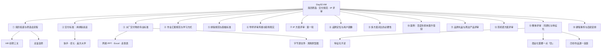

> [!info] 课程信息
> **场次**：Day02 上午 ｜ **主题**：简历筛选全流程 · 交付规范 · IP 与品牌方案评审
> **主线**：**简历怎么被筛掉 → 交付怎么才算专业 → 大厂交付物长什么样 → 逐份方案评审**
> **定位**：**这一天不是讲"怎么设计"，而是讲"怎么把设计交出去"。**

> [!abstract] 一句话总结
> **在面试官看到你的设计能力之前，你已经在"文件大小、文件格式、文件命名"这三关被筛过三轮了。**
> 全片最锋利的一条判据：**从走廊随便拉一个人看一页 PPT——他看得懂，你就过关；他要问你，你就不合格。**

---

# 一、简历投递与筛选：从 HR 初筛到总监复筛

> [!danger] 本模块要回答一个问题
> **你的作品集为什么没有回音？**
> 答案往往不在设计里，而在**文件名、文件大小、文件格式**这三件"与设计无关"的事上。

## 1.1 文件夹命名规范

### 作业命名要求

- **文件夹名称仅需标注本人真实姓名或者个人花名即可**

### 简历与作品集命名规则

| 层级 | 内容 |
| --- | --- |
| **基础必备信息** | **个人姓名、联系电话** |
| **建议补充信息** | **意向应聘岗位** |
| **投递命名要求** | **确保文件名称包含姓名、联系电话等关键信息** |

### 命名的核心逻辑

> [!important] 外部命名解决"能不能找到你"，不是"了解你"
> **投递 PDF 格式作品集的核心目的是让招聘方能够快速联系到求职者**，**而非让招聘方仅通过文件外部命名就完整了解求职者全部情况**——**招聘方仅通过文件外部命名能获取的信息十分有限。**
> **作品集内部可以详细写明意向岗位等完整个人信息，但外部命名必须保障关键联系信息清晰。**

### 命名不当的影响

- **若命名缺少关键身份、联系信息**，**即便求职者精心准备了面试作品集内容**，**也可能因招聘方无法快速识别、联系到本人，导致收不到面试反馈**，**令求职者产生自我怀疑的失落情绪**

> [!note] 补足：更严格的命名禁则与生效时间
> 另一份同场笔记（[[UXDesignCourse/W1D3_am_IP形象优化与配色体系方法论]]）记录得更完整：
> - **禁止使用包含"F""IP""作业"等无明确身份指向的内容作为文件夹名称**
> - **该标准自 2026 年 9 月 17 日起执行**（录音中提及"明天"）
> **理由**：**"F""IP""作业"这类词对招聘方是零信息**——**HR 面对几百个同名文件夹，只能靠姓名区分；命名不含姓名，等于把自己藏起来。**

## 1.2 简历投递量级

> [!warning] 你面对的竞争基数
> - **普通公司 HR 一天接到的简历数量为 500 份起**
> - **大厂要求的简历数在 1000 至 2000 份左右**
> - **京东、阿里等核心部门可能达到数千甚至上万份**
> - **简历投递通过专门邮箱接收，一天新增邮件可达 20 多页，每页约五六十封**

## 1.3 筛选流程：HR 初筛

> [!abstract] HR 初筛是一条漏斗
> **三关依次是：文件大小 → 文件格式 → 简历与学历。**
> **每一关淘汰的都是"与设计水平无关"的东西。**

### 第一步：文件大小筛选

- **HR 打开邮箱后，超过 100 兆的作品集直接不下载**
- **500 份简历中至少有 10% 到 30% 因文件过大成为"炮灰"，永远留在邮箱里不被查看**
- **部分投递者作品集做到几百兆甚至一个 G，等同于 App Store 上架被拒，直接淘汰**

> [!note] HR 为什么不下大文件
> - **HR 本身工作繁杂**：**考核绩效、考核签到、处理管理层事务、申报各类事项、处理请假**等，**没有时间下载超大文件**
> - **课堂评价（主观，非数据）**：**HR 薪资普遍不高，撑死一万**；**HR 多为年轻女生，心情不好时更不会下载大文件**
> （**这段是讲师的现场调侃，用来强调"不要给筛选方增加成本"，不必当作职场事实。**）

> [!tip] 补充：为什么是 100 兆这条线
> **100 兆是"能不能顺手点开"的临界值**——**手机流量、邮箱附件限制、公司网络**都会卡在这个量级。
> **正确做法**：**PDF 导出时压到 20–30 兆以内**，**图片用 JPEG、分辨率 150–200 dpi**；**确实需要超清，另附网盘链接写在第一页。**

### 第二步：文件格式筛选

- **压缩包内文件形式五花八门**：**有 PDF、有 PDF 加图片简历、有 PDF 加 PPT 加 Word 文档、有直接放设计源文件的**
- **没有统一投递标准，全靠投递者对这件事的理解和经验**
- **这一轮再淘汰 10% 到 30%，剩余约 40% 到 50%**

> [!danger] 三种直接被跳过的文件
> - **Word 文档字体丢失的不打开**
> - **PPT 打开后字体乱飞的不打开**
> - **放源文件的小白直接被跳过**
> **原因**：**HR 不是设计师，看不懂源文件，只会觉得"这人不懂规矩"。**

### 第三步：简历优先筛选

- **HR 不是设计师，看不懂作品集，先看有图片简历的**
- **优先看学历**：**985、211 先被挑出，约占 10%**
- **985、211 中再筛出北大动画系、清华美院动画系、吉林动画学院、广美等顶尖院校，剩下 5% 到 1%**
- **剩下 40% 中没有简历的**，**HR 怕浪费时间，可能直接 pass 掉 5%**
- **剩余约 30% 中，学历还行、素质过硬、有学生会经历和奖项的会被关注**
- **简历信息层级排布好的、有大厂成熟 S 级项目经验标签的，有 2% 到 3% 被挑出**
- **平平无奇的再筛出 10% 左右，最终汇总约 100 来份交给总监**

> [!warning] 关于这串百分比
> 原文是一口气口述的漏斗，**各环节的百分比口径并不统一**（有的以 500 为基数，有的以"剩余人数"为基数），**无法精确配平**。
> **请只记住这条结论**：**500 份 → 约 100 份进总监手上，通过率约 20%；其中"学历 + 简历层级 + 大厂项目标签"是决定性变量。**

## 1.4 筛选流程：总监复筛

- **总监觉得 100 多份太多，让 HR 再挑，给出项目经验等标准**
- **HR 不太懂项目经验，但会优先挑有实习经验或工作一两年有大厂背景的**
- **极个别工作经验不丰富但对工作流和链路非常熟悉的也会被挑出**
- **总监最终从 HR 挑出的人里再筛 5% 到 10%**
- **总监把意向人选和排期给 HR，HR 根据总监的空余时间约面试**

## 1.5 面试通知的潜台词

> [!important] 两句话，两种命运
> **面完说"回去等通知"**：**基本 70% 黄了。**
> **面完说"我们在周三之前会再联系你"**：**潜台词是——你基本满足预期但没有很优秀，还要看其他人；但凡有人比你高 1 分或 5 分，你就完蛋。**

> [!tip] 对应的行动
> **听到"周三前联系"，不要等。** **当天继续投下一家**——**等待的成本是零，但机会成本不是。**

## 1.6 被淘汰的常见原因

- **作品集文件名写成"作品集副本 1""作品集副本 2"，白白浪费两个月心血**
- **作品集做到 100 多页不压缩，没人下载，一直等不到联系**
- **在 PDF 简历里附带 PSD 源文件，压缩包里文件太多，HR 头疼直接不看**
- **核心问题：交付不专业，缺乏标准意识**

## 1.7 核心竞争力与求职现实

> [!important] 不能只跟自己比
> **投简历时是和 8 年、10 年经验的人一起投，面试官可能前后脚打开你们的简历。**

> [!success] 弯道超车：不需要全能，需要"被记住"
> **综合能力不如别人，但某一项优势足够突出，就能被记住。**
> **举例**：**海海的设计和 PPT 普通，但逻辑很强**；**团队缺一个能把所有东西串联好的人，就会觉得"我们组就差这么一个人"。**

> [!example] 找工作像谈恋爱
> **不帅、不高、挣得不多，但女生可能觉得你顾家就愿意聊聊；一米八五的体育生反而可能被认为"太好玩"不合适。**
> **策略**：**找到自己最优优势项，利用好并表现出来，同时补足短板，优势项要做到足够突出。**

## 1.8 交付标准与肌肉记忆

- **所有东西都要建立标准，包括画画、任何能力**
- **不是做了就能达到，必须形成肌肉记忆，下意识地去做，而不是"没想到"**
- **讲师本人看到不规范的交付会本能地难受，这就是十几年教学形成的肌肉记忆**
- **课程中要一点点学、一点点记，慢慢了解这些多出来的标准**

---

# 二、交付标准：用排版说话

## 2.1 作业点评环节的定位

- **查看同学们第一天的作业，对比质量、特点、相似性**
- **点评类似公司内部比稿，也类似面试中面试官对候选人作品的主观理解**
- **作品质量给到面试官后，面试官的个人喜好也会影响判断**
- **在一个标准下，每个人有不同理解和交付，体现认知层次和能力水平的差异**
- **团队中有人被总监高看一眼，一定是有原因的**

## 2.2 作业评审：阿玉同学 / 阿星同学

### 评审维度

> [!important] 两个维度，权重不同
> **维度一：品牌标准符合度**——**围绕自身品牌标准，检查作业是否符合要求。**
> **维度二：设计维度**
> - **基础标准**：**设计是否好看**（**占比相对较小**）
> - **工程标准**：**原文件 / 工程文件是否规范**、**流程是否清晰**、**能否体现从零到 N 的完整设计思路**

### 水平评估与核心问题

- **阿玉与阿星的整体水平和认知能力相差不大**，**但本次作业呈现出的结果存在明显问题**

> [!danger] 核心问题：交付形式不达标
> **无法从交付物中清晰认知最终形态**，**无法区分以下内容**：
> - **是推导模块还是成型方案？**
> - **是方案一还是方案二？**
> - **是某个方案的环节还是独立方案？**
> - **是头部 / 关键符号的推导，还是已完成的方案？**
> **需要反复追问才能理解作业内容。**
> **定性**：**交付形式不 OK，基础能力不过关。**

## 2.3 行业基础要求：用排版说话

> [!important] 核心原则
> - **设计师通过图文排版样式传达信息，而非依赖口头解释**
> - **排版应做到一目了然，让观者无需提问即可理解内容**
> - **不需要花里胡哨的设计，干净、清楚、整齐即可**

### 参考案例（大厂标准）

> [!example] 四个对标案例
> **① 快手案例**：**无需设计师本人解释，排版本身就能传达意图**；**文字分层级清晰——标题、主要信息、辅助信息各归其位**；**三视图等关键信息一目了然**；**小字部分可看可不看，不影响整体理解。**
> **② 大厂总监案例（U 盘资料）**：**几乎无排版设计，甚至对齐都不严格**，**但信息展示一目了然，能清楚说明规范内容**；**证明核心在于信息传达的清晰度，而非视觉设计。**
> **③ 优七（U7）级别案例**：**级别较高**（**title 为"优"，级别为"七"**）；**设计形式可能偏老旧（2020 年，约六年前）**，**但信息呈现依然一目了然。**
> **④ 美方大学案例**：**使用简单的圆形、三角形等基础图形，干干净净、规规矩矩**；**体现"上班"的核心要求：规规矩矩占 70% 的前提。**

> [!warning] 两处需待核的名称
> - **"优七（U7）"**：**口径不明**，**疑为阿里 / 优酷体系中的职级**（原文自注"title 为'优'，级别为'七'"），**待核**。
> - **"美方大学"**：**疑为转写误差**（可能为"美院"或某机构名），**待核**。
> **两处都不影响结论**：**这两个案例被引用的目的，都是证明"层级清楚 > 视觉花哨"。**

## 2.4 关键结论

> [!important] 对两位同学的要求
> - **三个月内必须学会：做出来的东西要让对方一目了然**
> - **检验标准：从走廊随便拉一个人看一页 PPT，看对方能否理解**
> - **不要求排版多好、设计感多强，只要求干净、清楚、整齐**

> [!note] 行业认知
> - **互联网设计师的基础要求：用图和排版说话**
> - **好的排版比口头解释更有效**
> - **大厂普遍做法：文字分层级（格式塔原则），码放整齐即可**
> - **工具不限（AI 排版等均可），但最终结果必须一目了然**

> [!danger] 保密提醒
> **本次录屏内容严禁外传。**
> **涉及内部案例资料（U 盘内容），注意保密。**

---

# 三、大厂交付物的专业标准

> [!abstract] 本模块是"惯例sample库"
> **下面每一个案例都在回答同一个问题：大厂交出来的东西，长什么样？**

## 3.1 工程文件命名透露的专业度

> [!tip] 一个下划线就能看出工龄
> - **文件命名中使用下划线加下划线作为分隔符，是工作经验的体现**
> - **原因**：**设计师导出素材给开发时，开发环境更多使用下划线，因此形成工作习惯**
> - **通过命名细节可判断**：**此人至少有一年工作经验，更可能是两三年经验**
> - **如果是小白但命名规范**，**说明有高人指点，且可能已吸收高人的能力，面试时值得关注**

## 3.2 小米发布会 PPT（2019 年）

- **采用大纲形式，先整体后细化**
- **工作流程**：**先做类似 P 图草稿的大纲，确认大致方向后再细化**
- **不是一上来就抠某几页的细节，而是把大纲细化后整体过一遍**
- **雷军发布会 PPT 完全没有设计感，但干干净净、一目了然、清清楚楚**

## 3.3 对学员当前作业的具体反馈

> [!warning] 当前呈现的内容像 Word 文档打字，缺乏信息层级
> - **需要区分**：**哪些是第一个环节（0 或 1）、哪些是 2、哪些是最终结果**
> - **定位、变现渠道等关键词需要与后续内容在字体轻重、大小、粗细上做出区分**
> - **目标**：**让观看者一秒内 get 到关键信息，非关键信息可看可不看**
> - **参考快手三农案例**：**零秒反应，光看标题即可理解**

## 3.4 头脑风暴的正确方法

> [!important] 核心逻辑：由大往小发展，越来越细
> - **从大方向中推出一个可以往下延展的关键点，即某个环节的支线**
> - **最终要有一个清晰的结果，让人知道接下来怎么往下做**
> - **当前学员的头脑风暴中因素太多，没有让人看到哪个是能推动设计往下走的关键因素**

> [!example] 优秀案例：PPT 演示式头脑风暴
> **某设计师通过 PPT 演示形式呈现头脑风暴，节奏把控在设计师手中。**
> **即使不说话，光演示就能让人理解思路走向。**
> **结构**：**基础条件 → 二级条件 → 三级条件 → 最终条件，层层递进。**

## 3.5 大厂交付物清单

> [!example] 八份可对标的交付物
> **① 网易 PPT**：**没有任何设计排版，但干干净净、一目了然**；**核心是展示出来的清楚程度能让观看者接受并理解到位。**
> **② Excel 表格规范**：**制定能力标准的人做的 Excel，每一格内都分信息层级**，**严格、干净、规整、规矩**；**如果能把 Excel 排成这样，就是很专业的表现**——**面试时拿这样的表格给面试官看，面试官会觉得此人太懂工作怎么回事。**
> **③ 设计走查表**：**设计师做完设计后用于自查的工具**，**交付上线前检查设计标准是否达标**；**不同形式（PPT / PDF / Word / Excel）但都分层级**；**邮件表格里面也都分层级。**
> **④ 字节跳动（头条）源文件**：**工程文件、源文件规范、PDF、Word 文档（DOC 格式）**；**Word 里用普通内置宋体，但都分层级**；**每周轮值设计师做"开眼"（审美提高分享），PDF 规规整整**；**交付到内部服务器的文件，打开找不到一个胡乱飞的**；**文件命名可能有个人代号，便于追溯责任人**；**即使只有几行字的 Word 文档，也有信息层级：大标题加粗加黑斜体**；**这种习惯已深入骨髓。**
> **⑤ 产品经理原型图**：**产品经理或交互设计师给 UI 的原型图，同样有清晰的信息层级**；**面试官可能说："你这 PPT 还不如我们产品经理拍的 PPT 好。"**
> **⑥ 滴滴原型图**：**产品经理做的 PDF，包含流程排列和界面**；**原型图是产品经理做完后交给设计师，设计师再针对 UI 做设计**；**滴滴设计师看到原型图后的反应**："**这还咋设计啊？**"；**产品经理的职责**：**梳理逻辑、弄文档、确定功能点。**
> **⑦ 爱奇艺 UI 规范（2018 年）**：**互联网 UI 界面的 APP 规范，不叫品牌书**；**纯品牌类叫 VI 手册 / 品牌书，UI 就叫规范**；**规范中拉线对齐、水印排版都有标准。**
> **⑧ 阿里巴巴饿了么规范**：**饿了么、猫眼电影等属于阿里大文娱集团（或平级团队）**；**即使在级别不高的团队，规范依然标准。**

> [!note] 术语澄清：腰封
> **原文注**：**腰封 = 美团外卖或电商 APP 中滑到中间的长条小展示海报，团队内部叫法（外部叫小 banner）。**
> **注意**：**这与出版业的"腰封"（书籍腰部那条纸带）不是一回事**，**是互联网团队内部的借用说法**。**跨团队沟通时建议直接用"banner / 中插海报"，避免歧义。**

> [!warning] 关于"阿里大文娱"的两句课堂说法（主观 / 时效性）
> - **"阿里大文娱是阿里所有公司 / APP 中级别最低的团队"**——**属于现场调侃，不是组织事实**。
> - **"高管在阿里'犯事'会被调去阿里大文娱当高管"**——**属于坊间传闻**。
> **本段真正有效的结论只有一条**：**即使在所谓"级别不高"的团队，交付规范依然按大厂标准执行——规范是行业底线，不是明星团队的专属。**

## 3.6 核心观点总结

> [!important] 六条结论
> 1. **设计感好与坏暂且不论，最起码要做到清楚**
> 2. **标准化流程、规矩，是不同大厂之间"说不上来的特殊感觉"的来源**
> 3. **把东西说清楚，在排版要素和信息上做到位**
> 4. **一个人很多行为习惯注定了接下来的发展高度**
> 5. **面试和工作中有一种人总监或团队不太想要：对很多工作环节不细的人**
> 6. **专业的人不需要讲解，光看演示就能理解在做什么，甚至能自己脑补解说**

---

# 四、作业汇报规范与学习方式

## 4.1 作业汇报规范

> [!important] 本次是「设计定稿汇报」
> - **需严格按照规范输出 PDF 方案**
> - **汇报 PDF 需清晰排列内容，让审阅者快速理解方案意图**
> - **大厂设计师的工作日常即包含此类项目总结与汇报排版，需养成肌肉记忆**

### 汇报态度与习惯

- **汇报时需保持专业姿态**，如**面对面沟通时需注视对方以示尊重**
- **此类习惯需深入血液，形成下意识行为，而非刻意为之**
- **当前 AI 时代虽可降低对设计细节的苛求，但汇报规范与认知习惯不可松懈**

## 4.2 关于老师带练的边界

> [!note] 不同老师的讲课风格不同，不要苛求一致
> - **当前老师带练原文件属于个人讲课方式，不代表其他老师都会这样做**
> - **胖儿老师不会带练作品集**
> - **李敏老师因教学偏技术方向，可能会带练**
> - **不应苛求所有老师采用相同方式，每位老师有自己的讲课风格**
> - **学生需学会举一反三、融会贯通，不能一直依赖老师修改**

## 4.3 线下学习的核心价值

> [!quote] 线下学习的最大收益，不是老师，是环境
> **线下学习的最大收益不是老师或教学资源，而是环境和系统。**

> [!example] 健身房类比
> **真正的收益不是教练，而是整体氛围**——
> **在家举铃，旁边是沙发、床、猫、电视，容易分心**；
> **在健身房即使想休息，看到别人在练也会被带动。**
> **氛围可以具体化为一个词：资源。**

## 4.4 往期学员资源案例

> [!success] 同学关系是长期有用的人脉资源
> - **有大厂同学现已担任总监，班级至今保持联系**
> - **一位同学直接对接小米雷军做 PPT，现为小米负责人**（**个性鲜明：一米五小个子，非常有个性的女孩**）
> - **一位同学做了爱奇艺品牌书规范**
> - **一位同学做了级别定位相关工作**
> - **一位同学现为美团小高管，上海人为留住他给了北京户口和 70 万年薪**
> - **同班同学、同桌等关系都是长期有用的人脉资源**

---

# 五、排版规范与画幅标准

> [!abstract] 本模块是纯"硬规范"
> **画幅、像素、层级——这些是交付物能不能被正常打开、正常看懂的前提。**

## 5.1 PDF 画幅比例

| 比例 | 适用场景 |
| --- | --- |
| **16:9 宽屏** | **演示文稿 PDF 的默认选择**；**作品集、PPT、PDF 因多在电视或电脑上演示，标准比例为 16:9** |
| **32:9 超宽屏** | **发布会等大型演讲可能使用**（如**雷军发布会**），**为照顾底层观众** |
| **4:3** | **少见**，**仅限投影仪或 iPad 等特定设备演示场景** |

## 5.2 标准像素尺寸

- **16:9 标准尺寸为 1920×1080 像素**
- **如需更高清晰度，可翻倍至 3840×2160 像素**
- **一般使用 1920×1080 即可**

> [!tip] 补充：导出建议
> **PDF 画布按 1920×1080 设计，导出时图片按 2 倍（3840×2160）输出**——**这样在电视上放大也不会糊**，**同时文件体积仍可控在几十兆以内**（**与 1.3 的"100 兆红线"配合理解**）。

## 5.3 当前方案排版问题：层级结构

> [!warning] 核心毛病：该同级的没同级，该降级的没降级
> - **整体排列可再规整**
> - **大框架下包含**：**VI、头脑风暴（含小文本和详细内容文本）、作业要求和作业标准**
> - **"品牌"与"作业"应为同一层级的两件事**
> - **当前"选择定位"大标题不应与上述内容同层级，应单独以标签、按钮等形式呈现为新内容形式**

> [!tip] 把它拆成一张层级表就清楚了
> | 层级 | 内容 |
> | --- | --- |
> | **一级（并列）** | **品牌** ｜ **作业** |
> | **二级** | **VI** ｜ **头脑风暴** ｜ **作业要求** ｜ **作业标准** |
> | **三级** | **头脑风暴下的小文本 / 详细内容文本** |
> | **独立形式（不占正文层级）** | **"选择定位"**——**以标签、按钮等组件形式呈现** |
> **判断方法**：**同一层级的话，字号、字重、颜色必须一致；一旦"选择定位"的标题和"品牌""作业"看起来一样大，阅读者就会误以为它们是同一层的三件事。**

## 5.4 设计参考建议

- **多关注纯排版与颜色驱动的设计案例**
- **2026 世界杯 logo 即大色块加文字符号的典型，纯排版元素效果出色**
- **关注此类设计可感知设计形式与现阶段设计发展趋势**

---

# 六、导师评审风格与职场现实

## 6.1 两位导师的评审风格对比

| 导师 | 风格 |
| --- | --- |
| **当前导师** | **对设计较为看重，细节把控较细**；**有个人标准，会用该标准审视所有作品** |
| **胖儿老师（华老师）** | **大面上完成质量的 70%–80% 即可通过**；**不太计较细节，大纲差不多就放行**；**若大纲未完成，直接指出缺失环节，要求回去补完再找** |

## 6.2 职场现实类比

> [!important] 总监不会逐项指导细节
> **总监通常只说"这块再试试"或"再做一版试试"。**
> **工作流程即如此，需适应。**

## 6.3 沟通态度说明

> [!note] 讲师本人的说明
> - **对学员个人没有任何意见，点名是针对具体事情**
> - **会把问题摆到明面上说透**
> - **如果学员感到不舒服可以沟通，老师愿意调整说话习惯**
> - **较真是针对当前展示的东西，不是攻击个人**
> - **希望学员不要产生误会，认为老师在攻击人**

---

# 七、IP 设计方案评审：第一轮

> [!abstract] 评审基调
> **这一轮是"方向评估"，不是"成品验收"。**
> **讲师给的判断几乎都落在同一个标准上：这件事有没有必要？**

## 7.1 整体评价

- **设计从大面上讲有特点，有很强的特点**
- **整体按要求的思路推进**

## 7.2 头部与装饰问题

> [!important] 头部是第一比重，装饰不能抢它
> - **头部为第一比重，可做成符号**
> - **头部上方的配套装饰与头部存在比重冲突，过于抢眼，有重复感**
> - **装饰过大导致后续添加五官时受限**：**帽子扣得过大，样式基本固定，表情和神态难以变化**
> - **建议**：**装饰缩小，再小一点，达到目的即可**

## 7.3 设计决策原则：必要性

> [!important] 行与不行，不靠感觉，也不靠绝对审美，而是靠必要性
> - **大厂设计师有能力做精致设计，但"无必要，没必要，做成那样足够"**
> - **拼多多等案例**：**四年美股上市，设计看似粗糙，实为定位与目的驱动**
> - **能达到目的即可，否则就是设计过度，太为了设计而做**

## 7.4 嘴部设计

- **当前嘴部加上去未起到嘴的作用**：**一是小，二是歪嘴仅为表示开心喜悦**
- **去掉嘴后五官神态已能传达喜悦感**
- **除非嘴是高度特征化设计，能体现 IP 或品牌特性，否则不必加**
- **特定活动场景**（如**双十一主视觉中飞着的小人**）**可临时加大笑容**

## 7.5 点点装饰

> [!warning] 表意模糊的装饰，等于没有装饰
> - **当前看不出加上去的含义和意义**
> - **可能想做蘑菇或草莓，但表意模糊**——"**蘑不蘑菇蘑菇，草不草莓草莓**"
> - **需判断该元素在画面中的比重**：**若仅为背景或单一环节元素，需评估必要性**

> [!example] 窗户案例：数量由比重决定
> **做一坨窗户放三个看看是否成立，还是要十几排？取决于在画面中的比重。**
> **两个表意性基本相同的元素，需做出选择决定。**

## 7.6 脸型设计

- **当前脸型形式可行，但效果不佳，像盗贼**
- **需回溯品牌概念和理念**：**若品牌理念支持"盗贼"形象则可行，否则需调整**
- **品牌是否自然增长、治愈等方向需确认**

## 7.7 品牌方向提示

- **当前品牌方向涉及教育领域**
- **导师提醒**：**不要都做教育方向，需注意差异化**
- **另一文件中有其他品牌方向参考**

---

# 八、品牌定位与用户画像

> [!abstract] 本模块是"从调研到画像到视觉基调"的完整推导
> **核心问题：一个品牌到底服务谁？这个人长什么样？**

## 8.1 品牌方向混乱问题

> [!danger] 调研材料对不上项目，等于没调研
> - **现有调研材料中品牌出海方向不明确，未找到核心定位**
> - **对标的 Shein（女装快时尚）与茄子快传（云存储工具）均与项目实际方向不符**
> - **项目实际方向为**：**游戏化时间管理工具，类似游戏商城 / App Store 形态，付费下载模式**

**两个对标案例的实际情况：**

| 对标对象 | 实际情况 | 与项目的关系 |
| --- | --- | --- |
| **Shein** | **女装快时尚**；**其竞品是 Zara** | **与"游戏化时间管理工具"完全无关** |
| **茄子快传** | **云存储工具**；**对标的是百度网盘、阿里网盘、迅雷网盘、夸克网盘等** | **与项目方向不符** |

> [!warning] 两处需要修正的表述
> **① "Shein 已导致 Zara 大量线下门店关闭"**——**因果被过度简化。**
> Zara 关店是**快时尚整体转型、线上化、疫情后选址调整**共同作用的结果，**Shein 是重要竞争者之一，但不是唯一原因**。**写调研报告时不宜写成单一因果。**
> **② "茄子快传是云存储工具"**——**分类不准确。**
> **茄子快传（SHAREit）主营是跨平台文件传输与内容分发**，**与百度网盘 / 夸克网盘这类"存储 + 分享"产品定位并不相同**。**它是一个典型的"看起来像但实际不是"的误对标案例**——**正好印证了本节的问题：对标之前先搞清楚对方到底做什么。**

## 8.2 目标用户画像

> [!important] 核心人群：时间紧张的上班族
> | 维度 | 内容 |
> | --- | --- |
> | **核心人群** | **时间紧张的上班族（白领为主，也可涵盖蓝领）** |
> | **薪资范围** | **1 万至 2 万之间，最高到中产水平以下** |
> | **关键词** | **急、焦虑、充实、累** |
> | **家庭状况** | **大部分未成家，没有孩子，甚至没时间谈恋爱** |
> | **性格特点** | **独立、有见解、有目的性** |
> | **宠物偏好** | **大部分养小动物** |
> | **与二次元 / 游戏宅的区别** | **不具备很特殊的性格、喜好特点，属于广义人群** |

**生活状态：**

- **放假躺床上不想出门**
- **点外卖为主**
- **做饭买速成或简单加工食品**
- **偶尔周末炖个排骨，不愿完全自己炒菜**

> [!tip] 这张画像的设计含义
> **关键词"急、焦虑、充实、累"直接决定了设计基调**：
> **不能用高饱和、强对比、攻击性强的视觉**——**那会加重焦虑**；
> **也不能太低幼**——**用户是"独立、有见解、有目的性"的成年上班族**。
> **宠物偏好（养小动物）则解释了为什么"陪伴感"是这类产品最容易成立的叙事。**

## 8.3 品牌视觉设计方向

### 设计基调

> [!important] 温和，让大部分人趋于接受
> - **设计应温和，让大部分人趋于接受**
> - **神态、五官不要过于特殊化**
> - **避免过于情绪化的表达**（如**过分坚定**）
> - **可以坚定，但不要让人过分感受到**

### 现有方案问题
- **AI 生成的思路形式方向正确，表情神态基本 OK**
- **有一个方案偏萌、低幼化**：**不张嘴可以接受，一张嘴太像小孩**
- **有一个方案存在歧义风险**：**第一眼感受可能产生误解，需将歧义和特殊感受降到最低**

### 色彩调整建议

| 调整项 | 建议 |
| --- | --- |
| **明度 / 饱和度** | **降低** |
| **脸部** | **可以亮一些** |
| **透明度** | **不建议降低** |

### 身体与动作延展性
> [!important] 身体没有延展性，方案就进不了第一梯队
> - **身体部分需进一步优化，更加具体**
> - **小肢体部分应适当展现出来**
> - **品牌需要大量动态应用场景，身体需具备动作延展性**
> - **参考**：**微博上的动作组件、动作库、动作素材**
> - **若身体没有延展可能性，需求方大概率不会将其作为第一最优方案**
> - **原文件交付后应具备可调整、可摆弄的空间**

---

# 九、多方案对比的必要性

> [!important] 没有对比，就无法判断好坏
> **复杂设计本身带来的问题很多，需要做十稿、几十稿甚至上百稿才能挑出最优方案。**
> **最终上线的方案可能连创作者自己都认为不完美。**
> **只做一两稿远远不够，面试或实际工作中均不成立。**

> [!example] 买衣服与看人
> **没有对比就无法判断好坏**——**如同买衣服，再贵的衣服单独放着也总觉得不太合适；再帅的人单独看也总觉得不太对。**
> **有对比才有方案的参差和好坏之分。**

## 9.1 其他同学方案对比

- **提到阿岩的方案，计划进行多同学方案对比**
- **通过对比不同同学的最终结果，观察各自特点、问题和优点**

---

# 十、案例：百度视觉专家岗晋升答辩

> [!abstract] 一个纯粹的"态度样本"
> **这个案例不提供方法，只提供一个证明：把交付做到极致，能换来什么。**

## 10.1 背景信息

- **该师兄未上过大学，通过成人自考获得学历**
- **对设计极度痴迷，属于"技术宅"类型**
- **从百度中高级岗晋升到专家岗，答辩成功**
- **后被快手总监挖走，年薪百万（50 万年薪 + 50 万期权）**
- **目前在快手担任小负责人，带几名设计师**

> [!note] 口径澄清："年薪百万"
> **原文作"50 万年薪 + 50 万期权 = 年薪百万"**——**这两个数字性质不同**：
> **50 万年薪是现金收入**；**50 万期权是权益，取决于授予价、归属节奏与行权时的股价，不等于当年到手收入**。
> **"年薪百万"应理解为"总包（TC）约百万量级"。**
> **面试谈薪时务必区分 base / 现金奖金 / 期权**——**把期权按面值当现金算，是最常见的自我误判。**

## 10.2 答辩作品特点

> [!success] 把答辩当成一次作品来做
> - **所有插画均为针对答辩专门手绘的封面**
> - **专门用 AE 录制动效，花了一整晚**
> - **答辩结尾有精心设计的环节**（"**别慌，好运**"主题）
> - **排版精致程度超过他面试百度时的作品集**
> - **评委反应：CEO 们站起来鼓掌**

## 10.3 个人特质

- **对设计有极高标准和严苛要求，像手艺人对待手艺**
- **把设计当成自己的事业在从业**
- **性格单纯**：**作为负责人，下属说在做头发，他就自己打开电脑干活，怕影响人家做头发**
- **被老师批评"你一个负责人，让他弄啊"，但他仍选择自己完成**

---

# 十一、品牌礼盒与周边产品评审

> [!abstract] 这一轮的靶心只有四个字：品牌辨识度
> **产品线很丰富，但"丰富"不等于"有品牌"。**

## 11.1 核心问题：缺乏品牌辨识度与设计特殊性

> [!danger] 看起来像"样机"
> - **当前产品（吧唧、毛绒、小包装盒、香囊、挂件等）虽然品类丰富，但整体呈现"刻板印象"中的样子，缺乏品牌特色**
> - **以泡泡玛特为例**：**即使不展示品牌标识，仅凭盲盒的比例、眼睛、手脚、五官结构位置等固定特征，就能识别出品牌归属**——**当前产品做不到这一点**
> - **第一印象是"样机"**——**即通用模板的感觉，而非有独立设计语言的品牌产品**

> [!note] 术语：吧唧
> **"吧唧"= 徽章 / 马口铁胸章**，**来自日文「バッジ」（bajji）的音译**，**周边产品圈的通用叫法**。

## 11.2 设计标准与落地成本的关系

> [!important] 设计是第一条件，成本是第二条件
> - **设计是第一条件，成本是第二条件。不应以成本低为由放弃设计探索**
> - **大厂的做法**：**先提出高标准的设计方案（视觉稿），再探索落地可能性，而不是先考虑落地难度再反推设计**
> - **设计服务于落地，但不应被落地完全限制**；**如果过度考虑落地，设计思路会被局限，最终呈现的结果无法体现设计师的真实能力**
> - **纸制品在材质上的成本是固定的（纸张大小不变）**，**差异在于开模、裁切、折页方式**，**这些由电脑计算后批量生产，样式上的特殊性并不会带来绝对的成本增加**

### 参考案例

> [!example] 三个"低成本高设计感"的中秋礼盒
> **① vivo 中秋礼盒**：**大量 V 形开口设计，疑似呼应 vivo 品牌字母的斜线特征**；**打开方式有吸附设计，展开方式独特**；**整体呈现"好玩有趣"的体验感，一看就不是样机。**
> **② 美团中秋礼盒**：**镂空设计、镭射效果、Logo 新颖**，**在现有模块上做出设计感**；**成本仅增加一毛两毛**（**贴纸或直接贴上的纸**），**但设计感显著提升。**
> **③ 小房子造型礼盒**：**纸质礼盒做成可打开的立体小房子样式**；**开模和折页方式不同，但纸张成本不变**——**说明样式特殊性不必然带来高成本。**

## 11.3 品牌标识（猫 Logo）的应用问题

### 当前状态

- **Logo / 形象本身有一定趣味性，但应用场景不明确**
- **主图形（猫）和副图形（底部容器 / 辅助图形）未被有效利用**
- **测评数据不理想**：**消费者不为猫形象买单，甚至不以为然或不在乎，说明当前方向需要调整**

### 改进方向

> [!important] 不要把 Logo 直接贴上去，要把它的"型"当引子
> - **保留品牌标识，但需重新定义其作用**
> - **猫形象不应只是直接贴在产品上，而应通过特征化的"型"作为引子线索，逐步探索其他维度的设计**
> - **辅助图形的容器功能**：**可以利用副图形（容器形状）来设计卡片样式、包装结构等，而非直接使用完整 Logo**

**具体示例：**

- **香囊或卡片可以做成具有品牌延续性的特殊形态，而非通用形状**
- **包装盒即使是方形，也可以通过抽拉方式、开盖方式、丝带位置等细节体现设计感**
- **猫耳朵可以作为礼盒的拉手 / 提手元素**——**例如丝带从耳朵位置拉出，既体现设计又兼顾功能性**

## 11.4 面试与作品集策略

> [!danger] 不要说"我没多少钱所以没弄太好"
> **面试时不应说这类话，这会被理解为"没诚意"或"糊弄"。**
> **应展示设计探索的过程和可能性，同时说明最终方案如何兼顾落地**，**让面试官看到设计能力和思考深度。**

> [!success] 面试官的真实意图：看的是"可能性"
> - **面试官能识别作品集中的"胡诌"成分，但仍愿意面试，是因为想看到候选人的可能性和潜在价值**
> - **案例**：**一位 UI 设计师面试时展示了 Principle 动态原型**，**虽然明确表示没有实际项目经验、不会某些技能，面试官仍表示"来了我教你"**——**因为面试官看到了她的设计潜力和价值，愿意投入培养成本**
> - **启示**：**作品集中应展示设计探索的多个版本、推演过程，以及最终选择当前方案的原因（兼顾了什么、放弃了什么）**，**让面试官看到完整的设计思维链条**

## 11.5 具体设计建议

> [!tip] 三件产品的改造方向
> **吧唧（徽章）**：**当前为普通圆形，缺乏特殊性**；**参考方向——火焰外框、破型处理（打破圆形边界，创造空间感和层次感）、异形设计（如果冻般的不规则形状）**；**即使保持圆形，也可以通过外框设计、层次处理来提升设计感。**
> **包装盒**：**当前为四四方方的普通礼盒样式**；**可探索——抽拉式或翻盖式打开方式的变化、圆形或其他非常规造型、利用猫耳朵等品牌元素作为功能性部件（如拉手）、丝带等辅助元素的位置和功能设计。**
> **卡片**：**可利用品牌辅助图形（容器形状）来设计卡片的外形或内部结构，而非直接使用完整 Logo。**

## 11.6 评分与目标用户定位

> [!warning] 当前评分：十分制中约为五六分
> - **未超出预期，所有产品形态都在"预期之内"**
> - **卡片对卡片、挂件对挂件、礼盒对礼盒、冰箱贴对冰箱贴**——**都是常规对应，缺乏惊喜**
> - **看不到设计为品牌带来的附加值，纯粹从功能性上体现，没有"设计为品牌赋能"的体现**

> [!important] 目标用户越是年轻人，设计越不能普通
> - **产品（吧唧、香囊等）主要面向年轻人，中老年群体几乎不会使用**
> - **正因目标用户是追求新鲜感的年轻群体，产品设计更不能普通，否则无法在同类产品中脱颖而出**

> [!note] 关于评分的口径（跨节一致性）
> 本节的"**十分制五六分**"（≈50–60%）与 **12.3 的"60~70 分"**（**百分制**）**用的是两把不同的尺子**。
> **换算后大致同档**：**都是"及格线上、未达优秀"**。**读笔记时不必纠结具体分数，看评语更准。**

---

# 十二、耳机套设计方案评审

> [!abstract] 小众产品的唯一出路：用设计感建门槛
> **耳机套已经没有"保护功能"的护城河了，只剩下设计感。**

## 12.1 当前设计存在的问题

### 设计感不足，缺乏差异化

> [!danger] 核心判断：设计本身没有抓住用户兴趣点
> - **现有耳机套设计形式过于普通，市场上同类设计太多，无法形成竞争力**
> - **耳机套的核心价值已从保护功能转向设计感和趣味性，消费者购买动机是"好玩、有意思"**
> - **以讲师自购的耳机套为例**：**功能上并无特别之处，但按压解压的小设计让人感觉不一样，售价十几块钱，成本可压得很低，变现空间可观**
> - **当前设计反响不好、无人购买，说明设计本身未能抓住用户兴趣点**

### 主题表达不直白

- **"大展宏图"主题**：**英文标识不应保留，应直接用"大展宏图"四个字，更直白地传递"好运"的寓意**
- **当前设计未能体现该主题对应时间点的具体事件发酵情况**（**歌曲专辑名即为"大展宏图"**）
- **招财猫主题**：**既然选择了招财猫含义，就应直接体现猫的外轮廓造型，内外呼应，让人一眼 get 到，而非隐晦表达**

### 缺乏系统性和品牌关联

> [!warning] 东西看着多，但没有品牌延续感
> - **各元素之间完全割裂**：**Logo 就是 Logo，贴纸就是贴纸，包装盒就是包装盒，彼此没有任何关联**
> - **唯一反复出现的元素只有猫，但猫的形象不统一**——**一会儿胖、一会儿瘦、一会儿是普通家猫，缺乏稳定的 IP 形象**
> - **整体不成套系、不成系统**

### IP 形象不稳定

- **猫的形象缺乏统一设定**：**有胖的、有中性的、有普通身材的、有带头的，无法确定猫的本体到底是什么样**
- **需要补充一个完整的、类似人形 IP 的完整形象，作为延展的基础**

## 12.2 设计方向建议

> [!important] 小众产品无法靠走量出圈，必须靠设计感建门槛
> - **不要过度纠结成本问题，优先确保设计能出来、有落地可能性，达到 80%~90% 即可**
> - **成本问题后续再议，贵一毛两毛到时候再说**——**面试看的是设计赋予品牌的可能性**

> [!tip] 先做品牌系统，再做产品
> **先做类似品牌书的内容，从中提炼品牌容器、品牌基础图形应用、技术图形，再基于此做产品设计。**
> **确保所有产品之间有统一的视觉关联和品牌延续感。**

> [!success] 参考案例：单 IP 账号
> **抖音上有账号做到大几百万粉丝，IP 形象为胖胖的、白白的角色，只卖这一个 IP 的周边产品（毛绒玩具、公仔、纸片、铁片等）。**
> **材质普通、成本低，但品牌延续感极强**；**商城只卖这一个 IP 的衍生产品，看似单一实则品牌化极其突出。**
> **该策略本质是**：**为精准粉丝群体提供唯一选择，强化品牌认知。**

### 自媒体逻辑

> [!important] 自媒体逻辑 ≠ 传统商品逻辑
> - **自媒体核心是差异化、抓眼球、咋咋呼呼**，**没有成本不成本、便宜不便宜、好做不好做的问题，先抓眼球再说**
> - **如果通过自媒体卖商品，必须遵循自媒体逻辑，而非传统商品逻辑**

## 12.3 评分与结论

- **当前设计评分：60~70 分，无法有效突出设计能力**
- **思路方向可行，但设计执行和品牌系统性需要大幅加强**
- **面试时应展示的是设计赋予品牌的可能性，而非试市场的思路**

## 12.4 课程延伸：自媒体内容的融入

- **木木同学（抖音咨询学员）反馈**：**老师课上讲的自媒体碎片化内容整理后用于团队分享，效果很好，领导要求其分享 AI 自媒体及 AI 破圈经验**
- **课程中可每天融入自媒体思路，提供想法和引导性干货**，**但前提是设计本身要做好，不能变成自媒体课**

---

# 十三、整体评审：同质化与特征化

> [!abstract] 本模块是全片设计理念的最高浓度一节
> **它回答"为什么你的形象看起来都差不多"，以及"为什么可以丑，不可以平"。**

## 13.1 整体评价

- **本次评审为第一天见面后的初步方向评估，整体结果在预期之内**
- **没有出现绝对优秀到无可挑剔的作品，也没有出现差到需要完全重做的作品**
- **部分作品存在同质化问题**：**设计虽然成立，但脑海中会浮现多个类似品牌形象，缺乏记忆锚点**
- **评分分布**：**有达到基本要求的、有不错的、有优秀的，也有介于两者之间的**；**没有给出"灰色"（需重做）的评价**

## 13.2 核心设计理念

### 特征化不足是当前普遍问题

> [!important] "哪哪都有一定设计"，等于没有设计
> - **多数作品缺乏突出的记忆点，过于简单或过于中性，导致品牌形象符号感弱**
> - **设计需要让人一眼看出"是什么"**：**如果借用云、土块、山、水滴等元素，就要把特征做足，让观者能直接感知到**，**而不是"似有非有、有一点点但还不清楚"**
> - **五官选择偏中性**：**中性五官导致特征化无法凸显，需要更鲜明的表情或形态语言**

### 符号的可用性

> [!warning] 单看形不复杂，但摆上商品后显得复杂
> - **头部作为独立符号使用时，需要兼顾简洁性与辨识度**
> - **波浪、鼓起等细节过多会抢占前景商品的视觉焦点**

### 商业化需要一定意义上的「丑」

> [!important] 流量 → 话题 → 讨论 → 冲突
> **商业化的前提是流量，流量的根本是话题，话题的根本是讨论，而讨论最容易由略带负面的元素（如"丑"）引发。**
> - **案例**：**哪吒、现代动画中的孙悟空、米老鼠、雪王等，均打破了传统审美认知，反而获得了记忆点和传播力**
> - **过于正面的形象（如雷锋）缺乏讨论空间**，**而有争议的形象（如李佳琦、三只羊）则天然具备话题性**
> - **雪王的"你爱我我爱你"旋律简单甚至"难听"**，**但正是这种特质使其具备了病毒式传播的基础**

> [!note] 跨节呼应
> 这条论点与 [[UXDesignCourse/W1D1_am_品牌设计与IP打造核心方法论]] 中的**"新鲜感驱动消费"**是同一逻辑的两面：
> **那边讲"用户为没见过的东西付费"，这边讲"用户为值得讨论的东西传播"。**
> **设计上"平"的代价，比"丑"更大。**

### 自媒体经验分享

> [!quote] 三年日更，八九百个视频，核心原则是"不要脸"
> - **敢于自我演绎、适度夸张**
> - **举例**：**一条关于"UI 没得做了，AI 一键生成界面"的视频，内容本身自己都不完全相信，但播放量达到 15–16 万**；**不夸张时流量仅五六千**
> - **结论**：**想要流量还是想要脸，二者不可兼得**
> - **想扩圈、想让大众喜欢，就必须放下身段**

## 13.3 具体作品反馈

### 作品一：波浪 / 云 / 山元素形象

> [!warning] 方向可行，但特征化不够明显
> - **头部形态处理过于简单，波浪和身体起伏较多，导致整体观感复杂**，**尤其在作为背景或搭配商品时会"抢戏"**
> - **建议**：**从头部形态上深挖特征，将云、土块或山的意象做足，让人一眼识别**；**若选择简洁路线，则需在形态转折上制造更大的变化，或增加诙谐幽默感**

**身体比例调整技巧：**

| 身体特征 | 调整方式 |
| --- | --- |
| **身体比例小** | **让形态更"蹲"一点，增加大的形体转折** |
| **身体修长** | **在结构上增加设计感，如手部做结构处理，使复杂程度与身体比例匹配** |

**表面装饰（麻子 / 斑点）问题：**

- **当前装饰过于随意，像可有可无的附加元素**，**实际应用时可能"还不如去掉"**
- **建议**：**若保留装饰，需赋予其设计依据**，**例如集中在特定区域形成类似服装元素的装饰带，而非随意散布**

### 作品二：水滴形象

> [!danger] 这不是品牌 IP，这是一个图标
> - **过于简单，几乎等同于一个图标而非品牌 IP 形象**
> - **图标的意义仅在于搭配文字说明功能**，**而品牌 IP 需要独立承载品牌气质**
> - **水滴的意象过于宽泛**：**可代表江河湖海、水管、洗澡、泳池、大海、鱼等，无法有效聚焦于品牌本身**

> [!important] 核心问题：把「依附元素」当成了「主体」
> **没有将水滴作为"依附元素"而非"主体"来使用。**
> **正确思路是借用水滴的设计理念或形态，附着于品牌之上**——**就像穿一件衣服，体现的仍是品牌自身的气质。**

> [!tip] 发散建议
> **将杯子品牌做得方方正正、蹲一点，底部有底座感**，**像年轻人喝的咖啡杯蹲坐在桌上，同时作为陪伴物存在。**
> **小人在上面搭配懵懂的小五官，形成"陪伴感"的设计叙事。**
> **当前设计无法回答"穿上这件衣服后，我的气质是什么"这一问题。**

### 作品三：猕猴桃 / 杯子 / 水滴混合形象

> [!warning] 比水滴作品更有特点，但撞车风险高
> - **存在与小红书及其他猕猴桃形象撞车的问题**
> - **需要优化以避免品牌认知偏差**：**用户看到类似形象时，可能联想到京东狗或其他已有品牌，等于为他人赋能**
> - **优化方向**：**① 满足特征化要求；② 做差异化设计；③ 避免与其他品牌样式一致**
> - **可发散的方向**：**杯子、飘出的热气、大水滴等元素均可作为设计切入点**

### 作品四：鹿形象

> [!warning] 完成度尚可，但本质上就是一只小鹿
> - **作为 IP 基础形象"像那么回事"，但缺乏品牌层面的独特性**
> - **与瑞幸的鹿相比**：**瑞幸通过"回头"的动态姿态和归纳出的弧度，呈现出了特殊性和唯一性**
> - **当前作品的鹿角、耳朵、脸型都是标准鹿的特征，没有在品牌维度上做文章**
> - **建议**：**鹿仅作为引子借用，重点应放在品牌特征的塑造上**；**每一个转折、每一个凸起都应寻找花样，但需遵循"概括"的前提**
> - **作者背景**：**此前未做过设计，本次作品为从正方形开始逐步捏圆、掐腰等方式手工抠出，显示出一定天赋**

## 13.4 行业案例分析

> [!example] 五个案例，一个结论：大厂花钱做设计，唯一目的是品牌赋能
> **饿了么**：**从早期形象到后期改版，转折和小细节的拿捏更加精准，唯一性更强**；**大厂在市场份额已稳固的情况下仍投入大量资源做设计升级，唯一目的就是用设计赋能品牌。**
> **美团**：**袋鼠形象即使不改也不影响业务，但选择突出设计价值**，**说明设计要素在大厂策略中占据首要位置。**
> **天猫**：**猫形象的应用可能性极多，元素简单好用，对设计师友好，后续接手项目的人不会因复杂形象而苦恼**；**天猫做猫、京东做狗，本质上是借用动物元素依附于品牌，而非主要做动物本身**；**十年前天猫如果不是猫，也可以是袋鼠或乌龟，关键不在于"像什么"，而在于品牌赋能。**
> **得物**：**费力打造形象却很少露面，但仍有其目的性，体现了设计的主导地位。**
> **成熟 IP 的特征**：**不在于复杂程度，而在于大小、形状变化上的特征**——**例如某些形象通过"胖到肉耷下来"的形态、五官聚堆的布局、大树耳朵与大圆眼睛的组合等方式，在极简中建立强辨识度。**

## 13.5 工作方法建议

> [!note] 三条
> - **提供的思路仅供参考和启发，不应直接照搬修改**；**应举一反三、融会贯通，在理解思路的基础上发展出自己的方案**
> - **设计师需要学会评估作品价值，主动寻找差异化空间，避免与已有品牌形象撞车**
> - **做设计不要怕"丑"**——**商业化语境下，略带负面的视觉特征往往比完美无缺的形象更具传播力**

---

# 十四、课程事务与后续安排

> [!note] 课程事务
> - **本次评审为第一天见面后的初步方向评估**
> - **明天讲解自媒体相关内容**（**讲师安排**）
> - **下午对上午讲到的要点进行收尾整理，根据反馈继续优化各自的设计方案**
> - **下午对其他同学的作品进行逐一详细评审，给出具体修改建议**
> - **注意保密：本次录屏及 U 盘内部资料不得外传**

## 14.1 待办清单

### 💼 简历投递与求职

- [ ] 投递简历前检查文件大小（控制在 100 兆以内）、文件命名规范、压缩包内容整洁
- [ ] 建立个人核心竞争力，找到最优优势项并突出表现
- [ ] 面试后若收到"周三前联系"的回复，继续投递其他机会，不要等待

### 📐 交付规范与排版

- [ ] 在课程中逐步学习交付标准，形成肌肉记忆
- [ ] 阿玉和阿星需重新梳理作业交付形式，明确区分推导过程与最终方案
- [ ] 在交付物中清晰标注：方案一 / 方案二、推导环节 / 成型方案、关键符号推导 / 完成方案
- [ ] 三个月内掌握"用排版说话"的基础能力，做到信息一目了然
- [ ] 参考大厂案例（快手、优七、美方大学等），学习干净整齐的排版方式
- [ ] 后续作业交付前，自检标准：随机找一人看单页内容，确认对方无需解释即可理解
- [ ] 学员需参考大厂交付物标准，提升自己作业的信息层级和清晰度

### 🧠 头脑风暴与信息层级

- [ ] 学员需重新整理头脑风暴内容，区分基础条件、二级条件、三级条件和最终条件
- [ ] 学员需在归纳整理时，对定位、变现渠道等关键词与后续内容在字体轻重、大小、粗细上做出区分
- [ ] 学员需确保观看者一秒内能 get 到关键信息，非关键信息可看可不看
- [ ] 学员需从头脑风暴中推出一个可以往下延展的关键点，形成清晰的设计方向

### 🎨 品牌定位与视觉方案

- [ ] 明确品牌出海方向，聚焦游戏化时间管理工具定位
- [ ] 重新梳理对标产品，剔除 Shein、茄子快传等不相关案例
- [ ] 调整角色设计：降低明度和饱和度，脸部提亮
- [ ] 修正低幼化方案：调整嘴部表情，避免张嘴时过于小孩化
- [ ] 消除方案中的歧义元素，降低第一眼感受的特殊性
- [ ] 优化身体设计，增加小肢体细节和动作延展性
- [ ] 参考微博动作组件 / 动作库 / 动作素材，验证身体方案的可延展性

### 🧭 方法论与学习方式

- [ ] 制作多稿方案进行对比，避免只做一两稿
- [ ] 对比阿岩等其他同学的方案，分析各自特点与问题
- [ ] 培养举一反三能力，减少对老师带练的依赖

### 🎁 品牌礼盒与周边产品

- [ ] 重新审视品牌标识（猫 Logo）的应用场景，明确其在品牌推广媒介中应起的作用
- [ ] 利用辅助图形（容器形状）探索卡片、包装等设计的特征化形态，而非直接使用完整 Logo
- [ ] 针对吧唧设计，参考破型处理、异形、外框设计等方向，提升设计特殊性
- [ ] 针对包装盒，探索抽拉式 / 翻盖式变化、非常规造型、品牌元素功能性融入（如猫耳朵拉手）等方案
- [ ] 在设计平台（非百度）搜索优秀吧唧、礼盒设计案例，拓宽参考视野
- [ ] 将 IP 推导思路（特征化型 → 引子线索 → 逐步探索其他维度设计）应用到品牌周边产品设计中

### 🖼 作品集与面试话术

- [ ] 补充作品集中缺失的设计推演过程，展示多版本方案及最终选择的原因
- [ ] 调整面试话术：不强调成本限制，改为展示设计探索过程与落地兼顾的思考

### 🎧 耳机套设计

- [ ] 优化耳机套设计，强化设计感和独特性
- [ ] "大展宏图"主题：去掉英文，直接用"大展宏图"四个字
- [ ] 招财猫主题：直接体现猫的外轮廓造型
- [ ] 建立品牌系统：先做品牌书，提炼品牌容器和基础图形，再延展产品设计
- [ ] 补充完整的猫 IP 形象（类似人形 IP 的完整设定），统一胖瘦和造型
- [ ] 串联各产品元素，形成套系和品牌延续感

### 🔍 整体评审与个案突破

- [ ] 针对"特征化不足"的问题，从头部形态、五官选择、身体比例等方面寻找突破口
- [ ] 水滴形象作品需重新思考品牌依附关系，尝试"杯子 + 小人"等发散方向
- [ ] 猕猴桃 / 杯子混合形象需排查与小红书等已有品牌的撞车风险，明确差异化方向
- [ ] 鹿形象作品需跳出"标准鹿"的框架，在品牌维度上寻找独特特征
- [ ] 所有作品需检查表面装饰元素是否有设计依据，避免"可有可无"的附加感
- [ ] 参考饿了么、美团、天猫等案例，思考如何通过设计为品牌赋能

### 📚 课程事务

- [ ] 查看第一天作业的 PSD 文件，进行对比点评
- [ ] 继续查看第二天作业
- [ ] 注意保密：本次录屏及 U 盘内部资料不得外传
- [ ] 学员如有不舒服的感受，可随时与老师沟通反馈
- [ ] 明天讲解自媒体相关内容（讲师安排）
- [ ] 下午对上午讲到的要点进行收尾整理，根据反馈继续优化各自的设计方案
- [ ] 下午对其他同学的作品进行逐一详细评审，给出具体修改建议

---

# 🧠 自测

> [!question]- Q1. 作业文件夹命名的要求是什么？哪些内容被明令禁止？
> **文件夹名称仅需标注本人真实姓名或者个人花名即可。**
> **禁止使用包含"F""IP""作业"等无明确身份指向的内容作为文件夹名称**（该标准自 **2026 年 9 月 17 日**起执行）。
> **理由**：**这类词对招聘方是零信息**——**HR 面对几百个同名文件夹，只能靠姓名区分。**

> [!question]- Q2. 简历与作品集的命名规则包含哪些信息？
> **基础必备信息**：**个人姓名、联系电话**。
> **建议补充信息**：**意向应聘岗位**。
> **投递命名要求**：**确保文件名称包含姓名、联系电话等关键信息。**

> [!question]- Q3. 为什么外部命名不需要写全个人信息？
> **投递 PDF 格式作品集的核心目的是让招聘方能够快速联系到求职者**，**而非让招聘方仅通过文件外部命名就完整了解求职者全部情况**——**招聘方仅通过文件外部命名能获取的信息十分有限。**
> **作品集内部可以详细写明意向岗位等完整个人信息，但外部命名必须保障关键联系信息清晰。**

> [!question]- Q4. 命名不当会造成什么后果？
> **若命名缺少关键身份、联系信息，即便求职者精心准备了面试作品集内容，也可能因招聘方无法快速识别、联系到本人，导致收不到面试反馈**，**令求职者产生自我怀疑的失落情绪。**

> [!question]- Q5. 大厂设计岗一天会收到多少份简历？
> **普通公司 HR 一天接到的简历数量为 500 份起**；**大厂要求的简历数在 1000 至 2000 份左右**；**京东、阿里等核心部门可能达到数千甚至上万份。**
> **简历投递通过专门邮箱接收，一天新增邮件可达 20 多页，每页约五六十封。**

> [!question]- Q6. HR 初筛的第一步是什么？淘汰比例多少？
> **文件大小筛选**：**超过 100 兆的作品集直接不下载。**
> **500 份简历中至少有 10% 到 30% 因文件过大成为"炮灰"，永远留在邮箱里不被查看。**
> **部分投递者作品集做到几百兆甚至一个 G，等同于 App Store 上架被拒，直接淘汰。**

> [!question]- Q7. HR 为什么没有时间下载大文件？
> **HR 本身工作繁杂**：**考核绩效、考核签到、处理管理层事务、申报各类事项、处理请假**等。
> （**课堂还补充了一句主观调侃——HR 薪资普遍不高、多为年轻女生、心情不好时更不会下载**，**这是强调"不要给筛选方增加成本"，不必当职场事实。**）

> [!question]- Q8. HR 初筛的第二步是什么？三种直接被跳过的文件是哪些？
> **文件格式筛选。**
> **三种直接被跳过**：**Word 文档字体丢失的不打开**；**PPT 打开后字体乱飞的不打开**；**放源文件的小白直接被跳过。**
> **这一轮再淘汰 10% 到 30%，剩余约 40% 到 50%。**

> [!question]- Q9. HR 初筛的第三步看什么？
> **简历优先筛选**：
> - **HR 不是设计师，看不懂作品集，先看有图片简历的**
> - **优先看学历**：**985、211 先被挑出，约占 10%**
> - **985、211 中再筛出北大动画系、清华美院动画系、吉林动画学院、广美等顶尖院校，剩下 5% 到 1%**
> - **剩下 40% 中没有简历的，HR 怕浪费时间，可能直接 pass 掉 5%**
> - **剩余约 30% 中，学历还行、素质过硬、有学生会经历和奖项的会被关注**
> - **简历信息层级排布好的、有大厂成熟 S 级项目经验标签的，有 2% 到 3% 被挑出**
> - **平平无奇的再筛出 10% 左右，最终汇总约 100 来份交给总监**

> [!question]- Q10. 总监复筛是怎么做的？
> **总监觉得 100 多份太多，让 HR 再挑，给出项目经验等标准。**
> **HR 不太懂项目经验，但会优先挑有实习经验或工作一两年有大厂背景的**；**极个别工作经验不丰富但对工作流和链路非常熟悉的也会被挑出。**
> **总监最终从 HR 挑出的人里再筛 5% 到 10%**，**然后把意向人选和排期给 HR，HR 根据总监的空余时间约面试。**

> [!question]- Q11. 面试通知里有哪些潜台词？
> **"回去等通知"**：**基本 70% 黄了。**
> **"我们在周三之前会再联系你"**：**潜台词是你基本满足预期但没有很优秀，还要看其他人；但凡有人比你高 1 分或 5 分，你就完蛋。**
> **对应行动**：**听到"周三前联系"不要等，当天继续投下一家。**

> [!question]- Q12. 作品集被淘汰的常见原因有哪些？
> - **文件名写成"作品集副本 1""作品集副本 2"，白白浪费两个月心血**
> - **做到 100 多页不压缩，没人下载，一直等不到联系**
> - **在 PDF 简历里附带 PSD 源文件，压缩包里文件太多，HR 头疼直接不看**
> **核心问题：交付不专业，缺乏标准意识。**

> [!question]- Q13. 为什么说"不能只跟自己比"？核心竞争力怎么弯道超车？
> **投简历时是和 8 年、10 年经验的人一起投，面试官可能前后脚打开你们的简历。**
> **弯道超车**：**综合能力不如别人，但某一项优势足够突出，就能被记住。**
> **举例**：**海海的设计和 PPT 普通，但逻辑很强**；**团队缺一个能把所有东西串联好的人，就会觉得"我们组就差这么一个人"。**

> [!question]- Q14. 「找工作像谈恋爱」这个类比的结论是什么？
> **不帅、不高、挣得不多，但女生可能觉得你顾家就愿意聊聊；一米八五的体育生反而可能被认为"太好玩"不合适。**
> **策略**：**找到自己最优优势项，利用好并表现出来，同时补足短板，优势项要做到足够突出。**

> [!question]- Q15. 什么是"肌肉记忆"？为什么交付标准需要它？
> **所有东西都要建立标准，包括画画、任何能力。**
> **不是做了就能达到，必须形成肌肉记忆，下意识地去做，而不是"没想到"。**
> **讲师本人看到不规范的交付会本能地难受，这就是十几年教学形成的肌肉记忆。**

> [!question]- Q16. 作业点评环节像什么？
> **类似公司内部比稿，也类似面试中面试官对候选人作品的主观理解。**
> **作品质量给到面试官后，面试官的个人喜好也会影响判断。**
> **在一个标准下，每个人有不同理解和交付，体现认知层次和能力水平的差异**——**团队中有人被总监高看一眼，一定是有原因的。**

> [!question]- Q17. 作业评审的两个维度是什么？各自权重如何？
> **维度一：品牌标准符合度**——**围绕自身品牌标准，检查作业是否符合要求。**
> **维度二：设计维度**
> - **基础标准**：**设计是否好看**（**占比相对较小**）
> - **工程标准**：**原文件 / 工程文件是否规范、流程是否清晰、能否体现从零到 N 的完整设计思路**

> [!question]- Q18. 阿玉和阿星作业的核心问题是什么？
> **交付形式不达标，基础能力不过关。**
> **无法从交付物中清晰认知最终形态，无法区分**：**是推导模块还是成型方案？是方案一还是方案二？是某个方案的环节还是独立方案？是头部 / 关键符号的推导，还是已完成的方案？**
> **需要反复追问才能理解作业内容。**

> [!question]- Q19. 「用排版说话」的核心原则是什么？
> - **设计师通过图文排版样式传达信息，而非依赖口头解释**
> - **排版应做到一目了然，让观者无需提问即可理解内容**
> - **不需要花里胡哨的设计，干净、清楚、整齐即可**

> [!question]- Q20. 四个排版参考案例分别说明了什么？
> **① 快手案例**：**无需设计师本人解释，排版本身就能传达意图**；**文字分层级清晰（标题、主要信息、辅助信息各归其位）**；**三视图等关键信息一目了然**；**小字部分可看可不看，不影响整体理解。**
> **② 大厂总监案例（U 盘资料）**：**几乎无排版设计，甚至对齐都不严格，但信息一目了然**——**证明核心在于信息传达的清晰度，而非视觉设计。**
> **③ 优七（U7）级别案例**：**级别较高，设计形式可能偏老旧（2020 年），但信息呈现依然一目了然。**（"优七"口径待核）
> **④ 美方大学案例**：**使用简单的圆形、三角形等基础图形，干干净净、规规矩矩**；**体现"上班"的核心要求：规规矩矩占 70% 的前提。**（名称待核）

> [!question]- Q21. 检验"一目了然"的唯一标准是什么？
> **从走廊随便拉一个人看一页 PPT，看对方能否理解。**
> **不要求排版多好、设计感多强，只要求干净、清楚、整齐。**
> **要求：三个月内必须学会。**

> [!question]- Q22. 命名中的下划线为什么能看出工龄？
> **文件命名中使用下划线加下划线作为分隔符，是工作经验的体现。**
> **原因**：**设计师导出素材给开发时，开发环境更多使用下划线，因此形成工作习惯。**
> **通过命名细节可判断此人至少有一年工作经验，更可能是两三年经验。**
> **如果是小白但命名规范，说明有高人指点，且可能已吸收高人的能力，面试时值得关注。**

> [!question]- Q23. 小米发布会 PPT（2019）的特点是什么？
> **采用大纲形式，先整体后细化。**
> **工作流程**：**先做类似 P 图草稿的大纲，确认大致方向后再细化**；**不是一上来就抠某几页的细节，而是把大纲细化后整体过一遍。**
> **雷军发布会 PPT 完全没有设计感，但干干净净、一目了然、清清楚楚。**

> [!question]- Q24. 对学员当前作业的具体反馈是什么？
> **当前呈现的内容像 Word 文档打字，缺乏信息层级。**
> - **需要区分：哪些是第一个环节（0 或 1）、哪些是 2、哪些是最终结果**
> - **定位、变现渠道等关键词需要与后续内容在字体轻重、大小、粗细上做出区分**
> - **目标：让观看者一秒内 get 到关键信息，非关键信息可看可不看**
> - **参考快手三农案例：零秒反应，光看标题即可理解**

> [!question]- Q25. 头脑风暴的正确逻辑是什么？当前学员的问题在哪？
> **核心逻辑：由大往小发展，越来越细。**
> **从大方向中推出一个可以往下延展的关键点，即某个环节的支线**；**最终要有一个清晰的结果，让人知道接下来怎么往下做。**
> **当前问题**：**因素太多，没有让人看到哪个是能推动设计往下走的关键因素。**

> [!question]- Q26. 优秀案例的头脑风暴是怎么呈现的？
> **某设计师通过 PPT 演示形式呈现头脑风暴，节奏把控在设计师手中。**
> **即使不说话，光演示就能让人理解思路走向。**
> **结构：基础条件 → 二级条件 → 三级条件 → 最终条件，层层递进。**

> [!question]- Q27. 大厂交付物中，网易 PPT 和 Excel 表格分别说明什么？
> **网易 PPT**：**没有任何设计排版，但干干净净、一目了然**；**核心是展示出来的清楚程度能让观看者接受并理解到位。**
> **Excel 表格规范**：**制定能力标准的人做的 Excel，每一格内都分信息层级**，**严格、干净、规整、规矩**；**面试时拿这样的表格给面试官看，面试官会觉得此人太懂工作怎么回事。**

> [!question]- Q28. 什么是设计走查表？
> **设计师做完设计后用于自查的工具**，**交付上线前检查设计标准是否达标。**
> **不同形式（PPT / PDF / Word / Excel）但都分层级**；**邮件表格里面也都分层级。**

> [!question]- Q29. 字节跳动的源文件交付有哪些特点？
> **工程文件、源文件规范、PDF、Word 文档（DOC 格式）**；**Word 里用普通内置宋体，但都分层级**；**每周轮值设计师做"开眼"（审美提高分享），PDF 规规整整**；**交付到内部服务器的文件，打开找不到一个胡乱飞的**；**文件命名可能有个人代号，便于追溯责任人**；**即使只有几行字的 Word 文档，也有信息层级：大标题加粗加黑斜体**；**这种习惯已深入骨髓。**

> [!question]- Q30. 产品经理原型图和滴滴原型图说明了什么？
> **产品经理原型图**：**产品经理或交互设计师给 UI 的原型图，同样有清晰的信息层级**；**面试官可能说"你这 PPT 还不如我们产品经理拍的 PPT 好"。**
> **滴滴原型图**：**产品经理做的 PDF，包含流程排列和界面**；**原型图是产品经理做完后交给设计师，设计师再针对 UI 做设计**；**滴滴设计师看到原型图后的反应是"这还咋设计啊？"**
> **产品经理的职责**：**梳理逻辑、弄文档、确定功能点。**

> [!question]- Q31. VI 手册 / 品牌书和 UI 规范有什么区别？"腰封"是什么？
> **纯品牌类叫 VI 手册 / 品牌书，UI 就叫规范**——**互联网 UI 界面的 APP 规范，不叫品牌书。**
> **爱奇艺 UI 规范（2018 年）中，拉线对齐、水印排版都有标准。**
> **腰封**：**美团外卖或电商 APP 中滑到中间的长条小展示海报，团队内部叫法**（**外部叫小 banner**）。
> （**注意：与出版业的"腰封"不是一回事，是互联网团队内部的借用说法。**）

> [!question]- Q32. 讲师关于"阿里大文娱"的说法该怎么理解？
> **"级别最低的团队""高管犯事被调去当高管"** 都属于**现场调侃 / 坊间传闻**。
> **本段真正有效的结论只有一条**：**即使在所谓"级别不高"的团队，交付规范依然按大厂标准执行——规范是行业底线，不是明星团队的专属。**

> [!question]- Q33. 「一个人很多行为习惯注定了接下来的发展高度」怎么理解？
> **标准化流程、规矩，是不同大厂之间"说不上来的特殊感觉"的来源。**
> **面试和工作中有一种人总监或团队不太想要：对很多工作环节不细的人。**
> **专业的人不需要讲解，光看演示就能理解在做什么，甚至能自己脑补解说。**

> [!question]- Q34. 本次作业汇报的规范要求是什么？
> **本次为设计定稿汇报，需严格按照规范输出 PDF 方案。**
> **汇报 PDF 需清晰排列内容，让审阅者快速理解方案意图。**
> **大厂设计师的工作日常即包含此类项目总结与汇报排版，需养成肌肉记忆。**
> **汇报时需保持专业姿态，如面对面沟通时需注视对方以示尊重**；**此类习惯需深入血液。**

> [!question]- Q35. AI 时代，汇报规范还需要坚持吗？
> **当前 AI 时代虽可降低对设计细节的苛求，但汇报规范与认知习惯不可松懈。**

> [!question]- Q36. 关于老师带练，讲师说明了什么？
> **当前老师带练原文件属于个人讲课方式，不代表其他老师都会这样做。**
> **胖儿老师不会带练作品集**；**李敏老师因教学偏技术方向，可能会带练。**
> **不应苛求所有老师采用相同方式**；**学生需学会举一反三、融会贯通，不能一直依赖老师修改。**

> [!question]- Q37. 线下学习的最大收益是什么？
> **不是老师或教学资源，而是环境和系统。**
> **健身房类比**：**真正的收益不是教练，而是整体氛围**——**在家举铃旁边是沙发、床、猫、电视，容易分心；在健身房即使想休息，看到别人在练也会被带动。**
> **氛围可以具体化为一个词：资源。**

> [!question]- Q38. 往期学员的资源案例有哪些？
> - **有大厂同学现已担任总监，班级至今保持联系**
> - **一位同学直接对接小米雷军做 PPT，现为小米负责人**（**一米五小个子，非常有个性的女孩**）
> - **一位同学做了爱奇艺品牌书规范**
> - **一位同学做了级别定位相关工作**
> - **一位同学现为美团小高管，上海人为留住他给了北京户口和 70 万年薪**
> **同班同学、同桌等关系都是长期有用的人脉资源。**

> [!question]- Q39. PDF 演示文稿该用什么画幅比例？
> **16:9 宽屏**：**演示文稿 PDF 的默认选择**；**作品集、PPT、PDF 因多在电视或电脑上演示，标准比例为 16:9。**
> **32:9 超宽屏**：**发布会等大型演讲可能使用**（如**雷军发布会**），**为照顾底层观众。**
> **4:3**：**少见**，**仅限投影仪或 iPad 等特定设备演示场景。**

> [!question]- Q40. 16:9 的标准像素尺寸是多少？
> **标准尺寸为 1920×1080 像素**；**如需更高清晰度，可翻倍至 3840×2160 像素**；**一般使用 1920×1080 即可。**

> [!question]- Q41. 当前方案的层级结构问题在哪？
> - **整体排列可再规整**
> - **大框架下包含：VI、头脑风暴（含小文本和详细内容文本）、作业要求和作业标准**
> - **"品牌"与"作业"应为同一层级的两件事**
> - **当前"选择定位"大标题不应与上述内容同层级，应单独以标签、按钮等形式呈现为新内容形式**

> [!question]- Q42. 讲师推荐的排版参考方向是什么？
> **多关注纯排版与颜色驱动的设计案例。**
> **2026 世界杯 logo 即大色块加文字符号的典型，纯排版元素效果出色。**
> **关注此类设计可感知设计形式与现阶段设计发展趋势。**

> [!question]- Q43. 两位导师的评审风格有什么差异？
> **当前导师**：**对设计较为看重，细节把控较细**；**有个人标准，会用该标准审视所有作品。**
> **胖儿老师（华老师）**：**大面上完成质量的 70%–80% 即可通过**；**不太计较细节，大纲差不多就放行**；**若大纲未完成，直接指出缺失环节，要求回去补完再找。**

> [!question]- Q44. 职场中总监会怎么给反馈？
> **总监不会逐项指导细节，通常只说"这块再试试"或"再做一版试试"。**
> **工作流程即如此，需适应。**

> [!question]- Q45. 讲师对"点名批评"的态度是什么？
> **对学员个人没有任何意见，点名是针对具体事情**；**会把问题摆到明面上说透**；**如果学员感到不舒服可以沟通，老师愿意调整说话习惯**；**较真是针对当前展示的东西，不是攻击个人。**

> [!question]- Q46. 第一轮 IP 评审的整体评价是什么？
> **设计从大面上讲有特点，有很强的特点**；**整体按要求的思路推进。**

> [!question]- Q47. 头部与装饰的比重冲突是什么？
> **头部为第一比重，可做成符号。**
> **头部上方的配套装饰与头部存在比重冲突，过于抢眼，有重复感。**
> **装饰过大导致后续添加五官时受限**：**帽子扣得过大，样式基本固定，表情和神态难以变化。**
> **建议：装饰缩小，再小一点，达到目的即可。**

> [!question]- Q48. 设计决策的判据是什么？
> **行与不行不靠感觉，也不靠绝对审美，而是靠必要性。**
> **大厂设计师有能力做精致设计，但"无必要，没必要，做成那样足够"。**
> **拼多多等案例**：**四年美股上市，设计看似粗糙，实为定位与目的驱动。**
> **能达到目的即可，否则就是设计过度，太为了设计而做。**

> [!question]- Q49. 嘴部设计的问题和建议是什么？
> **当前嘴部加上去未起到嘴的作用：一是小，二是歪嘴仅为表示开心喜悦。**
> **去掉嘴后五官神态已能传达喜悦感。**
> **除非嘴是高度特征化设计，能体现 IP 或品牌特性，否则不必加。**
> **特定活动场景**（如**双十一主视觉中飞着的小人**）**可临时加大笑容。**

> [!question]- Q50. 「点点装饰」的问题在哪？
> **当前看不出加上去的含义和意义**；**可能想做蘑菇或草莓，但表意模糊**——"**蘑不蘑菇蘑菇，草不草莓草莓**"。
> **需判断该元素在画面中的比重**：**若仅为背景或单一环节元素，需评估必要性。**
> **窗户案例**：**做一坨窗户放三个看看是否成立，还是要十几排？取决于在画面中的比重。**
> **两个表意性基本相同的元素，需做出选择决定。**

> [!question]- Q51. 脸型"像盗贼"这一反馈的深层含义是什么？
> **需回溯品牌概念和理念**：**若品牌理念支持"盗贼"形象则可行，否则需调整。**
> **品牌是否自然增长、治愈等方向需确认。**
> **含义**：**判断一个形态"行不行"，标准不是好看不好看，而是它与品牌理念是否一致。**

> [!question]- Q52. 品牌方向的差异化提醒是什么？
> **当前品牌方向涉及教育领域**；**导师提醒不要都做教育方向，需注意差异化**；**另一文件中有其他品牌方向参考。**

> [!question]- Q53. 品牌调研材料出现了什么问题？
> **品牌出海方向不明确，未找到核心定位。**
> **对标的 Shein（女装快时尚）与茄子快传（云存储工具）均与项目实际方向不符。**
> **项目实际方向为：游戏化时间管理工具，类似游戏商城 / App Store 形态，付费下载模式。**

> [!question]- Q54. 两个对标案例为什么是误对标？
> **Shein**：**女装快时尚，其竞品是 Zara**——**与"游戏化时间管理工具"完全无关。**
> **茄子快传**：**课堂归类为云存储工具，对标百度网盘、阿里网盘、迅雷网盘、夸克网盘**——**实际主营是跨平台文件传输与内容分发，分类不准确。**
> **结论**：**对标之前先搞清楚对方到底做什么。**

> [!question]- Q55. "Shein 导致 Zara 大量关店"这个说法准确吗？
> **不准确，因果被过度简化。**
> Zara 关店是**快时尚整体转型、线上化、疫情后选址调整**共同作用的结果，**Shein 是重要竞争者之一，但不是唯一原因。**

> [!question]- Q56. 目标用户画像的核心内容是什么？
> **核心人群**：**时间紧张的上班族（白领为主，也可涵盖蓝领）。**
> **薪资范围**：**1 万至 2 万之间，最高到中产水平以下。**
> **关键词**：**急、焦虑、充实、累。**
> **生活状态**：**放假躺床上不想出门；点外卖为主；做饭买速成或简单加工食品；偶尔周末炖个排骨，不愿完全自己炒菜。**
> **家庭状况**：**大部分未成家，没有孩子，甚至没时间谈恋爱。**
> **性格特点**：**独立、有见解、有目的性。**
> **宠物偏好**：**大部分养小动物。**
> **与二次元 / 游戏宅的区别**：**不具备很特殊的性格、喜好特点，属于广义人群。**

> [!question]- Q57. 用户画像如何决定设计基调？
> **关键词"急、焦虑、充实、累"决定了不能用高饱和、强对比、攻击性强的视觉**（**会加重焦虑**）；**也不能太低幼**（**用户是独立、有见解、有目的性的成年上班族**）。
> **宠物偏好（养小动物）解释了为什么"陪伴感"是这类产品最容易成立的叙事。**

> [!question]- Q58. 品牌视觉的设计基调是什么？
> **设计应温和，让大部分人趋于接受。**
> **神态、五官不要过于特殊化。**
> **避免过于情绪化的表达（如过分坚定）**；**可以坚定，但不要让人过分感受到。**

> [!question]- Q59. 现有方案有哪些问题？色彩怎么调？
> **偏萌、低幼化**：**不张嘴可以接受，一张嘴太像小孩。**
> **存在歧义风险**：**第一眼感受可能产生误解，需将歧义和特殊感受降到最低。**
> **色彩调整**：**降低明度和饱和度；脸部可以亮一些；不建议降低透明度。**

> [!question]- Q60. 为什么身体必须具备动作延展性？
> - **品牌需要大量动态应用场景，身体需具备动作延展性**
> - **若身体没有延展可能性，需求方大概率不会将其作为第一最优方案**
> - **原文件交付后应具备可调整、可摆弄的空间**
> - **参考：微博上的动作组件、动作库、动作素材**

> [!question]- Q61. 为什么必须做多稿方案？
> **复杂设计本身带来的问题很多，需要做十稿、几十稿甚至上百稿才能挑出最优方案。**
> **最终上线的方案可能连创作者自己都认为不完美。**
> **只做一两稿远远不够，面试或实际工作中均不成立。**
> **没有对比就无法判断好坏**——**如同买衣服，再贵的衣服单独放着也总觉得不太合适；再帅的人单独看也总觉得不太对。**

> [!question]- Q62. 百度师兄的背景和结果是什么？
> **未上过大学，通过成人自考获得学历**；**对设计极度痴迷，属于"技术宅"类型**；**从百度中高级岗晋升到专家岗，答辩成功**；**后被快手总监挖走，总包百万（50 万年薪 + 50 万期权）**；**目前在快手担任小负责人，带几名设计师。**
> （**注意：期权不等于当年现金收入，"年薪百万"应理解为总包约百万量级。**）

> [!question]- Q63. 百度师兄的答辩作品有哪些特点？
> - **所有插画均为针对答辩专门手绘的封面**
> - **专门用 AE 录制动效，花了一整晚**
> - **答辩结尾有精心设计的环节**（"别慌，好运"主题）
> - **排版精致程度超过他面试百度时的作品集**
> - **评委反应：CEO 们站起来鼓掌**

> [!question]- Q64. 百度师兄的个人特质是什么？
> **对设计有极高标准和严苛要求，像手艺人对待手艺**；**把设计当成自己的事业在从业。**
> **性格单纯**：**作为负责人，下属说在做头发，他就自己打开电脑干活，怕影响人家做头发**；**被老师批评"你一个负责人，让他弄啊"，但他仍选择自己完成。**

> [!question]- Q65. 品牌礼盒与周边产品的核心问题是什么？
> **缺乏品牌辨识度与设计特殊性。**
> **产品（吧唧、毛绒、小包装盒、香囊、挂件等）虽然品类丰富，但整体呈现"刻板印象"中的样子，缺乏品牌特色。**
> **第一印象是"样机"**——**即通用模板的感觉，而非有独立设计语言的品牌产品。**
> **以泡泡玛特为例**：**即使不展示品牌标识，仅凭盲盒的比例、眼睛、手脚、五官结构位置等固定特征，就能识别出品牌归属**——**当前产品做不到这一点。**

> [!question]- Q66. 设计标准和落地成本，哪个优先？
> **设计是第一条件，成本是第二条件。不应以成本低为由放弃设计探索。**
> **大厂的做法**：**先提出高标准的设计方案（视觉稿），再探索落地可能性，而不是先考虑落地难度再反推设计。**
> **纸制品在材质上的成本是固定的，差异在于开模、裁切、折页方式**，**样式上的特殊性并不会带来绝对的成本增加。**

> [!question]- Q67. 三个低成本高设计感的礼盒案例是哪些？
> **vivo 中秋礼盒**：**大量 V 形开口设计，疑似呼应 vivo 品牌字母的斜线特征**；**打开方式有吸附设计，展开方式独特，一看就不是样机。**
> **美团中秋礼盒**：**镂空设计、镭射效果、Logo 新颖，在现有模块上做出设计感**；**成本仅增加一毛两毛，但设计感显著提升。**
> **小房子造型礼盒**：**纸质礼盒做成可打开的立体小房子样式，纸张成本不变**——**说明样式特殊性不必然带来高成本。**

> [!question]- Q68. 猫 Logo 该怎么用？
> **不要把 Logo 直接贴上去，要把它的"型"当引子。**
> **猫形象不应只是直接贴在产品上，而应通过特征化的"型"作为引子线索，逐步探索其他维度的设计。**
> **辅助图形的容器功能**：**利用副图形（容器形状）来设计卡片样式、包装结构等，而非直接使用完整 Logo。**
> **具体示例**：**香囊或卡片做成具有品牌延续性的特殊形态**；**包装盒通过抽拉方式、开盖方式、丝带位置等细节体现设计感**；**猫耳朵可以作为礼盒的拉手 / 提手元素**。

> [!question]- Q69. 面试时为什么不能说"我没多少钱所以没弄太好"？
> **这会被理解为"没诚意"或"糊弄"。**
> **应展示设计探索的过程和可能性，同时说明最终方案如何兼顾落地，让面试官看到设计能力和思考深度。**

> [!question]- Q70. 面试官明明能识别"胡诌"，为什么还愿意面试？
> **因为想看到候选人的可能性和潜在价值。**
> **案例**：**一位 UI 设计师面试时展示了 Principle 动态原型，虽然明确表示没有实际项目经验、不会某些技能，面试官仍表示"来了我教你"**——**因为面试官看到了她的设计潜力和价值，愿意投入培养成本。**
> **启示**：**作品集中应展示设计探索的多个版本、推演过程，以及最终选择当前方案的原因（兼顾了什么、放弃了什么）。**

> [!question]- Q71. 吧唧、包装盒、卡片分别有哪些改造方向？
> **吧唧**：**当前为普通圆形，缺乏特殊性**；**参考方向——火焰外框、破型处理（打破圆形边界）、异形设计（如果冻般的不规则形状）**；**即使保持圆形，也可以通过外框设计、层次处理来提升设计感。**
> **包装盒**：**当前为四四方方的普通礼盒样式**；**可探索抽拉式 / 翻盖式打开方式的变化、圆形或其他非常规造型、猫耳朵等品牌元素作为功能性部件、丝带等辅助元素的位置和功能设计。**
> **卡片**：**利用品牌辅助图形（容器形状）来设计卡片的外形或内部结构，而非直接使用完整 Logo。**

> [!question]- Q72. 礼盒与周边的评分和用户定位是什么？
> **评分：十分制中约为五六分，未超出预期，所有产品形态都在"预期之内"**；**卡片对卡片、挂件对挂件、礼盒对礼盒、冰箱贴对冰箱贴——都是常规对应，缺乏惊喜**；**看不到设计为品牌带来的附加值。**
> **用户定位**：**产品主要面向年轻人，中老年群体几乎不会使用**；**正因目标用户是追求新鲜感的年轻群体，产品设计更不能普通。**

> [!question]- Q73. 耳机套当前设计有哪些问题？
> **① 设计感不足，缺乏差异化**：**形式过于普通，市场同类太多**；**耳机套的核心价值已从保护功能转向设计感和趣味性**；**当前设计反响不好、无人购买。**
> **② 主题表达不直白**：**"大展宏图"主题应去掉英文，直接用四个字**；**招财猫主题应直接体现猫的外轮廓造型。**
> **③ 缺乏系统性和品牌关联**：**各元素完全割裂**；**唯一反复出现的猫形象不统一，一会儿胖、一会儿瘦、一会儿是普通家猫。**
> **④ IP 形象不稳定**：**无法确定猫的本体到底是什么样，需要补充一个完整的、类似人形 IP 的完整形象。**

> [!question]- Q74. 小众产品的出圈逻辑是什么？
> **小众产品无法靠走量出圈，必须通过独特的设计感建立门槛。**
> **不要过度纠结成本问题，优先确保设计能出来、有落地可能性，达到 80%~90% 即可。**
> **面试看的是设计赋予品牌的可能性。**

> [!question]- Q75. 建立品牌系统的步骤是什么？
> **先做类似品牌书的内容，从中提炼品牌容器、品牌基础图形应用、技术图形，再基于此做产品设计。**
> **确保所有产品之间有统一的视觉关联和品牌延续感。**

> [!question]- Q76. 「单 IP 账号」成功案例说明了什么？
> **抖音上有账号做到大几百万粉丝，IP 形象为胖胖的、白白的角色，只卖这一个 IP 的周边产品。**
> **材质普通、成本低，但品牌延续感极强**；**商城只卖这一个 IP 的衍生产品，看似单一实则品牌化极其突出。**
> **本质是：为精准粉丝群体提供唯一选择，强化品牌认知。**

> [!question]- Q77. 自媒体逻辑和传统商品逻辑有什么不同？
> **自媒体核心是差异化、抓眼球、咋咋呼呼，没有成本不成本、便宜不便宜、好做不好做的问题，先抓眼球再说。**
> **如果通过自媒体卖商品，必须遵循自媒体逻辑，而非传统商品逻辑。**

> [!question]- Q78. 耳机套设计的评分与结论是什么？
> **当前设计评分：60~70 分，无法有效突出设计能力。**
> **思路方向可行，但设计执行和品牌系统性需要大幅加强。**
> **面试时应展示的是设计赋予品牌的可能性，而非试市场的思路。**

> [!question]- Q79. 本次整体评审的总体结论是什么？
> **为第一天见面后的初步方向评估，整体结果在预期之内。**
> **没有出现绝对优秀到无可挑剔的作品，也没有出现差到需要完全重做的作品。**
> **部分作品存在同质化问题：设计虽然成立，但脑海中会浮现多个类似品牌形象，缺乏记忆锚点。**
> **评分分布：有达到基本要求的、有不错的、有优秀的，也有介于两者之间的；没有给出"灰色"（需重做）的评价。**

> [!question]- Q80. 「特征化不足」具体指什么？
> - **多数作品"哪哪都有一定设计"，但缺乏突出的记忆点，过于简单或过于中性，导致品牌形象符号感弱**
> - **设计需要让人一眼看出"是什么"**：**借用云、土块、山、水滴等元素，就要把特征做足，让观者能直接感知到**，**而不是"似有非有、有一点点但还不清楚"**
> - **五官选择偏中性，导致特征化无法凸显，需要更鲜明的表情或形态语言**

> [!question]- Q81. 符号的可用性有什么陷阱？
> **头部作为独立符号使用时，需要兼顾简洁性与辨识度。**
> **当前部分设计"单看形不复杂，但摆上商品后显得复杂"**——**波浪、鼓起等细节过多会抢占前景商品的视觉焦点。**

> [!question]- Q82. 为什么商业化需要一点「丑」？
> **商业化的前提是流量，流量的根本是话题，话题的根本是讨论，而讨论最容易由略带负面的元素（如"丑"）引发。**
> **案例**：**哪吒、现代动画中的孙悟空、米老鼠、雪王等，均打破了传统审美认知，反而获得了记忆点和传播力。**
> **过于正面的形象（如雷锋）缺乏讨论空间，而有争议的形象（如李佳琦、三只羊）则天然具备话题性。**
> **雪王的"你爱我我爱你"旋律简单甚至"难听"，但正是这种特质使其具备了病毒式传播的基础。**

> [!question]- Q83. 自媒体经验分享的核心结论是什么？
> **坚持三年日更，发布八九百个视频，核心原则是"不要脸"——敢于自我演绎、适度夸张。**
> **举例**：**一条关于"UI 没得做了，AI 一键生成界面"的视频，内容本身自己都不完全相信，但播放量达到 15–16 万；不夸张时流量仅五六千。**
> **结论**：**想要流量还是想要脸，二者不可兼得；想扩圈、想让大众喜欢，就必须放下身段。**

> [!question]- Q84. 作品一（波浪 / 云 / 山）的问题和建议是什么？
> **方向可行，但特征化不够明显；头部形态处理过于简单，波浪和身体起伏较多，导致整体观感复杂，尤其在作为背景或搭配商品时会"抢戏"。**
> **建议**：**从头部形态上深挖特征，将云、土块或山的意象做足，让人一眼识别**；**若选择简洁路线，则需在形态转折上制造更大的变化，或增加诙谐幽默感。**
> **身体比例调整**：**身体比例小 → 让形态更"蹲"一点，增加大的形体转折**；**身体修长 → 在结构上增加设计感，如手部做结构处理，使复杂程度与身体比例匹配。**
> **表面装饰**：**当前装饰过于随意，像可有可无的附加元素**；**若保留，需赋予其设计依据**，**例如集中在特定区域形成类似服装元素的装饰带。**

> [!question]- Q85. 作品二（水滴）的核心问题是什么？
> **过于简单，几乎等同于一个图标而非品牌 IP 形象。**
> **图标的意义仅在于搭配文字说明功能，而品牌 IP 需要独立承载品牌气质。**
> **水滴的意象过于宽泛**（**可代表江河湖海、水管、洗澡、泳池、大海、鱼等**），**无法有效聚焦于品牌本身。**
> **核心问题：没有将水滴作为"依附元素"而非"主体"来使用**——**正确思路是借用水滴的设计理念或形态，附着于品牌之上，就像穿一件衣服，体现的仍是品牌自身的气质。**
> **发散建议**：**将杯子品牌做得方方正正、蹲一点，底部有底座感**；**小人在上面搭配懵懂的小五官，形成"陪伴感"的设计叙事。**

> [!question]- Q86. 作品三（猕猴桃 / 杯子 / 水滴）的优化方向是什么？
> **比水滴作品更有特点，但存在与小红书及其他猕猴桃形象撞车的问题。**
> **需要优化以避免品牌认知偏差**：**用户看到类似形象时，可能联想到京东狗或其他已有品牌，等于为他人赋能。**
> **优化方向**：**① 满足特征化要求；② 做差异化设计；③ 避免与其他品牌样式一致。**
> **可发散的方向**：**杯子、飘出的热气、大水滴等元素均可作为设计切入点。**

> [!question]- Q87. 作品四（鹿）与瑞幸的鹿差在哪？
> **当前作品整体完成度尚可，作为 IP 基础形象"像那么回事"，但本质上就是一只小鹿，缺乏品牌层面的独特性。**
> **瑞幸通过"回头"的动态姿态和归纳出的弧度，呈现出了特殊性和唯一性。**
> **当前作品的鹿角、耳朵、脸型都是标准鹿的特征，没有在品牌维度上做文章。**
> **建议**：**鹿仅作为引子借用，重点应放在品牌特征的塑造上**；**每一个转折、每一个凸起都应寻找花样，但需遵循"概括"的前提。**

> [!question]- Q88. 五个行业案例的共同结论是什么？
> **饿了么**：**从早期形象到后期改版，转折和小细节的拿捏更加精准，唯一性更强**；**大厂在市场份额已稳固的情况下仍投入大量资源做设计升级，唯一目的就是用设计赋能品牌。**
> **美团**：**袋鼠形象即使不改也不影响业务，但选择突出设计价值。**
> **天猫**：**猫形象应用可能性极多，元素简单好用**；**天猫做猫、京东做狗，本质上是借用动物元素依附于品牌，而非主要做动物本身**；**十年前天猫如果不是猫，也可以是袋鼠或乌龟，关键不在于"像什么"，而在于品牌赋能。**
> **得物**：**费力打造形象却很少露面，但仍有其目的性，体现了设计的主导地位。**
> **结论**：**成熟 IP 的特征不在于复杂程度，而在于大小、形状变化上的特征**——**例如"胖到肉耷下来"的形态、五官聚堆的布局、大树耳朵与大圆眼睛的组合，在极简中建立强辨识度。**

> [!question]- Q89. 讲师最后给出的三条工作方法建议是什么？
> 1. **提供的思路仅供参考和启发，不应直接照搬修改**；**应举一反三、融会贯通，在理解思路的基础上发展出自己的方案**
> 2. **设计师需要学会评估作品价值，主动寻找差异化空间，避免与已有品牌形象撞车**
> 3. **做设计不要怕"丑"**——**商业化语境下，略带负面的视觉特征往往比完美无缺的形象更具传播力**

---

# 📝 转写勘误

| 原文表述 | 修正 / 说明 | 置信度 |
| --- | --- | --- |
| **优七（U7）** | **口径不明**，原文自注"title 为'优'，级别为'七'"；**疑为阿里 / 优酷体系职级**，**待核** | 低（保留原文） |
| **美方大学案例** | **疑为转写误差**（可能为"美院"或某机构名），**待核** | 低（保留原文） |
| **Shein 已导致 Zara 大量线下门店关闭** | **因果被过度简化**；Zara 关店是**快时尚转型 + 线上化 + 选址调整**共同结果，Shein 是重要竞争者之一 | 高 |
| **茄子快传是云存储工具** | **分类不准确**；**SHAREit 主营跨平台文件传输与内容分发**，与百度网盘 / 夸克网盘定位不同 | 高 |
| **50 万年薪 + 50 万期权 = 年薪百万** | **两者性质不同**；**期权非当年现金收入**，应表述为"**总包约百万量级**" | 高 |
| **阿里大文娱是阿里级别最低的团队** | **现场调侃**，非组织事实 | 中 |
| **高管"犯事"被调去阿里大文娱当高管** | **坊间传闻**，无公开依据 | 低（保留原文） |
| **HR 薪资普遍不高，撑死一万** | **讲师主观调侃**，非统计事实 | 中 |
| **腰封（长条小展示海报）** | **互联网团队内部借用说法**；出版业的"腰封"是书籍腰部纸带，**两者不同** | 高 |
| **优七案例"2020 年，约六年前"** | 以 **2026 年**为基准倒推的表述 | 高 |
| **评分"十分制五六分" vs "60~70 分"** | **两把不同的尺子**（十分制 / 百分制），**换算后同档（及格线上、未达优秀）** | 高 |
| **"吧唧"** | **徽章 / 马口铁胸章**，**日文「バッジ」的音译** | 高 |
| **12.1 中"Speaker 1"** | 原文中的说话人标记，**指当前讲师** | 高 |
| **"大展宏图"为歌曲专辑名** | **原文的说明性括注**，指某首同名歌曲 / 专辑的发行背景 | 中 |

---

# 🔗 相关笔记

- [[UXDesignCourse/W1D1_am_品牌设计与IP打造核心方法论]] —— **品牌符号、字体版权与 IP 形象从零到一（视觉锤、剪影识别、否定置换原则）**
- [[UXDesignCourse/W1D1_pm_品牌营销与设计行业全景指南]] —— **广告营销、快消品牌运营与 IP 设计全流程**
- [[UXDesignCourse/W1D3_am_IP形象优化与配色体系方法论]] —— **同场笔记的另一版本（仅含命名规范部分，且有更严格的禁则记录）**
- [[UXDesignCourse/W1D3_pm_AI辅助形象设计应用、自媒体运营方法论与变现策略复盘]] —— **字节跳动人力资源体系与组织管理学解析**
- [[UXDesignCourse/W1D0_am_互联网行业认知与职场法则]] —— **行业认知与职场法则**
- [[UXDesignCourse/W1D0_pm_行业认知与职场法则]] —— **设计师能力模型与活动拆解**
- [[果冻Joe]] —— **本课讲师**

---

# 🏷️ 标签

#求职 #简历 #作品集 #交付规范 #设计评审 #品牌设计 #IP设计 #排版 #职场规范 #用户画像 #行业案例 #自媒体
