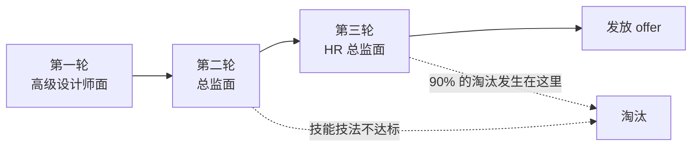
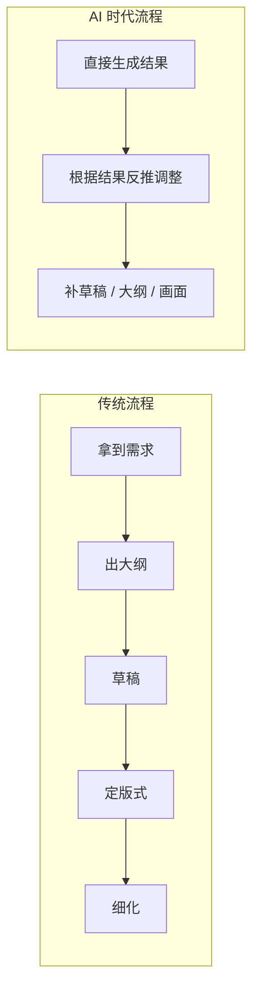

> [!info] 课程信息
> **场次**：Day02 下午（含 09-16 周会）｜ **讲师**：[[果冻Joe]] ｜ **机构**：像素范儿
> **两条主线**：
> **① 组织侧**——**字节跳动 HR 体系复盘**（**转述自《晚点 LatePost》报道**）
> **② 个人侧**——**大厂设计师能力模型、面试与薪资逻辑，以及 AI 工作流的完整方法论**

> [!abstract] 一句话总结
> **大厂对设计师的考核里，专业能力只占 30%，沟通协作与组织能力合计超过 60%。**
> **AI 只是提效工具，不是替代基础**——**"公司工作流以 AI 为主"指的是占比，不是全部；从零到一仍然依赖理性、细致的人为干预。**

```mermaid
graph TD
    D2P["Day02 PM<br/>字节 HR 体系 · 能力模型 · AI 工作流"] --> A["① 字节跳动 HR 体系复盘"]
    D2P --> B["② 大厂设计师能力模型"]
    D2P --> C["③ 综合能力模型与岗位要求"]
    D2P --> D["④ 行业认知与 AI 技术发展"]
    D2P --> E["⑤ AI 核心概念解析"]
    D2P --> F["⑥ AI 出图核心方法论"]
    D2P --> G["⑦ 提示词精准度与工作流颠覆"]
    D2P --> H["⑧ 设计评审：AI 出图问题复盘"]
    D2P --> I["⑨ 即梦工具实操全览"]
    D2P --> J["⑩ AI 视频广告应用"]
    D2P --> K["⑪ AI 辅助 IP 设计与规范化"]
    D2P --> L["⑫ 优秀 IP 设计案例库"]
    D2P --> M["⑬ 启动 Icon 与超级符号"]
    D2P --> N["⑭ 学习路径与课程规划"]
    D2P --> O["⑮ 教学理念与工作流认知"]
    D2P --> P["⑯ 自媒体运营经验"]
    D2P --> Q["⑰ 课程事务与后续安排"]

    B --> B1["三大能力：专业 · 通用 · 影响力"]
    B --> B2["三轮面试 · 90% 淘汰在 HR 面"]
    F --> F1["关键词逻辑与出图框架"]
    G --> G1["AI 时代工作流被颠倒"]
    H --> H2["活动类型决定氛围与人群"]
    L --> L1["阿里巴巴动物园"]
    M --> M1["启动 Icon · 超级符号 · 背板"]

    class B1,B2,F1,G1,H2,L1,M1 internal-link;
```

---

# 一、字节跳动 HR 体系复盘

> [!note] 本节来源与性质
> **本模块是讲师在周会上转述《晚点 LatePost》关于字节跳动的深度报道**，**属于"别人的组织案例"，不是讲师个人观点**。
> **读法建议**：**不要把它当"HR 操作手册"**——**它要说明的是一件事：一家公司的人才体系，是业务速度和规模的函数，不是人力资源部门自己设计出来的。**

## 1.1 背景与缘起

### 字节跳动的招聘神话

- **字节跳动曾是中国最会抢人的互联网公司，员工从零到 10 万人仅用了 8 年**，**这一速度让其他科技企业望尘莫及**
- **巅峰时期，字节的 HR 部门拥有 5000 多名员工**，**他们不顾一切地招聘，如同一座"人才工厂"**
- **《晚点》作为长期关注中国互联网公司的商业媒体**，**自成立以来一直在追踪报道字节跳动**；**本次通过采访多位字节内部人士，获得大量一手信息，还原字节 HR 体系的建立、运转与变化**

### 张一鸣：公司的第一 HR

- **字节跳动成立于 2012 年，是张一鸣的第二次创业**；**他非常明白人才招聘的重要性，早期张一鸣就是公司的第一 HR**
- **早期张一鸣会参加每一场公司面试，包括前台岗位的招聘**
- **到 2015 年时，他在公司电梯里仍能轻松喊出每一个刚入职员工的名字**
- **这一时期字节已成长为上千人的公司，办公地从出租屋搬进写字楼**；**2016 年又搬到中航广场**，**同年，日后推动字节狂飙突进的 HR 体系诞生**

## 1.2 招聘中台的建立与早期困境

### 决战第一与规模野心

- **2016 年 3 月，张一鸣在公司年会上提出"决战第一"的目标**；**当时今日头条发展迅猛，在资讯产品中活跃度仅次于腾讯新闻**
- **张一鸣的野心是将公司带上千亿美元规模**，**当时中国互联网公司中只有腾讯和阿里巴巴做到了**

> [!important] 一个关键推论：只有公司越大，规模效应才越强
> **张一鸣在 2016 年初做了一项分析**：**美国有一大波科技股市值腰斩，但总体科技股市值反而涨了 19%**，**核心原因是 Facebook 和 Google 在涨。**
> **他由此意识到，只有公司越大，才越能形成规模效应。**
> **这条推论的直接后果**：**招人不再是"缺人才招"，而是"先囤人再打仗"。**

### 招聘中台的诞生与首任负责人

- **随着业务快速扩张，张一鸣发现阻碍目标的最大问题是公司人太少**
- **为提高招聘效率，字节在 HR 部门成立了招聘中台，帮各个业务统一做批量化招聘**
- **用张一鸣的话说，就是建一个"内部的猎头公司"**
- **杨乐是招聘中台的第一位负责人**
- **作为公司新人，他面临重重困境**：**过去所有招聘任务都由业务部门的人力资源经理完成，并直接向人力资源总监肖金梅汇报**；**肖金梅跟随张一鸣创业多年，是字节的创始团队成员**
- **杨乐最初只能把更多精力放在外部渠道建设上**（如**完善各招聘网站的覆盖**），**但这些传统做法收效甚微**

### 2016 年的招聘困境

- **2016 年时，大家普遍认为的明星公司是滴滴**，**当时滴滴刚收购 Uber 中国业务，估值约 350 亿美元**
- **张一鸣处于"隐藏实力"的阶段**，**这是他的一种策略**：**不对外公布任何营收数据和用户增长数据，以此迷惑竞争对手，争取更多窗口期**
- **但这也带来一个问题**——**公司不太好招人，因为外界并不知道字节到底有多厉害**
- **招聘中台工作开局不利，几个月后杨乐离职**

> [!tip] 这一段的真正教训
> **"隐藏实力"对外是战术优势，对招聘是战术劣势。**
> **候选人不了解你，就不会为你的期权和成长性冒险。** **信息不对称的成本，最后由 HR 承担。**

## 1.3 收购猎头公司与招聘逆转

### 收购 OfferCome

- **张一鸣意识到，既然从头搭建内部猎头公司这么难，不如直接买一个**
- **2017 年 7 月，字节跳动收购了猎头公司 OfferCome**
- **收购为字节带来了海量简历资源，还带来了 OfferCome 的创始人魏小康**
- **他加入字节后成为招聘中台的第二任负责人**

### 应届生人才地图

> [!important] 一个在互联网行业几乎史无前例的举动
> **魏小康迅速制作了「应届生人才地图」。**
> - **团队先盘点出中国最头部 20 所大学的所有核心专业**
> - **接着通过各种渠道拿到这些学校和专业所有本科、硕士和博士应届毕业生的全部联系方式**
> - **一线 HR 接到的要求包括**：**重点院校重点专业的本科生，80 分以上的要联系到；90 分以上的硕士生也要联系到**

- **字节同时搭建自己的人才简历库**：**HR 部门的新员工和实习生会在第三方招聘平台上筛选简历并录入自己的库中，平均每天要找到约 200 份简历**
- **当时整个 HR 部门的实习生可能有上千人**

### 薪酬策略的制定

> [!important] 几个小时，定下整个行业的应届生价码
> - **HR 团队基本上把所有目标院校和目标专业的应届毕业生电话都打了一遍，摸清他们拿到的 offer 和薪资情况**
> - **当时互联网普遍的薪资包大概在 20 万一年，滴滴开得最高，能给应届生开到 25 万**
> - **了解情况后，魏小康和肖金梅只讨论了几个小时，就拍板定下产品技术岗位应届生最低 30 万的年薪标准**
> - **这个数字很快向上通报，没人反对，招聘工作随即迎来转机**

> [!tip] 为什么"只讨论几个小时"就够了
> **因为前面的工作已经做完了**——**打出所有电话、摸清市场价，等于把决策所需的信息一次性补齐。**
> **决策快，不是因为拍脑袋，是因为信息前置。** **这正是"有理有据"在组织层面的样子。**

### 极速招聘模式

- **中航大厦办公楼的食堂变成招聘现场，每到周末从早到晚做招聘**
- **HR 团队定下的唯一要求就是快：当天完成所有面试，当天发掉所有 offer**
- **一位当时的 HR 回忆，最多一天有将近 700 个应聘者**
- **到 2017 年底，张一鸣对 HR 又提出了更高的要求**

## 1.4 抖音爆发与人才工厂的运转

### 抖音的崛起

- **张一鸣更高要求的底气源于业务的快速膨胀**
- **当时内部孵化的抖音逐渐有了起色，并在 2018 年春节彻底爆发，一举超越快手，成为中国第一大短视频平台**
- **字节跳动整个公司因此加大了油门，一路狂飙**

### 极致招聘的竞争

- **很少有公司敢像字节这样几乎不管控雇佣人数，每年新增数万名员工**，**HR 仍然不顾一切地招人**
- **有时一个候选人已经进入某个部门的审核面试流程，但其他部门的 HR 仍会通过第三方招聘平台和渠道私下争取他**
- **一个候选人可能在一段时间内接到十几位 HR 的电话**
- **短时间内，字节抢到了大量人才**；**但更大的挑战是：这么多人要如何管理？**

## 1.5 华威与字节 HR 体系的核心设计

### 华威的角色

- **华威是搭建字节跳动 HR 体系的关键人物**
- **2014 年加入字节后，他负责过公司融资、战略投资**，**后来在张一鸣的建议下承担起搭建人力资源体系的工作**
- **华威的用人观跟张一鸣很像**：**不会用一套非常规整的体系去培养人，相反更愿意在招聘阶段就把最合适、最聪明的人招到**
- **HR 只要把最核心的几件事情讲清楚，其他问题都可以不计较**

> [!important] 核心管理机制一：双月 OKR
> **字节每两个月制定一次 OKR（关键目标与结果），让员工一直保持奔跑状态。**
> **OKR 由员工自己定，定完后由管理者再把控。**
> **员工需要在定目标时拿捏分寸**：**定太高达不到会显得在吹牛画大饼，定太低则显得目标不清楚。**

> [!important] 核心管理机制二：360 环评
> **360 环评保证了相对的公平。**
> **不光是领导给员工打分，同事之间也会匿名互相打分，还有领导之间、部门之间的评分，最后综合考核。**
> **环评关系到晋升、留存、裁员、奖金绩效**，**最终决定这个人在公司里要不要继续发展，压力很大。**

> [!important] 文化底色：英雄不论出身
> **最能驱动员工的还是"英雄不论出身"的故事。**
> **那些年纪轻轻随着业务增长而身居高位的弄潮儿，刺激着一个又一个聪明人加入这台"绞肉机"中拼杀。**
> **在字节，打仗才是最好的人才培养和竞争机制**——**能找到潜在的需求，提高生活质量。**

> [!important] 一个刻意的"缺失"：拒绝明确职级标准
> **员工可以按部就班地一步一步往上爬，但字节好像故意没有设置这些。**
> **后来有一次字节的 HR 部门想明确职级标准，方便管理和考评，但业务方非常反对。**
> **业务方的理由**：**如果这样的话，员工就会有借口只做自己分内的事，每天想着怎么去爬格子晋升，而不是思考怎么把工作做到最极致。**

> [!tip] 这三条机制合起来在做什么
> **双月 OKR 管"跑多快"，360 环评管"跑得公不公"，去职级管"别停下来看路标"。**
> **三者共同指向同一个目标**：**把组织维持在"始终创业"的高压状态。**
> **代价也很清楚**：**它假设业务永远在高速增长——一旦增速放缓，压力就变成内耗。**

## 1.6 狂飙的顶点与转折

### 规模巅峰

- **凭借这种极致，到 2020 年，字节跳动员工总数已接近 10 万人，在国内互联网公司中仅次于阿里巴巴**
- **但与此同时，字节的业务增速正在放缓**；**狂飙过后，脚步也开始徘徊**

### 去肥增瘦与组织调整

- **字节跳动在 2020 年第一次提出"去肥增瘦、降本增效"**
- **2020 年 3 月，字节调整了组织架构，梁汝波从华威手上接下 HR 业务**
- **梁汝波在字节高管里很特殊**：**他和张一鸣不仅是大学舍友，还是后来的创业伙伴，有二十多年建立的信任**
- **梁汝波接手 HR 事务后，把重点放在组织建设上**，**比如新设了组织发展部和人才发展中心，从外部招揽有成熟管理经验的负责人**

### 组织建设的反复

- **梁汝波负责 HR 业务的时间很短，2021 年 5 月转任为字节跳动 CEO，华威重新掌管 HR 业务**
- **华威重新掌管后半年，解散了人才发展中心**；**次年 7 月，组织发展部也被裁撤**
- **字节跳动的组织体系好像又回到了那个"始终创业"的样子，但字节跳动早已不是一家创业公司**

> [!warning] 这一段的读法
> **"新设两个部门 → 一年半内先后裁撤"** 不是一个笑话，**而是一次失败的组织实验**。
> **真正的问题是**：**一套为"高速增长"设计的体系，无法通过"加两个部门"转型为"成熟组织"。**
> **组织能力不能靠外聘买来**——**它得长在业务里。**

## 1.7 成熟期的挑战与 HR 体系转型

### 规模与成熟度的矛盾

> [!danger] 公司这么大，但体系还在建设中
> - **2022 年字节的收入超过 5000 亿元，接近腾讯的规模，拥有众多业务，俨然是一家成功的大公司**——**但它不够成熟**
> - **公司这么大了，但字节的人才培养体系和组织文化都还在建设当中**
> - **大部分成功的业务现在都依靠于抖音，但抖音的增长已经放缓**，**这意味着公司里的机会在变少，员工的上升通道也在收窄**
> - **这些问题不光是靠 HR 体系和人才体系就能解决的**

### HR 职能的专业化转型

- **面对新的形势，字节 HR 的日常工作已经不再以招聘为中心，职能逐渐变得专业化**
- **2022 年底开始，华威做了一次管理实验**：**根据不同的业务、职能和区域成立了一个 HR 轮值组织委员会，让各个业务部门的 HRBP 负责人轮流管理 HR 相关事务，希望这样能加强跨部门合作**
- **之前内部曾经引起过强烈反对的职级完善和调整制度，在 2023 年也开始重新被拿出来讨论**

### 体系的没落与公司的成熟

> [!quote] 结语
> **字节过去惯用的 HR 体系，随着公司整体脚步的徘徊走向没落。**
> **但更准确地说，这其实是一家公司结束创业期，逐渐成长为成熟大公司的一部分。**
> **当字节跳动真的成为一家成熟的大公司后，它是否还能保持曾经的吸引力，是一个值得思考的问题。**

> [!important] 这个案例对个人的意义
> **你在面试中遇到的"字节标准"，是这套体系的产物。**
> **理解它的成因，你就知道**：
> - **为什么字节看重"聪明 + 自我驱动"甚于"经验丰富"**
> - **为什么它一度不给你明确的职级阶梯**
> - **以及为什么在 2020 年之后，这套标准开始松动、转向"降本增效"**
> **面试策略要跟着企业所处的阶段走，而不是背一套固定答案。**

---

# 二、大厂设计师能力模型与招聘标准

> [!abstract] 本模块回答一个问题：大厂到底在筛什么？
> **答案不是"画得好"，而是"不用被照顾"**——**能力达标、说得清楚、不给团队制造摩擦。**

## 2.1 天赋与自我管理能力

### 一个反差案例

- **讲师自述**：**条理和综合素质一般，未达到 211 水平**
- **亲姐为北大毕业**，**其孩子（外甥"萌萌"）就读于北京四中火箭班，全年级前三名**

### 外甥的自我管理案例

> [!tip] 想玩的时候能马上休息，需要休息了就玩
> - **外甥平时在家也会打游戏，但考试仍能保持前三名**
> - **自称"真没复习"，但实际具备极强的自我管理能力**
> - **具体观察案例**：**家人回山东老家过生日，外甥因周六有课独自留在家中**；**母亲通过摄像头观察其行为——做完一页题后掀过去，打开电视看了约五分钟，随后自己看表，主动关掉电视，继续学习**
> - **核心结论**：**这才是"天赋级"的自我管理能力**——**不是不玩，是能精确控制玩的时间**

> [!note] 讲师为什么要讲这个
> **大厂要的"自我驱动"，本质就是这个东西**：**不需要别人盯着，自己知道什么时候该停。**
> **这也是后文"90% 的淘汰发生在 HR 面"的底层依据**——**HR 面看的不是技法，是这类特质。**

## 2.2 大厂招聘的核心逻辑

### 筛选目的

- **大厂通过严格筛选寻找"十里挑一、二十里挑一、百里挑一"的人才**
- **目标是让新人不要拖慢团队节奏，不要因个人原因造成负面影响**
- **理想状态**：**单个人加入即可直接为团队赋能，或通过少数人协作提升整体效率**

### 最完美的候选人形态

> [!important] 两条
> - **理性思考**
> - **能快速说清自己的价值和团队重要性**

### 当前学员的普遍短板

- **语言表达能力不足**
- **性格方面存在不足**
- **进入行业工作后会面临明显弊端**

## 2.3 AI 时代带来的挑战与变化

### 竞争压力的变化

> [!warning] 难度不在于做图技法本身
> - **AI 抹平了许多技术之间的门槛和壁垒**
> - **压力在某种程度上更大、更难**
> - **关键区分**：**难的是 AI 把原本参差不齐的差距抹平了**——**当大家都能出图，作品的"下限"被拉齐，"上限"的比拼就更残酷**

### 应对策略

- **必须关注行业、全行业甚至全领域的热点**
- **学习节奏平稳后，将安排每人中午分享近期热点或新闻**
- **分享后需探讨事件背后的深层原因，挖掘营销、增长或热点层面的价值**

## 2.4 好奇心与国际化价值观

> [!example] 两个用来"分层"的案例
> **案例一：Codex**——**最新 Codex 发布后，不同人的反应拉开层次**：**有人完全不知道，有人知道但不了解原理，有人深入研究。**
> **案例二："养龙虾"**——**今年过年期间出现的概念**，**多数人不知道是什么，少数人知道但研究不透，极少数人真正琢磨透了**；**国外在广泛关注，中国少数领域精英也在了解。**
>
> **结论**：**什么都不懂是不行的。**

> [!question]- 这两个案例为什么被放在"能力模型"里？
> 因为它们测的是**信息敏感度**——**同一件事发生后，你和别人的差距不是"知不知道"，而是"研究到哪一层"。**
> **Codex 是技术信号，"养龙虾"是文化信号**——**一硬一软，覆盖面正好。**
> **这直接对应后文的"专业影响力"**：**影响力的前提，是你先比别人早一步看懂。**

## 2.5 三大核心能力体系

> [!important] 大厂设计师的专业能力 = 三项，不是一项
> - **① 专业能力**：**不是纯作图能力**，**包含知识与技能、定位与执行、评估与复盘**；**这是大厂设计师发布文章的原因——属于必备项**
> - **② 通用能力**：**核心是沟通合作**；**简单层面是团队协作，复杂层面是与上下游交接，将设计交付给开发商实现**
> - **③ 专业影响力**：
>   - **沉淀与传播**：**工作中积累经验，遇到问题想办法解决，进行补充性学习**；**学习目的不只是自我提升，而是解决工作中实际遇到的难点**
>   - **示范并推广**：**将经验分享给团队**
>   - **人才培养**：**中高级以上设计师需带人**

> [!tip] 这一节是全篇的骨架
> **后面所有内容（职级标准、面试流程、薪资逻辑、综合能力权重）都挂在这三项上。**
> **记住这三个词，后面几节就都能对上号。**

## 2.6 人才培养体系详解

### 互联网公司普遍情况

| 职级 | 带人规模 |
| --- | --- |
| **中级偏初级** | **带实习生** |
| **高级** | **带两个实习生，可能再加一个中级设计师** |
| **专家岗** | **为总监或团队领导分担压力，负责协调部门间事务、安排周需求任务、与开发负责人沟通等** |

> [!note] 不只是大厂
> **标准互联网公司（不仅大厂）中，中级以上设计师都需带人。**

## 2.7 大厂三轮面试流程

### 第一轮：高级设计师面试

- **面试官级别可能与应聘者平级**
- **主要考察技能技法**

### 第二轮：总监面试

- **第一轮通过后由总监面试**
- **总监判断技能技法和实力水平是否达标**

### 第三轮：HR 总监面试

> [!danger] 90% 的淘汰发生在第三轮
> - **HR 识人，把控公司招人标准的战略性方向**
> - **类比**：**设计总监像"男朋友"，觉得合适就行；HR 像"父母"，从人品、履历上综合判定**
> - **HR 挂掉后通常不会明确说明原因**

> [!note] "90% 的淘汰发生在第三轮"该怎么理解
> **这个数字是课堂上的口语化表述，指"第三轮的淘汰率显著高于前两轮"**，**不是精确统计**。
> **它想强调的是**：**技术过关只是入场券，真正决定成败的是 HR 面对"人"的判断**——**履历真实性、跳槽动机、稳定性、协作风格。**
> **所以前两轮被刷通常有明确理由，第三轮被刷往往"说不出哪里不对"。**

## 2.8 各职级能力标准详解

### 实习生岗位

- **仅限在校生，毕业即失去机会**
- **标准相对宽泛**
- **无人才培养要求，本身就是被培养对象**
- **沉淀与传播**：**能主动进行总结（如总结一周任务难点、改进方向）**
- **有效沟通**：**能说人话，不抱怨，不说"我不会"**
- **要求**：**积极融入、主动交流、协同配合、互相理解、沟通表达**
- **底线**：**能正常说人话、理解指导、按时完成、初步了解、具备正确态度**

### 初级岗位

- **通常为应届生岗位**
- **薪资范围**：**10–15K**
- **开始要求"不需要培养"**
- **能有效总结方法论并在组内分享**
- **开始正确理解职责，配合所有环节人员**
- **能在初步评估下进行复盘，提出改进意见**
- **能树立正确目标，执行与定位**

> [!important] 初级岗的两项知识要求
> - **知识技能**：**能应用知识方法论，在色彩、字体、版型等方面有一定特长**
> - **跨专业知识**：**初步了解各环节实现落地，不需要掌握**
>   - **示例**：**不需要会开发，但需知道设计能否实现、大概效果和技术方向**
>   - **示例**：**了解 SVG 是设计跟开发之间解决动效的方式，是矢量格式**

### 中级岗位

> [!important] 分水岭：从这一级开始需要"人才培养体系能力"
> - **能指导别人，分配任务给实习生**
> - **能传授基本方法和技能（如教实习生使用 AI 工具）**
> - **面试中薪资期望与能力标准对标**
> - **高效沟通**：**能在项目中与合作方（产品、运营等）快速理解，一两句话或一个词让人 get 到**

### 高级岗位

- **指导跨专业知识应用决策**
- **战略指导战略级项目的设计决策**
- **在部门建立人才培养体系**
- **能制定工作流标准，串联团队协作**

## 2.9 工作中遇到"不会"的正确处理方式

> [!danger] 两条禁止行为
> - **不允许说"这个东西我不会"**
> - **不允许抱怨**（**如"现在都 AI 生成了，谁还用 C4D"**）

### 正确做法

- **将问题摆在明面上，与人探讨**
- **提供解决方案让对方选择**

> [!example] C4D 案例：把"不会"变成一道选择题
> **方案一**：**承认不擅长，但愿意花时间学习补足。**
> **方案二**：**提出 AI 工作流可能更高效，给出更优质的替代方案。**
> **让对方评估选择，而不是直接拒绝。**

> [!important] 核心原则
> **工作允许容错，允许不会。**
> **但关注点不是"会不会"，而是"不会了，我要这个东西，你怎么办"。**

## 2.10 薪资与能力匹配的面试逻辑

### 薪资期望的评估机制

- **面试官听到期望薪资后，会在头脑中对标该级别的能力标准**
- **追问的问题（如"有没有复盘整理汇总"）实际是在验证是否达到对应级别**

### 要价过低的风险

> [!warning] 能力够了但没要上价，人也不要
> - **能力达到高级岗水平，但期望薪资只要 15K**
> - **面试官会认为成熟度不够，直接砍掉**
> - **即使能力够了，但没要上对应价格，人也不要**

### 要价过高的风险

- **作品集和面试表现需能支撑薪资要求**
- **如果说要 50 万年薪（专家岗），但作品集没有体现战略指导、人才培养体系等能力，会被认为在吹牛**

### 破格申请机制

- **定岗严格，级别对应固定薪资范围**
- **想给低也给不了低，想给高需申请**
- **总监和多人开会，向 HR 申请破格打破薪资结构**
- **有先例：学员被申请破格录用**

> [!note] 报价本身就是一次能力展示
> **要价过低和过高都失败，说明薪资不是"谈判技巧"，而是"自我定位的准确度"。**
> **一个能准确评估自己级别的人，本身就是大厂想找的人。**

## 2.11 美团师兄案例

> [!success] 一份"简历硬件"的样本
> - **背景**：**美国哥伦比亚大学研究生**；**大学期间与教授参与硅谷真实项目实习**；**差点进入 Airbnb（爱彼迎）总部实习**；**被机构老师"忽悠"放弃 Airbnb，回国进入中国大厂**
> - **结果**：**应届生身份、无工作经验**；**美团多个部门争抢**；**入职月薪 20 多 K，打破应届生薪资平衡**；**目前年薪 70 多万，已是小高管**；**上海人**

## 2.12 开发协作中的关键认知

> [!important] 开发实现能力的真相
> **现阶段没有开发实现不了的效果。**
> **只有愿不愿意实现，以及实现的成本和难度。**

### 开发说"弄不了"的两种情况

- **评估后认为耗费时间过多**
- **懒得弄**

### 设计师的应对策略

- **了解基本技术知识，判断对方是否在忽悠**
- **提供解决方案，配合协调推动实现**
- **如果完全不懂，就无法判断真伪，可能白做**

---

# 三、设计师综合能力模型与岗位要求

> [!abstract] 本模块是"能力权重"的量化版本
> **上一模块讲"有哪三项能力"，这一模块讲"各占多少分"。**

## 3.1 对齐颗粒度与沟通效率

- **对齐颗粒度指双方快速理解彼此意图、达成共识的能力**
- **高效沟通的前提是双方能"说人话"，避免因表达不清导致协作成本上升**
- **在项目中需正确理解自身职责与目标，明确在当前项目中的 OKR 与绩效定位**
- **需明确自身在项目中的角色**：**是负责提效（用规范化流程），还是补足某一环节（如规范环节或视觉环节）**

## 3.2 岗位层级与能力要求

| 岗位 | 核心职责 |
| --- | --- |
| **中高级岗** | **负责对接沟通，运用工作流程和机制提升效率**；**承担多方组织协作任务，建立多部门间的合作关系** |
| **专家岗** | **多方驱动、统筹完成项目，建立协作模式**；**主导跨部门战略级目标，负责目标统筹、分配、进度把控**；**需为团队定目标、做管理、把控整体方向** |
| **专业能力要求（中级岗）** | **熟练使用知识体系与方法论**；**注重"细节输出"——明确输出内容、交付方式与交付物**；**了解设计趋势，具备对行业热点的敏感度** |

## 3.3 案例解析：苹果折叠屏 vs 小米折叠屏

> [!note] 这是一个"如何展示认知深度"的示范
> **本节的重点不是手机，是"设计师该怎样谈论一个行业热点"。**

### 行业热点背景

- **最近一两周，全球科技、设计、互联网领域出现一个"不大不小的热点"**
- **iPhone 16 发布未破圈，但苹果折叠屏产品引发全行业讨论**

### 苹果折叠屏的核心优势

> [!important] 五项
> - **无折痕**：**基本解决了折叠屏的折痕问题**
> - **多屏效技术**：**通过 A20 芯片中专门模块的算法，解决不同屏幕之间的黑屏衔接问题，实现多屏如单屏的体验**
> - **技术壁垒**：**芯片算法、芯片与屏幕适配、调试难度极高**；**苹果拥有 2 纳米芯片技术，中国自研芯片目前最先进约 7–10 纳米，差距显著**
> - **体验标准**：**苹果在交互逻辑、视觉体验、流畅度方面保持极高水准**
> - **设计决策**：**折叠屏去掉了 Face ID，改用指纹识别，避免双屏挖孔问题，同时提升屏占比，兼顾解锁效率与用户体验**

### 小米折叠屏的差距

- **外观与苹果相似，但技术逻辑不同**
- **无法解决黑屏衔接问题，只能让黑屏"闪得更快"，无法实现无缝衔接**
- **芯片技术（国产芯片）与算法能力与苹果存在代差**
- **保留了刘海和 Face ID，未解决双屏解锁的体验问题**

### 设计趋势洞察的启示

> [!tip] 关注热点 ≠ 看热闹
> - **了解设计趋势不仅是关注视觉风格（如 3D 模型、视觉表现），更要理解产品背后的技术逻辑、用户体验决策与设计解决方案**
> - **通过分析产品差异，形成独到见解，是设计师专业能力的体现**
> - **关注行业热点有助于在面试中展现自身认知深度，也可能与未来工作内容直接相关**

## 3.4 活动设计中的策略思维

### 双十一与过年的设计差异

> [!important] 视觉"low"不是审美问题，是策略问题
> - **双十一视觉风格长期保持"看起来 low"的表现，源于活动目的与用户行为模式的不同**
> - **过年期间跨度长（腊月至二月二龙抬头，近两个月），需通过集福卡等玩法拉长用户留存、促进活跃**
> - **双十一用户消费行为集中，无需通过长期留存机制绑定用户**

### 活动设计的底层逻辑

- **设计决策需从活动目的出发，而非仅看活动形式**
- **集福卡的核心目标是促活跃、拉留存，而非单纯增加玩法**
- **跨专业知识（如用户行为分析、活动运营逻辑）需能实际应用，包括前端实现（Codex、Who dex 等）与 AI 辅助落地**

> [!warning] 待核名词
> **原文作 "Who dex"，未能确认所指工具**，**疑为某前端 / 代码生成工具**。**保留原样，待课后核实。**

## 3.5 设计师综合能力模型

### 能力构成与权重

> [!important] 阿里巴巴中高级岗及以上：专业能力只占 30%
> - **专业能力**：**占 30%**
> - **沟通协作与组织能力**：**合计占 60% 以上**
> - **作品集本身并非决定性因素，面试中通过沟通即可判断真实水平**

> [!note] 这个权重的适用范围
> **30% / 60%+ 的口径来源于**阿里巴巴中高级岗及以上的能力模型**，**不是所有公司、所有级别的通用公式**。
> **对初级岗，专业能力的占比会明显更高**——**因为还没到需要"组织协作"的层级。**
> **引用这组数字时带上"阿里"和"中高级以上"两个限定，才站得住。**

### 高级岗与专家岗的关键差异

- **沉淀与传播**：**中高级岗开始要求能开发基础课程、高级课程**
- **大厂设计师开课是硬性考核要求，与晋升直接挂钩**
- **课程开发数量与变现效果纳入绩效评估**

### 阿里巴巴 D20 峰会案例

> [!example] 设计师要上台演讲
> - **主题涵盖**：**AI 电商、设计新生、AI 工具实践、AI 影像叙事、算法艺术等**
> - **演讲者包括高级设计师与管理岗，需具备逻辑能力与表达能力**
> - **做 PPT、准备课件需在完成本职工作的同时自行完成**

### 对个人能力提升的启示

- **面试中通过作品集讲解即可体现逻辑能力与讲课能力**
- **需准备演讲稿并反复练习，确保逻辑清晰**
- **大厂对外发布的公众号文章、复盘内容等，往往是设计师的日常工作产出**
- **入职后可能立即被安排做复盘 PPT、长图汇总等任务，需保持较高标准**

## 3.6 关键数据与事实

| 事实 | 数据 |
| --- | --- |
| **苹果芯片制程** | **2 纳米（A20 芯片）** |
| **中国自研芯片目前最先进水平** | **约 7–10 纳米** |
| **苹果两三年前芯片制程** | **3 纳米** |
| **中国两三年前芯片制程** | **约 14 纳米甚至几十纳米** |
| **阿里巴巴设计师能力权重** | **专业能力 30%，沟通协作与组织能力合计 60% 以上** |
| **过年活动时间跨度** | **腊月至二月二龙抬头，近两个月** |
| **双十一用户消费行为** | **集中在特定时间点，无需长期留存机制** |

> [!warning] 关于芯片制程数字的时效性
> **"中国自研芯片约 7–10 纳米"是课堂语境下的量级描述**，**不是精确的官方数据**，**且这一领域变化极快。**
> **引用时宜说"存在代差"，慎用具体数字**——**数字会过期，"代差"这个判断不会。**

## 3.7 核心结论

> [!success] 五条
> - **设计师的能力要求远不止作图，需综合考量沟通、组织、策略、跨专业应用等多维能力**
> - **了解设计趋势需深入产品背后的技术逻辑与用户体验决策，而非仅关注表面视觉风格**
> - **大厂对设计师的考核中，沟通协作与组织能力占比远高于专业能力**
> - **课程开发与对外输出（文章、演讲、复盘）是设计师的日常工作与晋升硬性要求**
> - **个人标准不能太低，至少在了解、执行和认知层面需保持较高水准**

---

# 四、行业认知与 AI 技术发展

> [!abstract] 从"折叠屏破圈"讲到"AI 三年演进"
> **这一节的作用是给后面的 AI 方法论建立时间坐标**——**知道我们是怎么走到 Agent 和 Skill 的。**

## 4.1 折叠屏与苹果产品

- **折叠屏手机推出时颠覆了大部分人对折叠屏的固有概念，在各行业引发轰动，实现了"破圈"传播**
- **苹果的产品策略**：**可以不急于推出沉淀中的技术，但凡推出就是绝对成熟、没有问题的产品**

## 4.2 AI 发展时间线

> [!important] 三年三步
> - **2022 年**：**AI 已开始起步。美团等大厂已在内部使用小众的 diffusion 模型（当时称为 SD）产出运营图和运营素材，走在行业前列**
> - **2023 年**：**Midjourney（MD）正式爆发，引发轰动，团队开始研究相关课程**
> - **当前**：**完全智能化和 Agent 模式**；**最新趋势是 Skill（技能插件）开始流行**

### 2023 年教学现场的冲击

- **当时线下 UI 班约五十多期、六十多期，学员临近毕业（仅剩一个月）时 Midjourney 突然出现，市场被颠覆**
- **刚毕业的学员面临困境**：**作品集需要大量加入 AI 内容，但课程尚未覆盖，只能自学 Midjourney**
- **早期教学方式**：**老师与学员共同研究，课上打开 Midjourney 一起琢磨口令，中午加分享环节，安排课题让每人研究一个口令，次日中午展示成果**

> [!quote] 一个来自大厂同学的反馈
> **美团同学反馈：2022 年他们已在用 SD 产出运营素材。**
> **大厂团队往往走在前面，负责研究国外动态。**

## 4.3 AI 技术演进阶段

| 阶段 | 形态 |
| --- | --- |
| **最早阶段** | **口令出图** |
| **当前阶段** | **完全智能化和 Agent 模式** |
| **最新趋势** | **Skill（技能插件）开始流行** |

---

# 五、AI 核心概念解析

> [!abstract] 三个必须能说清的名词
> **Skill、Agent、IP**——**面试和工作中都会被问到。**

## 5.1 Skill（技能插件）

> [!important] 本质：类似 PS 中的脚本或插件，并不神秘
> - **豆包、即梦等工具中已内置主流 Skill，在 Agent 模式下可选择**
> - **示例**：**品牌设计 Skill、海报设计 Skill、电商套图 Skill、剧情短片 Skill**
> - **使用方式**：**选定 Skill 后输入关键词，AI 根据该插件的专业理解输出更全面的内容**

## 5.2 Agent（智能代理）

- **代表真正的人工智能化**
- **根据用户口令自行琢磨，先找参考，甚至进行汇总**
- **豆包即采用 Agent 模式，大幅减少操作步骤**

> [!tip] Skill 与 Agent 的关系
> **Agent 是"会自己想办法的执行者"，Skill 是"给这个执行者装的专业技能包"。**
> **Agent 决定"怎么做"，Skill 决定"按哪一行的规矩做"。**
> **所以在 Agent 模式下选对 Skill，比把关键词写长更有用。**

## 5.3 IP 的定义

> [!important] 定义
> **具有知识版权的某一代表性元素或概念。**
> - **中国大 IP 示例**：**孙悟空、哪吒**
> - **品牌 IP 示例**：**淘宝、天猫的猫形象**
> - **自媒体赛道 IP 示例**：**搞笑赛道的大 IP 是三只羊**
> - **核心特征**：**独一无二，一想到某个领域或关键点就联想到它**

> [!note] 关于 IP 的全称
> **原文记作"全称英文词汇不确定"**。**IP 通常指 Intellectual Property（知识产权）**，**但在品牌设计语境中更常指"可延展、可变现的形象资产"**。**两种用法并存，理解概念即可。**

## 5.4 品牌基因

> [!important] 品牌基因 ≠ Logo，也 ≠ Slogan
> **以抖音为例**：**多数用户说不出其 Logo 的几种颜色及排列顺序，说明 Logo 并非强品牌基因。**
> **真正的品牌基因是让人记住的独特特征**——**例如：戴帽子的男同学、用游戏本的男同学、染头发的女同学，这些才是"基因"。**

> [!example] 抖音的品牌基因盘点
> - **BGM**
> - **网红**
> - **某句标志性话语**（**如"好嗨哟"**）
> - **梁子**（**大胖子网红，200 多斤，体检基本无大碍，顶多轻微脂肪肝**）

> [!example] 品牌符号与事件
> - **雪王的"我爱你你爱我"事件**
> - **西贝的预制菜事件**
> - **罗永浩的锤子手机倒闭事件**

> [!important] 雷军的矩阵式品牌策略
> **个人形象 + 标志性话语 + 视频段落 + 标志性产品（小米汽车）。**
> **小米汽车仅推出三四年，标志性已超过做了十几年的手机。**

> [!tip] 这个对比的商业含义
> **"标志性"不等于"时间长"，而等于"记忆点密度高"。**
> **雷军把四条线（人、话、内容、产品）叠在同一件事上，密度自然高。**
> **做品牌 IP 时同理**：**与其把一个形象打磨十年，不如让它在多个触点反复出现。**

---

# 六、AI 出图的核心方法论

> [!abstract] 一句话概括
> **出图的关键在于"关键词打什么"**——**它决定 AI 能否产出你想要的具体画面。**

## 6.1 关键词从哪里来

> [!important] 关键词来源于头脑风暴梳理出的线索，但不能乱加
> **"六 W 原则"的提法在课堂中并未展开定义**，**但本节实际给的操作口径是清楚的**：**关键词要有来源、有逻辑顺序、有层级。**
> **读法建议**：**把"六 W"理解为"完整交代一张画面的六个维度"**（**谁 / 什么 / 在哪 / 何时 / 为何 / 怎样**），**与下面的模块化框架配合使用。**

## 6.2 关键词逻辑顺序

> [!important] 逻辑正确才能保证稳定输出
> - **关键词需有逻辑顺序**——**虽然顺序稍乱也可能碰巧出好图，但逻辑正确才能保证稳定输出**
> - **出现偏差时，应知道如何调整关键词、调整哪里，而非删掉重打或单纯刷新**
> - **目标是真正把 AI 变成像 PS 一样的可控工具，而非"看天吃饭"**

## 6.3 出图框架（模块化顺序）

| 顺序 | 模块 | 示例 |
| --- | --- | --- |
| **1** | **需求** | **明确要出什么（如一本书、一个 IP 形象）** |
| **2** | **基本描述** | **具体类型（如立体书、图标）** |
| **3** | **细节** | **造型特征（圆润造型、书籍上有标签、设计简洁可爱）** |
| **4** | **视角** | **角度（微侧、微微翻页）** |
| **5** | **画面整体要求** | **柔和渐变、光影温馨** |
| **6** | **风格** | **3D、扁平、插画等** |
| **7** | **质量** | **如 4K（可测试加与不加的区别）** |

> [!tip] 这七步是"填空"，不是"许愿"
> **每一步都对应 AI 的一个决策维度**。
> **漏掉哪一步，AI 就在哪一步自由发挥**——**这是后文"什么都可以赖，但不能赖 AI"的机制解释。**

## 6.4 避免口语化描述

> [!danger] 错误示例
> **"给我出个 IP"、"天空给我蓝一点"、"我做不了啊，这东西好难啊"。**

> [!success] 正确做法
> **明确说出"品牌吉祥物"、"天空要淡蓝色、亮蓝色，要有白云"。**

> [!important] 工作中的同理心：别跟总监说"好难"
> **不说"好难"，而是说**：
> **"这个东西我确实没接触过，但我可以弄，大概一周左右排期，我还得去看看从零到一的 C4D 建模"**——**用具体条件让对方理解难度。**
> **核心原则**：**描述表意性要强，避免歧义。**

## 6.5 3D 的定位

> [!warning] 3D 是技法，不是目的
> - **3D 是一种技法，用于解决活动海报中"花里胡哨、更扎眼"的问题，制造视觉焦点**
> - **使用 3D 需明确当前目的**：**若目的是让形象更准确、肢体动态更标准，3D 未必是最佳选择**——**因为很多 3D 输出效果并不理想**

## 6.6 IP 形象出图的具体要点

### 常见问题

- **只说"可爱""简单""正面柔和扁平"，输出结果可能过于简单，像极简插画，没有身体**
- **需要明确**：**是否需要品牌特征化符号？是否需要全身 / 半身 / 仅头部？**

### 细化指令示例

> [!example] 把模糊词拆成可执行的描述
> - **可爱**：**需具体化——"胖一点的可爱"**（**因为"可爱"可能被理解为五官简单、腿短或无腿，发散空间过大**）
> - **表情**：**萌的表情**
> - **品牌符号**：**头顶有爱心符号，让 AI 理解这是公司品牌形象而非纯粹小插画**
> - **颜色**：**柔和颜色，不要太亮，避免粉不拉几或渐变混乱**
> - **风格**：**明确扁平，否则可能默认输出 3D**

### 背景控制

- **出 IP 形象时若不指定背景，AI 可能自动添加场景（如教育形象自动带教室背景）**
- **需明确对背景有无要求**

> [!tip] 一条通用于所有出图的规则
> **凡是你不说的，AI 都会替你决定；凡是你说得含糊的，AI 都会往最省事的方向解释。**
> **"可爱""简单""高级感"这类词，对 AI 来说等于没写。**

---

# 七、提示词精准度与工作流颠覆

> [!abstract] 本模块是"为什么 AI 时代更需要传统功底"的论证
> **核心结论：工作流被颠倒了，所以构图、比例、画面关系这些以前由草稿兜住的东西，现在全落到设计师的临场判断上。**

## 7.1 3D 与插画在结构表达上的差异

> [!important] 3D 的优势在于"含糊"，插画的劣势也在于此
> - **3D 的优势在于"含糊"处理**：**3D 可以掩盖复杂结构，例如手部动作可以直接盖住或含糊带过**
> - **插画对结构的要求更高**：**插画中如果结构含糊，会直接影响画面质量；3D 则天然允许某些部位"含糊过去"**
> - **AI 生成内容的常见问题**：**AI 出图时经常出现结构含糊的情况，例如手部到底是三根手指还是四根手指无法辨认**
> - **具体案例**：**某张图中角色头部侧面有一个含糊不清的装饰物，侧头部分甚至没有插上，显得莫名其妙**

## 7.2 提示词精准度对出图结果的影响

> [!important] 精准 vs 含糊，结果完全不同
> - **描述含糊时**：**AI 给出的结果完全由 AI 自行发挥，容易出现莫名其妙的画面**
> - **在脑图中加入少量详细、复杂的描述后**：**AI 输出的结果"大差不差"，基本可用**
> - **核心原则**：**让 AI"听你的话"，关键在于描述的精准程度**

## 7.3 完整画面的提示词框架

> [!important] 描述口诀：从远到近、从整体到局部、从主体到细节
> **完整画面比单一元素更复杂**——**涉及前后关系、场景感、故事主体、近景远景、风格画风等。**

**大框架顺序：**

1. **先描述需求**（**如"中秋节晚上"**）
2. **再描述主体细节**（**人物、动作、服饰等**）
3. **然后描述画面关系**（**场景、环境、视角**）
4. **最后指定风格与质量参数**

### 提示词示例：中秋节团圆场景

> [!example] 一条完整提示词的解剖
> - **需求**：**中秋节晚上，团圆**
> - **主体细节**：**一男一女夫妻带孩子；女性现代发型、穿中国传统女性服饰；男性寸头、穿明代或汉代汉服；小孩穿小孩衣服、蹦跳着；爸爸搂着妈妈**
> - **画面关系**：**人物站在桥上，桥前是河，后方是天上的月亮，远处有白云和淡淡烟雾笼罩**
> - **视角**：**正面视角、大广角、斜视或俯视**
> - **风格**：**中国古风、中国国潮风，或圣地可爱风格**
> - **质量参数**：**可加"4K 高清"**

### 提示词示例：风景插画

> [!example] 同一框架的复用
> - **需求**：**风景插画**
> - **具体描述**：**森林中有小溪，小溪两旁有树木**
> - **主体细节**：**小动物——松鼠和刺猬在喝水**
> - **画面关系**：**远处是山和蓝天白云，广角带一点透视**
> - **风格**：**童话故事风格**
> - **质量参数**：**4K**

## 7.4 4K 参数的实际影响

> [!important] 4K 不改变方向，只改变质感
> - **加 4K 后**：**插画质感偏向油画，光感更强**
> - **不加 4K 时**：**画面呈现纯手绘笔触感**
> - **结论**：**4K 参数不会改变大的关键词方向和画面方向，只在质量、光感和质感上有细微影响**
> - **设计师需要具备的能力**：**了解 AI 各参数的影响，能够判断哪些效果是自己想要的、哪些需要优化，而不是盲目碰运气**

## 7.5 风格关键词的验证方法

> [!example] 一次定向排查
> - **案例**：**童话故事风格出图后效果不符合预期，通过排查发现是某个关键词影响了风格方向。去掉该关键词后重新生成，结果符合预期。**
> - **要点**：**设计师应当对 AI 的输出有掌控力，知道哪个模块出了问题，能够定向调整，而不是随机尝试**

## 7.6 AI 出图中的常见问题与规避方法

### 问题一：文字乱码

- **现象**：**AI 生成的画面中出现乱码字符，降低整体质量和设计感**
- **影响**：**一旦需求方抠细节，会被要求返工优化**；**部分漫剧需求方可能不关注，但设计师自身应意识到这是问题**
- **现状**：**乱码问题目前仍是 AI 存在的壁垒之一**

### 问题二：画面元素交代不清（以"桥断了"为例）

- **现象**：**画面中桥的结构断裂，或桥与房子的形态混淆不清（如"鹊桥"的意象表达不明确）**
- **原因**：**提示词描述不够清楚，给 AI 的发散空间过大**——**例如只写"中秋节，兔子吃月饼"，月饼的样子、盛放容器、数量等全部交给 AI 自行想象**
- **解决方案**：**限定具体细节，如"两个月饼，每只兔子各拿一个，月饼放在盘子里"**
- **定性**：**这属于设计师主观描述不清导致的问题，虽然 AI 存在壁垒，但完全可以通过精准描述避免**

### 问题三：主体物结构含糊

- **现象**：**画面中所有主体物的结构交代不清楚，第一主体、第二主体均含糊，观者无法理解画面在表达什么**
- **影响**：**虽然整体看起来像模像样、像一张插画，但主体物一旦含糊，画面就失去了核心看点**

### 问题四：构图问题

> [!warning] 识别不出构图问题，说明感知力不足
> - **现象**：**三张示例图中，构图存在明显问题（如稻谷飞在天上、中间架空等），但部分学员无法识别**
> - **背景**：**在传统工作流中，先出大纲、草稿、定版式，再细化；AI 时代工作流被颠倒——直接出结果，再根据结果反推调整草稿、大纲和画面**
> - **风险**：**如果设计师对工作流程把控能力不强，或对传统流程不了解，就容易在构图、比例、画面关系上出问题**
> - **评价**：**识别不出构图问题说明感知力不足，需要提升对画面构图的敏感度**

## 7.7 AI 对设计师工作流的颠覆

> [!danger] 关键变化
> - **传统流程**：**拿到需求 → 出大纲 → 草稿 → 定版式 → 细化**
> - **AI 时代流程**：**直接生成结果 → 根据结果反推调整草稿、大纲、画面**
> - **核心变化**：**前期环节（大纲、草稿、构图）变成了后期工作，后期环节（细化、出图）提前到了最初几步**
> - **对设计师的要求**：**必须对完整工作流有清晰认知，否则会在构图、比例、画面关系等方面失控**

> [!quote] 这一模块真正的结论
> **AI 把"出图"这一步的成本降到了接近零，于是"判断好坏"成了唯一稀缺的能力。**
> **传统流程里，草稿阶段会强迫你思考构图；AI 流程里没人逼你，你必须自己逼自己。**
> **这就是为什么"AI 时代更需要传统功底"——不是技法，是判断力。**

---

# 八、设计评审：AI 辅助营销活动出图复盘

> [!abstract] 一次端午海报的实战评审
> **六张图，三张直接放弃，三张有修改空间**——**评分标准背后是一套可迁移的活动出图方法论。**

## 8.1 端午海报评审：前三张不及格

### 第一张：主体臃肿，信息被挤压

> [!danger] 主次关系失衡
> - **构图问题**：**主体物太满，导致画面臃肿**
> - **文字位置受限**：**端午安康本应是比重较高的信息模块，但只能放在下方一小块区域**
> - **文字没有往下落，可放置范围过小**
> - **主次关系失衡**：**主体过大，其他信息和元素被缩减**

### 第二张：画面散乱，元素过多

> [!danger] AI 生成过多，缺乏人工控制
> - **核心问题**：**太散、太乱、东西太多**
> - **元素缺乏主次和比重分配**
> - **原则：点到为止**——**放一个灯笼能证明有灯笼，放几个满足画面要求即可，不需要堆砌**

### 第三张：构图尚可，但仍有问题

- **对角线构图还可以**
- **主体物比例比较适中**
- **但主体物是否适中取决于设计师如何扩充、裁剪、调试**
- **需要用 AI 扩图或缩减，但必须由设计师自己控制**

## 8.2 后三张：可修改，有讨论空间

> [!warning] 评分结论
> - **后三张中有一张能给到 70 分左右**
> - **前三张不及格，绝对不能上线**
> - **后三张还有修改余地，可以继续优化**

> [!success] 合格作品的四个特点
> - **元素正确，避免了元素过多的问题**
> - **有主次关系，关系明确**
> - **有前后层次感**
> - **人物和留白与文案之间的关系把控得当**

## 8.3 设计师在 AI 时代的作用

> [!important] 同样是 AI 出图，差别在"人做了什么"
> - **前面不及格的作品**：**设计师没有发挥任何作用，全是 AI 的活**
> - **合格的作品**：**设计师挑图后，根据自身能力进行优化调整**
> - **核心能力**：**在 AI 生成基础上进行人工干预、裁剪、扩图、调试**

## 8.4 活动出图的根源性思考

### 活动类型差异分析

> [!important] 活动类型决定核心氛围与目标人群
> | 活动类型 | 核心氛围 | 目标人群 |
> | --- | --- | --- |
> | **九三阅兵** | **庄重、严肃** | **全民** |
> | **端午节** | **传统、安康** | **全民** |
> | **双十一** | **购物狂欢的奔放** | **消费人群** |
> | **世界杯** | **喧嚣、激情、奔放** | **男性为主、球迷** |
> | **过年** | **节日热闹、团圆** | **全民** |

> [!tip] 这张表的用法
> **做活动出图前先对上两列**：**氛围决定视觉强度，人群决定审美取向。**
> **氛围与人群一旦错位，画得再好也不合格**——**这是"前三张不及格"的根本原因，不是执行问题，是定位问题。**

### 世界杯案例分析：小红书 vs 抖音

**小红书的问题：**

- **第一天打开小红书感到失落，世界杯氛围远不如以往**
- **感觉像是"今天有一场比赛，明天有一场比赛"，而非一个月的狂欢**
- **活动目的不明确**：**只提供比赛和时间，看不出能给用户什么**
- **仅有的玩法是伊利冠名的竞猜，但外部展示看不出奖品、优惠或好处**
- **看似在带球迷球员账号，但目的模糊**

**抖音的成功之处：**

- **打开即感受到要参加一个大型体育盛会**
- **活动目的明确**：**沉淀短视频内容流量，引导用户下载抖音并持续观看其他内容**
- **解说员账号底下带可一起发布的主题**
- **提供比赛信息，玩法清晰**

> [!important] 人群定位的深入分析
> - **世界杯主要面向男性球迷，但小红书用户以女性为主，想吸引男性**——**这是人群与平台用户结构的错配**
> - **做长途（专题页）应参考咪咕体育、CCTV5 的用户人群喜好和习惯**
> - **不应只看大面上"大家都关注"，要精准定位核心人群**
> - **很多人是跟风凑热闹，并非真正懂球**（**举例：今年才开始买足彩，不敢碰，但很多人敢买敢说**）

## 8.5 竞品参考的核心方法论

### 找参考的本质

> [!important] 不是"找抄的"
> - **本质是吸收竞品公司在做同样东西时成熟的结果和反馈，直接拿过来用**
> - **竞品有庞大的用户基数，做了很多年，不需要自己再去调研和探索**
> - **看他们做了什么、最后收获了什么，很多东西直接拿过来用即可**

### 行业套路趋同现象

- **腾讯、微博、网易大神 APP 等不同厂商，套路都差不多**
- **做活动设计时，不太允许做不一样的东西**
- **延续成熟套路即可；如果要做不一样的，必须保证结果不差**
- **典型案例**：**五福好用后大家都跟，双十一成功后都跟着做双十一**

### 中国人的做事模式

> [!note] 一段带有明显个人色彩的论述
> - **起步晚，但上限比较低，能很快做好一件事**
> - **遵循大秩序下的按部就班发展**
> - **足球是例外**：**需要梅西这样跳出秩序的标志性人物，需要反秩序性、个人能力、独立决策**
> - **足球涉及人文环境、历史、社会积淀，不是简单抄套路就能成功的**
> - **结论**：**在擅长的领域直接用成熟模式，足球这类偶然性领域不适用**

> [!warning] 读法提示
> **这一段属于课堂上的即兴类比，带有较强的个人判断**（**"起步晚、上限低"并非严谨结论**）。
> **可用的部分只有一个**：**标准化程度高的领域（电商、节日营销）适用"成熟套路复制"；标准化程度低的领域（内容、竞技）必须靠原创。**
> **判断标准是"这个领域的结果可不可预测"，而不是"中国人行不行"。**

## 8.6 出行旅游类活动设计要点

> [!important] 竞品共性：三条
> - **全部是户外场景，没有一个室内**
> - **全部是促销性质**：**都得转化点什么、干点什么**
> - **促销最显著的特点**：**很多东西满天飞**
> - **核心氛围**：**出行游玩、玩得开心**

### 从参考到产出的流程

1. **分析竞品套路，提取核心要素**
2. **确定自己的构图**
3. **确定促销中该有的元素**
4. **将主体物替换上去**
5. **从一到 n 快速产出，而非从零到一**

> [!tip] 第 5 步是全流程的关键
> **"从一到 n"才是 AI 在营销活动里的真实价值**——**前面 4 步（套路、构图、元素、主体）仍然是人做的。**
> **这也回扣了后文的教学定位**：**AI 负责提效，不负责从零到一。**

## 8.7 AI 反推关键词的实操经验

### 用即梦反推的流程

- **给 AI 一张参考图，让它反推关键词**
- **AI 反推结果示例**：**卡通竖版、花朵点缀、充气硅胶质感、盲盒风格、马卡龙配色、蓝色渐变**
- **问题**：**AI 不考虑逻辑，只考虑图里有什么，反推结果比较混乱**

### 关键词优化过程

> [!important] 反推结果必须人工重排
> - **梳理反推结果，调整前后顺序**
> - **明确具体数量**：**如"两个毛绒质感的花朵"**
> - **删除不需要的元素**（**如"周围环绕"会导致满屏全是**）
> - **保留有质感或风格的关键词，居中处理**
> - **调整元素整体角度**

### 核心框架

- **按照既定公式大纲调整逻辑**：**需求描述、划分关系、视角风格**
- **注意**：**AI 反推时不会给出视角信息，直接用反推结果出图会与参考图完全无关**
- **具体问题具体分析、具体处理**

## 8.8 最终检验标准

> [!important] 四问
> - **是否最终符合项目需求目的**
> - **从推导的活动要素出发**：**是出行的、旅游的，还是卖货的**
> - **出现的元素是否能达到想要的卖货效果**
> - **构图是否合适**：**接下来要加文字，构图合不合适是关键**

---

# 九、即梦工具实操全览

> [!abstract] 三个来源合并成一份"即梦使用手册"
> **本节整合了原笔记中分散的三处即梦内容**（**工具使用要点 / 实操技巧 / 实操演示**），**按"概念 → 技巧 → 功能 → 问题"重新编排，去除重复。**

## 9.1 即梦的优势与定位

> [!important] 定位：够用，不强求从零到一
> - **画板功能很好用**
> - **Agent 模式在某种程度上表现不错，较为智能，能自行领悟**
> - **即梦：够用，不强求完全从零到一做设计**
> - **Lava**（**疑为 Lovart**）：**可以从零到一，东西更细，但确实贵**
> - **建议**：**同学可以合买 Lava，不行就先用即梦**

## 9.2 Agent 模式的注意事项

> [!warning] Agent 会"洗一遍"你的关键词
> - **Agent 会"洗一遍"用户输入的关键词，自动优化、加长、调整逻辑**
> - **导致最终展示的关键词与用户原始输入差异较大，可能包含重复内容或前后逻辑颠倒**
> - **复制他人分享的关键词后，即使原样再出一遍，结果也可能完全不同**
> - **小红书等平台上很多分享的关键词是 AI 整理后的产物，发布者自己也不清楚原始逻辑**
> - **使用他人关键词时需自行捋顺逻辑，删除重复项**（**如同时出现"流动光带""治愈系""梦幻活力"等风格词会导致 AI 理解混乱**），**判断哪些保留、哪些删除，需要反复测试**

## 9.3 出图偏差的归因

> [!important] 一条铁律
> **一旦 AI 输出结果与预期有偏差，一定是当前具体偏差的地方没有给出明确指令，或指令未被充分重视。**
> **换句话说**：**先查自己的提示词，再怪模型。**

## 9.4 基础生图与关键词优化

- **甲方需求修改示例**：**将"首购"改为"无手指的手掌"，其他特征不变**
- **关键词描述要具体、清楚，才能获得理想效果**
- **支持二次出图**：**例如 AI 生成的粘土风格纯白礼盒，可进一步修改为红色、宝箱内添加金币**
- **纯文字生图存在风格古早的问题，需要补充更细化的关键词描述**
- **关键词框架不变，但内部描述需更细致，场景描述完成后还可添加文字元素**

## 9.5 垫图功能（@ 功能）

> [!important] 不会颠倒元素关系的核心功能
> - **核心功能**：**通过"@"引用参考图，将多张图片拖入后指定修改方向**
> - **实操案例**：**将主视觉海报和锅两张图拖入，要求锅在画面中，食材从锅中飞出**
> - **优势**：**不会颠倒元素关系，构图方向稳定**
> - **注意事项**：**喂的图片需高清、风格具象化，关键词中不修改画面构图和元素关系即可保证出图方向准确**
> - **每次生成四张图，可根据材质风格挑选最合适的一张**

## 9.6 画布编辑功能

> [!example] 七项功能清单
> - **扩图**：**可调整尺寸比例，支持直接拉伸或点击预设比例**
> - **局部修改**：**扩图后定位想改的区域，描述修改文字即可**
> - **裁切功能**：**可裁切局部进行单独修改，其他区域锁定不变**
> - **关键词反推**：**从图片反推生成关键词**
> - **消除笔 / 修补工具**：**类似 PS 的修补功能，用于去除不需要的元素**
> - **水平翻转**：**可调整构图方向**
> - **九宫格切分**：**辅助构图参考**

## 9.7 局部重绘与新增功能

### 局部重绘

- **画板功能特别好用**：**单独拎出一个画布**
- **注意**：**改版后以前的工程文件都没了**
- **操作方式**：**手里拿着（选中）就会给一支铅笔，铅笔朝前朝后可以改**
- **局部重绘后不需要从头到尾大面积改动**

### 新增功能

- **多角度调整**：**今天刚看到的新功能**
- **打光功能**
- **加字改字功能**
- **擦除功能**
- **操作很傻瓜，不需要教**

### 新功能探索

- **主体动效**：**最近几周新加的功能，尚未深入研究**
- **多角度 / 连续分镜**：**可生成不同角度、位置、姿态的图片，相当于不同机位**
- **面部角度调整**：**如"面部三十度"等，主要服务于人物图像**
- **部分功能主要服务于视频制作，作图场景用不上**

## 9.8 关键词写法

> [!tip] 四条
> - **不要乱写，要有逻辑地写**
> - **用大白话即可，跟沟通差不多**
> - **每次出四张，绝对其中有一张是 OK 的**
> - **不满意就局部重绘，如"这块变成橡皮"**

## 9.9 图片风格转换与修图技巧

### 扁平转 3D

- **关键词**：**高亮高材质 C4D 风格**
- **关键指令**：**严格保持外观设计不变**（**防止 AI 瞎改样貌和设计**）
- **沟通方式**：**大白话，如"你给我做，但别改啊"**

### 粘土风格转换

- **保留场景中的关键元素**
- **要求亮一点**

### 修图饱和度调整

- **饱和度太低时，直接告诉 AI"饱和度要高，避免太灰"**
- **有问题就写上要避免的问题**

### 精准定位修改区域

> [!important] 一个极其实用的技巧
> - **在 PS 或 AI 里框选后截图**
> - **怕 AI 理解不了，直接画红圈，说"把红圈里边改掉"**
> - **效果**：**跟甲方提需求一样好用**

## 9.10 平台稳定性、速度与会员

> [!warning] 平台问题
> - **网页端频繁崩溃，可能与浏览器广告拦截设置有关**
> - **已尝试允许所有拦截项，仍会崩溃**
> - **客户端版本未出现崩溃问题，推测是浏览器兼容性问题**
> - **建议清除缓存或切换客户端使用**
> - **教室无线网络可能也是影响因素之一**

> [!note] 生成速度与算力
> - **生成速度较慢，需要排队等待**
> - **付费用户可享受快速通道，无需排队**
> - **算力是当前技术难点，短时间内难以优化**

> [!note] 积分与会员
> - **基础会员约 600+ 积分，日常出图从未用光**
> - **免费用户需靠签到领积分**
> - **即梦的 token 消耗相对较少**
> - **付费会员享有更多模型、快速通道等权益**

---

# 十、AI 视频广告应用分析

> [!abstract] 一个被讨论很多的商业现象
> **AI 生成虚拟明星代言广告**——**法律、公信力、转化率，各说各的。**

## 10.1 AI 漫剧形式广告案例

> [!example] 益达广告
> - **使用 AI 生成类似张小斐（《你好，李焕英》演员）的虚拟形象**
> - **特征**：**五官细节与真人不同，但整体观感高度相似，法律上难以追究**
> - **商业价值**：**广告商和甲方乙方获利显著，明星无需实际出演**

## 10.2 广告逻辑与受众心理

> [!important] 换一个视角看广告
> - **非受众视角**：**关注广告真假、公信力问题**
> - **受众视角**：**有实际需求时（如面试前需要清新口气），关注的是产品本身而非广告形式**
> - **算法分发**：**精准推送给有需求的用户，提高转化率**
> - **曝光目的**：**很多广告追求的是品牌曝光而非说服力，让用户知道产品存在即达成目标**

> [!tip] 这个区分对设计师的意义
> **判断一支广告"好不好"，必须先问"它是给谁看的、要达成什么"。**
> **用非受众的标准去评价投放型广告，会得出完全错误的结论**——**这与 8.4 的"活动类型决定氛围与人群"是同一套思维。**

## 10.3 具体案例讨论

- **隐形眼镜 / 美瞳广告**：**虚拟人代言缺乏公信力，但针对正在购买的用户仍有效**
- **vivo 手机广告**：**冰天雪地场景暗示续航能力，引发用户进一步了解的兴趣**
- **核心结论**：**广告创意和品牌曝光比说服力更重要**

---

# 十一、AI 辅助 IP 设计与规范化

> [!abstract] 从"用 AI 探索"到"文件怎么存"
> **本模块合并了原笔记的"AI 辅助 IP 设计探索"与"IP 设计规范与工作文件管理"**——**前半是方法，后半是纪律。**

## 11.1 使用 AI 工具进行设计探索

- **使用 AI 工具（类似豆包的 Agent 模式）辅助 IP 形象设计**
- **当前设计对象**：**一个带有聊天框元素的 IP 形象，涉及教育 / 社交方向**
- **设计需求**：**五官、外轮廓、整体造型的优化探索**
- **使用建议**：**让 AI 帮助探索设计可能性，不一定直接给出最终答案，可能在某处细节上提供引导**

## 11.2 Agent 模式与图片生成模式的区别

| 模式 | 行为 |
| --- | --- |
| **Agent 模式** | **AI 会自行归纳总结需求，梳理工作流，给出意见和方案，相当于"代理"角色** |
| **图片生成模式** | **根据描述直接出图，不做额外整理** |

- **当前使用体验**：**基础会员速度较慢，生成结果偏向 3D 扁平风格**
- **AI 会主动询问是否需要进一步细化**（**如标注游戏道具、地图等**）

## 11.3 AI 生成结果的局限性

> [!danger] 位图与矢量的鸿沟
> - **AI 生成的图片带有描边和固定格式，输出为位图**
> - **无法直接生成矢量格式（AI / EPS）或源文件（PSD / AE）**
> - **目前没有完美的 AI 转矢量解决方案，锚点混乱、不够圆润**
> - **交付运营或前后端时，IP 规范需要矢量文件，仍需人工临摹转换**
> - **广告图、海报等直接使用图片的场景不受影响**
> - **未来可能出现插件或 skill 解决此问题，但当前需求不迫切，市场反响有限**

## 11.4 工程文件结构建议

> [!important] 不要把肢体结构提前合并
> - **不建议**在工程文件中将身体、肢体结构直接连接和概括
> - **建议**保留肢体结构分开的存档，最后再合并闭合
> - **原因**：**后续修改某个部位（如腿部）时，如果已合并，只能裁掉重做；分开结构则只需修改局部后重新连接**
> - **规范三视图不仅是展示正面形象，更是应用存档，需为后续优化留好空间**

## 11.5 当前 IP 设计存在的问题

- **缺乏行业辨识度**：**看不出具体代表什么行业、商品或 APP**
- **聊天框元素过于简单，表意不够聚焦**
- **需要让用户一眼看出所属方向**（**如教育、科技、旅游、社交等**）

---

# 十二、优秀 IP 设计案例库

> [!abstract] 一个"行业辨识度"的对照表
> **好的 IP 不一定好看，但一定一眼能看出它属于哪个行业。**

## 12.1 行业辨识度案例

> [!example] 按行业看辨识度
> - **教育类**：**虽设计简单甚至"丑"，但一眼可识别为教育方向**
> - **场馆 / 滑雪场类**：**如北京冬奥会滑雪场相关设计**（**注：课堂举例指向冰墩墩，冰墩墩实为北京 2022 年冬奥会吉祥物，非"滑雪场专属形象"**）
> - **科技 / 学习类**：**与屏幕、多媒体相关，有代表性**
> - **旅游 / 城市类**：**闭着眼都能识别，与城市元素强关联**
> - **社交类**：**描边漫画风格、气泡 / 聊天框元素，贴合年轻人社交、圈子、互动感**
> - **运动类**：**韩国吉祥物通过发带等元素体现运动属性，表意性强**
> - **零食 / 日用品类**：**与社交类风格截然不同，一眼可区分**

## 12.2 日韩及欧美设计特点

- **设计极简但非常点题，一目了然**
- **实体场所柔韧性好，长期使用**
- **国外品牌竞争格局**：**行业竞争者少**（**如耐克 vs 阿迪达斯，彪马转向女性市场**），**差异化需求低**
- **国外做吉祥物多出于卖周边等商业目的**

## 12.3 阿里巴巴动物园案例

> [!important] 一个"零重复"的体系
> **阿里体系内各品牌吉祥物差异化极强，几乎没有重复。**

| 品牌 | 形象 / 特征 |
| --- | --- |
| **阿里体育** | **狮子** |
| **犀牛** | **某业务线** |
| **平头哥** | **马云在杭州开的酒吧的吉祥物，属于阿里体系** |
| **大麦** | **演唱会 / 演绎方向，一眼可识别** |
| **菜鸟** | **与货有关，条理清晰** |
| **淘菜菜** | **生鲜电商（类似小象超市）** |
| **高德地图** | **地图服务** |
| **阿里云** | **云服务器** |
| **盒马** | **体积大，体现货全、量大** |
| **Lazada（拉扎达）** | **东南亚电商，色彩大胆（紫、粉红、橘黄），体现当地文化审美** |

> [!tip] 这个案例真正的价值
> **阿里不是"设计了一个好形象"，而是"设计了十套互不冲突的形象"。**
> **难点不在单个形象的美感，而在体系内的区分度**——**这正是"超级符号"（见下一模块）要解决的问题的另一面。**

## 12.4 东南亚设计审美特点

- **大量使用高饱和、高亮度颜色**
- **质感强烈**
- **与当地文化中地毯、服饰等色彩丰富的元素相关**
- **中国审美相对内敛，没有那么多花样**

---

# 十三、启动 Icon 与超级符号

> [!abstract] 从"一个形象"到"一套资产"
> **IP 定下来之后，要变成能上架、能延展、能复用的一整套东西**——**Icon 是入口，超级符号是骨架。**

## 13.1 启动 Icon 设计要点

### 基本要求

- **定义**：**APP 未点开时显示的图标**
- **尺寸**：**1024×1024px（正方形）**，**800×800px 也可，建议稍大**
- **不能直接摆放 IP 形象，需做小变化、小层次设计**
- **可呼应品牌元素**（**如社交类可呼应聊天框**）

### 特殊节日版本

> [!important] 默认版本 + 节日版本
> - **需设计默认版本和特殊节日版本**
> - **特殊节日需与行业相关**：
>   - **教育类**：**开学季、工作季**
>   - **蛋糕类**：**生日、母亲节、情人节**
>   - **零食类**：**年货节**
> - **特殊节日图标的作用**：**引流入口，提示用户 APP 内有促销活动**

> [!example] 三个参考案例
> - **微博兔年**：**"兔个好彩头"，手持道具**
> - **转转**：**春节不打烊，手持扇子**
> - **网易考拉**：**主打黑色星期五（海外购属性）**

## 13.2 超级符号与元素背板

### 概念定义

- **从确定的 IP 方案中提炼可承载信息或元素的背板**
- **符号形式**：**构图元素、文字、具体物品（酒瓶、蛋糕等）**

### 容器的另一种使用场景

> [!important] 容器是用来"分区"的
> - **海报中的容器作用**：**分割画面构图与营销信息，避免花里胡哨的背景干扰文字**
> - **容器颜色需根据构图画面关系灵活调整，不固定为品牌色**

### 超级符号的延续性

- **参考大厂案例**：**天猫的猫头形象、多边形元素等超级符号在系列海报中反复出现**
- **超级符号的核心作用**：**承载信息元素，统一视觉识别**
- **设计手法**：**主体符号后叠加小花纹、小层次，形成丰富的视觉层次**

### 系列海报的套系配套逻辑

> [!important] 一个活动十张海报，靠"套系"统一
> - **同一活动下通常需要制作多张海报（如十张），覆盖不同场景和样式**
> - **时间节点分布示例**：**腊八节前上线一张；过年期间上线数张；正月十五再上线数张**
> - **套系设计的作用**：**归拢视觉风格；避免画面复杂、文字信息不明确；保证统一性**
> - **工作分工**：**排版人员从规范中提取底板，将不同文字盖在底板上，适配不同阶段**

### 信息承载卡的设计

- **容器（超级符号）用于承载具体信息元素**
- **示例**：**饺子、啤酒等产品图 + 价格信息（原价 / 替换价）+ 品牌名称**
- **在飞鸽码（设计软件）中排版操作简便**

> [!warning] 待核名词
> **原文作"飞鸽码（设计软件）"**，**未能确认对应哪款工具，疑为 Figma 的口误 / 转写误差**。**保留原样，待课后核实。**

## 13.3 AI 辅助优化形象设计

### 基本要求

- **以现有设计为基础，让 AI 生成多种可能性（如四种方案）**
- **风格统一要求**：
  - **同一种风格**（**如全部扁平化或全部 3D**）
  - **统一角度**（**正面即可**）
  - **不需要复杂花样**
- **目的**：**在现有基础上探索头部等其他样式的变化**

### AI 生成内容的交付规范

- **交付形式**：**AI 生成的图片（可能生成四张，挑选后整理）**
- **整理要求**：
  - **不要直接丢一张图上来**
  - **规矩整理，但不必过于复杂**
  - **没有固定模板要求**
  - **在保证不浪费太多时间的基础上做到规矩**

### AI 使用过程的记录要求

> [!important] 交付的不只是图，还有"你怎么用 AI 的"
> - **需要展示关键词和 AI 推测过程**
> - **记录要点**：
>   - **是直接 @AI 还是其他方式**
>   - **如何描述需求**
>   - **分了几步完成**
>   - **后续优化细节的步骤**
> - **示例**：**第一个方案分三步——先给关键词出初稿，发现头部问题后修改，最后完成；第二个方案使用画布功能，局部优化**

### 源文件交付

- **优先交付原文件（源文件），便于老师修改和把控**
- **可接受格式**：**源文件、图片、PPT 均可**
- **工程文件需保留，便于查看制作过程**

> [!tip] 为什么"过程"比"结果"更被看重
> **因为结果可以挑，过程不能编。**
> **四张图里挑一张好看的，谁都做得到；能说清"我分几步、每步调了什么关键词"，才是能力证明。**
> **这也是面试时作品集该展示的东西。**

---

# 十四、学习路径与课程规划

> [!abstract] 本模块回答"我现在该做什么、以后会学到什么"
> **合并了原笔记中四节零散内容**（**软件基础 / 作业与作品集 / 意向公司选择 / 三个月规划 / 技法与综合能力**），**统一为一条从"今天"到"三个月后"的路径。**

## 14.1 优化形象的定义与本次任务

- **将今天教学中未达要求的作品按照指出的要点修改**
- **改到最终的完整形态即为优化**

## 14.2 零基础同学的困境与应对

> [!warning] 真正的瓶颈不是审美，是肌肉记忆
> - **转行同学缺乏美术基础，手绘能力不足**
> - **AI 生成效果优于手绘，但需落地为工程文件**
> - **核心问题**：**软件熟练度不足，锚点操作不流畅**

### 锚点操作技巧

- **快捷方法**：**框选两个锚点，按住 Shift 直接拖拽，避免左右晃动**
- **手感问题需通过大量练习解决**
- **针对性问题记录**：**如"杆动这边不动"→ 框选后点击即可一起动**
- **练习方法**：**针对具体问题练十遍**

### 软件熟练度的本质

- **属于肌肉记忆，需要磨合**
- **类比**：**练枪需要一个月，不是一天能掌握**
- **零基础同学需额外投入时间练习**

## 14.3 老师的个人经历分享

> [!quote] 边学边教
> - **2018 年 AI 课开始前两天才接到教学任务**
> - **两天时间自学准备，边学边教**
> - **第一期教 20 期 UI，到 23 期才刚开始加 AI 软件**
> - **教学过程中也遇到操作问题，现场查录屏解决**
> - **经验总结**：**遇到问题解决问题，狂练**

## 14.4 品牌作业与作品集的关联

> [!important] 用不到内容，也用得到方法
> - **品牌作业中的很多东西可直接用于作品集**
> - **即使内容用不到，工作流程和方法论是核心价值**
> - **类比**：**在阿里（像素范儿）做电商，去字节做抖音，工作流方法论依然适用**
> - **工作流方法论的价值**：**从零到一的全链路逻辑和流程**；**按照大厂标准作图、标准工作流的规范和要求**；**这套能力可延展到其他活动的设计**

## 14.5 意向公司与目标公司的选择

> [!tip] 现阶段不需要确定意向公司
> - **零基础同学不要想太多，先把技能准备好**
> - **类比**：**开奥迪的司机可以去找开本田 SUV 的工作，不会因为车型不同被拒绝**
> - **面试中求职者占主导，公司根据现有能力评估是否吸收**

> [!important] 项目选择的逻辑
> - **零基础同学做任何行业都需要重新了解**
> - **建议选择自己喜好和了解度稍微熟悉的领域**
> - **目的**：**完善履历、方便面试时掌控话题**
> - **有经验的同学可以针对目标公司做特定项目**（**如想做抖音就做短视频 APP**）

> [!note] 课程兜底机制
> - **第三个月工作流阶段可用工具快速导出大量内容**
> - **机构有无限种兜底方式，保证超出预期的结果**
> - **前提**：**按照要求执行**

## 14.6 三个月课程阶段规划

| 阶段 | 目标与核心 |
| --- | --- |
| **第一阶段（第一个月）** | **目标：成为合格的、专业的设计师，能够落地**；**核心：掌握项目理解、落地能力、作图产出**；**基础支撑：技法能力（包括 AI 技法和作图技法）** |
| **第二阶段** | **提效流程，掌握流程** |
| **第三阶段** | **个人核心竞争力与作品集** |

> [!important] 第三个月的具体内容
> **集中攻克 ComfyUI 工作流（100 张图、300 多个动作），纯提效，不再被作图、探索、需求等环节困扰。**

## 14.7 技法与综合能力的关系

> [!important] 技法是门票，不是成绩
> - **类比**：**会用鼠标是玩游戏的门槛，但不决定能否成为大神**
> - **新手村装备是踏入游戏的基础，需要前期打怪**
> - **技法能力是获得面试资格的基础**
> - **综合能力同样重要**：**对当前球场的判断和认知（类比足球）；躲避和应对的能力；不只是纯技术**
> - **练习的必要性**：**老师平时也持续做案例练习；软件需要没事就练，形成肌肉记忆；AI 工具同样需要磨合，不是学一套方法就完事**

---

# 十五、课程教学理念与工作流认知

> [!abstract] 本模块是全篇的"总纲"
> **它把前面所有方法论收束成一句定位：AI 是提效工具，不是替代基础。**

## 15.1 AI 与传统技法的关系定位

> [!important] 核心定位：AI 是提效工具，不是替代基础
> - **当前公司工作流以 AI 为主，但"为主"意味着占比而非全部，基础作图能力仍是行活必备**
> - **类比说明**：**现代战争以导弹（AI）为主，但仍需用枪（传统技法）兜底。导弹轰炸后，剩下的用枪解决，两者缺一不可**
> - **AI 在工作流中的实际角色**：**多数公司中 AI 用于提效，补足或缩减中间环节，而非从零到一；从零到一仍需理性、细致的人为干预**
> - **工程文件的重要性**：**原文件需要归档和优化，是工作流的核心。以阿里巴巴为例，外包工作室需要基于工程文件进行延展，纯 AI 生成的图片无法对接后续产出**
> - **AI 落地场景举例**：**快手套系海报活动持续两个多月，每天需更换，工作流可产出 100 多张统一体系下的海报，这是 AI 提效的典型应用。但从零到一的创作仍依赖传统方式**

> [!tip] "以 AI 为主"这句话该怎么理解
> **"为主"说的是工作量占比，不是能力依赖度。**
> **100 张海报里 AI 出了 90 张，但决定那 90 张长什么样的，是人对体系的设计**——**这恰恰是从零到一。**
> **把"为主"误读成"全部"，是这轮技术变革中最常见的自我淘汰方式。**

## 15.2 学员能力评估与教学策略

- **当前学员水平**：**能做图但熟练度不够，效率有待提升，存在走弯路、多锚点等问题。但目的能达到，只是方法有好有坏**
- **与上一期对比**：**上一期学员基础更薄弱，第四周仍存在基础排版问题，知识点过多导致 hold 不住，因此无法扩充太多内容。本期学员整体情况较好**

> [!important] 教学节奏安排
> - **第一个月**：**了解工作是一个环节接一个环节，明确每个环节应做到什么程度**
> - **第二个月**：**进入实现层的内容**
> - **第三个月**：**集中攻克 ComfyUI 工作流（100 张图、300 多个动作），纯提效，不再被作图、探索、需求等环节困扰**
> - **课程周期**：**共九十来天，目前是开课第二天、真正做图第二天，时间充裕，按节奏走即可**

## 15.3 问题反馈机制要求

> [!danger] 从明天早上开始，问题必须"落在明面"
> - **核心要求**：**从明天早上开始，每位学员必须将问题落实到具体、明面上**
> - **具体做法**：
>   - **在源文件中列出问题，可导出图片或直接在原文件中标注**
>   - **格式示例**：**一、这里有个问题（如锚点多）；二、什么问题；三、什么疑问**
>   - **可将问题截图附上，标注"请看案例"**
> - **目的**：**避免点评时学员被动点头、实际存在其他想法或难点，造成"拧巴"状态。针对性解决问题，实现非填鸭式教学**
> - **当前问题**：**学员缺乏将问题落实在明面上的习惯，仍处于蒙头稀里糊涂的状态**

## 15.4 品牌项目当前任务

> [!warning] 问题诊断：品牌支撑力不够
> - **只有猫头元素，但猫头既没用上也没起到作用，品牌整体太虚无缥缈**
> - **解决方向**：
>   - **先让品牌落地，既然有猫整个身体的应用场景，就要明确猫长什么样、什么角度，把具体形象做出来**
>   - **可用 AI 辅助生成，再用 AI 抠图处理，但最好保留原文件**
> - **优先级调整**：**今晚先不用太管产出和落地的东西，优先解决当前品牌的问题**

## 15.5 技法练习建议

- **练习方式**：**针对具体技法反复练习，感受软件功能模块如何表现形状形态**
- **针对性补足**：**出现具体技法问题时，针对性练上五遍，吸收后再解决下一个问题**
- **日常积累**：**下载相关 APP，每天花一分钟打开浏览、截图，哪怕是躺在图片库里也行，逐步吃透行业常识**
- **行业认知**：**纯技法设计产出并不复杂，无非是涉及面广，需要兼顾实现、交互、视觉等多方面，但难度可控**

## 15.6 自媒体教学内容规划

- **学员需求**：**有学员明确提出希望学习自媒体知识，另有学员表示是泡泡老师粉丝，认为自媒体是终身主业但找不到进入头绪；还有学员已开始尝试做自己产品号**
- **讲师背景**：**从 2018–2019 年开始研究自媒体，做了三四年，每期都有学员能做出成果**
- **教学安排**：**本周内会专门安排时间讲自媒体，具体是明天还是后天待定，会根据学员需求调整**
- **预期目标**：**一个月内尽量让学员弄明白自媒体的来龙去脉，但一个月拿结果有难度，需要过程。曾有一期三个学员一个月后第二个月就接到广告**
- **课程结合方式**：**用作业产出赋能自媒体内容**
- **剪辑工具**：**视频剪辑会用到剪映，但不用怕，知道切片功能、会用一两个功能就够。剪映新出的 AI 剪片功能需要 SVIP，讲师目前是 VIP，因无刚需暂未开通**

## 15.7 服务承诺与沟通态度

> [!important] 责任边界很清晰
> - **开放交流**：**学员有新见识、新想法、新思路都可以交流，讲师持开放态度，可以吸收探索**
> - **服务灵活性**：**学员可提出需求，如中午让讲师在旁看着做图，完全可以满足**
> - **责任边界**：**学员按课程要求走，出现问题讲师负责兜底；若不按要求执行，出现问题无法兜底。作品集必须按要求做，否则后续找老师也无济于事**
> - **教学原则**：**非填鸭式教学，学员需明确自身能力水平，讲师才能针对性帮助提高。学员不证明自己能做出来，讲师也无法拔高**

---

# 十六、自媒体运营经验分享

> [!abstract] 一个额外但成体系的模块
> **讲师从 2018–2019 年做到现在，这一节是纯经验输出**——**平台、算法、对标、变现，四件事。**

## 16.1 平台选择与定位

> [!important] 两个能做的平台，两个不建议的
> - **核心平台**：**目前国内真正适合普通人做自媒体的平台主要是小红书和抖音两大平台**
> - **快手**：**现在已很难做起来**
> - **微博**：**不属于自媒体平台，本质是 KOL（意见领袖）赛道，适合网红、名人，素人很难进入**
> - **B 站**：**可以做，但变现路径不如小红书和抖音丰富**；**B 站以长视频为主，短视频起不来，对内容深度要求高，素人进入门槛较高**；**B 站带货链路和条件尚不成熟，主要靠接广告变现**

## 16.2 流量算法与更新策略

> [!important] 断更的代价
> - **持续更新的核心原因**：**平台算法会判断账号活跃度。如果账号能持续为平台带来流量吸纳，平台就会持续推送优质内容**
> - **三天打鱼两天晒网，甚至停更一个月，平台会把原本分配给你的流量转移给愿意持续更新的账号**
> - **坚持的本质**：**不是单纯靠毅力，而是与抖音大数据算法的智能判断机制直接相关。小红书同理**
> - **定时更新的重要性**：**更新节奏不能乱，要保持规律**

## 16.3 对标账号方法论

- **起步方法**：**想做某个领域（如历史史诗类），先大量刷同领域对标账号的内容，仅此而已**
- **对标逻辑**：**直接按照相似账号的逻辑来做，但要有自己的内容**
- **心态建议**：**不要有负担，困惑是正常的，每个人在每个阶段都有不同的困惑**

## 16.4 从入门到熟练的路径

> [!quote] 中间过程可控，结果不可预知
> - **可控与不可控**：**从一到二的具体流程规范化是可控的，但什么时候熟练、熟练到什么程度，不可控也无法预知**
> - **核心原则**：**所以先做、先看、先踩坑**
> - **踩坑的价值**：**只有走了这条路，才知道原来是这么回事。过去 800 多条、900 多条日更其实很多用的是笨方法，现在有更多捷径，没必要那么累**

## 16.5 变现数据参考

> [!important] 七位数，但是流水
> - **流水规模**：**靠自媒体几个平台的流水达到七位数**——**指小七位数，即 100 万–300 万左右的量级**
> - **实际到手**：**流水不等于实际到手，存在成本扣除**

## 16.6 学员实操建议

- **当前阶段重点**：**在保证完成基本作业的前提下，大量练习 AI 出图操作，反复练作图、出图的操作流程**
- **软件学习心态**：**常用功能其实就一两个，反复练出手感即可，不需要担心功能量太大。跟学英语、学自行车一样，多按多练，三个月一定能练出来**
- **线上沟通限制**：**复杂问题尽量在学校面对面解决，线上沟通成本高，老师无法做到秒回（因家庭原因，回家后需照顾孩子）。曾有同学因回复不及时而退课，老师对此表示抱歉但确实无法保证秒回**

---

# 十七、后续安排与待办清单

> [!note] 说明
> **原笔记的待办清单为一条平铺列表，此处按主题重新分组**，**条目内容完整保留（共 87 条）。**

## 17.1 组织案例与行业视野

- [ ] 搜索订阅晚点 LatePost，阅读关于字节跳动的更多深度报道
- [ ] 关注晚点 LatePost 的视频内容，获取后续相关分析
- [ ] 关注 Codex 等最新技术动态，保持对新鲜事物的好奇心
- [ ] 了解“养龙虾”等行业热点概念，培养国际化视野
- [ ] 学习节奏平稳后，每人中午分享近期热点或新闻，并探讨背后原因及营销 / 增长价值
- [ ] 回顾美团等大厂在 2022 年使用 SD 的案例，研究 diffusion 类工具在运营素材产出中的应用
- [ ] 自行搜索并观看阿里巴巴 D20 峰会视频（B 站搜索“D20 阿里”），了解设计师演讲内容与逻辑表达方式
- [ ] 关注大厂设计相关公众号，了解对外发布的文章与复盘内容，熟悉设计师的日常产出类型
- [ ] 关注苹果折叠屏及小米折叠屏的后续测评与用户反馈，持续跟踪设计趋势动态
- [ ] 如面试中遇到设计趋势相关话题，准备基于苹果折叠屏案例的独到分析与见解

## 17.2 求职与面试准备

- [ ] 如需应聘大厂设计师岗位，对照三大能力要求（专业能力、通用能力、专业影响力）进行自我评估和准备
- [ ] 面试准备时注意：不要表达“来学习”的态度，要展示现成的能力和核心竞争力
- [ ] 准备面试时提前梳理期望薪资和过往薪资的合理表述策略
- [ ] 准备面试时，确保期望薪资与作品集体现的能力级别匹配
- [ ] 面试前准备三轮面试的应对策略，特别注意 HR 面的综合评估
- [ ] 练习在工作中遇到“不会”时，提供解决方案而非直接拒绝
- [ ] 思考自身在当前项目中的 OKR 与职责定位，明确是提效角色还是补足环节角色
- [ ] 了解跨专业知识（如 SVG 等），达到“了解”而非“掌握”的程度
- [ ] 了解并学习跨专业知识（如用户调研、前端实现、AI 工具应用），提升综合应用能力
- [ ] 中级以上设计师需培养带人能力，学习传授基本方法和技能
- [ ] 积累工作中沉淀与传播的能力，主动总结方法论
- [ ] 培养组内分享能力，包括 PPT 排版、视频等多种形式
- [ ] 针对作品集讲解准备演讲稿，反复练习，确保逻辑清晰、表达到位
- [ ] 反复观看本次录屏内容，必要时截图保存关键信息，加深对能力模型与岗位要求的理解

## 17.3 AI 出图方法论与关键词

- [ ] 测试即梦工具中 4K 质量参数加与不加的输出区别
- [ ] 掌握 4K 等质量参数对画面质感的具体影响，做到按需添加或去除
- [ ] 整理并测试他人分享的 AI 关键词，捋顺逻辑、删除重复项，验证哪些保留哪些删除
- [ ] 练习用模块化框架（需求 → 基本描述 → 细节 → 视角 → 画面要求 → 风格 → 质量）撰写出图关键词
- [ ] 尝试在即梦 Agent 模式下使用品牌设计、海报设计、电商套图、剧情短片等 Skill 插件
- [ ] 关注 Skill 插件的最新发展动态，了解其与 Agent 模式的实际区别
- [ ] 针对 IP 形象出图，练习将“可爱”“简单”等模糊描述细化为具体特征（如胖一点、头顶爱心符号、柔和扁平颜色）
- [ ] 在出图时精准描述画面元素细节，避免给 AI 过大的发散空间（如限定数量、容器、位置等）
- [ ] 建立对 AI 输出结果的定向纠错能力，能够定位是哪个关键词或模块导致效果偏差
- [ ] 注意规避 AI 生成中的文字乱码问题，提升出图的整体质量和设计感
- [ ] 提升对画面构图的感知力，练习识别构图问题（如主体物架空、比例失调等）
- [ ] 熟悉并适应 AI 时代颠倒后的工作流，在出图后主动把控构图、比例和画面关系

## 17.4 即梦工具实操

- [ ] 尝试即梦画板的局部重绘、多角度、打光、加字改字、擦除等新功能
- [ ] 练习使用垫图（@ 功能）进行图片参考修改
- [ ] 探索画布编辑中的局部裁切修改功能
- [ ] 研究即梦新加的“主体动效”功能
- [ ] 尝试多角度 / 连续分镜功能，测试不同机位效果
- [ ] 使用即梦 AI 反推关键词时，先梳理逻辑、调整顺序、明确数量，再填入既定框架（需求描述、划分关系、视角风格）
- [ ] 图片风格转换时，用大白话写关键词，明确“严格保持外观设计不变”等约束条件
- [ ] 修图时如 AI 理解不了修改位置，用红圈标注后截图说明
- [ ] 考虑同学合买 Lava，或继续使用即梦
- [ ] 解决网页端频繁崩溃问题（清除缓存、检查浏览器设置）
- [ ] 尝试客户端与网页端切换使用，找到稳定方案
- [ ] 关注 AI 视频广告的应用案例，学习创意方法

## 17.5 活动出图与竞品参考

- [ ] 后三张海报继续修改优化，前三张直接放弃
- [ ] 做活动出图前，先进行头脑风暴或前期探索，明确活动类型、定位人群、活动目的和玩法
- [ ] 做长途（专题页）时，参考咪咕体育、CCTV5 等目标用户聚集平台的做法
- [ ] 培养快速找到竞品参考的能力，分析竞品共性后直接套用成熟套路

## 17.6 IP、Icon 与品牌资产

- [ ] 优化当前 IP 形象，细化五官和外轮廓设计
- [ ] 增强 IP 的行业辨识度，让用户一眼识别所属方向
- [ ] 基于优化后的 IP 形象设计启动 Icon（1024×1024px）
- [ ] 设计启动 Icon 的默认版本
- [ ] 设计启动 Icon 的行业相关特殊节日版本（如教育类做开学季）
- [ ] 从确定的 IP 方案中提炼超级符号 / 元素背板
- [ ] 将超级符号应用于海报等场景，注意颜色根据构图灵活调整
- [ ] 工程文件中保持肢体结构分开存档，便于后续修改
- [ ] 查询 Canva UI 是否支持 AI 转矢量功能（关注新版变化）
- [ ] 关注 AI 生成矢量 / 源文件的插件或 skill 动态

## 17.7 今晚与近期的作业执行

- [ ] 今晚完成品牌形象优化，将未达要求的作品按指出的要点修改至最终完整形态
- [ ] 今晚优先解决当前品牌的问题，让品牌落地，明确猫的具体形象和角度，可用 AI 辅助生成并抠图，但尽量保留原文件
- [ ] 使用 AI 工具在现有设计基础上生成多种可能性方案（建议四种），保持统一风格和正面角度
- [ ] 记录 AI 使用过程：关键词、描述方式、分步操作、优化细节
- [ ] 整理 AI 生成结果，规矩交付（不直接丢单张图），优先提交源文件
- [ ] 学员需继续优化设计作品（涉及松鼠素材、特殊节日常规 APP 默认 3 种情况）
- [ ] 明天课上查看 AI 优化结果，老师教授更多 AI 方法
- [ ] 按照课程要求推进品牌作业，遵循大厂标准工作流
- [ ] 学员需在保证基本作业完成的前提下，大量练习 AI 出图操作

## 17.8 问题反馈与学习机制

- [ ] 从明天早上开始，每位学员将问题落实到具体，在源文件中罗列出来（可导出图片或直接标注），格式为“一、问题；二、问题；三、问题”，可附截图说明
- [ ] 记录练习中遇到的具体问题，明天课上提出
- [ ] 针对出现的具体技法问题，针对性练习五遍以上，确保吸收后再进入下一个问题
- [ ] 学员需反复练习锚点功能，多按多练直到熟练
- [ ] 零基础同学今晚额外临摹指定内容，练习软件熟练度
- [ ] 零基础同学持续练习锚点操作等基础技法，形成肌肉记忆
- [ ] 学员每天花一分钟打开相关 APP 浏览截图，积累行业认知和审美素材
- [ ] 学员有疑问或需求（如中午请讲师在旁指导做图），可主动提出，讲师会配合解决
- [ ] 复杂问题尽量在学校面对面时解决，避免线上沟通延迟
- [ ] 本周内安排专门时间讲解自媒体知识，具体时间（明天或后天）待定，讲师会根据学员需求确定
- [ ] 关注对标账号，持续刷同领域内容，按相似逻辑推进自己的账号
- [ ] 第三个月将集中学习 ComfyUI 工作流（100 张图、300 多个动作），在此之前按课程节奏完成第一、二个月的任务
- [ ] 学员需按课程要求完成作品集，否则后续出现问题讲师无法兜底
- [ ] 现阶段无需确定意向公司，专注技能准备和项目执行

## 17.9 事务性事项

- [ ] 视频文件可通过 QQ 群传输，接受清晰度降低的方案
- [ ] 周末安排两人分饮 1 升装豆浆（每人 500 毫升）

---

# 🧠 自测

> [!question]- Q1. 字节跳动的 HR 体系是讲师原创的方法论吗？
> **不是。** 这是讲师在周会上**转述《晚点 LatePost》关于字节跳动的深度报道**，属于"别人的组织案例"。

> [!question]- Q2. 为什么说一家公司的人才体系是"业务速度和规模的函数"？
> 因为**招聘中台、人才地图、30 万年薪**这些动作，都是被"决战第一"的规模野心倒逼出来的，**不是 HR 部门自主设计的**。业务目标一变（2020 年"去肥增瘦"），体系随之转向。

> [!question]- Q3. 张一鸣 2016 年初的分析得出了什么结论？
> 美国科技股整体涨 19% 而多数个股腰斩，**核心原因是 Facebook 和 Google 在涨**——**只有公司越大，才越能形成规模效应**。直接后果是"先囤人再打仗"。

> [!question]- Q4. 为什么张一鸣的"隐藏实力"策略反而让招聘变难？
> 因为**对外不公布营收和用户数据，候选人不知道公司多厉害，就不愿为期权和成长性冒险**。信息不对称的成本最后由 HR 承担。

> [!question]- Q5. "应届生人才地图"具体做了什么？
> 盘点**中国最头部 20 所大学的所有核心专业**，拿到这些专业**所有本科、硕士、博士应届毕业生的联系方式**；要求重点院校重点专业**本科生 80 分以上、硕士生 90 分以上都要联系到**。

> [!question]- Q6. 字节的应届生薪资标准是怎么定出来的？为什么"只讨论了几个小时"？
> 定下**产品技术岗应届生最低 30 万年薪**（当时市场价约 20 万，滴滴最高 25 万）。讨论快是因为**前面已经把所有目标院校应届生的 offer 和薪资都打电话摸清了**——信息前置，所以决策快。

> [!question]- Q7. 字节 HR 体系的三大核心机制是什么？各管什么？
> **双月 OKR**（管"跑多快"）、**360 环评**（管"跑得公不公"）、**拒绝明确职级标准**（管"别停下来看路标"）。共同目标是把组织维持在"始终创业"的高压状态。

> [!question]- Q8. 字节为什么拒绝明确职级标准？
> 业务方反对的理由是：**有了职级，员工就会有借口只做分内的事，每天想着爬格子，而不是思考怎么把工作做到最极致。**

> [!question]- Q9. 字节的组织建设实验为什么失败？
> 梁汝波新设**组织发展部和人才发展中心**，一年半内**先后裁撤**。根本原因是**一套为"高速增长"设计的体系，无法靠"加两个部门"转型为成熟组织**——组织能力不能靠外聘买来。

> [!question]- Q10. 大厂筛选的"最完美候选人形态"是哪两条？
> **理性思考**；**能快速说清自己的价值和团队重要性**。

> [!question]- Q11. AI 时代竞争压力"更大更难"的真正原因是什么？
> **不是做图技法变难了，而是 AI 把原本参差不齐的差距抹平了**——下限被拉齐，上限比拼更残酷。

> [!question]- Q12. 大厂设计师的三大核心能力是哪三项？
> **专业能力**（知识与技能、定位与执行、评估与复盘）、**通用能力**（沟通合作）、**专业影响力**（沉淀与传播、示范并推广、人才培养）。

> [!question]- Q13. "专业能力不是纯作图能力"具体指什么？
> 它包含**知识与技能、定位与执行、评估与复盘**三块。这也是大厂设计师要发布文章的原因——**属于必备项**。

> [!question]- Q14. 互联网公司里，中级以上设计师为什么都要带人？
> 因为**人才培养是"专业影响力"的硬性组成部分**：中级偏初级带实习生，高级带两个实习生可能再加一个中级，专家岗为总监分担协调与管理。

> [!question]- Q15. 大厂三轮面试的顺序与各轮考点？
> **第一轮高级设计师面**（考察技能技法，面试官可能与应聘者平级）→ **第二轮总监面**（判断技能技法和实力水平）→ **第三轮 HR 总监面**（识人，把控招人标准的战略方向）。

> [!question]- Q16. "90% 的淘汰发生在第三轮"该怎么理解？
> 这是**口语化表述，指第三轮淘汰率显著高于前两轮**，不是精确统计。它想强调**技术过关只是入场券，真正决定成败的是 HR 面对"人"的判断**（履历真实性、动机、稳定性、协作风格）。所以前两轮被刷有明确理由，第三轮被刷常常"说不出哪里不对"。

> [!question]- Q17. 初级岗的薪资范围与两条知识要求？
> **10–15K**。要求**能应用知识方法论，在色彩、字体、版型等方面有一定特长**；**跨专业知识只需初步了解各环节实现落地**（如知道设计能否实现、了解 SVG 是设计与开发间解决动效的矢量格式）。

> [!question]- Q18. 哪一级是"人才培养能力"的分水岭？
> **中级岗**。从这一级开始需要能指导别人、分配任务给实习生、传授基本方法和技能。

> [!question]- Q19. 高级岗的四项能力标准？
> **指导跨专业知识应用决策**；**战略指导战略级项目的设计决策**；**在部门建立人才培养体系**；**能制定工作流标准，串联团队协作**。

> [!question]- Q20. 工作中遇到"不会"，两条禁止行为是什么？
> **不能说"这个东西我不会"**；**不能抱怨**（如"都 AI 生成了，谁还用 C4D"）。

> [!question]- Q21. 遇到不会的 C4D，正确的两种回应方式？
> **方案一**：承认不擅长，但愿意花时间学习补足。**方案二**：提出 AI 工作流可能更高效，给出更优质的替代方案。**让对方评估选择，而不是直接拒绝。**

> [!question]- Q22. 关于"不会"，核心原则到底是什么？
> **工作允许容错，允许不会。但关注点不是"会不会"，而是"不会了，我要这个东西，你怎么办"。**

> [!question]- Q23. 为什么能力达到高级岗、只报 15K 也会被砍？
> 因为**面试官会认为成熟度不够**——**要价本身就是一次自我定位的展示**。能力够但没要上对应价格，人也不要。

> [!question]- Q24. 什么是"破格申请机制"？
> 定岗严格，**级别对应固定薪资范围，想给低也给不了低，想给高需申请**——**总监和多人开会，向 HR 申请打破薪资结构**。有学员被申请破格录用的先例。

> [!question]- Q25. 开发说"弄不了"的两种真实情况？
> **评估后认为耗费时间过多**；**懒得弄**。所以设计师要**了解基本技术知识以判断真伪，并提供解决方案配合协调推动**。

> [!question]- Q26. "现阶段没有开发实现不了的效果"这句话的完整含义？
> **只有愿不愿意实现，以及实现的成本和难度。**

> [!question]- Q27. 阿里巴巴中高级岗及以上的能力权重是多少？
> **专业能力占 30%，沟通协作与组织能力合计占 60% 以上**，作品集本身并非决定性因素。

> [!question]- Q28. 引用"30% / 60%"这组数字时为什么必须加限定？
> 因为它是**阿里巴巴中高级岗及以上**的模型，**不是所有公司所有级别的通用公式**。**对初级岗，专业能力占比会明显更高**——还没到需要组织协作的层级。

> [!question]- Q29. 为什么说"大厂设计师开课是硬性考核要求"？
> 因为**中高级岗开始要求能开发基础课程、高级课程，与晋升直接挂钩，课程开发数量与变现效果纳入绩效评估**。

> [!question]- Q30. 阿里巴巴 D20 峰会说明了什么？
> 设计师**要上台演讲**（主题涵盖 AI 电商、设计新生、AI 工具实践、AI 影像叙事、算法艺术等），**需具备逻辑能力与表达能力**，且**做 PPT、准备课件要自行在完成本职工作的同时完成**。

> [!question]- Q31. 苹果折叠屏相比小米的核心优势在哪？
> **无折痕**、**多屏效技术**（A20 芯片专门模块算法解决黑屏衔接，实现多屏如单屏）、**芯片制程与技术壁垒**、**极高的体验标准**，以及**去掉 Face ID 改用指纹识别**的设计决策。

> [!question]- Q32. 小米折叠屏的差距具体表现在哪？
> **外观相似但技术逻辑不同**：无法解决黑屏衔接，**只能让黑屏"闪得更快"**；**芯片与算法存在代差**；**保留刘海和 Face ID，未解决双屏解锁体验问题**。

> [!question]- Q33. 关注设计趋势的正确姿势是什么？
> **不只关注视觉风格（3D、视觉表现），更要理解产品背后的技术逻辑、用户体验决策与设计解决方案**，并**通过分析产品差异形成独到见解**。

> [!question]- Q34. 双十一视觉风格"看起来 low"是审美问题吗？
> **不是，是策略问题。** 双十一用户消费行为集中，**无需通过长期留存机制绑定用户**；而**过年跨度近两个月，需要靠集福卡等玩法拉长留存、促进活跃**。

> [!question]- Q35. 集福卡的核心目标是什么？
> **促活跃、拉留存**，而不是单纯增加玩法。

> [!question]- Q36. AI 的三阶段演进是什么？
> **口令出图** → **完全智能化和 Agent 模式** → **Skill（技能插件）开始流行**。

> [!question]- Q37. 2022 年哪家大厂已在用 SD 产出运营素材？
> **美团**。他们在内部使用小众的 diffusion 模型（当时称 SD）产出运营图和素材，走在行业前列。

> [!question]- Q38. 2023 年 Midjourney 爆发时，为什么刚毕业的学员陷入困境？
> 因为**作品集需要大量加入 AI 内容，但课程尚未覆盖，只能自学 Midjourney**，市场被突然颠覆。

> [!question]- Q39. Skill 的本质是什么？
> **类似 PS 中的脚本或插件，并不神秘**。豆包、即梦等工具已内置主流 Skill（品牌设计、海报设计、电商套图、剧情短片），**在 Agent 模式下可选择，选定后输入关键词，AI 按该插件的专业理解输出更全面的内容**。

> [!question]- Q40. Agent 与 Skill 的关系是什么？
> **Agent 是"会自己想办法的执行者"，Skill 是"给这个执行者装的专业技能包"。** Agent 决定"怎么做"，Skill 决定"按哪一行的规矩做"。

> [!question]- Q41. IP 的核心特征是什么？
> **独一无二，一想到某个领域或关键点就联想到它。** 例如中国大 IP 孙悟空、哪吒；品牌 IP 淘宝天猫的猫；自媒体搞笑赛道的大 IP 三只羊。

> [!question]- Q42. 为什么说"Logo 不是强品牌基因"？
> 因为**多数用户说不出抖音 Logo 的几种颜色及排列顺序**。**真正的品牌基因是让人记住的独特特征**，如戴帽子的男同学、用游戏本的男同学、染头发的女同学。

> [!question]- Q43. 抖音的品牌基因包含哪些元素？
> **BGM、网红、标志性话语（如"好嗨哟"）、梁子**（大胖子网红，200 多斤）。

> [!question]- Q44. 雷军的矩阵式品牌策略包含哪四层？
> **个人形象 + 标志性话语 + 视频段落 + 标志性产品（小米汽车）**。**小米汽车仅三四年，标志性已超过做了十几年的手机。**

> [!question]- Q45. 出图的核心问题是什么？
> **"关键词打什么"**——它决定 AI 能否产出你想要的具体画面。关键词来源于头脑风暴梳理出的线索，但**不能乱加**。

> [!question]- Q46. 出图的模块化七步框架是什么？
> **需求 → 基本描述 → 细节 → 视角 → 画面整体要求 → 风格 → 质量**。漏掉哪一步，AI 就在哪一步自由发挥。

> [!question]- Q47. 请复述避免口语化描述的正反例。
> **错误**："给我出个 IP"、"天空给我蓝一点"、"我做不了啊，这东西好难啊"。**正确**："品牌吉祥物"、"天空要淡蓝色、亮蓝色，要有白云"。

> [!question]- Q48. 跟总监汇报困难时该怎么说话？
> 不说"好难"，而说**"这个东西我确实没接触过，但我可以弄，大概一周左右排期，我还得去看看从零到一的 C4D 建模"**——**用具体条件让对方理解难度**。

> [!question]- Q49. 3D 的定位是什么？
> **一种技法，用于解决活动海报中"花里胡哨、更扎眼"的问题，制造视觉焦点。** 若目的是让形象更准确、肢体动态更标准，**3D 未必是最佳选择**。

> [!question]- Q50. "可爱"这个关键词为什么不能直接用？
> 因为**"可爱"可能被理解为五官简单、腿短或无腿，发散空间过大**，输出可能过于简单、像极简插画、没有身体。要**具体化为"胖一点的可爱"**。

> [!question]- Q51. 出 IP 形象时如果不指定背景，会发生什么？
> **AI 可能自动添加场景**（如教育形象自动带教室背景）。**所以需明确对背景有无要求。**

> [!question]- Q52. 3D 与插画在结构表达上的根本差异？
> **3D 的优势在于"含糊"**——可以掩盖复杂结构（手部动作可直接盖住）；**插画对结构要求更高**，结构含糊会直接影响画面质量。**而 AI 出图经常出现结构含糊**（手指数量无法辨认）。

> [!question]- Q53. 完整画面的描述口诀是什么？
> **从远到近、从整体到局部、从主体到细节。**

> [!question]- Q54. 完整画面提示词的大框架顺序？
> **① 描述需求 → ② 描述主体细节（人物、动作、服饰）→ ③ 描述画面关系（场景、环境、视角）→ ④ 指定风格与质量参数。**

> [!question]- Q55. 4K 参数到底改变了什么？
> **不改变关键词方向和画面方向，只改质量、光感和质感**：加 4K 偏油画、光感更强；不加则呈现纯手绘笔触感。

> [!question]- Q56. 风格关键词出问题时的正确排查方式？
> **定向排查：找出是哪个关键词影响了风格方向，去掉后重新生成**——而不是随机尝试。设计师应当对 AI 输出有掌控力。

> [!question]- Q57. AI 出图的四类常见问题？
> **文字乱码**、**画面元素交代不清**（如"桥断了"）、**主体物结构含糊**、**构图问题**。

> [!question]- Q58. 以"桥断了"为例，问题的根源和解决方案？
> **根源是提示词描述不清，给 AI 的发散空间过大**（如只写"中秋节，兔子吃月饼"）。**解决方案是限定具体细节**："两个月饼，每只兔子各拿一个，月饼放在盘子里"。**这属于设计师主观描述不清，完全可以避免。**

> [!question]- Q59. AI 时代工作流被"颠倒"成了什么样？
> **传统**：拿到需求 → 出大纲 → 草稿 → 定版式 → 细化。**AI 时代**：直接生成结果 → 根据结果反推调整草稿、大纲、画面。**前期环节变成后期工作，后期环节提前到最初几步。**

> [!question]- Q60. 工作流颠倒带来的最大风险是什么？
> **如果设计师对完整工作流没有清晰认知，就会在构图、比例、画面关系上失控**——**因为不再有草稿阶段强迫你思考构图**。

> [!question]- Q61. 端午海报前三张的三类问题？
> **第一张**主体臃肿、信息被挤压、主次关系失衡；**第二张**太散太乱东西太多、元素缺乏主次和比重分配；**第三张**构图尚可但主体物比例仍需设计师自己扩充裁剪调试。

> [!question]- Q62. 元素堆砌的处理原则是什么？
> **点到为止**——**放一个灯笼能证明有灯笼，放几个满足画面要求即可，不需要堆砌。**

> [!question]- Q63. 合格作品的四个特点？
> **元素正确（避免过多）**、**有主次关系且关系明确**、**有前后层次感**、**人物和留白与文案之间关系把控得当**。

> [!question]- Q64. 不及格作品与合格作品在"设计师作用"上的差别？
> **不及格**：设计师没有发挥任何作用，全是 AI 的活。**合格**：设计师挑图后，根据自身能力进行优化调整。**核心能力是在 AI 生成基础上进行人工干预、裁剪、扩图、调试。**

> [!question]- Q65. 活动类型与核心氛围的对应关系（举四例）？
> **九三阅兵**（庄重严肃，全民）、**端午节**（传统安康，全民）、**双十一**（购物狂欢的奔放，消费人群）、**世界杯**（喧嚣激情奔放，男性为主球迷）。

> [!question]- Q66. 为什么这张"活动类型—氛围—人群"表这么重要？
> **氛围决定视觉强度，人群决定审美取向。氛围与人群一旦错位，画得再好也不合格**——这是"前三张不及格"的根本原因：不是执行问题，是定位问题。

> [!question]- Q67. 小红书的世界杯活动哪里出了问题？
> **氛围远不如以往**（像"今天有一场比赛"而非一个月的狂欢）；**活动目的不明确**（只提供比赛和时间）；**玩法展示不清**（伊利冠名竞猜但看不出奖品优惠）；**人群错配**（主面向男性球迷，但小红书用户以女性为主）。

> [!question]- Q68. 抖音世界杯活动成功在哪？
> **打开即感受到要参加一个大型体育盛会**；**活动目的明确**（沉淀短视频内容流量、引导下载并持续观看）；**解说员账号底下带可一起发布的主题**；**提供比赛信息、玩法清晰**。

> [!question]- Q69. 做世界杯"长途"（专题页）应该参考谁？
> **咪咕体育、CCTV5 等目标用户聚集平台的做法**——**不应只看大面上"大家都关注"，要精准定位核心人群**。

> [!question]- Q70. "找参考"的本质是什么？
> **不是"找抄的"**，而是**吸收竞品公司做同样东西时的成熟结果和反馈，直接拿过来用**——**竞品有庞大用户基数、做了很多年，不需要自己再调研探索**。

> [!question]- Q71. 行业套路趋同的具体表现？
> **腾讯、微博、网易大神 APP 等不同厂商套路都差不多**；做活动设计时不太允许做不一样的东西；**要做不一样的，必须保证结果不差**。典型案例：五福好用后大家都跟，双十一成功后都跟着做双十一。

> [!question]- Q72. 出行旅游类活动的竞品共性是哪三条？
> **全部是户外场景，没有一个室内**；**全部是促销性质**；**促销最显著的特点：很多东西满天飞**。核心氛围是**出行游玩、玩得开心**。

> [!question]- Q73. "从参考到产出"的五步流程？
> **① 分析竞品套路提取核心要素 → ② 确定自己的构图 → ③ 确定促销中该有的元素 → ④ 将主体物替换上去 → ⑤ 从一到 n 快速产出。**

> [!question]- Q74. 用 AI 反推关键词的主要问题是什么？
> **AI 不考虑逻辑，只考虑图里有什么，反推结果比较混乱**。而且要特别注意：**AI 反推时不会给出视角信息，直接用反推结果出图会与参考图完全无关。**

> [!question]- Q75. 反推结果的关键词优化五步？
> **① 调整前后顺序 → ② 明确具体数量（如"两个毛绒质感的花朵"）→ ③ 删除不需要的元素（如"周围环绕"会导致满屏全是）→ ④ 保留有质感或风格的关键词，居中处理 → ⑤ 调整元素整体角度。**

> [!question]- Q76. 即梦的定位是什么？
> **够用，不强求完全从零到一做设计。** Lava（疑为 Lovart）可以从零到一、东西更细，**但确实贵**。建议同学可以合买 Lava，不行就先用即梦。

> [!question]- Q77. Agent 模式对关键词做了什么？
> **会"洗一遍"用户输入的关键词，自动优化、加长、调整逻辑**，导致**最终展示的关键词与原始输入差异较大，可能包含重复内容或前后逻辑颠倒**。所以**复制他人分享的关键词后原样再出，结果也可能完全不同**。

> [!question]- Q78. 出图结果有偏差时，第一条归因是什么？
> **一定是当前具体偏差的地方没有给出明确指令，或指令未被充分重视。** 先查自己的提示词，再怪模型。

> [!question]- Q79. 即梦"垫图（@ 功能）"的优势和注意事项？
> **优势**：**不会颠倒元素关系，构图方向稳定**。**注意事项**：**喂的图片需高清、风格具象化；关键词中不修改画面构图和元素关系。**

> [!question]- Q80. 扁平转 3D 的关键词与关键指令？
> **关键词**：高亮高材质 C4D 风格。**关键指令**：**严格保持外观设计不变**（防止 AI 瞎改样貌和设计）。

> [!question]- Q81. 修图时如何让 AI 精准定位修改区域？
> **在 PS 或 AI 里框选后截图**；**怕 AI 理解不了，直接画红圈，说"把红圈里边改掉"**——**跟甲方提需求一样好用**。

> [!question]- Q82. AI 漫剧形式广告（益达案例）的核心特征？
> **使用 AI 生成类似张小斐的虚拟形象**，**五官细节与真人不同但整体观感高度相似，法律上难以追究**，**广告商和甲方乙方获利显著，明星无需实际出演**。

> [!question]- Q83. 看待 AI 广告的两种视角差异？
> **非受众视角**关注广告真假、公信力；**受众视角**在有实际需求时关注的是产品本身而非广告形式。加上**算法精准分发**和**很多广告追求的是品牌曝光而非说服力**这两个前提，结论是**广告创意和品牌曝光比说服力更重要**。

> [!question]- Q84. AI 生成结果在交付上的根本局限是什么？
> **输出为位图，无法直接生成矢量格式（AI/EPS）或源文件（PSD/AE）**；**目前没有完美的 AI 转矢量方案，锚点混乱、不够圆润**；**IP 规范需要矢量文件，仍需人工临摹转换**。广告图、海报等直接用图的场景不受影响。

> [!question]- Q85. 工程文件为什么要把肢体结构分开存档？
> 因为**一旦合并，后续修改某个部位（如腿部）只能裁掉重做；分开结构则只需修改局部后重新连接**。**规范三视图不只是展示正面形象，更是应用存档，要为后续优化留空间。**

> [!question]- Q86. 启动 Icon 的尺寸要求和设计禁忌？
> **1024×1024px（正方形）**，800×800px 也可但建议稍大。**不能直接摆放 IP 形象，需做小变化、小层次设计**，可呼应品牌元素。

> [!question]- Q87. 启动 Icon 为什么要做特殊节日版本？
> 因为它是**引流入口，提示用户 APP 内有促销活动**。节日需与行业相关：教育类做开学季 / 工作季，蛋糕类做生日 / 母亲节 / 情人节，零食类做年货节。

> [!question]- Q88. 什么是"超级符号 / 元素背板"？
> **从确定的 IP 方案中提炼出的、可承载信息或元素的背板**，符号形式可以是构图元素、文字、具体物品（酒瓶、蛋糕等）。**核心作用是承载信息元素、统一视觉识别。**

> [!question]- Q89. 系列海报为什么要"套系配套"？
> 因为**同一活动通常需要十张海报覆盖不同场景和样式**（腊八一张、过年数张、正月十五数张）。套系能**归拢视觉风格、避免画面复杂和文字信息不明确、保证统一性**；**排版人员从规范中提取底板，把不同文字盖上去即可适配不同阶段**。

> [!question]- Q90. 交付 AI 优化结果时，"过程记录"要包含哪些内容？
> **关键词和 AI 推测过程**——**是直接 @AI 还是其他方式、如何描述需求、分了几步完成、后续优化细节的步骤**。交付时**不要直接丢一张图，要规矩整理，并优先提交源文件**。

> [!question]- Q91. 为什么"过程"比"结果"更被看重？
> 因为**结果可以挑，过程不能编**。四张图里挑一张好看的谁都做得到；**能说清"我分几步、每步调了什么关键词"，才是能力证明**。

> [!question]- Q92. "AI 是提效工具，不是替代基础"的战争类比是什么？
> **现代战争以导弹（AI）为主，但仍需用枪（传统技法）兜底。导弹轰炸后，剩下的用枪解决，两者缺一不可。**

> [!question]- Q93. "公司工作流以 AI 为主"该怎么正确理解？
> **"为主"说的是工作量占比，不是能力依赖度。** 例如快手套系海报每天更换，工作流可产出 100 多张统一体系的海报——**但决定这 100 张长什么样的，是人对体系的设计，这恰恰是从零到一。**

> [!question]- Q94. 为什么工程文件在 AI 时代反而更重要？
> 因为**原文件需要归档和优化，是工作流的核心**。**以阿里巴巴为例，外包工作室需要基于工程文件进行延展，纯 AI 生成的图片无法对接后续产出。**

> [!question]- Q95. 三个月课程的阶段规划？
> **第一个月**：成为合格、专业、能落地的设计师（项目理解、落地能力、作图产出 + 技法能力）。**第二个月**：提效流程、掌握流程。**第三个月**：个人核心竞争力与作品集，集中攻克 ComfyUI 工作流（100 张图、300 多个动作）。

> [!question]- Q96. 为什么"学员必须把问题落在明面上"？
> 因为**要避免点评时学员被动点头、实际存在其他想法或难点，造成"拧巴"状态**——**针对性解决问题，才能实现非填鸭式教学**。做法是在源文件中按"一、问题；二、什么疑问"罗列，可附截图。

> [!question]- Q97. 品牌作业与作品集的关系是什么？
> **品牌作业中很多东西可直接用于作品集**；**即使内容用不到，工作流程和方法论是核心价值**。类比：**在阿里做电商、去字节做抖音，工作流方法论依然适用**。

> [!question]- Q98. 零基础同学现在需要确定意向公司吗？
> **不需要。** 先把技能准备好——**类比：开奥迪的司机可以去找开本田 SUV 的工作，不会因为车型不同被拒绝**。**面试中求职者占主导。**

> [!question]- Q99. 目前国内真正适合普通人做自媒体的平台是哪两个？为什么？
> **小红书和抖音**。**快手**已很难做起来；**微博**本质是 KOL 赛道，素人很难进入；**B 站**变现路径不如前两者丰富（以长视频为主、短视频起不来、带货链路不成熟，主要靠接广告）。

> [!question]- Q100. 为什么必须持续更新？
> 因为**平台算法会判断账号活跃度**——**如果能持续为平台带来流量吸纳，平台就持续推送**；**停更一个月，平台会把原本分配给你的流量转移给愿意持续更新的账号**。**坚持不是靠毅力，而是与算法机制直接相关。**

> [!question]- Q101. 自媒体起步的对标方法论？
> **想做某个领域，先大量刷同领域对标账号的内容，仅此而已**；**按相似账号的逻辑来做，但要有自己的内容**。

> [!question]- Q102. 讲师的自媒体变现量级是多少？需要注意什么？
> **七位数**——**指小七位数，即 100 万–300 万左右的量级**。**注意：这是流水，不等于实际到手，存在成本扣除。**

> [!question]- Q103. 学员当前阶段的实操重点是什么？
> **在保证完成基本作业的前提下，大量练习 AI 出图操作**，反复练作图、出图的操作流程。

> [!question]- Q104. 为什么"常用功能反复练出手感"就够了？
> 因为**常用功能其实就一两个**——**跟学英语、学自行车一样，多按多练，三个月一定能练出来**。

---

# 📝 转写勘误

> [!note] 说明
> **下表列出原笔记中疑似 ASR 转写或事实性错误**。**"处理"一列注明是已修正、保留原文，还是待核实**——**标注"待核"的条目请以原始录屏为准。**

| 原文 | 应为 / 说明 | 处理 |
| --- | --- | --- |
| **Lava** | **疑为 Lovart**（AI 设计工具），"可以从零到一，东西更细，但确实贵" | **保留原文，标注疑为 Lovart** |
| **Who dex** | **未能确认所指工具**，疑为某前端 / 代码生成工具 | **保留原文，待核** |
| **飞鸽码（设计软件）** | **疑为 Figma 的口误 / 转写误差** | **保留原文，待核** |
| **"六 W 原则"** | **课堂中未给出定义**，本节实际给的是"模块化七步框架" | **已在 6.1 加注说明** |
| **"90% 的淘汰发生在第三轮"** | **口语化表述，指第三轮淘汰率显著高于前两轮**，非精确统计 | **已在 2.7 加注澄清** |
| **"专业能力 30% / 沟通协作组织 60%+"** | **特指阿里巴巴中高级岗及以上**，非通用公式 | **已在 3.5 加注限定范围** |
| **"中国自研芯片约 7–10 纳米"** | **课堂语境下的量级描述，非官方精确数据，且变化极快** | **已在 3.6 加注时效性提示** |
| **"北京冬奥会滑雪场相关设计（冰墩墩）"** | **冰墩墩是北京 2022 年冬奥会吉祥物**，非"滑雪场专属形象" | **已在 12.1 加注更正** |
| **"中国人的做事模式：起步晚、上限比较低"** | **课堂即兴类比，带有较强个人判断**，并非严谨结论 | **已在 8.5 加注读法提示** |
| **"梁子（大胖子网红…体检基本无大碍，顶多轻微脂肪肝）"** | **涉及个人健康信息的转述**，无公开依据 | **保留原文，提示谨慎引用** |
| **"七位数（小七位数，即 100 万–300 万左右）"** | **表述规范，无需修改** | **保留原文** |

---

# 🔗 相关笔记

- [[UXDesignCourse/W1D2_am_大厂设计岗位简历筛选与IP品牌设计反馈]] —— **同日上午场**：简历筛选标准、交付规范、IP 方案评审
- [[day02_pm_广告营销、快消品牌运营与IP设计全流程体系]] —— **疑似重名的旧笔记**，内容为广告营销与快消品牌运营，与本文主题不同，**建议核对后合并或重命名**
- [[UXDesignCourse/W1D1_am_品牌设计与IP打造核心方法论]] —— **品牌符号、字体版权与 IP 形象从零到一**；"新鲜感驱动消费"与本文 8.4 的活动氛围论互为呼应
- [[UXDesignCourse/W1D1_pm_品牌营销与设计行业全景指南]] —— **品牌营销与设计行业全景**
- [[UXDesignCourse/W1D3_pm_AI辅助形象设计应用、自媒体运营方法论与变现策略复盘]] —— **组织人才战略与 AI 工作流**，与本文第一、四、五模块衔接
- [[UXDesignCourse/W1D0_am_互联网行业认知与职场法则]] —— **互联网行业认知与职场法则**
- [[UXDesignCourse/W1D0_pm_行业认知与职场法则]] —— **行业认知与职场法则**
- [[果冻Joe]] —— **讲师**

> [!tip] 外部资源
> **《晚点 LatePost》** —— 本文第一模块的来源媒体，**建议搜索订阅并关注其视频内容**。
> **阿里巴巴 D20 峰会** —— B 站搜索"D20 阿里"，观看设计师演讲，观察逻辑与表达方式。

---

# 🏷️ 标签

#字节跳动 #组织管理 #设计师能力模型 #求职 #面试 #AI工作流 #提示词 #即梦 #IP设计 #品牌基因 #启动Icon #超级符号 #自媒体 #活动设计 #设计评审
