> [!info] 课程信息
> **场次**：Day03 上午 ｜ **讲师**：[[果冻Joe]] ｜ **机构**：像素范儿
> **本场三大主线**：
> **① 设计原理**——**目的性、构图与场景、格式塔、超级符号**（**这是全篇最"硬"的部分**）
> **② 配色体系**——**颜色不是"配"出来的，是"体系"**（**本场信息密度最高的模块**）
> **③ IP 落地**——**形象优化、启动 Icon、表情包、热点营销**

> [!abstract] 一句话总结
> **一个画面里的色相数量不超过三种；一个元素存在的唯一理由是它服务的目的。**
> **"舒服""高级""丰富"这些模糊词，背后都有可操作的具体关系**——**间距、明度、饱和度、遮挡、主次。**

```mermaid
graph TD
    D3["Day03 AM<br/>IP 形象优化 · 配色体系"] --> A["① 设计开发协作：SVG / CSS"]
    D3 --> B["② 设计的目的性"]
    D3 --> C["③ 构图、场景与画面丰富度"]
    D3 --> D["④ 格式塔原理与设计素养"]
    D3 --> E["⑤ 超级符号：层级与场景构建"]
    D3 --> F["⑥ 设计师的成熟标志"]
    D3 --> G["⑦ IP 形象优化与命名"]
    D3 --> H["⑧ 作品集排版：跳帧"]
    D3 --> I["⑨ 设计评审：Forest 项目"]
    D3 --> J["⑩ 色彩理论基础"]
    D3 --> K["⑪ 配色核心：颜色是体系"]
    D3 --> L["⑫ IP 符号与启动 Icon"]
    D3 --> M["⑬ 流量与变现案例"]
    D3 --> N["⑭ 品牌 IP 设计方向"]
    D3 --> O["⑮ 表情包设计思路"]
    D3 --> P["⑯ 热点事件营销"]
    D3 --> Q["⑰ 国际工具封禁与国产替代"]
    D3 --> R["⑱ 任务进度与后续安排"]

    C --> C1["画面丰富度 = 关系，不是数量"]
    E --> E1["元素 / 承载 / 背景 三层级"]
    K --> K1["画面色相 ≤ 3 种"]
    K --> K2["行业惯例配色对照表"]
    L --> L1["启动 Icon = 1024px 的小海报"]

    class C1,E1,K1,K2,L1 internal-link;
```

---

# 一、设计开发协作：SVG、CSS 与前端边界

> [!abstract] 本模块讲"设计与开发的边界正在融化"
> **设计师不懂实现，就会在协作中失去话语权；开发能自己调样式，设计师的价值就必须往上游走。**

## 1.1 SVG 在网站中的应用

- **网站上的图标和功能很多本质上是 SVG 格式**
- **通过开发者模式可以查看前端代码，区分图片（PNG）和字体 / SVG 元素**
- **某些网站将 SVG 改名为专属格式（如 iconfont），本质仍是 SVG**
- **AI 工具做完设计后可以导出 SVG，供开发直接使用**

## 1.2 开发者的前端调试能力

> [!important] 开发可以直接在浏览器里"改设计"
> - **开发可以直接在浏览器中调试 SVG 的大小、颜色、位置、透明度等属性**
> - **前端代码中包含阴影、厚度、描边等逻辑，开发无需设计师干预即可调整**
> - **前端工种正在逐渐消失，因为开发可以自行完成调试工作**
> - **AI（如 Codex）出现后，设计师也可以承担部分前端工作**
> - **如果公司考虑成本，很多公司完全可以不需要设计师**

> [!warning] 这一段的真实含义
> **"很多公司完全可以不需要设计师"说的是"只会画图、只交付静态稿的设计师"。**
> **当开发能自己调颜色、能自己写阴影，设计的价值就只剩两件事**：**决定"要什么"（目的与判断），以及"为什么是这个"（理由与说服）。**
> **这正是本场后半段反复讲"目的性"的原因。**

## 1.3 实际案例：像素范儿招生官网

> [!example] 一个"设计稿即交付物"的样本
> - **设计稿由设计师完成，开发老师直接使用 Sketch 或 Figma 源文件，不需要切图**
> - **开发老师几乎能实现所有开发相关的效果**
> - **卡片阴影、弥散效果、按钮质感等均由开发用代码写出**
> - **字体由开发自行打包适配，调整大小和粗细**
> - **整体设计风格为"西轻米泰设计风格"**（**原话照录，疑为某种设计风格的转写**），**弥散效果柔和**
> - **进场动画等交互效果均为 CSS 样式实现**

## 1.4 CSS 样式与设计的关系

> [!important] CSS 本质上也是设计
> - **CSS 是通过代码实现的设计形式，本质上也是设计的一种**
> - **国外设计师通常自己完成个人网站的 CSS 实现**
> - **轮盘转动、滑动效果、鼠标悬停样式等均为 CSS 实现**
> - **切图与代码实现的选择取决于哪种方式更高效**
> - **弥散效果等渐变边缘不适合切图，更适合代码实现**

> [!tip] 判断"切图还是写代码"的一条经验
> **边界柔和、需要随尺寸变化的东西（阴影、弥散、渐变描边）→ 用代码。**
> **边界明确、形状固定的东西（图标、插画）→ 切图或用 SVG。**

## 1.5 开发自主发挥的案例

> [!example] 设计师说 30%，开发做了 70%
> - **设计师未考虑到的跟随效果，开发自行添加**
> - **设计师随意做的时钟表盘（只有 8 个数字），开发做成了真实的时钟（显示真实时间 10:04）**
> - **按钮的悬停效果、阴影质感等均为开发自行添加**
> - **设计师口头描述约 30% 的需求，开发自行发挥剩余 70%**

> [!note] "开发发挥 70%"是好事还是坏事
> **在这个案例里是好事**（**开发水平高、方向一致**）。
> **但它同时是一个风险提示**：**如果你只描述 30%，剩下的 70% 就由别人替你决定**——**最终上线的效果，未必是你想要的那个。**
> **要拿回这 70%，靠的就是把"目的"说清楚，而不是把"像素"说清楚。**

## 1.6 矢量转换工具与限制

> [!warning] 自动矢量化目前只能做简单图形
> - **存在可将像素图转为矢量的网站（如 Recraft.ai），但效果不佳**
> - **AI 中的"图像描摹"功能可将位图矢量化，但处理效果仅能达到手工制作的 30% 左右**
> - **自动转换的矢量路径不够流畅，会按照像素格产生锯齿状拐角**
> - **简单图形可以尝试自动转换，复杂图形建议手工制作**

> [!tip] 与 Day02 PM 的呼应
> **Day02 PM 讲"AI 输出位图、无法转矢量、仍需人工临摹"，本场给出了具体工具与量化结论（约 30% 水准）**。
> **两处结论一致**：**矢量交付这道关，短期内还得靠人。**

## 1.7 启动图标与活动海报的本质

> [!important] 启动 Icon 就是 1024 像素下的小海报
> - **启动图标（启动 icon）在特殊节日、常规 APP 中有三种形式**
> - **启动图标本质上是在 1024 像素下的小海报，起到 banner、海报、弹窗的作用**
> - **更新 APP 时弹出的启动图标代表有活动或促销（如年货节、618）**
> - **启动图标只能放置一个元素或元素的一部分，需起到活动应有的视觉表现作用**

> [!note] 详细展开见第十二模块
> **本模块只给定性（"小海报"）**，**具体的版式调研、大厂素材库、IP 结合方式，见 [[#十二、IP 符号与启动 Icon]]。**

## 1.8 容器设计的方法论

> [!important] 容器不是为了"让元素不散乱"
> - **容器（如手机框、相框）的作用不仅是让元素不散乱**
> - **选择容器形式需理解本质**：**体现特定主题（如旅行）**
> - **不应随意画一个框或随便选择有框的元素**
> - **当不确定某种做法是否合适时，倾向于先不采用**

> [!tip] "不确定就先不做"是一条很贵的经验
> **它对抗的是"加点东西显得更丰富"的本能。**
> **本场有大量内容都在讲同一件事**：**没有理由的元素，加上去就是负债。**

---

# 二、设计的目的性

> [!abstract] 本模块是全篇的纲领
> **"所有设计元素的存在都是为了达成特定目标，而非单纯为了表现设计感。"**

## 2.1 核心观点：设计必须有明确目的

> [!important] 每个元素都要能回答"它为什么在这"
> - **超级符号的目的**：**承载信息更清楚**
> - **UI 界面按钮的目的**：**让人能点击、跳转**
> - **吸管多出来的部分**：**用作嘴来吸水**
> - **鼠标的目的**：**让用户能看到光标位置**——**苹果端晃动鼠标时它会变大，因为满屏内容太多时用户找不到光标，晃动一下就知道在哪了**
> - **反面案例**：**小米全面屏学苹果的鼠标放大效果，只学了皮毛，实际翻屏时黑屏，没有真正达到目的**

> [!quote] 什么叫"学了皮毛"
> **苹果做鼠标放大，目的是"解决找不到光标"。**
> **小米做鼠标放大，目的是"看起来像苹果"。**
> **动作一样，目的不同**——**所以一旦遇到"翻屏黑屏"这种原版不存在的场景，模仿者就没有任何原则可以依据。**

## 2.2 卡片 / 容器设计的讨论

> [!important] 一个"像口袋"的卡片
> - **当前设计中的卡片像一个纸片从后面包着瓶子，相当于一个口袋、小纸箱或收纳装置**
> - **这种设计能让人感受到设计意图，同时达到了设计目的**
> - **需要考虑到未来可能在这块区域放置按钮、二维码、小文字等信息**
> - **如果异形过于夸张，可能导致排版困难**
> - **大厂的做法**：**保留异形的感觉，但会为当前排版的文字服务，弧度可以调缓一些，让排版和信息承载都更容易**
> - **不能简单地画个框、画条斜线来承载信息**——**"太愣了"，不符合大厂的设计水准**
> - **设计感需要体现品牌要素**，**这些细节不一定被用户明确感知，但在对外解释设计时有价值**（**"体现了什么、赋能了什么"**）

> [!tip] 这段藏着一个很实用的判断标准
> **设计要做"减法式的取舍"**：**异形弧度 → 调缓，是为了给未来的信息留位置。**
> **判断依据是"这块区域以后要放什么"，而不是"这样好不好看"。**

## 2.3 大厂设计规范观察

- **很多大厂的设计并没有严格的规范（弧度多大、弧成什么样），但都有类似的处理方式**
- **有些设计后面还有几层结构**
- **存在"更聪明、更优解"的解决方案，需要总结出几种方式来参考**

> [!note] "没有严格规范但有类似处理方式"
> **这句话说明**：**大厂的规范不是写死的数值，而是收敛的"做法集合"。**
> **对个人来说，可执行的版本就是**：**收集几种解法，形成自己的"做法库"**——**这也正是本场多次出现的"套路"一词的真实含义。**

---

# 三、构图、场景与画面丰富度

> [!abstract] 本模块回答"为什么三个元素能比五个元素更丰富"
> **答案：丰富度来自关系，不来自数量。**

## 3.1 构图与场景关系的底层逻辑

### 构图的本质定义

> [!important] 构图 = 把三维世界的某一块，放进一个好看的框里
> - **核心理解**：**构图是将三维世界中的某个模块选取并放入"好看的框"中**
> - **关键认知**：**构图服务于场景，是"取哪一块放到框里"的选择过程**

### 场景的基本属性

> [!important] 场景的三个关系维度
> - **空间关系**：**有前有后、有左有右**
> - **遮挡关系**：**谁挡谁、谁不挡谁**
> - **位置关系**：**谁挨着谁、谁不挨着谁**
> - **实例说明**：**教室作为场景，天然具有前后、左右、遮挡、距离等关系**

### 设计概念的通俗化解读

| 概念 | 通俗解释 |
| --- | --- |
| **疏密关系** | **场景中元素之间的距离不均等分布**——**"你挨着他的同时，他离你俩远"** |
| **层次感** | **包含前后遮挡、远近关系、大小变化** |
| **主次关系** | **与层次是平级概念，本质上表达相同含义** |
| **空间感** | **由前后、主次、疏密、构图等概念共同构成的基础概念** |
| **画面丰富** | **不是数量多，而是通过层次、主次、疏密、构图的合理运用实现** |

## 3.2 画面丰富度的真正来源

> [!important] 核心观点：画面丰富不取决于元素数量，而取决于关系处理
> - **对比案例**：**三个元素通过合理遮挡、远近、光影处理，比五个元素但缺乏关系的画面更丰富**
> - **关键因素**：**质感、层次、光感、远近、位置、明暗的综合运用**

## 3.3 排版与视觉和谐

### 排版的核心要求

- **避免的问题**：**拥挤混乱、空间分配不均、元素硬性拼凑**
- **理想状态**：**元素之间存在视觉导线，有远近、高低、质感、光感的差异**
- **实例分析**：**五个元素通过综合关系处理，能表现出比更多数量元素更丰富的层次感**

### 元素关系的和谐处理

> [!important] 三条
> - **构图调整**：**通过透视感、小角度等手法增强空间表现**
> - **形状处理**：**使元素在形状上产生呼应和协调**
> - **位置安排**：**避免"硬放不到一块硬放"的违和感**

> [!question]- 那么"关系不好"到底是什么样子？
> **三个信号，任一出现就说明关系没处理好**：
> **① 元素彼此之间没有遮挡、没有远近，全都平铺在同一层（层次缺失）；**
> **② 大小、明暗没有差异，看不出谁主谁次（主次缺失）；**
> **③ 间距处处相等，眼睛找不到成组阅读的线索（疏密缺失）。**
> **诊断方式很直接**：**把画面缩小到看不清细节，如果还能看出"一组一组"，关系就成立。**

---

# 四、格式塔原理与设计素养

> [!abstract] 本模块讲"如何把'舒服'这种模糊感受变成可操作的判断"
> **这是本场最接近"设计基本原理"的一节。**

## 4.1 设计概念的三个层级

> [!important] 从原理到应用的三层
> - **指导概念**：**格式塔原理**
> - **理解概念**：**亲密性原则等**
> - **运用概念**：**在排版中的具体应用**

> [!tip] 这三层是可以套用到任何设计知识上的框架
> **遇到一个新概念，先问它在哪一层**：**它是原理（为什么）、规则（怎么判断）、还是手法（具体怎么做）？**
> **分不清层级，就会把"手法"当"原理"背，然后一换场景就失效。**

## 4.2 格式塔原理的实践理解

> [!important] 核心领悟：格式塔的本质是"让它成为一个整体"
> - **亲密性原则**：**相关元素之间应保持更紧密的距离**
> - **对齐与不对齐**：**真正的对齐不是形式上的套用，而是理解其背后的逻辑**
> - **核心领悟**：**格式塔的本质是"让它成为一个整体"，使元素之间更紧凑、更协调**

> [!warning] "对齐不是形式上的套用"是什么意思
> **机械对齐只保证边缘齐平，不保证读起来是一组。**
> **例如**：**把标题和它下面的正文强行左对齐，但标题和上一段的距离比和正文还近，读者就会把它们读成一段。**
> **对齐服务于"成组"，不是反过来。**

## 4.3 字体设计实例分析

> [!example] 一个偏旁间距的例子
> - **问题表现**：**左右偏旁之间间距均匀，缺乏亲密性差异**
> - **调整效果**：**通过调整位置关系，使偏旁之间更紧密，字体看起来更舒服**
> - **专业认知**：**非专业人士能感受到"不舒服"，但专业人士能识别原因是间距和亲密性关系处理不当**

## 4.4 设计素养的基础要求

> [!important] 先做到"舒服"，才有资格谈设计感
> - **基础关系优先**：**先做到"说人话""让人舒服"，才有资格谈设计感**
> - **学习路径**：**了解概念 → 实践运用 → 在过程中体会 → 真正领悟**
> - **关键认知**：**老外将"舒服"等模糊概念具体化、落地化，形成可操作的理论体系**

> [!quote] 本模块最重要的一句话
> **"非专业人士能感受到不舒服，专业人士能说出为什么不舒服。"**
> **设计素养的差距，不在感受力的有无，而在**能不能把感受翻译成关系**。**

---

# 五、超级符号：运用层级与场景构建

> [!abstract] 本模块用一个屈臣氏的案例，把"超级符号怎么用"讲透
> **核心结论：同一个符号，放在哪一层，效果完全不同。**

## 5.1 核心案例：屈臣氏促销海报分析

> [!example] 后方元素被遮挡后，画面就"散"了
> **问题现象**：**海报后方的元素被遮挡后，画面显得"散"且缺乏层次。**

> [!important] 后方元素的三个作用
> - **场景感**：**加入后方元素后，画面从单纯促销卖货转变为具有"在屈臣氏、在某个商店"的具体场景**
> - **规整性**：**后方元素使画面更加规整、有层次感**
> - **空间穿透感**：**类似"时光机"的前后纵深效果，使画面从平面 2D 状态转变为具有空间深度的放射状构图**

## 5.2 光圈元素的关键作用

> [!important] 光圈决定了画面是"平面"还是"纵深"
> - **无光圈时**：**上方发散元素显得生硬，处于非常平面的 2D 状态，形成单纯的放射状构图**
> - **有光圈时**：**元素仿佛"从时光机里喷出来"，具有前后散出的空间意义**
> - **结论**：**光圈的存在决定了画面是"放射状构图"还是"具有空间纵深的发散效果"**

> [!tip] 光圈在这里到底做了什么
> **它给发散的元素提供了一个"出口"**——**有了出口，粒子才有"从某处喷出"的方向来源；没有出口，粒子就只是"贴在背景上"。**
> **这仍是"目的性"（见模块二）**：**光圈的存在是为了让放射有源头。**

## 5.3 超级符号的多种表现形式

> [!example] 五个不同行业的用法
> - **零添加案例**：**品牌将"零"作为注册标志，利用"零添加"概念打擦边球，属于品牌超级符号策略**
> - **东南亚市场案例**（**阿里巴巴旗下公司**）：**使用太阳等普通元素替代超级符号，但起到相同作用**
> - **抖音案例**：**超级符号不仅作为背景颜色，还演变为独立元素，承载主视觉功能**
> - **王者荣耀（光子工作室）案例**：**超级符号作为背景承载元素**
> - **乐视案例**：**符号真正融入构图，具有独立画面和构图地位**

## 5.4 超级符号的三种运用层级

> [!important] 元素 / 承载 / 背景——从强到弱
> - **作为元素**：**直接成为画面组成部分**
> - **作为承载**：**充当背景支撑主体内容**
> - **作为背景**：**完全融入背景，成为构图的基础元素**

> [!tip] 这三种层级怎么选
> **看这个活动需不需要"品牌是主角"**：
> **品牌主导的活动（会员日、品牌周年）→ 用"作为元素"，符号上到前景；**
> **促销主导的活动（品类大促）→ 用"作为承载"，符号托住商品；**
> **内容主导的活动（内容专题）→ 用"作为背景"，符号只负责统一氛围。**
> **层级选错，就会出现"符号抢了商品"或"品牌完全看不见"两种典型问题。**

## 5.5 超级符号背板的设计思考

> [!warning] 核心问题：你是想让形式变成怎样，还是想让人看到某种形式
> - **设计意图的明确性**：**设计背板时，是想通过设计让形式变得怎样，还是让人看到某种特定形式**
> - **避免盲从**：**不是"大家都加我也加"，而是有明确的设计目的**
> - **实践中的调整**：**即使元素固定，仍需在构图、形状、透视感上进行调整**
> - **和谐追求**：**让元素之间的存在更和谐，排版上"更像那么回事"**

---

# 六、设计师的成熟标志：工具的分阶段使用

> [!abstract] 本模块讲"什么时候该用什么工具"
> **成熟不是会用得多，而是知道"这个阶段该用哪个"。**

## 6.1 素材与工具的分阶段使用

> [!important] 成熟标志：拥有不同的网站和素材库，满足每个阶段的不同要求
> - **反面案例**：**逮着一个网站死命用，既找素材又找参考，还抄还收藏**
> - **正面类比**：**站酷可以看大厂文章、找参考、找素材，甚至使用其 AI 功能**

## 6.2 生活智慧的类比

> [!quote] 筷子比喻
> **不会用筷子的人，既吃饭又捅塑料袋又打人。**
> **成熟的标准是**：**吃饭用筷子、打人用棒球棍、捅东西用瑞士小刀，各归其位。**
> **设计对应**：**知道在什么阶段、用什么工具、满足什么需求。**

## 6.3 软件使用的认知

- **现实态度**：**任何软件都有好用的功能、常用的功能，也有个人觉得不好用的功能**
- **AI 工具理解**：**AI 不分 PSD 图层可能是技术复杂度所致，需要理解其局限性**

---

# 七、IP 形象优化：独特性与命名

> [!abstract] 本模块回到具体的 IP 上
> **一个聊天框谁都能画，所以它不能成为品牌资产。核心诉求只有一个：独特性。**

## 7.1 当前 IP 的问题

> [!danger] 贴合业务，但不独特
> - **当前的小人形象头部缺乏特点，代表性不够**
> - **虽然贴合业务，但看起来仍然像一个普通的聊天框**
> - **需要让它看起来像是"你们自己独有的东西"**
> - **不是要更复杂或更简单，也不是要加东西，而是要有独特性和生命力**

## 7.2 品牌命名的独特性原则

> [!important] 好的名称，一听就锁定唯一对象
> - **好的品牌名称或形象，一听 / 一看就能联想到特定对象，具有唯一性**
> - **举例**：**董宇辉**——**名字本身就代表了他这个人**；**赵四、李国庆**——**即使很土，但一说就只能想到那个人**；**拜登**——**世界上可能还有其他拜登，但叫出来感觉还是那一个人**
> - **IP 形象同理**：**天猫的猫一看就是天猫，京东的狗一看就是京东（"狗东"）**
> - **对比测试**：**两个聊天框形象放在一起，右边那个有小尖尖的更能让人记住、更突出**——**因为那个描述虽然简单，但画出来有辨识度；而普通的聊天框谁都能画出来，没有带动性**

> [!tip] 什么是"带动性"
> **一个形象有带动性，指的是"它带出了一整套后续设计的可能"**。
> **小尖尖不只是一个小尖尖**——**它能延伸成角、能延伸成耳机、能延伸成对话框的尾巴。**
> **普通的圆角方框，延伸不出任何东西。**
> **判断标准：这个头部形状，能不能支撑起十个不同的延展方案？**

## 7.3 品牌名称的"土"与破圈

> [!important] 好名字不一定"高大上"
> | 品牌 | 名字的来源与特点 |
> | --- | --- |
> | **京东** | **取自刘强东名字的"东"，加上其早期合伙人龚晓京名字的"京"** |
> | **阿里巴巴** | **在西方语境中是"小偷、盗贼、无赖"的意思，非常贬义**；**但马云说取这个名字是因为在世界任何角落说出来都叫"阿里巴巴"，没有第二个意思**——**负面口碑反而可以反向操作，要的就是有特点** |
> | **转转** | **名字很土，但好歹是市值很高的公司** |
> | **爱回收** | **京东旗下，听起来像收破烂的，但朗朗上口** |
> | **闲鱼** | **全世界最大的、公认可以拿到台面上的"黑市"，名字很土但一说就能记住** |
> | **好想来** | **三四线城市零食折扣店，名字像乡村小卖部** |
> | **抖音** | **名字里有音乐的感觉** |
> | **苹果** | **很普通的一个水果名，但大家都知道** |

> [!important] 高大上 vs 破圈
> - **想破圈、想做大，就不能追求高大上**
> - **高大上只能代表小众、某一个领域、某一个狭窄的赛道**
> - **高大上自媒体只能代表某个小赛道，不能代表所有破圈的人群**

> [!question]- 那"土"和"low"的区别在哪？
> **"土"是接地气的记忆点，"low"是廉价感**——**两者常常被混为一谈。**
> **判断标准**：**这个名字 / 形象，能不能承载一个体面的产品？**
> **京东、闲鱼、转转都"土"，但没有人觉得它们廉价**——**因为"土"在外壳，产品本身是硬的。**
> **真正危险的是"名字土 + 产品也土"，那才是 low。**

## 7.4 IP 形象具体优化方向

> [!important] 优化要点
> - **五官可以简单，但要从品牌角度考虑，不能过于平常，要有特点和记忆点**
> - **嘴部设计可以保留当前做法，也有特点**
> - **要么大一点，要么调整位置**
> - **最主要的是头部和身体需要优化**
> - **参考京东狗的耳朵**：**做了很多小设计、小优化调整，耳朵都有说法，大嘴巴的弧度、头部、耳朵都代表一些含义**

> [!note] 待办：核实京东狗各部位的设计含义
> **原文记作"耳朵都有说法（具体说法忘了）"**，**这条已进入本场待办清单**（**见模块十八**）。

## 7.5 延伸：苹果标志与图灵的传说

> [!quote]- 一段流传很广但缺乏确证的品牌轶事（非知识点，点击展开）
> - **传说乔布斯从未明确说过，但大家心照不宣**
> - **图灵**：**世界人工智能之父**，**在二战时期的英国是非常厉害的人，有电影《模仿游戏》讲述他的故事**
> - **当时同性恋被认为是一种病、有罪，必须关监狱、接受精神病治疗**；**图灵被折磨后自杀**
> - **图灵在三十年代提出概念**：**未来一定有一个东西，当你跟机器说话时听不出来是机器，机器跟人一样交流，这就是人工智能时代**
> - **据说是乔布斯为了纪念图灵，所以苹果标志是咬了一口的苹果；乔布斯非常崇拜图灵**
>
> **⚠️ 事实核查（详见转写勘误表）**：
> **① 图灵死于氰化物中毒**（**原文作"氯化氢"，为转写错误**——**氯化氢是盐酸气体，与本案无关**）。
> **② "苹果 Logo 咬一口是为了纪念图灵"是流传甚广的都市传说，乔布斯与苹果官方均未确认**，**设计师 Rob Janoff 的解释是"咬一口（bite）与字节（byte）谐音，且让苹果看起来不像樱桃"。**
> **③ 图灵提出"图灵测试"是在 1950 年，不是"三几年"。**
> **这类品牌故事很适合当谈资，但不适合当论据引用。**

## 7.6 延伸：京东创立的背景轶事

> [!quote]- 课堂即兴闲谈（非知识点，点击展开）
> **本段为课堂上由"京东命名"引出的即兴闲谈，不构成设计知识**，**摘录如下**：
> **关于刘强东的性格，讲师形容其"憨"**——**并举了当年引发广泛关注的明尼苏达事件为例，认为一个上市企业家遭遇此类事件本身就说明其性格**；**同时推测其他企业家也有类似经历但未被曝光。**
>
> **⚠️ 阅读提示**：
> **① 涉及具体个人的私德评价与未经证实的推测，均属于课堂口头表达，不构成事实陈述**，**笔记保留是为了不失真，不代表认同。**
> **② 同一段中还提到一位被称为"胖老师"的人物说话不看场合**，**举的例子是一位女同学在作品集里放个人照站位被其当面点评。**
> **③ 这条闲谈里唯一有用的知识点是**：**作品集里的个人照片要选择得体、专业的形象，避免引起不必要的误读。**

---

# 八、作品集排版：跳帧问题

> [!important] 什么是跳帧
> - **跳帧指版式同样都是对齐的、同样的排版形式，但在不同页面中模块位置发生偏移（往下、靠左或靠右）**
> - **在 PDF 和 Keynote 排版时要注意避免跳帧**
> - **解决方法**：**在 PPT 中直接 Command+C 复制，到第二页 Command+V 粘贴，会自动粘到原位置，不用重新手动排版**
> - **跳帧经常出现在作品集中，本质上可能是因为用了笨方法或纯手排**

> [!tip] 跳帧为什么是"硬伤"
> **翻页时元素轻微位移，观者说不出哪里不对，但会感到"不稳"。**
> **它的破坏力和模块四讲的"亲密性"是同一种**：**读者感知到的是混乱，而作者以为只是差了几像素。**

---

# 九、设计评审：Forest 项目

> [!abstract] 一个数字工具类产品的评审现场
> **先辨析品类（是不是 Web3），再改插画（眼睛、身形、状态点）。**

## 9.1 项目背景与 Web 3.0 辨析

- **品牌为 Forest，一款帮助用户专注的数字产品**
- **产品形态为数字工具类应用，非 Web 3.0 / 去中心化产品**
- **品牌定位**：**重工具型数字产品**

> [!warning] 一段关于虚拟货币的课堂论述
> **以下为讲师观点，保留原意并标注性质**：
> - **确认 Forest 不属于 Web 3.0 范畴，是纯工具型数字产品**
> - **虚拟礼物、虚拟徽章、虚拟货币等概念本质是"割韭菜"的营销手段**
> - **中国不允许纯虚拟货币交易，大厂曾尝试虚拟徽章 / 货币 / 文物等玩法，后因过于"割韭菜"而放弃**
> - **数字人民币与虚拟货币性质不同，属于正常金融工具**
> - **国外能发展比特币等加密货币，根本原因在于缺乏资金监管机制，个人财产难以影响国家利益**
> - **中国电子支付体系完善，资金监管有效**
> - **蚂蚁集团案例**：**疫情期间阿里巴巴资金和市值出现问题，马云试图推动蚂蚁上市。一旦上市，相当于银行基金上市，资产监管将完全交给股市，涨跌波动可能影响国家金融稳定，因此被叫停。这一决策是正确的。**
>
> **⚠️ 读法提示**：**这一段属于课堂上的行业评论，带有明确立场，不属于设计方法论**。**它对本项目的实际作用是"品类判断"**：**Forest 是工具产品，不要往虚拟资产方向做视觉叙事。**

## 9.2 插画形象修改意见

### 眼睛部分

- **使用正常的豆豆眼即可，不要眯缝眼**
- **原因**：**整体设计风格娇小压缩，眯缝眼会让脸部显得过于概括、缺乏设计感**

### 身形比例调整

> [!important] 可爱，但不要显得容易被欺负
> - **身体下半部分需要向下延伸，缩短整体长度**
> - **让身形更"蹲"一点，显得更稳重**
> - **调整方向**：**让角色看起来可爱但不娇小，身形不能显得容易被欺负**
> - **胳膊长度可以保持现状**

### 三个状态点的设计

- **将三个点做成三种不同状态，对应不同专注阶段**
- **第一个大小**：**正在专注中**
- **第二个大小**：**另一专注状态**
- **可以赋予不同颜色进行区分**

> [!tip] "三个点变三种状态"是一个典型的信息可视化思路
> **它不是装饰，而是把"专注进度"这一步信息编码进了形象本身。**
> **这仍然是模块二的"目的性"**：**点为什么是三个、为什么大小不同，都要能答出来。**

---

# 十、色彩理论基础

> [!abstract] 从"统一"到"搭配"到"脏与不脏"
> **这一节是为第十一模块（颜色是体系）铺路的操作基础。**

## 10.1 色彩统一性

> [!important] 统一不是"同色"
> - **颜色统一不仅指绝对同色，还包括以下维度的统一**：**饱和度、明度、色彩范围**
> - **判断两个颜色是否统一，需看它们在色相环上的位置关系**
> - **去色后可以直观判断明度是否统一**
> - **不能简单认为"都是亮色"就算统一，需关注明度与饱和度的具体匹配**

> [!tip] 一条最快的自检方法
> **把画面截下来，饱和度拉到 0**（**去色**）。
> **如果去色后画面依然好看、层次清楚，配色就是成立的**——**因为这时你看到的只有明度关系。**
> **去色后糊成一片，说明你的"丰富"全靠色相堆出来的，明度上其实没有层次。**

## 10.2 色彩搭配原则

> [!important] 三种基本搭配路径
> - **优先选择临近色**：**色相环上相邻的颜色，搭配不会产生太大冲突**
> - **纯明度 / 饱和度调整**：**在同一色相基础上调整明暗和鲜艳程度**
> - **互补色 / 对比色**：**如红与绿、蓝与黄，角度约 120 度至 180 度**
>   - **红绿搭配在动漫和服饰中常见，具有冲击力**
>   - **问题在于比例**：**两种颜色面积均等时跨度太大，需调整比例**
>   - **孟加拉国旗的红绿搭配面积过大，不适合直接参考**
> - **色系本质**：**所有颜色都源于红黄蓝三原色的混合，本质上相近，只要跨度不要太大即可**

## 10.3 颜色的"脏"与"不脏"

> [!important] 脏是相对的，取决于对比关系
> - **脏色表现为雾蒙蒙、灰蒙蒙的视觉效果**
> - **脏与不脏是相对概念，取决于对比关系**
> - **黑金配色是尊贵配色，广泛用于奢侈品和高端产品**
> - **搭配原则**：**明度和饱和度相近的颜色才能和谐搭配**
> - **重的颜色需要搭配亮一点的颜色来平衡**

## 10.4 画面中放置文字 / 元素的配色方法

> [!important] 三条实用规则
> - **黑白灰永远安全**：**优先选择黑白灰，但不一定是纯黑纯白，可带有轻微色偏（如偏蓝的白）**
> - **根据模块明暗选择**：**亮色模块上放暗色文字，但避免纯黑过于突兀**
> - **从画面中取色**：**直接从现有画面中提取颜色作为文字色，保证和谐**

## 10.5 互联网配色方法论

> [!important] 不需要天赋，用现有体系即可
> - **不需要依赖个人色彩感觉，使用现有颜色体系即可**
> - **色彩感知天赋仅少数女性拥有**（**生物学研究证实其感色细胞多一种**），**普通人无需强求**
> - **莫奈的"高级灰"是人为制造的概念，不必被艺术圈概念洗脑**
> - **核心原则：一个画面中的颜色框架不超过三种**
>   - **黑白灰（消色）不计入**
>   - **极小面积的点缀色可忽略**
>   - **大面积颜色最多三种**
> - **示例**：**蓝绿黄即为三种颜色的典型组合**

> [!note] 关于"色彩天赋"的表述
> **原文称"色彩感知天赋仅少数女性拥有（生物学研究证实其感色细胞多一种）"**。
> **更准确的表述是**：**部分人群存在第四种视锥细胞（四色视觉），能分辨更多色阶，这种变异在女性中比例更高，但仍是极少数人**——**并非"少数女性拥有色彩天赋"。**
> **这条对实际工作的结论不变**：**不要指望天赋，用体系和规范。**

### iOS 颜色规范参考

> [!tip] 初学者的最佳配色教材
> - **建议初学者搜索 iOS 规范（苹果官方），对小白非常友好**
> - **iOS 规范明确指出**：**在手机界面设计中增加一种新颜色，其目的必然是为了突出某个按钮或模块，引导用户点击**
> - **可通过豆包等工具整理 iOS 颜色规范的具体条目**
> - **广义上相近的颜色（如偏黄的两个色）可视为同一色系**

> [!important] 这句话值得单独记住
> **"界面里增加一种新颜色，目的必然是为了突出某个按钮或模块。"**
> **反过来讲**：**如果你加了一个新颜色，却说不出它突出了什么，那这个颜色就是多余的。**
> **这是"颜色是体系"最直接的判断依据。**

## 10.6 当前插画配色评估

- **整体效果尚可，但存在不适感**
- **绿色部分偏蓝，健康感稍差**
- **摄像区域黑色过重，与整体亮色调不协调**
- **可在现有基础上微调亮度**

---

# 十一、配色核心原则：颜色是体系，不是配出来的

> [!abstract] 本场信息密度最高的模块
> **核心论断只有一句：颜色不是"配"出来的，颜色叫"体系"。**

## 11.1 颜色丰富感的本质：明度与饱和度的变化

> [!important] 画面"颜色丰富"，不等于"用了很多颜色"
> - **核心观点**：**画面看起来颜色丰富，并不等于实际使用了多种颜色。多数情况下，是同一色相下明度和饱和度的变化制造了丰富的视觉效果。**
> - **实例说明**：
>   - **画面中从一种蓝过渡到另一种蓝，从一种黄过渡到另一种黄，本质上是计算机计算的明度和饱和度变化，可能加入了一点点白，但优化后不会显得灰**
>   - **如果颜色比较接近，可以理解为就是一种颜色下的明度饱和度变化**
> - **验证方法**：**用吸色工具去吸画面中的颜色，实际能吸出来的色相数量远少于视觉感受。例如，看似丰富的画面，实际可能只有三到四种色相。**
> - **结论**：**不能说"已经有五种颜色了"**——**配色上想要更丰富，其实就是在现有三到四个主要颜色的基础上，通过加重或提亮来区分层次。**

> [!tip] 一个可以立刻做的实验
> **找一张你觉得"颜色很丰富"的优秀插画，用吸管吸十次**。
> **大概率你会得到：同一个蓝的三四个明度层、同一个黄的两三个明度层、加黑白。**
> **这就是"丰富"的真相**——**它不是色相多，而是同一色相被"切"出了层次。**

## 11.2 插画与海报中的颜色数量规律

> [!important] 数量参考表
> | 类型 | 色相数量 |
> | --- | --- |
> | **插画** | **看起来颜色丰富的插画，通常也就三种左右色相。顶多四种，再多就"花了"** |
> | **海报（元素和层次较少）** | **两种颜色就够了** |
> | **纯人物海报** | **可能只有两种颜色——一个主色（如绿色），另一个是加白或加黑后的衍生色** |
> | **例外** | **除非是艺术家纯画着玩、追求某种艺术感觉，否则商业设计中不会超过三到四种色相** |

## 11.3 颜色选择的实际依据：行业配色对照表

> [!important] 不用自己想，行业惯例就是答案
> | 场景 / 行业 | 配色方案 |
> | --- | --- |
> | **健康类** | **绿黄配色** |
> | **稳重 / 安心类（如母婴）** | **绿蓝配色** |
> | **绿蓝基础上想丰富一点** | **搭配偏黄的点缀元素** |
> | **促销 / 美食类** | **偏红一点的黄，或稍微红一点** |
> | **世界杯 / 球场类** | **绿蓝为主** |
> | **春季出游 / 踏青主题** | **全都是绿黄蓝这一套配色** |
> | **电商行业** | **偏红色黄色为主** |
> | **阿里健康等健康类** | **绿蓝为主** |
> | **卖衣服 / 服装品牌** | **黑白为主，小清新风格最好，不宜太大胆**（**如 Zara 就是白底大黑字**） |
> | **食品相关** | **紫、红黄等"好吃"的颜色** |
> | **得物 APP** | **蓝绿色搭配黑色，体现个性**；**点缀色选择与蓝绿能搭配的黄，或加白、加饱和度、明度偏高的红色（粉色系）** |
> | **按钮颜色** | **通常很高亮、很特殊，界面中其他部分没有很特殊的颜色** |

> [!note] 一条容易被忽略的观察
> **"Zara 是白底大黑字，但 Zara 内部有很多个性衣服，说明品牌色不需要跟随单品风格。"**
> **这条对做品牌作业的同学尤其重要**：**品牌色是稳定的背景，单品可以有各自的调性。**
> **把品牌色拿去追单品的流行色，是最常见的翻车方式。**

## 11.4 颜色是体系，不是感性的配色

> [!important] 核心论断
> - **核心论断**：**颜色不是"配"出来的，颜色叫"体系"。它跟很多规范、格式塔是同一个概念——严格、理性、有逻辑性的框架，不是感性的"配色"。**
> - **实际应用**：**IP、公司或行业决定了颜色体系。如果没有明确的公司色，就遵循行业惯例。**
> - **不能随意加新颜色**：**在已有既定颜色体系下，单独加新颜色会破坏整个颜色体系，导致"乱套"。即使某个新颜色单独看搭配还行，也会破坏原本想营造的氛围（如健康温和的感觉）。**

> [!quote] 把这句话和模块四放在一起看
> **格式塔说"让元素成为一个整体"，颜色体系说"让颜色成为一个整体"**——**两者都是"收敛"，不是"添加"。**
> **这就是为什么本场反复强调"不超过三种"**：**不是为了限制，而是为了让画面能被读成一个整体。**

## 11.5 艺人海报配色：受限于甲方条件

> [!important] 真实工作场景：颜色不是你定的
> - **模特是固定的，经纪公司会提供素材，不允许设计师自己在网上找图**
> - **原因**：**艺人方担心角度问题引发公关问题。例如王心凌要求出镜必须拍特定一侧脸，另一侧不好看，出镜必须歪头；如果拍到不理想的角度，会要求不放出去**
> - **艺人方的要求**：**修图、抠图都要经过艺人方确认，对方会提出很多具体要求**

> [!example] 案例：吴亦凡与《中国有嘻哈》
> - **爱奇艺专门为吴亦凡打造综艺《中国有嘻哈》**
> - **签约时吴亦凡方提出要求**：**第一，打造一款行业头部综艺；第二，所有嘉宾由他选；第三，冠军由他说了算**
> - **大 IP 艺人是甲方，片酬和广告另算**

> [!example] 案例：成毅
> **大网剧里的头部艺人、第一大流量，但演技被骂。设计师只能跟着艺人的条件走，不能要求艺人为了广告换衣服。**

> [!important] 设计师的应对策略
> - **聪明的艺人会穿白色或黑色，怎么配都行**
> - **如果艺人穿了蓝色，设计师就得想办法去配**；**穿灰一点萧瑟色调的，就不用想太多**；**穿暖黄红色系的、紫色的，都要相应调整**
> - **文字颜色的选择也是在已知既定条件下进行，不能单独再加新颜色**

> [!tip] 这一节的真实价值：配色是一个"约束求解"问题
> **很多时候你不是在"创作颜色"，而是在"给定一个颜色的前提下让画面成立"。**
> **可迁移的做法**：**先锁定不可变的那几种颜色（艺人服装、产品实物、品牌色），然后只在自己可控的部分做明度/饱和度调整**——**这也解释了为什么最终答案总是"两到三种"。**

## 11.6 配色实操总结

> [!success] 五条
> - **核心方法**：**几个主要颜色放上去，真正遇到问题时再灵活调整。保证画面里就三种左右的颜色**
> - **海报**：**两种颜色就够**
> - **插画**：**两到三种，最多三种，撑死四种**
> - **原则**：**遵循实际情况，不用"配"**
> - **补充**（**来自 11.5**）：**在既定约束下做明度 / 饱和度调整，而不是新增色相**

---

# 十二、IP 符号与启动 Icon

> [!abstract] 从"提炼图形"到"上屏"
> **一个形状要能上手机屏幕，先得能被提炼成一个符号。**

## 12.1 图形提炼方向

> [!important] 不一定要完整搬用原图
> - **当前头部整体形状还可以，不一定非得完整搬用原图**
> - **可以取一半、局部，提炼出有特点的某一部分**
> - **提炼出的图形需满足两个条件**：**① 有一定特点；② 搭配素材时好用**
> - **山的图片效果不错，可以尝试使用，但不宜拉得太长**
> - **第二版图形比较好用，可以搭配各种元素**

> [!tip] "有特点"和"好用"是两条独立的门槛
> **很多同学只过了第一条**：**图形很有设计感，但一旦要放进卡片、要留出文字位、要缩小到图标尺寸，就完全不能用。**
> **反过来也有只过第二条的**：**图形万金油，但毫无记忆点。**
> **两个条件必须同时满足，才算提炼成功。**

## 12.2 图形在 UI 场景中的应用

- **提炼出的图形可作为标签、卡片、按钮等 UI 模块的视觉元素**
- **标签需要规格化制图，符合 UI 规范**
- **在具体应用场景中，需考虑如何延续超级符号品牌，同时满足当前功能需求**
- **品牌符号可作为"容器"或"背板"使用，但必须实际尝试排列，不能仅凭眼缘判断**

## 12.3 卡片与文字排版

> [!important] 单个元素 vs 多个元素
> - **单个元素作为卡片时**：**图形在一侧，文字在另一侧（如产品名、价格等信息）**
> - **多个元素堆叠时**：**注意大小、长短的调整，修整后达到平衡**
> - **元素摆放位置**：**要么左边，要么中间，注意露出部分不能太随意，要有设计感**
> - **多个元素通常成组摆放**：**要么规矩排列（有大小、厚薄、深浅变化），要么采用活动页常见的自由排列形式**
> - **总结**：**所谓"套路"就是大家都这么做形成的惯例，未来"天女散花"也可能成为新套路**

## 12.4 符号的概念与启动 Icon

> [!important] 符号意味着快速理解、简单概括
> - **启动 Icon 受限于实际显示尺寸（手机屏幕上就那么大），像素只决定质量，不决定大小**
> - **文字信息通常放在底部范围内，或在左右边角（很少在上方），符合上下规律，本身也是矩形方块**
> - **IP 与启动 Icon 的结合方式**：
>   - **斜着露出脑袋，诙谐地"看着什么"**
>   - **头部加元素（如拿扇子），类似转转的做法**
>   - **从素材库中提取现成动作 / 表情直接放置**
> - **设计流程**：**先确定模块承载的信息、位置和面积，再考虑品牌露出如何与信息排列排版**

> [!important] 设计流程的先后顺序不能反
> **先"信息"，后"品牌露出"。**
> **反过来的典型症状是**：**形象放得漂漂亮亮，但活动文案没地方放，最后挤在角落**——**这正是模块一"启动 Icon 只能放一个元素或元素的一部分"的原因。**

## 12.5 双十一活动示例

> [!example] 一个具体的改造思路
> - **背板可以继续沿用，效果很好**
> - **双十一文案（如"11.11"）左右留白较单薄，需补充辅助元素**
> - **可添加小彩带、小灯笼等装饰元素，在不影响信息的前提下增强氛围**
> - **IP 可以露头招手，或从"洞"中拿出红色元素**
> - **形式非常多，各厂商做法不同，不能纯靠硬想**

## 12.6 大厂启动 Icon 调研

> [!important] 阿里有专门的素材库
> - **阿里巴巴有专门的启动 / 推广素材库，设计师每年做几种样式沉淀入库，累计好几百个，使用时直接拖拽**
> - **常规启动 Icon 形式**：**简单 logo 或一个字 + 纯色背景**
> - **京东的形式**：**像海报一样上下排版，上文案下元素，类似小海报**
> - **闲鱼等形式**：**直接把 IP 脑袋放在上面，上方留空，脑袋既是容器又是 IP 露出**
> - **汽车之家**：**符号化容器 + 品牌文字**
> - **搜索"促销""大促"等关键词可找到大量样式，形式极多**
> - **共同特点**：**受限于尺寸，只有一个主体物 + 简单信息，不会有过多元素**
> - **海报有主体、辅助元素，但启动 Icon 只有一个主体物和简单信息**

> [!tip] 从"调研"到"可复用"的关键动作
> **阿里素材库的本质是"沉淀"**——**每年做几种，累积几百个。**
> **对个人来说可直接照搬**：**每做一次启动 Icon，把这次的版式抽象成一个模板存下来**。
> **这正是本场待办里的"至少完成三个像样的模板类设计"**。

## 12.7 启动 Icon 的重要性

> [!important] 它是一个"主动且持续"的推广位
> - **公司需求方对启动 Icon 需求严格，经常变样**
> - **活动需要花钱推广，启动 Icon 是实打实存在于用户手机上的入口**
> - **用户只要开锁就能看到，年货节等活动期间持续曝光**
> - **相比抖音开屏等被动获客方式，启动 Icon 是主动且持续的推广位**
> - **IP 与启动 Icon 结合效果远好于纯文字**：**有冲击力、有氛围感**

---

# 十三、流量与变现案例

> [!abstract] 两个"流量如何变成钱"的样本
> **它们不是设计方法论，但解释了"为什么公司愿意在启动 Icon 上花钱"。**

## 13.1 "什么值得买"APP 案例分析

> [!example] 一个曾经的核心竞争力样本
> - **功能**：**搜索商品后汇集所有平台的最低价和优惠信息，推荐最划算的购买渠道，点击跳转**
> - **核心竞争力**：**真实比价 + 优惠券叠加 + 最优机制推荐**
> - **现状**：**越来越小，近两年几乎没声音，可能被太多替代品挤压**
> - **对比小红书**：**小红书接广告后只推特定几款，用户会怀疑是否真好用；"什么值得买"推的是具体型号在各平台的最优价格，可信度更高**
> - **对比直播间**：**算法虽强，但用户主动搜索具体商品时，直播间不一定有货（如搜董宇辉不一定带剃须刀）**
> - **衰落原因**：**运营、推广和策略问题，而非核心竞争力丧失**
> - **盈利模式推测**：**引流抽成**

## 13.2 流量变现模式讨论

- **很多小程序通过内嵌广告盈利，属于"分众广告平台"模式**
- **分众广告从地铁站、报纸、电视媒体转移到了各 APP 及其模块上**
- **案例**：**羊了个羊小游戏，三人团队赚了好几亿，通过内嵌广告和广告商合作变现**
- **团队开发小哥哥也做过类似小游戏，赚了十几万广告费，后来把游戏卖掉又赚了几十万**
- **公众号变现**：**文章破圈后可加广告，按阅读量分成**
- **优质公众号一年广告收入可达十几万到几十万，头部更高**

## 13.3 杨毅侃球公众号案例

> [!example] 一个"流量 = 获客渠道"的完整样本
> - **公众号一年广告收入将近 1000 万**（**内部人士分析，未公开承认**）
> - **早期靠优质内容破圈，现在招聘写手走量，内容质量下降**
> - **单篇广告收入几千元很正常，可能还说少了**
> - **付费 FM**：**年费 200 元，付费用户几万，年收入大几百万**
> - **股东群模式**：**死忠粉单独拉群，开放 500 个名额（去年 200 个），年费 888 元 / 人，称为"股东群"**
> - **股东权益**：**可参与内容方向建议、线下见面会（面基）**
> - **股东画像**：**中产为主，北京有房，小高管级别**
> - **周边产品**：**如杨侃棒球服，售价 500 多元 / 件，年产量约 500 件**；**服装成本约 100 多元 / 件（牛仔裤成本 30–40 元，运动裤成本 20–30 元）**
> - **腾讯 NBA 官方解说**：**一场球解说费好几万（以前的价格）**
> - **微博营销策略**：**故意发表争议性观点引发球迷对喷，保持流量热度**
> - **经典话术**：**"观众老爷咬我，我不可能咬大家"，深谙流量玩法**
> - **品牌合作**：**李宁请其采访 NBA 球星，享界、比亚迪等品牌提供车辆合作**
> - **微博、抖音等平台广告报价大几十万**
> - **公司年收入合计几千万，已成立小工作室公司**
> - **核心逻辑**：**流量 = 获客渠道 = 钱主动送上门**

> [!tip] 为什么这个案例被放在设计课上
> **因为它解释了"启动 Icon 为什么重要"**——**它是这整条流量链路的入口位。**
> **也解释了模块十四的核心逻辑**：**内容IP的本质是获客渠道，不是"作品"。**

## 13.4 关键结论

> [!success] 四条
> - **启动 Icon 设计需先确定信息模块，再考虑品牌 / IP 露出方式**
> - **形式可参考大厂素材库，但需在此基础上优化具体内容**
> - **IP + 启动 Icon 的效果优于纯文字，兼具冲击力和氛围感**
> - **流量是核心资产，有获客渠道就有变现能力**

---

# 十四、品牌 IP 设计方向

> [!abstract] 本模块是另一条品牌线的推进
> **现有形象是一只头顶金元宝的小鹿——方向可行，问题出在五官。**

## 14.1 现有素材评估

- **当前 IP 形象为一只小鹿，头顶带有类似金元宝的结构，整体方向可行**
- **小鹿的基础造型可以保留，头部轮廓无需大改**
- **核心问题在于五官缺乏辨识度，需要重点优化**

## 14.2 五官设计的差异化策略

> [!important] 突破口就在五官
> - **当前 AI 生成的 IP 形象五官高度同质化，普遍呈现"大眼睛"风格，缺乏品牌辨识度**
> - **建议在五官上做文章，设计几种不同形态，让 IP 看起来有特点、与众不同**
> - **过于少儿化的五官风格并非不可行，但需结合品牌调性判断是否合适**
> - **参考案例**：**豆豆眼配合眉毛设计、腮部小结构、小睫毛、小嘴唇等细节，均可形成独特记忆点**
> - **品牌特征的核心突破口在于五官的特殊性，五官一旦有特点，品牌特征立刻凸显**

> [!tip] 为什么 AI 出图的五官总是"大眼睛"
> **因为 AI 的训练数据里，大眼睛是占比最高的"可爱"解。**
> **这意味着**：**AI 帮你做的不是"设计"，而是"平均解"。**
> **想做出辨识度，恰恰要在 AI 最平均的地方下手**——**五官、耳朵、尾巴这类小结构。**

## 14.3 设计工具与平台建议

> [!important] Pinterest：找 IP 素材的首选
> - **搜索关键词建议使用英文"mascot"（吉祥物），而非中文"IP"**
> - **平台自带 AI 推荐算法，点开一个类似设计后会无限推送风格相近的其他设计，精准度极高**
> - **该算法在 AI 概念普及之前（约 2010 年代）就已存在，至今无人能及**
> - **花瓣网曾尝试模仿该推荐机制，因技术达不到而放弃，改为推荐画板模式**

> [!warning] AI 工具储备的三条要求
> - **手中至少需保持 2–3 个趁手的 AI 工具，且必须包含至少一个国产工具**
> - **国外工具（如 ChatGPT）存在被封禁风险**，**VPN 需挂日本、阿富汗等地区节点，香港、台湾节点不可用**
> - **ChatGPT 对人像处理和 Codex 落地能力突出，但纯设计用途国内工具基本够用**
> - **Prodigy 近期出现无法使用的情况**

> [!important] 大厂模板利用
> **直接使用大厂现有模板，替换为自己的品牌名称和元素即可，无需追求完全原创。**

## 14.4 品牌命名与 Logo

- **名称不必与参考对象相同，可灵活调整（如"元宝"可改为"金币""铜钱"或自创名称）**
- **品牌名、Logo 等设计工作后续将统一推进**

---

# 十五、表情包设计思路

> [!abstract] 一个被低估的 IP 应用场景
> **表情包是 IP 进入用户日常社交的最短路径。**

## 15.1 表情包的核心逻辑

> [!important] 表情包要的是"状态感"，不是"表情变化"
> - **基础表情（微笑、大笑等）已被 emoji 替代，用户选择表情包时追求的是抽象、逗趣、社会化的表达**
> - **表情包需要具备"状态感"，而非单纯的表情变化**
> - **即使五官表情不到位，身体姿态的"憨态可掬"也能满足社交需求**
> - **示例**：**菩提老祖对孙悟空说"日后惹出祸事，不要把为师说出来"**——**这类抽象、有语境的表情包更受欢迎**

## 15.2 AI 生成表情包的局限

- **AI 直接生成的表情包素材不适合直接使用，需经过设计师干预和改版**
- **大厂的表情包往往经过定制化处理，结合特定事件或热点进行创作**
- **用 AI 生成表情包接私活（几百元一单）是可行的变现方式，但属于"糊弄"级别**

## 15.3 热点事件与表情包定制

- **大厂会根据奥运会等大型事件定制专属表情包**
- **热点事件营销本质上是"送流量"，短时间内所有品牌都愿意蹭热点**
- **蹭热点需注意版权问题**：**涉及具体人物或 IP 时，需购买版权或与相关方互动，否则可能产生纠纷**
- **联名合作（如哪吒与瑞幸）属于双方共赢，品牌方求之不得**

---

# 十六、热点事件营销案例分析

> [!abstract] 设计师为什么要懂热点
> **因为"技法是次要的，业务理解必须到位"——这是本模块的结论。**

## 16.1 张雪机车事件

- **张雪机车是近期热点，官方主流媒体开始推送后，意味着男女老少皆知，且属于正能量事件**
- **设计师如果不了解张雪机车的背景，做相关活动很难做到位**
- **小红书等平台上有大量当时蹭热度的机车相关话题内容**

## 16.2 黑神话悟空联名活动

> [!important] 没玩过游戏，就做不好联名
> - **黑神话悟空的联名活动持续时间较长，参与的设计师必须亲自体验游戏，了解关键元素**
> - **游戏中几个热门 Boss 是活动设计的核心素材**：
>   - **第一个 Boss（打头阵）**
>   - **弹三弦的断头 Boss**（**因莫高窟传统民族音乐走红**）
>   - **二郎神（最终 Boss）**
>   - **双形态蛇 Boss**（**打完第一形态立即出现第二形态，难度高，玩家死亡次数多**）
> - **活动中的 Boss 摆放需按照游戏关卡顺序，不能随意乱摆**
> - **设计师需要具备业务理解能力，技法比重不必过高，但对热点内容的了解必须到位**

> [!tip] "Boss 要按关卡顺序摆"是一条硬约束
> **它和模块二讲的"目的性"完全一致**：**元素的位置不是在排视觉，是在表达信息。**
> **把最终 Boss 放在最前面，对玩家来说就是信息错误**——**这跟海报把价格写错是同一类事故。**

---

# 十七、国际工具封禁风险与国产替代

> [!abstract] 一个"技术选型"的生存课
> **你选的工具，可能会在某一天让你的资产归零。**

## 17.1 历史封禁案例

> [!danger] 五个真实先例
> - **比汉斯（Behance）**：**Adobe 旗下平台，2017–2018 年间尚可直接访问，后突然封禁中国地区；封禁两年后升级为直接消耗中国 IP 账号，用户收藏数据全部丢失。Adobe 于 2021 年退出中国市场**
> - **Figma / Sketch**：**大厂已全面禁用，阿里等公司要求员工使用内部自研软件**
> - **CCD / Adobe 系软件**：**俄乌战争期间，Adobe 扣留俄罗斯地区公司素材，导致生产受严重影响；中国大厂因此全面禁用，统一改用 Blender**
> - **ChatGPT**：**官方明确对中国用户有一定封禁，早期因中国用户利用接口做免费套壳变现，引发封禁**

> [!note] 关于 "CCD"
> **原文作"CCD / Adobe 系软件"**，**"CCD"在此语境下应为转写误差**（**疑指 Adobe Creative Cloud 系产品，或与相机品牌 CCD 混淆**）。**保留原文，待核。**

## 17.2 风险预判

> [!warning] 三条
> - **若台海局势升级，国外软件可能对中国实施制裁，云端素材将无法取回**
> - **ChatGPT 会员素材存在无法下载的风险，开发逻辑等内容可能直接丢失**
> - **Lava（中国团队产品）相对安全**

## 17.3 国产工具评估

- **国内 AI 工具上下文能力尚可，正常使用基本够用**
- **上下文能力仍有欠缺，但有方法可以弥补**（**下午将详细说明**）
- **工作流部署、云端部署等内容将在第三个月涉及**

> [!tip] 给个人工作流的两条可执行建议
> **① 素材本地化**：**收藏 → 立刻下载到本地，不要把云端收藏夹当资产。**（**Behance 的教训**）
> **② 工具双轨**：**保持一个国产工具做主力，国外工具只做锦上添花**——**这与 14.3 的"至少 2–3 个工具且含一个国产"是同一个建议。**

---

# 十八、任务进度与后续安排

## 18.1 当前任务进度

### 已完成 / 进行中

- **IP 形象基础方向确认（小鹿 + 金元宝元素）**
- **五官设计方向探讨**
- **表情包设计思路梳理**
- **热点营销案例分析**

### 待优化事项

- **优化 IP 形象的特殊细节**
- **完成 icon 等运营模块的小设计**
- **至少完成三个像样的模板类设计，便于后续套用**

## 18.2 待办清单

> [!note] 说明
> **原笔记的待办清单为一条平铺列表，此处按主题重新分组**，**条目内容完整保留（共 47 条）。**

### 🧭 设计原理与基础关系

- [ ] 在接到设计需求时，先分析需求要点、理解本质，再开始制作
- [ ] 在设计实践中刻意关注构图、疏密、层次、主次等基础关系的处理
- [ ] 继续调整当前设计中的元素位置和构图关系，追求更和谐的视觉效果
- [ ] 在字体和排版设计中，优先处理亲密性原则和元素间距关系
- [ ] 通过实践体会格式塔原理，将“舒服”等模糊概念转化为可操作的设计判断

### 🔷 超级符号、容器与卡片

- [ ] 设计容器类元素时，思考容器的选择逻辑和主题表达，而非随意添加边框
- [ ] 多观察和分析不同设计案例中的超级符号运用方式，理解其背后的设计意图
- [ ] 在设计背板或背景元素时，明确设计意图，避免盲目跟风添加元素
- [ ] 总结大厂在卡片 / 容器设计上的几种处理方式，作为后续设计参考
- [ ] 调整卡片异形的弧度，使其更缓和，便于排版和信息承载

### 🎨 配色体系

- [ ] 根据色彩统一性原则，检查并调整当前配色的明度与饱和度匹配
- [ ] 调整绿色色相，减少偏蓝倾向，增强健康感
- [ ] 降低摄像区域黑色的重度，使其与整体亮色调协调
- [ ] 搜索并学习 iOS 颜色规范，整理可用配色方案
- [ ] 使用豆包等工具查询 iOS 规范中关于颜色搭配功能的具体条目
- [ ] 确认画面中大面积颜色不超过三种（黑白灰不计入）
- [ ] 在后续设计工作中，先确认项目所属行业 / 公司的既有颜色体系，再开始配色
- [ ] 接到艺人或模特海报需求时，优先获取经纪公司提供的官方素材，不自选网络图片
- [ ] 配色时控制色相数量在 2–4 种以内，通过明度和饱和度变化丰富层次
- [ ] 针对不同场景应用对应配色方案：健康类用绿黄、稳重类用绿蓝、促销类用红黄、服装类用黑白
- [ ] 在已有颜色体系下，避免随意添加新色相，防止破坏整体色彩逻辑

### 🦌 IP 形象优化

- [ ] 优化 IP 形象（阿星）的头部和身体，增加独特性和记忆点
- [ ] 参考京东狗耳朵的设计思路，查一查京东狗各部位设计的具体说法和含义
- [ ] 继续推进 IP 优化讨论（“一会儿咱再说 IP 的优化”）
- [ ] 将插画眼睛改为正常豆豆眼，不要眯缝眼
- [ ] 调整身形比例：下半身向下延伸，缩短整体长度，让角色更“蹲”一点
- [ ] 将三个状态点设计为三种不同大小，对应不同专注状态，并赋予不同颜色

### 📱 图形提炼与启动 Icon

- [ ] 从现有图形中提炼出有特点的局部元素，尝试取一半或局部进行设计
- [ ] 将提炼出的图形实际放入卡片、标签等 UI 场景中试排，验证好用程度
- [ ] 在设计启动图标时，明确其作为活动海报的传播目的和视觉诉求
- [ ] 参考大厂启动 Icon 素材库，搜集更多版式形式作为参考
- [ ] 尝试双十一活动启动 Icon 方案：背板 + IP 露头 / 招手 + 小彩带 / 小灯笼等装饰元素
- [ ] 搜索“促销”“大促”等关键词，调研更多启动 Icon 样式

### 🛠 工具与素材

- [ ] 了解 Recraft.ai 等矢量转换工具的实际效果，评估是否适用于简单图形转换
- [ ] 尝试使用 AI 中的“图像描摹”功能处理简单扁平图形，验证转换质量
- [ ] 建立分阶段、分用途的素材库和网站资源体系，避免单一来源依赖

### 📄 作品集

- [ ] 在作品集排版中注意避免跳帧问题，使用 Command+C / Command+V 保持版式一致

### 📈 变现与流量研究

- [ ] 关注“什么值得买”APP 现状，评估其模式是否仍有参考价值
- [ ] 研究杨毅侃球的流量运营和变现模式，思考可借鉴的获客策略

### 📚 课堂后续安排

- [ ] 下午讨论表情包的具体设计方案
- [ ] 下午讲解如何用国产 AI 工具产出想要的内容（上下文能力弥补方法）
- [ ] 中午用餐后继续优化 IP 形象的特殊细节
- [ ] 完成 icon 等运营模块的小设计
- [ ] 制作至少三个可套用的模板类设计
- [ ] 第三个月进行工作流部署及云端部署学习

### 🗂 事务性事项

- [ ] 处理 P 文件的传输问题
- [ ] 在群里发送定位信息

---

# 🧠 自测

> [!question]- Q1. 网站上的图标很多本质是什么格式？为什么设计师需要知道这件事？
> **SVG**（**某些网站改成 iconfont 等专属后缀，本质仍是 SVG**）。**因为 AI 工具做完设计后可以直接导出 SVG 供开发使用，设计师能借此参与交付环节，而不是只交静态稿。**

> [!question]- Q2. 开发为什么"无需设计师干预即可调整"？
> **因为开发可以直接在浏览器中调试 SVG 的大小、颜色、位置、透明度，前端代码里包含阴影、厚度、描边等逻辑。** 这直接导致**前端工种正在逐渐消失**，**AI（如 Codex）出现后设计师也能承担部分前端工作。**

> [!question]- Q3. 像素范儿官网案例中，设计稿是怎么交付的？
> **开发老师直接使用 Sketch 或 Figma 源文件，不需要切图。** 卡片阴影、弥散效果、按钮质感等**均由开发用代码写出**，字体由开发自行打包适配，进场动画等交互效果**均为 CSS 实现**。

> [!question]- Q4. CSS 和设计是什么关系？
> **CSS 是通过代码实现的设计形式，本质上也是设计的一种。** 国外设计师通常自己完成个人网站的 CSS 实现。**切图还是写代码，取决于哪种方式更高效**——**弥散效果等渐变边缘不适合切图，更适合代码实现。**

> [!question]- Q5. 开发自主发挥的极端案例是什么？
> **设计师随口做的时钟表盘只有 8 个数字，开发做成了显示真实时间的真时钟；跟随效果、按钮悬停、阴影质感均为开发自行添加。** 结论是**设计师口头描述约 30% 的需求，开发自行发挥剩余 70%。**

> [!question]- Q6. "开发发挥 70%"对设计师意味着什么？
> **是提示也是风险**：**你只描述 30%，剩下的 70% 就由别人替你决定**——**最终上线效果未必是你要的。要拿回这 70%，靠的是把"目的"说清楚，而不是把"像素"说清楚。**

> [!question]- Q7. AI 的"图像描摹"矢量化效果如何？
> **仅能达到手工制作的 30% 左右**。**自动转换的矢量路径不够流畅，会按照像素格产生锯齿状拐角。** **结论：简单图形可尝试自动转换，复杂图形建议手工制作。**（Recraft.ai 等网站效果同样不佳）

> [!question]- Q8. 启动图标和海报是什么关系？
> **启动图标本质上是在 1024 像素下的小海报，起到 banner、海报、弹窗的作用。** 更新 APP 时弹出的启动图标代表有活动或促销（年货节、618），**只能放置一个元素或元素的一部分**。

> [!question]- Q9. 选择容器形式时，判断依据是什么？
> **理解容器的本质——它要体现特定主题（如旅行），而不只是"让元素不散乱"。** **不应随意画一个框或随便选择有框的元素**；**当不确定某种做法是否合适时，倾向于先不采用。**

> [!question]- Q10. "设计必须目的明确"这一原则的具体例子有哪些？
> **超级符号的目的是承载信息更清楚；UI 按钮的目的是让人点击跳转；吸管多出来的部分是当嘴用；鼠标的目的是让用户看到光标位置（苹果端晃动会放大，因为满屏内容太多时找不到光标）。**

> [!question]- Q11. 小米全面屏的鼠标放大效果说明了什么？
> **反面案例：只学了皮毛。** 苹果做放大是为了"解决找不到光标"，**小米做放大是为了"看起来像苹果"——动作一样，目的不同**，**所以一旦遇到翻屏黑屏这种原版不存在的场景，就没有原则可依。**

> [!question]- Q12. 卡片"像口袋一样包着瓶子"这个设计好在哪里、风险在哪？
> **好在它达到了设计目的（像口袋 / 收纳装置），并让人感受到设计意图。** **风险在于：如果异形过于夸张，会导致排版困难**——**要考虑未来在这块区域放按钮、二维码、小文字。**

> [!question]- Q13. 大厂处理这类异形卡片的方式是什么？
> **保留异形的感觉，但为当前排版的文字服务，弧度调缓一些，让排版和信息承载都更容易。** **不能简单地画个框、画条斜线来承载信息——"太愣了"。**

> [!question]- Q14. "大厂没有严格规范但有类似处理方式"该怎么理解？
> **大厂的规范不是写死的数值，而是收敛的"做法集合"。** 对个人可执行的版本是**收集几种解法，形成自己的"做法库"**。

> [!question]- Q15. 构图的本质定义是什么？
> **构图是将三维世界中的某个模块选取并放入"好看的框"中。** **关键认知：构图服务于场景，是"取哪一块放到框里"的选择过程。**

> [!question]- Q16. 场景的三个基本关系维度？
> **空间关系**（**有前有后、有左有右**）、**遮挡关系**（**谁挡谁、谁不挡谁**）、**位置关系**（**谁挨着谁、谁不挨着谁**）。教室就是典型场景。

> [!question]- Q17. 用通俗语言解释"疏密关系""层次感""主次关系""空间感"。
> **疏密**：**元素之间的距离不均等分布——"你挨着他的同时，他离你俩远"**。**层次**：**前后遮挡、远近关系、大小变化**。**主次**：**与层次是平级概念，本质表达相同含义**。**空间感**：**由前后、主次、疏密、构图共同构成的基础概念**。

> [!question]- Q18. 画面丰富度取决于什么？
> **不取决于元素数量，而取决于关系处理。** **三个元素通过合理遮挡、远近、光影处理，比五个元素但缺乏关系的画面更丰富。** **关键因素是质感、层次、光感、远近、位置、明暗的综合运用。**

> [!question]- Q19. 排版"理想状态"和"要避免的问题"分别是什么？
> **避免**：**拥挤混乱、空间分配不均、元素硬性拼凑**。**理想**：**元素之间存在视觉导线，有远近、高低、质感、光感的差异。**

> [!question]- Q20. 元素关系和谐处理的三个方向？
> **构图调整**（**透视感、小角度增强空间表现**）、**形状处理**（**形状上产生呼应和协调**）、**位置安排**（**避免"硬放不到一块硬放"的违和感**）。

> [!question]- Q21. 设计概念的三个层级是什么？
> **指导概念**（**格式塔原理**）→ **理解概念**（**亲密性原则等**）→ **运用概念**（**在排版中的具体应用**）。

> [!question]- Q22. 为什么"分不清层级"很危险？
> **因为会把手法的当原理背，一换场景就失效。** 遇到新概念先问：**它是原理（为什么）、规则（怎么判断）、还是手法（具体怎么做）？**

> [!question]- Q23. 格式塔的本质是什么？亲密性原则怎么表述？
> **格式塔的本质是"让它成为一个整体"，使元素之间更紧凑、更协调。** **亲密性原则：相关元素之间应保持更紧密的距离。**

> [!question]- Q24. 为什么说"真正的对齐不是形式上的套用"？
> **机械对齐只保证边缘齐平，不保证读起来是一组。** **例如标题与正文强行左对齐，但标题离上段比离正文更近，读者就会把它们读成一段。** **对齐服务于"成组"，不是反过来。**

> [!question]- Q25. 字体设计中亲密性出问题的表现与修正？
> **表现：左右偏旁之间间距均匀，缺乏亲密性差异。修正：调整位置关系，使偏旁之间更紧密，字体看起来更舒服。** **专业认知：非专业人士能感受到不舒服，专业人士能识别原因是间距和亲密性处理不当。**

> [!question]- Q26. 设计素养的基础要求是什么？
> **先做到"说人话""让人舒服"，才有资格谈设计感。** **学习路径：了解概念 → 实践运用 → 在过程中体会 → 真正领悟。** **关键认知：老外把"舒服"等模糊概念具体化、落地化，形成可操作的理论体系。**

> [!question]- Q27. 屈臣氏海报案例中，"后方元素被遮挡"会造成什么后果？
> **画面显得"散"且缺乏层次。** 后方元素的作用有三：**场景感**（**从单纯促销卖货变成"在屈臣氏"的具体场景**）、**规整性**（**更规整、有层次感**）、**空间穿透感**（**从平面 2D 变成有纵深的放射状构图**）。

> [!question]- Q28. 光圈元素决定了什么？
> **决定了画面是"放射状构图"还是"具有空间纵深的发散效果"。** **无光圈时上方发散元素显得生硬、非常平面；有光圈时元素仿佛"从时光机里喷出来"，有前后散出的空间意义。**

> [!question]- Q29. 超级符号的三种运用层级是什么？
> **作为元素**（**直接成为画面组成部分**）、**作为承载**（**充当背景支撑主体内容**）、**作为背景**（**完全融入背景，成为构图的基础元素**）。

> [!question]- Q30. 举例说明超级符号的多种表现形式。
> **零添加**（**把"零"作为注册标志打擦边球**）、**东南亚某阿里旗下公司**（**用太阳等普通元素替代超级符号**）、**抖音**（**符号演变为独立元素承载主视觉**）、**王者荣耀（光子工作室）**（**作为背景承载元素**）、**乐视**（**符号真正融入构图，有独立构图地位**）。

> [!question]- Q31. 设计超级符号背板时最该先问自己的问题是什么？
> **"是想通过设计让形式变得怎样，还是让人看到某种特定形式？"** 即**避免"大家都加我也加"，要有明确设计目的**。**即使元素固定，仍需在构图、形状、透视感上调整，追求和谐。**

> [!question]- Q32. 成熟设计师使用素材 / 工具的标志是什么？
> **拥有不同的网站和素材库，满足每个阶段的不同要求。** **反面是逮着一个网站死命用，既找素材又找参考，还抄还收藏。** **正面类比：站酷可以看大厂文章、找参考、找素材，甚至用其 AI 功能。**

> [!question]- Q33. 筷子比喻说明了什么？
> **不会用筷子的人既吃饭又捅塑料袋又打人；成熟标准是吃饭用筷子、打人用棒球棍、捅东西用瑞士小刀，各归其位。** **对应设计：知道在什么阶段、用什么工具、满足什么需求。**

> [!question]- Q34. 当前 IP（聊天框小人）的核心问题是什么？
> **头部缺乏特点、代表性不够，看起来仍像一个普通的聊天框。** **需求不是更复杂或更简单、也不是加东西，而是要有独特性和生命力，让它看起来像"你们自己独有的东西"。**

> [!question]- Q35. 什么让一个名字 / 形象具有唯一性？
> **一听 / 一看就能联想到特定对象。** **董宇辉、赵四、李国庆都是例子；IP 同理——天猫的猫一看就是天猫，京东的狗一看就是京东（"狗东"）。**

> [!question]- Q36. "右边形形象因为有小尖尖而更能被记住"说明了什么？
> **描述虽然简单，但画出来有辨识度；而普通的聊天框谁都能画出来，没有带动性。** 所谓带动性，**指这个头部形状能不能支撑起后续一整套延展设计**。

> [!question]- Q37. "想破圈就不能追求高大上"，为什么？
> **因为高大上只能代表小众、某一个领域、某一个狭窄的赛道**，**不能代表所有破圈的人群。**

> [!question]- Q38. 阿里巴巴这个名字的好处是什么？
> **在世界任何角落说出来都叫"阿里巴巴"，没有第二个意思。** 它在西方语境里是**"小偷、盗贼、无赖"的贬义词**，但**负面口碑反而可以反向操作，要的就是有特点**。

> [!question]- Q39. "土"和"low"的区别在哪？
> **"土"是接地气的记忆点，"low"是廉价感。** **判断标准：这个名字 / 形象能不能承载一个体面的产品？** 京东、闲鱼、转转都"土"，但没有人觉得它们廉价；**危险的是"名字土 + 产品也土"。**

> [!question]- Q40. 当前 IP 形象的具体优化方向？
> **五官可简单但要从品牌角度考虑，不能过于平常，要有特点和记忆点；嘴部设计可保留；要么大一点，要么调整位置；最主要的是头部和身体需要优化。** **参考京东狗的耳朵——很多小设计小优化，耳朵、大嘴巴的弧度、头部都代表一些含义。**

> [!question]- Q41. 什么是作品集里的"跳帧"？
> **版式同样对齐、同样排版形式，但在不同页面中模块位置发生偏移（往下、靠左或靠右）。** **在 PDF 和 Keynote 排版时要注意避免**；**解决方法是在 PPT 中 Command+C 复制、到第二页 Command+V 粘贴，会自动粘到原位置。**

> [!question]- Q42. 跳帧经常出现的根本原因是什么？
> **可能是因为用了笨方法或纯手排。** 它的破坏力与"亲密性"同类——**翻页时元素轻微位移，观者说不出哪里不对，但会感到"不稳"。**

> [!question]- Q43. Forest 是什么类型的产品？为什么这点重要？
> **一款帮助用户专注的数字工具类应用，非 Web 3.0 / 去中心化产品，定位为重工具型数字产品。** **重要在于品类判断**：**不要往虚拟资产方向做视觉叙事。**

> [!question]- Q44. 讲师对虚拟货币的看法是什么？（课堂观点）
> **虚拟礼物、虚拟徽章、虚拟货币等本质是"割韭菜"的营销手段**；**中国不允许纯虚拟货币交易**；**数字人民币与虚拟货币性质不同，属于正常金融工具**；**国外能发展加密货币的根本原因是缺乏资金监管机制**。**（注意：这属于课堂行业评论，带有明确立场。）**

> [!question]- Q45. 蚂蚁集团案例的结论是什么？
> **一旦上市，相当于银行基金上市，资产监管将完全交给股市，涨跌波动可能影响国家金融稳定，因此被叫停。这一决策是正确的。**

> [!question]- Q46. Forest 插画的眼睛为什么要改？
> **使用正常的豆豆眼即可，不要眯缝眼。** **原因：整体设计风格娇小压缩，眯缝眼会让脸部显得过于概括、缺乏设计感。**

> [!question]- Q47. Forest 插画身形调整的方向和目的是什么？
> **身体下半部分向下延伸、缩短整体长度，让身形更"蹲"一点，显得更稳重。** **目的：让角色看起来可爱但不娇小，身形不能显得容易被欺负。** 胳膊长度保持现状。

> [!question]- Q48. "三个状态点"该怎么设计？
> **将三个点做成三种不同状态，对应不同专注阶段**（**第一个大小是正在专注中，第二个大小是另一专注状态**），**并可以赋予不同颜色进行区分。**

> [!question]- Q49. "颜色统一"包含哪几个维度？
> **不仅指绝对同色，还包括饱和度、明度、色彩范围的统一。** **判断两个颜色是否统一，需看它们在色相环上的位置关系；去色后可以直观判断明度是否统一。** **不能简单认为"都是亮色"就算统一。**

> [!question]- Q50. 检验配色是否成立的最快方法？
> **把画面去色（饱和度拉到 0）。** **去色后画面依然好看、层次清楚，配色就成立**——**因为这时你看到的只有明度关系；糊成一片说明"丰富"全靠色相堆出来。**

> [!question]- Q51. 三种基本搭配路径是什么？
> **① 优先选择临近色**（**色相环上相邻的颜色，不会产生太大冲突**）；**② 纯明度 / 饱和度调整**（**同一色相基础上调整明暗和鲜艳程度**）；**③ 互补色 / 对比色**（**如红与绿、蓝与黄，角度约 120 至 180 度**）。

> [!question]- Q52. 互补色搭配的关键问题是什么？
> **比例。** **两种颜色面积均等时跨度太大，需调整比例**——**孟加拉国旗的红绿搭配面积过大，不适合直接参考。** 红绿搭配在动漫和服饰中常见，具有冲击力。

> [!question]- Q53. "脏色"是什么？它和什么有关？
> **脏色表现为雾蒙蒙、灰蒙蒙的视觉效果。** **脏与不脏是相对概念，取决于对比关系。** **搭配原则：明度和饱和度相近的颜色才能和谐搭配；重的颜色需要搭配亮一点的颜色来平衡。**（黑金是尊贵配色，广泛用于奢侈品和高端产品）

> [!question]- Q54. 画面中放文字 / 元素的三条配色方法？
> **① 黑白灰永远安全**（**不一定是纯黑纯白，可带轻微色偏，如偏蓝的白**）；**② 根据模块明暗选择**（**亮色模块上放暗色文字，但避免纯黑过于突兀**）；**③ 从画面中取色**（**直接从现有画面中提取颜色作为文字色，保证和谐**）。

> [!question]- Q55. "一个画面中的颜色框架不超过三种"这条原则，哪些不算？
> **黑白灰（消色）不计入；极小面积的点缀色可忽略。** **大面积颜色最多三种。** **示例：蓝绿黄即为三种颜色的典型组合。**

> [!question]- Q56. iOS 规范给出了哪条关于"新增颜色"的明确结论？
> **在手机界面设计中增加一种新颜色，其目的必然是为了突出某个按钮或模块，引导用户点击。** **反过来说：如果你加了一个新颜色却说不出它突出了什么，那这个颜色就是多余的。**（建议初学者搜索苹果官方 iOS 规范，对小白非常友好）

> [!question]- Q57. 画面"颜色丰富"的真相是什么？
> **并不等于实际使用了多种颜色。** **多数情况下是同一色相下明度和饱和度的变化制造的丰富视觉效果**——**从一种蓝过渡到另一种蓝，本质上是明度和饱和度变化，可能加了一点点白。** **用吸色工具去吸，实际能吸出来的色相远少于视觉感受。**

> [!question]- Q58. 想"配色更丰富"的正确做法是什么？
> **在现有三到四个主要颜色的基础上，通过加重或提亮来区分层次**——**而不是"再加一种颜色"。**

> [!question]- Q59. 插画、海报、纯人物海报的色相数量参考？
> **插画**：**通常三种左右，顶多四种，再多就"花了"**。**海报（元素和层次较少）**：**两种颜色就够了**。**纯人物海报**：**可能只有两种——一个主色（如绿色），另一个是加白或加黑后的衍生色**。**商业设计通常不超过三到四种色相。**

> [!question]- Q60. 请列举行业配色惯例（至少六组）。
> **健康类→绿黄**；**稳重 / 安心类（母婴）→绿蓝**；**绿蓝想更丰富→加偏黄点缀**；**促销 / 美食→偏红一点的黄**；**世界杯 / 球场→绿蓝**；**春季出游 / 踏青→绿黄蓝**；**电商→偏红黄**；**阿里健康等健康类→绿蓝**；**服装品牌→黑白为主、小清新**；**食品→紫、红黄等"好吃"的颜色**；**得物 APP→蓝绿 + 黑，点缀黄或粉**；**按钮→高亮特殊色**。

> [!question]- Q61. 为什么说"品牌色不需要跟随单品风格"？
> **如 Zara 是白底大黑字，但 Zara 内部有很多个性衣服。** **品牌色是稳定的背景，单品可以有各自的调性**——**把品牌色拿去追单品的流行色，是最常见的翻车方式。**

> [!question]- Q62. "颜色是体系"这一论断的完整表述？
> **颜色不是"配"出来的，颜色叫"体系"。它跟很多规范、格式塔是同一个概念——严格、理性、有逻辑性的框架，不是感性的"配色"。** **IP、公司或行业决定了颜色体系；如果没有明确的公司色，就遵循行业惯例。**

> [!question]- Q63. 为什么不能随意加新颜色？
> **在已有既定颜色体系下，单独加新颜色会破坏整个颜色体系，导致"乱套"。** **即使某个新颜色单独看搭配还行，也会破坏原本想营造的氛围（如健康温和的感觉）。**

> [!question]- Q64. 接了艺人海报，设计师能自己找图吗？为什么？
> **不能。模特是固定的，经纪公司会提供素材，不允许设计师自己在网上找图。** **原因：艺人方担心角度问题引发公关问题**（**如王心凌要求出镜必须拍特定一侧脸，另一侧不好看，出镜必须歪头**）。**修图、抠图都要经过艺人方确认。**

> [!question]- Q65. 吴亦凡与《中国有嘻哈》案例说明了什么？
> **大 IP 艺人是甲方。** 签约时吴亦凡方提出**三条要求：打造行业头部综艺、所有嘉宾由他选、冠军由他说了算**；**片酬和广告另算。**

> [!question]- Q66. 艺人穿不同颜色时，设计师的策略分别是什么？
> **聪明的艺人会穿白色或黑色，怎么配都行**；**穿蓝色就得想办法去配**；**穿灰一点萧瑟色调的就不用想太多**；**穿暖黄红色系、紫色的都要相应调整**。**文字颜色的选择也是在已知既定条件下进行，不能单独再加新颜色。**

> [!question]- Q67. "配色是一个约束求解问题"如何理解？
> **很多时候你不是在创作颜色，而是在给定一个颜色的前提下让画面成立。** **可迁移做法：先锁定不可变的那几种颜色（艺人服装、产品实物、品牌色），然后只在自己可控的部分做明度 / 饱和度调整**——**这也解释了为什么最终答案总是"两到三种"。**

> [!question]- Q68. 配色实操总结的五条？
> **① 几个主要颜色放上去，遇到问题再灵活调整，保证画面就三种左右**；**② 海报两种颜色就够**；**③ 插画两到三种，最多三种，撑死四种**；**④ 遵循实际情况，不用"配"**；**⑤ 在既定约束下做明度 / 饱和度调整，而不是新增色相。**

> [!question]- Q69. 图形提炼的两个必要条件是什么？
> **① 有一定特点；② 搭配素材时好用。** **不一定要完整搬用原图，可以取一半、局部，提炼出有特点的某一部分。**（山的图片效果不错但不宜拉太长；第二版图形比较好用）

> [!question]- Q70. 为什么"有特点"和"好用"必须同时满足？
> **只过第一条的**：**图形很有设计感，但一放进卡片、要留文字位、要缩到图标尺寸就完全不能用。** **只过第二条的**：**图形万金油，但毫无记忆点。**

> [!question]- Q71. 提炼出的图形怎么在 UI 场景里用？
> **可作为标签、卡片、按钮等 UI 模块的视觉元素**；**标签需要规格化制图，符合 UI 规范**；**品牌符号可作为"容器"或"背板"使用，但必须实际尝试排列，不能仅凭眼缘判断。**

> [!question]- Q72. 单个元素卡片和多个元素堆叠，排版要点分别是什么？
> **单个元素**：**图形在一侧，文字在另一侧（产品名、价格等信息）**。**多个元素堆叠**：**注意大小、长短调整，修整后达到平衡**；**通常成组摆放——要么规矩排列（有大小、厚薄、深浅变化），要么采用活动页常见的自由排列形式。**

> [!question]- Q73. 元素摆放位置有什么讲究？
> **要么左边，要么中间，注意露出部分不能太随意，要有设计感。** **所谓"套路"就是大家都这么做形成的惯例，未来"天女散花"也可能成为新套路。**

> [!question]- Q74. 启动 Icon 的文字信息通常放在哪？为什么？
> **通常放在底部范围内，或在左右边角（很少在上方）**，**符合上下规律，本身也是矩形方块。**

> [!question]- Q75. IP 与启动 Icon 的三种结合方式？
> **① 斜着露出脑袋，诙谐地"看着什么"**；**② 头部加元素（如拿扇子），类似转转的做法**；**③ 从素材库中提取现成动作 / 表情直接放置。**

> [!question]- Q76. 启动 Icon 的设计流程顺序是什么？为什么不能反？
> **先确定模块承载的信息、位置和面积，再考虑品牌露出如何与信息排列排版。** **顺序反了的典型症状是：形象放得漂漂亮亮，但活动文案没地方放，最后挤在角落。**

> [!question]- Q77. 大厂启动 Icon 有哪些常见形式？
> **常规**：**简单 logo 或一个字 + 纯色背景**。**京东**：**像海报一样上下排版，上文案下元素**。**闲鱼**：**直接把 IP 脑袋放在上面，上方留空，脑袋既是容器又是 IP 露出**。**汽车之家**：**符号化容器 + 品牌文字**。**共同特点：受限于尺寸，只有一个主体物 + 简单信息。**

> [!question]- Q78. 阿里巴巴的启动 Icon 素材库是怎么运作的？
> **有专门的启动 / 推广素材库，设计师每年做几种样式沉淀入库，累计好几百个，使用时直接拖拽。** **对个人的可执行版本：每做一次就把版式抽象成一个模板存下来。**

> [!question]- Q79. 为什么说启动 Icon 是"主动且持续"的推广位？
> **活动需要花钱推广，启动 Icon 是实打实存在于用户手机上的入口；用户只要开锁就能看到，年货节等活动期间持续曝光。** **相比抖音开屏等被动获客方式，它是主动且持续的推广位。** **IP + 启动 Icon 效果远好于纯文字，有冲击力、有氛围感。**

> [!question]- Q80. "什么值得买"的核心竞争力是什么？为什么衰落？
> **核心竞争力：真实比价 + 优惠券叠加 + 最优机制推荐**（**搜索商品后汇集所有平台最低价，推荐最划算渠道，点击跳转**）。**衰落原因是运营、推广和策略问题，而非核心竞争力丧失。** **盈利模式推测为引流抽成。**

> [!question]- Q81. 什么值得买相比小红书和直播间的优势在哪？
> **相比小红书**：**小红书接广告后只推特定几款，用户会怀疑是否真好用；什么值得买推的是具体型号在各平台的最优价格，可信度更高**。**相比直播间**：**算法虽强，但用户主动搜索具体商品时直播间不一定有货（如搜董宇辉不一定带剃须刀）。**

> [!question]- Q82. 内嵌广告的变现规模有多大？
> **羊了个羊小游戏，三人团队赚了好几亿**（**通过内嵌广告和广告商合作变现**）；**团队开发小哥哥也做过类似小游戏，赚了十几万广告费，后来把游戏卖掉又赚了几十万**。**分众广告已从地铁站、报纸、电视转移到各 APP 及其模块上。**

> [!question]- Q83. 公众号的变现规模参考？
> **文章破圈后可加广告，按阅读量分成**；**优质公众号一年广告收入可达十几万到几十万，头部更高**。

> [!question]- Q84. 杨毅侃球的收入结构由哪几块构成？
> **公众号广告**（**一年将近 1000 万，内部人士分析**）、**付费 FM**（**年费 200 元，付费用户几万，年收入大几百万**）、**股东群**（**500 个名额，年费 888 元 / 人，可参与内容建议和线下见面会；股东画像为中产为主、北京有房、小高管级别**）、**周边产品**（**棒球服 500 多元 / 件，年产量约 500 件**）、**解说费**（**腾讯 NBA 一场好几万**）、**平台广告报价**（**微博、抖音大几十万**）、**品牌合作**（**李宁、享界、比亚迪**）。**公司年收入合计几千万。**

> [!question]- Q85. 杨毅侃球的流量玩法核心是什么？
> **故意发表争议性观点引发球迷对喷，保持流量热度**；**经典话术"观众老爷咬我，我不可能咬大家"，深谙流量玩法**。**核心逻辑：流量 = 获客渠道 = 钱主动送上门。**

> [!question]- Q86. 为什么杨毅侃球的案例出现在设计课上？
> **因为它解释了"启动 Icon 为什么重要"——它是整条流量链路的入口位**；**也说明内容 IP 的本质是获客渠道，不是"作品"。**

> [!question]- Q87. 小鹿 IP 的现状评估是什么？
> **当前 IP 形象为一只小鹿，头顶带有类似金元宝的结构，整体方向可行；基础造型可保留，头部轮廓无需大改。** **核心问题在于五官缺乏辨识度。**

> [!question]- Q88. AI 生成的 IP 五官有什么通病？突破口在哪？
> **五官高度同质化，普遍呈现"大眼睛"风格，缺乏品牌辨识度。** **突破口就在五官**：**设计几种不同形态；参考豆豆眼配合眉毛、腮部小结构、小睫毛、小嘴唇等细节；五官一旦有特点，品牌特征立刻凸显。** **（AI 给的是"平均解"，所以要在它最平均的地方下手。）**

> [!question]- Q89. 在 Pinterest 上搜 IP 素材，关键词应该用什么？
> **英文"mascot"（吉祥物），而非中文"IP"。** **平台自带 AI 推荐算法，点开一个类似设计后会无限推送风格相近的其他设计，精准度极高**（**该算法在 2010 年代就已存在**）。**花瓣网曾尝试模仿，因技术达不到而放弃。**

> [!question]- Q90. 手中为什么必须至少有一个国产 AI 工具？
> **因为国外工具存在被封禁风险**（**如 ChatGPT；VPN 需挂日本、阿富汗等地区节点，香港、台湾节点不可用**）。**ChatGPT 对人像处理和 Codex 落地能力突出，但纯设计用途国内工具基本够用。** **Prodigy 近期出现无法使用的情况。**

> [!question]- Q91. "大厂模板利用"的正确心态是什么？
> **直接使用大厂现有模板，替换为自己的品牌名称和元素即可，无需追求完全原创。**

> [!question]- Q92. 表情包的核心逻辑是什么？
> **基础表情（微笑、大笑等）已被 emoji 替代，用户选择表情包时追求的是抽象、逗趣、社会化的表达。** **表情包需要具备"状态感"，而非单纯的表情变化；即使五官表情不到位，身体姿态的"憨态可掬"也能满足社交需求。**

> [!question]- Q93. 用 AI 生成表情包接私活可行吗？
> **可行（几百元一单），但属于"糊弄"级别。** **AI 直接生成的表情包素材不适合直接使用，需经过设计师干预和改版**；**大厂的表情包往往经过定制化处理，结合特定事件或热点进行创作。**

> [!question]- Q94. 蹭热点需要注意什么？
> **热点事件营销本质上是"送流量"，短时间内所有品牌都愿意蹭热点。** **但涉及具体人物或 IP 时，需购买版权或与相关方互动，否则可能产生纠纷。** **联名合作（如哪吒与瑞幸）属于双方共赢，品牌方求之不得。**

> [!question]- Q95. 张雪机车事件为什么值得设计师了解？
> **官方主流媒体开始推送后，意味着男女老少皆知，且属于正能量事件。** **设计师如果不了解其背景，做相关活动很难做到位。**

> [!question]- Q96. 黑神话悟空联名活动对设计师提出了什么要求？
> **参与的设计师必须亲自体验游戏，了解关键元素**；**活动中的 Boss 摆放需按照游戏关卡顺序，不能随意乱摆**。**结论：设计师需要具备业务理解能力，技法比重不必过高，但对热点内容的了解必须到位。**

> [!question]- Q97. 黑神话悟空中几个热门 Boss 分别是谁？
> **第一个 Boss（打头阵）**、**弹三弦的断头 Boss（因莫高窟传统民族音乐走红）**、**二郎神（最终 Boss）**、**双形态蛇 Boss（打完第一形态立即出现第二形态，难度高，玩家死亡次数多）**。

> [!question]- Q98. 请列举国际上曾发生的工具封禁事件。
> **比汉斯（Behance）**：**2017–2018 年间尚可访问，后突然封禁中国地区；封禁两年后升级为直接消耗中国 IP 账号，收藏数据全部丢失**；**Adobe 于 2021 年退出中国市场**。**Figma / Sketch**：**大厂已全面禁用，阿里等要求用内部自研软件**。**Adobe 系软件**：**俄乌战争期间扣留俄罗斯地区公司素材，中国大厂因此全面禁用，统一改用 Blender**。**ChatGPT**：**官方明确对中国用户有一定封禁。**

> [!question]- Q99. 未来的风险预判有哪几条？
> **若台海局势升级，国外软件可能对中国实施制裁，云端素材将无法取回**；**ChatGPT 会员素材存在无法下载的风险，开发逻辑等内容可能直接丢失**；**Lava（中国团队产品）相对安全。**

> [!question]- Q100. 面对封禁风险，个人工作流该怎么设计？
> **① 素材本地化：收藏后立刻下载到本地，不要把云端收藏夹当资产（Behance 的教训）。② 工具双轨：保持一个国产工具做主力，国外工具只做锦上添花。** **（国内 AI 工具上下文能力尚可，正常使用基本够用；上下文能力的弥补方法下午讲解。）**

---

# 📝 转写勘误

> [!note] 说明
> **下表列出原笔记中疑似 ASR 转写或事实性错误**。**"处理"一列注明是已修正、保留原文，还是待核实**——**标注"待核"的条目请以原始录屏为准。**

| 原文 | 应为 / 说明 | 处理 |
| --- | --- | --- |
| **图灵"咬了一口氯化氢苹果而死"** | **氰化物**（**cyanide**）。**氯化氢是盐酸气体，与图灵之死无关** | **已在 7.5 正文更正** |
| **"据说乔布斯为了纪念图灵，所以苹果标志是咬了一口的苹果"** | **流传甚广的都市传说，乔布斯与苹果官方均未确认**。**设计师 Rob Janoff 的解释是"咬一口（bite）与字节（byte）谐音，且让苹果不像樱桃"** | **已在 7.5 标注为传说并附核查** |
| **图灵"在三几年提出概念"** | **图灵测试提出于 1950 年** | **已在 7.5 更正** |
| **"色彩感知天赋仅少数女性拥有（生物学研究证实其感色细胞多一种）"** | **更准确的说法是"部分人群存在第四种视锥细胞（四色视觉），能分辨更多色阶，这种变异在女性中比例更高，但仍是极少数人"**——**并非"少数女性拥有色彩天赋"** | **已在 10.5 加注更正** |
| **"CCD / Adobe 系软件"** | **"CCD"在此语境下应为转写误差**，**疑指 Adobe Creative Cloud 系产品，或与相机品牌 CCD 混淆** | **保留原文，待核** |
| **"西轻米泰设计风格"** | **未能确认所指设计风格**，疑为某风格名称的转写 | **保留原文，待核** |
| **"刘强东性格憨"及明尼苏达事件相关评述** | **涉及具体个人的私德评价与未经证实的推测，属于课堂口头表达，不构成事实陈述** | **已降级为折叠附录 7.6，并加阅读提示** |
| **"奶茶妹妹：地位这辈子起不来了"** | **对具体个人的贬抑性评价，非知识点** | **已不予保留，仅保留"京东"名称来源的事实** |
| **"胖老师"当面点评女同学个人照的引用** | **含不当措辞，非知识点** | **已不予保留，仅保留其中有用的知识点：作品集个人照应得体专业** |
| **课堂以政治人物作为"名字唯一性"示例** | **与设计知识点无关，且不宜作教学示例** | **已不予保留，同组其余示例（董宇辉、赵四、李国庆）已完整保留** |
| **"京东"名称来源** | **取自刘强东名字的"东"，加上其早期合伙人龚晓京名字的"京"** | **已在 7.3 表格中规范化表述** |
| **"梁子（大胖子网红…体检基本无大碍，顶多轻微脂肪肝）"** | **涉及个人健康信息的转述，无公开依据** | **见 Day02 PM 勘误表同条，引用时宜谨慎** |

---

# 🔗 相关笔记

- [[day03_pm_组织人才战略、AI工作流]] —— **同日下午场**：组织人才战略与 AI 工作流
- [[UXDesignCourse/W1D2_pm_字节跳动HR体系复盘与设计师能力模型及AI工作流]] —— **设计师能力模型、AI 出图方法论与即梦实操**；本文"矢量转换约 30% 水准"与其"AI 无法直接出矢量"结论一致
- [[UXDesignCourse/W1D2_am_大厂设计岗位简历筛选与IP品牌设计反馈]] —— **简历筛选、交付规范与 IP 方案评审**；本文模块八"跳帧"与其"作品集排版"内容互补
- [[UXDesignCourse/W1D1_am_品牌设计与IP打造核心方法论]] —— **品牌符号、字体版权与 IP 形象从零到一**；本文模块三、四的格式塔与排版基础是其延续
- [[UXDesignCourse/W1D1_pm_品牌营销与设计行业全景指南]] —— **品牌营销与设计行业全景**
- [[UXDesignCourse/W1D0_am_互联网行业认知与职场法则]] —— **互联网行业认知与职场法则**
- [[UXDesignCourse/W1D0_pm_行业认知与职场法则]] —— **行业认知与职场法则**
- [[果冻Joe]] —— **讲师**

> [!tip] 外部资源
> **Pinterest** —— 搜索关键词用英文 `mascot`，找 IP 素材首选（**见 14.3**）。
> **苹果官方 iOS 人机界面指南** —— 配色与颜色规范的入门教材（**见 10.5**）。
> **站酷** —— 看大厂文章、找参考、找素材，甚至可用其 AI 功能（**见 6.1**）。

---

# 🏷️ 标签

#IP设计 #配色体系 #色彩理论 #超级符号 #格式塔原理 #设计原理 #构图 #画面丰富度 #启动Icon #作品集 #跳帧 #前端协作 #SVG #CSS #矢量转换 #表情包 #热点营销 #工具封禁 #国产替代 #流量变现 #设计评审
