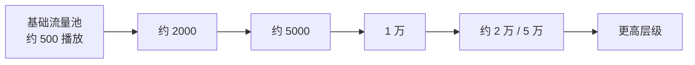
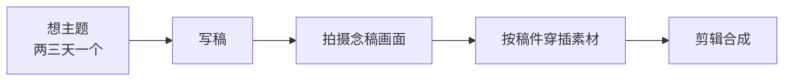

# day03_pm · AI 辅助形象设计应用、自媒体运营方法论与变现策略复盘

> [!abstract] 本场结构与阅读指引
> 本场分为**两个主题反差极大的部分**，建议按需跳读：
> - **上半场（模块一 ~ 五）——设计教学**：作业点评 → AI 辅助设计中的感知力与兜底 → 吉祥物设计方法论 → 软件技法（钢笔与布尔运算）→ 绘画练习心得。
> - **下半场（模块六 ~ 二十八）——自媒体运营**：从「自媒体是职场竞争力」讲到内容逻辑、推流机制、破圈话题、黑粉运营、变现方式、平台规则、账号历程，直到后续待办。
> - **两个半场的内在联系**：上半场解决「**怎么做出东西**」，下半场解决「**做出来的东西怎么被人看见、怎么变成钱**」。

> [!warning] 关于本篇的部分内容
> 下半场涉及大量**自媒体行业的灰色操作手段**（引战、擦边引流、钓鱼封面、PUA 式内容结构等）。
> **笔记保留它们的目的，是让你能识别这些套路**——讲师本人的立场是"了解它、但不崇拜它"（见模块二十五"对所有大 V 去魅"）。
> **出于合规与阅读体验考虑，本篇对少数原始转写中过度具体的个案做了去具体化处理**，逐条列在文末 **📝 转写勘误**表中。

> [!note] 关于本场日期
> 原稿 H1 记作"09-17 讲座"，而文件 frontmatter 的 `date` 为 `2026-09-16`，与原稿标题**存在一天的出入**。
> 本笔记以 frontmatter 的 `2026-09-16` 为准，**原稿的 "09-17" 保留在转写勘误表中待核**。

---

# 一、课堂作业点评：品牌 IP 形象设计（阿岩）

> [!abstract] 一次典型的"AI 生成 + 人工兜底"作业复盘
> **本模块的价值不在于"这个作业好不好"，而在于它完整演示了 AI 生成物的典型缺陷长什么样。**

## 1.1 整体评价

> [!important] 特殊角度作为品牌方向：可行，但有代价
> - **特殊角度（如抬头姿势）作为品牌方向是可行的**，但**抬头姿势会给后续品牌推广带来局限性**
> - **局限性体现在三处**：**① 启动图标上只能按固定方式排版；② 形象只能保持单一姿势；③ 后续延展受限**
> - **判断标准**：**作为 logo 特征可以接受歪头，但必须明确——这是否是品牌的常规标识姿势？**

> [!tip] 这条判断可以直接迁移到任何 IP 作业
> **问自己一句：这个姿势，能不能撑起"一年 12 个活动主题"？**
> **只能摆一个动作的形象，等于把品牌钉死在原地。**

## 1.2 三个版本（默认 / 常规 / 特殊）的区别问题

> [!warning] 问题：三个版本区分不明显
> - **三个版本（默认、常规、特殊）之间区别不明显，仅仅增加了颜色**
> - **默认与常规的区别未体现清楚**——这是最核心的问题

> [!important] 特殊版本应该包含什么
> - **特殊活动版本应包含灯笼、插画、文字等成体系的元素**
> - **参考案例：美团外卖 IP 手持灯笼、穿唐装**，**配合"一对一急送"功能做推广**
> - **特殊版本不限于节日**：**也可用于战略方向调整或功能主推**（**如双十一、一对一急送等运营活动**）

> [!tip] "三种版本"的正确理解
> - **默认版**：日常、最小、最概括的形态（等同 logo）
> - **常规版**：默认版 + 固定的品牌装饰体系
> - **特殊版**：常规版 + **当次运营活动的道具与文案**
> **只换颜色 = 三个版本实际上是同一个版本。**

## 1.3 超级符号设计问题

> [!important] 符号过于复杂，失去了"概括"的功能
> - **符号过于复杂，脑袋剪影无法达到概括图形的目的**
> - **直接使用完整形象剪影，缺乏象征意义的简化**
> - **当前设计的耳朵缺乏象征意义，不够简化**
> - **在简单图形应用场景下使用效果不佳**

> [!example] 对比案例：转转的熊头符号
> **三个圆形构成**——**可以截取上半部分单独使用**，**具有象征意义**。
> **要点在于：简化到"能用三个圆讲清楚"的程度。**

> [!success] 两个备选方案的取舍
> **右侧版本在使用中更好用；左侧版本叠加元素过多。**

## 1.4 身体结构问题（AI 生成后需人工优化）

> [!danger] 本节的真正主题：AI 在这些细节上帮不上忙
> **以下三类结构问题，AI 无法通过关键词调整，必须由设计师手动干预。**

### 腿部结构

- **右侧（远处）腿部弧度过于平缓，左侧（近处）反而结构复杂、角度大**——**不符合透视逻辑**
- **膝盖结构处理不当，需重新绘制**
- **身体多出一块结构，左右不对称，一侧鼓一侧缓**

### 肩膀结构

- **远处肩膀顶得过高，结构线异常**
- **站姿显得奇怪，存在大角度透视问题**
- **AI 无法通过关键词调整此类细节，需设计师手动干预**

### 工牌佩戴

- **工牌位置歪斜，与身体姿势不协调**
- **按当前姿势，肚子顶起后工牌应偏向一侧**
- **斜戴可以，但当前角度过于拧巴**——**真人佩戴会很难受**

### 整体风格

> [!important] 左侧 vs 右侧的对比结论
> - **追求轻松、歪歪扭扭的风格可以理解，但多处结构过于不严谨，导致视觉不适**
> - **右侧版本整体姿态比左侧版本更舒服**
> - **左侧版本五官走向与肩膀角度脱节，显得拧巴**
> - **右侧版本五官与身体姿态协调，设计更干练、概括，有大小特征层次**
> - **左侧版本线条过多、结构刻画过细，不如右侧版本有特点**

> [!tip] "不严谨"和"风格化"的界线在哪
> **风格化是有意识地把结构简化，简化后仍读得通；**
> **不严谨是把结构画错了，只是恰好看着像风格。**
> **判断方法**：**把形象转成纯剪影**。**剪影里还读得通的，是风格；剪影里读不通的，是画错了。**

## 1.5 猫咪特征识别问题

> [!warning] 形象越看越像耗子，不像猫咪
> **原因：关键形体结构未表现出猫的特征。**
> - **耳朵位置竖得太靠上，应向两侧偏移**
> - **鼻子过大，需调整鼻子的形态及与五官的比例关系**
> - **可通过在脸上增加毛发特征来强化猫的识别度**
> - **微笑表情处理可改善整体观感**

> [!tip] 识别度问题的通用诊断法
> **"像不像"从来不是细节问题，而是"关键特征点"问题。**
> **猫有两个特征点：耳位、鼻口比例。**
> **画任何动物前先问：它靠哪两三个特征点被人一眼认出？**

## 1.6 工作中的沟通启示

> [!important] 职场反馈从来不是直白的
> - **面试或工作中，他人不会直接指出具体问题点，而是以疑问方式反馈**（**如"这个角度当时是这么设计的吗？"**）
> - **这种模糊反馈容易造成双方误会**——**设计师可能认为对方在挑刺**
> - **课堂点评可以直白指出问题，但职场中需要设计师自己具备发现问题的能力**
> - **多个小问题叠加会形成整体不专业的印象**

> [!quote] 本模块最有价值的一句
> **"课堂上老师会告诉你哪里错了；工作中只会有人问你一句『这里是故意的吗』。"**
> **能够自己发现问题，才是从课堂走向职场的分水岭。**

## 1.7 需优化的关键部位汇总

> [!success] 六项待改清单
> 1. **腿部结构**（膝盖、左右腿弧度不对称）
> 2. **肩膀结构**（远处肩膀过高）
> 3. **工牌佩戴角度**
> 4. **耳朵位置与形态**
> 5. **鼻子大小与形态**
> 6. **五官与身体姿态的协调性**

---

# 二、AI 辅助设计中的感知力与兜底能力

> [!abstract] 本模块是本场的设计理论核心
> **一句话结论：AI 负责"大方向"，人负责"最后 10% 的精确"——兜底的方向不能反。**

## 2.1 设计师感知力的不可替代性

> [!important] AI 只能提供大方向，无法替代从零到一的创作
> - **差一点弧度、差一点距离，最终效果就完全不同**——**这源自设计师对行为和事物的感知力**
> - **AI 可以提供方向，但只是大的方向，无法完成从零到一的创作**
> - **很多公司目前的做法是：在基础条件之上批量延展**，**后续下游的工作任务量很大**

> [!example] AI 漫剧的实际工作流程
> - **当前短视频领域的 AI 漫剧，仍然需要先由脚本人员编写脚本，再制作分镜**
> - **完全靠关键词直接生成一部漫剧是不现实的**，**必须有脚本和分镜的支撑**

> [!tip] 这个例子为什么重要
> **它说明 AI 落地到真实产业时，被拆成了"人做骨架、AI 填肉"的分工。**
> **你越往上走，越是在做骨架那部分。**

## 2.2 案例：AI 辅助课件制作

> [!example] 一个真实接单案例
> - **案例背景**：**某位同学在上课期间接了一个需求——为某大学老师制作公开课课件所需的图片 / 视频素材**
> - **具体场景**：**历史老师的头像 + 李白古代穿越形象站在一起的画面**
> - **制作过程**：
>   - **使用的是"吉梦"工具**（**AI 生成工具**，详见转写勘误表）
>   - **并非百分之百直接输出，而是先试了一些草稿，类似于分镜的流程**
>   - **最终产出形式为视频**

> [!important] 对比：日常零散需求 vs. 工作级需求
> | 需求类型 | 能否直出 | 原因 |
> | --- | --- | --- |
> | **日常零散需求**（如生成手抄报让孩子照着画） | **可以直出** | **要求不高** |
> | **工作级需求**（规模大、需求细致） | **几乎不可能直出** | **很少能直接满足，必须走草稿 / 分镜流程** |

## 2.3 AI 的定位：90 分 + 人工兜底

> [!important] 核心观点
> - **不要总想着用 AI 直接达到目的**
> - **AI 可能达到 90 分，剩下的部分需要人工补足**
> - **AI 给出一个稍微 OK 的方向，由人来修改完善**

> [!note] 关于"90 分 + 15 分"的算术问题
> **原稿表述为"AI 可能达到 90 分，剩下 15 分需要人工补足"，原稿自己也标注了"此处为口语表达"。**
> **90 + 15 = 105，并非严格的比例划分。**
> **正确的理解是**：**AI 完成大部分（约九成量级的工作），人负责收尾的关键少数环节**——**"15 分"是口语里的程度词，不是精确的数字。**

> [!important] 兜底逻辑
> - **人去给 AI 兜底，而不是让 AI 给人兜底**
> - **AI 兜底的可能性太无限了，不可靠**
> - **人把最后几个关键环节补足，这才叫提效**
> - **提效不是什么都不干，而是 AI 帮你补足大的环节，你来兜底**

> [!quote] 记住这个方向
> **"AI 给人兜底"听起来更舒服，但它的失败模式是无法预期的；**
> **"人给 AI 兜底"才是一个可控的工作流。**

## 2.4 学员作品点评：简笔画与设计感的区别

> [!danger] 问题诊断
> - **学员作品呈现出"儿童简笔画"的感觉，有待优化**
> - **简笔画不等于简单概括**——**关键在于是否有特点**

> [!important] 设计感的核心要素
> **简单可以，但必须有一定的特点。特点体现在：**
> - **结构弧**（**弧度的小结构特点**）
> - **大脸型的结构**（**如三个圆组成的大脸型**）
> - **眼睛的造型**（**如长条眼睛的极致化处理**）

> [!example] 对比示例
> - **同样是长条眼睛**：**左边极致发挥长条的设计感，右边只是普通的长条套半圆**
> - **同样是基础图形**：**一个只是用图形做出一个东西，另一个是利用图形的优点放大它来达到目的**
> - **手部设计**：**全部由圆形组成，但加入了一些角度和圆润处理，形成了有特点的造型**

> [!important] 改进建议
> 1. **让 AI 多给一些思路**
> 2. **多看优秀案例，学习别人是怎么做的**
> - **对于零基础学员，就像新徒弟学手艺、学老师傅一样，直接照猫画虎**
> - **不要完全用自己的理解做东西，先学会一种表现方式，再探索新的东西**

## 2.5 现场修改演示

> [!example] 修改原则与操作
> - **修改原则**：
>   - **不重新画，保留学员原有的元素**
>   - **只调整一丢丢，让造型既有设计感，又不至于一看就是简单化的儿童简笔画**
>   - **适当调整结构上的变化**
> - **具体操作**：
>   - **胖乎乎的小人适当调整结构**
>   - **后脚跟露出来也无所谓**
>   - **拉出来再加一个元素**

> [!tip] "只调一丢丢"为什么重要
> **重新画等于把学员的作品变成老师的作品，学员什么也没学到。**
> **改一丢丢，学员能看见"我和及格线之间只差这一点"**——**这才是可学习的差距。**

## 2.6 技能技法与效率的关系

> [!important] 技能技法的新定位
> - **以前的技能技法直接影响设计能力**
> - **现在的技能技法是帮自己兜底**——**用 AI 兜底，同时用自己的能力去兜底**

> [!example] 效率对比：一个地方省九分钟
> | 做法 | 耗时 | 结果 |
> | --- | --- | --- |
> | **笨办法** | **先用十分钟怼一个，再改半天** | **一晚上熬到 12 点以后** |
> | **熟手** | **三十秒完成** | **省下九分钟** |
>
> - **一个地方省九分钟，十个地方省九十分钟**
> - **一晚上九点就能做完，还能看综艺、玩游戏，12 点睡觉，睡满 8 小时**
> - **第二天被同学表扬，兴致勃勃，心情不受影响**

> [!important] 潜移默化的影响
> - **效率的提升会让心气儿慢慢产生变化，信心就有了**
> - **很多东西不只是能力或苦学的问题，技能技法、方式方法也是影响学成效果的关键**
> - **下功夫最多的人，结果上不一定有反馈**

## 2.7 关于心态与结果的反思

> [!warning] 现实场景的警示
> - **如果上班的话，能力没有反馈到最终结果上，结果没有反馈到绩效上，老是差那么一点，最后就会崩**
> - **会产生"我不行""我不适合""我恨透了"的负面情绪**

> [!tip] 这一节其实在讲"正反馈循环"
> **效率 → 早收工 → 心情好 → 被表扬 → 更有信心 → 效率更高。**
> **反过来是：效率低 → 熬夜 → 状态差 → 结果差 → 自我否定。**
> **两者的起点，往往只是"一个地方省九分钟"。**

## 2.8 课程整体安排

> [!note] 本月课程目标与近期安排
> - **本月课程目标**：
>   - **让大家对 AI 的认知和整体使用框架建立一个框架**
>   - **每天都会用到 AI**
>   - **即使来之前用过 AI，对 AI 的磨合和很多技法还不够娴熟，大的方向没问题**
> - **近期安排**：
>   - **周六周天任务非常饱和，需要大量使用 AI**
>   - **建议学员自己准备一个基础的身形，保证技术人员随时可以进行优化，做简单调整**
>   - **不要直接就是纯 AI 生成**

## 2.9 课堂花絮

> [!quote]- 课堂琐事（非知识点，点击展开）
> - **上课时发现鼠标没电，找电池没找到，临时使用触控板操作**
> - **鼠标问题不确定是电池原因还是鼠标本身损坏，确实很久没换了**
> - **阿玉（学员）的作品有"丑萌丑萌"的感觉，但还有待优化**

---
# 三、从基础型到有特点的吉祥物设计

> [!abstract] 本模块回答一个最常被问到的问题
> **"我知道自己画得没特点，但特点到底从哪儿来？"**
> **讲师的答案是：特点不是"找"出来的，是"推"出来的。**

## 3.1 学员作品问题诊断

> [!danger] 核心问题：基础型依赖
> - **学员使用基础图形（椭圆）进行设计，仅做细微优化，本质上仍是椭圆的简笔画**
> - **五官位置、身体结构均停留在基础型阶段，缺乏设计特点**
> - **对比展示**：**左侧为学员原稿，右侧为教师在其基础上调整后的版本**——**五官未动，仅调整了头部和身体结构**

> [!warning] 新手常见误区
> - **用基础工具（椭圆、钢笔工具）画完后只做表面优化，基础结构未变**
> - **既没有用基础图形组合出有特点的造型，也没有跳出基础型的框架**
> - **学员自述"感觉找不到特点"**

## 3.2 设计方法论：特点是推出来的，不是找出来的

> [!important] 循序渐进的设计过程
> - **设计不是从起点直接跳到终点，而是一点一点叠加出来的**
> - **教师现场演示**：**从第一句话开始逐步拼合，全程讲解每一步的调整原因**
> - **每一步调整都有依据，不是凭个人喜好**

> [!important] 经验积累与调用
> - **教师十年的设计经验沉淀，使其能够直接调用判断，无需像新手一样耗费时间探索**
> - **零基础学员通常在第二周后半段到第三周能逐渐进入学习节奏**
> - **入局后稳步增长，形成一定套路**

> [!quote] "推"和"找"的区别
> **"找"是：脑子里先有一个成品，然后试图把它画出来——找不到就卡住。**
> **"推"是：先放一个基础型，然后每一步都问"这里差什么"，一步步逼近。**
> **前者依赖灵感，后者依赖方法。**——**这也是为什么本场反复强调"不要靠想象"。**

## 3.3 新手学习方法与路径

> [!important] 避免过度琢磨
> - **新手初期如果想法不足以支撑好的方法，不应过度依赖自己的判断**
> - **应依据客观事实和教师讲解的内容进行理性判断**
> - **过于感性、过度相信自己的判断是常见问题**

> [!example] 笨方法也是方法
> - **案例：有学员拆解教师字体设计中的笔画样式（三种），然后找字体直接套用**
> - **虽然无法举一反三、融会贯通，但能照搬也是一种有效方法**
> - **在新手初期，照搬和套用是可接受的过渡策略**

> [!important] 三种可行路径
> | 路径 | 性质 | 速度 |
> | --- | --- | --- |
> | **找参考 / 抄** | **捷径方法** | **快** |
> | **自己理性分析推导** | **正统方法** | **慢** |
> | **直接按教师示范修改** | **介于两者之间** | **改一改即可** |

## 3.4 核心原则：尊重客观规律，不要凭空想象

> [!important] 人无法靠想象做事情
> - **教师以自身经历举例**：**当父亲后的行为习惯，回想起来很多都是自己父亲曾经教育自己的话**，**尽管曾经讨厌那些方式**
> - **没当过家长，靠自己想象永远想不出来**
> - **设计同理**：**没见过、没参考过，靠自己想象无法做出正确判断**

> [!important] 两层客观标准
> 1. **第一层：不要做成自己喜欢的样子**
> 2. **第二层：大家都做什么样子，什么样子就是好看的**
> - **了解"大家做什么"的方法**：**直接看结果、找参考**

> [!tip] "不要做成自己喜欢的样子"该怎么执行
> **不是让你放弃审美，而是让你把判断依据从"我喜不喜欢"换成"它成不成立"。**
> **可操作的检验**：**把你的方案和三个行业头部案例放一起**——**如果只有你自己觉得它好，那大概率是你的偏好，不是它的价值。**

## 3.5 吉祥物五官比例的设计逻辑

> [!important] 五官聚拢与可爱的底层逻辑
> - **学员观察：五官聚拢显得可爱（亲密性原则）**
> - **深层原因：吉祥物普遍像小孩，只有孩子的五官才"没长开"**
> - **五官位置越接近水平线，越像孩子，越有亲和力和可爱感**

> [!important] 五官位置与年龄感的关系
> | 五官 / 留白处理 | 产生的年龄感 |
> | --- | --- |
> | **下巴留白更多** | **更童真** |
> | **五官往下走** | **看起来更睿智** |
> - **五官位置的微调会产生不同的年龄层次感受**

> [!important] 言之有物、有理有据
> - **设计判断不是个人主观意见，而是集大家之所长、尊重事物客观发展规律**
> - **即使见过小孩二十多年，也需要被点破才能意识到"原来是这样"**

## 3.6 AI 与参考工具的应用

> [!example] 用 AI 验证设计规律
> - **用 AI 生成吉祥物，观察其五官比例**——**AI 给出的答案同样是儿童五官比例**
> - **一两个样本不能说明问题，需要看十个八个才能确认规律**

> [!note] 快速参考渠道
> - **阿里巴巴、美食外卖等平台的吉祥物设计**
> - **直接找现成案例是最快、最能达到目的的方法**

> [!tip] "用 AI 交叉验证"是一个很好用的方法
> **当你不确定某条设计规律是否成立时，让 AI 生成十张，看它是否"天然地"都这么做。**
> **AI 的训练数据里浓缩了整个行业的惯例**——**它给出的默认答案，往往就是"大家都做什么样子"。**

## 3.7 五官比例变化的延伸应用

> [!important] 拉长五官比例的效果
> - **五官比例拉长后产生诙谐感，而非纯萌、纯童话的可爱**
> - **适合脱口秀剧场、喜剧类品牌**

> [!example] 实际案例
> - **《一年一度喜剧大会》品牌形象**：**拉长的脸型、五官比例拉长、眼距较窄**
> - **可爱源于诙谐，而非纯萌**

> [!important] 日常积累的重要性
> - **追剧、吃瓜、了解军事、新闻、政治、嘻哈、说唱、喜剧、电影等都能获取设计灵感**
> - **保持好奇心，愿意了解各领域内容，生活中处处有值得吸收的细节**

## 3.8 教师个人特质与教学态度

> [!quote] 一段自我剖白
> - **自述从小性格浮躁，但尽量保持理性，压抑浮躁进行理性思考**
> - **不是所有人都适合理性推导，需要找到适合自己的更快方法**
> - **强调"不要想"，要尊重客观规律，多看、多参考、多分析**

---

# 四、设计教学指导与作业点评

> [!abstract] 本模块是上半场最长的一节
> **一块讲"怎么找参考"，其余是五位同学的具体点评与软件技法演示。**

## 4.1 核心设计理念：不要自己凭空想

> [!important] 最有效的方法是直接参考和借鉴
> - **当前阶段很多同学的能力还达不到自己沉淀、原创设计的水平，最有效的方法是直接参考和借鉴优秀案例**
> - **连泡儿老师、霍老师这样的资深设计师，现在都不自己凭空想，而是直接"抄"**——**即找好的参考直接套用**
> - **举例：当爸爸这件事，与其自己琢磨怎么当，不如直接看好的爸爸怎么当，直接学过来**
> - **自己硬想太累，甚至可能累出抑郁症**
> - **核心方法论：多看、多分析、多总结、多归纳，不要老自己想太多**

> [!note] 这里的"抄"是什么意思
> **原稿中讲师用"抄"字，配合上下文可知其含义是"**找成熟参考直接套用**"，而非抄袭他人作品。**
> **结合模块三的"三种可行路径"，"抄"是新手期的过渡策略，不是终点。**

## 4.2 IP 形象头部造型分析

> [!important] 头部形状的关键特征
> - **好的 IP 头部不是纯圆或纯椭圆，而是圆鼓鼓的但有一定的"型"**
> - **这个"型"体现在：有些地方稍微缓一点，有些地方有微妙的变化**

> [!important] 调整方法
> - **画一个圆，然后等比例收两个锚点，就能做出又胖又蹲、又鼓的效果**
> - **收的幅度不同，效果也不同**：**收得小一点就没那么尖锐，收得大一点就更尖锐**
> - **如果想让弧度更陡、角度更大，就调整对应弧线，让它别那么缓**

> [!important] 不同 IP 的头部比例差异
> - **"于大会"这个案例**（**名称待核，见转写勘误表**）：**五官比例不同，整体感觉更成人化**，**不是那种萌的感觉**
> - **成人化但不诙谐的原因分析**：
>   - **虽然某块距离长，但另一块的比例大也宽**
>   - **所以虽然长了却不诙谐，没有那种过于夸张的感觉**
> - **也不像儿童化那么萌，是另一种风格**

> [!success] 检验是否真正掌握知识点的方法
> 1. **能否直观地感受到差异**
> 2. **能否用具体的距离、大小、间距等数据复述出来**
> 3. **能否打开软件实际比量、调整出来**
>
> **能做到这三条，这个知识点就"透了"。**

## 4.3 温毅同学作业点评（坚果 IP 形象）

> [!note] 整体评价
> - **方向没什么太大问题，但在设计上需要体现得更舒服一点**
> - **感觉头像像个包子，不太像坚果**

> [!important] 问题一：缺乏坚果特征
> - **目前没有坚果的感觉，更像包子**
> - **建议方案：做成裂开一条缝的感觉，露出里面的果肉，或者有剥开的层次感**
> - **如果要做剥开效果，这边结构就需要复杂化，但可能没必要**
> - **简单方案：裂一个缝就行**

> [!important] 问题二：像长了角
> - **如果想保留角的元素也可以，但建议做成裂开的效果更有特点**
> - **如果角没有特殊要求，就概括成简单的形，不要搞太复杂**
> - **目前角的线条有些地方小拐、有些地方大拐，看起来不舒服**

> [!important] 问题三：身体结构要为后续动作考虑
> - **虽然现在只是呆呆地站着，但要考虑后续做动作或让 AI 辅助完成动作时，结构是否清晰**
> - **胳膊等结构最好明确表示出来**
> - **如果发现结构不好，再调整**

> [!important] 问题四：脚 / 鞋的造型
> - **拿出来看时，这块像被抠掉一块，显得很瘦，还拐来拐去**
> - **建议：脚正常一点就行，想平一点底下砍一下，不平这样也行**
> - **目前感觉说不上来，有点怪，颜色偏冷，还有些糊**

> [!success] 整体结论
> **整体上还可以，没有太大问题，有点像卖药的或农副产品的感觉。**

> [!tip] "有点像卖药的或农副产品的"是什么意思
> **这是一句很典型的、不好翻译成结论的点评**——**它指的是形象的气质跑偏了**：
> **坚果本身应该带"零食、可口、精致"的属性，而这个形象呈现出的是"粗加工、土特产"的气质。**
> **这类反馈在工作中经常出现，设计师需要学会把它翻译成可执行的修改点（这里就是：缝、色温、结构清晰度）。**

## 4.4 三只松鼠相关经验参考

> [!example] 直接借鉴成熟案例
> - **之前有同学在三只松鼠实习过（或良品铺子）**
> - **可以参考其设计思路进行优化**：
>   - **中间间距不要太大，让两个元素往里聚**
>   - **缝儿窄一点也行**
> - **头部结构可以直接使用，问题不大**
> - **上边儿的结构可以拿出来在其他地方沿用**

## 4.5 设计元素的多场景应用

> [!important] 导航条设计
> - **参考抖音商城的导航条设计**：**模块入口处有卡片、图标加功能文字**
> - **自己的 IP 特征可以拿来做引导线，体现品牌特点**——**不用非得瞎搞一个或直接一条横线**

> [!important] 活动卡片与 UI 模块
> - **很多活动中的大卡片模块、APP 首页的图标区域都可以应用**
> - **大厂对这种模块的称呼**：
>   - **球区**（**像小球一样**）
>   - **金刚区**（**黄金位置功能**）
>   - **品类区**（**有各种品类**）
> - **这些是分发的主要大模块 / 入口，通常单独拎出来，配卡片、图标和功能说明**

> [!tip] 记住这三个词，面试很加分
> **球区 / 金刚区 / 品类区是电商端内设计的通用黑话。**
> **能自然说出这些词，等于告诉面试官"我在真实的业务环境里待过"。**

## 4.6 迎新春主题设计问题

> [!warning] 色彩冲突问题
> - **问题：文字加了红色，但背景黄色本身也是深色，红和黄撞了**
> - **解决方案**：
>   - **加层次感，做成 3D 带光感的效果**
>   - **加描边**
>   - **用 PS 笔刷一抹做出渐变**（**但 PS 内置渐变需要调，不太方便**）
>   - **对比有点强、有点脏的情况下，可以加小灯笼等元素丰富画面**

> [!important] AI 工具的使用建议：该用 AI 的时候要用 AI
> - **启动 icon 可以直接让 AI 生成**：**给它一个参考，把中间的小 IP 换成自己的**
> - **不要自己哐哐画，效率低**
> - **上午已经演示过类似操作**：**搜出来一堆参考，把中间 IP 替换即可**

> [!quote] 把 4.6 和模块二放在一起看
> **"AI 生成启动 icon"是"AI 干大活"；"把中间 IP 换成自己的"是"人做兜底"。**
> **这就是模块二那条工作流的一个具体切片。**

## 4.7 果果同学作业点评

> [!important] 整体还可以，但优先级还是差一点
> - **核心问题：五官太没有特点**
> - **感觉像博物馆或景区那种 IP，太普通**

> [!tip] 为什么很多景区 IP 做得普通
> **讲师给出的三条原因**：
> 1. **不舍得花钱**
> 2. **审美受限于领导**
> 3. **要做周边（冰淇淋、雪糕、冰箱贴等），太复杂了不好落地**
>
> **这三条合起来，正好解释了"为什么景区 IP 都长一个样"**——**它不是一个设计问题，是一个预算 / 决策链 / 生产约束的问题。**

> [!important] 改进方向
> - **每个地方都感觉差点，都是稳稳的，没有突出点**
> - **五官上再出来一点，做出特点**

## 4.8 阿玉同学作业点评

> [!note] 简短的点评
> - **需要和其他同学一样，练习软件技法**
> - **昨天已经讲过一些技法，也做了礼物相关的设计**
> - **完整内容在更新里面，可以截图查看**

## 4.9 软件技法教学：钢笔工具与布尔运算

> [!important] 核心逻辑：用最少的点做出来
> - **钢笔工具的逻辑是用更少的点把东西做出来**
> - **举例：画一个树叶，只需要点两个关键点（形体结构点），就能出来**
> - **很多同学不会用，反复在一个地方弄**——**多出来的点都要调，调一个影响另一个，非常麻烦**
> - **"大米"（可能指某个案例，详见转写勘误表）太考验结构、软件掌握和对设计形状的理解**

> [!important] 万物皆可归纳为方与圆
> - **任何世界上的万物，无非就是方的还是弧度的**
> - **方的和弧度的，用矩形和圆这两个基本图形都能搞定**
> - **无非就是矩形的组合，或者圆的优化调整**

> [!example] 具体操作演示（以手部造型为例）
> 1. **先弄成居中描边**
> 2. **每个转折相当于打一个点（锚点）**
> 3. **先把所有转折的点先点上**
> 4. **删掉不需要的边，拽直**（**稍微有点斜没事**）
> 5. **转折处往上提，调整位置**
> 6. **最后加一条线收尾**

> [!important] 弧度控制技巧
> - **控制弧度的就是那个杆（贝塞尔手柄）**
> - **想让尖或缓，就调杆**
> - **搞尖的技法：钢笔工具按 Alt 一点就尖了**
> - **除了规整图形图标之外，很少有绝对尖的、棱角分明的，基本上都是用弧度去调整优化**

> [!important] 剪切与删除
> - **常用剪切快捷键：Shift + M**（**详见下方技法注释**）
> - **很多画 logo 的复杂操作都是这么搞的**
> - **删除路径**：**白色箭头是编辑路径和小锚点，黑色箭头是选择图形用的**
> - **想删某个路径，用白色箭头框选锚点再删**

> [!note] 技法注释：Shift + M 是什么
> **在 Adobe Illustrator 中，Shift + M 是形状生成器（Shape Builder）工具。**
> **它的行为与讲师的描述完全吻合**："**可以密集地一次剪掉多个区域**"、"**是布尔运算所有功能的综合**"。
> **对照记忆**：**白色箭头 = 直接选择工具（A），黑色箭头 = 选择工具（V）。**

> [!important] 遮挡与布尔运算
> - **如果不需要真正剪掉，直接遮挡就行——遮挡最好用**
> - **如果非要剪掉某块**：
>   - **复制一个再剪**
>   - **或者用 Shift + M 直接剪**
> - **布尔运算**：
>   - **简单的两个独立图形之间用布尔运算**
>   - **复杂的图形用综合功能（Shift + M）**，**它其实就是布尔运算所有功能的综合**
>   - **单独图形之间的小计算和综合功能是一个意思**

> [!example] 斗笠案例
> - **椭圆先拽过去，选中后可以用之前讲的布尔运算功能一加就分出来了**
> - **看不清的话可以先改一下其他颜色**

## 4.10 作业快速过稿

> [!note] 一次快速走查
> - **老师的作业也快速过了一遍，是昨天做的对接内容**
> - **原来的图片没了就没了，不影响**
> - **手部造型有问题，按照上述方法调整即可**
> - **鼻子的结构稍微放一点，觉得尖或缓就调，让它不尖不缓就行**
> - **脑袋是后面再加一个大脑袋，逻辑就是这样的**
> - **牙牙的造型也是弧度的，底下可能有个嘴，把下半部分切掉就用嘴的弧度**

---

# 五、绘画技法练习心得

> [!abstract] 一段独立的经验分享
> **主题只有一个：为什么在 AI 时代，反而要回头练手绘。**

## 5.1 技法靠练习形成肌肉记忆

> [!important] 核心观点
> - **任何技法本质上都是熟练度问题，练多了自然形成肌肉记忆**
> - **不要对技法有畏难情绪，想掌握就去尝试，反复练习即可**

## 5.2 AI 时代仍需保留手绘基本功

> [!important] AI 出图不等于万事大吉
> - **近两年 AI 工具兴起后，上课时也会向学生强调：AI 出图不等于万事大吉**
> - **实际工作中的典型场景**：
>   - **海报偏手绘或 3D 风格时，光感不好，需要用 PS 模糊画笔手动补光**
>   - **插画中某个元素（如一棵树）不满意，不可能为了一棵树重新出一张图，直接用画笔涂两笔即可修正**
> - **结论：AI 负责大方向，手绘 / PS 负责精细修补，两者结合才是高效工作流**

## 5.3 个人练习经历

> [!example] 讲师的练手记录
> - **练习动机**：
>   - **一是为了保持手感、强化肌肉记忆**
>   - **二是儿子经常要求帮忙画画，顺势练习**
> - **练习内容**：**画龙（儿子指定的主题），画了很多，部分没有拍照记录**
> - **练习感受**：
>   - **前两个作品画起来有难度**
>   - **画到后面逐渐游刃有余，熟练度明显提升**
>   - **特殊角度的龙画起来也比预期轻松**
> - **重要发现**：**从大一到现在，多年来一直在纸上画画，但这次是第一次重新在纸上画，意识到确实需要定期练一练**

## 5.4 实际工作案例：PS 快速修图 vs AI 调关键词

> [!example] 场景：总监要求把画面中的猫改胖一点
> - **需求**：**类似大力水手的肌肉感，只需在某一侧稍微鼓起**
> - **处理方式**：
>   - **直接在 PS 里画一笔，模拟肱二头肌 / 肱三头肌的鼓起效果，一笔即可完成**
>   - **不需要画得多精细，结构大致对就行**
> - **对比 AI 方案**：
>   - **如果用关键词让 AI 调整，不知道要调多久**
>   - **AI 经常听不懂具体需求，可能把其他部分也改掉，反而增加工作量**
> - **结论：小范围、局部、精准的修改，手动 PS 远快于 AI 反复调试**

> [!tip] 这条判断标准值得背下来
> **"局部、精准、小范围" → 手动做。**
> **"整体、方向、大批量" → 交给 AI。**
> **这也正是模块二那句"AI 干大活、人做兜底"在操作层面的落地。**

## 5.5 一段课外观察

> [!quote]- 查看朋友圈微商（非知识点，点击展开）
> **原稿记录**：**提到加了一些售卖家（如品牌箱包）仿冒品的微商店铺。**
> - **加好友的动机**：**好奇微商如何卖衣服，想观察其运营方式**
> - **明确表态**：**从未购买过，也不买仿冒品，从未在该类店铺消费过**
>
> **⚠️ 阅读提示**：**本段属于课堂闲谈，唯一可提取的信息是"观察同行 / 非同行如何做内容运营"这一动机**，
> **与设计知识无关。原始转写中出现了具体奢侈品牌名称，此处已做去具体化处理。**

---
# 六、自媒体运营方法论（总纲）

> [!abstract] 从这里开始进入下半场
> **下半场的第一句话是本场最反直觉的判断：自媒体不是"个人爱好"，是"职场竞争力"。**

## 6.1 核心原则：借鉴与本地化结合

> [!important] 两条原则
> - **在缺乏大面积数据支撑时，可先参考美团等平台的成熟方法论**
> - **必须结合自身实际情况进行调整，不能完全照搬**

## 6.2 团队在 AI 应用上的问题

> [!danger] 当前团队的核心症结
> - **团队目前对 AI 工具的使用过于依赖"看天吃饭"**——**直接让 AI 生成内容，缺乏主动引导**
> - **具体表现包括**：**表情包生成、动态内容生成、IP 本体设计**
> - **核心症结：没有理性地摸索出一套逻辑再交给 AI 执行，导致产出质量不稳定**

> [!quote] "看天吃饭"是本章的题眼
> **同一个问题，在模块二叫"人给 AI 兜底"，在这里叫"先把逻辑摸清楚再交给 AI"。**
> **两者说的是一件事：AI 是执行器，不是决策器。**

## 6.3 自媒体能力的职场价值

> [!important] 自媒体已不只是个人账号运营
> - **自媒体已不仅是个人账号运营的范畴**
> - **当前企业越来越重视员工的自媒体能力与个人影响力**
> - **这项能力正在成为职场竞争力的重要组成部分**

## 6.4 典型案例：大头李（阿里员工）

> [!example] 副业收入远超主业
> | 维度 | 数据 |
> | --- | --- |
> | **所在公司** | **阿里巴巴** |
> | **粉丝规模** | **约 1.4 万** |
> | **主业薪资** | **早期约 15,000 元 / 月，当前约 15,000–18,000 元 / 月** |
> | **副业收入** | **每月承接 2–3 个私活 / 广告合作，月副业收入区间 20,000–50,000 元** |
> | **关键结论** | **副业收入远超主业薪资，自媒体变现能力显著** |

---

# 七、学员案例

> [!abstract] 三个真实样本
> **它们的共同点是：自媒体做到一定程度后，"工作反向找上了人"。**

## 7.1 阿丽（阿里在职）

> [!example] 从"不自信"到"被团队重新定位"
> - **平台以抖音为主，粉丝约 1400，稳定每月接 1–2 条小广告，广告费几百元**
> - **起步阶段**：**拍视频不打光、不化妆，形象随意，内容撑不起流量**
> - **改进后**：**学会化妆、健身、身材管理，整体形象"挺飒挺酷"**
> - **最初来上课时很不自信，上班后通过健身和自媒体分享逐渐建立信心**
> - **入职阿里约小半年到一年时，领导刷到其自媒体账号，发现内容与工作深度绑定**（**工作流、AI 技能技法、AI 相关技术**）
> - **领导评价"好强，学习能力啥的"，随后将其设计工作分出去，转向纯 AI 工作流搭建，逐步向 AI 产品经理方向靠拢**
> - **目前已经完全脱离设计岗位，设计技能生疏**
> - **入学第二个月即接到华硕广告**：**首批 10 条内容报酬 2000 元，因流量效果好追加 2000 元再发 10 条，总计收益 3000 元**
> - **成功关键：内容中自然露出设备（显示器），让广告主看到品牌植入的可能性**

> [!tip] 阿丽案例最重要的启示
> **改变她职业轨迹的不是"粉丝量"，而是"账号内容与本职工作高度绑定"。**
> **领导看到的不是"她粉丝多"，而是"她在公开输出我们团队在做的事"。**

## 7.2 木木

> [!example] 被领导安排给别的团队讲课
> - **领导在今年年初刷到其账号，评价"怎么这么厉害"**
> - **被安排给另一个团队做 AI 分享授课**
> - **领导很赏识、认同，老大还经常请教自媒体怎么做**
> - **分享时翻看上课笔记，让 AI 整理后去讲课**
> - **分享 AI 相关内容，让平台方看到合作可能性，接到 AI 平台合作，报酬几百元**
> - **因粉丝量少、更新频率低（一两周一条），收益有限**
> - **优点：及时反馈、勤于琢磨、愿意迭代优化**

## 7.3 锤锤师姐

> [!example] 简笔记录
> - **善于利用自身优势（身材好）**
> - **性格单纯：上课做不好图就哭，做好了就开心**
> - **曾相信男朋友"刷到的擦边视频都是机器推的"的说法**
> - **后来进入大厂（字节旗下团队，可能是懂车帝或汽车相关业务）**

---

# 八、自媒体对职业发展的影响

> [!important] 正面：内容与工作绑定，组织愿意看到
> - **自媒体内容与工作深度绑定（工作流、AI 技能等），团队、领导、公司愿意看到**
> - **与工作相关的优质账号，领导会看重、赏识，甚至请教经验**

> [!danger] 反面：粉丝多不等于被高看
> - **纯八卦类账号在大厂不被允许，存在危机公关风险**
> - **面试或团队中，单纯粉丝多不会被高看；若对公司无利，反而被视为不稳定因素**

> [!important] 大厂的变现压力怎么传导到设计团队
> - **阿里 P7 升 P8 有硬性指标：团队影响力建设、团队变现能力**
> - **运营和市场部门影响力变现容易（搞大活动），设计团队变现难**
> - **设计团队因此频繁开分享会、开课；腾讯卖盲盒也是"不得已而为之"**

> [!example] 一个"技术团队做账号"的样本
> - **网易有道技术团队运营自媒体账号"有道无霸哥"，粉丝 200 多万**
> - **以搞笑段子为主，接大量广告**
> - **团队成员真实做开发，甚至招聘美女小姐姐做技术**
> - （**账号名与粉丝数待核，详见转写勘误表**）

> [!quote] 本模块的结论
> **"粉丝量"本身不是资产，"粉丝量与岗位的相关性"才是资产。**

---

# 九、自媒体内容核心逻辑

> [!abstract] 本模块回答"一条内容为什么能被推"
> **答案拆成四件事：钩子、结构、框架、互动。**

## 9.1 前五秒完播（钩子）

> [!important] 不同平台的"钩子"位置不同
> | 平台 | 钩子位置 |
> | --- | --- |
> | **视频（抖音）** | **前五秒决定能否留住人** |
> | **图文（小红书）** | **封面即钩子** |
>
> - **钩子勾住人，首要播放量（抖音）/ 小眼睛（小红书）就有了**
> - **核心目的：前 5 秒必须把人拉过来，需要"使手段、下钩子"**

> [!important] 常见手法
> - **制造冲突或悬念，让观众产生"到底怎么回事"的好奇**
> - **将精彩镜头剪到最前面**
> - **刻意制造争议观点**

> [!warning] 现实
> **不使手段内容就没人看，很多博主内容存在夸大或演绎成分。**

## 9.2 内容结构

> [!important] 三段都要有事做
> - **开头**：**钩子**（见 9.1）
> - **中间**：**不能太空、太概念，要埋具体点**
> - **结尾**：**留影子**——**如"想听具体做法评论区打一，我再发一个视频"**
> - **图文逻辑**：**封面勾进来，内容能截图、收藏、写笔记，最好能引发评论**

## 9.3 内容框架方法论

> [!important] 核心套路：任何内容均可拆解为三大点
> | 序号 | 内容 |
> | --- | --- |
> | **第一点** | **现状 / 普遍认知是什么**（**往往是不好的**） |
> | **第二点** | **以自身为例，我是怎么做的** |
> | **第三点** | **大家应该怎么做** |

> [!example] 示例：教面试作品集
> **① 面试到底怎么回事 → ② 面试中怎么讲 → ③ 接下来最好怎么做**

> [!important] 封面与框架决定成败
> - **小红书靠静态封面，抖音靠前 5 秒动态封面**
> - **内容框架保持稳定即可**

> [!tip] 这个"三点框架"其实是一个万能模板
> **它之所以有效，是因为它同时完成了三件事**：**制造焦虑（现状不好）→ 建立权威（我做到了）→ 给出口（你也能做）。**
> **换任何主题都成立**——**这也是为什么它既是自媒体套路，也是提案汇报的好结构。**

## 9.4 小红书 AI 推荐权重（满分 5 分）

> [!important] 权重表
> | 互动行为 | 权重 |
> | --- | --- |
> | **关注** | **5 分** |
> | **评论** | **4 分** |
> | **转发** | **4 分** |
> | **收藏** | **2–3 分** |
> | **点赞** | **1 分（几乎没用）** |

> [!tip] 这张表解释了后面所有"引导评论"的手法
> **关注 5 分、评论 4 分、点赞 1 分**——**所以所有运营动作都在逼用户"打字"和"点关注"，而不是"点赞"。**
> **模块十二、十三里那些看起来过分的引导手段，动机都在这张表里。**

## 9.5 互动策略

> [!warning] 以下为行业通用手段，请结合模块二十五的"去魅"与合规提示阅读
> - **故意说错话、制造争议，引导用户评论甚至互骂**
> - **案例：视频开头故意说一句极端的话（原话含脏字，此处已净化），把中间句剪到前面，引发评论区互吵**
> - **大 V 底下黑粉和维护者互吵是常见现象**
> - **抖音弹幕与评论权重相同**
> - **任何引导评论的内容，本质逻辑都是拉播放时长**

## 9.6 流量核心逻辑：评论互动与完播率

> [!important] 平台判定"内容优质"的唯一依据
> - **内容优质的核心标准：看完或停留时间长**
> - **评论的作用**：**用户打字评论就是在拉时长、增加完播率，系统因此判定内容优质并继续推流**
> - **引导评论的手法**：
>   - **"我就说三点，最重要的三点"**——**勾引观众拉到后边看，帮助完成完播**
>   - **把精彩镜头剪到前边，观众中途找不到会拉进度条**

> [!quote] 一句话总结
> **平台上没有"好内容"，只有"被看完的内容"。**

---

# 十、流量池推流机制

> [!abstract] 本模块解释"为什么首发只有 500 播放"
> **因为这是平台给你的一次"试投放"，只有数据达标才进下一层。**

## 10.1 基础流量池与推流层级

> [!important] 层级结构
> **每进一层，都要重新通过一次数据考核。**

> [!important] 推流的三条规则
> - **基础流量池：约 500 播放 / 观看（小红书 500 多，微信 500 左右），大 V 也不例外**
> - **推流层级：500 → 约 2000 → 约 5000 → 1 万 → 约 2 万或 5 万，逐层递增**
> - **每层推流依据：当前流量池用户的反应数据**

> [!important] 关键指标
> | 指标 | 达标线 |
> | --- | --- |
> | **前 5 秒完播率** | **20%–40% 为不错，50% 以上为纯优质内容** |
> | **整体完播率** | **20%–30% 已挺好；30%–50% 赛道内优质；50% 以上可能破圈** |
>
> - **基数越大，完播率受影响越明显；影响比重很小时，机器停止推流**

## 10.2 抖音流量分发机制

> [!important] 账号从零开始时，平台在"猜"你是谁
> - **零粉丝账号**：**平台会摸索内容方向，先推送给约 500 人打标签**
> - **有粉丝基础的账号**：**前 500 人是粉丝中的优质流量**
> - **零粉丝账号如果前几条发职场经验，就推给找工作的人；发做图内容，就推给设计师**
> - **内容不垂直会导致反复推给不同人群，标签混乱**

> [!warning] 这就是模块十九说"账号必须垂直"的技术原因
> **乱发内容 → 平台标签混乱 → 每次都在从头猜 → 永远进不了第二层流量池。**

## 10.3 平台推送机制对比

> [!important] 抖音 vs 小红书
> | 维度 | 抖音 | 小红书 |
> | --- | --- | --- |
> | **推送方式** | **沉浸式推送，单屏单内容** | **信息流推送，一屏多内容** |
> | **驱动方式** | **纯算法驱动** | **算法初筛 + 用户选择双重机制** |
> | **内容形态** | **视频为主** | **更注重图文** |
> | **用户黏性** | **能有效黏住用户，消耗用户时长** | **无法转型为抖音式沉浸推送，处于尴尬境地** |
> | **封面角色** | **前 5 秒播放即相当于动态封面** | **静态封面承担全部钩子职能** |
> - **小红书只能依靠"歪门邪道"式的内容策略吸引用户停留**（**详见模块十五**）

---

# 十一、破圈话题类型

> [!abstract] 本模块回答"什么话题能出圈"
> **规律是：话题要站在某一群人的立场上，且这群人要有情绪。**

## 11.1 类型清单

> [!important] 常见的破圈话题类型
> - **民族情绪 / 爱国类话题**（**原稿中的具体说法已做去具体化处理**）
> - **正能量事件表扬**
> - **站在大众角度喷争议产品**（**原稿举了某国产车企的例子**）
> - **社会热点事件分析**（**原稿举了一件引发官媒下场、账号被封的公共事件，此处不再具体化**）
> - **站在特定人群角度给经验或行业内幕、套路**

> [!example] 一个具体的钩子案例
> **作品集面试话题，前五秒说"作品集在设计面试中根本没用"**——**绝对化表达吸引点击，后续再展开完整观点。**

> [!warning] 关于"热点事件分析"这类内容的提醒
> **原稿中列举的部分案例涉及具体社会事件与群体标签，属于有时效性、且容易引发对立的题材。**
> **本笔记保留"这类题材能破圈"的规律，但不保留具体个案**——**规律是可迁移的，个案会过期且带风险。**
> **详见文末转写勘误表。**

## 11.2 泡泡老师案例分析

> [!example] 一个"泛流量"账号的拆解
> - **踩中经济下行、大众焦虑情绪**
> - **靠信息差和独特认知角度分析问题**
> - **发布时间：深夜或刚上班大家不精神的时候**
> - **前两年内容与设计相关，发现泛流量话题好使后转向认知层面**
> - **类似案例：大冰（奇怪角度解读）、峰哥（答案超乎预期，如"女朋友绿了你是好事"）**
> - **这类内容需要经验、阅历、素养储备，小白难以复制**

> [!tip] "小白难以复制"是这一节最该记住的一句
> **泡泡老师的护城河不是技巧，是"阅历 + 表达"**——**这两样都没法通过看几条视频学会。**
> **所以模仿这类账号的正确姿势是：先积累，再输出，而不是先输出。**

---
# 十二、黑粉的价值与运营策略

> [!warning] 阅读前提示
> **本模块是全场争议最大的内容**——**讲师在课上明确说："我们的前提是维持社会主义道德核心底线，同时尽量避免封号。"**
> **笔记完整保留了这套推流逻辑（因为它是当前短视频平台的真实运行规则），但请把它当作"识别别人的手段"来读，而不是"该怎么做的操作手册"。**

## 12.1 核心观点

> [!important] 真正的流量来自黑粉，铁粉给不了流量
> - **铁粉的互动模式**：**发个"沙发""走了""1"或一朵花，系统判定停留时间仅 1 秒，不优质**
> - **黑粉不仅能看完内容，还会积极互动，带来反作用力推动流量**

> [!tip] 为什么会有这个反直觉的结论
> **回看模块九的权重表**：**点赞 1 分、评论 4 分、关注 5 分。**
> **铁粉的"沙发"是点赞级别的行为；黑粉的"骂你"是评论级别的行为。**
> **平台不认识"好人坏人"，只认识"谁在打字"。**

## 12.2 实操案例

> [!example] 案例一：故意引战
> - **发布 10 秒视频，配文"这些人里边，接下来三个月之后一定还会再出阿里大厂的设计师"**
> - **故意引发喷子来骂，一天跑出 16–17 万播放量**

> [!example] 案例二：大厂海报插画争议
> - **讲课切片中评价某大厂鼠年海报插画"没有结构、三庭五眼都没有"**
> - **作者的朋友先来骂 → 故意回怼 → 引作者带人过来骂 → 视频跑到七八万至近十万播放**
> - **数据达到目标后，将所有骂人者全部拉黑**

> [!example] 案例三：团队配合互骂互捧
> - **有人骂自己时，找小团体一起互骂互捧，把热度炒起来**

## 12.3 负面评论处理原则

> [!important] 不删 vs. 删除
> - **不删**：**人身攻击类负面评论不删，反而利用其拉流量**
> - **删除条件**：**仅当负面评论实质性影响业务**（**如编造"你们收了钱也不管学员"这类不实信息**），**才需要删除**
> - **流量低迷时**：**甚至会感叹"最近黑粉少了，怎么没人骂我呢"**

## 12.4 应对恶意评论与网络喷子

> [!warning] 以下描述的是课堂记录的行业实操，请批判性阅读
> - **网络喷子中不少疑似水军，账号往往没有信息、使用默认头像，骂完人后无法被反向追踪**
> - **面对恶意评论，能引导就引导，让喷子拉更多人过来对骂；引导不了就直接骂回去、拉黑**
> - **核心心态（讲师原话意译）：对方能来恶心你，你同样可以恶心回去。对方恶心你给你带来了流量，你骂完拉黑让自己心情爽，双方都没实际损失**
> - **群聊场景中被骂时，不能直接对骂，需保持文明。有效手段是引导群内成员与喷子互喷，利用"损失厌恶"心理让群成员主动维护你**
> - **具体操作示例**：**在群里说"很遗憾造成这种局面，我也没法管理，只能解散群了，大家不好意思"，群成员因害怕失去群资源会自发攻击喷子**
> - **结论：让对方"不能空手回"，来了也得带着东西回去**

## 12.5 关于喷子群体的一组观察

> [!note] 讲师对评论区的判断（属个人观察，非统计结论）
> - **自媒体创作者普遍将负面评论视为流量机会，有"终于有人骂我了"的心态**
> - **负面评论多出现在半夜，发布者常为情绪低落（emo）状态下轻描淡写地留下一句话**
> - **判断标准：但凡愿意花时间打字回复的人，大概率是喷子。普通用户刷视频本身就是消遣，很少主动评论**
> - **评论区活跃人群普遍存在认知问题，即使不是喷子，也往往认知水平有限**
> - **骂人者文化水平普遍偏低**

> [!warning] 关于 12.5 的表述说明
> **这一段是讲师基于个人运营经验的判断，带有明显的概括与简化，原稿亦为口语记录。**
> **笔记保留是为了完整呈现其运营视角，不代表本笔记认同该判断。**
> **其中真正可用的部分只有一条：评论行为本身是稀缺的，愿意打字的用户永远是少数。**

---

# 十三、争议引流的边界与封禁案例

> [!abstract] 本模块回答"哪些套路会死"
> **答案是：制造争议可以，编造事实不行。**

## 13.1 猫一杯案例

> [!danger] 一个完整的"越界 → 封号"链条
> - **大 V 常故意将具有争议性的片段放在视频开头，引导用户产生骂评，以此制造互动**
> - **案例经过**：**编造"在巴黎捡到练习册"的段子，声称是某小学学生的作业本，引导网友骂其造假**
> - **官方核实学校并无此人后，其道歉承认是编造段子，最终被直接封号，粉丝量归零**
> - **目前尝试用小号（以宠物狗为内容）重新起号，但已无法恢复原有影响力**
> - **平台底线：可以制造争议引导互动，但不能编造虚假内容**

> [!quote] 这条红线的操作定义
> **"制造争议"用的是**真实存在的立场分歧**；"编造虚假内容"用的是**不存在的事实**。**
> **前者是表达方式问题，后者是事实问题**——**前者平台容忍，后者平台清退。**

## 13.2 吴克群助残视频案例

> [!example] 一个"动机不纯但结果不坏"的样本
> - **内容**：**开头戴上眼罩假装体验盲人，刚走两步从摄像机后来了一个真瘸子，指着摄影师骂"你们这帮没良心的怎么不帮帮他"**
> - **判断：明显是演绎 / 摆拍，但初衷是好的，确实在帮助困难人士**
> - **本质：并非纯粹做公益，而是想通过抖音获取利益，使用了套路化手段**
> - **态度：对任何自媒体和大 V 都应"去魅"，不崇拜，了解其背后真实想法**

## 13.3 育儿博主"屎尿屁"视频案例

> [!danger] 一个 PUA 式内容结构的教科书样本
> - **内容**：**博主称孩子说屎尿屁是在发展幽默感，家长不应制止，而应跟孩子一起享受幽默**
> - **争议点：该观点违背常识**——**任何国家、任何家庭都不可能允许孩子在饭桌上说"这像臭粑粑"还一起笑**
> - **手段分析**：
>   - **前 5 秒抛出争议钩子**
>   - **让家长产生"我是不是扫了孩子的兴"的愧疚感**
>   - **本质是 PUA，抓住人性底层逻辑**
> - **商业变现：直播间卖 700–800 元甚至数千元的育儿课，收割认知较低的家长群体**
> - **评价：内容逻辑极其扯淡，但自媒体手段值得学习**

> [!tip] 从这条案例里能拿走什么
> **把"内容有没有道理"和"内容为什么有效"分开看。**
> **这条视频的道理不成立，但它的结构是成立的**：**制造内疚 → 提供解药 → 卖解药。**
> **这个三段式，是所有焦虑型内容产品的通用骨架。**

---

# 十四、变现方式

> [!abstract] 本模块是本场最"实在"的一节
> **它把"流量怎么变成钱"拆成了九条具体路径，并给出了真实数字。**

## 14.1 平台内容转载合作（MCN）

> [!example] 2021–2023 年自媒体发展黄金期
> - **MCN 公司主动找上门**
> - **模式：将抖音视频转载到淘宝"逛逛"等平台，月付约 2000 元**
> - **操作：无需自己动手，MCN 帮忙下载转发，签合同挂靠 MCN 机构即可**

> [!important] 背景逻辑：为什么平台愿意花钱买内容
> - **逛逛等平台有 KPI / OKR 要求，需要扩充优质内容，拨出储备资金（如 10 亿）购买内容**
> - **MCN 作为中介，拉一个人给 5000，分给创作者 2000，自己赚 3000**
> - **后续拓展：百家号、支付宝等平台也签了类似合作**

> [!note] 费用变化与条件
> - **初期最高约 2000 元 / 月，半年到一年后降至 800 元左右，逐步递减**
> - **条件：保证一个月每天发一条即可，无播放量要求，零播放也没问题**
> - **得物合作**：**不给现金，给无门槛券（500 元或几百元），可直接购物，非满减券；发几条象征性内容即可，无播放要求**

## 14.2 西瓜视频 / 抖音联动

> [!example] 平台互通带来的收益
> - **抖音与西瓜视频接口打通，内容互通**
> - **开通抖音开关后，西瓜视频同步可用**
> - **参与中视频计划等各类视频计划**
> - **西瓜视频播放量达到一定标准后，按播放量直接发放现金奖励至西瓜账户**
> - **累计收益：2000 多元**
> - **经验教训：不应日更**——**流量发酵需要时间，日更导致流量尚未充分发酵就发布新内容，影响收益最大化**

## 14.3 B 站创作者扶持

> [!example] 活动制的流量奖金
> - **B 站隔几个月推出一次创作者活动**
> - **参与活动可获得流量奖金和流量扶持**
> - **累计收益约 1000–2000 元**
> - **因内容迁移成本高（已发布 800 多条内容），仅挑选部分内容发布至 B 站**

## 14.4 品牌合作与广告模式

> [!important] 两种合作模式
> - **合作模式一**：**提供设备（如 2000 元设备）+ 单独创作资金**
> - **合作模式二**：**设备暂借使用（需发广告），资金更高**
> - **华硕官方等品牌主动联系寻求合作**
> - **对外统一报价：一条 5000–20000 元**
> - **至今未接任何广告，原因：备课、线上课、学员对接等事务繁忙**

## 14.5 广告变现核心逻辑

> [!important] 不是等广告主找上门
> - **不是等广告主找上门，而是第一条内容就要模拟已接广告的状态**
> - **在内容中体现品牌曝光能力，让潜在广告主看到合作可能性**
> - **广告形式多样：大 V 硬广、小账号软性植入、内容中自然露出产品**
> - **类比：没结过婚没当过爸爸，但要让人看到"可以当好爸爸"的可能性**

> [!quote] 这条就是阿丽拿到华硕广告的原因
> **她在内容里自然露出显示器**——**广告主看到的是"这个位置可以放我的产品"。**
> **对应模块七 7.1 的"成功关键"。**

## 14.6 课程销售与知识付费

> [!important] 三级课程与销量
> | 课程层级 | 价格 | 销量 |
> | --- | --- | --- |
> | **小课** | **99 元**（2021 年，纯矢量插画课 / 小图标） | **近 3000 人** |
> | **中课** | **2000 元** | **几十人** |
> | **大课** | **8000 元系统课（三个月）** | **几百人** |
> | **线上课程整体变现** | — | **小七位数** |

> [!important] 平台抽成与冲榜
> - **平台抽成：8000 元课程平台抽成约 10%（800 多元）；8999 元课程抽成约 840–870 元 / 人**
> - **知识付费 618 战绩**：**深夜直播（晚 10 点至次日凌晨 3 点），单晚 4 名学员直接付费，冲上知识付费 618 周榜第四名，获颁奖杯，当周流水约 10 万元**
> - **上榜原因：客单价高，卖出几个即可冲榜**
> - **线下课宣传方式：发布开课信息，强调小班制（如 3 人 1V1）**

## 14.7 简历与面试资料销售

> [!example] 一次"顺手就卖了"的变现
> - **在小红书橱窗挂售简历模板（名字打码处理）**
> - **另挂售大厂面试话术，因平台要求教师资质被下架**
> - **简历模板累计售出 100–200 单，从未主动推广**
> - **灵感来源：刷到小红书简历优化相关帖子后意识到自身资源可复用**

## 14.8 手工类账号变现

> [!important] 手工博主的变现路径
> - **手工博主变现难度较高（产品需逐个制作，时间成本高）**
> - **变现路径不限于卖产品**：
>   - **品牌广告**：**如拼豆博主接百事可乐广告（教做百事可乐小瓶子）**
>   - **热点借势**：**毛毡博主做哪吒、黑神话悟空、张雪机车等热点内容**
> - **核心：在内容中体现广告可能性，让广告主看到品牌植入空间**

## 14.9 直播带货

> [!example] 一个自然的转化契机
> - **直播中穿的衣服被询问后，意识到可挂链接销售**
> - **从"去淘宝搜"到"为什么不自己卖"的转变**

---

# 十五、平台运营策略与经验

> [!abstract] 本模块是下半场的操作手册
> **从选平台、定内容、做封面标题，一直到平台规则与带货数据。**

## 15.1 平台选择

> [!important] 三个平台的适配性
> | 平台 | 对普通人的友好度 | 原因 |
> | --- | --- | --- |
> | **微博** | **不适合** | **偏明星效应** |
> | **小红书** | **对纯素人极友好** | **成本低（图文为主）** |
> | **抖音** | **需要摸索** | **视频内容需摸索，前 5–10 条内容不要期待流量** |

## 15.2 内容定位原则

> [!important] 账号的本质是"记录美好生活"
> - **平台账号本质是"记录美好生活"**
> - **必须体现：活人感 + 姐妹 / 同行间的探讨分享**
> - **避免做成培训机构 / 营销号风格**
> - **封面要有规律，体现真实设计师的工作日常**
> - **内容中必须带电脑**：**强化互联网 + 办公属性，强化 IP 人设**

## 15.3 封面策略

> [!important] 封面不能像教程
> - **封面不能像教程 / 营销号（一张图 + 排版文字）**
> - **要像"一个跟你一样的设计师分享工作日常"**
> - **实际内容可以有干货，但封面呈现为日常交流感**
> - **封面是"钩子"，必须能勾人，不一定要漂亮，但要有特点**

> [!important] 有效钩子类型
> - **大厂工牌（字节背书）**
> - **身材优势**
> - **高管合影背书**
> - **精致感 + 大厂标签**
> - **情绪化表达（如"要哭了"）**
> - **最直白的钩子：直接展示吸引力**

## 15.4 标题策略

> [!important] 标题是关键词标签
> - **标题是关键词标签**，**例如："三个月 0 到 2.7 万""99 年两万五""00 后 27 岁""七份工作""大厂 offer""27 岁 IT 老板"**
> - **封面负责勾人，标题负责关键词标签**
> - **标题要绝对化才能产生流量**：**如"学历没用"比"学历在某些情况下作用有限"更有冲击力**

> [!important] 造概念是有效手段
> - **造概念**：**如自创"插件式学习法"**——**指工作中不需要系统报课，缺什么补什么，学几个工具就能完成当前任务**

> [!note] 更多标题规则
> - **小红书标题不超过 20 字**
> - **避免使用"国民级 IP"这类与受众无关的表述**
> - **受众心理：陌生人点击内容关注的是与自身相关的大厂、薪资、级别、title 等信息**
> - **映射效应**：**如"大厂几年，27 岁"这类标题，让受众产生自我映射（"我也 27 了"）**
> - **常见爆款标题套路**：**大厂剪纸、离职、实习、从大厂离职等话题；"勇闯双非"等身份标签类**

> [!tip] "绝对化"和"标题党"的界线
> **绝对化是**把真实观点说到极端**；标题党是**说一个自己都不信的事实**。**
> **前者对应模块十三的"可以制造争议"，后者对应"不能编造虚假内容"。**

## 15.5 平台导流规则与风险

> [!danger] 导流是最容易封号的动作
> | 平台 | 处罚 | 说明 |
> | --- | --- | --- |
> | **小红书** | **外部导流直接永久封号** | **私聊导流会被关小黑屋；平台会约谈违规账号** |
> | **抖音** | **外部导流禁言 7 天** | **实际案例：被疑似竞品账号钓鱼，回复微信后遭禁言** |

> [!important] 规避方式与申诉
> - **规避方式：使用模糊暗示（如用"绿泡"指代微信），不明确指向具体平台**
> - **被举报可申诉，理由：未明确指出具体平台**
> - **钓鱼账号特征：无内容发布、引导后消失**
> - **私域运营：粉丝群、微信均属私域；小红书有自有粉丝群功能；平台限制在评论区反复发布导流信息**

## 15.6 平台流量逻辑与变现本质

> [!important] 平台为什么推你
> - **在抖音挂线上课程销售期间，流量明显较好；不持续卖货时流量趋于稳定**——**因为未给平台带来直接商业价值**
> - **品牌方广告投放同样为平台创造收益，平台从中抽成**
> - **星图机制**：**品牌方通过星图平台联系创作者，款项打入抖音平台作为中转，平台抽取一定比例佣金**
> - **自媒体的本质：在平台发布内容的最终形态，必然是通过内容实现商业变现，平台才会认可创作者的价值**
> - **纯引流类账号（卖课、卖认知课）发布的内容通常不会太爆**——**因为新用户进入主页发现全是营销内容后会迅速离开，用户留存率低**

> [!quote] 这句话值得单独记住
> **"平台不是不让你赚钱，平台是要求你带着它一起赚钱。"**

## 15.7 小红书封面与擦边引流现象

> [!warning] 本节的案例已做去具体化处理
> **原稿记录了两个具体的擦边封面案例。为避免复述具体画面，此处只保留其类型与机制。**

> [!important] 擦边引流的通用机制
> - **小红书封面内容毫无下限，存在大量擦边内容**
> - **常见类型**：**以母婴场景作为封面吸引点击；以医疗影像类素材作为封面，配"姐妹你看我这个有没有问题？"这类求助式文案，实际为引流手段**
> - **转化路径**：**进入其主页后，发现内容多为带货（卖裤子、生活用品等）**——**先利用擦边内容吸引流量，再进行商品变现**
> - **平台容忍度：只要不触及绝对底线，小红书对擦边内容持容忍态度**

> [!important] AI 生成内容与钓鱼式引流
> - **AI 生成效果图问题**：**使用 AI 生成的效果图会被平台判定为"剪"，不予推荐**（**"剪"的具体含义待核，详见转写勘误表**）
> - **钓鱼式引流**：**发布带有简写或暗示性文字的内容，配一张打码照片，照片中的人物可能与发布者毫无关系或仅为朋友**
> - **用户点击进入主页后，发现全是卖货或变现内容**
> - **此类引流手法的核心：通过封面或视频前段内容"勾人"，引导用户进入主页**

## 15.8 小红书与抖音的带货数据对比

> [!important] 抖音：数据全透明
> - **抖音直播间数据可见性**：**进入直播间后，左上角显示带货总榜，可看到实时销售金额，数据每小时更新一次**
> - **董宇辉直播间数据**：**带货总榜通常显示大几百万甚至上千万，一小时销售额可达数百万至一千万**

> [!important] 小红书：关掉了金额，但消费力更强
> - **小红书数据权限调整**：**小红书已关闭带货总榜的金额显示，仅显示排名和销售数量**
> - **原因**：**与擦边内容及性别议题相关争议有关，被国家监管后遭舆论批评"为带货不择手段"，随后取消金额展示**
> - **消费力数据**：**用户基数虽不及抖音，但消费力极强，变现效率极高**
>   - **早上 8 点左右（最冷门时段），女装垂类赛道前十名直播间销售额可达大几百万至几千万**
>   - **对比酒类商品，同样情况下小红书流水至少是抖音的十倍**
>   - **抖音用户群体较杂，消费水平按基数平均后偏低，走低价路线；小红书价格定位更高**
> - **董洁案例**：**前年或去年，一小时带货销售额达 1.2 亿**
> - **带货黄金时段：晚 6 点至 12 点**

---

# 十六、内容生产：频率、流程与剪辑

> [!abstract] 本模块讲"日更到底该怎么办"
> **结论：宁可不发，也不要为了日更而日更。**

## 16.1 更新频率建议

> [!important] 三条线
> | 情形 | 要求 |
> | --- | --- |
> | **最低要求** | **一周至少更新两条，绝对不能停更** |
> | **理想频率** | **一周三条左右，保持稳定输出** |
> | **应对忙碌** | **如果某周无法达到三条，至少保证更新一条，可提前准备内容** |

## 16.2 内容生产流程

> [!example] 标准流程
> **先有主题，再有稿子，最后才有画面。**

## 16.3 视频时长要求

> [!important] 时长控制
> - **视频尽量不超过两分钟，一分钟左右为宜**
> - **一分钟实际很短，啰嗦说两句话三四十秒就过去了**
> - **十分钟的素材硬剪到五分钟仍然太长**

## 16.4 剪辑工具与功能

> [!important] 剪辑本身不构成壁垒
> - **剪映等剪辑软件已高度智能化，操作简单**
> - **进度条效果在剪映中可直接实现**
> - **支持中文字幕自动生成英文翻译（勾选即可）**
> - **剪辑本身不构成创作壁垒，核心在于内容逻辑**
> - **剪映已推出 AI 剪片功能，拍摄只需手机即可完成**
> - **大量博主掉帧严重、频繁剪辑是正常现象**
> - **观众看的是内容，不关注中间剪了多少次**
> - **语言逻辑强的人可以少剪或不剪，大部分人需要剪辑**

## 16.5 录制中的停顿处理

> [!tip] 停顿没关系
> - **中间不知道怎么说时，可以停顿，最多愣一分钟，后期裁掉即可**
> - **口气不对时重新录某一句，找到感觉后继续**

## 16.6 情绪调整方法

> [!important] 一个可复制的开录仪式
> 1. **早上录制时情绪通常不对（刚起床）**
> 2. **录前小方法：先笑一笑，拿一篇文章大声念一念**（**如"我们要遵循设计需求……"**）
> 3. **第一遍作为试水 demo，第二遍正式开始，拿捏情绪**
> - **语气、表情、手势都需要设计，小细节可能起到关键作用**

---

# 十七、爆款视频案例分析

> [!abstract] 九个真实案例
> **每个案例都只问一个问题：它靠什么勾住人？**

## 17.1 "UI 设计师别做了"视频

> [!example] 数据与复盘
> - **播放量：十几万**
> - **风格：极度咋咋呼呼、贩卖焦虑**
> - **本人评价：内容太恶心、太咋咋呼呼，但效果确实好，现在都不愿意看**
> - **核心逻辑：不贩卖焦虑就没有流量**

## 17.2 "AI 国内版 UI 设计"视频

> [!example] 数据与复盘
> - **播放量：四万多**
> - **内容：AI 国内版来了，一个人可以完成十个人的活，支持关键词一键出图**
> - **标题风格："天塌了，一个人就能搞定"**

## 17.3 "万能公式"视频

> [!example] 数据与复盘
> - **播放量：14 万**（**标题称"30 秒做出电商商品"**）
> - **实际情况：并非万能公式，只是一个框架和逻辑，且绝非一成不变**
> - **评论区有"课代表"帮做笔记，形成互动**

## 17.4 巅峰视频（16.8 万播放）

> [!example] 数据与复盘
> - **发布时账号仅 2000 粉丝**
> - **内容涉及"也许三个月后这里又将诞生几个大厂设计师"**
> - **评论区 90% 是喷子，同行挖苦居多**
> - **胖老师也来评论**（**称呼待核，见转写勘误表**）
> - **核心逻辑："同行挖矿不如卖铲子"**
> - **后续跟进：过了几天发了一条段子式视频，间接澄清机构身份**

## 17.5 小孩送走小猫小鸡视频

> [!example] 一条纯生活内容为什么能爆
> - **数据：点赞达 18 万，按点赞播放比约 10% 推算，播放量至少大几百万；若达到百万点赞级别则为现象级，播放量可能过亿**
> - **成功原因：前 5 秒呈现了情绪冲突，勾住观众；内容引发广泛共鸣**
> - **偶然性：发布者并非有意设计，恰好阴差阳错满足了自媒体逻辑；若再发纯生活化内容则不会有此效果**

## 17.6 两个小孩穿队服的视频

> [!example] 数据与复盘
> - **成功原因：前 5 秒抛出多个疑问（这俩小孩在干啥？为什么穿队服？），后边转为赞叹，形成"话题 → 惊叹"的过程**
> - **剪辑技巧：发布者知道从哪里截取、哪块放前面，说明剪视频的人很会剪**

## 17.7 B 站实习生求助视频

> [!example] 一条"借标签"的内容
> - **粉丝中思维逻辑最强的同学（B 站实习生）求助改需求**
> - **制作成微信聊天录屏视频**
> - **标题写"帮哔哩哔哩修改了一个系统"**
> - **"哔哩哔哩"作为标签和视觉锤，起到勾人作用**
> - **视频发出后大量实习生私信咨询课程**
> - **征得当事人同意，遮掉头像但保留 B 站标签**

## 17.8 显卡炫耀视频

> [!example] 把"炫耀"包装成"专业"
> - **200 元从闲鱼淘的显卡**
> - **不直接炫耀，而是从设计角度切入："看这个卡的设计，镭射风"**
> - **引发争议：有人喷"老师都搞镭射"**
> - **争议带来流量：4000 多播放**
> - **策略：故意引发讨论，有流量就行，不回应喷子**

## 17.9 九个案例的共同点

> [!success] 归纳
> 1. **前 5 秒必须有"事"**——**冲突、疑问、或情绪**
> 2. **标题必须绝对化**——**"天塌了""别做了""根本没用"**
> 3. **内容可以没有干货，但不能没有态度**
> 4. **争议是可控资源，能主动制造**
> 5. **"借标签"比"自证专业"更有效**——**B 站实习生的案例**

---
# 十八、账号运营历程与心得

> [!abstract] 本模块是一条完整的"从 0 到 4.5 万"时间线
> **它的价值不在于数据，而在于它证明了一件事：早期内容不用删。**

## 18.1 账号发展时间线

> [!important] 时间线
> | 时间 | 阶段 |
> | --- | --- |
> | **2018 年** | **录了一些歌，都保留着** |
> | **2019 年** | **瞎琢磨时期开始发内容** |
> | **2021 年** | **正式开始运营** |
>
> - **早期视频**：**三分钟视频全部背词录制，摆词在前边看一遍背一遍，说得做作**
> - **早期数据**：**第一条发出后 500 播放，当时很开心；后来到 2000 多；某一条开始小爆**

## 18.2 早期内容特点

> [!note] 讲师的自评
> - **没有收音设备**
> - **中间啰嗦**
> - **做作、背词**
> - **本人评价："内容太垃圾了""真的是做作"**
> - **但全部保留，不隐藏**

## 18.3 保留早期内容的价值

> [!important] 三条价值
> - **展示账号的迭代过程**
> - **让人看到账号的起始状态**
> - **营造"活人感"**——**账号是个实实在在的老师**

## 18.4 与同行的互相激励

> [!example] 早期的"盼头"
> - **与涛老师互相炫耀播放数据**（**称呼待核，见转写勘误表**）
> - **谁爆了就跟谁炫耀，相当于一个盼头**
> - **两人互相扶持，后来慢慢找到节奏**

## 18.5 封面演变

> [!note] 一段"从有到无"的演变
> - **刚开始做封面**
> - **后来连封面都不做了，直接发的时候打标题**

## 18.6 露脸策略与直播转型

> [!important] 露脸是一步一步来的
> - **前期不露脸**
> - **运营半年多到小一年后，用户开始习惯与每个视频互动**
> - **此时尝试一点点露脸，先试水**
> - **首次露脸方式：不是直接露脸，通过线上课活动（每位老师展示绝活），自己选择写歌展示，带小技能属性，让露脸不突兀，观察反馈后再逐步推进**
> - **开始直播后，用直播切片作为内容，相当于与直播互动结合，慢慢开始出镜**

> [!tip] 这个"露脸路径设计"很值得学
> **把"露脸"这个高风险动作，藏在一个正当的内容场景里**——**观众接受的是"老师展示绝活"，顺带接受了你的脸。**
> **这和 17.7 的"借标签"是同一个思路：不让对方直面你的意图。**

## 18.7 流量偶然性与心态

> [!important] 同样的套路，第二次不一定灵
> - **上一条爆了，按一模一样思路做第二条，效果可能差很多**
> - **存在竞争对手因素：同一时间有更爆的内容，平台就不推你的**
> - **实例：一条 30 多万播放的视频爆了后，两天后紧跟类似套路的内容，只有几万播放**
> - **反思：当时与涛老师决定日更，现在回想发得太勤，应该让前一条继续跑流量**
> - **核心心态：保持平常心，接受偶然性**

## 18.8 自媒体初心与心态变化

> [!quote] 从"绝对不赚钱"到"顺其自然"
> - **最初目标**：**收获赞誉掌声、拥有粉丝、坚持几年做出成就（日更 / 十万粉丝）**
> - **最初态度**：**绝对不赚钱、不带货**
> - **实际发展**：**机会自然找上门，变现顺其自然**
> - **早期成就感**：**单条视频一万播放即非常开心，与胖老师互相交流技巧**
> - **开课契机**：**做自媒体近一年时，学员主动要求开线上课**
> - **核心感悟：流量起来后，很多机会是主动找来的**

## 18.9 自媒体起步心态

> [!important] 唯一的困难是"怎么开始"
> - **小白常见问题：没做之前会先在脑海中构建好几种困难形式**
> - **实际起步后并没有想象中困难**
> - **个人起步经历：让媳妇帮忙剪，她剪了好几个小时没剪出来，晚上 10 点自己接手，剪了第一条点评类内容，有点感觉就发了**
> - **唯一的困难点就是怎么剪、剪什么形式，第一条出来后，后面没有太多对流量和自媒体的焦虑**
> - **想法单纯，不会给自己设置过多困难，只要有一个困难起步了，剩下的往前趟就可以**

## 18.10 给新人的建议总结

> [!success] 八条
> 1. **刚开始千万不要瞎搞，内容必须垂直**
> 2. **封面是钩子，标题是关键词标签**
> 3. **不要追求精致，要追求内容优质**
> 4. **想清楚每个内容的目标**
> 5. **偶尔发生活化内容立人设，但必须与赛道挂钩**
> 6. **营销内容不能频繁发，要掌握节奏**
> 7. **免费提供价值可以建立信任，为后续变现铺垫**
> 8. **不要急于求成，保持平常心，核心是保证整体框架稳定、方向对路**

---

# 十九、账号垂直与标签建立

> [!abstract] 本模块是模块十"流量池"的落地补充
> **讲的是：账号一开始跑偏了，还能不能救。**

## 19.1 账号必须垂直

> [!danger] 乱发的代价
> - **一开始就要发垂直内容，不能乱试**
> - **如果实在想尝试其他方向，十条里面最多一两条可以试**
> - **乱发会导致标签混乱，账号基本就废了**

## 19.2 初期流量不精准的实例

> [!example] 一个典型现象
> - **发前十条时，有六七十岁甚至七八十岁的老年人点赞**
> - **这些老年人来自抖音火山版，做任务赚红包，根本没看内容**
> - **应对方法：将亲朋好友全部屏蔽，发现不精准的点赞直接拉黑**
> - **流量逐渐起来的原因是内容稳定：都是作图、互联网相关内容**

## 19.3 账号现状评估

> [!note] 对自己账号的坦率评估
> - **当前账号约 2000 多粉丝，相当于没有粉丝基础（5000 粉以下与 0 粉丝差别不大）**
> - **之前经常发，后来断了一段时间**
> - **不需要换号，把新内容更起来、定位打准就能掰过来**

> [!tip] "5000 粉以下和 0 粉没区别"这句话怎么理解
> **因为流量池是按内容标签推的，不是按粉丝列表推的。**
> **粉丝数在跨过某个量级之前，对推荐几乎没有加权作用**——**所以账号"废了"的挽救方式不是换号，而是把标签重新打准。**

---

# 二十、营销手段与话术设计

> [!abstract] 本模块是"从内容到成交"的那一段
> **讲的都是话术，但底层只有两个字：反向。**

## 20.1 反向营销话术

> [!important] 不直接说"有课快报"，而是反向操作
> - **声称"已经不招了，忙不过来"**
> - **强调"一对一带上课、带制作简历、带面试"**
> - **受众自动过滤"忙不过来"，只记住核心价值**

> [!example] 效果数据
> - **一条视频当天 10 人联系，3 人直接抖音付费，3 人微信咨询后购买，共 6 人成交**
> - **收益：9000 元 × 6 人 = 54000 元**
> - **该手段用过第二次，效果尚可，但不能频繁使用**

## 20.2 免费策略建立信任

> [!important] 三条免费动作
> - **对大学生免费看作品集**
> - **免费提供技法提升网站**
> - **实际确实免费提供，但通过内容让有需求的人主动看到课程价值**

## 20.3 营销内容的态度转变

> [!quote] 从"不好意思卖"到"赚钱不寒碜"
> - **后来想明白了："赚钱不寒碜"**
> - **纯营销内容直接放二维码**
> - **虽然平台不给推流，但 4 万多粉丝基础可以"薅"**
> - **偶尔发生活化内容可以立人设、增加活人感，但不能频繁**

## 20.4 抖音官方奖杯的运营利用

> [!example] 背书不能直说
> - **抖音官方因卖课多发了小奖杯，博主将其作为背书工具**
> - **不能直接说"官方认可我"，太干且流量不行**
> - **通过拍洗手的段子等方式间接展示奖杯，原计划连发十条，最终发了两条**

> [!tip] 这里的通用原则
> **背书要"被看到"，不要"被说出"。**
> **直接宣称背书 = 广告；让背书出现在背景里 = 内容。**
> **这和 14.5 的"第一条内容就要模拟已接广告的状态"是同一个手法。**

## 20.5 日常内容与线下课引流

> [!important] 段子类内容的作用
> - **拍摄日常段子（抓迟到、抓吃东西等）流量表现优秀，十几到二十几秒的视频通常能获得 1–3 万播放**
> - **段子内容示例：拍学生迟到后问"今天怎么这么晚"，女生说"别拍我"；评论区互动活跃**
> - **这类内容的隐藏目的是让观众知道有线下课**
> - **当有人问"这是在上班吗"，回复"这是我们线下课"，或让其他人帮忙回复"这是机构"，从而引导咨询**
> - **原则：所有发布的内容尽量要有目的**

## 20.6 回复评论的策略

> [!important] 回复形式经过设计
> - **回复形式经过设计，看起来随意但有目的**
> - **示例：有人问"鹤怎么画"，博主回复"我给你画个鹤，你再画鱼，你又问我鱼咋画。你看的是思路"**——**意在强调不要总想拿现成的**
> - **有人要原文件，博主直接喷："不要老想着拿现成的。"**

> [!tip] 这条评论回复承担了三重功能
> **① 立"我是讲思路的老师"的人设；② 把提问者引向课程；③ 制造"这老师有点脾气"的记忆点。**
> **一句回复干三件事**——**这就是"回复也是内容"的意思。**

---

# 二十一、内容创作方法论

> [!abstract] 本模块讲"低成本内容怎么做"
> **核心结论：内容的价值来自设计，不来自制作。**

## 21.1 低成本高效果的内容形式

> [!important] 三种便宜形式
> - **微信聊天录屏：成本极低，效果很好**
> - **文字效果直接拖拽即可制作**
> - **不需要精致布景、射灯、专业设备**

## 21.2 内容目标要清晰

> [!important] 两条核心
> - **不需要追求精致，要追求内容优质**
> - **不需要像"且慢"那样纯技术流（他们是为了卖课当老师）**
> - **核心两点：拉近与受众的距离；想清楚发内容的目标**

## 21.3 封面制作技巧

> [!important] 封面四条
> - **从视频中截取能勾人的静态图**
> - **标题和封面结合，形成钩子**
> - **封面文案可以"真假不重要"，关键是激发好奇心**
> - **甚至可以直接借鉴他人作品**

## 21.4 内容拆分策略

> [!important] 把一分钟拆成几条
> - **自媒体中文班、学历价值等内容本身没什么干货**
> - **硬剪出来：把一分钟的内容拆开，多发几条**
> - **目的：蹭流量、出爆款**

## 21.5 技法类内容

> [!important] "形式咋呼，内容是实的"
> - **账号更新了大量小技法内容**
> - **包括：PS 做金币、存软件技巧、AI 小技巧等**
> - **强调：虽然形式上咋咋呼呼，但技法是真技法，不是骗人的**
> - **内容词和形式上"有点炸火"，但核心技法真实有效**

## 21.6 软广策略

> [!note] 一条软广
> - **偶尔带软广，如"用设计感模仿了人，力争做大厂人上人"**
> - **目的：让人知道这是个机构**
> - **某条软广视频播放量 1 万多**

## 21.7 外包项目案例：品牌识别系统

> [!example] 一个"两天赶工"的真实外包
> - **某大品牌外包项目，实际赶工仅两天完成**
> - **核心交付物：一套品牌识别系统（IP 体系内）**
> - **定位为"信用的一种新尝试"**
> - **工作方法：前期用脑图推导基本型，花大量时间在基础形态上；基本型确定后才进入后续设计阶段**
> - **内容包装策略**：
>   - **前几秒回顾判断是否足够吸引人**
>   - **若前几秒不够勾人，单独录一个 5 秒钩子**，**例如："没想到，我教课过程中也有互联网大厂来找我做外包"**
> - **核心观点：形式不重要，关键在于内容设计和流量机会的把握**
> - **自评该内容发出至少能到 1 万播放**

> [!tip] "独立录一个 5 秒钩子"是一个可复用的技巧
> **等于把"钩子"从内容里解耦出来，单独生产。**
> **当你的正文前 5 秒不够强时，不要重做内容，只需要补录一个 5 秒开头。**

## 21.8 思维导图落地法

> [!important] 把想法落成框架
> - **用思维导图形式，把模棱两可的想法一点点落地成框架**
> - **适用于完全摸不着头绪的 AI 关键词**
> - **演示中尝试了两个案例，第二个修改后出图更好且更简单**

> [!quote] 这一节呼应模块六的"看天吃饭"
> **"先用脑图把逻辑推出来，再交给 AI"**——**正是模块六 6.2 那条症结的解药。**

---

# 二十二、图文内容制作规范

> [!abstract] 本模块是唯一给"尺寸和规格"的一节
> **可以直接当执行清单用。**

## 22.1 图片规格

> [!important] 规格参数
> - **小红书图片尺寸：竖版 4:3 比例（约 1080×1440 或 1440×1920）**
> - **手机拍照默认比例即为 4:3**
> - **不确定时可保存参考图片，拖入设计软件查看格式尺寸，建对应画布**
> - **也可咨询豆包了解如何在该比例下保证清晰像素**

## 22.2 排版要求

> [!important] 六条
> - **规规整整，像交付标准一样**
> - **4 到 6 张图片，不要太少**
> - **每张图片要有明确的信息分工，自己过一遍能明白每张讲什么**
> - **可在图片上加小标题，稍微板正一点**
> - **封面必须做好，封面加标题两个要素缺一不可**
> - **封面必须是竖版，没有横版**

## 22.3 小红书内容结构要求

> [!important] 结构
> - **封面图：1 张主图**
> - **内文配图：4~6 张，用于展示内容步骤**
> - **示例：主题为"从零到一设计 IP"，内文配图分别展示第一步、第二步、第三步等，配合图文说明**

## 22.4 拍摄注意事项

> [!tip] 光线是这个部分唯一的硬要求
> - **尽量把家里灯都打开，保证亮堂**
> - **采光不好也要开灯，避免黑漆漆拍摄导致画面糊**
> - **只要亮一点就行，不要跟黑天一样糊**
> - **视频拍摄很简单，举个手机就行**
> - **啰啰嗦嗦的风格反而效果挺好**
> - **想拍就可以拍**

---

# 二十三、竞品分析与参考

> [!abstract] 本模块回答"不知道发什么的时候怎么办"
> **答案：去看同赛道的人发什么。**

## 23.1 刷内容找感觉

> [!important] 分两种情况
> - **没有固定思路：刷互联网赛道的账号**
> - **有固定赛道思路：刷自己赛道的账号，看发什么内容**
> - **记住短视频逻辑，看竞品的形式，相当于找参考**
> - **做任何行业都要看竞品，开酒店也一样**
> - **讲课初期也参考 TED 演讲和老外脱口秀的说话逻辑**

## 23.2 搜索关键词建议

> [!note] 直接可用的搜索词
> - **小红书：搜"互联网图文"或"互联网 设计"**
> - **抖音：搜互联网相关内容，可加"设计"关键词**
> - **观察说话方式和拍视频的形式**
> - **短视频卧虎藏龙，好多人脑回路新奇，看到新形式就吸纳过来**

## 23.3 对标账号策略

> [!important] 直接找对标
> - **老师建议学员去找对标账号，参考别人的做法，"看看怎么抄人家的"**

## 23.4 账号数据与赛道分析

> [!important] 两个人的赛道差异
> | 维度 | 果冻老师账号 | 泡泡老师账号 |
> | --- | --- | --- |
> | **平均播放量** | **高很多** | **相对低** |
> | **原因** | **视频短** | **视频 20 多分钟到半小时** |
> | **赛道性质** | **纯垂直赛道，流量基数不大但收益性大，播放点赞比好** | **泛流量，受众包括家庭主妇、大学生、老板等** |
> | **内容范围** | **设计、互联网相关** | **教育孩子、设计、情感关系等** |

> [!tip] "垂直"和"泛流量"没有优劣，只有取向
> **垂直赛道：播放量天花板低，但粉丝精准、变现效率高。**
> **泛流量：播放量天花板高，但粉丝杂、需要更长的转化路径。**
> **选哪条，取决于你打算靠什么变现。**

---

# 二十四、个人账号运营数据与经验

> [!abstract] 一组自己的实测数据
> **比任何方法论都更有说服力。**

## 24.1 账号基本情况

> [!important] 数据
> - **小红书粉丝峰值：4.5 万，近期因停更掉粉 4000 人**
> - **发布频率：日更**
> - **内容方向：设计、互联网相关**
> - **播放点赞比曾经较高：1 万多播放对应 400 多点赞**

## 24.2 流量表现

> [!important] 不同类型内容的流量差异
> | 内容类型 | 播放量 |
> | --- | --- |
> | **认真发内容** | **稳定在 5000 到 10000** |
> | **纯营销内容** | **流量明显偏低** |
> | **生活化内容（与赛道挂钩）** | **约 4000 多** |
> - **密集发布时数据有高有低：5000 多、6 万多、5000 多、5000 多**

> [!warning] 注意最后一行
> **密集发布时，六条里只有一条 6 万多，其余都回到 5000。**
> **这就是模块十八"流量偶然性"的实证**——**爆款是概率事件，稳定输出才是策略。**

## 24.3 个人经验案例

> [!important] 切片式内容也能出爆款
> - **与"炮儿老师"早期均使用讲课切片或直播片段作为内容**（**称呼待核，见转写勘误表**）
> - **不添加磨皮美颜，直接剪辑发布，仍产出多个爆款**
> - **曾有一条关于"新手不建议看站酷"的直播闲聊片段（约五六十秒），播放量达 6 万**
> - **内容优质不等于镜头和剪辑的优质，关键在于内容框架能否"勾人"，前段能否吸引用户停留**

---

# 二十五、自媒体世界的核心认知

> [!important] 五条认知
> - **自媒体是一个充满套路的世界，一切手段都服务于流量目的**
> - **前提条件：在维持社会主义道德核心底线的基础上操作，同时尽量避免封号**
> - **规避封号的技巧：使用关键词替换，避免出现明显违规词汇，同时让内容具有"刺痛感"**（**如用"祝加油，2000 块钱你一定行的"这种表面鼓励实则讽刺的表达**）
> - **对任何自媒体和大 V 都应"去魅"，不崇拜，了解其背后真实想法**
> - **拍视频本身不是壁垒，真正的障碍是流量焦虑**——**很多人发几条没流量就放弃**

> [!success] 一条理性的期望管理
> **追求数百万播放或数十万收入不现实，但让流量逐步上升并稳定是可行的。**

> [!quote] 本模块作为整场下半场的收束
> **前面二十多个模块讲了大量的手段与套路，这一节是讲师自己给出的边界：**
> **"一切手段都服务于流量目的"是事实描述；"在道德底线之上、尽量避免封号"是他的自我约束。**
> **读这篇笔记时，请把这两句一起带着。**

---

# 二十六、软件操作指导

> [!abstract] 一段独立的操作讲解
> **内容是通用设计软件（AI / 画布类工具）的基础操作。**

## 26.1 画布元素复制与对齐

> [!important] 快捷键
> - **创建新元素时，按住 Option 键拖动即可复制出一模一样的元素**
> - **需要对齐时，同时按住 Shift 键**
> - **画布太满、超出边界时，系统会阻止创建新元素，建议多重复使用已有元素**

## 26.2 画布设置

> [!important] 参数
> - **打开工作区，选择"传统基本"工作区**
> - **使用画板工具，拉一个框框，旁边会显示尺寸**
> - **设置 1080P 分辨率即可**
> - **工程文件中可往下拉或整体上移来扩展画板位置**

## 26.3 AI 工具使用

> [!tip] 一条心态建议
> - **AI 工具生成速度没那么快，需要耐心等待**
> - **建议学员先熟悉每个软件的基本用法，强调"这都是过程，没事"，鼓励学员不要焦虑**

---

# 二十七、过往合作经历与教训

> [!abstract] 两个失败的尝试
> **它们共同说明：这件事不能外包给别人。**

## 27.1 设计师合作失败案例

> [!danger] 一次失败的外包经历
> - **曾雇佣一名设计师，月薪 3000–4000 元，相当于招了一个大学生**
> - **该设计师工作态度消极，混日子，不按标准执行**
> - **讲课期间无法监督，下午 6 点多才能过去查看，导致工作跟不上进度**
> - **设计师在浅曼那边的办公室工作**（**"浅曼"待核，见转写勘误表**），**发布的内容质量差，图片拍摄也不行**
> - **最终合作不了了之**

> [!tip] 这条和 21.7 可以对照看
> **同一件事：内容生产必须掌握在自己手里。**
> **外包出去的不是"工作量"，是"内容判断力"**——而后者恰恰是唯一不可替代的部分。

## 27.2 小红书运营尝试

> [!example] 一次没有跑通的尝试
> - **曾布置作业：利用某个脱口秀热点拍摄小红书内容，结果没有流量**（**"Python 热点"为转写疑似错误，详见勘误表**）
> - **观察到擦边内容都能蹭上热点获得流量，而正经内容反而做不好**
> - **当时一天能想出几十个点子和十几个内容方向，现在精力下降，有些懒了**

---

# 二十八、后续安排与待办清单

> [!success] 共 68 条，按主题分组
> 为便于执行，已将原稿的 68 条待办按主题重新分组，**内容未做增删**。

## 28.1 内容与运营

- [ ] 完成自媒体逻辑的系统讲解
- [ ] 时间允许的情况下，补充讲解AI出图的方法与逻辑
- [ ] 内容创作遵循“三大点”框架：现状问题 → 个人做法 → 行动建议
- [ ] 每条视频前5秒设计钩子（冲突、悬念或争议），确保完播率
- [ ] 研究抖音前5秒留存数据，优化内容开头的“勾人”能力
- [ ] 保持一周至少两条、理想三条的内容更新频率，提前储备内容以应对忙碌周
- [ ] 避免在爆款视频流量未跑完时过频发布新内容，给前一条留出持续推流空间
- [ ] 持续发布内容，避免因流量焦虑中断更新节奏
- [ ] 保持小红书日更频率，内容以设计/互联网垂直方向为主
- [ ] 控制营销类内容发布频率，避免流量持续走低
- [ ] 小红书与抖音同步发布视频内容，不单独制作图文（除非必要）
- [ ] 尝试将一分钟内容拆分为多条发布，测试播放量和流量效果
- [ ] 保持日常段子（抓迟到、抓吃东西等）的更新频率，维持线下课引流效果
- [ ] 继续保留早期内容，维持账号的迭代展示和“活人感”
- [ ] 继续利用低成本内容形式（如微信聊天录屏）吸引实习生群体
- [ ] 参考“课代表”互动模式，在后续视频中有意识地引导观众做笔记式评论
- [ ] 查看账号中已更新的PS做金币、存软件、AI小技巧等技法内容，梳理可复用素材
- [ ] 将存于笔记中尚未发布的内容点子逐步整理发布（目前积累较多，精力有限）
- [ ] 安排小助理熟悉内容发布流程，逐步交接发布工作
- [ ] 利用剪映的智能化功能（进度条、中英文字幕自动翻译等）提升剪辑效率
- [ ] 录制前执行情绪调整流程：先笑一笑、大声念一段文章，第一遍试水，第二遍正式录制

## 28.2 平台规则与合规

- [ ] 持续观察平台导流规则变化，确保账号安全
- [ ] 关注小红书封面擦边引流的边界变化，评估是否调整内容封面策略
- [ ] 测试AI生成内容在小红书的推荐限制情况，寻找替代方案
- [ ] 持续关注平台敏感词变化，及时调整直播和内容用词
- [ ] 关注平台审核规则，避免使用平台认定的敏感词汇，提前准备替代表述
- [ ] 关注设计圈动态，避免使用过时的设计风格（如镭射风争议）

## 28.3 团队与 AI

- [ ] 引导团队从“被动接受AI输出”转向“主动构建逻辑框架后指导AI生成”
- [ ] 参考美团方法论，结合自身情况制定适合的自媒体运营策略
- [ ] 在内容中持续强化“思路比软件重要”的引导，减少观众对软件的过度追问
- [ ] 对白嫖原文件、白嫖推广的用户继续采取拉黑+举报应对策略

## 28.4 变现与合作

- [ ] 评估是否接受品牌方合作邀约（华硕等），参考报价5000-20000元/条
- [ ] 优化简历模板在小红书橱窗的展示与推广
- [ ] 研究手工类等细分赛道的广告变现案例，拓展变现思路
- [ ] 考虑直播时挂载商品链接，将观众询问转化为销售机会
- [ ] 对比小红书与抖音在目标垂类的带货数据表现，确定优先运营平台
- [ ] 下周开设线上课程（7999元，四个月带到月薪20K）
- [ ] 继续招募线上课学员，利用“反向营销”话术
- [ ] 对大学生群体持续提供免费服务（免费看作品集、免费推荐学习网站）
- [ ] 继续利用抖音官方奖杯作为背书，在适当时机以段子形式发布剩余内容

## 28.5 粉丝与评论

- [ ] 考虑恢复小红书更新，挽回因停更流失的粉丝
- [ ] 对负面评论采取“不删”策略，必要时主动引导互动拉流量；仅删除实质性影响业务的虚假评论
- [ ] 流量低迷时主动制造争议话题或引战内容，利用黑粉互动推动算法推流
- [ ] 数据达到目标后，将恶意攻击者拉黑，锁定流量成果
- [ ] 保持对自媒体套路的清醒认知，对所有大V和博主“去魅”，不盲目崇拜

## 28.6 学员与教学

- [ ] 关注木木同学等学员的账号运营进展，持续指导内容优化
- [ ] 整理已发布的800多条内容，筛选适合分发至B站等平台的内容
- [ ] 明天老师讲解如何优化封面、标题和内容
- [ ] 明天详细讲解AI框架的逻辑和思维导图落地方法
- [ ] 明天开始用品牌形象出相关配套素材
- [ ] 明天老师展示昨天的表格截图和课件提示词
- [ ] 明天再扒一扒之前成功的小红书账号案例（师兄师姐的账号）
- [ ] 技法不熟练的同学自行做小练习并提交，老师指出技法要点
- [ ] 学员回去练习软件操作，熟悉各软件的基本用法
- [ ] 没有小红书账号的学员注册一个小红书账号
- [ ] 查找并研究对标账号，参考其内容做法
- [ ] 确定自媒体赛道定位，结合教育行业背景拟定标题方向
- [ ] 完成今日作业（较简单，无需熬夜）
- [ ] 补齐之前遗漏的课程内容

## 28.7 今晚与周末安排

- [ ] 今晚整理并修改现有内容，该改的改
- [ ] 今晚尝试拍摄图文内容：4到6张规规整整的图片，按交付标准制作，从零到一讲述品牌故事
- [ ] 今晚尝试拍摄封面（竖版4:3比例），可加小标题
- [ ] 今晚尝试撰写小红书标题（不超过20字）
- [ ] 今晚可尝试拍摄视频（如愿意），注意开灯保证光线充足
- [ ] 今晚刷小红书和抖音，搜索互联网/设计相关赛道内容，找竞品参考和形式感觉
- [ ] 周六周日使用素材制作内容
- [ ] 每天学习自媒体碎片化知识点，有疑问写到文档或口头提问
- [ ] 准备自媒体内容：1张封面图 + 4~6张内文配图

---
# 🧠 自测：100 问

> [!question]- 一键展开 / 收起
> 用法：**先自己答一遍，再对照正文**。答不出来的，回到对应模块重读。

## 上半场：设计教学

**模块一 · 作业点评**

1. 特殊角度（如抬头姿势）作为品牌方向，会给后续推广带来哪三处局限？
2. 一个 IP 的"默认 / 常规 / 特殊"三个版本，区别应该体现在哪里？只换颜色为什么不算？
3. 特殊活动版本除了节日，还能用在什么场景？举例说明。
4. 超级符号"脑袋剪影"为什么不能用完整形象剪影？转转的熊头符号是怎么处理的？
5. 为什么说"AI 无法通过关键词调整膝盖、肩膀这类结构问题"？这对工作流意味着什么？
6. 工牌斜戴"可以"，但什么情况下会显得拧巴？
7. 判断形象是"风格化"还是"结构画错"，可以用什么快速方法？
8. 猫的特征点主要有哪几个？形象"像耗子不像猫"通常首先查什么？
9. 职场反馈为什么常常是"这个角度当时是这么设计的吗"这种疑问句？设计师应该具备什么能力？
10. 本次作业的六项待改清单是什么？

**模块二 · AI 感知力与兜底**

11. "AI 只能提供大方向，无法完成从零到一的创作"，这个结论的三个依据是什么？
12. AI 漫剧的真实流程是怎样的？为什么"完全靠关键词直接生成一部漫剧不现实"？
13. 用"吉梦"（疑即即梦）做课件案例中，产出流程为什么要先试草稿、做类似分镜的东西？
14. 日常零散需求 vs. 工作级需求，AI 直出的可能性差在哪？
15. "AI 90 分 + 人工 15 分"这个说法在算术上有什么问题？正确理解应该是什么？
16. "人给 AI 兜底"和"AI 给人兜底"，哪一种才是可控的工作流？为什么？
17. "提效"的准确定义是什么？为什么说"提效不是什么都不干"？
18. "儿童简笔画"和"简单概括"的区别是什么？
19. 设计感的特点具体体现在哪三个方面？
20. 改学员作品时，为什么强调"只调一丢丢、不重新画"？
21. "一个地方省九分钟"是如何滚成"信心"的？请复述这条正反馈链。
22. 技能技法在 AI 时代的定位发生了什么变化？
23. 讲师建议学员"自己准备一个基础的身形"，目的是什么？

**模块三 · 从基础型到有特点的吉祥物**

24. "基础型依赖"的典型表现是什么？为什么它不算设计？
25. "特点是推出来的，不是找出来的"——"推"和"找"的区别在哪？
26. 新手为什么要避免"过度琢磨"和"过度相信自己的判断"？
27. 拆解老师字体笔画再套用，这种方法值得肯定吗？为什么？
28. 新手可用的三条路径分别是什么？速度与性质如何？
29. 讲师用"当爸爸"举例，想说明什么？
30. "两层客观标准"分别是什么？如何了解"大家做什么样子"？
31. 吉祥物五官聚拢为什么会显得可爱？底层原因是什么？
32. 下巴留白更多、五官往下走，分别产生什么年龄感？
33. 如何用 AI 验证一条设计规律？为什么"一两个样本不能说明问题"？
34. 五官比例拉长会产生什么效果？适合什么类型的品牌？
35. 《一年一度喜剧大会》的品牌形象特征是怎样的？

**模块四 · 教学指导与作业点评**

36. 讲师说"连泡儿老师、霍老师都不自己凭空想"，这里的"抄"实际指什么？
37. 好的 IP 头部为什么不是纯圆或纯椭圆？
38. "画一个圆，等比例收两个锚点"能得到什么效果？收的幅度如何影响结果？
39. 检验一个知识点是否"透了"，有哪三条标准？
40. 温毅同学作品的四个问题分别是什么？
41. 坚果 IP 的改进方案有哪两种？简单方案是什么？
42. 为什么说身体结构要"为后续动作考虑"？
43. 从三只松鼠的设计中可以借鉴哪两点？
44. 大厂对 APP 首页图标区域有哪三种叫法？分别是什么意思？
45. 自己的 IP 特征除了做头像，还能怎么用在导航条上？
46. 迎新春设计中"红与黄撞色"有哪几种解决思路？
47. 讲师说"该用 AI 的时候要用 AI"，具体指哪个场景？
48. 果果同学作品的核心问题是什么？
49. 很多景区 IP 做得普通，讲师给出哪三条原因？
50. 钢笔工具的核心逻辑是什么？画树叶只需几个点？
51. "万物皆可归纳为方与圆"是什么意思？
52. 控制弧度的是什么？想画尖角用什么快捷键？
53. Shift + M 在 Illustrator 中是哪个工具？它的行为特征是什么？
54. 白色箭头和黑色箭头分别是什么工具、做什么用？
55. "直接遮挡"和"布尔运算"应该怎么选？
56. 什么时候用布尔运算，什么时候用综合功能（Shift + M）？

**模块五 · 绘画技法练习心得**

57. 为什么说"任何技法本质上都是熟练度问题"？
58. AI 时代仍然需要手绘基本功的两个典型工作场景是什么？
59. "AI 负责大方向，手绘 / PS 负责精细修补"——这个分工的边界在哪？
60. 总监要求"把猫改胖一点"的案例中，为什么手动 PS 优于让 AI 调关键词？
61. "局部、精准、小范围"和"整体、方向、大批量"，分别该交给谁做？

## 下半场：自媒体运营

**模块六 · 总纲**

62. 参考成熟方法论时，为什么必须做本地化调整？
63. 团队在 AI 应用上的核心症结是什么？"看天吃饭"具体指什么？
64. 为什么说自媒体能力正在成为职场竞争力？
65. 大头李案例中，主业与副业的收入分别是多少？结论是什么？

**模块七 · 学员案例**

66. 阿丽是什么契机被领导发现账号的？之后她的岗位发生了什么变化？
67. 阿丽接华硕广告的具体条数与收益是多少？成功关键是什么？
68. 木木的账号给工作带来了什么实际变化？
69. 锤锤师姐最后进入了什么类型的团队？

**模块八 · 自媒体对职业发展的影响**

70. 为什么"纯八卦类账号在大厂不被允许"？
71. 阿里 P7 升 P8 的硬性指标是什么？为什么设计团队变现难？
72. "有道无霸哥"是一个什么类型的账号？它的运营特点是什么？
73. 为什么说"单纯粉丝多不会被高看"？

**模块九 · 内容核心逻辑**

74. 视频和图文的"钩子"位置各在哪里？
75. 常见的三种钩子手法是什么？
76. "三大点"内容框架分别是什么？为什么它有效？
77. 小红书 AI 推荐权重中，关注、评论、转发、收藏、点赞分别是几分？
78. 为什么"引导评论"的所有手法，本质都是在拉播放时长？
79. 内容优质的核心标准是什么？

**模块十 · 流量池推流机制**

80. 基础流量池大约是多少播放？之后的推流层级是怎样的？
81. 前 5 秒完播率达到多少算不错？多少算优质？
82. 整体完播率的三个档位分别对应什么水平？
83. 零粉丝账号发布前几条内容时，平台在做什么？
84. 内容不垂直会怎样影响推流？
85. 抖音与小红书的推送机制有哪四点差异？

**模块十一 · 破圈话题**

86. 常见的破圈话题有哪几类？
87. "作品集在设计面试中根本没用"这个钩子为什么有效？
88. 泡泡老师账号踩中了什么情绪？他的护城河是什么？
89. 为什么说这类内容"小白难以复制"？

**模块十二 ~ 十三 · 黑粉与边界**

90. 为什么说"真正的流量来自黑粉"？请用权重表解释。
91. 铁粉和黑粉的互动行为，在系统看来有什么本质区别？
92. 负面评论在什么情况下才需要删除？
93. 猫一杯案例中，平台的红线具体是什么？
94. "制造争议"和"编造虚假内容"的操作性区别是什么？
95. 育儿博主案例的"三段式骨架"是什么？

**模块十四 ~ 十七 · 变现与运营**

96. 早期 MCN 转载合作的模式与分账比例是怎样的？费用为什么递减？
97. "第一条内容就要模拟已接广告的状态"是什么意思？举例说明。
98. 三级课程的价格与销量分别是多少？平台抽成大约多少？
99. 反向营销话术为什么有效？请复述那条视频的转化数据。
100. 播流机制对比：为什么说"平台不是不让你赚钱，是要求你带着它一起赚钱"？

> [!success] 如果这 100 问都能答上
> 你已经掌握了本场**全部可迁移的知识点**。
> 剩下需要时间积累的部分——**审美判断、阅历储备、账号手感**——都急不来。

---

# 📝 转写勘误

> [!warning] 说明
> 下表整理本场笔记中**疑似 ASR 转写错误、术语讹误、口径不一致或需要限定条件**的地方。
> **"待核"表示现有材料不足以确认正确写法，请以原始录音为准；标注"已处理"的条目，说明本笔记对该处做过的编辑动作。**
> **本笔记不臆造事实：能够根据上下文合理推断的，标注"疑为"；无法确认的，一律标注"待核"。**

| 原文 | 问题类型 | 处理 / 建议 |
| --- | --- | --- |
| **吉梦** | 工具名疑误 | **疑为即梦**（AI 出图工具）。同场其他笔记中出现过"即梦"，此处疑为同音转写错误，已保留原文并加注 |
| **郁郁症** | 错别字 | **应为抑郁症**，正文已按"抑郁症"表述 |
| **于大会** | 名称待核 | **疑为某 IP / 案例名称或人名，无法确认**，正文已标注待核 |
| **启动外刊上** | 词组疑误 | **疑为"启动图标上"**，与前后文（启动 icon 排版）语义吻合 |
| **泡儿老师 / 泡泡老师 / 炮儿老师** | 同一人称呼不一致 | 三处指同一人（泛流量账号讲师）。**正文保留原稿各处写法，此处统一说明** |
| **涛老师 / 胖老师** | 称呼疑似混用 | 原稿中两个称呼均多次出现且语境不同，**无法确认是否为同一人**，正文标注待核 |
| **Shift + M** | 术语未展开 | **在 Illustrator 中为形状生成器（Shape Builder）工具**，行为与原文描述完全吻合，已在 4.9 加注 |
| **"AI 达到 90 分，剩下 15 分需要人工补足"** | 数字不自洽 | **90 + 15 = 105**。原稿已自注"此处为口语表达"，**正文已加注说明"15 分"为程度词而非精确比例** |
| **"大米"** | 指代不明 | 原稿作"大米（可能指某个案例）"，**无法确认具体所指**，正文保留原文并标注 |
| **"浅曼"** | 名称待核 | 原稿提到"设计师在浅曼那边的办公室工作"，**疑为地名或机构名**，无法确认 |
| **"利用 Python 热点（付航相关）"** | 词组不通 | **"Python 热点"与"付航"（脱口秀演员）不构成搭配**，疑为转写错误。正文改写为"某个脱口秀热点"并标注待核 |
| **平台判定 AI 生成图为"剪"** | 术语待核 | **原文如此，疑指平台判定为搬运 / 非原创**，正文保留并加注 |
| **"数千万粉丝账号归零"（猫一杯）** | 数据待核 | 封号事实明确，**具体粉丝量级未核实** |
| **"有道无霸哥"粉丝 200 多万** | 数据待核 | 账号与所属团队（网易有道）明确，**粉丝数为课堂口述数据** |
| **"董洁一小时带货 1.2 亿"** | 数据待核 | 人物与平台明确，**具体金额为课堂口述数据** |
| **"张雪机车"** | 名称待核 | 疑为某摩托车品牌，**名称写法待核** |
| **原稿 H1"09-17 讲座"** | 日期不一致 | 与 frontmatter 的 `date: 2026-09-16` **相差一天**，本笔记以 frontmatter 为准 |
| **学员"阿岩"** | 姓名待核 | 同系列笔记的待办中出现过"阿星"一名，**两者是否为同一人无法确认** |
| **原稿含脏话的钩子案例** | 内容净化（已处理） | 原稿中"设计就××抄"一句含脏字，**正文已做净化处理，仅保留其"绝对化钩子"的机制** |
| **破圈话题中的具体社会事件与群体标签** | 去具体化（已处理） | 原稿含具体公共事件与群体称谓，**属有时效性且易引发对立的题材。正文保留"这类题材能破圈"的规律，不保留具体个案** |
| **擦边封面案例的具体画面** | 去具体化（已处理） | 原稿记录了母乳场景、医疗影像素材两个具体封面案例。**正文只保留其类型与转化机制，不复述具体画面** |
| **微商售假段落中的品牌名** | 去具体化（已处理） | 原稿点名了若干奢侈品牌，**正文已改为"品牌箱包类仿冒品"，仅保留"观察其运营方式"这一动机** |
| **负面评论对骂的完整话术** | 保留但加警示（已处理） | 该段属平台真实运行规则，**笔记完整保留并加 [!warning] 提示，请作为"识别他人手段"阅读** |
| **"骂人者文化水平普遍偏低"等群体概括** | 观点非事实（已加注） | 属讲师个人经验判断，**正文已加注说明，保留是为完整呈现其运营视角** |

---

# 🔗 相关笔记

> [!note] 同系列课程笔记
> - [[UXDesignCourse/W1D3_am_IP形象优化与配色体系方法论]]——**同一天上午场**：设计原理、超级符号、配色体系与启动 Icon
> - [[UXDesignCourse/W1D2_pm_字节跳动HR体系复盘与设计师能力模型及AI工作流]]——**前一天下午场**：设计师能力模型与 AI 工作流方法论
> - [[UXDesignCourse/W1D2_am_大厂设计岗位简历筛选与IP品牌设计反馈]]——**前一天上午场**：简历筛选与 IP 品牌设计
> - [[UXDesignCourse/W1D1_pm_品牌营销与设计行业全景指南]]——**品牌营销与行业全景**
> - [[UXDesignCourse/W1D1_am_品牌设计与IP打造核心方法论]]——**品牌设计与 IP 打造**
> - [[UXDesignCourse/W1D0_pm_行业认知与职场法则]]——**行业认知与职场法则**
> - [[UXDesignCourse/W1D0_am_互联网行业认知与职场法则]]——**互联网行业认知**

> [!tip] 后续场次
> **本场的"后续安排"在下一场（day04）中继续**：
> - [[UXDesignCourse/W1D4_am_自媒体内容创作与平台运营全流程实操培训]]
> - [[UXDesignCourse/W1D4_pm_AI设计素材制作指南、Taylor Swift商业案例与职场运营]]

> [!note] 本场涉及的外部主题
> - **自媒体平台**：#抖音 #小红书 #B站 #微博
> - **设计工具**：#Illustrator #钢笔工具 #布尔运算 #剪映
> - **课程讲师**：#tchr/果冻Joe

---

# 🏷️ 标签

`#status/seed` `#tchr/果冻Joe` `#像素范儿` `#AI辅助设计` `#IP设计` `#吉祥物设计` `#钢笔工具` `#布尔运算` `#自媒体运营` `#流量池` `#抖音` `#小红书` `#变现` `#知识付费` `#封面与标题` `#知识框架/设计职场`

---

> [!quote] 本场最值得记住的三句话
> 1. **"AI 给方向，人做兜底——兜底的方向不能反。"**（模块二）
> 2. **"平台上没有『好内容』，只有『被看完的内容』。"**（模块九）
> 3. **"一切手段都服务于流量目的，但前提是守住底线、避免封号。"**（模块二十五）
