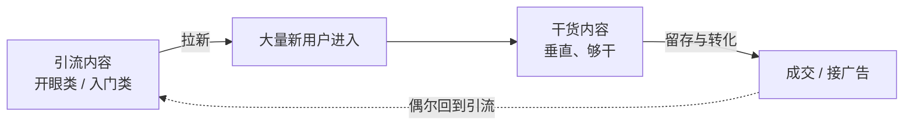

# day04_am · 自媒体内容创作与平台运营全流程实操培训

> [!abstract] 本场定位
> **如果说 [[UXDesignCourse/W1D3_pm_AI辅助形象设计应用、自媒体运营方法论与变现策略复盘]] 讲的是"自媒体是怎么运转的"，那么本场讲的是"具体怎么做一条内容"。**
> **全场围绕三件东西转**：**封面（入口）→ 标题（关键词）→ 布景（活人感）**，最后落到小红书图文与口播视频的实操细节。

> [!warning] 阅读提示
> 本场包含大量**平台运营的灰色手段**（擦边封面、编造段子、刷量、"抄加融合"等）。
> **笔记保留它们，是为了让你能识别套路**——**讲师本人的立场在"21.2 三点动机"里，是把自媒体当作个人影响力的建设工具。**
> **少数涉及具体个人评价、粗俗比喻与擦边案例的原文，已做弱化或去具体化处理，逐条登记在文末 📝 转写勘误表中。**

---

# 一、封面：自媒体的入口

> [!abstract] 本模块是全场的总纲
> **一句话：封面不是"内容的配图"，封面是"内容的门"。**

## 1.1 受众定位：不要人为排除潜在人群

> [!important] 封面最大的浪费，是自己把人群挡在门外
> - **当前封面直接排除了非目标人群**，**例如只针对"想做自媒体的人"，把三十五岁或其他年龄段的人挡在门外**
> - **应把三十五岁人群、五年经验人群等都拉过来，至少不要从主观角度把这些人排除出去**
> - **封面标题应从"0 到 1 起号，精准定位"改为更开放的表述，如"自媒体起号"**

> [!tip] 这条和"精准定位"不矛盾
> **"精准"针对的是内容赛道，不是人群画像。**
> **把赛道说清楚（自媒体起号），把人群放宽（谁都能起号）——两者可以同时成立。**

## 1.2 封面即入口：游乐场大门的类比

> [!example] 常州恐龙公园的大门
> - **大门口立着十几米高的大恐龙雕像**
> - **游客光在门口就能停留半小时左右，拍照、观察、琢磨**
> - **门口的作用是先"勾住"人，让人不自觉地停下来，而不是制造陌生感或关门感**
> - **对受众要保持亲和，让所有人都有意愿进来看看，门票策略也要友好**

## 1.3 封面的核心功能：勾人

> [!important] 关键判断标准
> - **封面要做到"勾人"**——**让人不自觉地走不了，就像游乐场门口的恐龙雕像一样**

> [!warning] 反面做法："敲锣"式吆喝
> - **反面做法是"敲锣"式吆喝（"来瞧一瞧看一看"）**
> - **这种方式只能吸引老头老太太，无法获得优质客源**

> [!important] 正确做法：设置可以"打卡"的元素
> - **设置可以"打卡"的元素**：**如快闪装置、大件小玩意儿、小游戏等，让人自己围上来**
> - **吸引一个小孩就等于吸引两三个大人，加上爷爷奶奶，客源就来了**

> [!tip] 用"儿童游乐场"替换"报幕员"
> **吆喝是"我在卖东西"，布景是"这里有东西可看"。**
> **前者要求观众先有购买意愿，后者只需要观众有好奇心**——**门槛天差地别。**

## 1.4 关键词筛选：头脑风暴式精准打击

> [!important] 与设计中的头脑风暴逻辑一致
> - **通过精准关键词打到精准人群的痛点，让人产生"我看看怎么个事"的冲动**

> [!example] 以土木工程为例
> - **当前标题"土木工程还会好吗"虽然有关键词，但土木从业者自己知道行业现状，标题没有勾人效果**
> - **改进方向：直接了当，如"土木工程已死"；或加入年龄和转型信息，如"28 岁零门槛进 AI 领域""28 岁从零学习互联网设计""进大厂"**
> - **关键词组合**：**土木工程 + 关键年龄信息 + 未来发展之路**
> - **几个关键词同时摆出，不管是想喷的、想骂的、还是觉得互联网也死了的人，都能被勾过来**

## 1.5 关键词在内容中的植入

> [!important] 关键词不只在标题里
> - **关键词不仅要出现在标题中，还要植入到视频内容或文字内容中**
> - **视频前五秒可以直接说："现在做土木工程的，纯找死。我身边所有人全都……"**——**用咋咋呼呼的方式植入关键词**
> - **文字内容（如小红书、抖音的正文）有字数限制**：**需要先归纳成几个点，大标题直接体现关键词，大标题下的小内容再简单展开**

## 1.6 通看与信息层级

> [!important] 人是"通看"，不是逐字读
> - **人在看信息时是"通看"（扫视），不是逐字阅读**
> - **无论是公众号文章还是视频，人都在潜意识里选择性吸收关键词和关键句**
> - **因此必须做文字内容框架**：**先定住几个框架，实际表达时像填空一样 freestyle 即可**
> - **框架是定死的逻辑，中间延展可以自由发挥但不要太啰嗦**
> - **关键框架定住之后，内容效果就能提升。创作者应主动设计内容中有哪几句话、哪几个词是关键，即使 freestyle 时脑子里也在构想**

## 1.7 信息层级的普适价值

> [!important] 不只是设计问题
> - **信息层级不仅适用于设计，对各行业都有影响。例如给领导写 Word 文档汇报，也需要让领导快速看到关键信息**
> - **自媒体是能直接体现"对不对路"的领域**：**一旦对路，效果直接可见；不对路，问题也一目了然，不需要分析就能看出来**

## 1.8 大 V 内容该不该学

> [!warning] 大 V 不是绝对的学习对象
> - **大 V 的内容不是绝对的学习对象，因为他们有粉丝基数和引流优势**
> - **但大 V 中也有值得借鉴的，如"千问办公"案例，关键点直接、一目了然**
> - （**"千问办公"名称待核，见转写勘误表**）

> [!quote] 自媒体比设计更"诚实"
> **"设计做完还有人喜欢有人不喜欢；自媒体哪里不行，一眼就能看出来。"**
> **这句话是本场所有方法论能成立的前提**——**因为它意味着反馈足够快、足够明确。**

---

# 二、封面设计的四大套路

> [!abstract] 四种可以直接套用的封面结构
> **情境设定 / 直截了当 / 大厂测试题 / 场景纵深感。**

## 2.1 情境设定式封面

> [!important] 核心手法
> **模拟一种情境，设定一个角色，让读者脑海中浮现具体画面。**

> [!important] 四个关键要素
> - **一个具体的人**（**设计师、程序员等职业身份**）
> - **干了什么事情**
> - **具体的时间周期**（**年龄、时长**）
> - **一个结果**（**如"5000+""2 万+"等数据**）
> - **效果：形成因果感，激发"吃瓜"心理，吸引点击**
> - **示例**：**"02 年设计师，三四线小城市，创业工作室"**

> [!tip] 为什么是这四要素
> **人、事、时长、结果——正好构成一个微型故事。**
> **缺任何一个都会塌**：只写"设计师"没有结果，读者不知道看什么；只写结果没有身份，读者不知道跟谁比。

## 2.2 直截了当式封面

> [!important] 原则
> - **不要试图把内容所有方面都讲出来，信息过多会导致读者"通看"疲劳**
> - **背景**：**当下社会浮躁，用户习惯跳着看、看解说，必须给读者"他们要看的东西"**
> - **做法：关键词直给**，**如"扣袋子，自由了，美滋滋"**（**原文表述待核，见转写勘误表**）

## 2.3 大厂测试题式封面

> [!important] 手法
> - **利用绝对大厂的品牌效应 + 具体事件**
> - **案例：直播间作业帮测试题、美团测试题、大厂测试题**
> - **效果：对有痛点、感兴趣的受众有较强吸引力**

> [!tip] 为什么"大厂测试题"好用
> **它同时给出了"权威来源"和"可自测的钩子"**——**看到的人会想"我会不会做"。**
> **这是成本最低的一种互动触发器。**

## 2.4 场景纵深感式封面

> [!important] 核心原理
> **利用两个屏幕一前一后，营造空间纵深感。**

> [!important] 具体操作
> - **前面大屏幕放大关键细节**（**标题、主要信息**）
> - **后面屏幕罗列内容**（**次要信息**）
> - **一前一后、一组一次，形成主次信息层次**

> [!important] 底层逻辑
> - **第一空间：你所在的屋子 / 工作空间**
> - **第二场景：充分利用相机广角特点，在二维画面中营造三维感受**

> [!important] 灵活性
> - **不一定需要两个屏幕，一个屏幕也可以**
> - **不一定需要设备，关键是场景和广角**

> [!tip] 这个套路为什么值得重点掌握
> **它是本场反复出现的"主套路"**：**后面案例里的木木师姐、梅梅同学、阿岩的优化方案，用的都是它。**
> **本质上是把"信息层级"这个设计原理，翻译成了摄影构图。**

## 2.5 活人感与角色关系

> [!important] 要点
> - **封面要让人一看就知道是"人在办公""人在互联网行业""某个职业的人"**
> - **场景暗示：好像正在工位上、正在自己工作室里**
> - **效果：建立真实感和代入感**

---

# 三、封面文字设计原则

> [!abstract] 封面上的字，只有四个原则
> **筛选、代入、造概念、换说法。**

## 3.1 筛选性突出关键信息

> [!important] 原则
> - **封面文字不能多，要有筛选性地突出关键内容**
> - **反面案例：信息太杂、太散、太宽泛、太空洞**
> - **具体问题**：**"从零到一做 IP""设计手搓 Skill""保姆教程"等表述过于宽泛，读者无法快速抓住重点**

## 3.2 角色代入感

> [!example] 示例："三年老设计，血泪经验，血泪史"
> - **效果**：**虽然不是直截了当说设计怎么了，但有角色代入感，比空洞的"教程"更有吸引力**
> - **对比**：**纯教程类封面容易让人反感，尤其对已经学了很多东西的用户**

## 3.3 概念创新

> [!important] 换一个小概念
> - **案例："从 0 到 1"已被用烂，改为"从 0 到 N"或"从零到二"，让读者更直白地理解概念**
> - **原则：可以换一换，创造一些好的小概念，不一定都用"从零到一"**

## 3.4 谐音梗与替代表达

> [!important] 规避敏感词的通用手法
> - **案例："土木工程已死"可改为"土木工程已死（拼音）"**，**既规避敏感词，又能让读者 get 到**
> - **原则：用谐音、替代词让读者"get 一下"就能理解**

> [!warning] 这条也可以反向使用
> **模块十二会讲到"自媒体环境的'人人皆懂'现象"**——**谐音梗之所以有效，正是因为它给了读者一个"我看懂了"的错觉。**
> **"看懂"本身，就是一种互动。**

---

# 四、封面案例拆解与实操优化

> [!abstract] 从"是不是好封面"到"具体改哪一笔"
> **本模块是全场上半段最实用的一节。**

## 4.1 一份正反面清单

> [!success] 正面案例：效果好在哪里
> | 案例要素 | 为什么有效 |
> | --- | --- |
> | **红线框选** | **在小红书中用红线框出一个区域，引发"这是咋了？框一个咋的了？"的好奇心**——**本质是筛选关键信息** |
> | **落地升级 5000 多** | **不笼统，有非常具体且与受众实际相关的信息，如"5000 元做文创"**（**原文表述待核**），**让人产生"文创已经这么卷了吗？升级又能升级成啥样？"的冲动** |
> | **裸辞 + 大厂落次** | **前四个字全是关键词，配合大厂调性的图片，营造大厂设计师的感觉**（**"大厂落次"疑为转写错误，见勘误表**） |
> | **千问办公（大 V 案例）** | **提升工作效率，搭建一目了然，关键点直接"三枪"打出，不绕弯子** |
> | **使劲道歉 + 失禁** | **直接勾人，用极具冲击力的关键词让人立刻想点进去看**（**原文表述待核**） |

> [!danger] 反面案例：问题出在哪里
> | 案例 | 问题 |
> | --- | --- |
> | **智能体 + 批量剪辑 + 信息流** | **全是笼统概念**——**智能体太大，信息流不知道剪什么，字又小，几百条内容 get 不到重点，勾不到人** |
> | **史上雕花** | **标题关键词用得好，挺唬人挺炸眼，但标题和封面都没有把具体信息说清楚，两个位置都没起到应有的作用** |
> | **某同学封面** | **加了小标签和封面设计，方向对，但字多且杂，没有做到筛选，一秒钟内映入眼帘的信息太乱** |

> [!quote] 两条清单的共同判据
> **好封面 = 一个具体到能想象画面的信息。**
> **坏封面 = 一堆正确但无法想象的词。**

## 4.2 案例一：02 年设计师封面

> [!important] 诊断
> - **优点：情境设定聪明，有角色、有地点、有事件**
> - **问题：字太小，放的形式不行**

> [!important] 优化建议
> - **"02 年设计师"用大红字，参考之前女生的大红字效果**
> - **"三四线小城市""创业工作室"作为次要信息**
> - **注意大小、层级、错落、排布、位置**

## 4.3 案例二：阿岩的封面

> [!important] 诊断
> - **优点：拍照很会拍，封面上会玩点小套路，有一定经验**
> - **问题**：
>   - **两个屏幕看不出前后关系，像两个并列的笔记本**
>   - **上面区域太多层小标题，视觉上太乱，脑子反应不过来**
>   - **屏幕上的水印需要擦掉**

> [!important] 优化建议
> - **参考师姐的做法，iPad 在前，屏幕在后，一前一后制造遮挡和空间关系**
> - **前面屏幕显示标题和关键信息，后面屏幕显示详细信息**
> - **取景时避开过多层级的区域**
> - **擦掉屏幕水印**

> [!tip] "像两个并列的笔记本"是个典型症状
> **场景纵深感的成立条件是"前后有遮挡"。**
> **没有遮挡 = 两个平面并排 = 空间感消失。**
> **判断方法：把封面缩到很小，还能不能看出前后？**

## 4.4 案例三：梅梅（设计师梅）

> [!example] 一个"套路丢了、流量就掉了"的样本
> - **现状：上课期间发的封面都有套路，流量好；毕业后自己乱发，流量下滑**
> - **套路分析：场景纵深感**——**两个屏幕一前一后，前面放大细节，后面罗列内容，一组一次，主次分明**

> [!quote] 这条案例的价值
> **它证明"流量好"不是因为天赋，是因为用了套路**——**套路不用了，流量就掉。**
> **这也是全场反复强调"套路先行"的最直接证据。**

## 4.5 三个主题封面的优化方案

> [!example] 主题一：「AI vs 手搓」
> - **问题：信息太散**——**"设计手搓 Skill""保姆教程"等关键词太多、太宽泛**
> - **优化方向**：
>   - **上面放"AI"，画一个横向箭头；这边"手搓"（引号），画一条斜线**
>   - **表达"现在都用 AI 了，别再手搓了"**
>   - **更直接、更勾人：AI Agent 或 AI Skill，横线划掉"手搓"**
>   - **加上"设计革命"或谐音梗**
> - **角色代入方案**：**上面是"AI"，底下是"三年老设计，血泪经验，血泪史"**

> [!example] 主题二：「创业坦白局」
> - **问题："坦白局"看不出坦白什么，是经验还是别的**
> - **优化方向**：
>   - **"设计创业，弯路血泪史"**
>   - **"变现经验，怎么做自己的小东西"**
>   - **直截了当，不要绕弯子**

> [!example] 主题三：「从零到一做 IP」
> - **问题：IP 概念混淆**——**是自媒体 IP 还是品牌 IP 设计，需要搞清楚**
> - **优化方向**：
>   - **明确是"从零到一做品牌"还是"从零到一做自媒体"**
>   - **如果是自媒体 IP，就是做账号，不要混淆**
>   - **可以换概念，如"从 0 到 N"**

> [!success] 本模块核心结论
> - **封面要说话**：**通过静态封面传达关键信息**
> - **筛选性突出**：**不能多，即使稍微多一点，也要筛选出关键信息**
> - **避免空洞**：**很多电影大场面都有但看完记不住，就是因为缺少具体情节引人入胜**
> - **场景纵深感是有效套路**：**充分利用小红书封面竖版优势和手机广角优势，在二维维度上让用户感受到三维或大场景的感觉**
> - **活人感 + 角色关系 + 空间场景 + 广角**——**这是封面设计的核心要素组合**

---
# 五、平台特性：为什么封面必须"直给"

> [!abstract] 本模块解释"短视频时代的封面规则"
> **核心差异只有一条：用户从"愿意点开看"变成了"只想看一个词"。**

## 5.1 小红书封面特点

> [!important] 三条特性
> - **公平性**：**相比抖音，小红书更公平**——**所有内容都是同样尺寸的封面、20 字标题**
> - **竞争核心**：**在同一起跑线上，谁能引流取决于用什么小方法**
> - **本质**：**小红书图文虽然形式是图文，但概念上是短视频的概念**

## 5.2 文章时代与短视频时代的区别

> [!important] 用户行为变了
> | 时代 | 标题逻辑 | 用户行为 |
> | --- | --- | --- |
> | **文章时代** | **标题可以绕弯子，如"与麒麟 10 谁得争锋"，读者需要点开看才知道** | **愿意点开探索** |
> | **短视频时代** | **内容太多，用户被"喂刁了"，很浮躁，只想看一个词、一个信息，感兴趣才点** | **扫一眼就走** |
> - **启示：封面不能绕弯子，要直截了当**

## 5.3 多刷自媒体的重要性

> [!important] 给自己"洗一洗"
> - **目的：给自己"洗一洗"，让意识和对认知潜移默化地变成自媒体短视频的认知**
> - **效果：避免按照文章时代的理解去做封面**

> [!tip] 这是一条被低估的建议
> **它不是"多看看找灵感"，而是"重装你的默认判断标准"。**
> **你做的每一个封面决策，背后都是你脑子里那个"什么样的内容值得点"的直觉**——**刷不够，直觉就是错的。**

## 5.4 竖版是首选

> [!important] 竖版 vs 横版
> - **竖版图片在信息流中展示面积远大于横版，横版面积瞬间小一半**
> - **竖版照片展示面积大，更吸引点击；横版即使内容有信心也仅"还 OK"**
> - **推荐尺寸：1080×1440**

> [!important] 横版的局限与补救
> - **横版上传后展示面积小，且背景杂乱时难以裁剪**
> - **竖版拍摄可自然减少杂乱背景，聚焦主体**

## 5.5 主信息模块占比问题

> [!danger] 一个具体的失败案例
> - **当前案例中，主信息模块仅占整个图片的 20%–30%，其余全是大键盘、桌面和背景**
> - **横版正确比例应让主信息成为视觉焦点，通过小图片传递"这个可以看看"的信号**
> - **同一时间刷到时，主信息占比高的图片更显眼**

## 5.6 平台优势需充分利用

> [!important] 一句话
> **每个平台有各自优势，应发挥其最大特点，不要浪费展示空间。**

---

# 六、优秀账号与学习对象

> [!abstract] 四个可以直接去看的账号
> **本模块本身就是一份"作业清单"。**

## 6.1 木木师姐

> [!example] 一批"被引用最多"的内容
> - **特点：上课时发的内容直接红了，很多人引用类似形式**
> - **套路：场景纵深感 + 固定套路**

## 6.2 阿丽同学

> [!example] 简笔记录
> - **特点：吸收了一些好的形式，做得挺好**

## 6.3 线上同学（前 K12 从业者）

> [!example] 简笔记录
> - **经历：之前在学而思或某 K12，学完后去上班，现在完全接广告没问题**
> - **现状：通过自媒体完全自由，all in 自媒体**

## 6.4 海林（师姐）

> [!example] 一个完整的大号样本
> - **小红书账号：搜"海林"**（**账号名与粉丝数据待核，见转写勘误表**）
> - **当前粉丝：33.1 万**（**最高时 40 万**）
> - **不做抖音，因口播能力不足**
> - **2019 年开始做自媒体，2020 年流量起来后辞职全职做**
> - **早期做工具类内容涨粉，后转型个人学习分享**
> - **形式：学习录播快放 + 背景讲解**（**偏女性化、鸡汤风格**）
> - **选题精准，能切中目标人群**
> - **做了 6 年自媒体，运营经验丰富**
> - **小红书官方庆典活动会邀请她参加**
> - **目前粉丝掉了十几万**（**讲师评价为"纯割韭菜"，属个人观点**）

> [!tip] 海林案例里最值得抄的一步
> **"早期做工具类内容涨粉，后转型个人学习分享"**——**这正是模块十一要讲的"引流内容 → 沉淀内容"的阶段切换。**
> **几乎所有能长期做的账号，都经历过这一次切换。**

---

# 七、布景：让观众知道你是个"活人"

> [!abstract] 本模块解决"画面里除了我还有什么"
> **结论：布景不需要复杂，但必须有一件东西在说"我干这行"。**

## 7.1 布景的目的

> [!important] 三条
> - **布景不是追求复杂，而是至少有一个元素能体现个人身份和职业属性**
> - **核心是让观众感知到"你是一个活人"，有职业、有身份、有角色设定感**
> - **布景是一种演绎，传递出职业气质和品味调性**

## 7.2 布景的实操要点

> [!important] 手边的东西就够
> - **不一定要买专门的道具，利用手头现有资源即可**
> - **示例：好看的水杯、小音箱、小耳机、鼠标、话筒、朋友送的小摆件等**
> - **哪怕只有一两件能拿得出手的物品，也要刻意摆放**
> - **细节都是故意设计的，不是随意出现**
> - **示例：一张揉成一团的纸巾放在桌面，也是刻意为之**
> - **可以通过裁切构图来实现布景效果，不一定非要摆放实物**
> - **示例：木木同学利用身后的树做近景远景关系，恰到好处**
> - **按钮、物品的朝向可以微调，让关键元素露出来**

## 7.3 AI 辅助布景

> [!important] 三层用法
> - **现在可以通过 AI 工具生成场景图片**
> - **可用工具：豆包（出图片）、即梦、ChatGPT（每天可生成一张图）**
> - **修图也可通过豆包、即梦完成，不一定手动修**

## 7.4 四个布景案例

> [!example] 案例一：做周边 / 文创的博主
> - **布景方式：摆放各种小玩意儿**
> - **特点：非常会布景，画面有主体物、主元素和辅助元素**
> - **效果：像海报一样，读信息的同时让人完全 get 到做周边的感觉**

> [!example] 案例二：阿里师姐（一期学员）
> - **一期共三个女生做自媒体，第二个月全部接到商业合作**
> - **拍照水平极高，封面冲击力强**
> - **构图逻辑：大标题 + 内容 + 场景，主焦点引导到次焦点，信息一目了然**
> - **数据表现：点赞 3000 多，最终播放量至少达到五六万**
> - **后续：接到华硕广告，三人一起接的**
> - **但后来这些同学都不做了**（**其中一位虽数据很好、点赞 9000 多，也放弃了**）

> [!example] 案例三：男同学（性格浮躁、带点小狂）
> - **布景实在没有键盘鼠标等道具，但依然坚持布景**
> - **看似随意的摆放其实都是故意设计的**
> - **后续也接到了类似保健品 / 小物件的广告**

> [!example] 案例四：梅梅同学
> - **非常会布景，封面图拍得极好，两张图拼接**
> - **从 0 到 1 的典型案例**：**刚开始不自信，样貌普通，不敢出镜，初期都是背对镜头**
> - **2021 年线上课学员，坚持了五年**
> - **目前自媒体收入已可支撑全职投入（all in），估计已辞职**
> - **接到了 3D 打印机的广告**

> [!quote] 四个案例的共同点
> **"会布景"不是"会拍照"，而是"能把职业属性翻译成一个画面"。**
> **梅梅同学五年、从背对镜头到 all in**——**这是本场唯一一条关于"时间"的证据：布景和内容都会，但账号是靠时间滚出来的。**

---

# 八、粉丝量与播放量的关系

> [!abstract] 本模块是全场最重要的"期望管理"
> **结论：对新手而言，播放量是资产，粉丝数不是。**

## 8.1 核心观点：优先关注播放量而非粉丝数

> [!important] 四条
> - **获客靠播放量，不靠粉丝数**
> - **一条内容即使 0 粉丝，只要做到 6 万播放，就已经达到获客目的**
> - **6 万播放中至少 90% 是定向用户，与粉丝无关**
> - **哪怕只有 1/10 的转化概率，有一个品牌方看到就达到目的了**

> [!tip] 这条判断对"接广告"尤其重要
> **广告主买的是"触达"，不是"粉丝列表"。**
> **6 万播放 = 6 万人看到 = 广告可以卖；6 万僵尸粉 = 0 触达 = 广告卖不掉。**
> **这也解释了模块八 8.4 里"有男同学想涨粉提高报价"为什么不是优先事项。**

## 8.2 粉丝多的实际影响

> [!warning] 粉丝多有可能是负资产
> - **粉丝多可能影响后续视频的第一流量池**
> - **但铁粉多不一定带来实际收益，抖音机制可能导致关注后刷不到**
> - **铁粉甚至可能带来负面效果：沙发评论后离开，拉低完播率**（**如 500 播放、完播率仅 3%–4%**）

> [!quote] 与 day03_pm 的呼应
> **"铁粉给不了流量"是 [[UXDesignCourse/W1D3_pm_AI辅助形象设计应用、自媒体运营方法论与变现策略复盘]] 模块十二的核心论断**，
> **本场给出了它的数据后果：沙发评论把完播率拉到 3%–4%。**

## 8.3 粉丝量的实际作用

> [!important] 三条真实价值
> - **影响力：在赛道内的影响力**
> - **变现可能：更多变现方式**
> - **报价选择权：有主动权**
> - **举例：被学校邀请讲课，6 月份去青岛给河北的大学老师讲课，被主办方称为"行业大神"**

## 8.4 个人经历

> [!example] 讲师自己的账号数据
> - **抖音最高 9.9 万粉，再坚持一个月就能到 10 万，但没继续做，现在掉到 7 万多**
> - **当时的目标是与"鲍老师"对赌，看谁先到 10 万粉**（**称呼待核，见转写勘误表**）
> - **对方先做了两个月，所以先到 10 万**
> - **小红书 4.5 万粉左右，内容随心情发，经常存了忘记发**
> - **有男同学反馈报价一条 2000，想涨粉提高报价，但当前阶段涨粉不是优先事项**

---

# 九、账号资产与变现价值

> [!abstract] 一个很多人没意识到的资产
> **账号本身就是可交易的资产，但它同时是"不能卖的生产工具"。**

## 9.1 账号估值与出售逻辑

> [!important] 一次真实的报价
> - **抖音号现状**：**当前账号在 9 万粉丝左右时，曾有人主动询问是否出售账号**
> - **报价信息**：**对方出价 10 万元，折合约 1 元 / 粉丝**
> - **报价逻辑与账号垂直度高度相关**——**该账号内容非常垂直，因此单价较高**
> - **当事人态度**：**仅出于好奇打听价格，并未回复出售意向，明确表示"不卖"**
> - **小红书情况**：**小红书平台上类似账号买卖现象更为普遍**
> - **账号总估值**：**目前所有账号仅出售即可获得接近 10 万元的收入**
> - **不卖的核心原因**：**后续仍需继续使用这些账号。如果卖掉，重新起号成本过高**

## 9.2 账号交易的行业现象

> [!warning] 两条观察
> - **市场上存在专门收购现成高粉丝账号的行为，买家购入后直接转换用途**
> - **有人提出一种运营思路：专门新建一个账号，用套路化内容快速吸粉，然后出售变现**

> [!tip] 换算一下这个模式的真实收益
> **12 万粉 ≈ 10 万元 ≈ 1 元 / 粉丝**。
> **结合模块八"6 万播放就能获客"的结论**——**同样的精力用来接广告，产出远高于养号出售。**
> **这大概就是讲师"不卖"的经济学理由。**

---
# 十、内容方向与人设

> [!abstract] 本模块回答"我该发什么"
> **答案：发能让你被认作"设计师"的东西，而不是发能证明你很厉害的东西。**

## 10.1 避免过于工具属性的内容

> [!warning] 工具属性内容的陷阱
> - **不建议做很空、很干、太工具属性的内容**
> - **虽然流量好（因为图好），但很重，不一定适合所有人**
> - **示例：某 AI 相关内容，关键词"450""457 块 8""做三个月"，有零有整，但过于工具化**

> [!quote] 这段和后面 19.6 是一组
> **"收藏量高不代表内容好，可能只是工具属性强。"**
> **工具属性内容换来的是"收藏"，而收藏在小红书权重表里只有 2–3 分。**

## 10.2 增加广告品牌方可能性的技巧

> [!important] 让产品"自然地"出现在画面里
> - **在布景中放置日常使用的产品**
> - **示例：保健品、熬夜健康食品、瑞幸咖啡杯（好看的一面朝外）**
> - **让品牌方看到合作可能性**

> [!tip] 这就是阿丽拿到华硕广告的同一个动作
> **day03_pm 模块七里，阿丽的成功关键是"内容中自然露出设备（显示器）"。**
> **本场把它变成了一个可复制的布景动作。**

## 10.3 设计师人设的塑造

> [!important] 主页要让人感受到"逼格"和调性
> - **点进主页要让人感受到设计师的"逼格"和调性**
> - **避免让人感觉像修电脑的、开发人员或普通用计算机的人**
> - **通过布景传递品味和职业气质**

---

# 十一、涨粉与内容策略

> [!abstract] 本场篇幅最大的一节
> **它把"内容"分成两类**：**用来拉新的"引流内容"，和用来成交的"沉淀内容"。**

## 11.1 关于粉丝数量的定位

> [!important] 粉丝多确实有用，但对新手价值有限
> - **粉丝多确实有用**：**品牌方会在后台按赛道筛选账号进行投放，粉丝多容易被优先看到**
> - **但对新手而言，粉丝数的实际价值有限，不应过度看重**
> - **涨粉本身很容易**——**只要发特定类型的内容，短期内甚至可能超过导师本人，但"一点用没有"**
> - **核心问题：这类粉丝无法沉淀，内容不具备个人专属属性，谁发都一样**

## 11.2 快速涨粉的"小手段"（可偶尔使用）

> [!example] 两类内容容易涨粉
> - **设计开眼类内容**：**分享国外设计网站、大厂品牌书下载资源等**
> - **零基础快速入门教程类内容**：**容易吸引流量，但缺乏沉淀价值**

> [!example] 导师亲历
> - **早期做抖音时，发了一条推荐大厂网站下载品牌书的内容**
> - **播放量从日常的 500–1000 直接冲到四五万，第一次感受到流量爆发的快感**
> - **结论：这类内容偶尔发一两条即可，用于"打开门"引流，但不能作为主力内容**

## 11.3 内容策略的核心逻辑

> [!important] 一个循环系统
> **引流内容负责"把人拉进来"，干货内容负责"把人留下来"。**

> [!important] 两类内容的角色分工
> - **"太干"的内容**（**高度垂直的专业干货**）**用户基数小，但真正对账号架构有用、能带来成交转化的恰恰是这类内容**
> - **引流内容与沉淀内容的配合**：**偶尔发一条"开眼"类内容打开流量入口，吸引大量用户进来，再用干货内容把用户沉淀住**

## 11.4 内容方向把控

> [!important] 谁负责什么
> - **导师会帮助把控内容方向、内容形式和细节，包括文案用字、框架、模块等**
> - **学员需要自己选好内容方向，确定要发什么内容**
> - **关键思路：不要额外花时间单独想自媒体内容，而是把学习内容直接消化后转化为内容输出**

## 11.5 内容消化与输出的方法

> [!important] 把作业角度换成教程角度
> - **不要把课程内容单纯当作作业分享，而要当作教程去分享**
> - **多吸收其他同学的经验，模拟真实工作场景**（**如"大厂实习中"的状态**）

> [!example] 一个具体案例
> - **有同学每天用笔记记录课程知识点（脑图、关键点）**
> - **导师建议直接发图文**——**两张图即可**
> - **以"今天刚开完周会，又被领导喷了"为角度**——**看似吐槽，实则展示大厂周会的干货内容**
> - **零碎细碎的信息点都可以整理成自媒体内容往外发**
> - **关键不在于发多发少，而在于以什么角度去发当前的内容**

> [!quote] 这句话是本场最实用的一句
> **"关键不在于发多发少，而在于以什么角度去发当前的内容。"**
> **同一份课堂笔记：以"作业"发，是学生；以"周会记录"发，是大厂人。**
> **内容没变，角色变了，流量也就变了。**

## 11.6 优秀内容案例解析

> [!example] 一条被低估的内容
> - **某同学发"实习被领导喷哭，同事告诉我……"的内容，90 多点赞，播放大几千**
> - **当时账号刚起号、没有流量基数，所以流量受限；如果现在发，流量会好很多**
> - **该同学后来用 AI 生成图重做海报，结合过年时间节点，蹭"马年热点"和"红包热点"，发布"用 AI 速做新年运营活动"相关内容**
> - **导师纠正其方向：不要纯分享技能技法，要把个人角色代入进去，做角色模拟 / 角色设定，给自己构建一个全新的角色模型**

## 11.7 角色模拟与标题策略

> [!important] 技能技法不能"干发"
> - **视频内容要分享技能技法，但不能纯分享，必须以个人视角出发做角色模拟**
> - **案例：某同学以"双非（学校）"身份切入**（**原文作"双飞"，见转写勘误表**），**标题形式如"吓哭了""HR 面试""终于转正了"等，构建完整角色叙事**
> - **薪资数字（如"1 万 1""1 万""8 千"）可以灵活调整，不必较真**——**"老子说了算"**

> [!warning] 警惕营销号套路
> - **如"民办本科 0 经验速通大厂"这类标题基本都是机构 / 开课账号**
> - **用的是自己学生的作品和练习，不可信**

## 11.8 关于"抄"的方法论

> [!important] 抄的要点
> - **导师曾提出"设计就是抄"，并发现抄非常好用，已传授给学员**（**如梅梅同学**）
> - **抄的要点：抄完要不一样，还能原创**——**用抄加融合的方法，做到"连他亲妈都不认识"**
> - **不能老用"抄"这一招，用完差不多了就换别的，否则会疲劳**
> - **标题也可以学别人的套路**

> [!tip] "抄加融合"的操作定义
> **不是改颜色、换字体，而是**把三个不同来源的结构拆开，重新组合成一个新结构**。**
> **验收标准就是讲师那句话：**看的人认不出原型。****

## 11.9 标题与封面策略

> [!important] "不断学习"类标题无效
> - **"不断学习"类标题无效**：**你是谁？没人关心你学不学习。除非是马云发"我不断学习"才有流量**
> - **改进方式：加入比对感**——**如"学习一天，刚学一天字体做成这样行吗？"**
> - **让读者产生"学一天就这样了"或"学一天才这样"的认知，有 get 到的点才会点开**
> - **不爱学习的人看到"学习"类内容会直接划走，所以要避免纯学习标签**

## 11.10 作品集整理与营销号识别

> [!important] 常见的编造内容套路
> - **作品集整理类内容中，很多是营销号操作**——**如"小学生作品集"实际是营销号自己做的，家长不可能让孩子做那种东西**
> - **常见假内容套路**：
>   - **教师节礼物出现在垃圾桶里**
>   - **情人节捡到手机**
>   - **月薪 3 千做的图**（**实际是套模板**）
> - **这些内容 99.999% 是自己编的段子，但"他们都会玩"**

## 11.11 反认知类内容

> [!example] 一个具体的反认知钩子
> - **案例："日本动画人也开始用 AI 了"**——**利用反认知制造吸引力**
> - **读者会认为日本有工匠精神、漫画水平高，没想到他们也用 AI**
> - **实际情况可能是：画完后用 AI 做线条优化等某一环节，但标题不说全，制造唬人效果**
> - **这类"奇奇怪怪"的内容值得关注和学习**

> [!tip] 反认知的本质是"打破一个默认假设"
> **观众脑子里默认"日本动画人不用 AI"，你把这条假设打破，好奇心就自动产生。**
> **所以做反认知内容的第一步，是先找到一个"大家都默认但其实不一定"的假设。**

## 11.12 高流量内容的共性

> [!important] 两个例子
> - **"干了两天，88 个真正有用的死记"**：**很唬人，让人想看**
> - **"面试复盘 SOP"**：**注意"SOP"这个词会筛掉一部分不懂的潜在读者，可以加一些解释性词汇（如"SOP 关键流程""薪资直接翻倍"）降低理解门槛**

> [!success] 共性总结
> **高流量内容的核心：真正帮读者节省时间、提升效率。**

## 11.13 封面与标题的组合逻辑

> [!important] 一个类比
> - **封面营造一个场景，标题文字打造角色设定，两个关键信息结合**
> - **类比：封面是"门"，标题是"门头"，你拿个大喇叭怎么喊决定了别人进不进来**
> - **哪怕用夸张手段把人骗进来，只要踏进来了就达到目的了**——**买不买是下一步的事，但前提是里面必须有内容，不能光有一张封面**

> [!warning] 一个被玩坏的数字
> - **案例："30 岁我失业了两次"**——**这类标题很吸引人，但同一个人在不同内容里一会儿 30 岁一会儿 33 岁，说明都是瞎编的**
> - **小红书环境被这帮人搞臭了，但没办法**
> - **观察：有人特别喜欢"30"这个数字（30 岁、30 国、三十天），"三十是个坎儿"**

## 11.14 品牌认知

> [!important] 一句话
> - **品牌是自己磨出来的，不是靠偶尔尝试做一点内容就能建立的**
> - **有些人会做但做得不多，知道苗头但不够深入**——**这是不够的**

---

# 十二、标题写作的核心原则

> [!abstract] 本模块是全场的"硬规则"
> **20 字，是小红书的物理极限，也是内容筛选能力的放大器。**

## 12.1 20 字限制的底层逻辑

> [!important] 三条
> - **小红书标题限 20 字，平台刻意限制字数，说明标题极其重要**
> - **需慎重处理每个字，甚至删除标点、切换英文标点以节省字符**（**中文标点后自带空格**）
> - **每个字、每个词都必须是精华和关键词**

> [!tip] 这是一道"免费的压力测试"
> **给你 20 字，你会被迫选出最重要的信息。**
> **反过来说：如果 20 字都填不满还想加字，说明你还没想清楚要说什么。**

## 12.2 宽泛关键词必须具体化

> [!danger] 反面案例
> **"0 粉起号""小红书账号搭建""不走弯路""0 到 1"**——**太宽泛、不具体。**

> [!success] 正面示范
> **"三年，某滴、某团、某 T 某四字大厂设计师，两年自媒体弯路血泪分享"**——**每个词都是关键信息。**

> [!important] 账号搭建类标题要明确四件事
> - **什么赛道**
> - **怎么搭建**
> - **是否变现**
> - **内容方向**

## 12.3 零基础类标题需绑定具体身份

> [!important] 从"宽泛"到"具体"
> - **"零基础学习设计第一天都干了什么"方向对，但"零基础"太宽泛**
> - **应具体到数字和身份**，**如："30 岁零基础，All in 设计学习第一天"**
> - **类似案例：35 岁宝妈重新入行**——**标题必须落到具体数字和具体身份上**

## 12.4 标题具体程度直接影响流量与受众

> [!important] 三重影响
> - **关键词具体到什么程度，决定内容有多少人看、什么样的人来看**
> - **品牌方也会审视内容是否垂直、受众是否精准**
>   - **例如阿里品牌方曾评价某内容："很垂直，流量第一，点赞好，都是我们的受众人群。"**
> - **标题体现筛选信息的能力，团队负责人看到标题即可判断内容是否会发、是否会归纳整理，进而影响对设计师专业素养的评价**

> [!quote] 这一条把"做自媒体"和"职场评价"接上了
> **在职场里，你的标题能力会被当作"信息筛选能力"来评估。**
> **这也呼应了模块一的"信息层级不只适用于设计"。**

## 12.5 避免"教程 / 教学"姿态

> [!important] 换一个姿态
> - **不要直接写"教程""经验分享"，会让不想学习的人直接划走**
> - **正确姿态**：**"零基础没问题，抄就行，跟着我来做""我的学生都怎么怎么样了"**——**以陪伴和示范代替教学**

## 12.6 自媒体环境的"人人皆懂"现象

> [!important] 无论你多专业，都有人挑刺
> - **无论行业地位多高，在抖音 / 小红书都有人挑刺**
> - **案例：国宾护卫队走正步，弹幕有人指出"胳膊没抬到位"；UFC 中国选手赢了比赛，仍有人评论"姿势错了""技术运用不对"**
> - **因此内容设计需模拟具体设定，预判并利用这种"找喷点"的心理**

---

# 十三、引流内容的边界与真相

> [!warning] 阅读前提示
> 本模块记录的是**平台上真实存在的引流手法**。
> **笔记保留它们，是为了让你能识别**——**讲师在模块二十一里也说明了推动学员做自媒体的正面动机。**

## 13.1 擦边封面是纯营销手段

> [!danger] 案例类型：利用职业背景制造吸引力
> - **以"住院日常"类封面为例，利用工牌、大厂背景等元素制造吸引力，男女受众都会被勾起好奇心**
> - **这类内容多为摆拍**：
>   - **工牌可自行打印**
>   - **名字故意模糊**
>   - **场景无法核实**（**如某大厂数万员工无从查证**）
> - **本质是"纯擦边、纯营销、假的"，目的仅为把人"勾进来"，点击即达成目标**

> [!example] 同类案例
> - **"不饱和月入过万，985 大学女大两份副业日常"**——**图片好看即是副业，内容无干货，以自我展示为主**

> [!note] 一个补充观察
> - **帅哥类封面没有同等的引流效果，难以形成类似的点击驱动力**

## 13.2 纯营销号与无偿内推的套路

> [!important] 两种套路
> - **猎头类账号纯靠内容拉人，无账号设定**
> - **"无偿内推"类帖子下 1000 多条留言，实际无法逐一回复，目的是让用户留言做数据**
> - **留言权重最高**（**与分享同为四五级权重**），**点赞权重最低**（**一级**）**，因为点赞可刷，平台不给予高比重**

> [!tip] 用 day03_pm 的权重表交叉验证
> **[[UXDesignCourse/W1D3_pm_AI辅助形象设计应用、自媒体运营方法论与变现策略复盘]] 记的是小红书权重（关注 5 / 评论 4 / 转发 4 / 收藏 2–3 / 点赞 1）。**
> **本场补充了原因**：**点赞可以刷，所以平台不给高权重。**
> **"无偿内推"就是把这个权重差直接变现成了数据。**

## 13.3 刷量已失效

> [!warning] 一段亲身经历
> - **早年（2020 年做小红书时）存在刷赞服务，约 100 元刷 100 赞**
> - **刷上去后第二天即被后台大数据 / AI 大模型识别并清零，白花钱，且刷量方无法追责**
> - **结论：刷量现在已完全没用**

---
# 十四、小红书图文创作与运营

> [!abstract] 本模块是下半场的操作主体
> **从"套路先行"这个总原则，一直落到文案、命名、互动数据。**

## 14.1 核心方法论：套路先行

> [!important] 两条
> - **苹果手机买来后底下有说明书，但很多人不知道**——**因为很多东西不需要学，套路对了自然就会了**
> - **套路的核心逻辑：大家怎么做你就怎么做，除非你有把握用别的方式也能成功，否则必须遵循主流做法**
> - **以设计为例，一百个案例里找不到第二个特例时，就必须跟随主流**
> - **主流做法示例：屏幕展示时焦点要大、键盘区域要缩小，不要露出过多无用内容**

> [!quote] "套路"不是贬义
> **套路 = 已经被市场验证过的默认解。**
> **在你还不知道为什么之前，先按套路做；等你能解释"为什么这套路有效"了，才有资格改它。**

## 14.2 小红书图文内容结构

> [!important] 封面与图片策略
> - **图片不要纯铺上去，纯图片对用户感知力不够，用户截个图就走了**
> - **每张图至少要有一个点让用户琢磨一到三秒钟，甚至更长，这样才能保证停留时长**
> - **小红书后台会监测每张图片的停留时长和完播时长，数据会反馈到推送机制中**
> - **有知识点的图片尽量往前放，放在前面几页，不要往后放，否则用户划不到后面就不看了**
> - **最好每一页都有一些小知识点，哪怕五张里有一张能让人有收藏、点赞或下载欲望的图也行**

> [!tip] "每页至少一个琢磨点"是可以量化的
> **一个页面的阅读时长目标：1–3 秒。**
> **低于 1 秒 = 用户滑过去了；超过 3 秒但信息是废话 = 用户失去耐心。**
> **设计每一页时，先问"这一页让人停几秒"。**

## 14.3 内容排版要求

> [!important] 五条
> - **不需要复杂设计，不需要专业排版，规规整整、规规矩矩即可**
> - **第一页可以放参考来源或小知识点，第二页开始设计小步骤，简单罗列即可**
> - **实际做的内容可能比展示的复杂得多，或者根本没按步骤做，但展示出来要像模像样**
> - **可以放截图，配上文字说明**，**比如"这个教程帮我出两个"，用豆包等 AI 工具转成文字即可**
> - **图片上可以标注网站名称、素材库特点、使用场景、被多少人使用等信息，带一个小网址即可**

## 14.4 账号命名策略

> [!important] 起名三原则
> - **名字尽量不要超过五个字，四五个字左右最佳**
> - **要朗朗上口，不能是生僻字，要能马上写出来、打出来**
> - **名字要有独特性，不能太通用，否则搜索时会被淹没**
> - **反面案例：男生起的名字多偏中二风格，不够显眼，不容易被记住**
> - **正面案例："锤锤""Kitty""温酒大人"等名字独特且好记**

> [!important] 个人标签打造
> - **以"果冻秀秀"为例**：**单独叫"果冻"搜出来有小孩、有狗、有自媒体，辨识度不够**
> - **加上"秀秀"作为限定词后，搜"果冻秀秀""秀秀""设计秀秀""果秀秀"都能找到，形成个人标签**
> - **核心逻辑：名字要能成为可搜索的标签，增加被找到的概率**

> [!tip] 起名的验收标准
> **搜一下这个名字，第一页有没有别的东西。**
> **有 → 加限定词；没有 → 可用。**

## 14.5 小红书文案与 AI 工具使用

> [!important] 文案字数与格式
> - **小红书正文限制 1000 字，不超过即可，不会有人机感**
> - **文案中要加入 emoji 表情，标题要清晰，内容要完整归纳总结**
> - **底部标签也要规划好，AI 可以帮忙生成标签建议**

> [!important] 给 AI 提需求的正确方式
> - **给 AI 提需求时要具体：要求像某几个账号的风格一样提炼、筛选、总结，加入 emoji 表情**
> - **可以要求 AI 梳理几个标题，带上 emoji，内容文字完整归纳总结，不超过 1000 字**
> - **可以要求 AI 同时给出底部标签建议**
> - **豆包可以直接生成文档，功能已经比较成熟**
> - **豆包生成的内容如果太啰嗦，可以让它再归纳总结、压缩**
> - **豆包生成后如果觉得太概括，可以让它再展开或调整**

> [!important] 多 AI 工具配合策略
> - **豆包相当于"100 米短跑选手"，日常使用快捷高效，没毛病**
> - **ChatGPT 相当于"十项全能选手"，需要兜底或深度优化时使用**
> - **操作流程：豆包生成初稿 → 复制到 ChatGPT → 让它优化成高赞风格的内容**
> - **这种"人剑合一"的多 AI 配合方式效果很好**
> - **可以让 AI 根据点赞量高的内容总结套路，按照高赞套路来生成内容**

> [!important] AI 训练与磨合
> - **使用 AI 的前提是以后干啥都用，强行用 AI 干就行了**
> - **要不断给 AI 提需求、筛选结果、再反馈，逐步训练它理解你的风格**
> - **示例：让 AI 出标题，20 字以内；筛选出几个后再告诉它要加入哪些元素，逐步磨合**
> - **核心逻辑：让 AI 听你的话，需要反复磨合和训练**

## 14.6 互动与数据优化技巧

> [!warning] 以下属于"数据运营"动作
> - **转发内容给朋友时，要提醒对方"一定要滑到最后"，不要只点个赞就划出去**
> - **点赞后要先滑到最后，停留一会儿，让系统判定为有效互动**
> - **后台数据会监测停留时长和完播率，这些数据影响推送效果**
> - **封面标题能保证流量和推送，内容质量能保证播放和停留**

> [!quote] 最后一句话是整节的骨架
> **"封面标题保证推送，内容质量保证停留。"**
> **前者决定"有没有人看到"，后者决定"平台愿不愿意继续推"。**
> **两者是乘法关系，缺一个都是零。**

## 14.7 内容创作完整形态

> [!important] 两个层次
> - **最完美形态**：**样式和内容都像优秀案例一样丰富，能保证用户进来就有得可看**
> - **如果内容量不够，可以像师姐们一样，做到规规整整、有归纳总结整理即可**
> - **师姐们的做法**：**稍微规整地归纳总结，放很多截图，文字简单排版**
> - **截图内容可以直接用 AI 转成文字**，**比如"这个教程帮我出两个"，豆包都能处理**

## 14.8 关于抄袭与原创

> [!warning] 抄，但别只抄一个人
> - **可以抄，但不要都抄同一个人的，否则会有局限**
> - **师姐们之前都抄同一个人的内容，被指出后有所调整**
> - **核心是参考优秀案例的套路，但要有自己的归纳和整理**

## 14.9 个人 AI 使用经验分享

> [!example] 一份"强行用 AI"的日常清单
> - **去年年初对 AI 感受还不深，今年开始大量使用，已经形成一套成熟的使用逻辑**
> - **使用场景举例**：
>   - **玩游戏时用 AI 找教程**
>   - **看到热点事件（如抖音上的瓜）用 AI 了解来龙去脉**
>   - **抖音直播间截图问 AI 是什么游戏、能不能买、怎么玩、去哪买、游戏属性、适不适合自己**
>   - **吃饭时拍麻辣烫问 AI 这一袋多少大卡，输入身材数据问能吃多少**
> - **核心原则：生活、工作、娱乐中各种问题都可以问 AI，强行用 AI 解决**

> [!tip] "强行用"是唯一的训练方式
> **和 14.5 的"AI 训练与磨合"是一件事**：**你不是在学提示词技巧，你是在让 AI 熟悉你的表达习惯。**

---

# 十五、小红书账号运营策略

> [!abstract] 本模块把"运营"落到一个具体账号上
> **讲的是一位"土木转设计"学员的账号该怎么规划。**

## 15.1 账号垂直度问题

> [!important] 现状分析
> - **账号内容涉及土木、设计、互联网求职，虽看似跨领域，但仍在职业转型的大范围内，标签不会过于混乱**

> [!important] 内容规划建议：四步走
> 1. **分享土木相关内容**
> 2. **分享转行经历（土木转设计）**
> 3. **分享求职目标（互联网 1.8 万月薪）**——**已有清晰思路，前两步已完成**
> 4. **分享土木转行的方法和思路，可反复分享不同角度**
> - **活人感营造：偶尔发布与主业稍有关联的生活内容，营造真实人物 IP，但不能完全脱离垂直领域**

> [!tip] 这四步其实是一条完整的叙事弧
> **"我原来是谁" → "我怎么变的" → "我变成了谁" → "你也能变"。**
> **这正是 day03_pm 模块九里那条"三大点框架"的长线版。**

## 15.2 小红书平台特性：女性友好

> [!important] 三条
> - **女性友好平台**：**女性用户之间互动极强，存在无条件信任的氛围**
> - **内容风格建议**：
>   - **女性向内容**：**模拟拉家常语气，加入情绪表达（如"今天不开心""求安慰"），吐槽式分享踩坑经验效果极好**
>   - **男性向内容**：**保持稳重、专业，适当融入关键词信息，也可模拟女性喜欢的表达方式**
> - **用户行为特点**：**平台上女性用户看到推荐会立即行动并反馈，互动率极高**

> [!note] 一条务实的提醒
> **"模拟女性喜欢的表达方式"是讲师对男性创作者的建议，属于平台观察层面的经验，不代表唯一正确做法。**

## 15.3 图文内容排版要求

> [!important] 四条硬指标
> - **标题**：**需带符号筛选，控制在 20 字以内**
> - **正文文字量**：**每页最多两三行，避免大片文字堆砌**
> - **页数要求**：**至少 4–6 页，太少则内容缺乏可看性**
> - **首句技巧**：**可加入情绪化表达，如"今天不开心，撅嘴，又让我工作到 7 点"**
> - **AI 辅助排版**：**可使用豆包、即梦 Agent 等工具，将内容排成竖版、归纳总结、生成图片**（**"集梦 Agent"疑为转写错误，见勘误表**）

## 15.4 图片内容要求

> [!important] 四条
> - **场景感**：**利用工作环境中的显示屏、电脑等设备，营造设计师 / 职业状态**
> - **道具摆放**：**放置 1–2 个有品质感的电子产品或小物件，体现价格感和品味**
> - **停留时间**：**确保每张图能让用户停留 2–3 秒，避免纯产品图无内容可看**
> - **产品图优化**：**可摆拍得好看，或用 AI 处理美化**

## 15.5 发布时间策略

> [!important] 时段与原则
> - **推荐时段**：**早上 6–7 点（通勤刷手机）、晚上 7–8 点（下班后刷手机）**
> - **个人数据参考**：**后台会显示最佳发布时间，需根据自身账号数据调整**
> - **竞争因素**：**热门时段流量大但竞争激烈，冷门时段流量少但竞争小**
> - **核心原则**：**内容足够强时，发布时间影响不大，想起来就发也可以**

> [!tip] 冷热时段的取舍逻辑
> **热门时段是"分母大、分子也大"，冷门时段是"分母小、分子小"。**
> **你的内容越强，越应该去热门时段抢；内容越弱，冷门时段越容易露头。**

---

# 十六、口播视频拍摄指南

> [!abstract] 本模块是一份可以照着做的拍摄 SOP
> **设备只需要一台手机。**

## 16.1 拍摄工具与准备

> [!important] 四件事
> - **推荐工具**：**使用剪映 App 的"提词拍摄"功能**
> - **VIP 购买**：**通过拼多多购买剪映 VIP，约 100 多元 / 年**
> - **设备**：**手机前置摄像头即可**
> - **提词设置**：**控制滚动速度放慢，字号大小影响不大**

## 16.2 拍摄状态与技巧

> [!important] 六条
> - **核心原则**：**不要让人看出在念稿，保持自然的人物状态**
> - **避免呆板**：**专注读文字时容易显得呆滞，失去人物感**
> - **自然动作**：**可以挠头、摸东西、手里拿点物品，保持随意感**
> - **节奏控制**：**语速慢一点没关系，剪映中可以加速处理**
> - **多次拍摄**：**前一两遍用于找节奏，多拍几遍即可找到感觉**
> - **分段录制**：**可以断开分段录制，不满意直接删除重录，最后导入剪映编辑**

## 16.3 美颜与形象管理

> [!important] 开什么、不开什么
> | 功能 | 建议 |
> | --- | --- |
> | **磨皮** | **适当开启**——**改善皮肤状态和黑眼圈** |
> | **皮肤焕白** | **可用**——**与磨皮不同，可整体提亮肤色，适合灯光不好的场景** |
> | **口红** | **稍微加一点**——**增加嘴唇血色** |
> | **瘦脸 / 大眼** | **不建议开启，保持自然** |
> - **理念：好的形象状态能影响观众，属于个人管理的一部分**

## 16.4 口播内容要点

> [!important] 五条
> - **语气自然**：**像跟朋友说话一样，不要刻意做作**
> - **情绪放大**：**在正常说话基础上，情绪稍微放大，注意重音即可**
> - **逻辑优先**：**不需要过度炸呼，逻辑通顺即可**
> - **结尾埋点**：**不要直接结束，可以总结要点或预告下期内容，引导持续关注**
> - **自我优化**：**录完自己听一遍，发现做作的地方及时调整删减**

> [!quote] "录完自己听一遍"
> **这是成本最低、效果最直接的一条建议**——**它几乎能修掉 80% 的"做作感"。**

---

# 十七、内容形式与差异化

> [!abstract] 本模块解决"图文还是视频"
> **结论：视频的效率更高，但口播有门槛。**

## 17.1 脱口秀 / 口播形式

> [!important] 优劣
> - **优势：差异化强，演绎好效果显著**
> - **风险：演绎不好容易显得做作**
> - **关键：保持与日常说话一致的状态，情绪稍微放大即可**
> - **参考案例：胖老师等账号视频不炸呼，但逻辑通顺即可**（**称呼待核，见转写勘误表**）

## 17.2 图文 vs 视频

> [!important] 效率对比
> - **视频优势：拍摄后直接剪辑，比图片拍摄 + 修图更高效**
> - **当前趋势：女性用户多发图片，男性创作者多转向视频，以垂类内容为主**

## 17.3 小红书 vs 抖音：讲师的个人路径

> [!example] 一条"抖音带小红书"的路径
> - **先做小红书两三个月，积累 5000 粉后停滞**
> - **转做抖音半年，找到新形式**
> - **将抖音内容搬运回小红书，"发一条爆一条"**
> - **小红书粉丝完全靠抖音内容带起来，无额外技巧**
> - **原因：讲课风格"咋咋呼呼"但内容有实质，在小红书属于新颖形式**

> [!example] 两个平台的使用习惯差异
> - **小红书风格与抖音差异较大**
> - **初期做小红书时还在研究，后来做视频后去掉图文直接发视频**
> - **小红书发布随心情，不同步发布**
> - **以前也玩图文，但发完图文后，视频更直接干脆，后来转向视频内容**

> [!tip] "形式新颖"本身是一种红利
> **同一种内容风格，在抖音已经饱和，在小红书可能还是新鲜的。**
> **跨平台搬运之所以有效，本质上是在吃"风格的时间差"。**

---
# 十八、AI 工具使用与评价

> [!abstract] 本模块是一份工具选型清单
> **结论：国内场景用豆包，兜底和深度优化交给 ChatGPT。**

## 18.1 主流 AI 工具对比

> [!important] 四个工具
> | 工具 | 定位 | 使用门槛 |
> | --- | --- | --- |
> | **豆包** | **适合简单搜索场景，使用便捷** | **无需翻墙，手机直接打开即可使用** |
> | **Deepseek** | **定位为"丐版 ChatGPT"，整体表现尚可** | **国内可用** |
> | **ChatGPT** | **综合能力最强** | **需要翻墙使用，操作上较为麻烦** |

> [!warning] 豆包的局限
> - **深度内容处理能力不足，会出现错误后道歉再纠正的情况**
> - **体验类似"先忽悠再被看穿"**

## 18.2 豆包的实用场景

> [!example] 三个高频用法
> - **医疗辅助**：**拍摄验血报告后，可分析血液问题、推荐后续就诊科室、具体医院、药物信息、国外临床数据及实验情况**
> - **日常决策**：**遇到问题先通过 AI 查询，基本能解决大部分痛点，方便快捷**
> - **资料查询**：**AI 三十秒即可完成人工长时间分析的工作量**

> [!warning] 关于"医疗辅助"这一条
> **原稿记录的是讲师的使用场景，此处保留原意。**
> **AI 输出的健康与医疗信息不能替代专业诊断，请以医生意见为准。**

## 18.3 小红书内容搜索建议

> [!important] 抓取能力差异
> - **ChatGPT 等国外工具抓取小红书数据能力较弱，受 IP 地域限制**
> - **豆包或 Deepseek 在抓取国内平台数据方面更有优势**
> - **搜索时需要指定具体赛道，结果会更精准**

---

# 十九、作品修改建议与创作指导

> [!abstract] 本场最后一份系统性指导
> **七个部分，其中"变现方式分析"和"发布与迭代策略"尤其值得单独看。**

## 19.1 标题与定位策略

> [!important] 避免笼统表述
> - **不要用"零基础""干货"这类泛化词汇，缺乏辨识度**

> [!important] 强调个人具体经历
> - **"入行一年，给大厂做了个品牌形象"**
> - **"打杂全过程" / "草图环节全过程" / "草稿阶段全过程" / "第一版方案全过程" / "辅助主视觉全过程"**

> [!important] 用痛点替代教程感
> - **示例："小白做两个月，给公司品牌形象返稿十次"**
> - **示例："做品牌给我哐哐掉头发" / "大厂实习才一个月，做了个品牌需求，哐哐流鼻血"**
> - **核心原则：标题点到即止，让读者自行脑补细节，不要写成完整教程**

> [!important] 内容定位
> - **代表自己，不代表所有人**
> - **从文字中能清晰看到定位**（**如"辅助主视觉全过程"**）
> - **可借助 AI 辅助优化标题，但需避免过于笼统的课程感**

## 19.2 封面与视觉设计
    
> [!important] 贴纸风格
> - **贴纸风路子正确，但需注意**：
>   - **清晰度要提升，避免模糊**（**原稿的比喻过于粗俗，此处已做净化处理**）
>   - **贴纸不要加太多，两行左右即可**
>   - **删除不必要的中间元素**

> [!important] 图片构图
> - **人物与场景**：
>   - **头可以放边上，露出显示器，压着一点点即可**
>   - **不必全身入镜，可裁剪为竖版**
>   - **黑板等背景不必全部拍上，保留想象空间**
> - **文字图片建议**：
>   - **不建议每张竖版图都堆满文字**
>   - **纯文字图片用户划两下就离开，停留时间短**
>   - **可让 AI 生成占位素材图替代纯文字**
>   - **文字需概括提炼，当前文字"不概括，没有提炼"**

> [!important] 封面与标题关系
> - **封面用 live 图（动态图）可增加吸引力**
> - **若封面无法放标题，标题文字需着重设计，要"勾人"**

## 19.3 内容形式与平台策略

> [!important] 三条
> - **纯文字图片不建议，用户停留时间短**
> - **工具属性太强的内容缺乏"账号感"**
> - **营销号式内容可偶尔做一两个，但不宜过多**
> - **核心方向：打造个人影响力，结合自身经历建立账号属性**

## 19.4 变现方式分析

> [!important] 一、知识付费（低价课）
> - **几块钱的课，卖一万份就是十万**
> - **用户因价格低不会退款，"学不好都赖我自己"**
> - **属于"纯赚纯割"模式**
> - **对当前阶段"没啥用"**

> [!important] 二、平台推广合作
> - **模式**：**平台付费（几千元），创作者分享内容时将工具 / 网站替换为广告商平台**
> - **操作方式**：
>   - **视频广告**：**广告商提供操作演示视频，创作者只需念稿**
>   - **图文广告**：**广告商提供完整脚本（文字怎么说、怎么列、怎么罗列），创作者负责封面拍摄和标题**
> - **案例**：**海林接的图文广告，广告商直接给文档脚本**
> - **本质："借你流量用的"，广告素材由广告商准备好**
> - **前提：流量起来后，广告商会主动找上门**

> [!important] 三、个人品牌价值
> - **像海林那样建立专业形象，对找工作有帮助**
> - **能接广告，也能提升个人价值**
> - **以结果为导向，持续输出专业内容**

> [!tip] 三种变现的"重"与"轻"
> **低价课：最轻，但拿不到信任资产。**
> **平台推广：中等，本质是出租流量。**
> **个人品牌：最重，但可迁移到找工作、接私活、讲课。**
> **讲师说前者"没啥用"，理由就在这里。**

## 19.5 发布与迭代策略

> [!important] 发布节奏
> - **小红书效果判断周期：约一天左右**
> - **没效果可隐藏后重新发布**
> - **同一条内容可反复发布多次，不影响流量分发**
> - **每次发布面对的人群不同，不存在重复问题**
> - **重新发布时需优化封面和标题**

> [!example] 一个成功案例与它的教训
> - **男同学案例**：
>   - **第一条内容直接爆了，点赞 9000+**
>   - **内容：用 AE 做品牌动态导视（作业内容）**
>   - **封面使用苹果 live 图，长按有动效**
>   - **标题着重设计，勾人**
>   - **两天后有动态网站平台找他推广，报价 500 多元**
>   - **他因作业未接**
>   - **后续几条数据也不错，但老师不再指导后，点赞降到几十个**
> - **教训：需要总结火的原因，否则无法持续复制**

> [!quote] 这条教训与 day03_pm 的"流量偶然性"完全一致
> **爆款是概率事件，能复制的只有"套路"，不是"结果"。**
> **这位同学的数据从 9000 掉到几十，不是能力下降，是没人替他分析为什么火。**

## 19.6 核心方法论

> [!important] 一、学习与沉淀
> - **反复循环：自己弄 → 看别人形式 → 再自己弄 → 再看别人**
> - **知识点"知道是这么回事"和"真正 get 到"是两回事**
> - **真正开始做的时候才会恍然大悟**

> [!important] 二、设计理念
> - **"平庸才是最大的硬伤"**
> - **做品牌、给甲方做品牌，甲方不看设计好坏，看品牌特点**
> - **要有特点，有业务价值**
> - **不要追求完美**

> [!important] 三、内容创作原则
> - **不要做得太"营销号"**
> - **工具属性太强的内容缺乏个人感觉**
> - **收藏量高不代表内容好，可能只是工具属性强**
> - **对个人来说，打造影响力和账号感比单纯流量更重要**

## 19.7 当前作品具体修改建议

> [!important] 文字问题
> - **文字太小，手机上可能需再缩小 1/3 比例**
> - **文字不概括，没有提炼**
> - **建议将文字总结后放到底下，而非每张图都堆文字**

> [!important] 图片问题
> - **当前图片"有点像摆拍"**
> - **建议裁剪为竖版，不必全拍上**
> - **人物头往边上移，露出显示器**
> - **清除画面中多余元素**

> [!success] 创意肯定
> **"挺有创意的"，同学们的想法不错。**

---

# 二十、技法本质与学习观

> [!abstract] 一段方法论层面的收束
> **把"技法"和"套路"彻底画上了等号。**

## 20.1 所有技法都是套路

> [!important] 核心观点
> - **任何技法层面的东西全是套路，与是否零基础无关**
> - **套路对了就有效，套路不对再学也没用**
> - **类比：现在没人买手机还需要学怎么用**——**好的设计 / 内容应让人自然上手**

> [!quote] 这个类比值得展开
> **"买手机不用学"是因为有人替你做了决定。**
> **做内容也一样**：**你替观众做的决定越多（封面给什么、标题说什么、第一页放什么），观众越不需要"学"怎么看你。**

---

# 二十一、自媒体作业与课程动机

> [!abstract] 一节课的"元交代"
> **讲师在这里说明了自己为什么要推动学员做自媒体。**

## 21.1 当前作业进展

> [!note] 今日安排
> - **今天的作业已基本改完**
> - **今晚新增任务：整理自媒体内容。要求先找参考、排大纲，差不多就发，不预设标题和拍摄要求**
> - **有女生学员拍得好，老师评价"这个好看，行，发发试试"，以实践驱动成长**

## 21.2 老师推动学员做自媒体的三点动机

> [!important] 按讲师自述的优先级
> 1. **验证自身案例是否可复制，探索能否按自己的形式帮他人起号**
> 2. **实现个人影响力，证明个人价值（赚钱排第三第四位），包括获得学员认可**
> 3. **探索学员自媒体起来后的其他变现可能性**

> [!quote] 这段交代让前面所有"套路"换了一个读法
> **它说明讲师推的不是"流量生意"，而是"用自媒体验证一套方法论能不能复制"。**
> **读前面那些灰色手段时，可以带着这句一起看。**

---

# 二十二、软件操作指导

> [!abstract] 一段独立的工具操作讲解
> **内容是设计软件的锚点与钢笔工具操作。**

## 22.1 学习安排

> [!note] 课堂安排
> - **下午需要寻找学习相关内容，从关注列表中查找**
> - **鼓励成员之间平时多讨论、多分享经验**

## 22.2 AI 工具操作教学

> [!important] 添加锚点
> - **当前使用的 AI 工具打开后默认状态即为当前显示状态**
> - **界面中存在"高亮"功能，位于特定位置**
> - **先选中目标对象，使其处于高亮状态**
> - **高亮后箭头图标会发生变化**
> - **直接拖动高亮对象，内部会自动添加类似杠杠的标记，完成锚点嵌入**

> [!important] 钢笔工具
> - **使用钢笔点击某个区域时，选择范围会自动缩小，聚焦到特定区块**
> - **该功能被强调为"比较重要"**

> [!important] 操作恢复
> - **如果操作失误（如转错方向），无需担心，几分钟后会自动恢复**
> - **也可以手动调回后重新练习一遍**

---

# 二十三、后续安排与待办清单

> [!success] 共 70 条，按主题分组
> 为便于执行，已将原稿的 70 条待办按主题重新分组，**内容未做增删**。

## 23.1 封面与标题

- [ ] 将封面标题从“0到1起号，精准定位”改为更开放的表述（如“自媒体起号”），避免人为排除三十五岁等潜在人群
- [ ] 针对土木工程类内容，重新设计标题关键词组合，加入年龄信息和转型方向（如“28岁零门槛进AI领域”）
- [ ] 在视频前五秒植入咋咋呼呼的关键词话术，确保关键词在内容框架中反复出现
- [ ] 整理文字内容框架：先归纳大标题关键词，再展开小内容，适应小红书/抖音的字数限制
- [ ] 筛选参考案例时，跳过点赞量低（如19个点赞）的内容，只研究流量好、效果好的案例
- [ ] 对“史上雕花”类标题，确保标题或封面至少有一处把具体信息说清楚
- [ ] 避免使用“智能体”“信息流”等笼统概念，替换为具体的关键词（如“批量广告”“剪AI漫剧”）
- [ ] 持续总结效果好的内容方向，形成可复用的封面和标题套路
- [ ] 优化阿岩的封面：调整两个屏幕的前后关系，前面iPad显示标题和关键信息，后面屏幕显示详细信息，擦掉屏幕水印，取景避开过多层级区域
- [ ] 针对“AI vs 手搓”主题封面进行优化：采用“AI + 箭头 + 手搓（划掉）”或“三年老设计血泪史”的角色代入方案
- [ ] 针对“创业坦白局”封面进行优化：改为“设计创业，弯路血泪史”或“变现经验，怎么做自己的小东西”
- [ ] 明确“从零到一做IP”中IP的具体含义（自媒体IP还是品牌IP设计），避免概念混淆
- [ ] 参考“02年设计师”封面优化方案：大红字突出关键信息，注意大小、层级、错落、排布、位置
- [ ] 标题控制在20字以内，逐字筛选关键词，必要时删除标点或切换英文标点
- [ ] 避免使用“教程”“经验分享”等教学姿态的标题表述，改为陪伴式、示范式表达
- [ ] 参考“三年某滴某团四字大厂设计师”式标题，提炼个人经历中的具体数字与身份标签
- [ ] 将标题中的宽泛关键词（如“零基础”“账号搭建”）替换为具体数字和具体身份
- [ ] 封面与标题配合：封面营造场景，标题打造角色设定，确保内容页有实质内容支撑
- [ ] 优化标题策略：避免纯“学习”类标题，加入比对感或反认知元素
- [ ] 注意降低专业术语门槛（如“SOP”需加解释），避免筛掉潜在读者
- [ ] 多刷自媒体内容，培养短视频时代的封面认知，避免文章时代的绕弯子思维
- [ ] 学习木木师姐、阿丽同学等优秀案例的场景纵深感套路
- [ ] 学习“抄加融合”的方法，做到抄完不一样、能原创，但不要长期依赖单一方法
- [ ] 关注反认知类内容和高效率工具类内容的创作机会
- [ ] 可借助AI优化标题和生成占位素材图
- [ ] 参考海林的小红书账号（搜“海林”），学习选题思路

## 23.2 布景与视觉

- [ ] 整理手头可用的小物件（水杯、音箱、耳机、鼠标等），至少准备一个用于布景
- [ ] 尝试用AI工具（豆包、即梦、ChatGPT）生成或修饰布景场景
- [ ] 在布景中放置日常使用的产品（如保健品、咖啡杯等），增加品牌合作可能性
- [ ] 参考梅梅同学的封面图拼接方式，优化封面设计
- [ ] 保持账号人设一致性，体现设计师的职业气质和品味
- [ ] 后续拍摄优先使用竖版构图，减少背景杂乱，确保主信息模块占比提升
- [ ] 将图片裁剪为竖版，调整人物位置和贴纸数量
- [ ] 拍摄产品图时注意场景感和道具摆放，确保图片有2-3秒停留价值
- [ ] 提炼文字内容，避免纯文字堆砌

## 23.3 内容策略与人设

- [ ] 关注播放量数据而非粉丝数，优先通过内容设计提升播放
- [ ] 避免制作过于工具属性、空洞的内容方向
- [ ] 学员需确定自己的内容方向，明确要发什么内容
- [ ] 将课程学习内容直接消化，以“教程”角度（而非作业角度）转化为自媒体内容
- [ ] 多吸收其他同学的经验，模拟真实工作场景（如大厂实习状态）进行角色设定
- [ ] 偶尔发布“设计开眼”类引流内容（如国外网站分享、大厂资源推荐），用于打开流量入口
- [ ] 用干货内容沉淀引流来的用户，形成“引流→留存→转化”的循环系统
- [ ] 尝试角色模拟的内容形式，以个人视角出发，构建完整的角色模型和叙事
- [ ] 参考优秀案例的完整形态，逐步提升自己内容的丰富度和样式水平
- [ ] 持续迭代：自己创作 → 参考他人形式 → 再创作，形成循环
- [ ] 后续内容规划：按土木分享→转行经历→求职目标→转行方法的顺序持续输出
- [ ] 保留现有账号，继续运营，不出售

## 23.4 小红书图文制作

- [ ] 制作小红书图文时，确保每张图片至少有一个让用户停留1-3秒的知识点
- [ ] 有知识点的图片尽量放在前几页，不要放在后面
- [ ] 为小红书账号起一个四五个字以内、朗朗上口、可搜索的独特名字
- [ ] 将现有图文内容进行优化：标题控制在20字内、正文精简至每页两三行、确保4-6页
- [ ] 使用AI工具（豆包/即梦Agent）辅助排版，将内容转为竖版格式
- [ ] 使用豆包生成小红书文案时，明确要求：像指定账号风格、提炼筛选总结、加入emoji、不超过1000字、附带标签建议
- [ ] 尝试“豆包初稿 + ChatGPT优化”的多AI配合流程，生成高赞风格内容
- [ ] 转发内容给朋友时，提醒对方滑到最后并停留，确保有效互动数据
- [ ] 日常强行使用AI处理各类问题（游戏教程、热点事件、购物决策、饮食热量等），逐步磨合AI使用逻辑

## 23.5 口播视频

- [ ] 今天完成口播视频的首次录制尝试（使用剪映提词拍摄功能）
- [ ] 在拼多多购买剪映VIP会员（约100多元/年）
- [ ] 录制时注意保持自然状态，避免念稿感，录完自查并优化
- [ ] 结尾处埋设下期内容预告，引导持续关注

## 23.6 发布与迭代

- [ ] 今晚完成新增的自媒体整理任务：先找参考，排大纲，差不多就发
- [ ] 中午根据修改意见调整内容，改动不多的话中午完成修改
- [ ] 下午抽时间发布第一条内容
- [ ] 尝试发布第一篇优化后的内容，感受实际效果
- [ ] 发布后观察一天左右的数据表现
- [ ] 若效果不佳，隐藏后优化封面和标题重新发布
- [ ] 根据后台数据观察最佳发布时间段，调整发布策略

## 23.7 学习与协作

- [ ] 下午寻找学习相关资料（从关注列表中查找）
- [ ] 成员之间平时多讨论、多分享AI工具使用经验
- [ ] 继续练习AI工具中的高亮、锚点添加和钢笔工具操作

---
# 🧠 自测：100 问

> [!question]- 一键展开 / 收起
> 用法：**先自己答一遍，再对照正文**。答不出来的，回到对应模块重读。

## 一 ~ 四 · 封面

1. 为什么"只针对想做自媒体的人"的封面定位是一种浪费？
2. "0 到 1 起号，精准定位"应该改成什么？为什么？
3. 常州恐龙公园大门的类比，说明了封面的什么功能？
4. "敲锣式吆喝"的问题出在哪里？
5. 为什么"吸引一个小孩等于吸引两三个大人"？这对封面设计有什么启示？
6. 关键词筛选要让人产生什么冲动？以土木工程为例，改进前后的差别在哪？
7. 土木类标题的"关键词组合"公式是什么？
8. 关键词除了标题，还要出现在哪里？视频前五秒该怎么用？
9. "通看"是什么意思？它对内容框架提出了什么要求？
10. 什么是"文字内容框架"？框架和 freestyle 的关系是什么？
11. 信息层级除了设计，还能用在什么场景？
12. 为什么说自媒体比设计更容易看出"对不对路"？
13. 大 V 的内容该不该学？什么样的大 V 值得借鉴？
14. 情境设定式封面的四个关键要素是什么？
15. 为什么"02 年设计师，三四线小城市，创业工作室"是有效封面？
16. 直截了当式封面针对的用户习惯是什么？
17. 大厂测试题式封面为什么有效？
18. 场景纵深感式封面的操作方式和底层逻辑分别是什么？
19. 场景纵深感"不一定需要两个屏幕"——那它的核心变量是什么？
20. "活人感"在封面上具体指什么？
21. 封面文字的第一个原则是什么？反面案例有哪些？
22. "三年老设计，血泪经验，血泪史"为什么比"教程"更有吸引力？
23. "概念创新"的一个具体案例是什么？
24. 谐音梗在封面里承担什么功能？
25. 请复述"效果好"的封面清单（至少四项）及各自的原因。
26. "智能体 + 批量剪辑 + 信息流"这类封面失败在哪？
27. "史上雕花"的问题是什么？它属于哪一类失败？
28. 阿岩封面的三个具体问题是什么？优化方案呢？
29. "像两个并列的笔记本"暴露了什么？怎么快速判断？
30. 梅梅的案例证明了什么？
31. "AI vs 手搓"封面的优化思路是什么？
32. "创业坦白局"的问题在哪？怎么改？
33. "从零到一做 IP"为什么要先澄清概念？
34. 本场总结的"封面核心要素组合"是哪四个词？

## 五 ~ 六 · 平台与对标

35. 小红书的"公平性"体现在哪里？
36. 为什么说"小红书图文在概念上是短视频"？
37. 文章时代和短视频时代的标题逻辑差在哪？
38. "多刷自媒体给自己洗一洗"到底在洗什么？
39. 竖版和横版的展示面积差多少？推荐尺寸是多少？
40. 主信息模块占比低于多少算失败？会带来什么后果？
41. 木木师姐的套路是什么？
42. 海林从工具类内容转型到什么？这次转型的通用规律是什么？
43. 海林为什么不做抖音？

## 七 · 布景

44. 布景的目的是什么？"至少有一个元素"指什么？
45. 布景为什么被称为"一种演绎"？
46. 手边没有专业道具时，布景怎么做？
47. "揉成一团的纸巾也是刻意为之"想说明什么？
48. 不用摆放实物也能布景吗？举例说明。
49. AI 可以怎么辅助布景？
50. 阿里师姐那个案例的构图逻辑是什么？
51. 梅梅同学的账号轨迹说明了什么？

## 八 ~ 九 · 数据与资产

52. 为什么说"获客靠播放量，不靠粉丝数"？
53. 一条 6 万播放的 0 粉内容，为什么已经达到获客目的？
54. 铁粉为什么会拉低完播率？具体数据是多少？
55. 粉丝量真正的三条价值是什么？
56. 讲师自己的抖音、小红书粉丝数分别是多少？为什么没做到 10 万？
57. 账号出售的报价是多少？折合单价多少？
58. 报价高低与什么强相关？
59. 讲师为什么不卖账号？

## 十 ~ 十三 · 内容策略与标题

60. 为什么"过于工具属性"的内容不建议做？
61. 怎么在布景里增加品牌合作的可能性？举例说明。
62. 设计师人设要避免给人什么印象？
63. 快速涨粉的两类内容是什么？为什么不能当主力？
64. "引流内容 → 沉淀内容"的循环系统是怎么运转的？
65. "把学习内容直接消化成内容输出"具体怎么做？
66. "关键不在于发多发少，而在于以什么角度去发"——请举例说明"角度"的差别。
67. 什么是"角色模拟"？为什么技能技法不能干发？
68. "抄加融合"的操作定义和验收标准是什么？
69. "不断学习"类标题为什么无效？怎么改？
70. 列举至少三种营销号编造的假内容套路。
71. 什么是反认知类内容？做它的第一步是什么？
72. "SOP"这类术语为什么可能筛掉读者？怎么补救？
73. "封面是门，标题是门头"这个类比说明了什么？
74. 为什么说"品牌是自己磨出来的"？
75. 小红书标题为什么限 20 字？这对创作者意味着什么？
76. "账号搭建"类标题需要明确哪四件事？
77. "零基础"类标题该怎么具体化？
78. 标题具体程度会影响哪三件事？
79. 为什么不要用"教程""经验分享"这类姿态？
80. "人人皆懂"现象是什么？内容设计该怎么利用它？

## 十三 · 引流边界

81. "住院日常"类封面为什么被称为纯营销？
82. "无偿内推"帖的留言为什么回复不完？
83. 为什么点赞的权重最低？
84. 刷量为什么现在没用？

## 十四 ~ 十七 · 平台实操

85. "套路先行"的核心逻辑是什么？什么时候可以不遵循主流？
86. 为什么"纯图片"留不住用户？每张图的目标停留时长是多少？
87. 有知识点的图片应该放在前面还是后面？为什么？
88. 小红书正文的字数上限是多少？文案里必须加什么？
89. 豆包和 ChatGPT 的定位分别是什么？配合流程是怎样的？
90. "账号命名"的三条原则是什么？为什么"果冻秀秀"比"果冻"好？
91. "封面标题保证推送，内容质量保证停留"——这两句话分别对应什么？
92. 口播拍摄时怎么避免"念稿感"？具体有哪些小动作？
93. 美颜里哪一项不建议开？为什么？
94. 图文和视频在制作效率上差在哪？
95. 讲师"抖音带小红书"的路径是怎样的？它为什么有效？

## 十八 ~ 二十二 · 工具与观念

96. 豆包、Deepseek、ChatGPT 各自的定位是什么？
97. 为什么抓取小红书数据要用国内工具？
98. 三种变现方式分别是什么？为什么低价课"没啥用"？
99. 为什么"平庸才是最大的硬伤"？甲方看的是什么？
100. "所有技法都是套路"——这个结论对学习方式有什么影响？

> [!success] 如果这 100 问都能答上
> 你已经掌握了本场**全部可操作的知识点**。
> 剩下需要时间积累的部分——**封面手感、拍摄状态、账号节奏**——都急不来。

---

# 📝 转写勘误

> [!warning] 说明
> 下表整理本场笔记中**疑似 ASR 转写错误、术语讹误、口径不一致或需要限定条件**的地方。
> **"待核"表示现有材料不足以确认正确写法，请以原始录音为准；标注"已处理"的条目，说明本笔记对该处做过的编辑动作。**
> **本笔记不臆造事实：能够根据上下文合理推断的，标注"疑为"；无法确认的，一律标注"待核"。**

| 原文 | 问题类型 | 处理 / 建议 |
| --- | --- | --- |
| **frontmatter `title: day_4`** | 与文件名不符 | **已改为与文件名一致的完整标题** |
| **原稿无 H1** | 结构缺失 | **已补充 H1 标题；原稿的图片原本位于 frontmatter 之后、无标题之下，现已移至 H1 之后** |
| **"集梦 Agent"** | 工具名疑误 | **疑为即梦 Agent**。同场其他位置出现过"即梦"，此处疑为同音转写错误。正文已按"即梦 Agent"表述 |
| **"双飞（学校）"** | 词组疑误 | **疑为"双非"（非 985 / 非 211 院校）**。day03_pm 中出现过"勇闯双非"，语义吻合 |
| **"鲍老师"** | 称呼待核 | 原稿作"与鲍老师对赌，看谁先到 10 万粉"。**与其他笔记中的"胖老师"读音相近，疑为同一人**，无法确认 |
| **"大厂落次"** | 词组待核 | 原稿作"裸辞 + 大厂落次"。**疑为"大厂裸辞"或"大厂落地"**，无法确认 |
| **"扣袋子，自由了，美滋滋"** | 表述待核 | 作为"直截了当式封面"的示例，**具体所指不明**，正文保留原文并标注 |
| **"史上雕花"** | 名称待核 | **疑为"史诗级雕花"**，无法确认 |
| **"使劲道歉 + 失禁"** | 表述待核 | 作为"直接勾人"的封面示例，**关键词所指不明**，正文保留原文并标注 |
| **"落地升级 5000 多"** | 表述待核 | **疑为"落地/升级 5000 多（元）"**，与下文"5000 元做文创"呼应，无法确认 |
| **"千问办公"** | 名称待核 | 作为"大 V 案例"，**疑与通义千问相关**，无法确认 |
| **"海林"及其粉丝数 33.1 万 / 最高 40 万** | 数据待核 | 账号名写法与粉丝量均为课堂口述数据，**建议自行搜索核实** |
| **"纯割韭菜"（评价海林）** | 观点非事实 | **属讲师个人评价**，正文已标注，保留是为完整呈现其判断 |
| **对同学"性格偏负面、有点小自闭"的描述** | 个人评价 | **属对具体同学的性格评价**，正文已弱化为"其中一位虽数据很好、点赞 9000 多，也放弃了" |
| **"像上厕所的纸巾"等粗俗比喻** | 内容净化（已处理） | **原文比喻粗俗，正文已改写为"清晰度要提升，避免模糊"并加注** |
| **"名模热舞"作为引流案例** | 去具体化（已处理） | **正文改为"哪怕用夸张手段把人骗进来，只要踏进来了就达到目的了"**，保留机制、去掉具体指涉 |
| **"住院日常"类擦边封面案例** | 保留但加警示（已处理） | **该案例用于说明"纯擦边、纯营销"的机制，正文保留并加 [!danger] 提示** |
| **豆包用于分析验血报告等医疗场景** | 需限定条件（已加注） | **原稿为讲师个人使用记录，正文已加注说明 AI 输出不能替代专业诊断** |
| **"450""457 块 8"** | 数字指代不明 | 作为"过于工具化"的负面示例，**具体含义待核**，正文保留原文 |
| **"马年热点"** | 时效性说明 | **本场日期为 2026-09-18，2026 年为丙午马年**，故"蹭马年热点"成立 |
| **"某 T 某四字大厂"** | 匿名表述 | **正文保留原稿的匿名写法，不做推测还原** |
| **原稿末尾"【内容由 AI 生成，仅供参考】"** | 结构清理（已处理） | **该行为原始导出备注，与本笔记正文无关，已移除** |

---

# 🔗 相关笔记

> [!note] 同系列课程笔记
> - [[UXDesignCourse/W1D3_pm_AI辅助形象设计应用、自媒体运营方法论与变现策略复盘]]——**前一场下午**：自媒体运营方法论与变现策略（本场的理论总纲）
> - [[UXDesignCourse/W1D3_am_IP形象优化与配色体系方法论]]——**前一场上午**：IP 形象优化与配色体系
> - [[UXDesignCourse/W1D2_pm_字节跳动HR体系复盘与设计师能力模型及AI工作流]]——**设计师能力模型与 AI 工作流**
> - [[UXDesignCourse/W1D2_am_大厂设计岗位简历筛选与IP品牌设计反馈]]——**简历筛选与 IP 品牌设计**
> - [[UXDesignCourse/W1D1_pm_品牌营销与设计行业全景指南]]——**品牌营销与行业全景**
> - [[UXDesignCourse/W1D1_am_品牌设计与IP打造核心方法论]]——**品牌设计与 IP 打造**
> - [[UXDesignCourse/W1D0_pm_行业认知与职场法则]]——**行业认知与职场法则**
> - [[UXDesignCourse/W1D0_am_互联网行业认知与职场法则]]——**互联网行业认知**

> [!tip] 下一场
> [[UXDesignCourse/W1D4_pm_AI设计素材制作指南、Taylor Swift商业案例与职场运营]]

> [!note] 本场涉及的关键概念
> - **平台**：#小红书 #抖音
> - **工具**：#豆包 #ChatGPT #剪映
> - **方法**：#封面设计 #标题写作 #布景 #口播视频 #角色模拟
> - **讲师**：#tchr/果冻Joe

---

# 🏷️ 标签

`#status/seed` `#tchr/果冻Joe` `#像素范儿` `#自媒体运营` `#封面设计` `#标题写作` `#小红书` `#抖音` `#内容创作` `#布景` `#口播视频` `#AI工具` `#豆包` `#账号运营` `#变现` `#知识框架/设计职场`

---

> [!quote] 本场最值得记住的三句话
> 1. **"封面不是内容的配图，封面是内容的门。"**（模块一）
> 2. **"关键不在于发多发少，而在于以什么角度去发当前的内容。"**（模块十一）
> 3. **"封面标题保证推送，内容质量保证停留。"**（模块十四）
