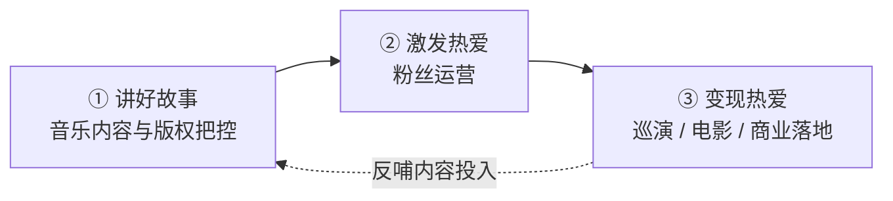

[[UXDesignCourse/W2D1_am_设计素材规范与复用思维复盘]]
# day04_pm · AI 设计素材制作指南、Taylor Swift 商业案例与职场运营

这场课是"上午讲课 + 下午实操"的合并记录，两条线内容差异极大：

- **上半场（模块一 ~ 九）**：以 **Taylor Swift 时代巡演**为切口，讲娱乐行业的万能商业模式，并延伸到**美国社会民生、中外产业规则差异**。
- **下半场（模块十 ~ 十三）**：**IP 素材制作的完整实操流程**——组件拆分、头部角度调整、AI 提示词框架、出图规范、工作进度要求。

两条线由同一个问题串起来：**什么是有影响力的"资产"，以及怎么把它批量生产出来。**

> [!warning] 阅读提示
> 上半场包含大量**课堂口述数据**与**社会事件的转述**，处理原则如下：
> - **可核实的公开数据**：保留，并在勘误表中标注核对结果与差异。
> - **无法核实的传闻**：**保留原文并明确标注"待核 / 传闻"**，不做事实性背书。
> - **讲师个人观点**：**单独标注为"讲师观点"**，与事实陈述分开。
>
> 涉及敏感社会事件的部分（模块七、九）请以正式调查结论与权威报道为准，本笔记仅记录课堂转述。

---

# 一、美国经济两大"趣味支柱"

讲师用了一个并列，把"科技叙事"和"娱乐叙事"放在了同一个位置上。

## 1.1 支柱一：英伟达

- 凭借对 AI 基础设施近乎垄断的地位收割全球科技巨头
- 其 **GTC 大会**（GPU Technology Conference）场场爆满，被美国网友称为**"男版 Taylor Swift"**
- CEO 黄仁勋曾到访中国，在北京新世纪附近被普通民众偶遇合影，当时除互联网从业者外，国内普通民众对其辨识度较低

## 1.2 支柱二：Taylor Swift（泰勒·斯威夫特）

- 其巡演创下多项消费、经济拉动记录，相关经济现象被学术界、产业界命名为 **"Swiftnomics（斯威夫特经济学 / 霉霉经济学）"**（原稿作"美美经济学"，见勘误表）
- 被形容为 **"行走的印钞机"**
- 其演艺生涯案例已被大学教授编入经济学原理课程，影响力超出娱乐圈范畴
- 被认为是当代美国软实力的核心代表人物

> [!tip] 这个并列在教什么
> "男版 Taylor Swift"这个称呼说明了一件事：**底层逻辑是同一种**——掌握了一个所有人都绕不开的稀缺位置，然后用它辐射整个链条。
> 英伟达的稀缺位置是算力，Taylor 的稀缺位置是"现场体验"。
> 下半场讲的 IP 素材，本质也在找这个位置。

---

# 二、Taylor Swift 商业影响力：核心数据

以下数字均为课堂口述的公开报道转述，具体口径见文末勘误表。

## 2.1 巡演基本信息

- 出道以来共举办 **6 次大型巡回演唱会**（原稿作"6 场"，实为 6 轮巡演，见勘误表）
- 当前正在进行的第六次 **"时代巡演"（The Eras Tour）**：
  - 2023 年 3 月从美国亚利桑那州格兰代尔（Glendale）启动
  - 计划 2024 年 12 月在加拿大温哥华收官
  - 总计规划 **152 场**（实际收官场次为 149 场，见勘误表）
- 其中 2023 年已完成 **60 场**演出

## 2.2 直接收入测算

**一、门票收入**

- 据行业杂志 **《Pollstar》**保守统计（原稿作"Postar"，见勘误表）：已举办场次平均单场售票超 **72,000 张**，2023 年全球门票总收入达 **10 亿美元**
- 按当前势头，152 场巡演全部结束后，扣除 15% 分成，Taylor 个人仅门票部分即可至少获得 **21 亿美元**收入

**二、周边收入**

- 据美国机构 **QuestionPro** 调查：观演粉丝平均周边消费达 **214 美元**，单场演唱会周边收入约 **1,500 万美元**，整个巡演周期周边总收入约 **22 亿美元**
- 扣除物料成本后艺人可分得 3 成，对应净收入约 **6.6 亿美元**

**三、演唱会电影收入**

- 2023 年上映的时代巡演电影全球票房达 **2.6 亿美元**，按分成协议 Taylor 个人可获得 **7,400 万美元**
- 关键动作：**绕过电影制片厂，直接与院线谈分成**——既拓展收入渠道，也覆盖了未抢到票的粉丝群体，强化了粉丝粘性

**四、收入合计**

- 整轮两年期全球巡演预计为 Taylor 带来超 **28 亿美元**的个人收入
- 2023 年 10 月福布斯公布其身家达 **11 亿美元**，在全球富豪榜中排名第 **2545 位**
- 她是**全球首位仅凭词曲创作、表演业务达到十亿身家的音乐家**
- 该收入**不包含**美妆、时尚品牌、对外投资等副业收入，仅附带部分房产投资

> [!quote] "绕过中间商"是这条线里最值得抄的一招
> 演唱会电影直接与院线谈分成——这一步和下半场讲的"不依赖一键生成、自己部署工作流"是同一个思路。
> **谁能绕开中间环节，谁就拿走那部分利润。**

## 2.3 对比参考：她为什么是现象级

2023 年三大娱乐市场的规模对比：

| 市场 | 2023 年全球规模 |
| --- | --- |
| **音乐市场** | **286 亿美元** |
| **电影市场** | **338 亿美元** |
| **电子游戏市场** | **1,840 亿美元** |

流媒体时代，音乐内容本身的价值被压低了。多数顶流歌手均通过**副业**增收——蕾哈娜做美妆、侃爷做鞋类产品、Jay Z 与碧昂丝夫妇横跨多领域投资。而 Taylor Swift 始终**专注音乐主业，把音乐商业链条的每个环节都做到极致**，这是她成为现象级人物的核心原因。

需要补充的是：**音乐是三大市场里最小的那个，主业的盘子天生就小。** 她的路径不是"换一个大盘子"（做美妆、做鞋），而是"把同一个小盘子里的每一环都自己吃掉"——门票、周边、电影、版权。这一点在下半场的素材制作里同样成立：与其广撒网，不如把一条流水线吃干。

---

# 三、巡演经济拉动效应

一场演唱会能上经济学课，是因为它的杠杆率远超常规。

## 3.1 行业对比：杠杆是常规的 2 倍以上

- **常规演唱会场景**：观众每在门票上花费 100 元，可带动当地酒店、餐饮、交通等周边消费 **300 元**
- **Taylor Swift 时代巡演**：消费拉动杠杆是常规水平的 **2 倍以上**，单名歌迷可给举办地带来约 **700 美元**的餐饮、交通、服装等关联消费

为什么她的杠杆更高？**常规演唱会的观众多为本地人，消费半径小**；而时代巡演的观众大规模跨城、跨国流动，机票、酒店、餐饮全部在当地结算。所以"巡演拉动经济"不是歌迷更能花钱，是**歌迷花在了异地**。

## 3.2 具体拉动成果

- **全美范围**：巡演覆盖美国 20 余个城市，直接带动消费总额约 **50 亿美元**
- **城市案例**：

| 城市 / 站点 | 拉动成果 |
| --- | --- |
| **辛辛那提** | **带动当地消费 4,800 万美元** |
| **丹佛** | **为科罗拉多州带去 1.4 亿美元消费** |
| **洛杉矶站（6 场）** | **创造 3,300 个就业岗位，直接拉动当地 GDP 增长 3.2 亿美元** |

## 3.3 从业人员福利

2023 年，Taylor Swift 为伴舞、音响师、卡车司机等巡演工作人员一次性发放总额 **5,500 万美元**的奖金，其中 50–80 名卡车司机每人获得 **10 万美元**。（原稿记为 2023 年 7 月，公开报道多在 8 月，见勘误表。）

这不是"慷慨"，而是一笔投资：**巡演团队是超级个体唯一无法外包的资产。** 给一线工作人员发钱，等于用最直接的方式锁定团队稳定性——奖金发得越大方，下一轮巡演越不用重新招人。对照模块八讲的"国内经纪公司把艺人当商品"，这里是把团队当资产。

## 3.4 疫情后的情绪价值

- 美国正处于疫情后通货膨胀高企、民众消费保守的阶段，其巡演及相关活动有效拉动了整体消费
- 在全球被战争、通胀、经济停滞困扰的 2023–2024 年，其音乐和演唱会为大众提供了情绪出口
- "霉霉经济学"的兴起，既是对其热爱、专注、才华的正向反馈，也是现实社会情绪的侧影

一句话收束：**经济下行时，人们不买"更便宜的东西"，人们买"更能让自己好受一点的东西"。** 这解释了为什么演唱会、短剧、情绪类内容在经济差的时候反而更旺。

---

# 四、跨领域影响力：从市长到外交事件

## 4.1 官方认可

- **城市行政层**：
  - 美国加利福尼亚州圣克拉拉市任命其为**名誉市长**
  - 另有城市在其演唱会举办当天将城市名称临时改名（原稿记为明尼阿波利斯市改为"Swift 波利斯"；公开报道中为亚利桑那州格兰代尔市临时改名"Swift City"，见勘误表）
- **金融监管层**：美联储在每年发布的经济展望报告**"褐皮书"**中，对 Taylor Swift 的经济带动作用表示肯定
- **媒体年度层**：2023 年力压 ChatGPT 代表人物 Sam Altman，当选《时代》杂志 **2023 年度人物**，评语为"把艺术和商业结合在一起，释放出了历史性力量"

**褐皮书那一条被低估了**：美联储的经济展望报告引用一位歌手，意味着她的巡演已经被当作"宏观经济变量"来统计。这是个人影响力能到达的最"官方"的位置。

## 4.2 国际邀约

- **智利总统**亲自写信邀请她到智利举办演唱会
- **加拿大总理**公开向她发出巡演邀约
- **新加坡**官方以每场数百万美元的补贴，拿到其巡演在东南亚的独家举办权，随即引发泰国总理、菲律宾议员公开谴责，事件演变为**外交层面**的事件

> [!quote] 这组事实给"超级个体"下了一个定义
> 当你的档期能影响一个国家的旅游收入时，你就不再是"艺人"了，**你是一个可以谈判的主体**。
> 这也是下一模块"娱乐行业万能商业模式"能成立的前提。

---

# 五、商业成功逻辑：娱乐行业的万能三步法

**娱乐行业万能商业模式分为三步：讲好故事 → 激发热爱 → 变现热爱。**

最典型的成功案例是**迪士尼**：通过影视内容打造 IP，通过乐园、周边产品变现粉丝热爱，同时依靠强势法务体系保障 IP 变现的独家性。**Taylor Swift 是歌手群体中，对该三步法执行最彻底的代表。**

这三步不是"做完第一件再做第二件"，而是**三个必须同时成立的条件**：

- **没有①，②只是空转的互动**——粉丝喜欢的是"你这个人"，不是"你的作品"，一停产就散
- **没有②，①只是高分作品**——作品再好，没有情感沉淀，变现时没有溢价
- **没有③，①②只是自嗨**——没有变现，就没有下一轮内容的钱

判断一个账号值不值钱，就看这三条里有几条断了。

## 5.1 第一步：讲好故事（音乐内容与版权把控）

**一、专业能力过硬**：累计获得 **14 座格莱美奖**，创作能力得到行业公认。

**二、版权维权举措**（本节最硬的一段）：

- **背景**：2014–2015 年，全球音乐行业处于实体专辑销量下滑、流媒体平台刚起步的青黄不接阶段，多数音乐人被迫接受流媒体低价甚至免费上架规则
- **2014 年**：在新专辑《1989》发布后，因与 Spotify 的专辑额外付费谈判破裂，**直接将自己所有音乐从 Spotify 平台下架**
- **2015 年 6 月**：公开致信苹果公司，谴责 Apple Music 在用户 3 个月试用期内播放歌曲却不向艺人支付报酬的政策，**促使苹果高管公开道歉并修改政策**
- **结果**：下架流媒体的策略直接刺激了《1989》实体专辑销量，最终全球销量超 **1,200 万张**，同时沉淀了大批忠实粉丝

**三、专辑重录决策**（把版权拿回来）：

- 2018 年与前唱片公司合约到期后，**未能买回自己前 6 张专辑的母带版权**
- 她凭借所持有的**全部歌曲词曲创作权**，在合约允许的专辑发布 5 年后启动重录计划
- 与环球唱片签订新合约时，**明确保留未来所有音乐的所有权**
- 陆续推出标注 **"Taylor's Version"** 的重录专辑，所有重录专辑的播放量均超过原版
- 这一步为后续时代巡演的举办扫清了版权障碍

> [!tip] 为什么"自己写歌"在这里变成了商业护城河
> 母带（录音版权）被卖了，但**词曲版权还在她手里**。
> 只要词曲权在，她就可以"重录一遍"——因为版权法保护的是"录音"这个具体制品，而不是"这首歌"。
> **这是创作者最值得记住的一条：你签的合同里，"词曲"和"录音"是两回事。**
>
> 很多人只看到"她维权很刚"，漏掉了真正的结构：
> 1. **先确保自己拥有不可替代的那一半权利**（词曲创作权）
> 2. **再用这一半权利去倒逼另一半**（重录、拿回主动权）
> 3. **最后把维权本身做成内容**——下架 Spotify、致信苹果，每一次都是公众事件，等于免费宣传
>
> **维权不只是法律动作，也是内容动作。** 这一点和下半场"把学习过程直接做成内容"是同一个逻辑。

## 5.2 第二步：激发热爱（粉丝运营）

**一、全平台粉丝互动**

- 从早期的 **Myspace、Tumblr** 到后期的 **Instagram、TikTok**，始终在各社交平台搭建良性粉丝生态
- 日常与粉丝高频互动，定期举办粉丝派对、邀请粉丝线下试听新歌
- 粉丝普遍反馈其**没有偶像的疏离感**

**二、粉丝体验设计**

- 效仿电影彩蛋模式，在专辑内容中设置**细节彩蛋**供粉丝挖掘
- 开创**"慢速放票"**的售票规则，尽可能保障核心粉丝的购票权益

**这两个动作的指向是同一个**：彩蛋是"给认真的人额外奖励"，慢速放票是"让真粉比黄牛先买到"。两者都在做同一件事——**把"粉丝身份"变成一种有价值的特权**。

对照模块八：国内经纪公司主动与受众保持距离；这里是主动把距离压到零。这不是谁更"宠粉"，而是**两种商业模式对"粉丝"的定义不同**——一个是消费者，一个是资产。

## 5.3 第三步：变现热爱（商业落地）

- **时代巡演**：过往积累的粉丝情感集中在时代巡演中兑现，成为现象级演出项目
- **演唱会电影**：绕过电影制片厂直接与院线谈分成合作，拓展收入渠道、覆盖更多粉丝群体

至此三步闭环完成：**① 内容与版权 → ② 粉丝情感 → ③ 现金 → 回到 ① 的下一轮投入**。这个环一旦转起来，规模是复利的。

---
# 六、美国社会民生相关情况

> [!warning] 阅读前提示
> 本模块全部为课堂口述转述，涉及收入分层、税收、医疗等民生数据。**所有数字口径差异较大（尤其是"中产"的定义），请以官方统计与权威报道为准。**
> 本笔记保留它们是为了还原课堂语境，不构成事实背书。

## 6.1 收入分层参考

**中国收入及资产标准（课堂口径）**

- 此前央视公布数据显示，国内高收入人群门槛为**月薪 1 万元**，该收入水平超过全国 90% 的人口
- 国内**中产**年收入约 50 万元；**小资阶层**年收入约 100 万元
- 资产阶层按 **"A 系列"**划分：A8 对应个人净资产（含不动产）500 万–1,000 万元；A9 对应净资产数千万元；A10 对应净资产数亿元

关于 A8/A9/A10 需要补充一点：这是中文互联网财富圈的民间黑话，不同圈子的算法不一致。较常见的算法是**"A 后的数字 = 净资产位数"**——即 A8 为 8 位数（千万级），A9 为 9 位数（亿级），A10 为 10 位数。本笔记保留课堂口径，两种算法并存，**使用时请先确认对话方的定义**。

**美国收入标准（课堂口径）**

- 美国**中产**阶层年收入约 **20 万–30 万美元**，可实现基本吃喝不愁
- 但美国税收负担极高：联邦税加各州州税通常会扣除个人收入的 **40% 左右**，部分州扣除比例达 **45%–50%**
- 例如 NBA 球星年薪 2,000 万美元为税前收入，税后实际到手不足 1,000 万美元
- 结论：**10 万美金在美国属于较高金额**

一条必要的对照：**"美国中产年收入 20 万–30 万美元"这个口径明显偏高。** 美国官方统计中，家庭收入中位数约在 7 万–8 万美元量级，20 万美元以上通常已属于中高收入家庭。课堂截取的是"过得相对舒服的那一档"，不是统计学意义上的中位数。

## 6.2 高生活成本与"斩杀线"现象

**"斩杀线"的定义**：指原本高收入的人群，可能因突发状况快速破产、沦为流浪汉的风险边界。核心诱因是**高税负、高房产税、高昂的医疗成本**。

**诱因一：永久房产税**

- 美国实行**永久房产税**政策，普通家庭购置的 100 余平房产，每月需缴纳 2,000 至数千美元不等的房产税，贷款购房的家庭税负压力更高
- 案例：曾有从事计算机技术、医生职业的人士，因收入不稳定无法承担税费，其作为唯一不动产的房屋被银行抵押充公，一夜之间破产无家可归

**诱因二：医疗体系**

- **免费医疗**资源不足，排队周期极长——普通拔牙走公费医疗需排队 **3 个月**，期间仅能开具止疼药缓解
- **私人医疗**服务价格是公费的数倍至十几倍，普通民众难以承担
- **救护车**单次呼叫费用达 **1,000–2,000 美元**，叠加后续治疗成本极高
- 不少留学生甚至会选择**买机票回国就医**
- 历史上曾出现因牙疼排队等待治疗引发感染致死的案例

**底层生活困境**

- 食品成本极低：可乐几美分即可买数升、炸鸡仅需几美元一份
- **高糖廉价食品导致低收入群体健康问题频发**；穷人无法承担健身成本与高端医疗费用，只能依赖廉价食品维持生存
- 缺乏完善的低保制度，仅靠公益组织发放餐食
- 不少曾经的工程师等中产人群，也会因突发状况落入贫困阶层
- 普通黑人家庭常将**成为职业运动员**作为阶层上升、规避生活风险的核心路径

> [!quote] "斩杀线"这个概念真正的锋利之处
> 它描述的不是"穷人有多穷"，而是**"中产离破产有多近"**。
> 在永久房产税 + 商业医疗的组合下，收入高不等于安全，只等于"月供更高"。一旦收入中断，回落到零成本极低——这正是和国内"有房就有底"的最大差别。

不同的社会结构，会生产完全不同的内容需求：美国的"破产焦虑"催生大量个人理财、副业、保险类内容；国内的结构催生的是"考公考研、大厂求职、副业搞钱"类内容。**同一个选题，在不同市场里的热度可以完全相反。**

## 6.3 中美贸易相关细节（止疼药）

- 课堂称：美国 **90% 的止疼药依赖从中国进口**
- 该类止疼药长期服用具有**成瘾性**
- 中国国内禁止生产和面向民众销售，仅作为出口创汇产品（此处指的应为芬太尼类物质，原稿表述含混，见勘误表）
- 中美贸易战期间，止疼药进口是双方博弈的关键筹码：美国制裁相关产品时，中方将止疼药的经销商、生产环节转移至墨西哥、加拿大等周边国家，核心原材料仍由中国供应，以此作为谈判筹码

> [!warning] 事实层面必须区分开
> 公开报道中常见的相关议题是**"芬太尼类物质整类列管"**与**"原料药供应链依赖"**，两者不是同一件事：
> - **芬太尼类物质**：中国自 2019 年起整类列管，属于管制类精神活性物质，不是普通"止疼药"
> - **原料药（API）依赖**：美国药品（含普通止疼药）的原料药产能确实高度依赖中国与印度
>
> 课堂把这两条合并成了一条叙述。**做内容引用时务必拆开，否则会被专业人士指出硬伤。**

## 6.4 美国政治逻辑

- 欧美国家的选举等政治活动由**利益集团、赞助商**支持
- 影响力足够的个体可以获得更多资源，甚至影响政治结果
- 如特朗普参选总统背后有明确的利益集团提供赞助支持

和政治献金制度对照着看会更准确：美国的利益集团影响政治，是通过**政治行动委员会（PAC）捐赠**这类**合法制度**实现的，不是非法的暗箱操作。理解这一点，才能理解为什么"超级个体"在美国可以公开地把影响力兑换成资源——**这条通道在国内并不存在（见模块八）。**

---

# 七、海外娱乐圈资源交换的负面事件

> [!danger] 强烈提示
> 本模块内容的来源是课堂口述与网络流传的说法，其中包含**大量未经司法确认的传闻**。
> 课堂用这个案例想说明的，只是一个很窄的命题：**什么行为会从"道德问题"升级为"国家层面的介入"。**
> 本笔记保留这些内容以还原课堂逻辑，但**不为其真实性背书**。请以正式调查结论与权威报道为准。

## 7.1 事件层级与核心问题

课堂把海外娱乐行业的资源交换圈层划分为两级：

| 层级 | 代表事件 | 参与者构成 |
| --- | --- | --- |
| **顶层圈层** | **爱泼斯坦事件** | **政客、顶级资本，涉及英国王子等政要** |
| **次级圈层** | **吹牛老爹事件** | **娱乐界演员、艺人为主** |

**圈层运作模式（课堂转述）**：通过收买、诱骗等方式搜罗女性，作为资源交换的工具；课堂提到的涉及人群包括伊拉克战争弃儿、数百线小女明星、花花公子女郎等。

课堂给出的判断是：**事件引发舆论轰动的核心原因并非男女关系混乱，而是存在软禁、将人不当人等侵犯人权的行为。** 这类问题的严重程度远超普通淫乱事件，可上升至国家、政界出面介入的层级。

这条判断可以抽象成一个更普适的结论：**不同文化的"道德容忍度"差异很大，但对"侵犯人身自由"的容忍度高度一致。** 跨文化做内容时，前者可以试探，后者绝对不能碰。

关于"萝莉岛"，课堂称其为爱泼斯坦购置的岛屿，仅通过其自有游轮通航，仅对接有相关资源的政客等群体，岛上受害女性半数为未成年人。课堂还提到**网传存在"将受害儿童杀害后摆成特定造型"的恶性事件**，并称 FBI 公开的文档、报道均做了打码处理，未打码的原始存档仅能通过黑客手段入侵 FBI 系统获取。

> [!warning] 以上均为传闻，不可采信
> 这些说法**没有任何司法结论支持**。本笔记仅作"课堂曾如此转述"的记录。

## 7.2 爱泼斯坦事件的三个争议点

**争议点一：与美国大选的关联（课堂转述）**——课堂称事件曝光时正值特朗普、希拉里、拜登竞选美国总统，原本希拉里在票选中处于领先位置，因前总统克林顿（希拉里丈夫）被曝参与爱泼斯坦相关活动，**希拉里被迫退选**；课堂还称相关方告知其"退选可保全克林顿，避免其被关押甚至判处无期徒刑"。

**注意：「希拉里因该事件被迫退选」属于未经证实的推断，与公开的选举事实不符，请勿采信。**

**争议点二：死亡疑点**——课堂称其在重型监狱关押期间，监狱离奇停电半小时，无任何监控、数据记录，电力恢复后爱泼斯坦被认定为自杀死亡；关键人物死亡导致相关谜团无法查实，最终克林顿未被追责。

**争议点三：特朗普相关关联**——课堂称有影像证据显示特朗普从商时期曾是爱泼斯坦的追随者，且爱泼斯坦的公寓、私人岛屿上发现了特朗普的字迹、画作等痕迹；课堂称特朗普公开否认与爱泼斯坦相识，称相关影像为 AI 伪造、相关痕迹是他人假扮栽赃，截至目前该问题未被细查。

> [!quote] 这一整段的"信息卫生"提醒
> 本模块呈现的是**"课堂上是怎么讲的"，不是"事实是什么"**。
> 这类内容在网上传播时的典型特征：**关键人物死亡、证据丢失、文件打码、只有传闻没有判决。**
> 做内容时碰到这种结构，正确姿势是**标注来源与争议状态，而不是当结论转发。**

## 7.3 不同地区行业规则差异

- 欧美顶级资源圈层存在诸多不为人知的潜规则，当地对于这类**资源交换行为本身**的接受度较高，但对**侵犯人权**的行为容忍度极低
- 中国娱乐圈不存在此类将人作为工具、侵犯人权的资源交换模式，公众对这类行为的接受度极低

需要说明的是：这属于课堂给出的概括判断，不是可验证的数据结论。本笔记保留原意，同时提示读者——**任何行业都存在个案，用"整个行业都是/都不是"的句式做判断都需要谨慎。**

---

# 八、中外产业与社会规则差异

## 8.1 中外娱乐产业"超级个体"发展差异

**海外超级个体模式**

- 海外尤其是欧美地区**推崇个人英雄主义**，"超级个体"是被鼓励的发展方向
- 资本、资源会围绕有影响力的超级个体进行辐射
- **政界、娱乐界、体育界的边界模糊**，政界人士会主动联动有影响力的娱乐、体育界个体
- 超级个体只要自身影响力足够，**资源会主动向其靠拢**

**中国娱乐产业资源逻辑**

- 国内娱乐产业的核心资源**掌握在经纪公司及背后的资本方手中**
- 艺人的发展高度依赖背后的资源扶持，艺人的职业变故通常与背后资本方的变动相关（课堂举例：某冰、景甜的职业起伏均与其背后扶持的资本变动有关）
- 国内练习生模式与韩国类似，**将艺人作为商品运营**——韩国练习生行业压力更大，甚至出现艺人自杀等极端丑闻；国内受道德约束，环境相对温和
- 但普通艺人、科技行业从业者，**都没有直接掌握核心资源的能力**

课堂还举了几组例子来说明"国内超级个体发展受限、不鼓励个体拥有过强的社会影响力"：

- 吴亦凡曾拥有多个国际高奢资源，出事后相关资源分流给其他艺人（课堂另转述了若干关于其抓捕过程的传闻细节，此类说法未经证实，本笔记不予收录）
- 原头条旗下 APP **内涵段子**用户规模达数亿，形成了独立的社群文化，后被以"低俗"为由整治关停；课堂称关停后大量用户涌入抖音刷相关内容，导致抖音历史上首次关闭评论互动功能长达一周
- 抖音平台粉丝量最高的账号为**人民网**（1 亿+ 粉丝），其次为新华社、央视新闻
- 头部达人**小杨哥**粉丝峰值达 9,000 万，**平台未让其粉丝量超过官方账号**

以上属于课堂观察，其中涉及平台运营动机的部分为**讲师推测，非公开事实**。

把具体人物剥掉，剩下的是一条很硬的平台规则：**官方账号的粉丝量级是平台的"天花板"，商业达人的排序不会越过它。** 顺带的推论是——民间达人的影响力存在隐含上限，越接近上限，账号越"脆弱"。

对内容创作者的实际意义：**不要用"把粉丝量做到最大"当目标，把"账号活多久、能接多少单"当目标更现实。**

另外，课堂提到一个观察：国内热点事件的通报有固定顺序——首先由**人民日报**点名，随后**新华社**跟进，最后由**央视新闻**发布报道。这是讲师总结的媒体运作观察，不是公开的制度规定，引用时请注明为"业内观察"。

本模块的收束是讲师的一句话：**"平台虽然鼓励个人影响力变现，但个人影响力的发展仍存在明确边界。"** 这句话是上半场和下半场之间最直接的一座桥——下半场讲的素材生产、账号运营，全部要在边界内做。

## 8.2 中外艺人运营与粉丝互动模式差异

**中国艺人运营特点**

- 经纪公司**不鼓励艺人与受众保持过度亲密的关系**，双方存在明确距离感
- 公司核心职责为对接资源，仅安排象征性的粉丝见面会类活动
- 粉丝互动边界严格：线下互动仅可实现近距离合影，**不允许出现摸手、拥抱、贴面等亲密接触行为**

**海外艺人运营特点**

- 艺人将粉丝互动、公开社交场合作为**个人 IP 运营、资源互换的渠道**
- 日本见面会设置摸手、拥抱环节
- **美国超级碗**（橄榄球决赛，被称为"美国春晚"）、格莱美、奥斯卡等大型活动，是艺人社交、互换资源的核心场景
- 艺人会为获取顶级资源主动进行利益交换，课堂举例：BLACKPINK 成员 Lisa 为获取 LV 相关顶级资源，参与疯马秀脱衣舞表演，主动放弃中国市场，后续遭到中国市场抵制，相关影像内容被限制播出，无法来华发展；艺人杨颖（Angelababy）因到场观看该表演被封杀

其中"**为获取 LV 资源而参与表演**"属于讲师对动机的推测，当事人未公开承认，本笔记标注其为"讲师观点"；后半段关于资源限制与市场抵制的描述，属于公开可见的结果。

> [!quote] 两种模式的根本差别
> 国内模式的假设是**"艺人是资产，资产需要被保管"**；
> 海外模式的假设是**"艺人是品牌，品牌需要被经营"**。
> 保管的逻辑下，**距离越远越安全**；经营的逻辑下，**距离越近越值钱**。
> 所以"粉丝该不该离得近"没有标准答案，取决于你站在哪一套逻辑里。

这一条对自媒体创作者的直接启示是：你在做账号时，也在选一套逻辑——

- 选**"资产逻辑"**：保持距离、维持专业形象、把内容做成作品集
- 选**"品牌逻辑"**：高频互动、暴露生活、把粉丝变成关系

两者都能成，但**混着做会两边都不像**——这也是下半场反复强调"人设一致性"的原因。

---

# 九、其他延伸讨论

> [!warning] 本模块内容为课堂口述的传闻，事实性极低，仅作记录，请勿采信或转述。
> 这里的"事实性极低"指：本节全部内容均来自讲师转述，**没有任何独立信源可供交叉验证**。

**关于孟晚舟事件的课堂转述**

- 提及孟晚舟为任正非第一任妻子所生，曾任华为高管
- 课堂称传闻其在美国对伊朗实施制裁期间，未经国家同意私自通过关联公司向伊朗出售武器、芯片相关配件
- 美国动用长臂管辖规则，要求加拿大在孟晚舟过境时将其扣押，计划引渡至美国
- 中方组建了 30 余人的律师团与加方周旋，期间中方抓捕了部分在华加拿大相关人员
- 最终孟晚舟未被引渡至美国

> [!danger] 必须区分"指控"与"事实"
> 上述"向伊朗出售武器、芯片相关配件"是**美方提出的指控**，课堂叙述将其当作事实转述。
> 中方立场是该指控出于政治目的、缺乏事实依据；事件最终以暂缓起诉协议方式解决，孟晚舟回国。
> **做任何内容引用时，"美方指控"和"实际行为"必须分开表述。**

---
# 十、IP 素材制作与 AI 工具使用工作指南

下半场从这里开始，是一份可以直接照着执行的流水线文档。主线是：**拆组件 → 调角度 → 写提示词 → 出图 → 拼场景 → 留档交付。**

| 小节 | 解决什么 |
| --- | --- |
| **10.1 工作目标** | **今天要产出什么** |
| **10.2 组件化拆分** | **怎么把 IP 变成一个能动的骨架** |
| **10.3 效果验证** | **拆完怎么自测** |
| **10.4 头部角度调整** | **怎么把头部转成 3/4 侧面** |
| **10.5 动作素材生成** | **提示词怎么写** |
| **10.6 工具问题排查** | **关键词与会员的坑** |
| **10.7 实操方法与经验** | **怎么稳定出图** |
| **10.8 框架与场景要求** | **模板里改哪一块** |
| **10.9 工具能力盘点** | **工具能做什么、不能做什么** |
| **10.10 流程与进度要求** | **职场交付标准** |

## 10.1 下午核心工作目标
1. **产出 IP 人物动作素材**
2. **基于动作素材，搭建搭配 IP 人物的小场景素材**

这个顺序不能颠倒。**先有动作，再有场景**——反过来的话，场景的透视、视角会反过来限制动作的可选范围。这是 10.7 与 10.8 反复强调"先定姿态、再换头、最后套场景"的同一个道理。

## 10.2 IP 人物组件化拆分操作方法

**一、关节拆分逻辑（参考手办可动原理）**

- 在人物本体关键可动位置标记关节点
- **手臂无天然关节分隔的位置，手动打 2 个锚点区分大臂、小臂**
- 关节点位置可根据实际结构上下调整——若现有锚点位置靠下，可上移
- 本次演示的 IP 形象**仅需处理手臂、腿部关节**即可满足动作需求，无需额外拆分脖颈、手腕等精细关节

**二、拆分操作**

- 使用 **Ctrl+X** 剪切对应部件，按照锚点位置剪切后**粘贴闭合**
- 通过**"连级功能"**将拆分后的部件设为独立可动单元（该术语疑为转写错误，见勘误表）
- 单独选中单个部件添加连级，可让部件形成独立的完整闭合结构

**三、关节美化（最容易踩的坑）**

- 拆分后的关节连接处会存在瑕疵
- **不可直接倒圆角**——会导致部件短一截
- 正确做法：使用**钢笔工具**，按住 **Alt 键**将直线转为弧度，同时按住 **Alt+Shift 键**拉出正弧，优化关节处造型

**四、备份要求**

拆分完成后**务必留存组件备份**，避免操作失误丢失素材。这一条在 10.10 里被再次强调为"工程文件必须留档"，是本场重复次数最多的要求。

> [!tip] 关节拆分的三条通用原则（原稿未讲透，此处补齐）
> - **只在"需要独立旋转的位置"打关节**——关节越多，拼接时对位越难，出错率越高
> - **关节要打在结构最窄处**——窄处旋转时穿模最少
> - **对称部件的关节位置必须一致**——左右手肘高度不同，做动作时会出现一高一低
>
> 判断标准很简单：**能不能用最少的关节，撑住你要做的全部动作。**

## 10.3 组件效果验证

拆完先自测，别急着进 AI：

- 拆分完成后先**初步测试动作姿态**，无需在意生硬感，重点确认动作动起来是否违和
- 按 **R 键**触发旋转功能，**将旋转中心点移至关节位置**，即可调整部件角度
- 测试跑步等腿部动作，确认关节拆分符合自身结构、可正常活动即可
- **AI 出图时不会显示底层拆分的组件结构，不影响最终画面效果**

最后那句话解决了一个常见顾虑：**"AI 看不出你底下拆得糙不糙"**——所以拆分阶段的目标是"能动"，不是"好看"。把精力留给 AI 生成和场景拼接，别在拆分阶段抠细节。这一条和 10.10 的"进度优先于细节"是同一套价值观。

## 10.4 IP 人物头部角度调整方法

**一、通用角度选择：3/4 微侧面**

- 批量产出人物素材**优先选用 3/4 微侧面角度**，大厂活动素材大多采用该角度
- 原因：**无纯正面、无纯侧面**，可兼顾姿态展示效果，避免造型过于个性夸张，**可覆盖几十上百个形体的使用需求**
- 仅在制作**三视图规范**时，才需要纯正面、纯侧面角度

为什么"3/4 侧面"是商业素材的默认解？**纯正面最省事，但信息量最少**（没有纵深，看不清体量）；**纯侧面最有形，但信息量太偏**（看不见脸，认不出是谁）。3/4 是唯一同时能交代"体量"和"身份"的角度——**所以它不是为了好看，是为了信息完整。**

**二、3/4 侧面调整操作**

核心口诀：**"五官先走，以鼻子为中轴线。"**

- 先将正面五官**整体向侧方拖动**
- 遵循透视原则：**离视线越远的五官部位，与鼻子距离越近**
- 以鼻子为中轴，调整所有关键转折、结构的位置

**三、细节优化**

- **眼睛**：不可生硬平移，需根据透视调整弧度；**离视线远的一侧眼睛弧度略大于近侧**，以视觉舒服为标准
- **耳朵、头发**：跟随头部角度调整——离视线远的耳朵清晰度降低、位置适当后移；头发向转头方向轻微拖动，发间距可适当缩小，无需大幅修改
- **验收标准**：调整后需保证**正面、侧面脸型有明确形体区分**，头部可保留少许后脑勺露出度
- **调整容错**：调整存在小瑕疵不影响使用，可后续再优化

> [!tip] "以鼻子为中轴线"这句话的实际含义
> **转头时，鼻子的位置几乎不变，变的是它两侧的结构。**
> 所以正确顺序是：**先钉住鼻子 → 再把五官按"远者靠拢"的规律挪过去 → 最后补耳朵头发的遮蔽关系。**
> 先挪眼睛、再找鼻子，是所有新手做 3/4 侧面翻车的根本原因——**因为中轴一旦动了，全部透视都不成立。**

> [!note] 视角术语速查
> **3/4 侧面（three-quarter view）**：介于正面与纯侧面之间，能同时看到半张正脸与部分侧轮廓。在角色设计、商业插画、IP 延展物料中是最通用、最"安全"的展示角度。

## 10.5 AI 生成动作素材方法

**一、提示词框架逻辑**

- 遵循固定逻辑：**基本需求描述 → 细节描述 → 自定义补充需求**
- **不可逻辑混乱**；核心关键点需先梳理清楚，再套用框架转化为提示词
- **无需生硬罗列关键词**

这个框架的作用不是让你写得多，而是**逼你在写之前先回答一个问题：我到底要什么。** 写不出框架，通常不是不会写提示词，是需求本身没说清。这一条和 10.10 的"表述需清晰无歧义"是同一件事的两种说法。

**二、吉祥物动作素材提示词要点**

| 维度 | 要求 | 解决什么问题 |
| --- | --- | --- |
| **基本描述** | **明确主体为吉祥物，要求全身呈现** | **避免输出非全身的表情包类内容** |
| **细节描述** | **明确动作姿态，设置多组不同姿势** | **避免姿态同质化、动作幅度小** |
| **动态要求** | **要求人物动起来** | **避免僵直站立的姿态** |
| **视角要求** | **添加多角度提示** | **增加透视变化** |
| **防杂项技巧** | **添加"纯白背景"关键词** | **避免 AI 生成带多余元素、场景的完整插画** |
| **风格说明** | **仅需批量产出动作样式时，无需限定 2D/3D 等具体风格** | **减少不必要的约束** |

**"纯白背景"是整张表里性价比最高的一个词。** 它的作用不是好看，是**把"插画"降级成"素材"**。没有这个词，AI 会默认给你一张有场景、有光影、有构图的完整插画——而这种图是没法抠出来直接使用的。批量产出素材时，**先在提示词里切断 AI 的"创作欲"，再谈质量。**

**三、AI 生成实操技巧**

- **参数设置**：单次可设置生成 **4 张**图片，提高产出效率
- **多模型对比**：可同时在不同 **Agent 模式**下生成，对比不同模型的理解差异
- **卡顿处理**：若 AI 平台卡顿，可新建生成任务重试；卡顿可能与浏览器运行内存、平台使用人数过多有关

**四、公共提示词筛选：不要直接照搬**

- 平台公共区域的 AI 生成作品提示词**通常逻辑混乱**
- 会**堆叠过多冲突风格**——如同时堆叠莫奈、梵高、伦勃朗、金箔岩彩、极简主义等互斥风格
- 导致**无法稳定复现效果**
- 正确做法：筛选其中**真正影响画面的核心风格关键词**，删除无效、冲突的关键词

为什么"堆风格词"必然失败？因为**提示词里的风格词不是"加法"，更接近"投票"**。你写"莫奈 + 梵高 + 极简主义"，模型不会给你"三者的融合"，它会在三种分布之间摇摆——所以同一段提示词每次出图都不一样。**可复现的前提是关键词之间不互相竞争。**

---
## 10.6 AI 生图工具使用问题梳理

**一、关键词相关问题**

**① 资产库关键词不可直接复用**

平台展示的社区关键词大多经过 **AI 自动整理**，并非创作者工程文件内的原始关键词，无法保证生成效果一致。

**② Agent 介入会自动修改关键词**

复杂画面生成过程中若触发 Agent 功能，系统会**自动对用户输入的关键词进行优化润色**，可能添加"治愈、简单干净、颜色鲜艳"等用户未设置的无关描述，偏离生成预期。该机制为近两个月新上线的功能，逻辑暂不明确，**不可完全信任**。

**③ 关键词复用的稳妥方式**

从平台资产中筛选**效果符合预期**的关键词，复制后直接使用，以此保证生成过程可控、工程文件一致。

> [!quote] 这是"AI 帮你做决定"的典型反例
> 前面刚说"AI 应该替观众做决定"，这里就出现了反面：**AI 替你改了关键词，等于替你改了需求。**
> 区别在于：**面向观众的自动化是效率，面向创作者的自动化是失控。**
> 凡是"你没法关掉的自动优化"，都应该被当作**风险**而不是功能。

**二、会员与功能限制问题**

- **基础会员存在排队问题**，生成效率低
- **生成页面无进度百分比提示**，仅能通过画布状态判断进度
- 平台画布比例支持调整为 1:1，操作过程中偶尔出现显示 bug，**不影响最终生成结果**

## 10.7 AI 生图实操方法与经验

### 10.7.1 人物 / 吉祥物生成方法

**一、姿态生成与调整**

- 生成结果若姿态不符合预期，**直接刷新重新生成**即可，可挑选满意的姿态部件直接拼接
- 拼接时若身体结构不对，可手动调整细节：调整身体角度以呈现后背感、调整胳膊弯折弧度避免过于僵直、调整前后层次关系
- **无需过度细化基础工程文件**；若需细化，可隐藏多余线条，针对单一海报场景优化弧度弯折、补充前后结构线即可
- 若需保留描边效果：生成后需检查是否出现**多余的外层描边**，有问题可直接去掉描边设置

**二、稳妥生成流程（最重要的一条）**

1. **优先先生成符合要求的动作姿态**
2. **再替换为目标人物 / 吉祥物头部**

该方式**可控性最高**，能有效避免动作姿态偏差问题。也可直接使用人物正脸图作为参考，要求 AI 保持人物特征替换动作——需明确指令要求"**仅调整动作、保持风格与人物形态不变**"，降低 AI 理解偏差。生成过程需**允许 AI 存在容错空间**，只要大方向正确即可，细节问题后续调整。

> [!tip] "先姿态、后换头"为什么是可控性最高的做法
> 因为这两个变量在 AI 眼里是**耦合**的。
> 如果你让 AI 一次性完成"这个角色 + 这个动作"，它会在两者之间做妥协，最后很可能动作不像、脸也不像。
> **拆成两步，每一步只让 AI 解一个变量**——这是所有 AI 工作流的通用降错法，不只是画图。
> 同一个思路在本场出现了三次：**先姿态再换头（10.7）、先 demo 再批量（10.10）、先动作素材再场景（10.8）。**

**三、效率优化技巧**

- 可直接指定要求"**风格保持不变**（如矢量风格、无描边，原稿此处表述存疑，见勘误表），**仅变换动作**"
- **批量生成 30–40 个不同动作**，提高出图效率
- 若关键词框架逻辑清晰，可直接用**文生图**从零到一生成
- 若为二次创作、结合参考图生成，可使用 **Agent 功能**理解需求、生成符合个人偏好的关键词，大方向确定后再进入画布细抠 3D 材质、特殊角度、小细节等内容

### 10.7.2 场景搭配生成方法

**一、统一要求**

- 多个动作搭配的场景需保持**视觉统一**，避免场景大小、透视角度不一致
- 优先选择**简单 3D 小设计风格**（类似小图标质感，不过度追求细节、空间感、光感与强透视）
- 理由：**方便后续直接套入吉祥物替换元素**

**二、关键词搭建逻辑**

- **无需一次性罗列所有元素**，先搭建整体框架：
  - 明确场景主题
  - 画面背景为**白色安全边**
  - 所有场景元素**完整显示**，方便提取
- **先试做小 demo，再根据生成结果补全调整细节**
- 可参考现有同类型场景，拆分场景典型元素加入关键词——如沙滩场景搭配椰子树、海鸥，远景搭配车辆；设置全景视角、人物全身显示

**三、生成与优化逻辑**

- **AI 生图无法一次成型**，通常首次生成能达到 **70%–90%** 的符合度
- 先确定整体姿态、画面占比等**大方向**
- 再通过**重新编辑功能**修改局部问题（如替换错误元素、调整结构位置）
- **无需追求一次达到 100% 完美效果**

**四、风格测试方法**

- 针对油画、金箔等关键风格关键词，**逐个测试单关键词效果**
- 再测试**多关键词组合效果**
- 摸索 **2–3 次**找到最优的关键词组合，摸透 AI 生成套路

"70%–90% 就算成功"是一条期望管理：把目标定在 100%，你会不停重出，最后既超时又没更好；把目标定在"首图 70%，剩下 30% 靠局部编辑补"，产出速度会高一个量级。这条和 10.10 的"进度优先于细节"是同一个原则的前后脚。

而"摸透套路"这四个字，和上半场的"娱乐行业万能模式"是一件事：Taylor 把音乐链条的每一环都吃透了，这里的"摸透"是把关键词的每一个变量吃透。**领域不同，方法论同构：不猜，测。**

## 10.8 素材制作核心框架与场景要求

**一、现有内容无需调整的部分**：整体模板框架、远景内容固定不变，无需修改。

**二、需调整替换的区域**：**仅调整画面中间区域内容。**

**三、场景示例参考**

| 场景 | 可搭配元素 |
| --- | --- |
| **雪地场景** | — |
| **春季田野草地场景** | **柳树等树木、家庭轿车；吉祥物在草地放风筝；天空搭配燕子、雨燕、太阳** |
| **沙滩夏季场景** | **椰子树、海鸥，远景搭配车辆** |
| **冬季场景** | **鞭炮元素，契合过年活动需求** |

以上均可在框架内补充细节。

**四、制作兜底方案**

- **优先保障大方向与框架正确**
- 若出现**细节乱码**问题：可通过刷新重出、参数优化解决
- 若对直接生成效果存疑：可**先单独制作动作素材、再匹配场景素材**，匹配对应动作角度，避免正面角度产生的歧义偏差
- 若生成的形象**头部不符合要求**：需严格参照指定的头部形象调整，可单独截取头部素材要求替换，也可通过复制工程文件单独优化

**五、技术问题解决方案**

- **浏览器差异**：不同浏览器对生成网站的优化效果存在差异，可能导致图像加载崩溃；**使用 Safari 默认浏览器可规避此类问题**，谷歌浏览器因插件较多易出现加载异常
- **肢体前后层次混乱**：可调整颜色区分前后胳膊，降低识别误差
- **3D 生成不稳定**：可采用"**先制作 2D 动作素材 → 再绘制 2D 场景 → 最后转换为 3D 效果**"的工作流兜底；当前 AI 工具已支持直接生成符合要求的完整 3D 场景内容

> [!tip] 兜底方案的设计逻辑（值得单独记住）
> 这里有三个"降级路径"，全部是同一个形状：
> 1. **一次性生成整张 → 拆成"先动作、后场景"**
> 2. **直接 3D → 先 2D、再转 3D**
> 3. **换头重生成 → 只截头部单独替换**
>
> **当一条路径不稳定时，正确的反应不是"再试几次"，而是"把这一步拆成两步"。**
> 这套思路可以直接迁移到任何 AI 工作流上。

## 10.9 AI 工具功能与使用经验

以"**即梦**"为例，逐项说明现在能做什么。（原稿此处又作"即梦"，与前面的"吉梦"为同一工具，见勘误表。）

**一、图片生成能力**

- 即梦工具**视频生成能力突出**，图片生成能力处于平均水平线以上
- 搭配对应工作流**可满足日常基础工作需求**，仅在超大工作量、特殊需求场景下存在一定限制
- 工具本身处于持续迭代升级状态
- 新增的**"套系生成"功能**可用于制作完整品牌视觉体系
- 目前**外部导入功能存在"点击后关闭"的 bug**，仍在调试中

一句很关键的心态：**"若使用过程中出现效果问题，优先从自身操作、参数设置层面排查原因，工具本身功能问题占比极低。"** 这句话在 AI 工具普及初期特别值钱——多数"工具不行"，其实是提示词和参数不行。

**二、视频生成能力**

- **支持首尾帧生成模式**：上传首尾参考图，用 **@ 标记图片顺序**，可要求工具补足转场补间动画、单页进场动效；可添加"转场自然、效果酷炫、有创意"等限定要求
- 生成消耗积分根据页数、时长浮动，参考值为 **80 多积分 / 次**，900 多积分可支撑多次测试
- 单次两张图的转场生成效果较好，可用于制作 **MG 动态作品集**
- 支持基于个人照片、个人信息生成**简短自我介绍视频**

**三、行业前沿案例（课堂转述，数据待核）**

- 当前顶级视频生成模型已达**好莱坞级别**
- 国内创作者用 AI 生成的赛博朋克废土风短片**《丧尸清道夫》**（片名待核，见勘误表），风格对标《爱，死亡和机器人》
  - 制作消耗 token 成本约**三千元**
  - 获得好莱坞知名制片人 / 导演的合作邀约
- 相关 AI 生成影视内容曾引发全球互联网、好莱坞行业轰动，外网评价极高，**全球播放量达 1 亿**
- 有创作者用 **10 天时间、3,000 元成本**制作相关 AI 内容走红网络
  - 账号从几万粉涨至 **70 多万粉**
  - 后续推出内容重置版本，开通付费教程，通过抖音**抖币付费**模式变现
  - 部分 AI 内容的配乐也为 AI 生成
- 该类模型能力发布后，**迪士尼、好莱坞、漫威等影业公司已向字节跳动提交版权声明，严禁使用自有 IP 训练模型**

> [!important] 最后那一条是整份笔记里最重要的行业信号
> "版权方开始禁止用自有 IP 训练模型"——这句话把上下半场连起来了。
> 上半场讲的是 Taylor 如何**守住版权**（重录专辑、拿回母带）；
> 下半场讲的是 AI 时代**版权如何被重新定义**。
> 对做 IP 素材的人来说，结论很直接：**你自己设计的 IP 形象，将来也会是你唯一能主张的权利，所以要留档、要留源文件。**
> 这正是 10.10 里"工程文件必须留档"的深层理由——**它不只是为了改图方便。**

## 10.10 工作流程与进度要求

### 10.10.1 工作流程相关要求

1. **工程文件必须留档**——不能仅依赖动态替换功能批量生成，保证后续可编辑、可调整
2. **正式批量生成前需先出小 demo 测试效果**，确认框架没问题后再扩展生成全部内容
3. **沟通话术与表达逻辑需要调整**，表述需清晰无歧义，避免 AI 因理解错误生成偏差结果
4. **后续需部署对应工作流，设置前期生成环节，不能依赖一键生成功能完成全部内容**

第 4 条和第 1 条其实是一句话：**"不能依赖一键生成" + "必须留档" = 你要拥有可复现的流程，而不是一次性的运气。** 对照上半场——Taylor 绕过电影制片厂直接和院线谈，拿走的是**渠道控制权**；这里不依赖一键生成，拿走的是**流程控制权**。谁是流程的主人，谁定价。

### 10.10.2 工作进度要求

**核心原则：进度优先于细节**

- 优先保障**工作进度与批量产出**，不要因抠单个细节浪费大量时间
- 先完成整体工作量累积，待所有内容全部产出后，再统一逐个调整细节

**职场要求（本场最"硬"的一句）**

- 需确保能承载对应工作量，**进度保障优先级高于细节完美度**
- **小瑕疵仅会被判定为"方法、效率可优化"**
- **进度滞后则会被判定为"专业能力不足"**

> [!quote] 这两句评价的差别值得抄在三处
> 同一个小问题，在两种交付状态下会被解读成完全不同的两件事：
> - **按时交付但有瑕疵** → 归因为"方法可以更好"（可接受，属于技术问题）
> - **迟交但完美** → 归因于"这个人不行"（不可接受，属于能力问题）
>
> 因为职场评价的底层问题不是"你做得好不好"，而是**"我能不能指望你"**。
> 这条规则解释了为什么 10.10.1 要求先出 demo、先留档——**都是在建立"可被指望"的信号。**

**产出数量要求**

- 需完成 **10 个完整 3D 场景素材**，覆盖不同季节、不同活动类型的内容，保障素材通用性
- 可支持后续过年等节点活动**快速排版出海报**
- 即使场景存在局限，**单独的动作素材也可拆分复用**，满足后续单独搭配场景的需求
- 当前阶段无需追求大厂级别成百上千的素材库规模，先完成 10 个基础素材的交付，后续可逐步扩充

为什么是"10 个"而不是"100 个"？因为这一轮的目标不是建库，是**验证流水线能不能跑通**。10 个能覆盖"四季 × 活动类型"的最小组合，足以暴露所有流程问题。这也是 10.10.1 里"先出小 demo"的放大版——**先用小批量换经验，再用经验换大批量。**

### 10.10.3 休假安排

- 本次周六周日**正常双休**（周日为中秋补班日，其他单位需上班，团队正常休息）
- 周一正常上班，休假期间办公楼人员较少

---
# 十一、AI 行业格局与出图规范

## 11.1 AI 视频生成模型行业格局

各家赛道布局（课堂口径）：

| 厂商 / 产品 | 定位与表现 |
| --- | --- |
| **即梦** | **全球范围内主打视频模型的厂商**（原稿作"吉梦"，见勘误表） |
| **ChatGPT** | **专注于图形领域与开发技术、其他工作流落地，未重点布局视频模型赛道** |
| **字节跳动** | **在国内外大视频抓取领域处于独一份的位置** |
| **可灵（快手）** | **最初与"C 公司"模型为竞品，但目前多模态能力不及 C 公司模型**（"C 公司"具体所指待核，见勘误表） |
| **百度、通义万相等** | **大厂推出的相关模型使用者少，属于大厂孵化的小体量产品，成熟度不足**（原稿作"通义万象"，应为"通义万相"） |
| **"真理模型"** | **虽有更新但表现不佳**（名称待核，见勘误表） |

课堂给出的头部判断是：**当前全球头部视频生成模型为中国的两款产品**——"**dents**"（名称疑为转写错误，见勘误表）处于遥遥领先位置，**可灵**表现也处于第一梯队。

> [!warning] 关于这一节的可信度
> AI 模型排名变动极快，课堂口径反映的是当天的认知，且部分产品名存在转写讹误。
> **引用前请查阅最新的模型榜单（如 Artificial Analysis、LMArena 等），不要直接使用本节结论。**

## 11.2 AI 出图操作方法与规范

**一、需求梳理逻辑**

- 出图前需先分析具体需求，明确要求、方向
- 参考关键词框架、逻辑公式进行**套用**，**不能直接零散挑选关键词生成**
- 操作步骤：**先在软件、笔记或输入框内罗列相关关键词 → 再细化筛选 → 组成框架结构后生成内容**
- 若生成结果存在偏差，可补充调整关键词后重新生成

这三步和"讲好故事"是同一种能力的两种叫法：**先罗列（发散）→ 再筛选（收敛）→ 再组框架（结构化）。** 写提示词、写标题、做封面、定内容方向，用的都是这一个流程。这也是本场唯一一个横跨上下半场的方法论。

**二、模型版本选择**

| 版本 | 特点 | 适用场景 |
| --- | --- | --- |
| **4.1 版本** | **一致性强** | **批量产出内容、不需要 AI 过多发挥的场景；但设计创新能力不足** |
| **4.0 版本** | **支持参考图导入** | **可直接进行内容替换、修改优化** |

日常使用选择**默认版本**即可。

**三、参数设置规范**

- **比例设置**：日常素材无特殊比例要求；海报固定**竖版 9:16** 比例；部分弹窗使用 **3:4** 比例（原稿另有"也可使用 4:3 竖版比例"，表述自相矛盾，见勘误表）
- **出图数量**：默认生成 2 张；选择生成 4 张可获得更多选择空间；**最多可设置 4×4 张**的产出量级
- **清晰度**：默认选择高清即可；**4K 清晰度生成速度慢**；若无 2K 以上清晰度需求，可先设置为 **1.5K 清晰度**，选中合适的图后再优化质量，避免等待时间过长

"先低清选图、再高清出图"是一条通用省时策略：清晰度越高，生成越慢，而**选图这个动作根本不需要高清晰度**。把"选择"和"精修"分成两个成本阶段，是所有 AI 工作流的基本功。对照 10.7 的"70%–90% 就算成功"，是同一个效率观。

**四、工具适配建议**

- 日常出图工作使用**即梦**即可满足需求，可应对常规批量出图、工作流落地要求
- 另一款 AI 工具功能更全面：支持单独编辑拆分内容、内置模板、**支持嵌入从 GitHub 下载的 skill**；作图场景**可替代 PS**，仅部分精细化修图工作仍需 PS；但费用较高，操作偏傻瓜式
- 可待掌握基础 AI 工具后进阶使用；该工具支持多账号登录，可多人**拼单购买标准包月版本**，平摊后单人成本约 **100 元 / 月**；现阶段无工作需求可暂不使用（该工具名称待核，见勘误表）

判断这类工具的标准很简单：**能不能把你自己的处理逻辑固化成可复用的模块。** 能固化的才是工作流，不能固化的只是聊天框。

---

# 十二、作业要求、账号运营与职场相关

## 12.1 作业与文档要求

**一、提交工程文档需满足的标准**

- **新建全新工程文档**，完整罗列相关内容、整理清楚对应动作
- 瑕疵调整可使用 **PS** 完成，**无需强制使用 AI 工具**——通过涂抹、点修的操作即可实现新增元素（如添加叶子、云朵）的效果，具体操作方法下周教授
- **第一周个人问题归纳汇总内容需一并放入工程文档，打印提交**

**二、提交时间节点**

| 日期 | 事项 |
| --- | --- |
| **2026 年 9 月 20 日（周日）** | **完成工程文档相关内容整理** |
| **2026 年 9 月 22 日（周一）** | **提交作业** |

**三、周一后续安排**：教授 PS 问题的使用方法、自媒体发布方法；可细化撰写问题优化方向、后续改正措施。

## 12.2 自媒体账号运营逻辑

**一、核心生态原则**

- 账号内容**不能仅局限于教程、干货类内容**，需构建**完整内容生态**
- **所有内容均需贴合"互联网设计师"身份**，不可发布与身份完全无关的纯日常内容
- 不同类型内容的定位：**干货类内容为核心，关联类内容为补充**，内容组合需统一服务于设计师人设打造

**二、关联类内容创作方法（三个可直接抄的示范）**

| 日常场景 | 可关联的设计切入点 |
| --- | --- |
| **分享家中古董类小物件** | **关联其中的设计纹样、造型设计相关话题** |
| **分享环球影城出行内容** | **关联现场色彩搭配、冰激凌产品的用户体验设计相关话题** |
| **学员咨询问题的解答** | **录屏作为内容补充，丰富内容维度** |

**三、内容组合优势**

- **填补干货内容生产周期长的缺口**，降低内容创作压力
- **拓展内容思路**，避免出现"无内容可发"的困境

这三条其实解决的是自媒体最大的死因：**断更**。纯干货账号的死法几乎都一样——写不出下一篇，于是停更。"关联类内容"的价值不是涨粉，是**保证账号能一直活着**。对照上一场（day04_am）的"引流内容 → 沉淀内容"循环，这里补上了第三种：**生活关联内容**，它的作用是维持更新节奏。

## 12.3 互联网设计师面试与晋升规则

**一、面试评分机制**

- 企业有**固定的评分表格**（不同大厂标准大同小异）
- 面试官会在面试过程中**对照表格隐形打分**，面试者无法获知打分情况与具体得分
- **评分与期望薪资挂钩**：如期望薪资 15K 对应中级岗，面试官会对照中级岗能力标准开展提问打分
- **评分参考维度**：
  - **项目参与程度**——独立完成项目可拿高分，仅承担打杂类工作得分极低
  - **项目规划能力**——排期制定、项目周期把控、进度调试等
- **流程**：面试结束后面试官会填写评分表格归档至内网 / 云端 → 所有候选人面试结束后，**按分数高低确定录用结果**
- **评分核心**：考察**实际相关经验、能力达标情况**，**与项目规模关联度较低**

"与项目规模关联度较低"是这段里最反直觉的一条。很多人以为"我参与过一个大项目"就是加分项，但**评分表看的是"你在这个项目里独立承担了多少"，不是"这个项目有多大"**。一个由你独立完成的小项目，评分高于在大项目里打杂。这条和 12.2 里"关联类内容要贴合身份"是同一个价值观：**角色清晰度 > 体量。**

**二、晋升相关规则**

- 企业会给各组分派**固定晋升名额**，由总监确定符合基础标准的候选人员
- 晋升需满足**多维度指标**：除基础工作能力外，还包括**行业影响力、团队带人能力**等要求；若候选人员存在指标缺口，会被要求**临时补全**（如准备课题跨组分享）
- 晋升名额分配存在**非能力因素**影响：如优先考虑入职年限长、上一年度晋升失败的员工；存在领导安排达标候选人协助其他竞争人员准备晋升材料的情况

> [!quote] 这段解释了"为什么埋头干活不一定升得上去"
> **晋升不是"能力排行榜"，是"名额分配"。**
> 在名额制下，能力的边际收益会递减——够格之后，剩下的是**资历、曝光度和人际关系**。
> 对个人的实际启示：
> 1. **先确保能力达标**（否则连候选都进不去）
> 2. **再主动经营"行业影响力"这类软指标**（而自媒体正好是它的最直接证据）
>
> 这一条把上半场的"超级个体"和下半场的"账号运营"接上了：**在国内体系里，个人影响力虽不能直接兑换资源，但可以在晋升这类名额分配中变成筹码。**

## 12.4 个人能力提升方向

- **综合能力要求**：需掌握 AI 工具使用能力，及时了解行业相关信息
- **表达与沟通能力提升**：可通过**观看综艺**学习沟通技巧，参考评委与选手的互动方式，学习如何在**照顾对方情绪的前提下指出问题**，实现得体有效沟通；正面案例为时代少年团成员**严浩翔**，在自身对说唱领域了解不足的情况下，仍能做到点评得体、话术恰当，展现出高情商
- **娱乐内容的价值**：观看综艺、电视剧等内容并非完全无用，可从中挖掘可复用的表达、互动技巧，应用于讲课、演讲、日常沟通场景

这一节的位置不是偶然的——它和模块一"娱乐行业万能商业模式"遥相呼应：本场对"娱乐内容"的态度是统一的，**娱乐不只是消遣，它是一套被验证过的表达系统，可以被拆解、被复用**。做内容的人如果对娱乐产品只有"看"没有"拆"，就会一直缺表达素材。

## 12.5 娱乐行业商业模式观察

> [!warning] 本模块为课堂观察与转述，涉及具体人物与公司，部分信息未经证实，本笔记保留原意并做中性化处理。
> 下文涉及的具体人物、组合、歌曲名，均已在文末勘误表中标注为"待核"。

**一、男团运营相关现象**

- 部分男团成员因组合流量不足，会采用**女装等夸张造型、炒男成员 CP** 的方式打造记忆点获取流量
- 这类运营为**公司商业化安排，并非成员个人意愿**
- 课堂举例：某男团成员原本造型正常，后续为获取流量采用女性化造型，并曾现身 CBA 某队关键比赛现场引发关注（具体人物、组合与歌曲名待核，见勘误表）

**二、粉丝经济模式（课堂以时代峰峻为例）**

- 存在大量**私生饭**，严重影响艺人正常生活
- 官方推出**专属 APP**，用户需**充值会员才可获得购买周边、演唱会门票的资格**
- 苹果端会员费为 **500 余元 / 年**
- 会员权益**仅对应单个团体**，查看其他团体内容需额外付费
- APP 内会发布网络上无法获取的**艺人专属动态、活动安排**
- 除官方周边外，**盗版周边**（如棉花娃娃、吧唧等）家庭作坊单次发售即可获利数百万元

**三、粉丝构成**

- 粉丝以**女性为主**，存在妈粉、团粉等不同粉丝类型，男粉占比较低
- 时代峰峻旗下团体目前较少涉及影视演出领域

"**付费会员 = 购买资格**"这个设计值得单独拆开看：普通会员制卖的是"内容"，这个模式卖的是"**购买权**"。一旦拿到"购买权"的分配资格，平台就同时锁住了三层收入——会员费、周边、门票。对照上半场的 Taylor Swift：慢速放票是为了**保障真粉**，这里是靠会员费**筛出真粉**——同样是"用门票做筛选器"，一个用来维护情感，一个用来变现流量。同一个动作，两套意图，这是本场最好的一个商业对照。

---

# 十三、后续待办汇总

共 **40 条**，为便于执行已按主题重新分组，内容未做增删。

## 13.1 事实核查

- [ ] 核实美国止疼药进口贸易相关的具体药品种类、产业转移实际落地情况
- [ ] 查询 Taylor Swift 时代巡演截至当前的最新票房、消费拉动数据，确认最终收官的实际经济影响
- [ ] 核实中美两国收入分层、税收比例、医疗成本等民生数据的官方统计口径与最新数值
- [ ] 查证黄仁勋访华期间在京行程的公开信息，确认民众偶遇事件的真实性与具体细节

## 13.2 IP 素材与组件制作

- [ ] 产出 IP 人物动作素材
- [ ] 将动作素材结合 IP 人物搭建小场景素材
- [ ] 验证已拆分的 IP 组件适配性，排查待优化问题
- [ ] 按方法拆分 IP 人物组件并留存备份，完成组件关节美化
- [ ] 将 IP 人物头部调整为 3/4 微侧面角度，优化五官、附属结构透视
- [ ] 完成人物姿态拼接调整，优化身体角度、胳膊弧度、前后层次等细节，确认基础姿态没问题后截图导图
- [ ] 生成 10 个统一配套的场景动作，保证所有场景的大小、透视角度、风格一致，方便后续替换吉祥物
- [ ] 完成画面中间区域内容的替换制作，按场景框架生成对应内容，保留远景、整体模板的固定内容，可在框架内补充细节元素
- [ ] 优化已生成的素材，对替换错误、头部形象不符、细节乱码、肢体层次错误等问题进行调整，可采用刷新重出、替换头部素材、调整颜色区分层次、匹配对应动作角度、复制工程文件单独优化等方式解决
- [ ] 优先批量产出全部素材，不要因单个素材的细节问题停滞，所有素材产出后再统一逐个调整细节，使用 Safari 浏览器规避图像加载崩溃问题
- [ ] 整理标注清晰的动作 IP 说明，确保动作素材可独立识别
- [ ] 完成 10 个覆盖不同季节、不同活动类型的 3D 完整场景素材制作，保障素材通用性，支持后续活动快速调用

## 13.3 AI 提示词与出图

- [ ] 按照提示词框架编写吉祥物动作生成提示词，使用 AI 批量产出不同的吉祥物动作素材
- [ ] 筛选 AI 生成的动作素材，剔除不符合需求的内容
- [ ] 测试不同 Agent 模式的生成效果，对比理解差异
- [ ] 排查 AI 平台卡顿问题，必要时新建生成任务重试
- [ ] 调整沟通话术的表达逻辑，将风格要求融入指令，确保表述清晰无歧义，避免 AI 理解偏差
- [ ] 测试油画、金箔等关键风格关键词的效果，分别测试单关键词、多关键词组合的生成结果，摸索 2–3 次找到最优关键词组合
- [ ] 搭建吉祥物搭配场景的生成关键词框架，先试做沙滩主题小 demo，补全场景元素描述，测试生成效果
- [ ] 新建发布页面，将参考图、自有吉祥物素材导入，测试替换生成效果
- [ ] 部署对应 AI 生图工作流，设置前期生成环节，规范从 demo 测试到批量生成的全流程
- [ ] 整理优化后的可用关键词，筛选效果符合预期的内容留存，搭建自有可控的关键词库
- [ ] 排查操作过程中遇到的抠图功能异常、显示 bug 问题，确认是否影响最终生成结果
- [ ] 参考讲解录屏中的关键词框架、逻辑，梳理需求后按照"先罗列关键词 → 筛选细化 → 组建框架"的流程练习 AI 出图，先进行测试生成排查问题
- [ ] 日常 AI 出图严格遵循参数设置规范，根据场景选择适配的模型版本、比例、清晰度、出图数量

## 13.4 工具探索与采购

- [ ] 搜索查询淘宝渠道会员充值方式，确认是否可充值到当前使用账号，解决基础会员排队、功能受限问题
- [ ] 待基础 AI 出图技能掌握熟练后，可根据工作需要评估是否拼单购买功能更全面的 AI 工具进阶使用
- [ ] 可自行测试即梦工具的套系品牌书生成、首尾帧转场生成 MG 动画、个人介绍视频生成等功能，摸索工具使用技巧
- [ ] 可搜索观看 AI 生成短片《丧尸清道夫》，了解当前 AI 视频生成的前沿水平

## 13.5 发布与跟踪

- [ ] 完成内容优化后将成品发布出去，跟踪发布后的数据情况并做总结

## 13.6 作业提交与时间节点

- [ ] 2026 年 9 月 25 日当周（下周），基于品牌需求制作不同活动、促销场景的相关画面与活动类型素材
- [ ] 2026 年 9 月 20 日（周日）完成工程文档整理工作，新建工程文档罗列全部相关内容、梳理对应动作，同步完成第一周个人问题归纳汇总
- [ ] 2026 年 9 月 22 日（周一）提交包含第一周问题汇总的工程文档，将内容打印提交
- [ ] 下周教授 PS 修图操作方法（无需依赖 AI 工具，通过基础点涂操作即可实现新增元素等修图效果）
- [ ] 2026 年 9 月 22 日（周一）教授问题使用方法、自媒体发布方法
- [ ] 细化撰写第一周问题的优化方向与后续改正措施

---
# 🧠 自测：103 问

用法：**先自己答一遍，再对照正文**。答不出来的，回到对应模块重读。

## 一 ~ 五 · Taylor Swift 商业案例

1. "男版 Taylor Swift"这个称呼指的是谁？它说明了什么共同逻辑？
2. 时代巡演是什么时候、在哪里启动和收官的？共规划多少场？
3. 门票收入的测算来源是哪本行业杂志？总额多少？
4. 周边消费的人均金额是多少？由哪家机构调查得出？
5. 演唱会电影为什么绕过电影制片厂？这一招同时解决了哪两个问题？
6. 整轮巡演预计为 Taylor 带来多少个人收入？身家排名第几？
7. 她"全球首位"的记录具体是什么？
8. 她的收入不包含哪几类？为什么这个限定很重要？
9. 2023 年三大娱乐市场的规模分别是多少？哪个最大？
10. 多数顶流歌手为什么都做副业？她为什么不做？
11. 常规演唱会的消费拉动杠杆是多少？她的是多少？
12. 为什么她的杠杆能翻倍？真正的原因是什么？
13. 全美范围带动的消费总额约多少？
14. 洛杉矶站 6 场演出创造了多少个就业岗位、拉动多少 GDP？
15. 她给巡演工作人员发过多少奖金？卡车司机每人多少？
16. 为什么说这笔奖金是投资而不是慷慨？
17. 为什么"霉霉经济学"在 2023–2024 年特别成立？
18. 美联储是在哪份报告里提到她的？这件事的意义是什么？
19. 新加坡是怎么拿到东南亚独家举办权的？引发了什么后果？
20. 娱乐行业万能商业模式的三步是什么？最典型的成功案例是谁？
21. 三步法为什么必须同时成立？缺①、缺②、缺③分别会怎样？
22. 2014 年她对 Spotify 做了什么？2015 年对苹果做了什么？
23. 下架流媒体的策略带来了什么意外结果？
24. 她为什么能重录专辑？关键权利是什么？
25. "词曲版权"和"母带版权"的差别是什么？为什么这个差别是护城河？
26. 维权动作同时还是一个什么动作？（提示：与内容有关）
27. 粉丝运营的两个具体设计是什么？各自解决了什么问题？
28. "彩蛋"和"慢速放票"指向同一个目的，是什么？
29. 国内经纪公司与她的粉丝策略差别，本质上是"粉丝"被定义成了什么？

## 六 ~ 九 · 美国社会与中外差异

30. A8/A9/A10 是哪一类的划分？课堂口径与常见口径差别在哪？
31. "美国中产年收入 20 万–30 万美元"这个数据的口径问题是什么？
32. 美国税收扣除比例大致在什么区间？
33. "斩杀线"的定义是什么？三大诱因是什么？
34. 永久房产税给中产带来的真实风险是什么？
35. 美国公费医疗的排队周期举例是多少？私人医疗价格是公费的几倍？
36. 救护车呼叫一次的费用是多少？
37. 为什么美国"食品成本低"反而是问题？
38. "斩杀线"真正锋利的地方是什么？（与"穷人有多穷"相对）
39. 社会结构差异如何影响内容选题？（美国 vs 国内各催生什么内容）
40. 课堂关于止疼药的说法，实际对应的是哪两件不同的事？
41. 引用相关话题时必须拆开哪两条，否则会被指出硬伤？
42. 美国利益集团影响政治的合法渠道是什么？
43. 课堂对海外娱乐圈事件的层级划分是什么？
44. 课堂认为事件引发轰动的真正原因是什么？抽象出的普适结论是什么？
45. 爱泼斯坦事件课堂讲了哪三个争议点？分别属于什么性质？
46. 这类传闻的典型结构特征有哪些？
47. 碰上网传内容时，正确的处理姿势是什么？
48. 海外"超级个体"模式的核心假设是什么？
49. 中国娱乐产业的核心资源掌握在谁手里？
50. 从吴亦凡、内涵段子、小杨哥这几个例子中，能抽出哪条平台规则？
51. 官方账号的粉丝量级对商业达人意味着什么？
52. 为什么"把粉丝量做到最大"不是好目标？
53. 国内热点事件的通报顺序，课堂给出的观察是什么？这属于什么性质的信息？
54. 中国艺人运营中，粉丝互动的边界是什么？
55. 海外艺人把见面会、颁奖礼当成什么场合使用？
56. "国内模式"和"海外模式"对艺人的假设分别是什么？
57. "距离越远越安全 / 距离越近越值钱"分别对应哪套逻辑？
58. 做账号时选"资产逻辑"和选"品牌逻辑"分别意味着什么？
59. 两者混着做会怎样？
60. 孟晚舟事件中，"美方指控"和"事实"为什么必须分开表述？

## 十 · IP 素材与 AI 出图实操

61. 下午的两个核心工作目标是什么？
62. 为什么必须先有动作、再有场景？
63. 关节拆分的参考原理是什么？
64. 手臂无天然关节时，要打几个锚点？区分什么？
65. 关节点位置可以怎么调整？
66. 本次演示的 IP 需要拆哪些关节？哪些可以不拆？
67. 拆分部件用的快捷键是什么？
68. 关节美化为什么不能直接倒圆角？
69. 正确的关节美化手法是什么？
70. 拆分完成后必须做哪一件事？（本场重复次数最多的要求）
71. 关节拆分的三条通用原则是什么？
72. 判断"关节够不够用"的标准是什么？
73. 怎么测试组件效果？按哪个键、要移动什么？
74. 为什么拆分阶段不必抠细节？（AI 会不会看到底层结构）
75. 批量产出素材优先选用什么角度？为什么？
76. 什么时候才需要纯正面、纯侧面？
77. 头部角度调整的核心口诀是什么？
78. 透视原则中，"离视线越远的五官"应该怎么处理？
79. 为什么"先挪眼睛、再找鼻子"会翻车？
80. 眼睛调整时不能做什么？弧度规律是什么？
81. 耳朵和头发要跟随调整什么？
82. 3/4 侧面调整的验收标准是什么？
83. 提示词框架的三段结构是什么？
84. 提示词框架的真正作用是什么？
85. 吉祥物动作提示词中，"全身呈现"避免什么问题？
86. "纯白背景"这个关键词的作用是什么？不加会怎样？
87. 为什么批量产出时可以不限定 2D/3D 风格？
88. 平台公共提示词为什么不能直接照搬？举出课堂给的互斥风格例子。
89. 为什么"堆风格词"必然导致无法复现？（"投票"比喻）
90. Agent 会自动修改关键词，这属于什么性质的风险？
91. 关键词复用的稳妥方式是什么？
92. "先姿态、后换头"为什么可控性最高？这个降错法在本场还出现在哪三处？
93. 首图符合度达到多少就算成功？剩下的怎么补？
94. 场景素材为什么优先选简单 3D 小设计风格？
95. 搭场景关键词时，第一步要明确哪三件事？
96. 风格测试要怎么做？（单关键词 vs 多关键词）
97. 素材模板中，哪些部分固定不动？只改哪里？
98. 三个"降级兜底路径"分别是什么？它们共同的形状是什么？
99. 3D 生成不稳定时的兜底工作流是什么？

## 十一 ~ 十二 · 行业格局与职场

100. 为什么要先出小 demo、为什么要留档、为什么要批量优先？（用同一个理由回答）
101. 职场里"有瑕疵但按时"和"完美但迟交"分别被归因为什么？
102. 为什么说这个归因差别解释了 demo 和留档的必要性？
103. 本轮为什么要做 10 个场景而不是 100 个？

如果这些问题都能答上，你已经掌握了本场两条线的全部可操作知识点：**上半场是一套商业模式的分析框架，下半场是一条可以照做的素材流水线。** 剩下需要时间积累的部分——商业嗅觉、出图手感、职场判断——都急不来。

---

# 📝 转写勘误

说明：下表整理本场笔记中**疑似 ASR 转写错误、术语讹误、数据口径不一致或需要限定条件**的地方。**"待核"表示现有材料不足以确认正确写法，请以原始录音为准；标注"已处理"的条目，说明本笔记对该处做过的编辑动作。** 本笔记不臆造事实：能够根据上下文合理推断的，标注"疑为"；无法确认的，一律标注"待核"。

| 原文 | 问题类型 | 处理 / 建议 |
| --- | --- | --- |
| **frontmatter `title: day04_pm_`** | 与文件名不符 | **已改为与文件名一致的完整标题**；原 `aliases` 为空、`tags` 仅 1 个，均已补全 |
| **原稿无 H1** | 结构缺失 | **已补充 H1 标题**；原图片位于 frontmatter 之后、无标题之下，现已移至 H1 之后 |
| **"吉梦"** | 工具名疑误 | **疑为即梦（Dreamina，字节跳动）**。原稿同篇后文即出现"即梦工具"，正文统一按"即梦"表述 |
| **"Postar"** | 刊物名拼写 | **疑为 Pollstar（美国演出行业权威杂志）**，正文已按 Pollstar 表述 |
| **"Swiftnomics"** | 术语拼写 | **常见写法为 Swiftonomics**，正文保留原拼写并注明 |
| **"美美经济学"** | 术语讹误 | **疑为"霉霉经济学"**（霉霉为 Taylor Swift 中文昵称），正文已按此表述 |
| **"共举办 6 场大型巡回演唱会"** | 量词错误 | **应为 6 轮 / 6 次巡演**（每轮包含数十场），正文已改为"6 次" |
| **"总计规划 152 场"** | 数据待核 | **公开报道中时代巡演实际完成 149 场**，与课堂口径有差异，正文两者并记 |
| **"计划 2024 年 12 月在加拿大温哥华收官"** | 已核实 | 与公开报道一致 |
| **"2023 年 7 月发放 5,500 万美元奖金"** | 时间待核 | **公开报道多在 2023 年 8 月**，正文保留课堂口径并标注 |
| **"明尼阿波利斯市改名为 Swift 波利斯"** | 城市疑误 | **公开报道中临时改名的城市为亚利桑那州格兰代尔市（Swift City）**，正文两者并记 |
| **"希拉里被迫退选"** | 与公开事实不符 | **属未经证实的推断，正文已明确标注"请勿采信"** |
| **"萝莉岛""摆成特定造型"等描述** | 网传未证实 | **属网络流传的说法**，正文保留并加警示说明，仅记录课堂转述 |
| **"爱泼斯坦监狱停电半小时"** | 传闻 | 正文保留并标注为课堂转述，未作事实背书 |
| **关于吴亦凡抓捕过程的传闻细节** | 未经证实 | **正文已删去具体传闻、仅保留"资源分流"这一公开结果** |
| **"内涵段子关停导致抖音关闭评论一周"** | 数据待核 | 正文保留课堂说法并标注为课堂观察 |
| **"头部达人小杨哥粉丝峰值达 9,000 万"** | 数据待核 | **公开数据中小杨哥抖音粉丝曾过亿**，正文保留课堂口径并标注 |
| **"某冰、景甜的职业起伏"** | 个人评价 | 涉及对具体艺人的因果判断，正文保留代称、未展开 |
| **"Lisa 为获取 LV 资源参与疯马秀"** | 动机为推测 | **正文已标注为"讲师观点"**，当事人未公开承认 |
| **孟晚舟"私自向伊朗出售武器、芯片配件"** | 指控非事实 | **正文已加警示：该说法为美方指控，与事实必须分开表述** |
| **"美国中产年收入 20 万–30 万美元"** | 口径偏差 | **该数值明显高于美国官方家庭收入中位数（约 7 万–8 万美元）**，正文已补充对照说明 |
| **"A8 对应净资产 500 万–1,000 万元"** | 口径不唯一 | **民间黑话，不同圈子算法不一致**；正文补充了"A 后数字 = 净资产位数"的常见算法 |
| **"美国 90% 的止疼药依赖从中国进口"** | 数据待核 | **公开议题实为"芬太尼类物质列管"与"原料药供应链依赖"两件事**，正文已拆开说明 |
| **"中国国内禁止生产和面向民众销售"** | 表述含混 | **所指应为芬太尼类物质（2019 年整类列管），非普通止疼药**，正文已标注 |
| **"dents 处于遥遥领先位置"** | 产品名待核 | **疑为某国产视频生成模型的转写讹误**，无法确认，正文保留原文并标注 |
| **"C 公司模型"** | 指代不明 | 具体所指待核，正文保留原稿写法 |
| **"真理模型"** | 产品名待核 | 名称无法确认，正文保留原文并标注 |
| **"通义万象"** | 产品名讹误 | **应为通义万相**，正文已修正 |
| **"4:3 竖版比例"** | 表述自相矛盾 | **4:3 为横版**，原稿逻辑不自洽，正文保留原文并标注 |
| **"无粉底"** | 术语待核 | 出现在"保持风格不变（如矢量风格、无粉底）"，**疑为"无描边"或"无粉质感"**，正文保留并标注 |
| **"连级功能"** | 术语疑误 | 出现在部件拆分语境，**疑为 After Effects 的"父级链接（Parent）"或编组功能**；同段的"按 R 键旋转"符合 AE 的快捷键习惯，无法确认，正文保留原文并标注 |
| **"《丧尸清道夫》"** | 片名待核 | 片名与相关数据（3,000 元成本、1 亿播放、70 万粉）均为课堂口述，建议自行搜索核实 |
| **"另一款功能更全面的 AI 工具"** | 名称未给出 | 原稿未点名，正文保留"另一款"的表述，不做推测还原 |
| **"某男团成员""所属组合曾推出《大貔貅》《金蛇狂舞》"** | 具体指涉待核 | 人物、组合与歌曲名均无法确认，正文已做去具体化处理 |
| **"严浩翔（04 年生，时代少年团选秀第 6 名）"** | 信息待核 | 出生年份与团体归属可考，选秀名次待核，正文保留原稿信息并标注 |
| **原稿末尾"【内容由 AI 生成，仅供参考】"** | 结构清理（已处理） | 该行为原始导出备注，与本笔记正文无关，**已移除** |

---

# 🔗 相关笔记

**同系列课程笔记**

- [[UXDesignCourse/W1D4_am_自媒体内容创作与平台运营全流程实操培训]]——**本场上午**：封面设计、布景与小红书运营实操（本场"账号运营"一节的前置）
- [[UXDesignCourse/W1D3_pm_AI辅助形象设计应用、自媒体运营方法论与变现策略复盘]]——**前一场下午**：自媒体运营方法论与变现策略（**本场上半场"超级个体"的国内对照**）
- [[UXDesignCourse/W1D3_am_IP形象优化与配色体系方法论]]——**前一场上午**：IP 形象优化与配色体系（**本场 IP 素材制作的前置**）
- [[UXDesignCourse/W1D2_pm_字节跳动HR体系复盘与设计师能力模型及AI工作流]]——**设计师能力模型与 AI 工作流**
- [[UXDesignCourse/W1D2_am_大厂设计岗位简历筛选与IP品牌设计反馈]]——**简历筛选与 IP 品牌设计**
- [[UXDesignCourse/W1D1_pm_品牌营销与设计行业全景指南]]——**品牌营销与行业全景**
- [[UXDesignCourse/W1D1_am_品牌设计与IP打造核心方法论]]——**品牌设计与 IP 打造**
- [[UXDesignCourse/W1D0_pm_行业认知与职场法则]]——**行业认知与职场法则**（本场"面试与晋升规则"的延伸）
- [[UXDesignCourse/W1D0_am_互联网行业认知与职场法则]]——**互联网行业认知**

**本场的两座桥**

- **上半场 ↔ 下半场**：**"版权"是同一个关键词**——Taylor 靠拿回版权守住资产，AI 时代靠留档守住工程文件
- **上半场 ↔ 前几场**：**"个人影响力"在国内的边界（模块八）**，正是 [[UXDesignCourse/W1D3_pm_AI辅助形象设计应用、自媒体运营方法论与变现策略复盘]] 里"平台权重与流量池"讨论的上位背景

---

# 🏷️ 标签

`#status/seed` `#tchr/果冻Joe` `#像素范儿` `#TaylorSwift` `#商业案例` `#粉丝经济` `#中美差异` `#AI生图` `#AI视频生成` `#即梦` `#提示词` `#IP素材` `#吉祥物设计` `#组件拆分` `#职场规则` `#设计职场` `#知识框架/设计职场`

---

> [!quote] 本场最值得记住的三句话
> 1. **"讲好故事、激发热爱、变现热爱"——三步缺一条，账号就不值钱。**（模块五）
> 2. **"优先先生成动作姿态，再替换目标头部。"——所有 AI 工作流的通用降错法是"一步只解一个变量"。**（模块十 10.7）
> 3. **"小瑕疵只会被判定为方法可优化，进度滞后会被判定为专业能力不足。"**（模块十 10.10）
